# 2000 年国考行测（统一卷）

- 题量：96（含答案 69）
- 模块分布：资料分析16 / 数量关系15 / 言语理解20 / 判断推理35 / 常识判断10
- 试卷编号：`国考-2000-统一卷`

## 题目与答案

**【言语理解·中心理解｜GK-2000-ty-X001】**
> 材料：(共20 题,参考时限20 分钟) 每道题包含一段文字(或一个句子),后面是一个不完整的陈述,要求你从四个选项中选出一个来完成陈述。 注意:答案可能是完成对所给文字主要意思的提要,也可能是满足陈述中其他方面的要求,你的选择应与所 提要求最相符合。

1. 真正的辩论与辩论比赛之不同在于,在前者中,辩论双方均站在自己真实的立场上,而在后者中,角色是抽签 决定的。 上面这段话主要支持了这样一种观点,即( )。

- **A.** 真正辩论是为了坚持观点,比赛是为了提高技巧
- **B.** 辩论比赛中的双方是通过抽签决定的
- **C.** 真正的辩论的目的是为坚持社会准则
- **D.** 在辩论比赛中,双方必须坚持自己个人的观点

**答案：A**　**考点：中心理解｜对策优先**　**难度：★☆☆☆☆**
**【言语理解·中心理解｜GK-2000-ty-X002】**

2. 在永恒“变化”的过程中,有的东西是要永恒坚持的,那就是学习方法论和颖悟性,还有“做人”。 上面这段话主要支持了这样一种观点,即( )。

- **A.** 永恒变化着的某些东西需要永恒坚持
- **B.** 有些东西只有永恒地坚持,才会永恒“变化”
- **C.** 有些东西不应随着永恒的“变化”而丢弃
- **D.** 永恒的“变化”是绝对的,静止是相对的

**答案：C**　**考点：中心理解｜对策优先**　**难度：★☆☆☆☆**
**【言语理解·中心理解｜GK-2000-ty-X003】**

3. 某经济专家提出:中央进行宏观调控成功的关键在于如何在尽量多地安排就业人员并兼顾物价的基本稳定两方 面做出努力。通货膨胀不是最可怕的,要保持经济的高增长,不可能没有一定的通货膨胀。 上面这段话主要支持了这样一种观点,即( )。

- **A.** 中央必须做好就业安置与物价稳定两方面的工作
- **B.** 发展经济就不可避免地会引起通货膨胀
- **C.** 就业安排不当比通货膨胀的危害更大
- **D.** 宏观调控就是为了解决就业和物价两个问题

**答案：C**　**考点：中心理解｜中心句与主旨**　**难度：★★☆☆☆**
**【言语理解·中心理解｜GK-2000-ty-X004】**

4. 总体来说,银行获得的存款量决定了银行的贷款能力。但是,在许多时候银行的贷款数量会超出它所获得的存 款数量,这是一个众所周知的事实。如果这种贷款的数量超出过多,就会造成通货膨胀。 上面这段话主要支持了这样一种观点,即( )。

- **A.** 相对稳定的贷款政策可以给银行和存款人都带来好处
- **B.** 银行的存款量大大少于贷款量会造成通货膨胀
- **C.** 银行应该采取一种有效的控制通货膨胀的策略
- **D.** 银行的贷款量与银行获得的存款量成正比例关系

**答案：B**　**考点：中心理解｜转折与因果**　**难度：★★☆☆☆**
**【言语理解·中心理解｜GK-2000-ty-X005】**

5. 在现代社会中,追求幸福生活时不应忽略接受教育的需求。如果没有对科学、文学和艺术等方面的成就的欣赏 能力并从这种欣赏中获得满足,那么一个人就算不上获得了真正的生活,只不过是生存而已。 上面这段话主要支持了这样一种观点,即教育( )。

- **A.** 可以使人获得维持生活的基本能力
- **B.** 可以使人更充分地享受生活的乐趣
- **C.** 涉及科学、文学和艺术方面的内容
- **D.** 并不关注社会生活中的具体目的

**答案：B**　**考点：中心理解｜中心句与主旨**　**难度：★★☆☆☆**
**【言语理解·中心理解｜GK-2000-ty-X006】**

6. 建设有中国特色社会主义理论是一个严整、统一的马克思主义科学体系。那种只见树木、不见森林,甚至望文 生义、断章取义的学风,永远也达不到真正的建设有中国特色社会主义理论的境界。 上面这段话主要支持了这样一种观点,即( )。

- **A.** 建设有中国特色社会主义的理论是一项严肃的工作
- **B.** 只有经过全面系统的研究,才能创立这一理论
- **C.** 必须全面系统地钻研,才能把握这一理论的精神实质
- **D.** 掌握马克思主义的科学体系,才能达到这一理论的境界

**答案：C**　**考点：中心理解｜中心句与主旨**　**难度：★★☆☆☆**
**【言语理解·中心理解｜GK-2000-ty-X007】**

7. 从就业角度看,扩大投资就是为后人增加“饭碗”,压缩投资就是压后人的“饭碗”。“饭碗”压得过多,虽 然有利于今天的稳定,却不利于明天的稳定,不利于中国社会的长治久安。上面这段话主要支持了这样一种观 点,即( )。

- **A.** 扩大投资就是压缩今人的“饭碗”
- **B.** 压缩投资就有利于稳定,扩大投资有利于发展
- **C.** 扩大投资有利于长远地解决就业问题
- **D.** 压缩投资有利于解决当前的就业问题

**答案：C**　**考点：中心理解｜中心句与主旨**　**难度：★★☆☆☆**
**【言语理解·中心理解｜GK-2000-ty-X008】**

8. 初唐的人们探究梁、陈、北齐的祸乱之源,往往归咎于淫靡的文风,并要求建立一种新的文风,以适应唐代大 而统的政治局面,这对初唐文坛的建设无疑起到了推动作用。但以文风不振作为亡国之因,毕竟本末倒置。 上面这段话主要支持了这样一种观点,即( )。

- **A.** 唐代大而统的政治局面需要建立一种新的文风
- **B.** 把文风不振作为封建王朝的亡国之因是错误的
- **C.** 把文风不振作为亡国之因有利于文坛的建设
- **D.** 把文风不振作为亡国之因虽不科学,但起到了积极的作用

**答案：D**　**考点：中心理解｜对策优先**　**难度：★★☆☆☆**
**【言语理解·中心理解｜GK-2000-ty-X009】**

9. 作为一种特殊商品,图书是塑造人类灵魂和教育人民的工具,因而是无价的,不能参与市场竞争,其定价只能 按成本、发行费用和微利来折算,并实行全国统一定价。所谓放开书价,实际意在上浮,结果会带来很多危害。 上面这段话主要支持了这样一种观点,即( )。

- **A.** 因其定价很难确认,所以不能参与市场竞争
- **B.** 其定价如任意浮动,会产生极其不良的后果
- **C.** 因不能参与市场竞争,所以出版单位不能赢利
- **D.** 如果参与市场竞争,就会失去对人类社会的作用

**答案：B**　**考点：中心理解｜中心句与主旨**　**难度：★★☆☆☆**
**【言语理解·中心理解｜GK-2000-ty-X010】**

10. 借助药物、物理治疗或化学治疗的方法来消除病患,效果并不一定很好。目前防治高血压的药物有4 种,分 别适用于不同的对象。如果使用不当,还可能造成对身体的危害。约一半的高血压患者可以通过调整饮食、 戒烟戒酒和减轻体重的方法得到康复。 上面这段话主要支持了这样一种观点,即( )。

- **A.** 高血压患者只要采用恰当的方法,就可以不药自愈
- **B.** 现代科学技术方法在治疗许多人的高血压方面收效甚微
- **C.** 依赖现代科技手段的治疗并非是消除病患的惟一途径
- **D.** 高血压患者应该避免滥用药物,否则对治疗有害无益

**答案：C**　**考点：中心理解｜中心句与主旨**　**难度：★★☆☆☆**
**【言语理解·中心理解｜GK-2000-ty-X011】**

11. 从1901 年到1961 年,诺贝尔文学奖几乎完全为欧美白人垄断;20 世纪60 年代以后,亚、非、拉美作家居 多数;90 年代则没有欧美白人作家获奖。而60 年代以后是欧美科学技术突飞猛进的时代,这是否意味着技 术突起、科学精进会使文学作品失去人文魅力? 上面这段话主要支持了这样一种观点,即( )。

- **A.** 科技高度发展可能使文学中的人文精神走向浅薄
- **B.** 不排除技术和科学的干扰,就没有优秀的文学作品
- **C.** 真正优秀的文学作品只能产生在落后的国家和地区
- **D.** 科技发展是以文学作品丧失人文魅力为代价的

**答案：A**　**考点：中心理解｜转折与因果**　**难度：★★★☆☆**
**【言语理解·中心理解｜GK-2000-ty-X012】**

12. 湿地保护和研究正在成为热点。人们逐渐接受的广义湿地概念革新了传统的地球环境分类系统。地球生物圈 内生态系统的一级分类由海洋和陆地变成了海洋、湿地和陆地。湿地是三大生态系统中惟一的一个四圈(大气 圈、水圈、土圈、岩石圈)交汇的生态系统,与人类生存关系的密切程度令人吃惊。 上面这段话主要支持了这样一种观点,即湿地保护和研究成为热点的原因是( )。

- **A.** 湿地地域广阔,革新了地球生物圈内的生态系统
- **B.** 湿地生态系统是具备气、水、土、石四圈交会的系统
- **C.** 人类主要生活在湿地生态系统,与之关系最密切
- **D.** 湿地生态系统生存条件恶劣,易发生各种自然灾害

**答案：C**　**考点：中心理解｜转折与因果**　**难度：★★★☆☆**
**【言语理解·中心理解｜GK-2000-ty-X013】**

13. 婴儿很早就表现出掌握环境的强烈愿望。由于控制动作的技能发展缓慢,所以他们的活动受到了限制。他们 还没有足够的本领来支配环境以独立生存。在这个意义上,应该说他们是“不能自立”的。在这段话中,说 婴儿“不能自立”是指( )。

- **A.** 他们完全不能够独立生存
- **B.** 他们不能控制自己的动作
- **C.** 他们仅有独立生存的意愿
- **D.** 他们没有适应环境的足够本领

**答案：A**　**考点：中心理解｜对策优先**　**难度：★★☆☆☆**
**【言语理解·中心理解｜GK-2000-ty-X014】**

14. 当旧的艺术,如小说、戏剧等渐离世人的关注中心而让位于影视等诸种艺术新贵时,一种文化贫困正笼罩在 各种批评之上。面对强大的“工业文化”,文化批评也差不多变成促销广告了。在这段话中,“一种文化贫 困正笼罩在各种批评之上”意思是说( )。

- **A.** 文化的贫困使批评无法进行
- **B.** 各种文化批评的品位在降低
- **C.** 文化贫困现象受到了种种批评
- **D.** 批评家们都受到了贫困的威胁

**答案：B**　**考点：中心理解｜中心句与主旨**　**难度：★★☆☆☆**
**【言语理解·细节判断｜GK-2000-ty-X015】**

15. 隐性信息是一种特殊信息,它与在社会经济生活中可以直接或间接获取的显性信息不同,是一种能够提 示并预测未来发展趋势的、未萌的“胎动”信息,它要通过分析研究才能获取。对这段话中的“隐性信息”, 理解正确的一项是( )。

- **A.** 不能直接获取,只能间接获取
- **B.** 可能预测未萌的“胎动”
- **C.** 可以提示未来的发展趋势
- **D.** 能提示尚未公开的信息

**答案：C**　**考点：细节判断｜细节判断**　**难度：★★☆☆☆**
**【言语理解·中心理解｜GK-2000-ty-X016】**

16. 研究“基本”粒子,须借助极高的能量。欲知物质的微观结构,首先得变革微观结构,首先得变革微观物质, 即得想办法把氢原子、原子核以及质子、中子等这些小粒子打碎,把它们的内部结构和各种性质暴露出来。 对“物质的微观结构”与“微观物质”解说正确的一项是( )。

- **A.** 两者都反映微观物质的结构,即微观结构构成了微观物质
- **B.** 前者指原子结构(含原子核),后者指质子、中子等小粒子
- **C.** 前者指小粒子内部的组合模式,后者指构成物质的各种小粒子
- **D.** 两者都是指组成物质的分子、原子、质子、中子等粒子

**答案：C**　**考点：中心理解｜中心理解（综合）**　**难度：★★★★☆**
**【言语理解·中心理解｜GK-2000-ty-X017】**

17. 市场作为资源配置的方式和手段不是万能的、无缺陷的。市场配置,一般是由看不见的手,即价值规律、供 求规律和竞争规律的作用来进行自发的调节,而且这种调节带来滞后性,就是说从价格形成的信号反馈再到 产品产出效应,有一定的时滞。 在这段话中,作者认为,“市场作为资源配置”的“缺陷”是( )。

- **A.** 自发性和竞争性
- **B.** 滞后性和调节性
- **C.** 滞后性和自发性
- **D.** 竞争性和调节性

**答案：C**　**考点：中心理解｜中心理解（综合）**　**难度：★★★☆☆**
**【言语理解·中心理解｜GK-2000-ty-X018】**

18. 虽然人类罪恶昭彰,但我们也不能忘记他的艺术的形式——以科学、真理的追求及美的创造与正义的概念等等 方面所显露出来的伟大的和可敬的特质。每当我们说出人类或人性这两个字眼时,我们便触及到一个“大神 秘”;如果我们对这“神秘”已无知觉,那么我们便已经屈服于精神的死亡。上面这段文字中的“神秘”, 意思是( )。

- **A.** 拥有艺术,追求科学、真理和正义的人类却是罪恶昭彰
- **B.** 罪恶昭彰的人类竟然与艺术、科学、美和正义等相关联
- **C.** 人类虽有许多众所周知的罪恶,但仍有伟大可敬的特质
- **D.** 要忘掉人类的精神罪恶,却不能忘记他伟大可爱的特质

**答案：C**　**考点：中心理解｜中心句与主旨**　**难度：★★★☆☆**
**【言语理解·中心理解｜GK-2000-ty-X019】**

19. 自20 世纪以来,随着世界范围内经济研究的不断深入和经济活动的不断拓展,对资本这一概念在使用中产生 了不同理解。一种是继续把“资本”作为政治经济学中的一个阶级属性概念,用来研究资本主义的运动;一 种是把资本作为商品经济学中的一个自然属性概念,即单纯的经济概念,用来研究“货币生出更多的货币” 这一客观经济规律。后者称为现代资本概念。从这段话中可以看出,20 世纪的“资本”这一概念是指( )。

- **A.** 不断拓展的政治经济学概念
- **B.** 阶级属性概念让位单纯的经济概念
- **C.** 世界范围内的现代资本概念
- **D.** 阶级属性概念与自然属性概念

**答案：D**　**考点：中心理解｜中心理解（综合）**　**难度：★★★★☆**
**【言语理解·中心理解｜GK-2000-ty-X020】**

20. 一朵朵多姿多彩的生活的浪花会在你我他的心中激起层层涟漪。 对上面这段话中的“涟漪”的意思解释不恰当的一项是( )。

- **A.** 指风行水上留下的波纹
- **B.** 指内心深处的触动
- **C.** 指抑制不住的联翩浮想
- **D.** 指引起深深的共鸣

**答案：A**　**考点：中心理解｜中心理解（综合）**　**难度：★☆☆☆☆**
**【数量关系·数字推理｜GK-2000-ty-X021】**
> 材料：(共15 题,参考时限10 分钟) 本部分包括两类型的试题: 选择你认为最合理的一项来填补空缺项。

21. 2,1,4,3,( ),5。

- **A.** 1
- **B.** 2
- **C.** 3
- **D.** 6

**答案：D**　**考点：数字推理｜等差数列**　**难度：★★★★☆**
**【数量关系·数字推理｜GK-2000-ty-X022】**

22. 22,35,56,90,( ),234。

- **A.** 162
- **B.** 156
- **C.** 148
- **D.** 145

**答案：暂缺**　**考点：数字推理｜数字推理（综合）**　**难度：★★★★☆**
**【数量关系·数字推理｜GK-2000-ty-X023】**

23. 1,2,2,4,( ),32。

- **A.** 4
- **B.** 6
- **C.** 8
- **D.** 16

**答案：C**　**考点：数字推理｜数字推理（综合）**　**难度：★★★★☆**
**【数量关系·数字推理｜GK-2000-ty-X024】**

24. -2,-1,1,5,( ),29。

- **A.** 17
- **B.** 15
- **C.** 13
- **D.** 11

**答案：C**　**考点：数字推理｜等比数列**　**难度：★★★★☆**
**【数量关系·数字推理｜GK-2000-ty-X025】**

25. 1,8,9,4,( ),1/6。

- **A.** 3
- **B.** 2
- **C.** 1
- **D.** 1/3

**答案：C**　**考点：数字推理｜分数与组合数列**　**难度：★★★★☆**
**【数量关系·其他数量关系｜GK-2000-ty-X026】**

26. 大于4/5 且小于5/6 的数是( )。

- **A.** 6/7
- **B.** 21/30
- **C.** 49/60
- **D.** 47/61

**答案：暂缺**　**考点：其他数量关系｜其他数量关系（综合）**　**难度：★☆☆☆☆**
**【数量关系·最值问题｜GK-2000-ty-X027】**

27. 最大的四位数比最大的两位数大的倍数是( )。

- **A.** 99
- **B.** 100
- **C.** 101
- **D.** 102

**答案：暂缺**　**考点：最值问题｜最值优化**　**难度：★★★★☆**
**【数量关系·其他数量关系｜GK-2000-ty-X028】**

28. 1988 1989+1989 1988 的个位数是( )。

- **A.** 9
- **B.** 7
- **C.** 5
- **D.** 3

**答案：暂缺**　**考点：其他数量关系｜基础计算**　**难度：★☆☆☆☆**
**【数量关系·其他数量关系｜GK-2000-ty-X029】**

29. 一块金与银的合金重250 克,放在水中减轻16 克。现知金在水中重量减轻1/19,银在水中重量减轻1/10, 则这块合金中金、银各占的克数为( )。

- **A.** 100 克,150 克
- **B.** 150 克,100 克
- **C.** 170 克,80 克
- **D.** 190 克,60 克

**答案：暂缺**　**考点：其他数量关系｜方程与不定方程**　**难度：★☆☆☆☆**
**【数量关系·其他数量关系｜GK-2000-ty-X030】**

30. 某时刻钟表时针在10 点到11 点之间,此时刻再过6 分钟后分针和此时刻3 分钟前的时针正好方向相反且在 一条直线上,则此时刻为( )。

- **A.** 10 点15 分
- **B.** 10 点19 分
- **C.** 10 点20 分
- **D.** 10 点25 分

**答案：暂缺**　**考点：其他数量关系｜方程与不定方程**　**难度：★☆☆☆☆**
**【数量关系·年龄问题｜GK-2000-ty-X031】**

31. 今年父亲年龄是儿子年龄的10 倍,6 年后父亲年龄是儿子年龄的4 倍,则今年父亲、儿子的年龄分别是( )。

- **A.** 60 岁,6 岁
- **B.** 50 岁,5 岁
- **C.** 40 岁,4 岁
- **D.** 30 岁,3 岁

**答案：暂缺**　**考点：年龄问题｜年龄和与倍数**　**难度：★☆☆☆☆**
**【数量关系·利润问题｜GK-2000-ty-X032】**

32. 某人用4 410 元买了一台电脑,其价格是原来定价相继折扣了10%和2%后的价格,则电脑原来定价是( )。

- **A.** 4 950 元
- **B.** 4 990 元
- **C.** 5 000 元
- **D.** 5 010 元

**答案：暂缺**　**考点：利润问题｜折扣与促销**　**难度：★☆☆☆☆**
**【数量关系·年龄问题｜GK-2000-ty-X033】**

33. 某机关共有干部、职工350 人,其中55 岁以上共有70 人。现拟进行机构改革,总体规模压缩为180 人,并 规定55 岁以上的人裁减比例为70%。请问55 岁以下的人裁减比例约是多少?( )。

- **A.** 51%
- **B.** 43%
- **C.** 40%
- **D.** 34%

**答案：暂缺**　**考点：年龄问题｜年龄问题（综合）**　**难度：★★☆☆☆**
**【数量关系·其他数量关系｜GK-2000-ty-X034】**

34. 某储户于1999 年1 月1 日存入银行60 000 元,年利率为2.00%,存款到期日即2000 年1 月1 日将存款全 部取出,国家规定凡1999 年11 月1 日后孳生的利息收入应缴纳利息税,税率为20%,则该储户实际提取本 金合计为( )。

- **A.** 61 200 元
- **B.** 61 160 元
- **C.** 61 000 元
- **D.** 60 040 元

**答案：暂缺**　**考点：其他数量关系｜基础计算**　**难度：★★★☆☆**
**【数量关系·行程问题｜GK-2000-ty-X035】**

35. 甲、乙两人从400 米的环形跑道的一点A 背向同时出发,8 分钟后两人第三次相遇。已知甲每秒钟比乙每秒 钟多行0.1 米,那么,两人第三次相遇的地点与A 点沿跑道上的最短距离是( )。

- **A.** 166 米
- **B.** 176 米
- **C.** 224 米
- **D.** 234 米

**答案：暂缺**　**考点：行程问题｜环形与往返**　**难度：★★☆☆☆**
**【判断推理·事件排序｜GK-2000-ty-X036】**
> 材料：(共45 题,参考时限30 分钟) 本部分包括四种类型的题目: 发生顺序的四个数字序列,请你选择其中最合乎逻辑的一种事件顺序。

36. (1)鲜菜摆上货架 (2)给西红柿浇水 (3)建造玻璃暖房 (4)给炉子添加煤炭 (5)采摘成熟果实

- **A.** 3—4—2—5—1
- **B.** 5—1—3—2—4
- **C.** 3—1—5—2—4
- **D.** 1—2—3—5—4

**答案：A**　**考点：事件排序｜事件排序**　**难度：★☆☆☆☆**
**【判断推理·事件排序｜GK-2000-ty-X037】**

37. (1)开发建设油气田 (2)新的合成材料不断问世 (3)勘探石油、天然气资源 (4)节省大量天然原材料 (5)兴办石油化学工业

- **A.** 2—4—1—5—3
- **B.** 1—3—5—2—4
- **C.** 3—1—5—2—4
- **D.** 5—4—1—3—2

**答案：C**　**考点：事件排序｜事件排序**　**难度：★☆☆☆☆**
**【判断推理·事件排序｜GK-2000-ty-X038】**

38. (1)攀登比斯特峰 (2)与队伍失去联系 (3)被采药人抬下山 (4)遇到雪崩 (5)昏迷冻伤

- **A.** 1—2—4—3—5
- **B.** 4—1—5—2—3
- **C.** 1—4—2—5—3
- **D.** 2—1—4—3—5

**答案：C**　**考点：事件排序｜事件排序**　**难度：★☆☆☆☆**
**【判断推理·事件排序｜GK-2000-ty-X039】**

39. (1)暴风雨袭击了这一地区 (2)列车不能正常运行 (3)铁路局重新制定了运行计划 (4)洪水冲毁了几处铁路 (5)天气预报台风将在这一带登陆

- **A.** 1—2—4—5—3
- **B.** 5—1—4—2—3
- **C.** 5—1—3—4—2
- **D.** 5—3—1—4—2

**答案：暂缺**　**考点：事件排序｜事件排序**　**难度：★★☆☆☆**
**【判断推理·事件排序｜GK-2000-ty-X040】**

40. (1)到了目的地 (2)给朋友们看照片 (3)在车上听当地人介绍旅游景点 (4)在许多地方拍了纪念照 (5)踏上旅途

- **A.** 1—3—4—5—2
- **B.** 5—3—1—4—2
- **C.** 1—4—2—3—5
- **D.** 5—1—4—3—2

**答案：B**　**考点：事件排序｜事件排序**　**难度：★☆☆☆☆**
**【判断推理·事件排序｜GK-2000-ty-X041】**

41. (1)为解决交通问题许多人购置了私人汽车 (2)政府采取了限制私人购车的措施 (3)人们把目光投向了公共交通设施 (4)大量小汽车使马路变得拥挤不堪 (5)由于房价原因许多人搬到郊区居住

- **A.** 1—4—2—3—5
- **B.** 1—2—3—4—5
- **C.** 5—1—4—2—3
- **D.** 3—4—1—2—5

**答案：C**　**考点：事件排序｜事件排序**　**难度：★★☆☆☆**
**【判断推理·事件排序｜GK-2000-ty-X042】**

42. (1)有关部门将王村开辟为旅游景点 (2)记者对王村的溶洞作了报道 (3)王村的许多农民搞起了第三产业 (4)王村发现了一个天然溶洞 (5)许多人到王村来参观溶洞

- **A.** 2—4—5—3—1
- **B.** 4—1—5—2—3
- **C.** 3—4—1—2—5
- **D.** 4—2—1—5—3

**答案：D**　**考点：事件排序｜事件排序**　**难度：★★☆☆☆**
**【判断推理·事件排序｜GK-2000-ty-X043】**

43. (1)山洪倾泻 (2)供应食物 (3)连日暴雨 (4)火车受阻 (5)抢修路基

- **A.** 1—3—4—5—2
- **B.** 3—4—1—2—5
- **C.** 1—4—3—2—5
- **D.** 3—1—4—5—2

**答案：D**　**考点：事件排序｜事件排序**　**难度：★☆☆☆☆**
**【判断推理·事件排序｜GK-2000-ty-X044】**

44. (1)赵家的几个亲戚陆续搬来垦荒 (2)有二十几个知青插队到赵家庄 (3)一些农民在赵家庄乡镇企业当了工人 (4)一个姓赵的农民在一处山林辟荒落脚 (5)黄泛区一些农民逃荒到了赵家庄

- **A.** 1—4—5—3—2
- **B.** 4—5—2—3—1
- **C.** 4—1—5—2—3
- **D.** 5—4—1—2—3

**答案：C**　**考点：事件排序｜事件排序**　**难度：★★☆☆☆**
**【判断推理·事件排序｜GK-2000-ty-X045】**

45. (1)厂家将其产品赠给某体育代表团饮用 (2)某企业购买了一项专利 (3)运动员称他的体能恢复得益于某种保健品 (4)研制出一种新型营养配方 (5)生产出一种保健饮品

- **A.** 4—5—1—2—3
- **B.** 2—4—5—1—3
- **C.** 2—5—1—3—4
- **D.** 4—2—5—1—3

**答案：D**　**考点：事件排序｜事件排序**　**难度：★★☆☆☆**
**【判断推理·事件排序｜GK-2000-ty-X046】**

46. (1)计算机配件产量降低 (2)台湾占领了亚洲地区大部分计算机配件市场 (3)亚洲地区计算机配件价格上涨 (4)计算机配件工厂受到破坏 (5)台湾发生地震

- **A.** 2—5—4—1—3
- **B.** 5—1—3—2—4
- **C.** 5—2—4—3—1
- **D.** 3—1—4—5—2

**答案：A**　**考点：事件排序｜事件排序**　**难度：★★☆☆☆**
**【判断推理·事件排序｜GK-2000-ty-X047】**

47. (1)发现一种植物有抗菌作用 (2)制成一种抗菌药物“A” (3)许多医生开始使用“A”药物 (4)从植物中提取出有效成分 (5)厂家投入大量资金作广告宣传

- **A.** 1—4—2—5—3
- **B.** 4—1—5—2—3
- **C.** 1—2—3—4—5
- **D.** 4—1—2—3—5

**答案：A**　**考点：事件排序｜事件排序**　**难度：★★☆☆☆**
**【判断推理·事件排序｜GK-2000-ty-X048】**

48. (1)记者与当事人电话联系 (2)记者听说一件资助失学少年的事情 (3)一篇感人的报道引起了反响 (4)当事人不愿将自己的事情“曝光” (5)记者到学校进行调查和采访

- **A.** 2—1—4—5—3
- **B.** 3—4—5—1—2
- **C.** 1—2—4—5—3
- **D.** 2—5—3—4—1

**答案：A**　**考点：事件排序｜事件排序**　**难度：★★☆☆☆**
**【判断推理·事件排序｜GK-2000-ty-X049】**

49. (1)藏羚羊被大肆捕杀 (2)颁布保护藏羚羊的有关法规 (3)藏羚羊数量有所回升 (4)藏羚羊濒临灭绝 (5)偷猎者被绳之以法

- **A.** 1—4—2—5—3
- **B.** 4—1—2—3—5
- **C.** 2—3—5—1—4
- **D.** 2—1—4—5—3

**答案：A**　**考点：事件排序｜事件排序**　**难度：★☆☆☆☆**
**【判断推理·事件排序｜GK-2000-ty-X050】**

50. (1)足球滚入球门 (2)对方前锋抬脚怒射 (3)教练员愤怒地离开球场 (4)报纸抨击球员打假球 (5)守门员表现失常

- **A.** 5—1—2—3—4
- **B.** 2—5—1—3—4
- **C.** 3—2—4—1—5
- **D.** 1—4—5—3—2

**答案：B**　**考点：事件排序｜事件排序**　**难度：★☆☆☆☆**
**【常识判断·历史人文｜GK-2000-ty-X051】**
> 材料：的一个。

51. 刚刚回归祖国的澳门特别行政区是历史上的什么时候、怎样被葡萄牙侵占的?( )。

- **A.** 在16 世纪被葡萄牙海盗用枪炮侵占
- **B.** 在16 世纪被葡萄牙人先以晾晒货物为由后强行霸占
- **C.** 在17 世纪被葡萄牙商人用货物不平等交换侵占
- **D.** 在17 世纪由于中国政府战争失败被迫划给葡萄牙

**答案：暂缺**　**考点：历史人文｜中国古代史**　**难度：★☆☆☆☆**
**【常识判断·生活常识｜GK-2000-ty-X052】**

52. “出师未捷身先死,长使英雄泪满襟。”此句中所指人物和作者分别是( )。

- **A.** 岳飞,辛弃疾
- **B.** 周瑜,杜甫
- **C.** 诸葛亮,杜甫
- **D.** 诸葛亮,李白

**答案：暂缺**　**考点：生活常识｜其他常识（综合）**　**难度：★☆☆☆☆**
**【常识判断·生活常识｜GK-2000-ty-X053】**

53. 著名的《春之声圆舞曲》出自( )。

- **A.** 贝多芬
- **B.** 柴可夫斯基
- **C.** 舒伯特
- **D.** 斯特劳斯

**答案：暂缺**　**考点：生活常识｜其他常识（综合）**　**难度：★☆☆☆☆**
**【常识判断·生活常识｜GK-2000-ty-X054】**

54. “水能载舟,亦能覆舟”一语出自( )。

- **A.** 孔子
- **B.** 宋太祖
- **C.** 唐太宗
- **D.** 乾隆

**答案：暂缺**　**考点：生活常识｜其他常识（综合）**　**难度：★☆☆☆☆**
**【常识判断·科技常识｜GK-2000-ty-X055】**

55. 目的是使消费者对商品产生良好感觉的广告是( )。

- **A.** 公益广告
- **B.** 劝说性广告
- **C.** 信息性广告
- **D.** 特征广告

**答案：B**　**考点：科技常识｜科技常识（综合）**　**难度：★☆☆☆☆**
**【常识判断·生活常识｜GK-2000-ty-X056】**

56. 著名的意大利比萨斜塔倾斜的主要原因是( )。

- **A.** 受到地震的影响
- **B.** 常年遭受飓风吹袭的结果
- **C.** 塔底地层下陷的缘故
- **D.** 钟塔的木料砖石年久破损失修

**答案：C**　**考点：生活常识｜其他常识（综合）**　**难度：★☆☆☆☆**
**【常识判断·生活常识｜GK-2000-ty-X057】**

57. 在我们居住的北半球上,出现冬天冷夏天热这一自然现象的主要原因是( )。

- **A.** 季风
- **B.** 地球自转
- **C.** 地球公转
- **D.** 海洋暖流

**答案：C**　**考点：生活常识｜其他常识（综合）**　**难度：★☆☆☆☆**
**【常识判断·经济常识｜GK-2000-ty-X058】**

58. 在市场经济中,企业追求的经营动机是( )。

- **A.** 利润
- **B.** 社会效益
- **C.** 企业规模
- **D.** 市场占有率

**答案：A**　**考点：经济常识｜微观与市场**　**难度：★☆☆☆☆**
**【常识判断·生活常识｜GK-2000-ty-X059】**

59. “千年虫”问题是指( )。

- **A.** 计算机系统的时间变换问题
- **B.** 2000 年黑客同时入侵
- **C.** 计算机的一种病毒
- **D.** 1000 年发作一次的病毒

**答案：A**　**考点：生活常识｜其他常识（综合）**　**难度：★☆☆☆☆**
**【常识判断·生活常识｜GK-2000-ty-X060】**

60. 只要两件事总是同时发生,则(

> （本题为图形题，选项为图片，见原卷）

**答案：D**　**考点：生活常识｜其他常识（综合）**　**难度：★☆☆☆☆**
**【判断推理·图形推理｜GK-2000-ty-X061】**

61. A B C D

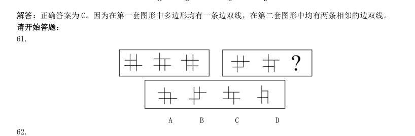

> （本题为图形题，选项为图片，见原卷）

**答案：A**　**考点：图形推理｜图形推理（综合）**　**难度：★★★★☆**
**【判断推理·图形推理｜GK-2000-ty-X062】**

62. A B C D

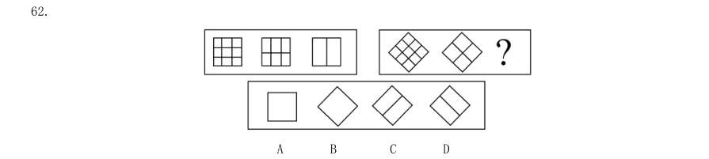

> （本题为图形题，选项为图片，见原卷）

**答案：B**　**考点：图形推理｜属性规律**　**难度：★★★★☆**
**【判断推理·图形推理｜GK-2000-ty-X063】**

63. A B C D

> （本题为图形题，选项为图片，见原卷）

**答案：A**　**考点：图形推理｜图形推理（综合）**　**难度：★★★★☆**
**【判断推理·图形推理｜GK-2000-ty-X064】**

64. A B C D

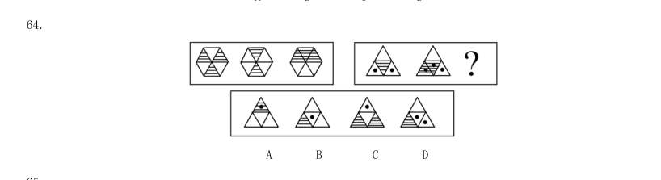

> （本题为图形题，选项为图片，见原卷）

**答案：暂缺**　**考点：图形推理｜样式规律**　**难度：★★★★☆**
**【判断推理·图形推理｜GK-2000-ty-X065】**

65. A B C D

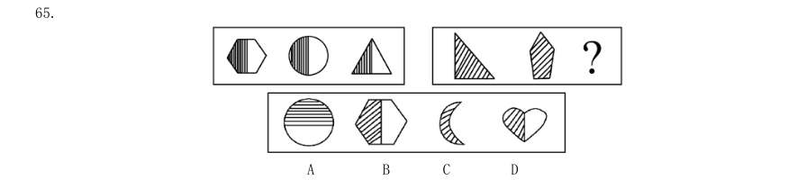

> （本题为图形题，选项为图片，见原卷）

**答案：C**　**考点：图形推理｜图形推理（综合）**　**难度：★★★★☆**
**【判断推理·图形推理｜GK-2000-ty-X066】**

66. A B C D

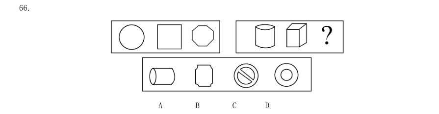

> （本题为图形题，选项为图片，见原卷）

**答案：暂缺**　**考点：图形推理｜立体图形**　**难度：★★★★☆**
**【判断推理·图形推理｜GK-2000-ty-X067】**

67. A B C D

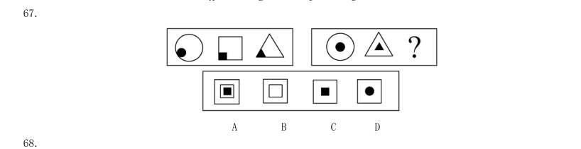

> （本题为图形题，选项为图片，见原卷）

**答案：C**　**考点：图形推理｜立体拼合**　**难度：★★★★☆**
**【判断推理·图形推理｜GK-2000-ty-X068】**

68. A B C D

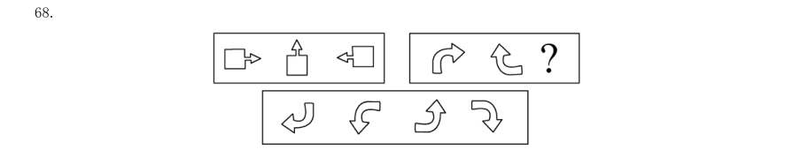

> （本题为图形题，选项为图片，见原卷）

**答案：暂缺**　**考点：图形推理｜位置规律**　**难度：★★★★☆**
**【判断推理·图形推理｜GK-2000-ty-X069】**

69. A B C D

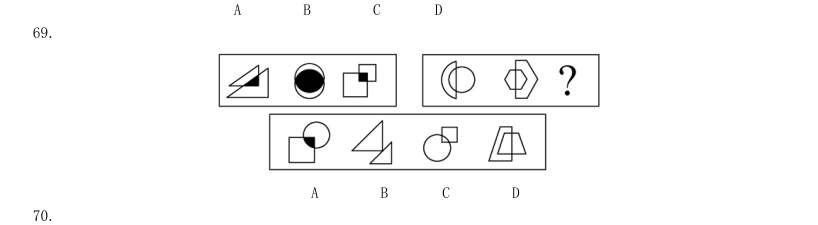

> （本题为图形题，选项为图片，见原卷）

**答案：暂缺**　**考点：图形推理｜样式规律**　**难度：★★★★☆**
**【判断推理·图形推理｜GK-2000-ty-X070】**

70. A B C D 四、演绎推理:共10 题,每题给出一段陈述,这段陈述被假设是正确的、不容置疑的。要求你根据这段陈述选 择一个答案。注意:正确的答案应与所给的陈述相符合,不需要任何附加说明即可以从陈述中直接推出。

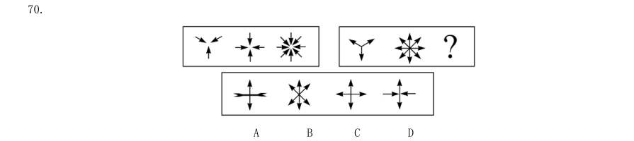

> （本题为图形题，选项为图片，见原卷）

**答案：C**　**考点：图形推理｜样式规律**　**难度：★★★★☆**
**【判断推理·逻辑判断｜GK-2000-ty-X071】**

71. 计算机的普及和网络的出现正改变着社会信息的传播方式,也改变着人们的娱乐方式,同时也使传统媒体受 到巨大的冲击。许多人在计算机前花费不少时间,甚至变成了“网络孤独症”患者。由此可以推出( )。

- **A.** 电影的不景气是由计算机的出现造成的
- **B.** “网络孤独症”的病因是因为有了计算机
- **C.** 不与人接触是产生“网络孤独症”的一个原因D.长期与计算机打交道对人的身体有害

**答案：暂缺**　**考点：逻辑判断｜归纳推导**　**难度：★★★★★**
**【判断推理·逻辑判断｜GK-2000-ty-X072】**

72. 有一份选择题试卷共6 个小题,其得分标准是:一道小题答对得8 分,答错得0 分,不答得2 分,某位同学 得了20 分,则他( )。

- **A.** 至少答对一道题
- **B.** 至少有三个小题没答C.至少答对三个小题
- **D.** 答错两个小题

**答案：D**　**考点：逻辑判断｜逻辑判断（综合）**　**难度：★★★☆☆**
**【判断推理·逻辑判断｜GK-2000-ty-X073】**

73. X 国生产汽车发动机的成本比Y 国低10%,即使加上关税和运输费,从X 国进口汽车发动机仍比在Y 国生产 便宜。由此我们可以知道( )。

> 同题变体（主记录 GK-2001-ty-X090）

- **A.** X 国的劳动力成本比Y 国低10%
- **B.** 从X 国进口汽车发动机的关税低于在Y 国生产成本的10%
- **C.** 由X 国运一个汽车发动机的费用高于在Y 国造一个汽车发动机的10%
- **D.** 由X 国生产一个汽车发动机费用是Y 国的10%

**答案：暂缺**　**考点：逻辑判断｜逻辑判断（综合）**　**难度：★★★★☆**
**【判断推理·逻辑判断｜GK-2000-ty-X074】**

74. 某保险公司推出一项“希望之星”保险业务,该业务要求5 岁儿童的家长每年交600 元保险金并至14 岁,即 可享受儿童将来上大学的所有学费,则促使家长不参加投保的最适当理由为( )。

- **A.** 家长并不能确定儿童将来上哪一所大学
- **B.** 10 年的累计保险金总额大于将来上大学的学费总和
- **C.** 据估计,每年上大学的学费增长率大于生活费的增长率
- **D.** 该业务并不包括上大学的食宿费用

**答案：暂缺**　**考点：逻辑判断｜逻辑判断（综合）**　**难度：★★★☆☆**
**【判断推理·逻辑判断｜GK-2000-ty-X075】**

75. 所有能干的管理人员都关心下属的福利,所有关心下属的福利的管理人员在满足个人需求方面都很开明;在 满足个人需求方面不开明的所有管理人员不是能干的管理人员,由此可以推出( )。

- **A.** 不能干的管理人员关心下属的福利
- **B.** 有些能干的管理人员在满足个人需求方面不开明
- **C.** 所有能干的管理人员在满足个人需求方面开明
- **D.** 不能干的管理人员在满足个人需求方面开明

**答案：C**　**考点：逻辑判断｜翻译推理**　**难度：★★★☆☆**
**【判断推理·逻辑判断｜GK-2000-ty-X076】**

76. 对建筑和制造业的安全研究表明,企业工作负荷量加大时,工伤率也随之提高。工作负荷增大时,企业总是 雇佣大量的不熟练的工人,毫无疑问,工伤率上升是由非熟练工的低效率造成的。则能够对上述观点作出最 强的反驳的一项是( )。

- **A.** 负荷量增加时,企业雇佣非熟练工只是从事临时性的工作
- **B.** 建筑业的工伤率比制造业高
- **C.** 只要企业工作负荷增加,熟练工人的事故率总是随之增高
- **D.** 需要雇佣新人的企业应加强职业训练

**答案：暂缺**　**考点：逻辑判断｜削弱**　**难度：★★★★☆**
**【判断推理·逻辑判断｜GK-2000-ty-X077】**

77. 为了解决某地区长期严重的鼠害,一家公司生产了一种售价为2 500 元激光捕鼠器,该产品的捕鼠效果及使 用性能堪称一流,厂家为推出此产品做了广泛的广告宣传,但结果是产品仍没有销路。由此可知这家公司开 发该新产品失败的最主要原因可能是( )。

- **A.** 未能令广大消费者了解产品的优点
- **B.** 忽略消费者的价格承受力
- **C.** 人们不需要捕鼠
- **D.** 人们没有听说过这种产品

**答案：B**　**考点：逻辑判断｜逻辑判断（综合）**　**难度：★★★★☆**
**【判断推理·逻辑判断｜GK-2000-ty-X078】**

78. 甲、乙、丙和丁是同班同学。 甲说:“我班同学都是团员。” 乙说:“丁不是团员。” 丙说:“我班有人不是团员。” 丁说:“乙也不是团员。” 已知只有一个人说假话,则可推出以下判定肯定是真的一项为( )。

- **A.** 说假话的是甲,乙不是团员
- **B.** 说假话的是乙,丙不是团员
- **C.** 说假话的是丁,乙不是团员
- **D.** 说假话的是甲,丙不是团员

**答案：暂缺**　**考点：逻辑判断｜真假推理**　**难度：★★★★☆**
**【判断推理·逻辑判断｜GK-2000-ty-X079】**

79. 有A、B、C、D、E 五位同学一起比赛象棋,每两人之间只比赛一盘,统计比赛的盘数知:A 赛了4 盘,B 赛了 3 盘,C 赛了2 盘,D 赛了1 盘,则同学E 赛的盘数是( )。

- **A.** 1 盘
- **B.** 2 盘
- **C.** 3 盘
- **D.** 4 盘

**答案：B**　**考点：逻辑判断｜朴素逻辑（排序/匹配）**　**难度：★★★☆☆**
**【判断推理·逻辑判断｜GK-2000-ty-X080】**

80. 体育馆内正进行一场乒乓球双打比赛,观众议论双方运动员甲、乙、丙、丁的年龄: (1)“乙比甲的年龄大。” (2)“甲比他的伙伴的年龄大。” (3)“丙比他的两个对手的年龄都大。” (4)“甲与乙的年龄差距比丙与乙的年龄差距更大些。” 根据这些议论,甲、乙、丙、丁的年龄从大到小的顺序是( )。

- **A.** 甲、丙、乙、丁
- **B.** 丙、乙、甲、丁
- **C.** 乙、甲、丁、丙
- **D.** 乙、丙、甲、丁

**答案：暂缺**　**考点：逻辑判断｜朴素逻辑（排序/匹配）**　**难度：★★★★☆**
**【资料分析·综合分析｜GK-2000-ty-X081】**

81. 如 甲城喜欢X 节目的占30%,喜欢Y 节目的占70%,无人喜欢Z 节目;而丙城20%喜欢X 节目,50%喜欢Y 节目, 30%喜欢Z 节目。 戊城中学生最喜欢的节目是( )。

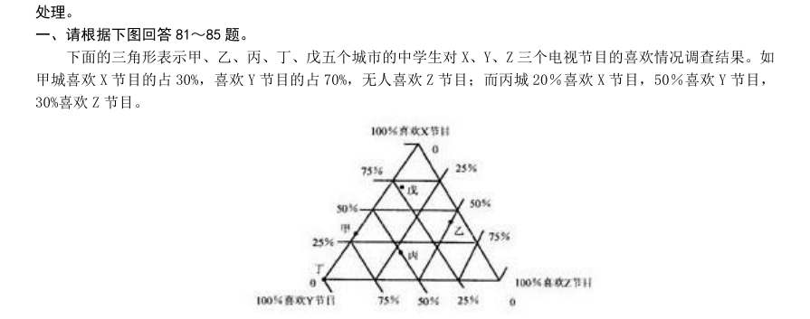

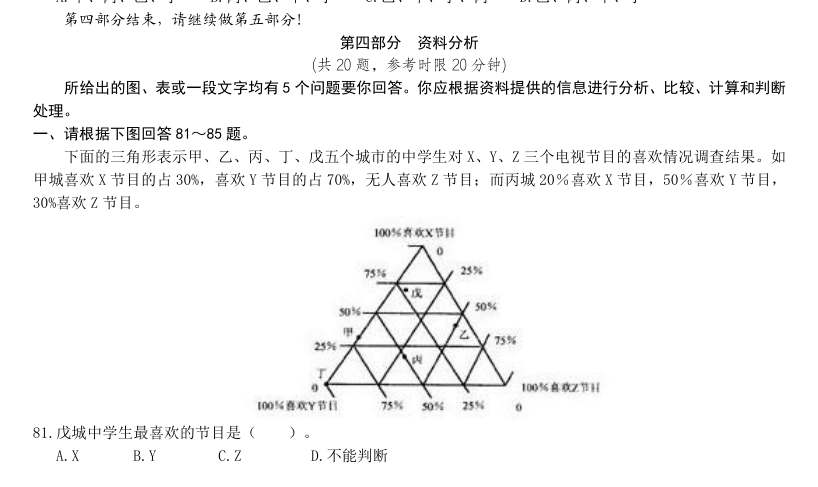

- **A.** X
- **B.** Y
- **C.** Z
- **D.** 不能判断

**答案：A**　**考点：综合分析｜综合分析（综合）**　**难度：★★★★☆**
**【资料分析·综合分析｜GK-2000-ty-X082】**

82. 甲城中学生与丁城中学生共同特点是( )。

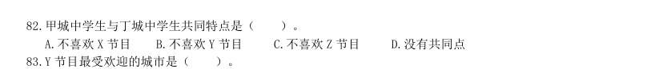

- **A.** 不喜欢X 节目
- **B.** 不喜欢Y 节目
- **C.** 不喜欢Z 节目
- **D.** 没有共同点

**答案：C**　**考点：综合分析｜选正确项**　**难度：★★★☆☆**
**【资料分析·综合分析｜GK-2000-ty-X083】**

83. Y 节目最受欢迎的城市是( )。

> 材料图见 images/GK-2000-ty-X081-m.jpg

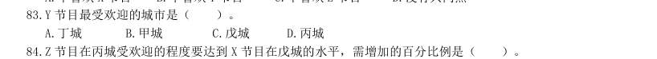

- **A.** 丁城
- **B.** 甲城
- **C.** 戊城
- **D.** 丙城

**答案：A**　**考点：综合分析｜综合分析（综合）**　**难度：★★★☆☆**
**【资料分析·增长率计算与比较｜GK-2000-ty-X084】**

84. Z 节目在丙城受欢迎的程度要达到X 节目在戊城的水平,需增加的百分比例是( )。

> 材料图见 images/GK-2000-ty-X081-m.jpg

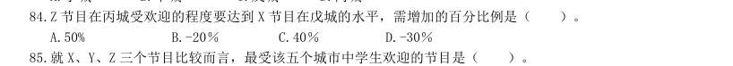

- **A.** 50%
- **B.** -20%
- **C.** 40%
- **D.** -30%

**答案：C**　**考点：增长率计算与比较｜增长率计算（综合）**　**难度：★☆☆☆☆**
**【资料分析·综合分析｜GK-2000-ty-X085】**

85. 就X、Y、Z 三个节目比较而言,最受该五个城市中学生欢迎的节目是( )。

> 材料图见 images/GK-2000-ty-X081-m.jpg

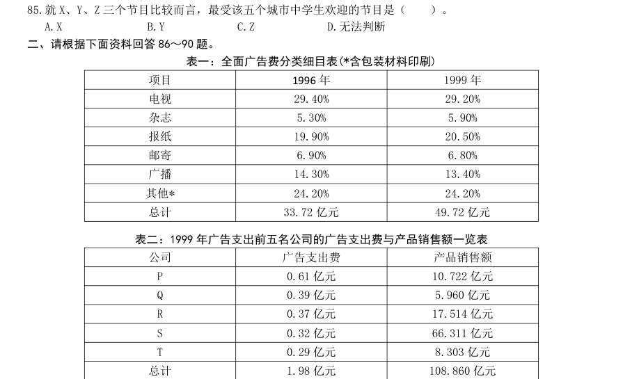

- **A.** X
- **B.** Y
- **C.** Z
- **D.** 无法判断

**答案：B**　**考点：综合分析｜选正确项**　**难度：★★★☆☆**
**【资料分析·综合分析｜GK-2000-ty-X086】**

86. 表一:全面广告费分类细目表(*含包装材料印刷) 项目 1996 年 1999 年 电视 29.40% 29.20% 杂志 5.30% 5.90% 报纸 19.90% 20.50% 邮寄 6.90% 6.80% 广播 14.30% 13.40% 其他* 24.20% 24.20% 总计 33.72 亿元 49.72 亿元 表二:1999 年广告支出前五名公司的广告支出费与产品销售额一览表 公司 广告支出费 产品销售额 P 0.61 亿元 10.722 亿元 Q 0.39 亿元 5.960 亿元 R 0.37 亿元 17.514 亿元 S 0.32 亿元 66.311 亿元 T 0.29 亿元 8.303 亿元 总计 1.98 亿元 108.860 亿元 1999 年广告费支出最大的五个公司中哪一个公司的广告支出比(广告支出/销售额)最小?( )。

> 材料图见 images/GK-2000-ty-X081-m.jpg

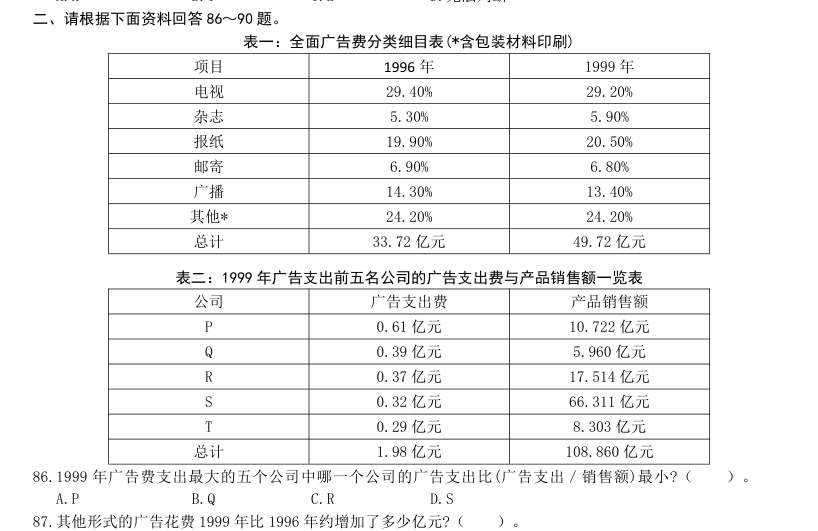

- **A.** P
- **B.** Q
- **C.** R
- **D.** S

**答案：D**　**考点：综合分析｜选正确项**　**难度：★★★★★**
**【资料分析·增长量计算｜GK-2000-ty-X087】**

87. 其他形式的广告花费1999 年比1996 年约增加了多少亿元?( )。

> 材料图见 images/GK-2000-ty-X081-m.jpg

- **A.** 0
- **B.** 3.9
- **C.** 8.2
- **D.** 12

**答案：B**　**考点：增长量计算｜增长量计算（综合）**　**难度：★☆☆☆☆**
**【资料分析·比重计算与比较｜GK-2000-ty-X088】**

88. 1999 年广告费支出最大的五个公司的广告花费额约占当年广告费总额的( )。

> 材料图见 images/GK-2000-ty-X081-m.jpg

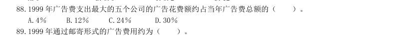

- **A.** 4%
- **B.** 12%
- **C.** 24%
- **D.** 30%

**答案：A**　**考点：比重计算与比较｜现期比重**　**难度：★☆☆☆☆**
**【资料分析·综合分析｜GK-2000-ty-X089】**

89. 1999 年通过邮寄形式的广告费用约为( )。

> 材料图见 images/GK-2000-ty-X081-m.jpg

- **A.** 340 000 元
- **B.** 3 400 000 元
- **C.** 34 000 000 元
- **D.** 340 000 000 元

**答案：暂缺**　**考点：综合分析｜综合分析（综合）**　**难度：★★★☆☆**
**【资料分析·比重计算与比较｜GK-2000-ty-X090】**

90. 如果1999 年全部广告费的0.2%用于包装材料的印刷,那么此项支出约占其他形式类的广告支出的百分比为 ( )。

> 材料图见 images/GK-2000-ty-X081-m.jpg

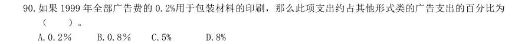

- **A.** 0.2%
- **B.** 0.8%
- **C.** 5%
- **D.** 8%

**答案：B**　**考点：比重计算与比较｜现期比重**　**难度：★☆☆☆☆**
**【资料分析·综合分析｜GK-2000-ty-X091】**

91. 前十届奥运会的统计情况 次 第 会址 年度 男子比 赛场数 男运动 员数 女子比赛 场数 女运 动员 数 参加国家 总数 运动项 目总数 雅典 巴黎 圣路易斯 伦敦 斯德哥尔摩 安特卫普 巴黎 阿姆斯特丹 洛杉矶 柏林 运动项目最多的年度男子比赛场数为( )。

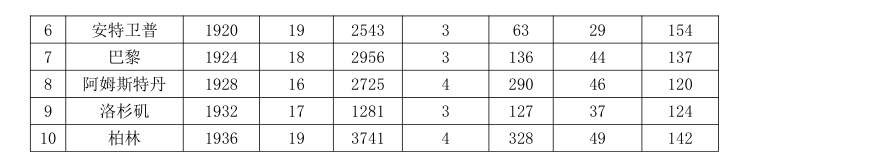

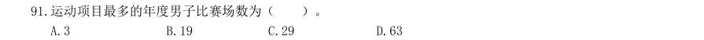

- **A.** 3
- **B.** 19
- **C.** 29
- **D.** 63

**答案：B**　**考点：综合分析｜选正确项**　**难度：★★★★★**
**【资料分析·倍数计算｜GK-2000-ty-X092】**

92. 参加的运动员人数最多的一年约是参加人数最少的一年的多少倍?( )。

> 材料图见 images/GK-2000-ty-X091-m.jpg

- **A.** 14
- **B.** 13
- **C.** 11
- **D.** 2

**答案：A**　**考点：倍数计算｜是几倍**　**难度：★☆☆☆☆**
**【资料分析·综合分析｜GK-2000-ty-X093】**

93. 第6 届奥运会与第5 届奥运会相比,最大特点是( )。

> 材料图见 images/GK-2000-ty-X091-m.jpg

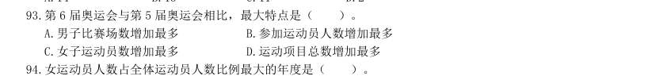

- **A.** 男子比赛场数增加最多
- **B.** 参加运动员人数增加最多
- **C.** 女子运动员数增加最多
- **D.** 运动项目总数增加最多

**答案：D**　**考点：综合分析｜选正确项**　**难度：★★★★☆**
**【资料分析·比重计算与比较｜GK-2000-ty-X094】**

94. 女运动员人数占全体运动员人数比例最大的年度是( )。

> 材料图见 images/GK-2000-ty-X091-m.jpg

- **A.** 1936 年
- **B.** 1932 年
- **C.** 1928 年
- **D.** 1900 年

**答案：C**　**考点：比重计算与比较｜现期比重**　**难度：★☆☆☆☆**
**【资料分析·综合分析｜GK-2000-ty-X095】**

95. 在巴黎举行的两届奥运会中,增长比率最大的是( )。

> 材料图见 images/GK-2000-ty-X091-m.jpg

- **A.** 女子比赛场数
- **B.** 参加国家总数
- **C.** 参加运动员总数
- **D.** 女运动员总数

**答案：D**　**考点：综合分析｜综合分析（综合）**　**难度：★★★★☆**
**【资料分析·综合分析｜GK-2000-ty-X099】**
> 材料：20 世纪70 年代,在世界新发现的大油田中,海上油田有31 个,约占51.7%。在新增加的地质储量中,海 洋占42%。海上钻井平台总数为7 021 座,其中美国有1 079 座,委内瑞拉有5 033 座,苏联有840 座。1977 年, 近海油田有500 个,产量4.6 亿吨,占世界总产量的15.6%。 96.70 年代世界新发现的大油田共有( )。 A.31 个 B.29 个 C.91 个 D.60 个 97.70 年代美国海上钻井平台数约占世界总数的比例是( )。 A.42% B.15% C.72% D.10% 98.70 年代通过海上钻井平台采油量最少的国家是( )。

99. A.苏联 B.委内瑞拉 C.美国 D.未知 1977 年世界石油总产量是多少亿吨?( )。

> 材料图见 images/GK-2000-ty-X091-m.jpg

- **A.** 4.6
- **B.** 29.5
- **C.** 34.1
- **D.** 10.7

**答案：B**　**考点：综合分析｜选正确项**　**难度：★★★★☆**