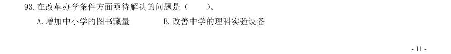
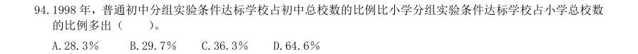
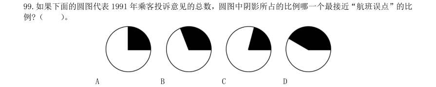

# 2001 年国考行测（统一卷）

- 题量：110（含答案 110）
- 模块分布：资料分析20 / 数量关系15 / 言语理解20 / 判断推理35 / 常识判断20
- 试卷编号：`国考-2001-统一卷`

## 题目与答案

**【常识判断·政治常识｜GK-2001-ty-X001】**
> 材料：(共20 题,参考时限10 分钟) 要求你依据常识作出判断。请注意,似乎合理的答案可能有多种,你应选择最为合理的一个。

1. E-mail 邮件本质上是( )。

- **A.** 一个文件
- **B.** 一份传真
- **C.** 一个电话
- **D.** 一个电报

**答案：A**　**考点：政治常识｜政治常识（综合）**　**难度：★☆☆☆☆**
**【常识判断·政治常识｜GK-2001-ty-X002】**

2. 下列作家不是法国人的是( )。

- **A.** 都德
- **B.** 莫泊桑
- **C.** 雨果
- **D.** 海涅

**答案：D**　**考点：政治常识｜政治常识（综合）**　**难度：★☆☆☆☆**
**【常识判断·科技常识｜GK-2001-ty-X003】**

3. 人体患急性炎症时,每立方毫米血液中白细胞数可能是( )。

- **A.** 700 个
- **B.** 16 000 个
- **C.** 30 万个
- **D.** 500 万个

**答案：B**　**考点：科技常识｜基础科学**　**难度：★☆☆☆☆**
**【常识判断·政治常识｜GK-2001-ty-X004】**

4. 含羞草的感应性对它生存的主要意义是( )。

- **A.** 防止损伤枝叶
- **B.** 利用捕食昆虫
- **C.** 利用水分运输
- **D.** 利于体内有机物的分配

**答案：A**　**考点：政治常识｜政治常识（综合）**　**难度：★☆☆☆☆**
**【常识判断·历史人文｜GK-2001-ty-X005】**

5. 宋朝以来,没有做过我国国都的城市是( )。

- **A.** 开封
- **B.** 南京
- **C.** 杭州
- **D.** 洛阳

**答案：D**　**考点：历史人文｜中国古代史**　**难度：★☆☆☆☆**
**【常识判断·政治常识｜GK-2001-ty-X006】**

6. 我国少数民族中人口最多的民族是( )。

- **A.** 朝鲜族
- **B.** 蒙古族
- **C.** 壮族
- **D.** 回族

**答案：C**　**考点：政治常识｜政治常识（综合）**　**难度：★☆☆☆☆**
**【常识判断·政治常识｜GK-2001-ty-X007】**

7. Internet 的缺点是( )。

- **A.** 不够安全
- **B.** 不能传输文件
- **C.** 不能实现即时对话
- **D.** 不能传送声音

**答案：A**　**考点：政治常识｜政治常识（综合）**　**难度：★☆☆☆☆**
**【常识判断·政治常识｜GK-2001-ty-X008】**

8. 破坏臭氧层的物质主要是( )。

- **A.** 氟利昂
- **B.** 二氧化碳
- **C.** 酸雨
- **D.** 紫外线

**答案：A**　**考点：政治常识｜政治常识（综合）**　**难度：★☆☆☆☆**
**【常识判断·经济常识｜GK-2001-ty-X009】**

9. 不属于经济特区的城市是( )。

- **A.** 深圳
- **B.** 珠海
- **C.** 广州
- **D.** 厦门

**答案：C**　**考点：经济常识｜经济常识（综合）**　**难度：★☆☆☆☆**
**【常识判断·政治常识｜GK-2001-ty-X010】**

10. 计算机鼠标是一种( )。

- **A.** 输出设备
- **B.** 输入设备
- **C.** 光标
- **D.** 控制器

**答案：B**　**考点：政治常识｜政治常识（综合）**　**难度：★☆☆☆☆**
**【常识判断·政治常识｜GK-2001-ty-X011】**

11. 主张“人性善”的是( )。

- **A.** 孔子
- **B.** 孟子
- **C.** 荀子
- **D.** 韩非子

**答案：B**　**考点：政治常识｜政治常识（综合）**　**难度：★☆☆☆☆**
**【常识判断·政治常识｜GK-2001-ty-X012】**

12. 首先提出“无为而治”主张的是( )。

- **A.** 孔子
- **B.** 孟子
- **C.** 老子
- **D.** 庄子

**答案：C**　**考点：政治常识｜政治常识（综合）**　**难度：★☆☆☆☆**
**【常识判断·政治常识｜GK-2001-ty-X013】**

13. 月蚀发生时( )。

- **A.** 月球在地球和太阳之间
- **B.** 太阳在月球和地球之间
- **C.** 地球在太阳和月球之间
- **D.** 是在新月的时候

**答案：C**　**考点：政治常识｜政治常识（综合）**　**难度：★☆☆☆☆**
**【常识判断·政治常识｜GK-2001-ty-X014】**

14. 红色颜料与(1)色颜料可配成紫色,黄色颜料与(2)色颜料可配成绿色。

- **A.** 1绿;2蓝
- **B.** 1蓝;2蓝
- **C.** 1蓝;2红
- **D.** 1绿;2红

**答案：B**　**考点：政治常识｜政治常识（综合）**　**难度：★☆☆☆☆**
**【常识判断·政治常识｜GK-2001-ty-X015】**

15. 与针式打印机和喷墨打印机相比,不属于激光打印机特点的是( )。

- **A.** 打印分辨率高
- **B.** 噪声小
- **C.** 速度快
- **D.** 价格低

**答案：D**　**考点：政治常识｜政治常识（综合）**　**难度：★☆☆☆☆**
**【常识判断·历史人文｜GK-2001-ty-X016】**

16. 在我国古代神话中“开天辟地”、“钻木取火”、“尝百草”分别指( )。

- **A.** 燧人氏、女娲、神农氏
- **B.** 盘古氏、神农氏、燧人氏
- **C.** 盘古氏、燧人氏、神农氏
- **D.** 女娲、燧人氏、神农氏

**答案：C**　**考点：历史人文｜中国古代史**　**难度：★☆☆☆☆**
**【常识判断·政治常识｜GK-2001-ty-X017】**

17. 一个人( )越过国际日期变更线时,钟表的时刻不变,但日期应加一天。

- **A.** 自西向东
- **B.** 自东向西
- **C.** 自南向北
- **D.** 自北向南

**答案：B**　**考点：政治常识｜政治常识（综合）**　**难度：★☆☆☆☆**
**【常识判断·政治常识｜GK-2001-ty-X018】**

18. 地球表面大约有70%的面积被水覆盖,水的总量约有13.6 亿立方公里,其中淡水所占比例很小,可利用 的淡水资源约占水总量的( )。

- **A.** 0.65%
- **B.** 8.9%
- **C.** 11.28%
- **D.** 21.42%

**答案：A**　**考点：政治常识｜政治常识（综合）**　**难度：★★★☆☆**
**【常识判断·政治常识｜GK-2001-ty-X019】**

19. 穿越我国领土距离最长的纬线是( )。

- **A.** 北纬20°
- **B.** 北纬30°
- **C.** 北纬40°
- **D.** 北纬50°

**答案：C**　**考点：政治常识｜政治常识（综合）**　**难度：★☆☆☆☆**
**【常识判断·科技常识｜GK-2001-ty-X020】**

20. 大气层中的臭氧层能够保护地球上的生物,这主要是因为臭氧层可以( )。

- **A.** 释放出大量的氧气
- **B.** 滤除大量的紫外光
- **C.** 屏蔽太阳的辐射
- **D.** 吸收大量的二氧化碳

**答案：B**　**考点：科技常识｜基础科学**　**难度：★☆☆☆☆**
**【言语理解·中心理解｜GK-2001-ty-X021】**
> 材料：(共20 题,参考时限20 分钟) 每道题包含一段文字(或一个句子),后面是一个不完整的陈述,要求你从四个选项中选出一个来完成陈述。 注意:答案可能是对所给文字主要意思的提要,也可能是满足陈述中其他方面的要求,你的选择应与所提要求 最相符合。

21. 在现代社会中,当一个人追求幸福生活时不应忽略接受教育方面的需求。如果没有对于人类在科学、文学 和艺术等方面的成就的欣赏能力并从这种欣赏中获得满足,那么一个人就算不上获得了真正的生活,只不 过是生存而已。(此题与2000 年5 题相似,好几个版本都是这样,因年份太久,我也无法核实) 这段话主要支持了这样一种观点,即教育( )。

- **A.** 并不关注于某些具体的目的
- **B.** 可以使人更充分地享受生活的乐趣
- **C.** 可以使人获得维持生活的基本能力
- **D.** 主要教授有关科学、文学和艺术方面的内容

**答案：B**　**考点：中心理解｜中心句与主旨**　**难度：★★★☆☆**
**【言语理解·中心理解｜GK-2001-ty-X022】**

22. 我国实行的开放政策使国内城市与城市之间、南方与北方之间、内地与沿海之间展开了多种多样的吸引外 资的竞争,导致了一些省份原先获得的区域倾斜政策优势(如减税、退税、低税、优惠贷款等)减弱,从而 增加了国内利用外资的竞争。 这段话主要支持了这样一种观点,即( )。

- **A.** 优惠政策有利于吸引外资
- **B.** 利用外资的国际环境越来越复杂
- **C.** 国内利用外资竞争正在增加
- **D.** 减税、退税、低税等政策使国家税收受损

**答案：C**　**考点：中心理解｜中心句与主旨**　**难度：★★☆☆☆**
**【言语理解·中心理解｜GK-2001-ty-X023】**

23. 高新技术企业的工资制度需要改革。应该允许企业在积累增长大于消费增长、劳动生产率增长大于工资总 额增长的前提下,自主确定职工工资标准和企业内部分配办法。国家可以通过调节个人收入所得税管理这 些企业。这段话主要支持了这样一种观点,即在高新技术企业的工资改革中( )。

- **A.** 个人所得应不断提高
- **B.** 应确定职工工资标准和企业分配办法
- **C.** 企业对职工工资标准应有一定自主权
- **D.** 劳动生产率的增长将大于工资总额的增长

**答案：C**　**考点：中心理解｜对策优先**　**难度：★★☆☆☆**
**【言语理解·中心理解｜GK-2001-ty-X024】**

24. 任何一项政策,它的功能都是通过事物之间相互联系的动态形式所产生的作用而实现的。作用一般都是相互的。 当一个事物对另一个事物发生作用时,必然要受到对方对它的反作用。 这段话主要支持了这样一种观点,即( )。

- **A.** 政策的稳定性是相对的
- **B.** 在执行政策时,应从实际出发
- **C.** 政策是事物间相互作用的产物
- **D.** 政策在实施过程中可能产生负效应

**答案：D**　**考点：中心理解｜转折与因果**　**难度：★★☆☆☆**
**【言语理解·中心理解｜GK-2001-ty-X025】**

25. 今天,整个社会都表现出对高雅艺术的关心,政府拨出专款予以扶植,企业慷慨解囊给予支持。对于一个 病人,需要输血,需要输氧,但是,病人健康地生活最终还要靠自身的生命力和自身的机能转换。这段话 主要支持了这样一种观点,即( )。

- **A.** 高雅艺术正在恢复蓬勃的生机
- **B.** 对于高雅艺术的界定尚不明确
- **C.** 高雅艺术需要得到政府和企业的帮助
- **D.** 高雅艺术的发展还有赖于自身的改革和完善

**答案：D**　**考点：中心理解｜对策优先**　**难度：★★☆☆☆**
**【言语理解·中心理解｜GK-2001-ty-X026】**

26. 不少新建、扩建企业没有在投资中按比例安排相应的自有流动资金,有的企业甚至靠挪用流动资金来盲目 争上新的项目;历年清产核资中发生的损失也有一部分用企业自有流动资金冲减;一些企业甚至挪用资金 炒房地产、炒股票等。此外,物价的上涨也吃掉了一部分资金。这段话主要支持了这样一种观点,即( )。

- **A.** 盲目争上项目造成了企业流动资金的不足
- **B.** 在不少企业中存在着自有流动资金紧张的现象
- **C.** 多数企业只能依靠银行来解决流动资金问题
- **D.** 企业自有流动资金数量逐年下降是正常趋势

**答案：B**　**考点：中心理解｜中心句与主旨**　**难度：★★★☆☆**
**【言语理解·中心理解｜GK-2001-ty-X027】**

27. 只有同时兼顾公平与效率两个方面的税制才是最好的税制,这是无须证明的。但就具体的税种来说,往往 不是低效率、高公平,就是高效率、低公平,高效率、高公平的最优结合是少有的。就某一具体的税种来 说,往往不是以效率为主导,就是以公平为核心,二者并重并不一定是理想状态。这段话主要支持了这样 一种观点,即就某一具体税种来说,( )。

- **A.** 是公平与效率之间的妥协
- **B.** 兼顾高效率和高公平不是最好的
- **C.** 兼顾高效率和高公平才是最理想的
- **D.** 不应以效率为主导,而应以公平为核心

**答案：A**　**考点：中心理解｜主题词**　**难度：★★★☆☆**
**【言语理解·中心理解｜GK-2001-ty-X028】**

28. 现阶段,我国城乡之间在生产水平、就业结构、收入水平等方面都存在着很大的差别,农村经济的现代化、 社会化都还有一个漫长的过程,广大农村在近期尚不具备国家统一立法、强制实行社会保险制度的条件, 不能照搬城乡企业的办法。广大农民仍应坚持家庭养老、邻里互助等好的传统做法,在富裕的地区,根据 农民自愿,可以进行个人储蓄积累式的养老保险试点。这段话主要支持了这样一种观点,即( )。

- **A.** 农村社会保障制度改革应坚持农民自愿的原则
- **B.** 在社会保障制度改革方面要因地制宜,循序渐进
- **C.** 进行农村社会保障缺席改革必须坚持社会主义方向
- **D.** 应该坚持和发扬农村中那些好的社会保障的传统做法

**答案：B**　**考点：中心理解｜转折与因果**　**难度：★★★★☆**
**【言语理解·中心理解｜GK-2001-ty-X029】**

29. 一般来说,越是能直接产生经济效益的科技成果,越应该由受益的经济组织提供激励;越是产生巨大社会 效益的科技成果,越应该由政府提供激励。这一原则符合世界上许多国家的实际情况。这段话主要支持了 这样一种观点,即( )。

- **A.** 激励应该选择适当的客体
- **B.** 激励应该由适当的主体来承担
- **C.** 政府应该对科技成果提供更多的激励
- **D.** 世界上许多国家的政府都很重视对科学研究鼓励和支持

**答案：B**　**考点：中心理解｜对策优先**　**难度：★★☆☆☆**
**【言语理解·中心理解｜GK-2001-ty-X030】**

30. 我国的专利申请平均每年以48%速度增长。我国的专利实施只占专利总量的20%~30%,与国外高达80% 的实施率相比差距很大。在我国专利申报总量只有15%来自于企业,而发达国家的专利申请80%来自于企 业。这段话主要支持了这样一种观点,即( )。

- **A.** 在具体政策上对科技成果评估活动重视不够
- **B.** 在我国,应该努力扩大对日益增长的专利技术的开发、实施
- **C.** 在我国,多数人还没有学会使用专利武器来保持自己的知识成果
- **D.** 与企业相比,大专院校和科研单位更重视对科研成果的开发和应用

**答案：B**　**考点：中心理解｜中心句与主旨**　**难度：★★★★☆**
**【言语理解·细节判断｜GK-2001-ty-X031】**

31. 当今世界的工业社会面临着许多难以解决的问题:生态危机、信仰危机、种族纷争、精神危机,这些都在 困扰着人类社会。于是许多哲学家、思想家乃至政府官员都主张回到传统文化和道德中去寻找解决危机的 钥匙,很多人热衷于研究儒家伦理同现代化的关系,东亚有些国家甚至提出“新儒学”或所谓“儒家资本 主义”的口号。 对这段话理解正确的一项是( )。

- **A.** 儒家伦理是能成功地解决当今工业社会诸多危机的钥匙
- **B.** 东亚有些国家是当今资本主义世界中解决了诸多危机的模范典型
- **C.** 有些国家和个人主张从儒家学说中寻找解决当今社会难题的良方
- **D.** 当今世界的诸多危机从本质上说是在儒学与现代化的矛盾中产生的

**答案：C**　**考点：细节判断｜细节判断**　**难度：★★★★★**
**【言语理解·细节判断｜GK-2001-ty-X032】**

32. 时间怀有一种公平的道义,对它所拿去的,它会给我们别的补偿。它夺去了我们肢体精神的灵活,却给予 我们安静和安详。对这段话理解正确的一项是( )。

- **A.** 无所谓浪费时间
- **B.** 耽误的时间可以得到补偿
- **C.** 不具有灵活肢体精神的人能获得安宁
- **D.** 晚年的宁静可以使青春活力的消失得到补偿

**答案：D**　**考点：细节判断｜细节判断**　**难度：★☆☆☆☆**
**【言语理解·细节判断｜GK-2001-ty-X033】**

33. 储蓄是经济增长的资源基础,但最大限度的储蓄增长率决不是最优的经济增长率,只有适度的储蓄增长率 才容易带来较大的经济增长率。对这段话理解正确的一项是( )。

- **A.** 储蓄增长率应与经济增长率相等
- **B.** 储蓄增长率与最优的经济增长率成反比
- **C.** 储蓄增长速度如果无限度地增长,会影响经济增长速度
- **D.** 最大限度的储蓄增长率要求最优的经济增长率与之相适应

**答案：C**　**考点：细节判断｜细节判断**　**难度：★☆☆☆☆**
**【言语理解·中心理解｜GK-2001-ty-X034】**

34. 如果从伦理的角度着眼,两极分化是一种悲剧性的社会现实。面对落入破产者行列的许多小生产者和劳动 者,我们不能不寄予深切的同情。但是从生产力的角度着眼,两极分化是商品经济的价值规律发生作用后 的必然经济结果,它发挥着约束和激励的功能,使人力资源和物质资源都趋于更合理的配置。对这段话理 解正确的一项是( )。

- **A.** 从发展商品经济的角度看,两极分化具有一定的积极意义
- **B.** 我们应该对落入破产者行列的小生产者和劳动者寄予深切的同情
- **C.** 我们不应该对落入破产者行列的小生产者和劳动者寄予太多的同情
- **D.** 我们应该首先从经济的角度考虑问题,而不应该过多地从伦理的角度考虑问题

**答案：A**　**考点：中心理解｜转折与因果**　**难度：★★★★★**
**【言语理解·细节判断｜GK-2001-ty-X035】**

35. 职业技术教育的任务是为社会各种产业培养劳动力。学生接受完职业技术教育后就直接进入劳动队伍,因 此职业技术教育和市场经济有较直接的关系,它应该根据市场经济发展和需要调剂专业设置、课程计划和 培养方式等。当然,也有诸如师范、卫生、艺术、体育等专业与市场经济没有直接联系,它们应该根据社 会发展的需要,而不仅仅根据市场的需要来规划和发展。对这段话理解正确的一项是( )。

- **A.** 市场经济规律决定着职业技术教育的发展
- **B.** 发展职业技术教育,首先应强调社会发展的需要
- **C.** 师范、卫生、艺术、体育等个别专业与市场经济没有联系
- **D.** 职业技术教育中的多数专业应根据市场的需求而调整、发展

**答案：D**　**考点：细节判断｜细节判断**　**难度：★★★★☆**
**【言语理解·细节判断｜GK-2001-ty-X036】**

36. 物质生产和人口生产的发展必然引起自然生态环境的重要改变:一种是“顺向改变”,促进自然生态系统的 良性循环,保持生态平衡;另一种是“逆向改变”,造成自然生态系统的恶性循环,破坏生态平衡。精神生 产,特别是科学技术知识发展和应用,则会扩大和加深上述两种改变。对这段话理解正确的一项是( )。

- **A.** 人口生产总是破坏生态平衡的,因而一般属于“逆向改变”
- **B.** 精神生产有比物质生产和人口生产更为积极的作用
- **C.** 精神生产存在着“顺向改变”和“逆向改变”两种可能性
- **D.** 科学技术发展总是维护生态平衡的,应该说是“顺向改变”

**答案：C**　**考点：细节判断｜细节判断**　**难度：★★★★★**
**【言语理解·逻辑填空｜GK-2001-ty-X037】**

37. 许多文人雅士通过为自己的书房命名来言志寄情。梁启超的书房命名为“饮冰室”,语出《庄子·人间世》, 形容内心忧愁焦灼,欲饮冰镇之。 从“饮冰室”的斋名中可以体现出( )。

- **A.** 室主对国家前途的关切和忧虑
- **B.** 室主过人的才华和机敏
- **C.** 室主失望和消极的人生态度
- **D.** 室主对庄周的敬仰之情

**答案：A**　**考点：逻辑填空｜逻辑填空（综合）**　**难度：★☆☆☆☆**
**【言语理解·中心理解｜GK-2001-ty-X038】**

38. 人面呢?颜色比那纸制的小玩意儿好而且活动,带着生气。可是你褒奖他的时候,他虽是高兴,脸上却装出 很不愿意的样子,你指责他的时候,他虽是懊恼,脸上却偏要显示出勇于纳言的颜色。这段话认为,纸面 具与人面最大的不同是( )。

- **A.** 它并不具有人面的欺骗性
- **B.** 它经不住人们的褒奖或指责
- **C.** 它显现出更鲜明的人性特征
- **D.** 它没有人面那种生动的色泽

**答案：A**　**考点：中心理解｜中心句与主旨**　**难度：★★☆☆☆**
**【言语理解·中心理解｜GK-2001-ty-X039】**

39. 婴儿对一点一滴的外部世界已经在头脑中建立起了某种“模型”,形成了对外部世界的某种看法。如果这种 模型与外部世界相符合,他们就感到满意;若不是符合,即所期望的结果没有出现,他们就感到不满意。 根据这段话的意思,假如一个婴儿对着他所熟悉的面孔微笑,则说明( )。

- **A.** 他喜欢这个人
- **B.** 这张面孔看上去很亲切
- **C.** 他期望巩固头脑中的某种“模型”
- **D.** 这张面孔与他脑中的某种期望相符合

**答案：D**　**考点：中心理解｜中心句与主旨**　**难度：★★☆☆☆**
**【言语理解·中心理解｜GK-2001-ty-X040】**

40. 尽管新儒家学者无一例外地夸大了儒家哲学的精神义理在现代社会中可能发生的作用和影响,因而是需要 否定和批判的;但此种影响的实际存在倒确实是毋庸置疑的。 这段话中的“此种影响”是指( )。

- **A.** 儒家哲学的精神义理可能对社会发生的影响
- **B.** 对儒家哲学作用的夸大所造成的影响
- **C.** 新儒家学者对人类社会发展的影响
- **D.** 儒家哲学在过去发生过的实际影响

**答案：A**　**考点：中心理解｜对策优先**　**难度：★☆☆☆☆**
**【数量关系·数字推理｜GK-2001-ty-X041】**
> 材料：(共15 题,参考时限10 分钟) 本部分包括两种类型试题。 认为最合理的一项来填补空缺项。

41. 12,13,15,18,22,( )。

- **A.** 25
- **B.** 27
- **C.** 30
- **D.** 34

**答案：B**　**考点：数字推理｜等差数列**　**难度：★★★★☆**
**【数量关系·数字推理｜GK-2001-ty-X042】**

42. 6,24,60,132,( )。

- **A.** 140
- **B.** 210
- **C.** 212
- **D.** 276

**答案：D**　**考点：数字推理｜等比数列**　**难度：★★★★☆**
**【数量关系·数字推理｜GK-2001-ty-X043】**

43. 6,18,( ),78,126。

- **A.** 40
- **B.** 42
- **C.** 44
- **D.** 46

**答案：B**　**考点：数字推理｜等差数列**　**难度：★★★★☆**
**【数量关系·数字推理｜GK-2001-ty-X044】**

44. 3,15,7,12,11,9,15,( )。

- **A.** 6
- **B.** 8
- **C.** 18
- **D.** 19

**答案：A**　**考点：数字推理｜等差数列**　**难度：★★★★☆**
**【数量关系·数字推理｜GK-2001-ty-X045】**

45. 0,9,26,65,124,( )。

- **A.** 186
- **B.** 215
- **C.** 216
- **D.** 217

**答案：D**　**考点：数字推理｜幂次数列**　**难度：★★★★☆**
**【数量关系·其他数量关系｜GK-2001-ty-X046】**

46. 1 235×6 788 与1 234×6 789 的差值是( )。

- **A.** 5 444
- **B.** 5 454
- **C.** 5 544
- **D.** 5 554

**答案：D**　**考点：其他数量关系｜和差倍比**　**难度：★☆☆☆☆**
**【数量关系·最值问题｜GK-2001-ty-X047】**

47. 已知甲的12%为13,乙的13%为14,丙的14%为15,丁的15%为16,则甲、乙、丙、丁四个数中最大 的数是( )。

- **A.** 甲
- **B.** 乙
- **C.** 丙
- **D.** 丁

**答案：A**　**考点：最值问题｜最值优化**　**难度：★★★★☆**
**【数量关系·其他数量关系｜GK-2001-ty-X048】**

48. 某市一条大街长7 200 米,从起点到终点共设有9 个车站,那么每两个车站之间的平均距离是( )。

- **A.** 780 米
- **B.** 800 米
- **C.** 850 米
- **D.** 900 米

**答案：D**　**考点：其他数量关系｜其他数量关系（综合）**　**难度：★☆☆☆☆**
**【数量关系·其他数量关系｜GK-2001-ty-X049】**

49. 飞行员前4 分钟用半速飞行,后4 分钟用全速飞行,在8 分钟内一共飞行了72 千米,则飞机全速飞行的时 速是( )。

- **A.** 360 千米
- **B.** 540 千米
- **C.** 720 千米
- **D.** 840 千米

**答案：C**　**考点：其他数量关系｜其他数量关系（综合）**　**难度：★☆☆☆☆**
**【数量关系·其他数量关系｜GK-2001-ty-X050】**

50. 某单位召开一次会议,会期10 天。后来由于议程增加,会期延长3 天,费用超过了预算,仅食宿费用一项 就超过预算20%,用了6 000 元。已知食宿费预算占总预算的25%,那么总预算费用是( )。

- **A.** 18 000 元
- **B.** 20 000 元
- **C.** 25 000 元
- **D.** 30 000 元

**答案：B**　**考点：其他数量关系｜其他数量关系（综合）**　**难度：★★☆☆☆**
**【数量关系·利润问题｜GK-2001-ty-X051】**

51. 一种收录机,连续两次降价10%后的售价是405 元,那么原价是( )。

- **A.** 490
- **B.** 500 元
- **C.** 520 元
- **D.** 560 元

**答案：B**　**考点：利润问题｜基础利润**　**难度：★☆☆☆☆**
**【数量关系·其他数量关系｜GK-2001-ty-X052】**

52. 某企业1999 年产值的20%相当于1998 年产值的25%,那么1999 年的产值与1998 年的产值相比( )。

- **A.** 降低了5%
- **B.** 提高了5%
- **C.** 提高了20%
- **D.** 提高了25%

**答案：D**　**考点：其他数量关系｜和差倍比**　**难度：★☆☆☆☆**
**【数量关系·其他数量关系｜GK-2001-ty-X053】**

53. 一个游泳池,甲管放满水需6 小时,甲、乙两管同时放水,放满水需4 小时。如果只用乙管放水,则放满 水需( )。

- **A.** 8 小时
- **B.** 10 小时
- **C.** 12 小时
- **D.** 14 小时

**答案：C**　**考点：其他数量关系｜方程与不定方程**　**难度：★☆☆☆☆**
**【数量关系·行程问题｜GK-2001-ty-X054】**

54. 甲每5 天进城一次,乙每9 天进城一次,丙每12 天进城一次,某天三人在城里相遇,那么下次相遇至少要 ( )。

- **A.** 60 天
- **B.** 180 天
- **C.** 540 天
- **D.** 1 620 天

**答案：B**　**考点：行程问题｜相遇追及**　**难度：★☆☆☆☆**
**【数量关系·最值问题｜GK-2001-ty-X055】**

55. 某商店实行促销手段,凡购买价值200 元以上的商品可以优惠20%,那么用300 元钱在该商店最多可买下 价值( )元的商品。

- **A.** 350 元
- **B.** 384 元
- **C.** 375 元
- **D.** 420 元

**答案：C**　**考点：最值问题｜最值优化**　**难度：★★★★☆**
**【判断推理·事件排序｜GK-2001-ty-X056】**
> 材料：(共35 题,参考时限25 分钟) 本部分包括三种类型的题目。 四种假定发生顺序的四个数字序列,请你选择其中最合乎逻辑的一种事件顺序。

56. (1)拍下宰杀被保护动物的镜头 (2)登出新闻照片 (3)餐馆受到查处 (4)被控告“报道失实” (5)路过一家餐馆

- **A.** 5—1—2—4—3
- **B.** 1—2—4—5—3
- **C.** 2—4—5—3—1
- **D.** 5—1—2—3—4

**答案：D**　**考点：事件排序｜事件排序**　**难度：★☆☆☆☆**
**【判断推理·事件排序｜GK-2001-ty-X057】**

57. (1)推广可重复使用的竹筷 (2)推广使用一次性木筷 (3)对生产木筷作出限制 (4)生产木筷出口创汇 (5)森林资源日趋萎缩

- **A.** 1—2—4—3—5
- **B.** 2—4—5—3—1
- **C.** 1—2—3—4—5
- **D.** 2—4—3—5—1

**答案：B**　**考点：事件排序｜事件排序**　**难度：★☆☆☆☆**
**【判断推理·事件排序｜GK-2001-ty-X058】**

58. (1)市民自发看护鸽子 (2)对不文明行为进行“曝光” (3)有人偷捕鸽子 (4)放养一批广场鸽 (5)对城市放养鸽子的利弊作了研究

- **A.** 4—3—1—2—5
- **B.** 4—3—5—2—1
- **C.** 3—2—5—1—4
- **D.** 5—4—3—2—1

**答案：D**　**考点：事件排序｜事件排序**　**难度：★☆☆☆☆**
**【判断推理·事件排序｜GK-2001-ty-X059】**

59. (1)投资开设“氧吧” (2)宣传吸氧有健脑作用 (3)光顾“氧吧”客人日渐稀少 (4)“氧吧”经营其他项目 (5)吸氧后未见显著效果

- **A.** 1—2—3—5—4
- **B.** 5—2—1—4—3
- **C.** 2—5—1—3—4
- **D.** 1—2—5—3—4

**答案：D**　**考点：事件排序｜事件排序**　**难度：★☆☆☆☆**
**【判断推理·事件排序｜GK-2001-ty-X060】**

60. (1)发起一起灭蟑螂运动 (2)进行一次大规模的调查研究 (3)儿童哮喘病发病率明显偏高 (4)发现儿童接触蟑螂过多可导致哮喘病 (5)专家们向政府提出灭蟑建议

- **A.** 3—2—4—5—1
- **B.** 2—3—4—1—5
- **C.** 2—4—1—5—3
- **D.** 4—5—1—3—2

**答案：A**　**考点：事件排序｜事件排序**　**难度：★★☆☆☆**
**【判断推理·事件排序｜GK-2001-ty-X061】**

61. (1)改造设计后的电话机大受欢迎 (2)电话机市场竞争日益激烈 (3)某厂效益明显好转 (4)调整电话机的生产策略 (5)某厂电话机大量积压

- **A.** 1—4—2—3—5
- **B.** 2—5—4—1—3
- **C.** 2—4—3—5—1
- **D.** 4—2—1—3—5

**答案：B**　**考点：事件排序｜事件排序**　**难度：★☆☆☆☆**
**【判断推理·事件排序｜GK-2001-ty-X062】**

62. (1)大雁好几年未孵出雏雁 (2)公园小岛上的雁孵常常被偷 (3)大学生自愿为大雁巢值守 (4)某企业捐资表彰大学生 (5)小雁顺利诞生

- **A.** 1—2—3—4—5
- **B.** 1—2—3—5—4
- **C.** 2—1—3—5—4
- **D.** 2—3—5—1—4

**答案：C**　**考点：事件排序｜事件排序**　**难度：★☆☆☆☆**
**【判断推理·事件排序｜GK-2001-ty-X063】**

63. (1)司机们接受了新型汽油 (2)某种汽油对大气污染严重 (3)用户认为价格太贵,不愿使用 (4)厂家采用新技术降低成本 (5)专家研制出某种新型低污染汽油

- **A.** 2—3—4—5—1
- **B.** 3—4—5—1—2
- **C.** 2—5—4—3—1
- **D.** 2—5—3—4—1

**答案：D**　**考点：事件排序｜事件排序**　**难度：★★☆☆☆**
**【判断推理·事件排序｜GK-2001-ty-X064】**

64. (1)同学们一致同意 (2)班上组织周末去野炊 (3)有人提议去跳舞 (4)同学们另作安排 (5)周末下大雨

- **A.** 2—1—3—5—4
- **B.** 2—5—4—3—1
- **C.** 5—4—3—1—2
- **D.** 5—2—4—3—1

**答案：B**　**考点：事件排序｜事件排序**　**难度：★☆☆☆☆**
**【判断推理·事件排序｜GK-2001-ty-X065】**

65. (1)同学们希望听到名家讲京戏 (2)同学们对京戏有了更进一步的了解和喜爱 (3)某高校开设了一门京剧课程 (4)引起同学们极大兴趣 (5)学校邀请著名京剧艺术家来校办讲座

- **A.** 3—4—1—5—2
- **B.** 2—5—4—1—3
- **C.** 2—4—5—1—3
- **D.** 3—2—4—1—5

**答案：A**　**考点：事件排序｜事件排序**　**难度：★★☆☆☆**
**【判断推理·事件排序｜GK-2001-ty-X066】**

66. (1)某地风景秀丽 (2)某地成为旅游胜地 (3)政府决定开发旅游资源 (4)投资修建旅游景点 (5)吸引大批游客

- **A.** 3—1—4—2—5
- **B.** 1—5—3—2—4
- **C.** 1—3—5—4—2
- **D.** 1—3—4—5—2

**答案：D**　**考点：事件排序｜事件排序**　**难度：★☆☆☆☆**
**【判断推理·事件排序｜GK-2001-ty-X067】**

67. (1)海滩上海鸟开始死亡 (2)原油泄漏 (3)海水污染 (4)油轮触礁 (5)志愿者赶赴海滩

- **A.** 4—3—5—3—1
- **B.** 4—1—2—3—5
- **C.** 4—2—3—1—5
- **D.** 4—2—3—5—1

**答案：C**　**考点：事件排序｜事件排序**　**难度：★☆☆☆☆**
**【判断推理·事件排序｜GK-2001-ty-X068】**

68. (1)有关人员受到处分 (2)小学生接种疫苗 (3)有关部门进行调查 (4)某防疫站购进过期药品 (5)小学生出现不良反应

- **A.** 2—4—5—3—1
- **B.** 4—2—5—3—1
- **C.** 4—2—5—1—3
- **D.** 5—2—4—3—1

**答案：B**　**考点：事件排序｜事件排序**　**难度：★☆☆☆☆**
**【判断推理·事件排序｜GK-2001-ty-X069】**

69. (1)与单位领导发生冲突 (2)坐在南下的列车上 (3)坐在面试的办公室里 (4)在报刊亭前浏览人才招聘信息 (5)递交辞职申请书

- **A.** 1—5—2—4—3
- **B.** 4—3—5—1—2
- **C.** 2—5—3—1—4
- **D.** 2—4—3—1—5

**答案：A**　**考点：事件排序｜事件排序**　**难度：★☆☆☆☆**
**【判断推理·事件排序｜GK-2001-ty-X070】**

70. (1)水环境质量恶化 (2)城市危机出现 (3)排放工业废水 (4)呼吁改变城市环境状况 (5)工业迅速发展

- **A.** 3—5—4—2—1
- **B.** 1—4—2—5—3
- **C.** 2—4—3—1—5
- **D.** 5—3—1—2—4

**答案：D**　**考点：事件排序｜事件排序**　**难度：★☆☆☆☆**
**【判断推理·图形推理｜GK-2001-ty-X071】**
> 材料：差异。要求你从四个选项中选择你认为最适合取代问号的一个。正确的答案应不仅使两套图形表现出最大的 相似性,而且使第二套图形也表现出自己的特征。

71. A B C D

> （本题为图形题，选项为图片，见原卷）

**答案：B**　**考点：图形推理｜数量规律**　**难度：★★★☆☆**
**【判断推理·图形推理｜GK-2001-ty-X072】**

72. A B C D

> （本题为图形题，选项为图片，见原卷）

**答案：A**　**考点：图形推理｜位置规律**　**难度：★★★☆☆**
**【判断推理·图形推理｜GK-2001-ty-X073】**

73. A B C D

> （本题为图形题，选项为图片，见原卷）

**答案：D**　**考点：图形推理｜位置规律**　**难度：★★★☆☆**
**【判断推理·图形推理｜GK-2001-ty-X074】**

74. A B C D

> （本题为图形题，选项为图片，见原卷）

**答案：D**　**考点：图形推理｜数量规律**　**难度：★★★☆☆**
**【判断推理·图形推理｜GK-2001-ty-X075】**

75. A B C D

> （本题为图形题，选项为图片，见原卷）

**答案：D**　**考点：图形推理｜图形推理（综合）**　**难度：★★★☆☆**
**【判断推理·图形推理｜GK-2001-ty-X076】**

76. A B C D

> （本题为图形题，选项为图片，见原卷）

**答案：C**　**考点：图形推理｜样式规律**　**难度：★★★☆☆**
**【判断推理·图形推理｜GK-2001-ty-X077】**

77. A B C D

> （本题为图形题，选项为图片，见原卷）

**答案：C**　**考点：图形推理｜位置规律**　**难度：★★★☆☆**
**【判断推理·图形推理｜GK-2001-ty-X078】**

78. A B C D

> （本题为图形题，选项为图片，见原卷）

**答案：C**　**考点：图形推理｜样式规律**　**难度：★★★☆☆**
**【判断推理·图形推理｜GK-2001-ty-X079】**

79. A B C D

> （本题为图形题，选项为图片，见原卷）

**答案：C**　**考点：图形推理｜图形推理（综合）**　**难度：★★★☆☆**
**【判断推理·图形推理｜GK-2001-ty-X080】**

80. A B C D 三、演绎推理:共10 题,每题给出一段陈述,这段陈述被假设是正确的、不容置疑的。要求你根据这段陈述 选择一个答案。注意:正确的答案应与所给的陈述相符合,不需要任何附加说明即可从陈述中直接推出。

> （本题为图形题，选项为图片，见原卷）

**答案：B**　**考点：图形推理｜图形推理（综合）**　**难度：★★★★☆**
**【判断推理·逻辑判断｜GK-2001-ty-X081】**

81. 有一位雄心勃勃的年轻人想发明一种能够溶解一切物质的溶液。下面哪项劝告最能使这位年轻人改变初衷 呢?( )

- **A.** 许多人都已经对此做过尝试,没有一个是成功的。
- **B.** 理论研究证明这样一种溶液是不存在的。
- **C.** 研究此溶液需要复杂的工艺和设备,你的条件不具备。
- **D.** 这种溶液研制出来以后,你打算用什么容器来盛放它呢?

**答案：D**　**考点：逻辑判断｜逻辑判断（综合）**　**难度：★★★☆☆**
**【判断推理·逻辑判断｜GK-2001-ty-X082】**

82. 据2000 年11 月22 日《人民日报》报道,当年1 月至10 月吉林省工业实现利润76.4 亿元,比去年同期增 长近6 倍。国有企业减亏15 亿元,减幅达42.2%;实现利润67.4 亿元,增幅达8 倍,这两项指标均居全 国前列。 据此我们知道,根据当年1 月至10 月的统计,( )。

- **A.** 吉林省国有企业已经实现整体扭亏为盈
- **B.** 吉林省国有企业尚未实现整体扭亏为盈
- **C.** 吉林省工业增长速度在全国名列前茅
- **D.** 吉林省在建立现代企业制度方面取得显著进展

**答案：A**　**考点：逻辑判断｜逻辑判断（综合）**　**难度：★★★★☆**
**【判断推理·逻辑判断｜GK-2001-ty-X083】**

83. 为了解决某地区长期严重的鼠害,一家公司生产了一种售价为2 500 元的激光捕鼠器,该产品的捕鼠效果 及使用性能堪称一流,厂家为推进此产品又做了广泛的广告宣传。但结果是产品仍没有销路。请推测这家 公司开发该新产品失败的主要原因可能是( )。

- **A.** 未能令广大消费者了解该产品的优点
- **B.** 忽略消费者的价格承受力
- **C.** 人们不需要捕鼠
- **D.** 人们没听说过这种产品

**答案：B**　**考点：逻辑判断｜逻辑判断（综合）**　**难度：★★★★☆**
**【判断推理·逻辑判断｜GK-2001-ty-X084】**

84. 冬季,某市公交系统在许多线路上增加了临时公交车,以作为这些线路公交运输的补充。但是在一段时期 内,原线路乘客拥挤的现象未得到缓解。 在下列陈述中,无助于解释上述现象的是( )。

- **A.** 这些路线的乘客中,在冬季突然增加了大量外地民工
- **B.** 一段时期内人们对新增临时公交车的停车站、运行时间等还不清楚
- **C.** 临时公交车在每日运行高峰期中增加的数量有限
- **D.** 临时公交车的司机售票员都与公司签订了承包合同

**答案：D**　**考点：逻辑判断｜解释评价**　**难度：★★★☆☆**
**【判断推理·逻辑判断｜GK-2001-ty-X085】**

85. 只有钓鱼技术高超的人才能加入钓鱼协会;所有钓鱼协会的人都戴着太阳帽;有的退休老同志是钓鱼协会 会员;某街道的人都不会钓鱼。由此不能确认的一项是( )。

- **A.** 有的退休老同志戴有太阳帽
- **B.** 该街道上的人都不是钓鱼协会会员
- **C.** 该街道上有的人戴着太阳帽
- **D.** 有的退休老同志钓鱼技术高超

**答案：C**　**考点：逻辑判断｜翻译推理**　**难度：★★★☆☆**
**【判断推理·逻辑判断｜GK-2001-ty-X086】**

86. 知名度和美誉度反映了社会公众对一个组织的认知和赞许的程度,两者都是公共关系学所强调追求的目标。 一个组织形象如何,取决于它的知名度和美誉度。公共关系策划者需要明确的是:只有不断提高知名度, 才能不断提高组织的美誉度。知名度只有以美誉度为基础才能产生积极的效应。同时,美誉度要以知名度 为条件,才能充分显示其社会价值。由此可知,知名度和美誉度的关系是( )。

- **A.** 知名度高,美誉度必然高
- **B.** 知名度高,美誉度必然低
- **C.** 只有美誉度高,知名度才能高
- **D.** 只有知名度高,美誉度才能高

**答案：D**　**考点：逻辑判断｜翻译推理**　**难度：★★★★★**
**【判断推理·逻辑判断｜GK-2001-ty-X087】**

87. 信贷消费在一些经济发达国家十分盛行,很多消费者通过预支他们尚未到手的收入满足对住房、汽车、家 用电器等耐用消费品的需求。在消费信贷发达的国家中,人们的普遍观念是:不能负债说明你的信誉差。 如果上述论述为真,那么必须以下列哪项叙述为前提?( )。

- **A.** 在发达国家,消费信贷已成为商业银行扩大经营、加强竞争的重要手段。
- **B.** 消费信贷于国于民都有利,国家可利用利率下调刺激消费多购买商品。
- **C.** 社会已建立起完善、严密的信用网络,银行可对信贷者的经济状况进行查询和监督。
- **D.** 保险公司可向借贷人提供保险,以保障银行资产的安全。

**答案：C**　**考点：逻辑判断｜前提假设**　**难度：★★★★★**
**【判断推理·逻辑判断｜GK-2001-ty-X088】**

88. 奥林匹克运动会的赞助商要想通过奥运会取得商业上的成功,仅仅在名片上增加“五环”或支起帐篷招揽 游客是远远不够的。近15 年来,作为奥林匹克运动会的全球性赞助商,VISA 国际组织认为要想有效地利 用这一全球最大的体育和文化盛事,并非只是简单的往奥运圣火里扔钱的活动。 据此我们知道( )。

- **A.** 通过对奥运会的赞助以达到商业上的成功,还需要有效的市场营销
- **B.** 赞助奥林匹克运动会是一种往奥运圣火里扔钱的活动
- **C.** VISA 国际组织是全球最大的奥林匹克运动会赞助商
- **D.** VISA 国际组织没有支起帐篷招揽游客

**答案：A**　**考点：逻辑判断｜翻译推理**　**难度：★★★★☆**
**【判断推理·逻辑判断｜GK-2001-ty-X089】**

89. 不久前,还有许多人从事铅字排印、晨报发送和机械打字工作,也有一些人是这些职业领域中的技术高手。 今天,这些职业已经从社会上消失了。由于基因技术的发展,可能会帮助人类解决“近视”的问题,若干 年后,今天非常兴旺的眼镜行业也可能会趋于消失。据此我们知道( )。

- **A.** 一些新的职业会诞生
- **B.** 一些人的职业变换与技术发展有关
- **C.** 今后,许多人在一生中会至少从事两种以上的职业
- **D.** 终生教育是未来教育发展的大趋势

**答案：B**　**考点：逻辑判断｜逻辑判断（综合）**　**难度：★★★★☆**
**【判断推理·逻辑判断｜GK-2001-ty-X090】**

90. X 国生产汽车发动机的成本比Y 国低10%,即使加上关税和运输费,从X 国进口汽车发动机仍比在Y 国生 产便宜。由此我们可以知道( )。

- **A.** X 国的劳动力成本比Y 国低10%
- **B.** 从X 国进口汽车发动机的关税低于在Y 国生产成本的10%
- **C.** 由X 国运一个汽车发动机的费用高于在Y 国造一个汽车发动机的10%
- **D.** 由X 国生产一个汽车发动机费用是Y 国的10%

**答案：B**　**考点：逻辑判断｜逻辑判断（综合）**　**难度：★★★★☆**
**【资料分析·比重计算与比较｜GK-2001-ty-X091】**
> 材料：资料分析(共20 题,参考时限15 分钟) 所给出的图、表或一段文字均有5 个问题要你回答。你应根据资料提供的信息进行分析、比较、计算和判 断处理。 一、根据下列文字资料回答91~95 题。 根据教育部《1999 年全国教育事业发展统计公报》,全国普通中小学校舍建筑面积为104 070 万平方米, 比上年增加4 747 万平方米。其中危房741.4 万平方米,危房率比上年下降0.3 个百分点。普通初中理科实验 设备、分组实验条件和图书藏量达标学校占初中总校数的比例分别是:71.5%、68.3%和73.4%,分别比上 年提高3.2、3.7 和4.3 个百分点。小学理科实验设备、分组实验条件和图书藏量达标学校占小学总校数的比 例分别是:44.4%、38.6%和63%,分别比上年提高2.0、2.3 和3.8 个百分点。

91. 与1998 年相比,1999 年小学理科实验设备、分组实验条件和图书藏量达标学校占小学总校数的比例增长 最快的是( )。

- **A.** 理科实验设备
- **B.** 分组实验条件
- **C.** 图书藏量
- **D.** 不能确定

**答案：C**　**考点：比重计算与比较｜现期比重**　**难度：★★☆☆☆**
**【资料分析·综合分析｜GK-2001-ty-X092】**

92. 从上述阐述中可以得出( )。

- **A.** 全国普通中小学办学条件进一步得到改善
- **B.** 普通初中比小学理科实验设备达标比例上升得慢
- **C.** 小学比普通初中分组实验条件达标比例上升得快
- **D.** 普通初中比小学图书藏量达标率上升得慢

**答案：A**　**考点：综合分析｜选正确项**　**难度：★★★★☆**
**【资料分析·综合分析｜GK-2001-ty-X093】**

93. 在改革办学条件方面亟待解决的问题是( )。

- **A.** 增加中小学的图书藏量
- **B.** 改善中学的理科实验设备
- **C.** 改善小学的分组实验条件
- **D.** 以上三项都不是

**答案：D**　**考点：综合分析｜选正确项**　**难度：★★★★☆**
**【资料分析·比重计算与比较｜GK-2001-ty-X094】**

94. 1998 年,普通初中分组实验条件达标学校占初中总校数的比例比小学分组实验条件达标学校占小学总校数 的比例多出( )。

- **A.** 28.3%
- **B.** 29.7%
- **C.** 36.3%
- **D.** 64.6%

**答案：A**　**考点：比重计算与比较｜现期比重**　**难度：★☆☆☆☆**
**【资料分析·综合分析｜GK-2001-ty-X095】**

95. 1998 年,全国普通中小学校舍建筑面积中危房约是多少万平方米?( )。

- **A.** 741.4
- **B.** 743.6
- **C.** 993.2
- **D.** 1 553.7

**答案：C**　**考点：综合分析｜综合分析（综合）**　**难度：★★★★☆**
**【资料分析·综合分析｜GK-2001-ty-X096】**

96. 某航空公司1990~1991 年收到乘客投诉统计资料(%) 分 类 1990 年 1991 年 航班误点 20.0 22.1 行李差错 18.3 21.8 服务质量差 13.1 11.3 乘客超载 10.5 11.8 理赔问题 10.1 8.1 票价问题 6.4 6.0 订票与确认问题 5.8 5.6 饮食问题 3.3 2.3 吸烟 3.2 2.9 广告 1.2 1.1 信誉问题 1.0 0.8 特殊乘客 0.9 0.9 其他 6.2 5.3 100.0 100.0 收到投诉总件数 22 988 件 13 278 件 该公司1990 年接到有关票价的投诉意见的件数大约为( )。

- **A.** 220
- **B.** 860
- **C.** 1 200
- **D.** 1 500

**答案：C**　**考点：综合分析｜选正确项**　**难度：★★★★★**
**【资料分析·增长率计算与比较｜GK-2001-ty-X097】**

97. 1991 年与1990 年相比,投诉意见下降的百分比约为( )。

- **A.** 42%
- **B.** 58%
- **C.** 75%
- **D.** 94%

**答案：A**　**考点：增长率计算与比较｜增长率计算（综合）**　**难度：★☆☆☆☆**
**【资料分析·综合分析｜GK-2001-ty-X098】**

98. 从1990 年到1991 年,公司改进最明显的是( )。

- **A.** 服务质量
- **B.** 理赔
- **C.** 饮食
- **D.** 信誉

**答案：C**　**考点：综合分析｜选正确项**　**难度：★★★★☆**
**【资料分析·比重计算与比较｜GK-2001-ty-X099】**

99. 如果下面的圆图代表1991 年乘客投诉意见的总数,圆图中阴影所占的比例哪一个最接近“航班误点”的比 例?( )。 A B C D

> （本题为图形题，选项为图片，见原卷）

**答案：C**　**考点：比重计算与比较｜现期比重**　**难度：★★☆☆☆**
**【资料分析·综合分析｜GK-2001-ty-X100】**

100. 下面的陈述哪项可以从统计资料表中得出?( )。 I.在1990 年及1991 年中,乘客关于航班误点、行李差错及服务质量三项的投诉意见超过全部投诉意见 的50%。 II.特殊乘客的投诉意见数量1991 年与1990 年的相比没有变化。 III.与1990 年相比,1991 年有关航班误点的投诉意见的数量增加了。

- **A.** 只有第I项
- **B.** 只有第II项
- **C.** I项与III项
- **D.** 全部三项

**答案：A**　**考点：综合分析｜选错误项**　**难度：★★★★★**
**【资料分析·比重计算与比较｜GK-2001-ty-X101】**

101. 1997 年对某地区人员的职业、性别及工资收入进行调查得到如下资料: 该地区男性就业人员在全部就职人员中所占比例约为( )。

- **A.** 38%
- **B.** 52%
- **C.** 58%
- **D.** 62%

**答案：D**　**考点：比重计算与比较｜现期比重**　**难度：★★☆☆☆**
**【资料分析·综合分析｜GK-2001-ty-X102】**

102. 1997 年该地区一般职员的人数超过熟练操作工种的人数为( )。

- **A.** 384 000
- **B.** 441 500
- **C.** 650 500
- **D.** 825 600

**答案：B**　**考点：综合分析｜选正确项**　**难度：★★★★☆**
**【资料分析·年均增长率｜GK-2001-ty-X103】**

103. 该地区男性就业人员的年平均收入比女性就业人员的年平均收入多( )。

- **A.** 10%
- **B.** 20%
- **C.** 25%
- **D.** 35%

**答案：D**　**考点：年均增长率｜年均增长率计算**　**难度：★☆☆☆☆**
**【资料分析·综合分析｜GK-2001-ty-X104】**

104. 该地区女性公务员的人数约为( )。

- **A.** 3.2 万人
- **B.** 4.5 万人
- **C.** 6.1 万人
- **D.** 7.5 万人

**答案：B**　**考点：综合分析｜选正确项**　**难度：★★★★☆**
**【资料分析·比重计算与比较｜GK-2001-ty-X105】**

105. 下面哪项陈述可以从资料中得出?( )。 I.专业辅助人员中男性所占比例不到l/3。 II.女性公务员是女性保安类人员的3 倍。 III.男性技术人员的平均年收入不如女性公务员的平均年收入高。

- **A.** 只有第I项
- **B.** 只有第II项
- **C.** II项与III项
- **D.** I和III项

**答案：D**　**考点：比重计算与比较｜现期比重**　**难度：★★☆☆☆**
**【资料分析·综合分析｜GK-2001-ty-X106】**

106. 哪一年进出口总额突破20 亿元?( )。

- **A.** 1985 年
- **B.** 1986 年
- **C.** 1987 年
- **D.** 1988 年

**答案：C**　**考点：综合分析｜选正确项**　**难度：★★★★☆**
**【资料分析·综合分析｜GK-2001-ty-X107】**

107. 图中所显示的该国外贸状况有几年是出口额超过进口额5 亿元以上的?( )。

- **A.** 9 年
- **B.** 7 年
- **C.** 6 年
- **D.** 5 年

**答案：B**　**考点：综合分析｜选正确项**　**难度：★★★★☆**
**【资料分析·综合分析｜GK-2001-ty-X108】**

108. 1974 年至1990 年的进口年增长额大约是( )。

- **A.** 0.47 亿元
- **B.** 0.75 亿元
- **C.** 1.12 亿元
- **D.** 1.23 亿元

**答案：A**　**考点：综合分析｜选正确项**　**难度：★★★★☆**
**【资料分析·增长率计算与比较｜GK-2001-ty-X109】**

109. 图中哪一年的外贸出口额的增长率最大?( )。

- **A.** 1982 年
- **B.** 1983 年
- **C.** 1985 年
- **D.** 1987 年

**答案：A**　**考点：增长率计算与比较｜增长率比较**　**难度：★☆☆☆☆**
**【资料分析·平均数计算｜GK-2001-ty-X110】**

110. 如果按照1978~1990 年进口额平均增长速度计算,预计1996 年进口额约为多少亿元?( )。

- **A.** 10.6 亿元
- **B.** 12.5 亿元
- **C.** 16.0 亿元
- **D.** 18.4 亿元

**答案：B**　**考点：平均数计算｜现期平均数**　**难度：★☆☆☆☆**