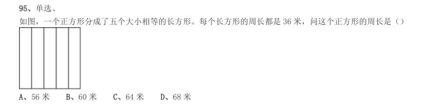
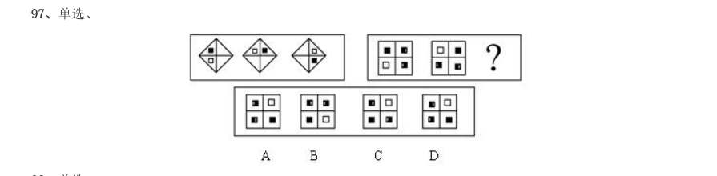
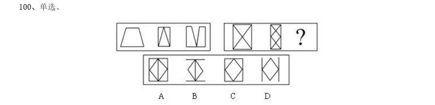
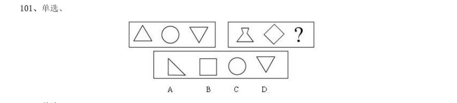
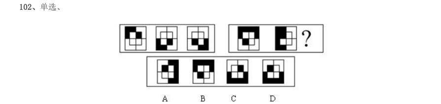
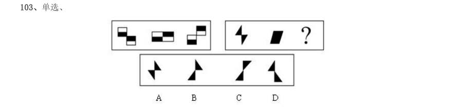
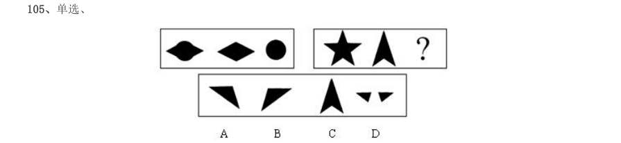
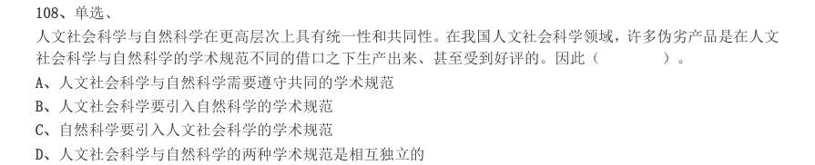

# 2002 年国考行测（B卷）

- 题量：113（含答案 0）
- 模块分布：数量关系18 / 言语理解24 / 判断推理26 / 常识判断45
- 试卷编号：`国考-2002-B卷`

## 题目与答案

**【常识判断·政治常识｜GK-2002-b-X001】**
> 材料：此套题原题有听力20 道,题型已淘汰,故略去。

1. 单选、 具有多媒体功能的微型计算机系统中,常用的CD-ROM 是( )。

- **A.** 只读型光盘
- **B.** 半导体只读存储器
- **C.** 只读型硬盘
- **D.** 只读型大容量软盘

**答案：暂缺**　**考点：政治常识｜政治常识（综合）**　**难度：★☆☆☆☆**
**【常识判断·科技常识｜GK-2002-b-X002】**

2. 单选、 为实现全球通讯(南极、北极除外),地球赤道上空等距离发射同步卫星的颗数至少为( )。

- **A.** 2 颗
- **B.** 3 颗
- **C.** 5 颗
- **D.** 24 颗

**答案：暂缺**　**考点：科技常识｜科技成就**　**难度：★☆☆☆☆**
**【常识判断·政治常识｜GK-2002-b-X003】**

3. 单选、 远程电力传输一般采用50 万~100 万伏的高电压,其主要原因是( )。

- **A.** 确保远程电力传输的安全
- **B.** 减少传输线路上的电能损失
- **C.** 节约传输线路上的设备和材料
- **D.** 减少雷电对传输线路的破坏

**答案：暂缺**　**考点：政治常识｜政治常识（综合）**　**难度：★☆☆☆☆**
**【常识判断·政治常识｜GK-2002-b-X004】**

4. 单选、 香烟点燃后,冒出的烟雾看上去是蓝色的,这是因为( )。

- **A.** 烟雾的颗粒本身是蓝色的
- **B.** 烟雾将光线中其他色光滤掉,只有蓝色光透射出来
- **C.** 烟雾的颗粒对蓝色光散射强烈
- **D.** 烟雾的颗粒吸收光线后,发出蓝色荧光

**答案：暂缺**　**考点：政治常识｜政治常识（综合）**　**难度：★☆☆☆☆**
**【常识判断·政治常识｜GK-2002-b-X005】**

5. 单选、 多数汽车的前窗都是倾斜的,最主要原因是( )。

- **A.** 避免因反光而影响驾驶员视线
- **B.** 减少空气阻力
- **C.** 结构合理,视野开阔,承受冲击能力强
- **D.** 便于雨水流走

**答案：暂缺**　**考点：政治常识｜政治常识（综合）**　**难度：★☆☆☆☆**
**【常识判断·政治常识｜GK-2002-b-X006】**

6. 单选、 人向竖直的平面镜走近时,镜中所成的像( )。

- **A.** 缩小
- **B.** 变大
- **C.** 大小不变
- **D.** 先小后大

**答案：暂缺**　**考点：政治常识｜政治常识（综合）**　**难度：★☆☆☆☆**
**【常识判断·政治常识｜GK-2002-b-X007】**

7. 单选、 在太空中,宇航员观察星星时发现( )。

- **A.** 星光闪烁
- **B.** 星星十分清晰
- **C.** 有时闪烁,有时清晰
- **D.** 当太空舱位于地球和太阳之间时,星光闪烁

**答案：暂缺**　**考点：政治常识｜政治常识（综合）**　**难度：★☆☆☆☆**
**【常识判断·政治常识｜GK-2002-b-X008】**

8. 单选、 多数鱼类背部发黑、腹部发白,其原因是( )。

- **A.** 长期进化形成的保护色
- **B.** 背部比腹部接受光线多,导致色素沉淀
- **C.** 背部比腹部黏膜厚,吸收光线多
- **D.** 背部鱼鳞多,吸收光线多

**答案：暂缺**　**考点：政治常识｜政治常识（综合）**　**难度：★☆☆☆☆**
**【常识判断·科技常识｜GK-2002-b-X009】**

9. 单选、 地球表面的绿色植物通过光合作用,将太阳的辐射能量转化成能被其他生物利用的有机化学能。下面说法错误的 是( )。

- **A.** 光合作用吸收的主要是太阳光中的绿光
- **B.** 植物的绿色是反射的太阳光中的绿色
- **C.** 不同植物的光合作用效率是不一样的
- **D.** 植物在不同时间的光合作用效率不一样

**答案：暂缺**　**考点：科技常识｜基础科学**　**难度：★☆☆☆☆**
**【常识判断·政治常识｜GK-2002-b-X010】**

10. 单选、 月亮上有许多大大小小的环形山,多数科学家认为环形山的成因是( )。

- **A.** 地震
- **B.** 火山爆发
- **C.** 陨星撞击
- **D.** 板块运动

**答案：暂缺**　**考点：政治常识｜政治常识（综合）**　**难度：★☆☆☆☆**
**【常识判断·政治常识｜GK-2002-b-X011】**

11. 单选、 酸雨被称为“空中死神”,它会破坏土壤的结构和营养,使土壤贫瘠化,危害动、植物生长。其pH 值范围( )。

- **A.** 小于5.6
- **B.** 小于6
- **C.** 大于6
- **D.** 大于7.6

**答案：暂缺**　**考点：政治常识｜政治常识（综合）**　**难度：★☆☆☆☆**
**【常识判断·政治常识｜GK-2002-b-X012】**

12. 单选、 DNA 是人类进行亲子鉴定的主要依据。就DNA 的组成,下面说法正确的是( )。

> 同题变体（主记录 GK-2002-a-X004）

- **A.** DNA 由核糖、碱基和磷酸组成
- **B.** DNA 由脱氧核糖、磷酸和碱基组成
- **C.** DNA 由脱氧核糖、磷酸、碱基和蛋白质组成
- **D.** DNA 由脱氧核糖、磷酸、碱基和脂肪组成

**答案：暂缺**　**考点：政治常识｜政治常识（综合）**　**难度：★☆☆☆☆**
**【常识判断·政治常识｜GK-2002-b-X013】**

13. 单选、 下列电池中不能充电的( )。

- **A.** 镍镉电池
- **B.** 银锌电池
- **C.** 普通干电池
- **D.** 铅蓄电池

**答案：暂缺**　**考点：政治常识｜政治常识（综合）**　**难度：★☆☆☆☆**
**【常识判断·政治常识｜GK-2002-b-X014】**

14. 单选、 夏天,打开冰箱冷冻室的门,常常看到冷冻室中冒出一股白雾,这是( )。

- **A.** 冰箱里的冰升华后,又凝结成小水滴
- **B.** 冰箱里原有的水蒸气凝结成的小水滴
- **C.** 冰箱里的水变为水蒸气
- **D.** 冰箱外部空气中的水蒸气凝结成的小水滴

**答案：暂缺**　**考点：政治常识｜政治常识（综合）**　**难度：★☆☆☆☆**
**【常识判断·科技常识｜GK-2002-b-X015】**

15. 单选、 下列关于水的物理现象描述正确的是( )。

- **A.** 蒸发时放热,结冰时吸热
- **B.** 蒸发时吸热,结冰时放热
- **C.** 结冰和蒸发时都吸热
- **D.** 结冰和蒸发时都放热

**答案：暂缺**　**考点：科技常识｜基础科学**　**难度：★☆☆☆☆**
**【常识判断·政治常识｜GK-2002-b-X016】**

16. 多选、 计算机技术和通讯技术的结合,诞生了网络,产生了信息高速公路。一台个人计算机采用拨号方式上网,必须具 备的硬件条件是( )。

- **A.** 一条电话线
- **B.** TCP/IP
- **C.** 浏览器
- **D.** 调制解调器

**答案：暂缺**　**考点：政治常识｜政治常识（综合）**　**难度：★★★☆☆**
**【常识判断·政治常识｜GK-2002-b-X017】**

17. 多选、 青春期生理上显著的变化是( )。

- **A.** 体形、体态和身体成分剧变
- **B.** 大脑重量突增
- **C.** 各系统器官的形态和功能走向成熟健全
- **D.** 性器官发育成熟

**答案：暂缺**　**考点：政治常识｜政治常识（综合）**　**难度：★☆☆☆☆**
**【常识判断·政治常识｜GK-2002-b-X018】**

18. 多选、 以下情况属于无性繁殖的是( )。

- **A.** 异卵双胞胎
- **B.** 植物插条繁殖
- **C.** 植物嫁接
- **D.** 细菌繁殖

**答案：暂缺**　**考点：政治常识｜政治常识（综合）**　**难度：★☆☆☆☆**
**【常识判断·地理常识｜GK-2002-b-X019】**

19. 单选、 温室效应将引起全球气温上升,导致气候异常、海平面上升、生态恶化。引起温室效应的最主要的气体是 ( )。

> 同题变体（主记录 GK-2002-a-X007）

- **A.** 氮氧化合物
- **B.** 二氧化碳
- **C.** 臭氧
- **D.** 氟利昂

**答案：暂缺**　**考点：地理常识｜中国地理**　**难度：★☆☆☆☆**
**【常识判断·政治常识｜GK-2002-b-X020】**

20. 多选、 1990 年4 月美国把耗资21 亿美元的哈勃太空望远镜送入太空。这样做的原因是( )。

- **A.** 地球的大气层阻碍了对宇宙的清晰观察
- **B.** 地球的引力会引起大透镜变形,影响分辨率
- **C.** 地面易出现振动干扰,影响观测精度
- **D.** 地球上气候变化对观测有影响

**答案：暂缺**　**考点：政治常识｜政治常识（综合）**　**难度：★☆☆☆☆**
**【常识判断·历史人文｜GK-2002-b-X021】**

21. 单选、 我国古代文学名作《桃花源诗》和诗序《桃花源记》的作者是( )。

- **A.** 屈原陶渊明
- **B.** 陶渊明陶渊明
- **C.** 杜甫李白
- **D.** 陆游

**答案：暂缺**　**考点：历史人文｜中国古代史**　**难度：★☆☆☆☆**
**【常识判断·政治常识｜GK-2002-b-X022】**

22. 单选、 2001 年是辛亥革命90 周年,标志其发生的事件是( )。

- **A.** 清帝退位
- **B.** 南京临时政府成立
- **C.** 武昌起义
- **D.** 孙中山任临时大总统

**答案：暂缺**　**考点：政治常识｜毛中特与党史**　**难度：★☆☆☆☆**
**【常识判断·政治常识｜GK-2002-b-X023】**

23. 单选、 “千古奇冤,江南一叶,同室操戈,相煎何急”是为皖南事变而作的题词。其作者是( )。

- **A.** 叶挺
- **B.** 周恩来
- **C.** 陈毅
- **D.** 毛泽东

**答案：暂缺**　**考点：政治常识｜政治常识（综合）**　**难度：★☆☆☆☆**
**【常识判断·经济常识｜GK-2002-b-X024】**

24. 单选、 英国产业革命首先是从什么部门开始的?( )

- **A.** 机械工业
- **B.** 纺织工业
- **C.** 煤炭工业
- **D.** 钢铁工业

**答案：暂缺**　**考点：经济常识｜经济常识（综合）**　**难度：★☆☆☆☆**
**【常识判断·政治常识｜GK-2002-b-X025】**

25. 多选、 社会主义社会是( )。

- **A.** 一个很长的历史过程
- **B.** 一个不断发展的社会
- **C.** 要经过不同的历史发展阶段的社会
- **D.** 一个不断自我完善的社会

**答案：暂缺**　**考点：政治常识｜政治常识（综合）**　**难度：★☆☆☆☆**
**【常识判断·政治常识｜GK-2002-b-X026】**

26. 单选、 根据被管理者的成就需要、权力需要和合群需要对其进行管理,其出发点是将被管理者视为( )。

- **A.** 经济人
- **B.** 社会人
- **C.** 决策人
- **D.** 文化人

**答案：暂缺**　**考点：政治常识｜政治常识（综合）**　**难度：★☆☆☆☆**
**【常识判断·历史人文｜GK-2002-b-X027】**

27. 多选、 中国共产党80 年历程中历史性转折的标志是( )。

- **A.** “八七”会议
- **B.** 遵义会议
- **C.** 七届二中全会
- **D.** 十一届三中全会

**答案：暂缺**　**考点：历史人文｜中国古代史**　**难度：★☆☆☆☆**
**【常识判断·经济常识｜GK-2002-b-X028】**

28. 单选、 粗放型的经济增长主要依靠( )。

- **A.** 增加资金和资源的投入量
- **B.** 科技进步和提高劳动者素质
- **C.** 提高生产要素的质量和使用效率
- **D.** 结构优化,合理布局生产力

**答案：暂缺**　**考点：经济常识｜经济常识（综合）**　**难度：★☆☆☆☆**
**【常识判断·经济常识｜GK-2002-b-X029】**

29. 单选、 在市场经济条件下,资源配置的主体是( )。

- **A.** 市场
- **B.** 计划
- **C.** 企业
- **D.** 政府

**答案：暂缺**　**考点：经济常识｜微观与市场**　**难度：★☆☆☆☆**
**【常识判断·经济常识｜GK-2002-b-X030】**

30. 多选、 拉动经济增长的需求有( )。

- **A.** 投资需求
- **B.** 消费需求
- **C.** 储蓄需求
- **D.** 出口需求

**答案：暂缺**　**考点：经济常识｜经济常识（综合）**　**难度：★☆☆☆☆**
**【常识判断·政治常识｜GK-2002-b-X031】**

31. 单选、 俗话说:“一条船不能有两个船长”。从管理的角度看,下列解释最恰当的是( )。

- **A.** 在领导班子中如果有多个固执己见的人物最终会降低管理效率
- **B.** 需要集权管理的组织不能允许有多个直线领导核心
- **C.** 一个组织中的能人太多必然会造成内耗增加从而导致效率下降
- **D.** 组织中不能允许存在两种以上的观点,否则易造成管理混乱

**答案：暂缺**　**考点：政治常识｜政治常识（综合）**　**难度：★★★★☆**
**【常识判断·政治常识｜GK-2002-b-X032】**

32. 单选、 近年来,利用现代信息技术手段而建立和发展起来的一种新型组织结构是( )。

- **A.** 矩阵式组织结构
- **B.** 直线职能式组织结构
- **C.** 网络型组织结构
- **D.** 委员会组织结构

**答案：暂缺**　**考点：政治常识｜政治常识（综合）**　**难度：★☆☆☆☆**
**【常识判断·政治常识｜GK-2002-b-X033】**

33. 单选、 目标管理中的目标是由谁确定的?( )

- **A.** 实施单位的上级
- **B.** 实施单位的下级
- **C.** 实施单位自己
- **D.** 实施单位与其上级

**答案：暂缺**　**考点：政治常识｜政治常识（综合）**　**难度：★☆☆☆☆**
**【常识判断·科技常识｜GK-2002-b-X034】**

34. 单选、 下列各项职位中,最适宜于运用观察法来进行考核的是( )。

- **A.** 处长
- **B.** 打字员
- **C.** 会计师
- **D.** 巡视员

**答案：暂缺**　**考点：科技常识｜科技常识（综合）**　**难度：★☆☆☆☆**
**【常识判断·政治常识｜GK-2002-b-X035】**

35. 单选、 在下列各项中,属于现场控制的是( )。

- **A.** 指导
- **B.** 计划
- **C.** 预算
- **D.** 财务报告分析

**答案：暂缺**　**考点：政治常识｜政治常识（综合）**　**难度：★☆☆☆☆**
**【常识判断·政治常识｜GK-2002-b-X036】**

36. 多选、 我国五年发展计划属于的决策类型是( )。

- **A.** 程序性决策
- **B.** 战略决策
- **C.** 战术决策
- **D.** 风险型决策

**答案：暂缺**　**考点：政治常识｜政治常识（综合）**　**难度：★☆☆☆☆**
**【常识判断·政治常识｜GK-2002-b-X037】**

37. 多选、 下面关于政府职能与行政权力的关系表述正确的有( )。

- **A.** 行政权力是政府职能的外在表现
- **B.** 政府职能是行政权力的外在表现
- **C.** 行政权力是履行政府职能的基本条件
- **D.** 政府职能是配置行政权力的依据

**答案：暂缺**　**考点：政治常识｜政治常识（综合）**　**难度：★☆☆☆☆**
**【常识判断·法律常识｜GK-2002-b-X038】**

38. 多选、 根据现行公务员制度的有关规定,下列各项中属于行政处分的有( )。

- **A.** 降级
- **B.** 撤职
- **C.** 降职
- **D.** 严重警告

**答案：暂缺**　**考点：法律常识｜行政法**　**难度：★☆☆☆☆**
**【常识判断·政治常识｜GK-2002-b-X039】**

39. 多选、 下列各项中,属于地方行政组织层级的是( )。

- **A.** 省
- **B.** 县
- **C.** 乡
- **D.** 村

**答案：暂缺**　**考点：政治常识｜政治常识（综合）**　**难度：★☆☆☆☆**
**【常识判断·政治常识｜GK-2002-b-X040】**

40. 多选、 为了应付复杂的行政管理事务,我们在进行行政决策时要拟定多个方案。主要有( )。

- **A.** 积极方案
- **B.** 消极方案
- **C.** 临时方案
- **D.** 应变方案

**答案：暂缺**　**考点：政治常识｜政治常识（综合）**　**难度：★☆☆☆☆**
**【常识判断·政治常识｜GK-2002-b-X041】**

41. 多选、 下面属于行政工作人员违反回避制度的有( )。

- **A.** 某行政人员在原籍乡任乡长
- **B.** 某行政人员在原籍县任县长
- **C.** 属于少数民族的某行政人员在原籍民族自治县任县长
- **D.** 某行政执法人员参与处理自己原籍家乡发生的行政案件

**答案：暂缺**　**考点：政治常识｜政治常识（综合）**　**难度：★☆☆☆☆**
**【常识判断·政治常识｜GK-2002-b-X042】**

42. 多选、 下列行为中,属于行政裁决的有( )。

- **A.** 某县人民政府解决甲乙双方土地使用权归属的纠纷
- **B.** 某劳动争议仲裁委员会解决某企业与某职工之间因解除劳动合同而产生的争议
- **C.** 某环境保护部门调解甲乙双方因环境污染引起的损害赔偿纠纷
- **D.** 某公安机关责令违法行为人甲赔偿被侵害人乙的医疗费

**答案：暂缺**　**考点：政治常识｜政治常识（综合）**　**难度：★★★★☆**
**【常识判断·法律常识｜GK-2002-b-X043】**

43. 多选、 下列各项中必须通过招标方式签订合同的有( )。

- **A.** 三峡工程
- **B.** 世界银行资助的绿化项目
- **C.** 修建高速公路
- **D.** 农村土地承包

**答案：暂缺**　**考点：法律常识｜民法典**　**难度：★☆☆☆☆**
**【常识判断·法律常识｜GK-2002-b-X044】**

44. 多选、 《行政处罚法》规定,行政机关可以采取抽样取证和登记保存的方法收集证据,抽样取证和登记保存属于 ( )。

- **A.** 行政强制执行
- **B.** 证据保全措施
- **C.** 行政强制措施
- **D.** 即时强制

**答案：暂缺**　**考点：法律常识｜行政法**　**难度：★☆☆☆☆**
**【常识判断·政治常识｜GK-2002-b-X045】**

45. 多选、 某公司严重违法经营,工商行政机关欲对其作出吊销营业执照的处罚。在处罚决定前,工商行政机关告知该公司 有权要求听证。两日后该公司提出听证要求。工商行政机关在五天之后通知该公司参加听证会。听证会上,听证 主持人当场作出了吊销营业执照的处罚,并向该公司收取了100 元的听证费用。本案中的错误做法有( )。

- **A.** 本处罚适用了听证程序
- **B.** 经当事人申请,工商行政机关举行了听证会
- **C.** 听证主持人作出了处罚决定
- **D.** 听证收取了当事人的费用

**答案：暂缺**　**考点：政治常识｜政治常识（综合）**　**难度：★★★★★**
**【言语理解·逻辑填空｜GK-2002-b-X047】**
> 材料：基因是具有遗传效应的DNA 分子片断,是我们身体的一部分。关于基因是否应该申请专利的问题,不同的人 有不同的回答。 基因是天然的遗传物质,并非人工产物。有关基因的序列和功能的知识都是科学[a],而不是技术[b],按惯 例是不能申请专利的,故“基因专利”既不合理也不合法。严格的说,“专利保护的只是DNA 序列的应用,而不 是序列本身”。 在生物经济时代,基因不是金钱但胜过金钱。洛克菲勒大学有一条肥胖基因,售价高达2000 万美元。由于 经济利益的驱动,已有2000 个“功能已知的基因”被授予专利。这样,受谴责的“基因专利”便获得公认,迫 使人们改变原来的伦理观念,不得不参加“基因争夺战”。因为人类基因组的基因总数是有限的,必竟只有6 万 到10 万个。每有一个基因获专利,就等于少了一个基因。于是,人们为了专利而抢夺基因。特别是我国的基因 资源,被国外常常是无偿的掠夺,丧失知识产权,连当事人也

47. 单选、 文中四个加黑字,必须修改的是()

- **A.** 授予
- **B.** 谴责
- **C.** 伦理
- **D.** 必竟

**答案：暂缺**　**考点：逻辑填空｜逻辑填空（综合）**　**难度：★☆☆☆☆**
**【言语理解·语句排序｜GK-2002-b-X048】**

48. 单选、 文末四个划线的句子中语序不当的是( )

- **A.** 人们为了专利而抢夺基因
- **B.** 被国外常常是无偿的掠夺
- **C.** 连当事人也不知情
- **D.** 我们只有参与竞争去争取

**答案：暂缺**　**考点：语句排序｜语句排序**　**难度：★★★★☆**
**【言语理解·逻辑填空｜GK-2002-b-X049】**

49. 单选、 不属于人们不得不参加“基因争夺战”的原因是( )

- **A.** 经济利益
- **B.** 基因数量有限
- **C.** 伦理观念
- **D.** 基因专利获得认可

**答案：暂缺**　**考点：逻辑填空｜逻辑填空（综合）**　**难度：★☆☆☆☆**
**【言语理解·细节判断｜GK-2002-b-X050】**

50. 单选、 下列叙述不符合文意的一项是( )

- **A.** 对基因是否应申请专利,人们有不同的看法
- **B.** “基因专利”目前还没有获得人们的认可
- **C.** “基因专利”导致人们去抢夺有限的基因
- **D.** 为保护我国的基因资源,我们应参与竞争

**答案：暂缺**　**考点：细节判断｜细节判断**　**难度：★☆☆☆☆**
**【言语理解·逻辑填空｜GK-2002-b-X052】**
> 材料：意识、忧患意识、责任意识、慎独意识历来都是很强烈的,经过数千年之[a],形成了一种民族的风骨和气度, 形成了一种民族的自强不息的精神。屈原、司马迁、陶渊明、文天祥这些历史上的文化名人,历来都是我国知识 分子学习和效仿的榜样,是我们民族的精英。“天下兴亡,匹夫有责”,{ }等至理名言,一直流传至今, 脍炙人口,为人们所传颂。今天我们继承与发扬这种文化传统,仍然具有宝贵的现实意义。[b],这也是我们创 建社会主义先进文化的宝贵资源。至于传统文化当中的糟粕,应当加以批评,比如官本位的[c],唯书唯上的[d], 因循守旧的[e],不讲卫生、不注重社会公德的生活恶习,等等。这些都是社会进步的严重障碍,是绊脚石,必 须克服和抛弃。特别是[f]——总把自己的缺点、毛病遮掩、包着,不愿去面对和正视,这值得人们注意。为圣 者讳,为尊者讳,历代见之于文字的禁忌多得很。我认为这对中华民族的发展妨碍甚大。 51:

52. 单选、 不适合在{ }处引用的是( )

- **A.** 先天下之忧而忧,后天下之乐而乐
- **B.** 宁为玉碎,不为瓦全
- **C.** 君子慎其独
- **D.** 众人皆醉我独醒,众人皆浊我独清

**答案：暂缺**　**考点：逻辑填空｜逻辑填空（综合）**　**难度：★☆☆☆☆**
**【言语理解·逻辑填空｜GK-2002-b-X053】**

53. 单选、 [b]处恰当的措辞是( )

- **A.** 无可厚非
- **B.** 不容置喙
- **C.** 不可否认
- **D.** 毋庸讳言

**答案：暂缺**　**考点：逻辑填空｜逻辑填空（综合）**　**难度：★☆☆☆☆**
**【言语理解·逻辑填空｜GK-2002-b-X054】**

54. 单选、 在[c]、[d]、[e]处恰当的措辞是( )

- **A.** 等级观念,教条习气,思维方式
- **B.** 教条习气,等级观念,思维方式
- **C.** 思维方式,等级观念,教条习气
- **D.** 等级观念,思维方式,教条习气

**答案：暂缺**　**考点：逻辑填空｜逻辑填空（综合）**　**难度：★☆☆☆☆**
**【言语理解·逻辑填空｜GK-2002-b-X055】**

55. 单选、 [f]处恰当的词语是( )

- **A.** 文过饰非
- **B.** 讳疾忌医
- **C.** 掩耳盗铃
- **D.** 巧立名目

**答案：暂缺**　**考点：逻辑填空｜逻辑填空（综合）**　**难度：★☆☆☆☆**
**【言语理解·逻辑填空｜GK-2002-b-X057】**
> 材料：事情偏要想法子掩盖,。“巧立名目”意思是指变着法定出一些名目来达到某种不正当的目的。 千百年来,人们裹在梦幻的柔纱里,忘却尘世的喧嚣,单纯的心灵只愿意接受这一个李白:诗仙、醉圣、谪 仙人......不,历史是斑驳的杂色!“安能摧眉折腰事权贵,使我不得开心颜”是______;“生不用封万户侯,但 愿一识韩荆州”是______;“长揖万圣君,还归富春山”是______;“君王赐颜色,声价凌烟虹”是______。既 热中功名,又藐视权位;既超凡,又落俗;既坦荡荡,又常戚戚。这才是一个真实的李白。 追根究底,古代的“士”在坚持心中的“道”与应对客观的“势”的矛盾中,只能有四种选择:殉道[a]“势”, 修道[b]“势”,泯道[c]“势”, [d]于“道”、“势”之间。多数的“士”并非自觉地选择了最后一中,李 白是其中的一个代表。他清醒地认识到“达则兼济天下,穷则独善其身”,而他的不幸在于“达”不能“

57. 单选、 在文中四个加点的词中必须修改的是( )

- **A.** 热中
- **B.** 藐视
- **C.** 落俗
- **D.** 戚戚

**答案：暂缺**　**考点：逻辑填空｜逻辑填空（综合）**　**难度：★☆☆☆☆**
**【言语理解·逻辑填空｜GK-2002-b-X058】**

58. 单选、 在[a]、[b]、[c]处恰当的措辞是( )

- **A.** 抗,媚,避
- **B.** 避,媚,抗
- **C.** 避,抗,媚
- **D.** 抗,避,媚

**答案：暂缺**　**考点：逻辑填空｜逻辑填空（综合）**　**难度：★☆☆☆☆**
**【言语理解·逻辑填空｜GK-2002-b-X059】**

59. 单选、 在[d]处恰当的措辞是( )

- **A.** 徜徉
- **B.** 徘徊
- **C.** 周旋
- **D.** 出入

**答案：暂缺**　**考点：逻辑填空｜逻辑填空（综合）**　**难度：★☆☆☆☆**
**【言语理解·逻辑填空｜GK-2002-b-X060】**

60. 单选、 在[e]处恰当的措辞是( )

- **A.** 从而
- **B.** 因为
- **C.** 于是
- **D.** 其实

**答案：暂缺**　**考点：逻辑填空｜逻辑填空（综合）**　**难度：★☆☆☆☆**
**【言语理解·逻辑填空｜GK-2002-b-X062】**
> 材料：么新的《鲁迅传》偏偏[a],至今没有人写出来呢?原因[b]是多方面的。相当重要的一个原因是和我们文学理论 研究的现状有关。在文学理论研究领域,直到目前为止[c]留下许多空白点,而传记文学这一课题[d]始终没有提 到日程上来。 在国外,传记文学早已成为专门名家的学问。[e]所谓“拿破仑学”的专家所写出的充塞各国图书馆的拿破 仑传,[f]以卓别林的传记来说,以我有限的见闻,[g]不下六七种之多。有本人写的自传,也有别人写的转机。 写法不同,各有各的侧面,各有各的角度,很少雷同,各有特色。例如,二次大战前法国作家菲利普·苏卜根据 卓别林在影片中所创造的那个流浪汉所写的《夏洛传》,就是通过卓别林的艺术创造来探讨他的内心世界。这在 传记文学中别具一格,被称为“幻想人物传记”。如果我们把国外的各种传记的写法[h],是有助于丰富传记文 学理论的。 我国史学在世界素享盛誉。黑格尔曾对中国两千年来从未中辍的

62. 单选、 [b]、[c]、[d]处恰当的词语是( )

- **A.** 似乎,恐怕,确实
- **B.** 恐怕,确实,似乎
- **C.** 确实,似乎,恐怕
- **D.** 似乎,确实,恐怕

**答案：暂缺**　**考点：逻辑填空｜逻辑填空（综合）**　**难度：★☆☆☆☆**
**【言语理解·逻辑填空｜GK-2002-b-X063】**

63. 单选、 [e]、[f]、[g]处恰当的措辞是( )

- **A.** 无论,还是,就
- **B.** 且不说,仅,就
- **C.** 无论,仅,就
- **D.** 且不说,如果,也

**答案：暂缺**　**考点：逻辑填空｜逻辑填空（综合）**　**难度：★☆☆☆☆**
**【言语理解·逻辑填空｜GK-2002-b-X064】**

64. 单选、 [h]、[i]处恰当的措辞是( )

- **A.** 加以总结,加以总结
- **B.** 进行比较研究,加以继承
- **C.** 进行比较研究,加以总结
- **D.** 加以总结,加以继承

**答案：暂缺**　**考点：逻辑填空｜逻辑填空（综合）**　**难度：★☆☆☆☆**
**【言语理解·细节判断｜GK-2002-b-X065】**

65. 单选、 下列对文中信息的理解,符合文意的一项是( )

- **A.** 《鲁迅传》至今没有写出来,是文学理论研究出了问题
- **B.** 国外传记文学已经成了专门学问,因此我们理应写出《鲁迅传》
- **C.** 国外“幻想人物传记”的写法对我国的文学理论建设有借鉴意义
- **D.** 我国古代史学家是传记文学的创作者,他们的理论是国外所没有的

**答案：暂缺**　**考点：细节判断｜细节判断**　**难度：★★★☆☆**
**【言语理解·逻辑填空｜GK-2002-b-X067】**
> 材料：道不孤”——人们多以为现代汉语非规范化现象太使人生气,原来“天下乌鸦一般黑”,这[b]的恶魔到处在横 行霸道。 这是英国伦敦一个被称作“保守的思想库”——政策研究中心提出的“警世恒言”!它说,如今的语文教师 已不太看重语法对不对,不太强调要说标准语了。那份研究报告[c]说,在许多名牌大学的应考生中只有少数能 够拼写正确,标点无误,文句符合语法。这个研究机关把这些现象(在我们这里就是写错别字、乱加标点和语句 不通)称之为“语言技能的流失”——这“将[d]到一个民族的未来”。 乍看似有点[e],细想则很是[f]。破碎的语言不能形成完整的思想,所以世人认为[g]地使用语言体现了一 个民族的文明程度。同一报告补充说,当然这并不意味着[h]一千年前的语言就能表达当今错综复杂的社会生活。 这段补充的好,规范化、标准化不是[i]着某一时期的语言为界,语言的变异是不断发生的,但变异也得走向规 范。 66:

67. 单选、 [c]、[d]处恰当的措辞是( )

- **A.** 于是,危害
- **B.** 于是,危及
- **C.** 甚至,危害
- **D.** 甚至,危及

**答案：暂缺**　**考点：逻辑填空｜逻辑填空（综合）**　**难度：★☆☆☆☆**
**【言语理解·逻辑填空｜GK-2002-b-X068】**

68. 单选、 [e]、[f]处恰当的措辞是( )

- **A.** 百思不解,入情入理
- **B.** 言过其实,入木三分
- **C.** 危言耸听,耐人寻味
- **D.** 耸人听闻,发人深省

**答案：暂缺**　**考点：逻辑填空｜逻辑填空（综合）**　**难度：★☆☆☆☆**
**【言语理解·逻辑填空｜GK-2002-b-X069】**

69. 单选、 [g]、[h]、[i]处恰当的措辞是( )

- **A.** 规范而健康,保守,保守
- **B.** 健康而规范,保守,保守
- **C.** 规范而健康,固守,固守
- **D.** 健康而规范,固守,固守

**答案：暂缺**　**考点：逻辑填空｜逻辑填空（综合）**　**难度：★☆☆☆☆**
**【言语理解·中心理解｜GK-2002-b-X070】**

70. 单选、 “这段补充的好”,“好”的原因是( )

- **A.** 破碎的语言不能形成完整的思想
- **B.** 强调了语言规范而健康的重要意义
- **C.** 说明了规范化、标准化的语言也会变异
- **D.** 强调语言变异也要走向规范化

**答案：暂缺**　**考点：中心理解｜中心理解（综合）**　**难度：★☆☆☆☆**
**【言语理解·逻辑填空｜GK-2002-b-X072】**
> 材料：来表现。 欣赏篆刻作品,首先要看“篆法”。篆法是三法中的基础。历来印章均以篆为宗,故治印章必先精通篆法, 用字要有出处,变化须合六书,切忌生编滥造或任意增减。那些颇有成就的篆刻家,并非都是古文学家,但必须 搞清楚文字的源流、演变的过程。只有这样方能使篆字“丰神流动,[a]”,以达到古人所说的“有轻有重,有 屈有伸,有俯有仰,有去有来,有粗有细,有强有弱,有疏有密”,[b]的境地。 其次是欣赏“章法”。章法是三法中的重点。章法是复杂多变的,只有多看,多摹,多揣摸,日积月累,循 序渐进,方能进一步门庭,[c]。篆刻章法应以秦汉古印为准绳,精通六书八体。一字有一字的章法,全章有全 章的章法。尽管方寸间字有多寡,文有朱白,印有大小,笔画有疏密、增损、参差、平衡、呼应、挪让、轻重、 离合、方圆、巧拙等,应当全局考虑,是方寸印章“相依顾而有情,一气贯通而不悖”。欲臻章法之妙,就要符 合美的规律,或寻工

72. 单选、 [a]、[b]处恰当的措辞是( )

- **A.** 庄重典雅,出神入化
- **B.** 出神入化,庄重典雅
- **C.** 尽逞其妙,随心所欲
- **D.** 随心所欲,尽逞其妙

**答案：暂缺**　**考点：逻辑填空｜逻辑填空（综合）**　**难度：★☆☆☆☆**
**【言语理解·逻辑填空｜GK-2002-b-X073】**

73. 单选、 [c]处恰当的措辞是( )

- **A.** 十分添春色
- **B.** 春色添十分
- **C.** 添十分春色
- **D.** 添春色十分

**答案：暂缺**　**考点：逻辑填空｜逻辑填空（综合）**　**难度：★☆☆☆☆**
**【言语理解·逻辑填空｜GK-2002-b-X074】**

74. 单选、 第三段应该删掉的词语是( )

- **A.** 尽管
- **B.** 等
- **C.** 应
- **D.** 或

**答案：暂缺**　**考点：逻辑填空｜逻辑填空（综合）**　**难度：★☆☆☆☆**
**【言语理解·逻辑填空｜GK-2002-b-X075】**

75. 单选、 第三段使用有误的词语是( )

- **A.** 循序渐进
- **B.** 准绳
- **C.** 臻
- **D.** 寻

**答案：暂缺**　**考点：逻辑填空｜逻辑填空（综合）**　**难度：★☆☆☆☆**
**【数量关系·数字推理｜GK-2002-b-X077】**
> 材料：76:单选、 4,5,7,11,19,() A、27 B、31 C、35 D、41

77. 单选、 3,4,7,16,()

- **A.** 23
- **B.** 27
- **C.** 39
- **D.** 43

**答案：暂缺**　**考点：数字推理｜数字推理（综合）**　**难度：★★★★☆**
**【数量关系·数字推理｜GK-2002-b-X078】**

78. 单选、 32,27,23,20,18,()

- **A.** 14
- **B.** 15
- **C.** 16
- **D.** 17

**答案：暂缺**　**考点：数字推理｜数字推理（综合）**　**难度：★★★★☆**
**【数量关系·数字推理｜GK-2002-b-X079】**

79. 单选、 25,15,10,5,5,()

- **A.** 10
- **B.** 5
- **D.** -5

**答案：暂缺**　**考点：数字推理｜数字推理（综合）**　**难度：★★★★☆**
**【数量关系·其他数量关系｜GK-2002-b-X080】**

80. 单选、 -2,1,7,16,(),43

- **A.** 25
- **B.** 28
- **C.** 31
- **D.** 35

**答案：暂缺**　**考点：其他数量关系｜其他数量关系（综合）**　**难度：★☆☆☆☆**
**【数量关系·数字推理｜GK-2002-b-X081】**

81. 单选、 甲、乙、丙三人买书共花费96 元钱,已知丙比甲多花16 元,乙比甲多花8 元,则甲、乙、丙三人花的钱的比是 ()

- **A.** 3:5:4
- **B.** 4:5:6
- **C.** 2:3:4
- **D.** 3:4:5

**答案：暂缺**　**考点：数字推理｜数字推理（综合）**　**难度：★★★★☆**
**【数量关系·其他数量关系｜GK-2002-b-X083】**
> 材料：把一个边长为4 厘米的正方形铁丝框制成两个等周长的圆形铁丝框,铁丝的总长不变,则每个圆铁丝框的面积为 () A、16π B、8π C、 D、

83. 单选、 若干学生住若干房间,如果每间住4 人则有20 人没地方住,如果每间住8 人则有一间只有4 人住,问共有多少 名学生()

- **A.** 30 人
- **B.** 34 人
- **C.** 40 人
- **D.** 44 人

**答案：暂缺**　**考点：其他数量关系｜其他数量关系（综合）**　**难度：★☆☆☆☆**
**【数量关系·数字推理｜GK-2002-b-X084】**

84. 单选、 12.5×0.76×0.4×8×2.5 的值是()

- **A.** 7.6
- **B.** 8
- **C.** 76
- **D.** 80

**答案：暂缺**　**考点：数字推理｜数字推理（综合）**　**难度：★★★★☆**
**【数量关系·数字推理｜GK-2002-b-X085】**

85. 单选、 3×999+8×99+4×9+8+7 的值是()

- **A.** 3840
- **B.** 3855
- **C.** 3866
- **D.** 3877

**答案：暂缺**　**考点：数字推理｜数字推理（综合）**　**难度：★★★★☆**
**【数量关系·其他数量关系｜GK-2002-b-X086】**

86. 单选、 一居民楼内只能允许同时使用6 台空调。现有8 户人家各安装了一台空调,问在一天(24 小时)内平均每户最 多可使用空调()小时?

- **A.** 16 小时
- **B.** 18 小时
- **C.** 20 小时
- **D.** 22 小时

**答案：暂缺**　**考点：其他数量关系｜其他数量关系（综合）**　**难度：★☆☆☆☆**
**【数量关系·数字推理｜GK-2002-b-X087】**

87. 单选、 三角形的内角和为180 度,问六边形的内角和是多少度()

- **A.** 720 度
- **B.** 600 度
- **C.** 480 度
- **D.** 360 度

**答案：暂缺**　**考点：数字推理｜数字推理（综合）**　**难度：★★★★☆**
**【数量关系·数字推理｜GK-2002-b-X088】**

88. 单选、 百货商场折价出售一商品,以八折出售的价格比原价少15 元,问该商品的原价是多少元()

- **A.** 65 元
- **B.** 70 元
- **C.** 75 元
- **D.** 80 元

**答案：暂缺**　**考点：数字推理｜数字推理（综合）**　**难度：★★★★☆**
**【数量关系·几何问题｜GK-2002-b-X089】**

89. 单选、 一个长方形,它的周长是32 米,长是宽的3 倍,问这个长方形的面积是多少()

- **A.** 64 平方米
- **B.** 56 平方米
- **C.** 52 平方米
- **D.** 48 平方米

**答案：暂缺**　**考点：几何问题｜平面几何**　**难度：★★★★☆**
**【数量关系·其他数量关系｜GK-2002-b-X090】**

90. 单选、 1.12+1.22+1.32+1.42 的值是:

- **A.** 5.04
- **B.** 5.49
- **C.** 6.06
- **D.** 6.3

**答案：暂缺**　**考点：其他数量关系｜其他数量关系（综合）**　**难度：★☆☆☆☆**
**【数量关系·其他数量关系｜GK-2002-b-X091】**

91. 单选、 两个运输队,第一队有320 人,第二队有280 人,现因任务变动,要求第二队的人数是第一队人数的2 倍,须从 第一队抽调多少人到第二队()

- **A.** 80 人
- **B.** 100 人
- **C.** 120 人
- **D.** 140 人

**答案：暂缺**　**考点：其他数量关系｜和差倍比**　**难度：★☆☆☆☆**
**【数量关系·其他数量关系｜GK-2002-b-X092】**

92. 单选、 铺设一条自来水管道,甲队单独铺设需8 天可以完成,而乙队每天可铺设50 米。如果甲、乙两队同时铺设,4 天可完成全长的2/3,问这条管道全长是多少米()

- **A.** 1000 米
- **B.** 1100 米
- **C.** 1200 米
- **D.** 1300 米

**答案：暂缺**　**考点：其他数量关系｜其他数量关系（综合）**　**难度：★☆☆☆☆**
**【数量关系·数字推理｜GK-2002-b-X093】**

93. 单选、 某学校学生排成一个方阵,最外层的人数是60 人,问这个方阵共有学生多少人()

> 同题变体（主记录 GK-2002-a-X079）

- **A.** 272 人
- **B.** 256 人
- **C.** 240 人
- **D.** 225 人

**答案：暂缺**　**考点：数字推理｜数字推理（综合）**　**难度：★★★★☆**
**【数量关系·其他数量关系｜GK-2002-b-X094】**

94. 单选、 一块三角地,在三个边上植树,三个边的长度分别为156 米、186 米、234 米,树与树之间的距离均为6 米,三 个角上都必须栽一棵树,问共需植树多少棵?

> 同题变体（主记录 GK-2002-a-X083）

- **A.** 90 棵
- **B.** 93 棵
- **C.** 96 棵
- **D.** 99 棵

**答案：暂缺**　**考点：其他数量关系｜其他数量关系（综合）**　**难度：★☆☆☆☆**
**【数量关系·数字推理｜GK-2002-b-X095】**

95. 单选、 如图,一个正方形分成了五个大小相等的长方形。每个长方形的周长都是36 米,问这个正方形的周长是()

- **A.** 56 米
- **B.** 60 米
- **C.** 64 米
- **D.** 68 米

**答案：暂缺**　**考点：数字推理｜数字推理（综合）**　**难度：★★★★☆**
**【判断推理·图形推理｜GK-2002-b-X097】**
> 材料：96:单选、

97. 单选、

> （本题为图形题，选项为图片，见原卷）

**答案：暂缺**　**考点：图形推理｜图形推理（综合）**　**难度：★★★☆☆**
**【判断推理·图形推理｜GK-2002-b-X098】**

98. 单选、 .

> （本题为图形题，选项为图片，见原卷）

**答案：暂缺**　**考点：图形推理｜图形推理（综合）**　**难度：★★★☆☆**
**【判断推理·图形推理｜GK-2002-b-X099】**

99. 单选、

> （本题为图形题，选项为图片，见原卷）

**答案：暂缺**　**考点：图形推理｜图形推理（综合）**　**难度：★★★☆☆**
**【判断推理·图形推理｜GK-2002-b-X100】**

100. 单选、

> （本题为图形题，选项为图片，见原卷）

**答案：暂缺**　**考点：图形推理｜图形推理（综合）**　**难度：★★★☆☆**
**【判断推理·图形推理｜GK-2002-b-X101】**

101. 单选、

> （本题为图形题，选项为图片，见原卷）

**答案：暂缺**　**考点：图形推理｜图形推理（综合）**　**难度：★★★☆☆**
**【判断推理·图形推理｜GK-2002-b-X102】**

102. 单选、

> （本题为图形题，选项为图片，见原卷）

**答案：暂缺**　**考点：图形推理｜图形推理（综合）**　**难度：★★★☆☆**
**【判断推理·图形推理｜GK-2002-b-X103】**

103. 单选、

> （本题为图形题，选项为图片，见原卷）

**答案：暂缺**　**考点：图形推理｜图形推理（综合）**　**难度：★★★☆☆**
**【判断推理·图形推理｜GK-2002-b-X104】**

104. 单选、

> （本题为图形题，选项为图片，见原卷）

**答案：暂缺**　**考点：图形推理｜图形推理（综合）**　**难度：★★★☆☆**
**【判断推理·图形推理｜GK-2002-b-X105】**

105. 单选、

> （本题为图形题，选项为图片，见原卷）

**答案：暂缺**　**考点：图形推理｜图形推理（综合）**　**难度：★★★☆☆**
**【判断推理·逻辑判断｜GK-2002-b-X106】**

106. 单选、 本体指天地万物的内在基础,在天地形成之后,作为天地基础的本体并不消失,而继续作为天地万物的内在依据 永恒存在着。在老子的学说中,道在生成天地万物之后依然是天地万物深藏的依据。所以( )。

- **A.** 老子的道论是一种现象论
- **B.** 老子的道论是一种本体论
- **C.** 老子的学说是唯物主义的
- **D.** 老子的学说是形而上学的

**答案：暂缺**　**考点：逻辑判断｜逻辑判断（综合）**　**难度：★★★★☆**
**【判断推理·逻辑判断｜GK-2002-b-X107】**

107. 单选、 某珠宝店被盗,警方已发现如下线索:(1) 甲、乙、丙三人至少有一个人是罪犯(2) 如甲是罪犯,则乙一定是 同案犯(3) 盗窃发生时,乙正在咖啡店喝咖啡可见( )。

- **A.** 甲是罪犯
- **B.** 甲、乙都是罪犯
- **C.** 甲、乙、丙都是罪犯
- **D.** 丙是罪犯

**答案：暂缺**　**考点：逻辑判断｜逻辑判断（综合）**　**难度：★★★☆☆**
**【判断推理·科学推理｜GK-2002-b-X108】**

108. 单选、 人文社会科学与自然科学在更高层次上具有统一性和共同性。在我国人文社会科学领域,许多伪劣产品是在人文 社会科学与自然科学的学术规范不同的借口之下生产出来、甚至受到好评的。因此( )。

> 同题变体（主记录 GK-2002-a-X105）

- **A.** 人文社会科学与自然科学需要遵守共同的学术规范
- **B.** 人文社会科学要引入自然科学的学术规范
- **C.** 自然科学要引入人文社会科学的学术规范
- **D.** 人文社会科学与自然科学的两种学术规范是相互独立的

**答案：暂缺**　**考点：科学推理｜科学推理（综合）**　**难度：★★☆☆☆**
**【判断推理·逻辑判断｜GK-2002-b-X109】**

109. 单选、 我国是一个农业大国,农业是国民经济的基础,减轻农民负担,就是要保护和调动农民积极性,促进农业、农村 经济和国民经济的发展。如果不注意保护农民利益,随意向农民乱收费、乱罚款和进行各类集资摊派,必将挫伤 农民生产积极性。所以( )。

- **A.** 要发展经济,特别是发展农村基础设施,就要增加农民负担
- **B.** 发展经济与减轻农民负担两者并不矛盾
- **C.** 不减轻农民负担,将会影响农村的社会稳定
- **D.** 农民负担问题是农村经济发展的最主要问题

**答案：暂缺**　**考点：逻辑判断｜逻辑判断（综合）**　**难度：★★★★☆**
**【判断推理·逻辑判断｜GK-2002-b-X110】**

110. 单选、 经济的市场化与政治的民主化是现代社会前进的两个车轮。但民主政治的发展不仅仅依托于民主体制的构建,还 要立足于对民主体制在文化上的认同。因此,民主政治既缺乏根源,又会出现操作失效的境况。因此( )。

- **A.** 建设民主政治,首先要发展经济
- **B.** 建设民主政治的前提条件是具有民主政治文化
- **C.** 只要经济发展了,就可发展民主政治
- **D.** 民主政治在任何情况下实施都有利于社会的进步

**答案：暂缺**　**考点：逻辑判断｜逻辑判断（综合）**　**难度：★★★★☆**
**【判断推理·逻辑判断｜GK-2002-b-X111】**

111. 单选、 凡有关国家机密的案件都不是公开审理的案件。据此,我们可以推出( )。

> 同题变体（主记录 GK-2002-a-X103）

- **A.** 不公开审理的案件都是有关国家机密的案件
- **B.** 公开审理的案件都不是有关国家机密的案件
- **C.** 有关国家机密的某些案件可以公开审理
- **D.** 凡不涉及国家机密的案件都可以公开审理

**答案：暂缺**　**考点：逻辑判断｜归纳推导**　**难度：★★★☆☆**
**【判断推理·逻辑判断｜GK-2002-b-X112】**

112. 单选、 犯罪行为不是合法行为,故意杀人是犯罪行为。因此我们可以推出( )。

- **A.** 故意杀人不是合法行为
- **B.** 不合法行为是犯罪行为
- **C.** 不是犯罪行为一定合法
- **D.** 有的犯罪行为是合法行为

**答案：暂缺**　**考点：逻辑判断｜归纳推导**　**难度：★★★☆☆**
**【判断推理·逻辑判断｜GK-2002-b-X113】**

113. 单选、 经公安机关讯问,已知下列判断为真:(1) 若甲和乙都是杀人犯,则丙是无罪的;(2) 丙有罪,并且丁的陈述 正确;(3) 只有丁的陈述不正确,乙才不是杀人犯。由此可以推出下列哪项是正确的?( )

- **A.** 甲、丙是杀人犯
- **B.** 丙、丁是杀人犯
- **C.** 甲不是杀人犯,乙是杀人犯
- **D.** 甲是杀人犯,乙不是杀人犯

**答案：暂缺**　**考点：逻辑判断｜翻译推理**　**难度：★★★★☆**
**【判断推理·逻辑判断｜GK-2002-b-X114】**

114. 单选、 有配偶而重婚的,或者明知他人有配偶而与之结婚的,处2 年以下的有期徒刑或者拘役。据此可知( )。

- **A.** 重婚罪要判处2 年有期徒刑
- **B.** 明知他人有配偶而与之结婚的是重婚罪
- **C.** 与有配偶的人结婚的是重婚罪
- **D.** 有配偶而重婚的,处2 年以下有期徒刑或者拘役

**答案：暂缺**　**考点：逻辑判断｜逻辑判断（综合）**　**难度：★★★☆☆**
**【判断推理·逻辑判断｜GK-2002-b-X115】**

115. 单选、 下列推理哪一项是正确的?( )

- **A.** 只有打开电源开关,日光灯才亮,这盏日光灯不亮,所以没有打开电源开关
- **B.** 只有意思表示真实的行为,才属于民事法律行为,张、王二人的借贷行为是意思表示真实的行为,所以,他们之间的借贷行为属于民事法律行为
- **C.** 如果黄某是本案作案人,那么他就具有作案工具;如果黄某是本案作案人,那么他就有作案时间。黄某既不具有作案工具,也没有作案时间,所以,黄某不是本案作案人
- **D.** 作案人是熟悉现场情况的人;这个公司的人是熟悉现场情况的人,所以,这个公司的人是作案人

**答案：暂缺**　**考点：逻辑判断｜逻辑判断（综合）**　**难度：★★★★☆**
**【判断推理·定义判断｜GK-2002-b-X116】**

116. 单选、 行政处罚:是指行政相对人违反行政管理法规,依法应当给予处罚的行政行为。根据以上定义,下列行为属于行 政处罚的是( )。

- **A.** 某县土地管理局对下属某一土地管理所所长给予警告的处分
- **B.** 某市人民政府对甲、乙两村委会就争议的土地所有权作出的裁决
- **C.** 某市税务局对涉嫌违法的某公司账户的查封
- **D.** 某县建委对县人民政府涉嫌违法的建筑作出限期拆除的决定

**答案：暂缺**　**考点：定义判断｜单定义**　**难度：★★☆☆☆**
**【判断推理·定义判断｜GK-2002-b-X117】**

117. 单选、 . 行政许可:是指行政主体根据行政相对人的申请,依法赋予其从事某种事项或活动的资格或者权利的行政行 为。根据以上定义,下列行为属于行政许可的是( )。

> 同题变体（主记录 GK-2002-a-X107）

- **A.** 登记
- **B.** 产品质量认证
- **C.** 颁发营业执照
- **D.** 授予荣誉称号

**答案：暂缺**　**考点：定义判断｜单定义**　**难度：★★☆☆☆**
**【判断推理·定义判断｜GK-2002-b-X118】**

118. 单选、 犯罪预备:是指为了犯罪准备工具、制造条件的行为。根据以上定义,下列行为中,甲的行为属于犯罪预备的是 ( )。

> 同题变体（主记录 GK-2002-a-X108）

- **A.** 甲、乙、丙、丁四人预谋某晚去某超市盗窃,由甲提供一辆三轮车。届时,甲因害怕未去,由乙、丙、丁三人用甲提供的三轮车盗走超市的大批名贵手表
- **B.** 甲与乙有仇,遂寻机报复。一天,甲得知乙一人在家,便携带匕首向乙家走去,途中突然腹痛,只得返回家中
- **C.** 甲于某日携带匕首前往乙家,准备杀乙泄愤,途中遇联防人员巡逻,甲深感害怕,折返家中
- **D.** 甲在树丛中向仇人乙射击,连开了两枪未击中乙,乙因害怕而求饶,甲在能继续开枪的情况下不再开枪

**答案：暂缺**　**考点：定义判断｜单定义**　**难度：★★☆☆☆**
**【判断推理·逻辑判断｜GK-2002-b-X119】**

119. 单选、 社会保障:是国家和社会依据一定的法律和规定,通过国民收入的再分配,对社会成员的基本生活权利予以物质 保障的一系列社会安全制度。下列不属于社会保障的是( )。

> 同题变体（主记录 GK-2002-a-X109）

- **A.** 国家面向工资劳动者提供的保障女职工生育期间生活的生育保险
- **B.** 社会给下岗职工提供最低生活补助
- **C.** 国家给所有退休军人提供生活保障
- **D.** 红十字会向灾区人民发放生活救济

**答案：暂缺**　**考点：逻辑判断｜逻辑判断（综合）**　**难度：★★★☆☆**
**【判断推理·定义判断｜GK-2002-b-X120】**

120. 单选、 共同犯罪:是指二人以上共同故意犯罪。根据以上定义,下列行为属于共同犯罪的是( )。

> 同题变体（主记录 GK-2002-a-X110）

- **A.** 甲欲杀乙,故意将装好子弹的枪支给丙,并骗丙说是空枪,叫丙向乙瞄准恐吓乙,结果乙中弹身亡。甲与丙构成共同犯罪
- **B.** 赵某之妻提出离婚,赵坚决反对,并与其好友高某商量对策。高某说,想办法把她脸弄伤,让她不能再嫁人。

**答案：暂缺**　**考点：定义判断｜单定义**　**难度：★★☆☆☆**
**【判断推理·定义判断｜GK-2002-b-X121】**
> 材料：痢疾,高失约未去,赵独自一人毁了其妻容貌。赵某与高某构成共同犯罪 C、甲将依法持有的猎枪寄存乙处,某日甲至乙处。对乙讲明,要用该枪杀丙,请乙交还猎枪,甲遂持枪杀丙。 甲乙构成共同犯罪 D、张某、李某共谋后于深夜蒙面携带管制刀具进入一狭窄街巷抢劫。张叫李把住街口,防止他人进来,自己深 入街巷,持刀抢劫了一妇女现金3000 元。张欲独吞此款,对李讲该妇女身上一分钱都没有,李信以为真。张、 李的行为属于共同犯罪

121. 单选、 行政复议参加人:是指行政争议的当事人和与行政争议的具体行政行为有利害关系而参加行政复议的人。根据以 上定义,下列不是行政复议参加人的是( )。

> 同题变体（主记录 GK-2002-a-X111）

- **A.** 行政复议的被申请人
- **B.** 行政复议的第三人
- **C.** 行政复议的鉴定人
- **D.** 行政复议第三人委托的律师

**答案：暂缺**　**考点：定义判断｜单定义**　**难度：★★☆☆☆**
**【判断推理·定义判断｜GK-2002-b-X122】**

122. 单选、 不公平竞争:是一个企业采用不正当或者不公平的手段,提高其产品的市场份额,给生产同类产品的竞争对手造 成了不公平的市场环境,严重损害其竞争对手的利益。根据定义,下列行为不是不公平竞争的是( )。

> 同题变体（主记录 GK-2002-a-X112）

- **A.** 微软在其操作系统中捆绑IE 浏览器,用户购买操作系统的同时也购买了IE 浏览器,导致大量用户不再另外购买其竞争对手Netscape 的浏览器
- **B.** 20 世纪80 年代,IBM 公司投入大量资金研制超大型计算机的关键技术,成功之后申请专利,造成20 世纪90年代在超大型计算机领域IBM 一手遮天的局面
- **C.** A 公司和B 公司都生产减肥药品,为了扩大其市场占有份额,提高销售利润,A 公司在电视台和一些报纸上大作宣传,指出B 公司药品的种种缺点和副作用,导致消费者都拒买B 公司的产品
- **D.** A 公司为了和B 公司争夺市场份额,制作电影广告,显示一架机徽为A 的战机向即将倾覆的(标志为B)军舰投

**答案：暂缺**　**考点：定义判断｜单定义**　**难度：★★★☆☆**