# 2003 年国考行测（A卷）

- 题量：130（含答案 120）
- 模块分布：资料分析20 / 数量关系15 / 言语理解30 / 判断推理35 / 常识判断30
- 试卷编号：`国考-2003-A卷`

## 题目与答案

**【数量关系·数字推理｜GK-2003-a-X001】**
> 材料：数量关系(共15 题,参考时限15 分钟) 本部分包括两种类型的试题: 中选择你认为最合理的一项,来填补空缺项,使之符合原数列的排列规律。

1. 1,4,8,13,16,20,( )。

- **A.** 20
- **B.** 25
- **C.** 27
- **D.** 28

**答案：B**　**考点：数字推理｜数字推理（综合）**　**难度：★★★★☆**
**【数量关系·数字推理｜GK-2003-a-X002】**

2. 1,3,7,15,31,( )。

- **A.** 61
- **B.** 62
- **C.** 63
- **D.** 64

**答案：C**　**考点：数字推理｜数字推理（综合）**　**难度：★★★★☆**
**【数量关系·数字推理｜GK-2003-a-X003】**

3. 1,4,27,( ),3125。

- **A.** 70
- **B.** 184
- **C.** 256
- **D.** 351

**答案：C**　**考点：数字推理｜数字推理（综合）**　**难度：★★★★☆**
**【数量关系·数字推理｜GK-2003-a-X004】**

4. ( ),36,19,10,5,2。

- **A.** 77
- **B.** 69
- **C.** 54
- **D.** 48

**答案：B**　**考点：数字推理｜数字推理（综合）**　**难度：★★★★☆**
**【数量关系·数字推理｜GK-2003-a-X005】**

5. 2/3,1/2,2/5,1/3,2/7,( )。

- **A.** 1/4
- **B.** 1/6
- **C.** 2/11
- **D.** 2/9

**答案：A**　**考点：数字推理｜分数与组合数列**　**难度：★★★★☆**
**【数量关系·利润问题｜GK-2003-a-X006】**

6. 一件商品如果以八折出售,可以获得相当于进价20%的毛利,那么如果以原价出售,可以获得相当于进价 百分之几的毛利?( )。

- **A.** 20%
- **B.** 30%
- **C.** 40%
- **D.** 50%

**答案：D**　**考点：利润问题｜基础利润**　**难度：★☆☆☆☆**
**【数量关系·其他数量关系｜GK-2003-a-X007】**

7. 某服装厂生产出来的一批衬衫中大号和小号各占一半。其中25%是白色的,75%是蓝色的。如果这批衬衫 总共有100 件,其中大号白色衬衫有10 件,问小号蓝色衬衫有多少件?( )。

- **A.** 15
- **B.** 25
- **C.** 35
- **D.** 40

**答案：C**　**考点：其他数量关系｜和差倍比**　**难度：★★☆☆☆**
**【数量关系·其他数量关系｜GK-2003-a-X008】**

8. 某剧场共有100 个座位,如果当票价为10 元时,票能售完,当票价超过10 元时,每升高2 元,就会少卖出 5 张票。那么当总的售票收入为1 360 元时,票价为多少?( )。

- **A.** 12 元
- **B.** 14 元
- **C.** 16 元
- **D.** 18 元

**答案：C**　**考点：其他数量关系｜其他数量关系（综合）**　**难度：★★☆☆☆**
**【数量关系·其他数量关系｜GK-2003-a-X009】**

9. 2001 年,某公司所销售的计算机台数比上一年度上升了20%,而每台的价格比上一年度下降了20%。如果 2001 年该公司的计算机销售额为3 000 万元,那么2000 年的计算机销售额大约是多少?( )。

- **A.** 2 900 万元
- **B.** 3 000 万元
- **C.** 3 100 万元
- **D.** 3 300 万元

**答案：A**　**考点：其他数量关系｜方程与不定方程**　**难度：★★☆☆☆**
**【数量关系·其他数量关系｜GK-2003-a-X010】**

10. 赛马场的跑马道600 米长,现有甲、乙、丙三匹马,甲1 分钟跑2 圈,乙1 分钟跑3 圈,丙1 分钟跑4 圈。 如果这三匹马并排在起跑线上,同时往一个方向跑,请问经过几分钟,这三匹马自出发后第一次并排在起 跑线上?( )。

- **A.** 1/2
- **B.** 1
- **C.** 6
- **D.** 12

**答案：B**　**考点：其他数量关系｜其他数量关系（综合）**　**难度：★★☆☆☆**
**【数量关系·其他数量关系｜GK-2003-a-X011】**

11. 一种挥发性药水,原来有一整瓶,第二天挥发后变为原来的1/2;第三天变为第二天的2/3;第四天变为第 三天的3/4,请问第几天时药水还剩下1/30 瓶?(

> （本题为图形题，选项为图片，见原卷）

**答案：C**　**考点：其他数量关系｜其他数量关系（综合）**　**难度：★☆☆☆☆**
**【数量关系·利润问题｜GK-2003-a-X012】**

12. 某企业发奖金是根据利润提成的。利润低于或等于10 万元时可提成10%;低于或等于20 万元时,高于10 万元的部分按7.5%提成;高于20 万元时,高于20 万元的部分按5%提成。当利润为40 万元时,应发放 奖金多少万元?( )。

- **A.** 2
- **B.** 2.75
- **C.** 3
- **D.** 4.5

**答案：B**　**考点：利润问题｜基础利润**　**难度：★★☆☆☆**
**【数量关系·最值问题｜GK-2003-a-X013】**

13. 某校在原有基础(学生700 人,教师300 人)上扩大规模,现新增加教师75 人。为使学生和教师比例低于2∶ 1,问学生人数最多能增加百分之几?( )。

- **A.** 7%
- **B.** 8%
- **C.** 10.3%
- **D.** 11%

**答案：A**　**考点：最值问题｜最值优化**　**难度：★★★★☆**
**【数量关系·行程问题｜GK-2003-a-X014】**

14. 姐弟俩出游,弟弟先走一步,每分钟走40 米,走了80 米后姐姐去追他。姐姐每分钟走60 米,姐姐带的小 狗每分钟跑150 米。小狗追上了弟弟又转去找姐姐,碰上了姐姐又转去追弟弟,这样跑来跑去,直到姐弟 相遇小狗才停下来。问小狗共跑了多少米?( )。

- **A.** 600 米
- **B.** 800 米
- **C.** 1 200 米
- **D.** 1 600 米

**答案：A**　**考点：行程问题｜相遇追及**　**难度：★★★☆☆**
**【数量关系·其他数量关系｜GK-2003-a-X015】**

15. 假设地球是一个正球形,它的赤道长4 万千米。现在用一根比赤道长10 米的绳子围绕赤道一周,假 设在各处绳子离地面的距离都是相同的,请问绳子距离地面大约有多高?( )。

- **A.** 1.6 毫米
- **B.** 3.2 毫米
- **C.** 1.6 米
- **D.** 3.2 米

**答案：C**　**考点：其他数量关系｜和差倍比**　**难度：★☆☆☆☆**
**【判断推理·图形推理｜GK-2003-a-X016】**
> 材料：判断推理(共35 题,参考时限35 分钟) 本部分包括三种类型的题目: 1.每道题目的左边4 个图形呈现一定的规律性。你需要在右边所给出的备选答案中选出一个最合理的正确 答案。每道题只有一个正确答案。

16. A B C D

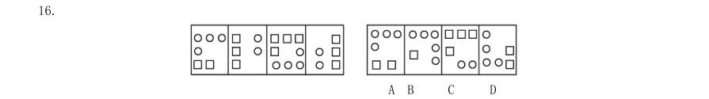

> （本题为图形题，选项为图片，见原卷）

**答案：A**　**考点：图形推理｜位置规律**　**难度：★★★☆☆**
**【判断推理·图形推理｜GK-2003-a-X017】**

17. A B C D

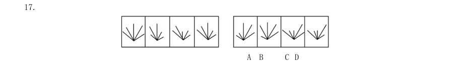

> （本题为图形题，选项为图片，见原卷）

**答案：B**　**考点：图形推理｜图形推理（综合）**　**难度：★★★☆☆**
**【判断推理·图形推理｜GK-2003-a-X018】**

18. A B C D

> （本题为图形题，选项为图片，见原卷）

**答案：B**　**考点：图形推理｜图形推理（综合）**　**难度：★★★☆☆**
**【判断推理·图形推理｜GK-2003-a-X019】**

19. A B C D

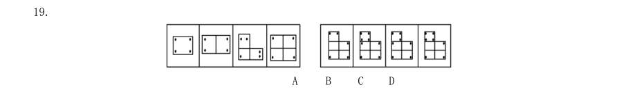

> （本题为图形题，选项为图片，见原卷）

**答案：A**　**考点：图形推理｜数量规律**　**难度：★★★☆☆**
**【判断推理·图形推理｜GK-2003-a-X020】**

20. A B C D

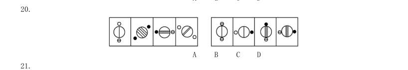

> （本题为图形题，选项为图片，见原卷）

**答案：C**　**考点：图形推理｜位置规律**　**难度：★★★☆☆**
**【判断推理·图形推理｜GK-2003-a-X021】**

21. A B C D

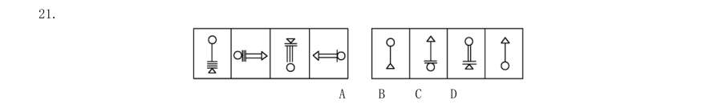

> （本题为图形题，选项为图片，见原卷）

**答案：A**　**考点：图形推理｜位置规律**　**难度：★★★☆☆**
**【判断推理·图形推理｜GK-2003-a-X022】**

22. A B C D 2.每道题包含两套图形和可供选择的4 个图形。这两套图形具有某种相似性,也存在某种差异。要求你从 四个选项中选择你认为最适合取代问号的一个。正确的答案应不仅使两套图形表现出最大的相似性,而且使第 二套图形也表现出自己的特征。

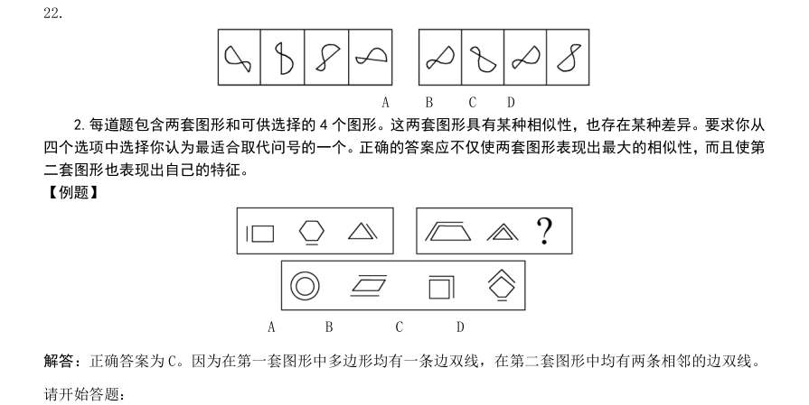

> （本题为图形题，选项为图片，见原卷）

**答案：D**　**考点：图形推理｜位置规律**　**难度：★★★★☆**
**【判断推理·图形推理｜GK-2003-a-X023】**

23. A B C D

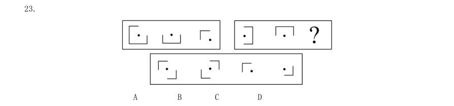

> （本题为图形题，选项为图片，见原卷）

**答案：A**　**考点：图形推理｜图形推理（综合）**　**难度：★★★☆☆**
**【判断推理·图形推理｜GK-2003-a-X024】**

24. A B C D

> （本题为图形题，选项为图片，见原卷）

**答案：B**　**考点：图形推理｜图形推理（综合）**　**难度：★★★☆☆**
**【判断推理·图形推理｜GK-2003-a-X025】**

25. A B C D 二、演绎推理:共15 题,每题给出一段陈述,这段陈述假设是正确的,不容置疑的。要求你根据这段陈述, 选择一个答案。注意:正确的答案应与所给的陈述相符合,不需要任何附加说明即可以从陈述中直接推出。

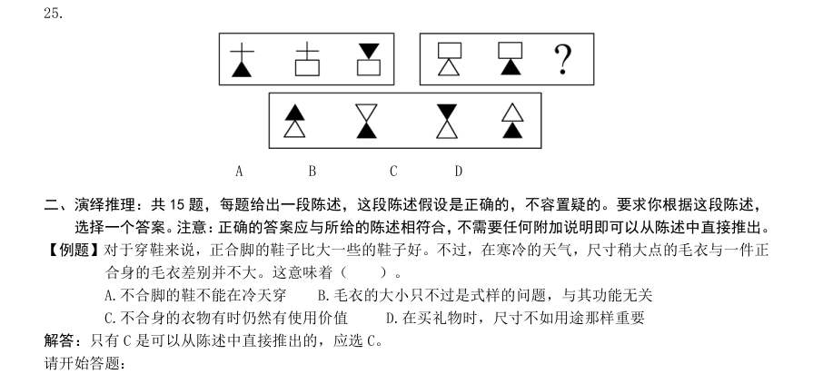

> （本题为图形题，选项为图片，见原卷）

**答案：B**　**考点：图形推理｜位置规律**　**难度：★★★★☆**
**【判断推理·逻辑判断｜GK-2003-a-X026】**

26. 当一个高压峰遭遇一个低压峰时,通常会发生降水。气象学家通过测量两个相向移动的峰的速度,可确定 它们什么时候、在什么地方相遇,借此来预测降水。 据此可知( )。

- **A.** 气象学家的职责是预测降水
- **B.** 低压峰总是向着高压峰方向移动
- **C.** 降水不一定需要低压峰的出现
- **D.** 某些降水的预测是基于高、低压峰的一般反应

**答案：D**　**考点：逻辑判断｜前提假设**　**难度：★★★☆☆**
**【判断推理·逻辑判断｜GK-2003-a-X027】**

27. 世界食品需求能否保持平衡,取决于人口和经济增长的速度。人口增长会导致食物摄取量的增加;另一方 面,经济增长会促使畜产品消费增加,改变人们的食物结构,从而对全球的谷物需求产生影响。据此可知 ( )。

- **A.** 人口的增长将影响全球的谷物需求
- **B.** 改变食物结构将降低全球的谷物需求
- **C.** 经济的增长可降低全球谷物的需求
- **D.** 人口的增长会导致世界畜产品消费的增加

**答案：A**　**考点：逻辑判断｜逻辑判断（综合）**　**难度：★★★★☆**
**【判断推理·逻辑判断｜GK-2003-a-X028】**

28. 最近15 年,世界技术有很大革新,尤其在通讯、信息和电子等方面。无疑,技术的进步使生产得到了改进, 加强技术力量是推动经济增长的一个重要因素。据此可知( )。

- **A.** 最近15 年世界经济增长迅速
- **B.** 技术革新可以推动生产发展
- **C.** 生产发展对技术进步有反作用
- **D.** 技术进步决定了经济的增长

**答案：B**　**考点：逻辑判断｜加强**　**难度：★★★☆☆**
**【判断推理·逻辑判断｜GK-2003-a-X029】**

29. 一方面由于天气恶劣,另一方面由于主要的胡椒种植者转种高价位的可可,所以,三年以来,全世界的胡 椒产量已经远远低于销售量了。因此,目前胡椒的供应相当短缺。其结果是:胡椒价格上扬,已经和可可 不相上下了。据此可知( )。

- **A.** 世界市场胡椒的储存量正在减少
- **B.** 世界胡椒消费已持续三年居高不下
- **C.** 胡椒种植者正在扩大胡椒的种植面积
- **D.** 目前可可的价格要低于三年前的价格

**答案：A**　**考点：逻辑判断｜逻辑判断（综合）**　**难度：★★★★☆**
**【判断推理·逻辑判断｜GK-2003-a-X030】**

30. 顾客并不像通常所描述的那么容易被操纵。他们知道自己需要什么。他们需要的东西,和别人认为他们需 要的东西,可能有很大的差别。据此可知( )。

- **A.** 广告投资与商品销售不成正比
- **B.** 大多数人购物认准一种品牌多年不变
- **C.** 在进入商店前顾客大都知道要买哪种牌子的商品
- **D.** 顾客在商店购物时一般不喜欢他人的介绍或建议

**答案：C**　**考点：逻辑判断｜逻辑判断（综合）**　**难度：★★★☆☆**
**【判断推理·逻辑判断｜GK-2003-a-X031】**

31. 令人奇怪的是,洛可可风格竟然首先出现于法兰西。路易十四的统治持续时间太长,对老王朝过分虔诚的 时代终于结束,雄伟高贵的凡尔赛不再迫使人们参加令人生厌的庆典,从此人们聚集于巴黎各公馆的精美 沙龙之中。起初,洛可可是一种新型装饰,是为热爱冒险、异国情调、奇思遐想和大自然的高雅、智慧的 社会服务的。这种轻盈、精美的风格最适合于现代公寓,房间不大,但均有珍贵的用途。洛可可进入巴洛 克风格出尽风头的国家时,是十分谨慎小心的。从这段话可以得到的正确推论是( )。

- **A.** 路易十四时期法国流行轻盈、精美的巴洛克式室内装潢风格
- **B.** 洛可可风格首先在法国出现是因为法国人热爱冒险和奇思遐想
- **C.** 现代公寓都是洛可可式的,因而它们房间不大,但均有珍贵的用途
- **D.** 与巴洛克风格相比,洛可可风格并不追求雄伟和高贵

**答案：B**　**考点：逻辑判断｜逻辑判断（综合）**　**难度：★★★★★**
**【判断推理·逻辑判断｜GK-2003-a-X032】**

32. 广告业的真理之一是,在广告中很少需要使用有内容的词句。广告所要做的只是吸引可能的顾客的注意力, 因为记忆会促成一切。以产品的销售量而言,顾客对某项产品的记忆比对产品某些特性的了解还重要。这 表明作者这样一种观点( )。

- **A.** 广告业对它所促销商品的了解并不多
- **B.** 要吸引可能的顾客的注意力并不很困难
- **C.** 人们不需要对某产品有深入的了解就能够记住它
- **D.** 只为吸引可能的顾客的注意力的广告缺乏真实性

**答案：C**　**考点：逻辑判断｜逻辑判断（综合）**　**难度：★★★★☆**
**【判断推理·逻辑判断｜GK-2003-a-X033】**

33. 与中国的贸易,法国远远落后于日本和美国,甚至落后于英国和意大利。中国今年的国民生产总值增长率 预计将达7.5%~7.8%,与2001 年头7 个月相比,法国同中国的贸易只增长了2.7%,而同是竞争者的其 他欧洲国家同中国的贸易却均增长了10%。 这段话说明( )。

- **A.** 法中贸易增长率低于中国国民生产总值增长率
- **B.** 法国同中国贸易的发展步伐相对缓慢
- **C.** 法国同中国的贸易远远落后于其他发达国家
- **D.** 除法国外的其他欧洲国家与中国的贸易都增长迅速

**答案：B**　**考点：逻辑判断｜逻辑判断（综合）**　**难度：★★★★☆**
**【判断推理·逻辑判断｜GK-2003-a-X034】**

34. 在公元之初,牧师们将基督教在整个罗马帝国中传播开来。基督教的普及首先涉及的是各大城市的平民阶 层。基督徒们反对皇权意识,因此君主们都把他们视为威胁,并组织起对他们的暴力摧残。然而这并没有 中断新信仰的扩展,它一点点赢得了贵族阶级和最有影响力的人士,而且很快触及到了皇帝周围的人和最 高君主本人。公元312 年的米兰敕令为迫害画上了句号。公元380 年,狄奥多西敕令使基督教成为国教。 因此,公元4 世纪标志着基督教概念中的转折点。根据这段话,可得到的正确推论是( )。

- **A.** 基督教从开始就反对皇权统治,且一直与罗马皇帝及其政权斗争
- **B.** 基督教成为国教,意味着它由非法而合法、由被迫害而被推崇
- **C.** 公元312 年基督教赢得了贵族阶级和最有影响力的人士的支持
- **D.** 公元380 年以后,基督徒不再受到迫害,基督教被承认

**答案：B**　**考点：逻辑判断｜加强**　**难度：★★★★★**
**【判断推理·逻辑判断｜GK-2003-a-X035】**

35. 某家庭有6 个孩子,3 个孩子是女孩。其中5 个孩子有雀斑,4 个孩子有卷发。 这表明有可能( )。

- **A.** 两个男孩有卷发但没有雀斑
- **B.** 三个有雀斑的女孩都没有卷发
- **C.** 两个有雀斑的男孩都没有卷发
- **D.** 三个有卷发的男孩只有一个有雀斑

**答案：C**　**考点：逻辑判断｜前提假设**　**难度：★★★☆☆**
**【判断推理·逻辑判断｜GK-2003-a-X036】**

36. “一桌子苹果,别人通常挑一两个,挑三四个。毕加索最可气,每个都咬上一口,每个苹果上都有他的牙 印儿。”一位中国画家如此评价毕加索。毕加索一生搞过素描、油画、雕塑、版画,担任过舞台设计,还 写过小说、剧本和无标点散文诗。 从这段文字中我们可以推论( )。

- **A.** 毕加索吃苹果,每个都只咬一口。中国作家对这种做法不以为然
- **B.** 很多人都像毕加索一样参与过许多艺术类型的创作
- **C.** 毕加索在艺术领域的许多方面进行过创作的尝试
- **D.** 毕加索是个天才式的人物,没有他不涉及的艺术领域

**答案：C**　**考点：逻辑判断｜解释评价**　**难度：★★★★☆**
**【判断推理·逻辑判断｜GK-2003-a-X037】**

37. 四个小偷(每人各偷了一种东西)接受盘问。甲说:每人只偷了一块表;乙说:我只偷了一颗钻石;丙说: 我没偷表;丁说:有些人没偷表。经过警察的进一步调查,发现这次审问中只有一人说了实话。下列判断, 没有错误的是( )。

- **A.** 所有人都偷了表
- **B.** 所有人都没偷表
- **C.** 有些人没偷表
- **D.** 乙偷了一颗钻石

**答案：A**　**考点：逻辑判断｜前提假设**　**难度：★★★★☆**
**【判断推理·逻辑判断｜GK-2003-a-X038】**

38. 作为一名建筑师,莱伊恩并不是最出色的。但作为一个人,他无疑非常伟大。他始终恪守自己的原则,给 高贵的心灵一个美丽的住所,哪怕是遭遇到最大的阻力,也要想办法抵达胜利彼岸。下列表达有错误的是 ( )。

- **A.** 莱伊恩的阻力来自于他并不出色的建筑才能
- **B.** 伟大表现在即使遇到困难,也要坚持自己的原则
- **C.** 莱伊恩做到了给自己的心灵一个美丽的住所
- **D.** 工作没有惊人成绩也不妨碍一个人成为伟大的人

**答案：A**　**考点：逻辑判断｜逻辑判断（综合）**　**难度：★★★★☆**
**【判断推理·逻辑判断｜GK-2003-a-X039】**

39. 作为惟一一支留在世界杯的南美球队,下一场比赛巴西将迎战淘汰了丹麦的英格兰球队。巴西队教头 斯科拉里不愿谈论如何与英格兰较量,而他的队员也保持着清醒的头脑。在击败顽强的比利时队后, 斯科拉里如释重负: “我现在脑子里想的第一件事就是好好放松一下。”依上文我们无法知道的是( )。

- **A.** 巴西队本届世界杯中再也不会与南美球队比赛
- **B.** 由于没有做好充分的准备,斯科拉里不愿意谈论与英格兰的较量
- **C.** 与比利时的比赛很艰苦,所以赛后斯科拉里如释重负
- **D.** 英格兰在与巴西比赛之前必须要战胜丹麦

**答案：B**　**考点：逻辑判断｜逻辑判断（综合）**　**难度：★★★★☆**
**【判断推理·逻辑判断｜GK-2003-a-X040】**

40. 某著名经济学家说,市场经济是一种开放经济,中国肯百折不回地争取入世,从根本上讲是国内市场化改 革导致的必然抉择。中国许多问题的解决都得靠外力的推动。从更深广的层面来看,WTO 是中国加入的最 后一个重要国际组织,这是中国自立于世界民族之林的最后一次重大外交行动,也是全面重返国际舞台的 显著标志和强烈信号。所以有人曾指出,入世的政治意义大于经济意义。依据上文,不能推出的结论是 ( )。

- **A.** 加入WTO 后,中国已经全面重返国际舞台
- **B.** 加入WTO 后,中国已加入了所有重要的国际组织
- **C.** 加入WTO 后,中国的政治发展将快于经济发展
- **D.** 中国若没有国内市场化的改革,难以取得加入WTO 的成果

**答案：C**　**考点：逻辑判断｜归纳推导**　**难度：★★★★★**
**【判断推理·定义判断｜GK-2003-a-X041】**
> 材料：选出一个最符合或最不符合该定义的答案。注意:假设这个定义是正确的,不容置疑的。 请开始答题:

41. 劳动争议:指在劳动者和劳动力使用者之间因劳动权利与义务发生分歧而引起的争议。 根据以上定义,下列行为属于劳动争议的是( )。

- **A.** 职工甲因工伤未能获得保险赔偿而与工厂争执
- **B.** 甲企业与乙企业之间因借调某一职工而产生矛盾
- **C.** 职工甲因工作调动而与当地的劳动部门发生争执
- **D.** 某厂职工甲与职工乙因工作意见不一而产生矛盾

**答案：A**　**考点：定义判断｜单定义**　**难度：★☆☆☆☆**
**【判断推理·定义判断｜GK-2003-a-X042】**

42. 反诉:是指在已经提起的诉讼中,被告针对与原诉有联系的行为,提起独立诉讼请求的行为。根据以上 定义,下列行为属于反诉的是( )。

- **A.** 老师起诉学生借钱不还,学生起诉老师剽窃
- **B.** 原告起诉离婚,被告请求法院确认婚姻关系本来就是无效
- **C.** 原告起诉,要求被告按买卖合同交货,被告起诉供货商未能按时交货
- **D.** 原告起诉被告居住的房屋所有权是他的,被告请求法院让原告偿还欠款

**答案：B**　**考点：定义判断｜单定义**　**难度：★★☆☆☆**
**【判断推理·定义判断｜GK-2003-a-X043】**

43. 诉讼标的:是指当事人争议的要求人民法院通过审判予以解决的某一民事法律关系或权利。根据以上 定义,下列属于诉讼标的的是( )。

- **A.** 原、被告之间发生纠纷的1 000 元的借款
- **B.** 原、被告之间发生的名誉受到诽谤的伤害
- **C.** 原、被告之间发生的起诉与被起诉的关系
- **D.** 原、被告之间发生的抢劫与被抢劫的施、受害关系

**答案：B**　**考点：定义判断｜单定义**　**难度：★☆☆☆☆**
**【判断推理·定义判断｜GK-2003-a-X044】**

44. 赠与合同:是合同一方当事人将自己的财产无偿给予另一方当事人的合同。给予财产的一方当事人为赠与 人,受领财产的一方为受赠人。 根据以上定义,下列行为可能形成赠与合同的是( )。

- **A.** 甲出国留学期间将自己的住所免费提供朋友乙使用
- **B.** 甲将自己经营的养鸡场送给答应给自己养老的女婿
- **C.** 甲邀请乙来经营自己的公司并给对方80%的股份
- **D.** 某电脑商在校庆之际送给母校15 台新款电脑

**答案：D**　**考点：定义判断｜单定义**　**难度：★★☆☆☆**
**【判断推理·逻辑判断｜GK-2003-a-X045】**

45. 社会保险:是国家通过立法,采取强制手段对国民收入进行分配与再分配,形成专门消费基金,对劳动者 在丧失劳动能力或失去工作机会时进行社会帮助以保障其基本生活的一种制度。下列属于社会保险的是 ( )。

- **A.** 工伤保险
- **B.** 退伍军人安置费
- **C.** 国家向洪水灾区人民发放生活救济
- **D.** 旅客人身伤害保险

**答案：A**　**考点：逻辑判断｜逻辑判断（综合）**　**难度：★★★★☆**
**【判断推理·定义判断｜GK-2003-a-X046】**

46. 职务侵占罪:是指公司、企业或者其他单位的人员,利用职务上的便利,将本单位财物非法占为己有,数 额较大的行为。下列行为属于职务侵占罪的是( )。

- **A.** 王某是出租车司机,将乘客遗失在他车上价值5 000 元的物品占为己有
- **B.** 刘某是某建筑公司一工地的材料工人,负责工地模板等物品的调拨,几次私自将公司的建筑模板卖给一个过路的车主,共卖了2 万元
- **C.** 刘某是单位的保管员,一天他趁其他同事不注意的时候,将一个200 元的录音机拿回家给儿子用
- **D.** 赵某是一大钢铁公司的会计师,为了增加公司的利润私自做假账,使公司偷税高达200 万余元

**答案：B**　**考点：定义判断｜单定义**　**难度：★★☆☆☆**
**【判断推理·定义判断｜GK-2003-a-X047】**

47. 受贿:是指国家工作人员利用职务上的便利,索取他人财物,或者非法收受他人财物,为他人谋取利益的 行为。下列行为属于受贿的是( )。

- **A.** 某建筑公司以女色拉拢市长对工程招、投标实施影响
- **B.** 某市工商行政管理局李局长,因个人恩怨,故意刁难申请开办公司的张某。张某便出钱请与李局长熟识的刘某为其疏通。刘某收下张某的5 000 元钱,但未做任何疏通工作
- **C.** 杨某为某县副县长,主管外贸。杨某生性贪婪,认为下面的人都应该向自己纳贡。但他又怕脏了自己的手,遂指示其妻子向本县辖区内的各外贸企业打电话,让他们表表孝心,各公司老总为了本公司的前途,

**答案：C**　**考点：定义判断｜单定义**　**难度：★★☆☆☆**
**【判断推理·逻辑判断｜GK-2003-a-X048】**
> 材料：D.某大型广告公司业务员李某,经常利用自己的身份,在和其他公司的业务往来中收取对方支付的好处费、 回扣

48. 一事不再罚:是指对当事人的同一个违法行为,不得给予两次以上罚款的行政处罚。 下面做法不符合一事不再罚规定的是( )。

- **A.** 张某回国携带应申报物品而没有向海关申报,海关认定张某的行为构成走私,对其做出没收物品,并罚款人民币2 000 元的处罚
- **B.** 个体户杨某在贩卖生猪时被“生猪办”执法人员查出没有完税凭证,并且拒绝申报纳税。“生猪办”执法人员遂通知公安机关以妨碍公务为名将其留置盘查48 小时。后国税分局根据“生猪办”认定的事实,

**答案：D**　**考点：逻辑判断｜逻辑判断（综合）**　**难度：★★★★☆**
**【判断推理·逻辑判断｜GK-2003-a-X049】**
> 材料：C.某县有一饮食店,未在工商、税务部门办理登记就开始营业,半年后被工商部门查获罚款。县地税局通 过调查,对该饮食店下达了《税务行政处罚事项告知书》、《税务处理决定书》、《税务行政处罚决定 书》,责令其补税、并缴纳加收滞纳金和罚款 D.某甲是河北人,在北京打工。因为多生一孩违反了地方法规的规定,已经依据北京市某区计划生育部门 的决定在北京缴纳了社会抚养费。某甲在回家探亲时,其户籍所在地的计划生育部门根据河北省有关规 定亦对某甲的超生行为征收了社会抚养费

49. 回避条件作用:当厌恶刺激或不愉快情境出现,个体做出某种反应,从而逃避了厌恶刺激或不愉快情境, 则该反应在以后的类似情境中发生的概率增加。 下列不属于回避条件作用的是( )。

- **A.** 看见路上的垃圾后绕道走开
- **B.** 碰到烫的东西,赶紧缩回手来
- **C.** 感觉屋内人声嘈杂时暂时离去
- **D.** 害怕见生人不敢上街

**答案：C**　**考点：逻辑判断｜逻辑判断（综合）**　**难度：★★★☆☆**
**【判断推理·定义判断｜GK-2003-a-X050】**

50. 倾销:是指企业在国外出售商品的价格低于国内市场的价格或低于生产成本。 根据这一定义,下列行为不属于倾销的是( )。

- **A.** 某国以低于产品正常价值的价格向他国销售新闻纸
- **B.** 某企业在国内有较高的垄断地位和较大的市场份额,但质量不如国外同类产品,为了抢占国际市场,该企业以低于成本价的价格在他国销售
- **C.** 某国软件公司为了获得他国政府采购的定单,与他国同类软件竞争,以低于该产品在本国的销售价格投标
- **D.** 某地为著名的蔬菜生产基地,由于采用先进的科学技术和规模化经营,其生产的蔬菜的价格远远低于国

**答案：D**　**考点：定义判断｜单定义**　**难度：★★☆☆☆**
**【常识判断·政治常识｜GK-2003-a-X051】**
> 材料：常识判断(共30 题,参考时限20 分钟) 本部分包括两种类型的题目,请根据题目要求做出正确选择。多项选择题错选、多选、少选均不得分,但 也不倒扣分。 请开始答题: 一、单项选择题(20 题)

51. 第二次世界大战全面爆发的标志性事件是( )。

- **A.** 1939 年9 月1 日德国突袭波兰
- **B.** 1937 年7 月7 日日本制造卢沟桥事变
- **C.** 1941 年12 月8 日日本突袭珍珠港
- **D.** 1941 年6 月22 日德国突袭苏联

**答案：A**　**考点：政治常识｜政治常识（综合）**　**难度：★☆☆☆☆**
**【常识判断·政治常识｜GK-2003-a-X052】**

52. 重庆直辖市的设置是由下列哪个机构通过的( )。

- **A.** 国务院
- **B.** 全国人民代表大会常务委员会
- **C.** 全国人民代表大会
- **D.** 国家主席

**答案：C**　**考点：政治常识｜政治常识（综合）**　**难度：★☆☆☆☆**
**【常识判断·经济常识｜GK-2003-a-X053】**

53. 利率是一国政府调控宏观经济的重要杠杆。变动利率对经济影响的一般规律是( )。

- **A.** 提高利率,储蓄减少
- **B.** 降低利率,投资会减少
- **C.** 提高利率,会抑制通货膨胀
- **D.** 降低利率,消费会减少

**答案：C**　**考点：经济常识｜宏观经济**　**难度：★☆☆☆☆**
**【常识判断·政治常识｜GK-2003-a-X054】**

54. 下列说法正确的是( )。

- **A.** 2000 年9 月15,秋风送爽,悉尼奥运会在一派欢乐气氛中开幕
- **B.** 《诗经》里的“七月流火”,非常形象的描绘了夏天天气的炎热
- **C.** 人们经常说的“绿色食品”指以绿色植物为主要原料制作的食品
- **D.** 水晶和沙子虽然外表差别很大,但它们的主要成分是一样的

**答案：D**　**考点：政治常识｜政治常识（综合）**　**难度：★★★★☆**
**【常识判断·经济常识｜GK-2003-a-X055】**

55. 某地有一些无经济来源的孤寡残幼,政府关心并对他们提供基本的生活保障,这种情况应属于( )。

- **A.** 社会救助
- **B.** 社会保险
- **C.** 社会捐助
- **D.** 社会优抚

**答案：A**　**考点：经济常识｜微观与市场**　**难度：★☆☆☆☆**
**【常识判断·政治常识｜GK-2003-a-X056】**

56. 我国现阶段的外交政策是( )。

- **A.** 和平共处五项原则
- **B.** 求同存异
- **C.** 建立国际经济新秩序
- **D.** 独立自主的和平外交政策

**答案：D**　**考点：政治常识｜政治常识（综合）**　**难度：★☆☆☆☆**
**【常识判断·政治常识｜GK-2003-a-X057】**

57. 我国实行的政党制度是( )。

- **A.** 多党制
- **B.** 人民民主专政
- **C.** 中国共产党一党执政
- **D.** 中国共产党领导的多党合作与政治协商

**答案：D**　**考点：政治常识｜政治常识（综合）**　**难度：★☆☆☆☆**
**【常识判断·政治常识｜GK-2003-a-X058】**

58. 人民法院审理行政案件,可以依据的规范性文件是( )。

- **A.** 北京市某区政府发布的政府采购实施办法
- **B.** 云南某自治州制定的在本州范围内实施的单行条例
- **C.** 国务院对其最终裁决行为的规定
- **D.** 人事部发布的在本部门系统内部施行的规定

**答案：B**　**考点：政治常识｜政治常识（综合）**　**难度：★☆☆☆☆**
**【常识判断·政治常识｜GK-2003-a-X059】**

59. 地球南北极上空,经常出现极光,下列关于极光成因的正确说法是( )。

- **A.** 在地球南北两极,磁场活动异常活跃,磁场与大气层中的气体发生作用,形成了色彩艳丽的极光
- **B.** 地球南北两极气流活动活跃。气流与太阳光交互作用,摩擦放电,形成了极光
- **C.** 来自太阳的高能粒子,在地磁作用下,聚集到南北两极,并且与大气层中的粒子冲撞产生了极光
- **D.** 南北两极大气层比其他地区厚,折射太阳光线的能力很强,照射到南北极区的光线大部分被折射回去,

**答案：C**　**考点：政治常识｜政治常识（综合）**　**难度：★★★★☆**
**【常识判断·政治常识｜GK-2003-a-X060】**

60. 最近,有人在美国境内发现了一种在中国常被视为“盘中佳肴”的黑鱼,在美国上下引起不小的风波。引 起这场“黑鱼风波”的主要原因是( )。

- **A.** 美国人不喜欢吃黑鱼
- **B.** 美国人认为黑鱼是名贵物种,应该被保护起来
- **C.** 黑鱼会破坏美国当地的生态平衡
- **D.** 黑鱼非常凶猛,危害人类

**答案：C**　**考点：政治常识｜政治常识（综合）**　**难度：★★★☆☆**
**【常识判断·政治常识｜GK-2003-a-X061】**

61. 中国恢复在联合国大会的席位是在( )。

- **A.** 1971 年
- **B.** 1972 年
- **C.** 1978 年
- **D.** 1979 年

**答案：A**　**考点：政治常识｜政治常识（综合）**　**难度：★☆☆☆☆**
**【常识判断·政治常识｜GK-2003-a-X062】**

62. 现阶段我国政府机构改革的关键是( )。

- **A.** 精简机构
- **B.** 压缩编制
- **C.** 转变职能
- **D.** 政企分开

**答案：C**　**考点：政治常识｜毛中特与党史**　**难度：★☆☆☆☆**
**【常识判断·地理常识｜GK-2003-a-X063】**

63. 根据现行国家公务员制度,国家公务员是指国家行政机关工作人员,但不包括其中的( )。

- **A.** 党群专职工作人员
- **B.** 工勤人员
- **C.** 政府组成人员
- **D.** 国务院各部部长

**答案：B**　**考点：地理常识｜世界地理**　**难度：★☆☆☆☆**
**【常识判断·政治常识｜GK-2003-a-X064】**

64. 管理学中的“木桶原理”指的是在管理工作中要注意( )。

- **A.** 灵活性
- **B.** 原则性
- **C.** 程序性
- **D.** 整体性

**答案：D**　**考点：政治常识｜政治常识（综合）**　**难度：★☆☆☆☆**
**【常识判断·政治常识｜GK-2003-a-X065】**

65. 以下组织结构形式,能够有效结合组织的纵向垂直管理和横向水平管理的是( )。

- **A.** 直线指挥式
- **B.** 职能参谋式
- **C.** 事业部制
- **D.** 矩阵式

**答案：D**　**考点：政治常识｜政治常识（综合）**　**难度：★☆☆☆☆**
**【常识判断·政治常识｜GK-2003-a-X066】**

66. 世贸组织规则,要求所有成员对来自某一成员的产品所给予的利益、优待、特权和豁免,应当无条件地给 予来自其他所有成员的相同产品。这一原则被称为( )。

- **A.** 最惠国待遇原则
- **B.** 国民待遇原则
- **C.** 互惠原则
- **D.** 贸易政策透明度原则

**答案：A**　**考点：政治常识｜政治常识（综合）**　**难度：★★★☆☆**
**【常识判断·历史人文｜GK-2003-a-X067】**

67. 英国剑桥大学的史蒂芬·霍金教授是当代国际著名物理学大师,也是杰出的科普作家。他1988 年写的一部 在世界上广为流传的科普小说是( )。

- **A.** 《大爆炸探秘》
- **B.** 《自然的终结》
- **C.** 《物理世界奇遇记》
- **D.** 《时间简史》

**答案：D**　**考点：历史人文｜世界史**　**难度：★★★☆☆**
**【常识判断·政治常识｜GK-2003-a-X068】**

68. 开电扇使人感到凉快的主要原因是( )。

- **A.** 电扇有制冷作用
- **B.** 汗水在空气流通中迅速蒸发
- **C.** 空气流通后室内温度降低
- **D.** 心理作用,其实并没有凉快多少

**答案：B**　**考点：政治常识｜政治常识（综合）**　**难度：★☆☆☆☆**
**【常识判断·政治常识｜GK-2003-a-X069】**

69. 在处理实际问题时,往往不能“一刀切”的主要原因是( )。

- **A.** 事物矛盾之间存在有机联系
- **B.** 事物矛盾具有特殊性
- **C.** 事物矛盾具有共同点
- **D.** 事物矛盾具有普遍性

**答案：B**　**考点：政治常识｜政治常识（综合）**　**难度：★☆☆☆☆**
**【常识判断·政治常识｜GK-2003-a-X070】**

70. “不以物喜,不以己悲”告诉我们( )。

- **A.** 不能因为自己的成功或失败而或喜或悲
- **B.** 不能因为环境的好坏和自己的得失而或喜或悲
- **C.** 不能因为自己的物质条件好坏而或喜或悲
- **D.** 不能因为自己强于或不如别人而或喜或悲

**答案：B**　**考点：政治常识｜政治常识（综合）**　**难度：★☆☆☆☆**
**【常识判断·法律常识｜GK-2003-a-X071】**

71. 按照宪法和组织法的规定,属于政府组成人员的是( )。

- **A.** 国务院总理
- **B.** 国家主席
- **C.** 青岛市人民政府秘书长
- **D.** 海关总署署长

**答案：暂缺**　**考点：法律常识｜宪法**　**难度：★☆☆☆☆**
**【常识判断·法律常识｜GK-2003-a-X072】**

72. 国务院制定的行政法规可以规定的事项有( )。

- **A.** 犯罪与刑罚
- **B.** 对公民财产权利的剥夺
- **C.** 限制人身自由的强制措施
- **D.** 外贸的一般制度

**答案：暂缺**　**考点：法律常识｜刑法**　**难度：★☆☆☆☆**
**【常识判断·政治常识｜GK-2003-a-X073】**

73. 下列关于行政复议的说法,正确的是( )。

- **A.** 行政复议是行政行为
- **B.** 行政复议是司法行为
- **C.** 行政复议是行政系统内部的监督行为
- **D.** 行政复议是行政救济方式的一种

**答案：暂缺**　**考点：政治常识｜政治常识（综合）**　**难度：★☆☆☆☆**
**【常识判断·政治常识｜GK-2003-a-X074】**

74. 下列人员,享有选举权的有( )。

- **A.** 因盗窃被判处有期徒刑三年的罪犯
- **B.** 年满12 周岁,正在上中学的学生
- **C.** 在我国长期居住的无国籍人
- **D.** 完全不能辨认和控制自己行为能力的精神病人

**答案：暂缺**　**考点：政治常识｜政治常识（综合）**　**难度：★☆☆☆☆**
**【常识判断·历史人文｜GK-2003-a-X075】**

75. 目前,我国已拥有世界遗产28 处,其中属于世界文化遗产的有( )。

- **A.** 布达拉宫
- **B.** 庐山
- **C.** 云冈石窟
- **D.** 九寨沟

**答案：暂缺**　**考点：历史人文｜世界史**　**难度：★☆☆☆☆**
**【常识判断·地理常识｜GK-2003-a-X076】**

76. 在行政系统内部对国家行政机关实施专门监督的机关有( )。

- **A.** 司法行政机关
- **B.** 行政监察机关
- **C.** 纪律检查委员会
- **D.** 审计机关

**答案：暂缺**　**考点：地理常识｜世界地理**　**难度：★☆☆☆☆**
**【常识判断·法律常识｜GK-2003-a-X077】**

77. 下列属于《国家公务员暂行条例》规定的行政处分的有( )。

- **A.** 罚款
- **B.** 警告
- **C.** 降职
- **D.** 开除

**答案：暂缺**　**考点：法律常识｜行政法**　**难度：★☆☆☆☆**
**【常识判断·经济常识｜GK-2003-a-X078】**

78. 20 世纪90 年代初出现的“新经济”是相对于传统经济而言的一种经济模式。下列能表述其基本特征的有 ( )。

- **A.** 全球化
- **B.** 市场化
- **C.** 信息化
- **D.** 专业化

**答案：暂缺**　**考点：经济常识｜微观与市场**　**难度：★☆☆☆☆**
**【常识判断·法律常识｜GK-2003-a-X079】**

79. 根据《国家公务员暂行条例》的规定,对公务员的考核包括( )。

- **A.** 德
- **B.** 能
- **C.** 廉
- **D.** 绩

**答案：暂缺**　**考点：法律常识｜行政法**　**难度：★☆☆☆☆**
**【常识判断·政治常识｜GK-2003-a-X080】**

80. 下列观点正确的有( )。

- **A.** 一切事物的存在和发展都是有条件的
- **B.** 有些事物的存在和发展是有条件的,有些则不然
- **C.** 事物存在和发展的条件变了,事物本身也要发生变化
- **D.** 事物存在和发展的条件变了,事物不一定随之而改变

**答案：暂缺**　**考点：政治常识｜马克思主义基本原理**　**难度：★☆☆☆☆**
**【言语理解·逻辑填空｜GK-2003-a-X081】**
> 材料：言语理解与表达(共30 题,参考时限30 分钟) 每道题包含一段文字(或一个句子),后面是一个不完整的陈述,要求你从四个选项中选出一个来完成陈述。 注意:答案可能是完成对所给文字主要意思的提要,也可能是满足陈述中其他方面的要求,你的选择应与所提 要求最相符合。

81. 科学家发现大洋底部的裂陷扩展从来没有停止过。这个发现可能会解答一个曾引起人们关注的问题。地球 每天的时间都比前一天延长1/700 秒,即每过一年,一天要延长0.5 秒,据此预测,再过2 亿年,一年将 只有250 天了。对“一个曾引起人们关注的问题”的“解答”,最准确的是( )。

- **A.** 大洋底部裂陷扩展,地球运行时间延长
- **B.** 大洋底部裂陷扩展,地球运行时间缩短
- **C.** 大洋底部裂陷扩展,地球自转速度减慢
- **D.** 大洋底部裂陷扩展,地球自转速度加快

**答案：C**　**考点：逻辑填空｜逻辑填空（综合）**　**难度：★★★☆☆**
**【言语理解·语句填入｜GK-2003-a-X082】**

82. 有人也许认为,“写文章只要不妨害所表达的义理,材料细节有点出入是无所谓的。”义理是文章的灵魂, 大凡写文章,不会不关注这一点。这种关注就应包含对支撑义理的材料的审慎核查与选用。对画横线文字 理解最准确的是( )。

- **A.** 批评了只重视表达义理,但是不重视材料真实性的错误认识
- **B.** 肯定了既重视义理的表达,也重视材料细节必须真实的主张
- **C.** 批评了借口不妨害表达义理,而忽视材料真实性的错误认识
- **D.** 肯定了材料对表达义理的作用,不主张苛求材料细节的真实

**答案：C**　**考点：语句填入｜语句填入（综合）**　**难度：★★★★★**
**【言语理解·逻辑填空｜GK-2003-a-X083】**

83. 如果我们只把过去的一些文件逐字逐句照抄一通, ,更谈不到正确地解决什么问题。那样即使我 们口头上大讲拥护毛泽东思想,实际上也只能是违反毛泽东思想。 填入横线上最恰当的是( )。

- **A.** 那就连一般问题也解决不了
- **B.** 那就不能解决什么问题
- **C.** 那就不能解决任何问题
- **D.** 那就不是解决问题的办法

**答案：B**　**考点：逻辑填空｜一空**　**难度：★☆☆☆☆**
**【言语理解·逻辑填空｜GK-2003-a-X084】**

84. 孔子作为儒家的创始人,奠定了儒家理想人格的基本格局。孔子理想人格的基本内容是“礼”和“仁”。 “礼”是外在的行为规范,“仁”是内在的精神原则。 。 B.孔子认为礼和仁是区分庸人与圣贤的根本标志 C.孔子把礼视为立身之本,并用仁来补充规定礼 D.孔子的理想人格就是内仁外礼的“仁—礼”人格

> （本题为图形题，选项为图片，见原卷）

**答案：D**　**考点：逻辑填空｜逻辑填空（综合）**　**难度：★★★☆☆**
**【言语理解·逻辑填空｜GK-2003-a-X085】**

85. 菲尔丁说:“不好的书也像不好的朋友一样,可能会把你戕害。”这话没错。但也不必为此走向极端,夸 大书籍对人的品格的影响。更多的情况是: 。填入横线上最恰当的是( )。

- **A.** 好人读了坏书受害至深,坏人读了好书受益甚微
- **B.** 好人读了好书取其精华,坏人读了坏书取其糟粕
- **C.** 好人读了好书好上加好,坏人读了坏书不可救药
- **D.** 好人读了坏书仍是好人,坏人读了好书仍是坏人

**答案：D**　**考点：逻辑填空｜一空**　**难度：★☆☆☆☆**
**【言语理解·中心理解｜GK-2003-a-X086】**

86. 从1901 年到1961 年,诺贝尔文学奖几乎完全为欧美白人垄断;60 年代以后亚、非、拉美作家居多数;90 年代则完全没有欧美白人作家获奖。而60 年代以后正是欧美科学技术突飞猛进的时代。这是否意味着科学 技术的发展会使文学作品失去人文魅力? 这段话主要支持了这样一种观点,即( )。

- **A.** 科技高度发展可能使文学中的人文精神走向浅薄
- **B.** 不排除技术和科学的干扰,就没有优秀文学作品
- **C.** 真正优秀的文学作品产生在落后的国家和地区
- **D.** 科技发展是以文学作品丧失人文魅力为代价的

**答案：A**　**考点：中心理解｜转折与因果**　**难度：★★★☆☆**
**【言语理解·细节判断｜GK-2003-a-X087】**

87. 中国妇女发展基金会将委托专业金融机构对中国女足发展基金进行管理和运作,其收益部分用于资助中国 女子足球队改善生活和训练条件,开展交流与合作,培养选拔后备力量。下列表述,符合文意的是( )。

- **A.** 中国女足发展基金,将解决中国女足所面临的问题
- **B.** 广泛开展交往合作,是培养和选拔女足后备力量的保证
- **C.** 中国女足的活动,由受委托的专业金融机构管理和运作
- **D.** 中国女足发展基金,已确定了管理机制和运作规则

**答案：A**　**考点：细节判断｜细节判断**　**难度：★☆☆☆☆**
**【言语理解·逻辑填空｜GK-2003-a-X088】**

88. 胚胎组织的免疫系统发育尚不充分,对外界刺激反应较慢,如果将胚胎组织注射到受外伤的成年人体内, 可有效防止伤口疤痕的形成。成年人血小板中的一种生长因子可加快伤口愈合,研制具有抑制这种生长因 子作用的药物,在伤口出现12 小时内,将该药物敷于伤口部位,伤口愈合后亦无疤痕。关于上述两种医疗 措施的表述,最准确的是( )。

- **A.** 其共同作用是使伤口对外界刺激反应较慢
- **B.** 其共同作用是使伤口改变自然愈合的状态
- **C.** 其共同作用是使伤口处血凝速度明显降低
- **D.** 其共同作用是使伤口的愈合过程相对缓慢

**答案：A**　**考点：逻辑填空｜逻辑填空（综合）**　**难度：★★★☆☆**
**【言语理解·中心理解｜GK-2003-a-X089】**

89. 鲁迅和青年们谈话,不爱用教训口吻,从不说“你应该这样”、“你不应该那样”一类的话。他以自 己的行动,以有趣的比喻和生动的故事作出暗示,让人体会到应该这样,不应该那样。对这段话理解最 准确的是( )。

- **A.** 鲁迅对青年的教导,与众不同,追求一种独特的方式
- **B.** 鲁迅对青年进行教育,宽容大度,启发他们自己觉悟
- **C.** 鲁迅对青年进行教育,善于引导,鼓励他们弃旧图新
- **D.** 鲁迅对青年的教导,讲究形象性,启发他们明辨是非

**答案：D**　**考点：中心理解｜对策优先**　**难度：★★☆☆☆**
**【言语理解·细节判断｜GK-2003-a-X090】**

90. 做一件事,往往有利也有弊,只有利而无弊的事情几乎是没有的。《淮南子·人间训》云:“众人皆知利 利而病病,惟圣人知病之为利,利之为病也。”看来古人已经注意到利弊的辩证关系。下列表述符合文意 的是( )。

- **A.** 现实生活中的事情都由利与弊组成
- **B.** 要善于分析,争取做到利大于弊
- **C.** 利与弊不是绝对的,是可以转化的
- **D.** 我们应当努力争取做到有利无弊

**答案：B**　**考点：细节判断｜细节判断**　**难度：★★☆☆☆**
**【言语理解·中心理解｜GK-2003-a-X091】**

91. 文学家在克隆一个时代横断面风景线的同时,克隆了自己人生的风景线。品察他们的克隆有双重意义:一 是品察在时代变幻中凸现的人文景观,二是品察他们在时代场景中自身的人格取向。这段文字所表明的中 心是( )。

- **A.** 文学家肩负着反映时代和展示人生的双重任务
- **B.** 表现时代和展示人生,是文学创作的双重目的
- **C.** 欣赏文学作品可以使读者了解文学家们的社会人格
- **D.** 欣赏文学作品有认识时代和文学家人格的双重意义

**答案：D**　**考点：中心理解｜转折与因果**　**难度：★★☆☆☆**
**【言语理解·中心理解｜GK-2003-a-X092】**

92. 市场作为资源配置的方式和手段不是万能的,无缺陷的。它由价值规律、供求规律和竞争规律的作用来进 行自发的调节。这种调节带有滞后性,就是说从价格形成到信号反馈再到产品产出效应,有一定的时滞。 作者认为市场作为资源配置的方式和手段的“缺陷”是( )。

- **A.** 自发性和盲目性
- **B.** 滞后性和调节性
- **C.** 自发性和滞后性
- **D.** 竞争性和调节性

**答案：C**　**考点：中心理解｜转折与因果**　**难度：★★☆☆☆**
**【言语理解·中心理解｜GK-2003-a-X093】**

93. 假使我们打些比喻,那么短篇小说作者所应选择也是最适宜表现的是:可以证明地层结构的悬崖峭壁,可 以泄露春意的梅萼柳芽,可以暗示秋讯的最先飘落的梧桐一叶,可以说明太古生活的北京人的一颗臼齿等 等。这段话支持了这样一种观点,即短篇小说()。

- **A.** 要采用多种描写方法,展现不同人物丰富多彩的思想情感
- **B.** 最适宜表现社会和自然的重大主题中那些振奋人心的情节
- **C.** 无法完成长篇或中篇的任务,它只能描写事物的关键部分
- **D.** 应该选取最贴近主题、最有代表性的情节来塑造艺术形象

**答案：D**　**考点：中心理解｜转折与因果**　**难度：★★★★☆**
**【言语理解·中心理解｜GK-2003-a-X094】**

94. 研究基本粒子,须借助极高的能量。欲知物质的微观结构,首先得变革微观物质,即得想办法把原子、原 子核,以及质子、中子等这些“小粒”打碎,把它们的内部结构和各种性质暴露出来。对“物质的微观结 构”与“微观物质”解说正确的是( )。

- **A.** 前者指各种小粒内部组合模式,后者指构成物质的各种小粒
- **B.** 前者指原子结构(含原子核),后者指质子、中子等这些小粒
- **C.** 二者反映了微观物质世界结构,即小粒结构构成了微观物质
- **D.** 二者都指组成物质的分子、原子、质子以及中子等各种小粒

**答案：A**　**考点：中心理解｜中心理解（综合）**　**难度：★★★★☆**
**【言语理解·逻辑填空｜GK-2003-a-X095】**

95. 鲁迅满怀悲愤的写道:“不是年青的为年老的写记念,而在这三十年中,却使我目睹许多青年的血,层层 淤积起来,将我埋得不能呼吸,我只能用这样的笔墨,写几句文章,算是从泥土中挖一个小孔,自己延口 残喘,这是怎样的世界呢。” 对上文中“延口残喘”一词的理解,不准确的是( )。

- **A.** 反映鲁迅英勇抗争,一往无前的无私无畏精神
- **B.** 反映鲁迅对只能写文章纪念捐躯青年的无奈
- **C.** 反映鲁迅先生处于极为险恶、压抑的环境之中
- **D.** 反映鲁迅先生悲愤的心情和奋力抗争的精神

**答案：A**　**考点：逻辑填空｜逻辑填空（综合）**　**难度：★★☆☆☆**
**【言语理解·细节判断｜GK-2003-a-X096】**

96. 苏轼认为,贾谊才学虽高,但不能审时度势,以致郁郁而死,未尽其才。他还说:“贾生志大而量小,才 有余而识不足也。”从贾谊的际遇看,苏轼说的是实情;但是,导致贾谊悲剧的原因主要是当朝统治者的 错误。下列陈述,不符合文意的是( )。

- **A.** 苏轼认为,识见不足是阻遏贾谊才智发挥的重要原因
- **B.** 苏轼没有着眼社会环境来分析造成贾谊悲剧的本源
- **C.** 苏轼经历坎坷,所以与未尽其才的贾谊同病相怜
- **D.** 苏轼肯定了贾谊的才学,同时指出了他性格上的弱点

**答案：C**　**考点：细节判断｜细节判断**　**难度：★★☆☆☆**
**【言语理解·逻辑填空｜GK-2003-a-X097】**

97. 凡能创造美的艺术家,其学习起点必高。如起点甚卑,则易与世俗同流。现代一些老的艺术家,其起步多 在三十年代之初,师承鲁迅现实主义之教,投身中国革命洪流,根底甚厚。其积累之经验,可为后代言传 身教者,当亦不少。不符合本段意思的是( )。

- **A.** 学习的起点高的艺术家,可如鲁迅一样不与世俗同流
- **B.** 学习起点高,可以创造美,并可为后代言传身教
- **C.** 一些老艺术家师承鲁迅,投身革命,可为后代师表
- **D.** 学习起点高低,影响艺术家品格,也影响艺术造诣

**答案：B**　**考点：逻辑填空｜逻辑填空（综合）**　**难度：★★☆☆☆**
**【言语理解·中心理解｜GK-2003-a-X098】**

98. 专家们对农作物的生产加工应用生物基因技术,反应不一。大部分专家认同一个严肃的想法:发展基因改 良植物与“长期但确实的风险”相关。下列观点,与“大部分专家”态度明显不一致的是( )。

- **A.** 不能因转基因食品尚未出现严重负面影响,就说它无害
- **B.** 考虑基因改良植物的负面影响,是没有什么根据的
- **C.** 在还没有科学公断时,不应告诉大家某一技术是安全的
- **D.** 呼吁暂缓转基因作物在大范围内种植,是有理由的

**答案：B**　**考点：中心理解｜中心句与主旨**　**难度：★☆☆☆☆**
**【言语理解·逻辑填空｜GK-2003-a-X099】**
> 材料：科学家利用卫星进行了有关实验:一些星际空间的小分子物质在太阳紫外线照射下生成了氨基酸等大分子。 一些科学家认为彗星在空间运行时会吸附上这些大分子;而且,由于彗星结构松散,其吸附的大分子在紫外线 的照射下更容易产生类生命物质。它们虽具有类似原始生命的结构,但不能自我复制。据此推测:地球生命之 源可能来自40 亿年前坠入地球海洋的一颗或数颗彗星。当时地球大气密度很高,减慢了彗星下坠的速度,使 彗核表面的温度不会过高,从而保护了彗核表面的类生命物质。当彗核坠入海洋后,它们得到了再发展的条件, 便形成了更为复杂的系统(通常由上百个分子组成)。该系统只让氧气、水等小分子进出,而氨基酸等则不能进 出,久而久之这种有序状态促成了该系统能自我复制,进而导致了生命的诞生。

99. “它们虽具有类似原始生命的结构”中的“它们”指的是( )。

- **A.** 经紫外线照射的小分子物质
- **B.** 类生命物质
- **C.** 接受紫外线照射过的氨基酸
- **D.** 大分子物质

**答案：B**　**考点：逻辑填空｜逻辑填空（综合）**　**难度：★☆☆☆☆**
**【言语理解·中心理解｜GK-2003-a-X100】**

100. “当彗核坠入海洋后,它们得到了再发展的条件”的含义是( )。

- **A.** 海洋使彗核表面的类生命物质处于系统而有序的状态
- **B.** 彗核表面的类生命物质只有在海洋中才能生存和发展
- **C.** 海洋为彗核表面的类生命物质的进化提供了有利条件
- **D.** 彗核表面的类生命物质在海洋中找到了生命的起源地

**答案：C**　**考点：中心理解｜中心理解（综合）**　**难度：★☆☆☆☆**
**【言语理解·逻辑填空｜GK-2003-a-X101】**

101. 文中所说的“更为复杂的系统”的最重要的功能是( )。

- **A.** 能自我复制其中类似原始生命的结构
- **B.** 能让氧气、水等小分子进来,不让氨基酸等出去
- **C.** 能贮存氧气、水和氨基酸等重要物质
- **D.** 能使上百个类生命分子聚合在一起并长时期存在

**答案：B**　**考点：逻辑填空｜逻辑填空（综合）**　**难度：★☆☆☆☆**
**【言语理解·标题填入｜GK-2003-a-X102】**

102. 下列适合作本文标题的是( )。

- **A.** 彗星上面有生物
- **B.** 地球生命起源之谜被揭开
- **C.** 彗星是地球之父
- **D.** 地球生命起源之谜有新解

**答案：D**　**考点：标题填入｜标题填入**　**难度：★☆☆☆☆**
**【言语理解·逻辑填空｜GK-2003-a-X103】**
> 材料：随着网络技术的发展与普及,以及电子信息资源的不断丰富,出现了电子图书馆。人们在探讨图书馆的未 来形式时,还提出诸如数字图书馆、虚拟图书馆、无墙图书馆和全球图书馆等新概念。 狭义的电子图书馆是指使用电子介质(磁盘、光盘等)存贮、检索和传递信息的图书馆;数字图书馆也没有 传统印刷型图书,而是利用纯数字化的信息为读者提供网上服务;虚拟图书馆不是一个独立的实体,只是一种 为用户提供各种入口去获取所需信息的环境,它拥有二维或三维人机界面,并能使用户任意浏览和存取信息。 实际上,这三类图书馆在本质上是一致的,因此,图书馆界统称其为电子图书馆。美国《电子图书馆法案》 明确了电子图书馆系统应具备的特征,即:(1)利用一系列技术能够将包括教育和研究在内的大量信息发送到 家庭、学校和社区,并能提供检索;(2)提供的多媒体程序能为正规的和非正规的教育与学习提供帮助;(3) 这些信息与服务可提高生产效率,能为每个

103. 对文中画横线句子的意思,陈述最准确的是( )。

- **A.** 指出了电子图书馆出现的时代背景
- **B.** 展示了电子科学技术领域的新成果
- **C.** 交代了电子图书馆出现的科技因素
- **D.** 介绍了电子科学技术的发展与应用

**答案：A**　**考点：逻辑填空｜一空**　**难度：★☆☆☆☆**
**【言语理解·逻辑填空｜GK-2003-a-X104】**

104. 属于“电子图书馆系统应具备的特征”的是(

> （本题为图形题，选项为图片，见原卷）

**答案：B**　**考点：逻辑填空｜逻辑填空（综合）**　**难度：★☆☆☆☆**
**【言语理解·细节判断｜GK-2003-a-X105】**

105. 对“虚拟图书馆”的理解,不符合文意的是( )。

- **A.** 非独立实体,是用户利用网络获取所需信息的一种环境
- **B.** 有先进的工作系统,而不具有传统图书馆的建筑特征
- **C.** 虚拟,是针对传统的实体概念而言,并非虚设之意
- **D.** 拥有专为用户个人设置的二维或三维人机界面

**答案：D**　**考点：细节判断｜细节判断**　**难度：★☆☆☆☆**
**【言语理解·中心理解｜GK-2003-a-X106】**

106. 下列各项陈述,不符合第三段文意的一项是( )。

- **A.** 电子图书馆应具备为社会上每一个人提供信息服务的能力
- **B.** 电子图书馆承担着提高生产效率以及提高生活水平的任务
- **C.** 为教育与学习的社会化提供帮助是电子图书馆的重要特征
- **D.** 供用户检索信息和提供信息服务是电子图书馆的基本特征

**答案：B**　**考点：中心理解｜中心理解（综合）**　**难度：★★★☆☆**
**【言语理解·逻辑填空｜GK-2003-a-X107】**
> 材料：西安半坡遗址是新石器时代仰韶文化的典型,以红质黑纹的彩陶为特征。其后的龙山文化,则以坚硬的黑 陶为特征。半坡彩陶上每每有一些类似文字的简单刻画,和器物上花纹判然不同。黑陶上也有这种刻画,但为 数不多。刻画的意义至今虽尚未阐明,但无疑是具有文字性质的符号,如花押或者族徽之类。我国后来的陶器、 铜器或者其他器物,有“物勒工名”的传统。殷代的青铜上就有一些表示族徽的刻画文字,和这些符号极相似。 由后比例前,也就如由黄河下游以溯源于星宿海,彩陶上的那些刻画记号,可以肯定地说就是中国文字的起源, 或者中国原始文字的孑遗。 彩陶上的花纹。有些如人形、人面形、人着长衫形、鸟形、兽形、草木形等等,画得精巧,得心应手,看 来显然在使用着柔软性的笔了。有人以为这些绘画是当时的象形文字,其说不可靠。当时是应该有象形文字的, 但这些图形,就其部分而言,确是花纹,而不是文字。 在陶器上既有类似文字的刻画,又有使用着

107. 第1 段中“由后比例前”的意思是( )。

- **A.** 根据以前的来类推后来的
- **B.** 由后来的来规范以前的
- **C.** 由以前的来规范后来的
- **D.** 根据后来的来类推以前的

**答案：D**　**考点：逻辑填空｜逻辑填空（综合）**　**难度：★☆☆☆☆**
**【言语理解·中心理解｜GK-2003-a-X108】**

108. 作者认为半坡彩陶上的刻画具有文字性质,其理由是( )。

- **A.** 半坡彩陶上的刻画比较简单,因而意义至今尚未阐明
- **B.** 半坡彩陶上的刻画记号同殷代青铜器上的刻画文字极相类似
- **C.** 半坡彩陶上的刻画虽没有意义,但和器物上的花纹明显不同
- **D.** 半坡彩陶上的刻画常见,而黑陶上的刻画却为数不多

**答案：B**　**考点：中心理解｜中心句与主旨**　**难度：★★★☆☆**
**【言语理解·中心理解｜GK-2003-a-X109】**

109. 作者推断“当时是应该有象形文字的”的依据,正确的是( )。

- **A.** 写在竹木上的文字质地容易毁灭,难以保留至今
- **B.** 半坡彩陶上的花纹形式多样,都有别于刻画的绘画
- **C.** 半坡彩陶上已出现了具有文字性质的简单的刻画
- **D.** 半坡彩陶上的人和物的形状,已初具象形文字特点

**答案：C**　**考点：中心理解｜对策优先**　**难度：★☆☆☆☆**
**【言语理解·中心理解｜GK-2003-a-X110】**

110. 下列几种说法与原文不相符合的是( )。

- **A.** 仰韶文化彩陶和龙山文化黑陶上的刻画记号是中国原始文字
- **B.** 半坡彩陶上刻画的意义已能解释,龙山黑陶上的刻画则不能
- **C.** 仰韶文化时期已有了在不同质地上用笔书写的初步文字
- **D.** 半坡彩陶上的某些符号与后来“物勒工名”的传统一致

**答案：B**　**考点：中心理解｜转折与因果**　**难度：★★★☆☆**
**【资料分析·综合分析｜GK-2003-a-X111】**
> 材料：(共20 题,参考时限20 分钟) 所给出的图、表或一段文字均有5 个问题要你回答。你应根据资料提供的信息进行分析、比较、计算和判 断处理。 请开始答题: 一、根据下表回答问题。

111. 某地区劳动力文化程度的资料如下:(单位:万人)分组合计文盲小学初中高中大专本科及以上男性 3452711712060912 女性40548228903063 总计75075345210901515(注:学习年限标准:文盲,0 年;小学,6 年;初中,9 年;高中,12 年;大专,15 年;本科及以上,16 年) 该地区每万人劳动力中,大专及以上文化程度的人数是多少?( )。

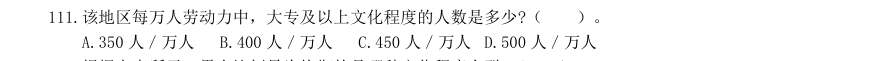

- **A.** 350 人/万人
- **B.** 400 人/万人
- **C.** 450 人/万人D.500 人/万人

**答案：B**　**考点：综合分析｜综合分析（综合）**　**难度：★★★★★**
**【资料分析·综合分析｜GK-2003-a-X112】**

112. 根据上表所示,男女比例最为均衡的是哪种文化程度人群?( )。

> 材料图见 images/GK-2003-a-X111-m.jpg

- **A.** 文盲
- **B.** 小学
- **C.** 初中
- **D.** 高中

**答案：C**　**考点：综合分析｜综合分析（综合）**　**难度：★★★★☆**
**【资料分析·平均数计算｜GK-2003-a-X113】**

113. 经折算,该地区劳动力的平均学习年限约为7.34 年,那么造成这一现状的主要原因,我们可以认为( )。

> 材料图见 images/GK-2003-a-X111-m.jpg

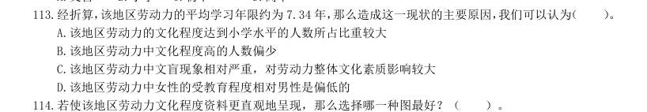

- **A.** 该地区劳动力的文化程度达到小学水平的人数所占比重较大
- **B.** 该地区劳动力中文化程度高的人数偏少
- **C.** 该地区劳动力中文盲现象相对严重,对劳动力整体文化素质影响较大
- **D.** 该地区劳动力中女性的受教育程度相对男性是偏低的

**答案：A**　**考点：平均数计算｜现期平均数**　**难度：★☆☆☆☆**
**【资料分析·综合分析｜GK-2003-a-X114】**

114. 若使该地区劳动力文化程度资料更直观地呈现,那么选择哪一种图最好?( )。

> 材料图见 images/GK-2003-a-X111-m.jpg

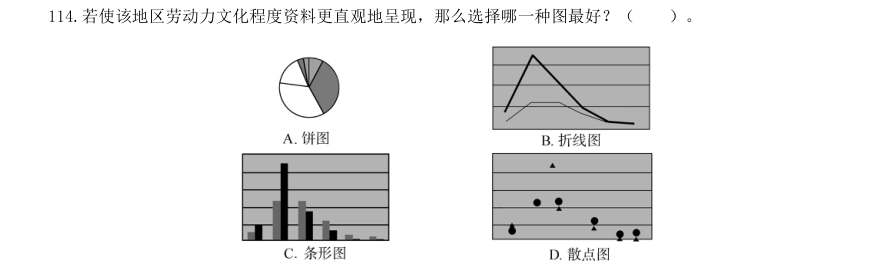

> （本题为图形题，选项为图片，见原卷）

**答案：C**　**考点：综合分析｜综合分析（综合）**　**难度：★★★★☆**
**【资料分析·综合分析｜GK-2003-a-X115】**

115. 当地政府计划将该地区劳动力资源当中高中及以上文化程度的人数比例由原来的6∶1∶1 调整为5∶3∶2,假 设该地区高中文化程度的人数不变,则大专、本科及以上两种文化程度的人数应分别增加多少万人?( )。

> 材料图见 images/GK-2003-a-X111-m.jpg

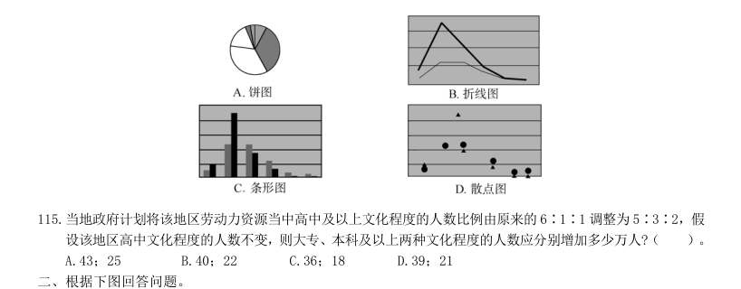

- **A.** 43;25
- **B.** 40;22
- **C.** 36;18
- **D.** 39;21

**答案：D**　**考点：综合分析｜综合分析（综合）**　**难度：★★★★☆**
**【资料分析·平均数计算｜GK-2003-a-X116】**

116. 某地区用水与人口情况 日平均用水量分配图 当日平均用水量为200 万吨时的年代,人口约为多少万?( )。

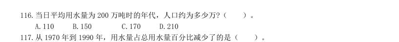

- **A.** 110
- **B.** 150
- **C.** 170
- **D.** 210

**答案：A**　**考点：平均数计算｜现期平均数**　**难度：★☆☆☆☆**
**【资料分析·比重计算与比较｜GK-2003-a-X117】**

117. 从1970 年到1990 年,用水量占总用水量百分比减少了的是( )。 I.发电用水。 II.其他工业用水。 III.灌溉用水。

> 材料图见 images/GK-2003-a-X116-m.jpg

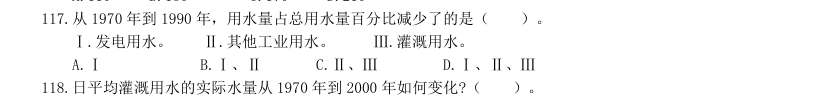

- **A.** I
- **B.** I、II
- **C.** II、III
- **D.** I、II、III

**答案：C**　**考点：比重计算与比较｜现期比重**　**难度：★★☆☆☆**
**【资料分析·平均数计算｜GK-2003-a-X118】**

118. 日平均灌溉用水的实际水量从1970 年到2000 年如何变化?( )。

> 材料图见 images/GK-2003-a-X116-m.jpg

- **A.** 减少了
- **B.** 增加了
- **C.** 不变
- **D.** 无法确定

**答案：B**　**考点：平均数计算｜现期平均数**　**难度：★☆☆☆☆**
**【资料分析·平均数计算｜GK-2003-a-X119】**

119. 从1970 年到1990 年,日平均发电用水量大约增加了多少万吨?( )。

> 材料图见 images/GK-2003-a-X116-m.jpg

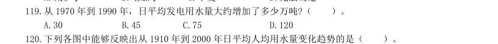

- **A.** 30
- **B.** 45
- **C.** 75
- **D.** 120

**答案：C**　**考点：平均数计算｜现期平均数**　**难度：★☆☆☆☆**
**【资料分析·平均数计算｜GK-2003-a-X120】**

120. 下列各图中能够反映出从1910 年到2000 年日平均人均用水量变化趋势的是( )。 三、根据下列图表回答问题。 下面几张图分别是中国网民的性别、年龄及学历构成。

> 材料图见 images/GK-2003-a-X116-m.jpg

> （本题为图形题，选项为图片，见原卷）

**答案：A**　**考点：平均数计算｜现期平均数**　**难度：★★☆☆☆**
**【资料分析·综合分析｜GK-2003-a-X121】**

121. 如果中国网民的总人数为2 250 万,那么41 岁以上的网民约有多少万人?( )。

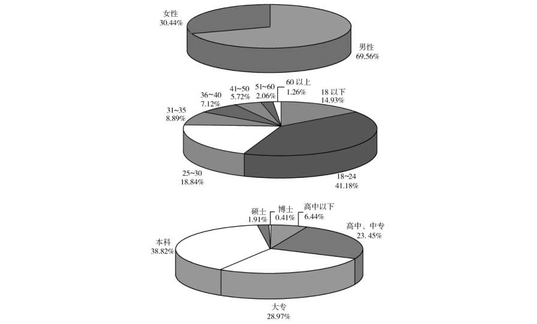

- **A.** 100
- **B.** 200
- **C.** 300
- **D.** 400

**答案：B**　**考点：综合分析｜综合分析（综合）**　**难度：★★★★☆**
**【资料分析·增长率计算与比较｜GK-2003-a-X122】**

122. 男性网民比女性网民约多多少?( )。

> 材料图见 images/GK-2003-a-X121-m.jpg

- **A.** 60%
- **B.** 70%
- **C.** 90%
- **D.** 130%

**答案：D**　**考点：增长率计算与比较｜增长率计算（综合）**　**难度：★☆☆☆☆**
**【资料分析·比重计算与比较｜GK-2003-a-X123】**

123. 下列说法中哪些正确?( )。 I.本科以上(含本科)的网民比本科以下的网民多。 II.25~30 岁的网民比31~40 岁的网民多。 III.本科学历的网民所占的比例最高。

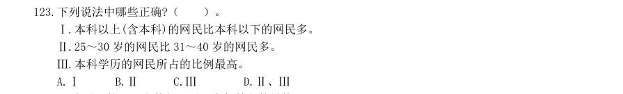

- **A.** I
- **B.** II
- **C.** III
- **D.** II、III

**答案：D**　**考点：比重计算与比较｜现期比重**　**难度：★★☆☆☆**
**【资料分析·综合分析｜GK-2003-a-X124】**

124. 18 岁以下的网民人数与下列哪个年龄段的最接近?( )。

> 材料图见 images/GK-2003-a-X123-m.jpg

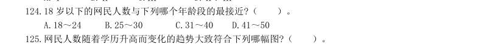

- **A.** 18~24
- **B.** 25~30
- **C.** 31~40
- **D.** 41~50

**答案：C**　**考点：综合分析｜综合分析（综合）**　**难度：★★★★☆**
**【资料分析·综合分析｜GK-2003-a-X125】**
> 材料：网民人数随着学历升高而变化的趋势大致符合下列哪幅图?( )。 四、根据下列文字资料回答问题。 2002 年1~6 月,我国通信业务收入完成2 189.4 亿元,比上年同期增长15.6%,增幅是同期国内生产总 值的两倍。其中,邮政完成247.4 亿元,增长8.5%;电信完成1 942.1 亿元,增长16.6%。各项业务中,国 内长途业务收入222 亿元,同比下降0.2%;国际业务收入36.8 亿元,下降17.6%;移动通信收入920.6 亿 元,增长24%;本地网通信收入565 亿元,增长13.5%;数据通信收入84 亿元,增长68%。以上各项业务 分别占整个电信业务收入的11.4%、1.9%、47.4%、29.1%和4.3%。各类新业务迅猛发展。上半年,IP 电 话通话时长达到253.4 亿分钟,同比增长21.3%。移动短信业务量达到326 亿条。邮政储蓄期末余额达到6 627.1 亿元,

125. 其中,固定电话用户新增1 990.9 万户,达到1.99 亿户;移动电话用户新增3 135.7 万户,达 到1.76 亿户。固定电话用户中,城市电话用户新增1 385.2 万户,达到1.25 亿户;农村电话用户新增605.7 万户,达到7 411.4 万户。电话用户中,东、中、西部地区各为1.95 亿户、1.1 亿户和0.7 亿户,分别占52%、 29.3%和18.7%。全国电话普及率达到30.2 部/百人,比上年末提高4.3 个百分点;移动电话普及率达到13.86 部/百人,比上年末提高2.7 个百分点。

> 材料图见 images/GK-2003-a-X123-m.jpg

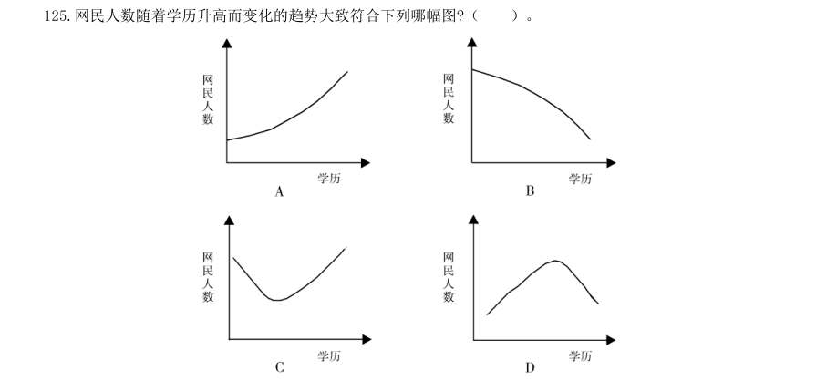

> （本题为图形题，选项为图片，见原卷）

**答案：D**　**考点：综合分析｜综合分析（综合）**　**难度：★★★★★**
**【资料分析·比重计算与比较｜GK-2003-a-X126】**

126. 占整个电信业务收入比重最大的业务在2002 年上半年中与去年同期相比变化情况是( )。

> 材料图见 images/GK-2003-a-X123-m.jpg

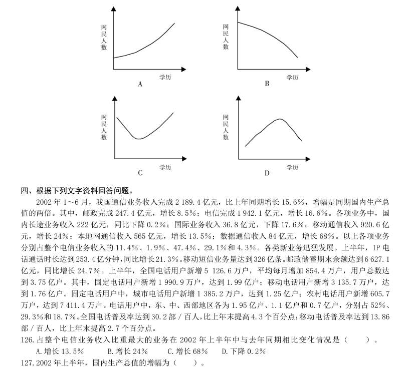

- **A.** 增长13.5%
- **B.** 增长24%
- **C.** 增长68%
- **D.** 下降0.2%

**答案：B**　**考点：比重计算与比较｜现期比重**　**难度：★☆☆☆☆**
**【资料分析·增长率计算与比较｜GK-2003-a-X127】**

127. 2002 年上半年,国内生产总值的增幅为( )。

> 材料图见 images/GK-2003-a-X123-m.jpg

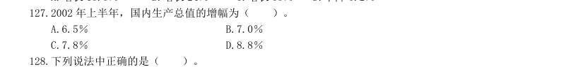

- **A.** 6.5%
- **B.** 7.0%
- **C.** 7.8%
- **D.** 8.8%

**答案：C**　**考点：增长率计算与比较｜增长率计算**　**难度：★☆☆☆☆**
**【资料分析·综合分析｜GK-2003-a-X128】**

128. 下列说法中正确的是( )。 I.业务收入增长最快的是数据通信,但其占整个电信业务收入比重还不足5%。 II.农村电话用户新增数量比城市电话用户新增数量大。 III.东部的固定电话用户数比中部和西部的总和还多。

> 材料图见 images/GK-2003-a-X123-m.jpg

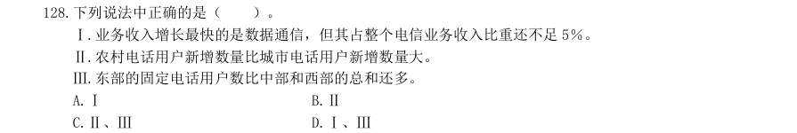

- **A.** I
- **B.** II
- **C.** II、III
- **D.** I、III

**答案：D**　**考点：综合分析｜选错误项**　**难度：★★★★★**
**【资料分析·增长量计算｜GK-2003-a-X129】**

129. 农村固定电话用户数比上年末增长了( )。

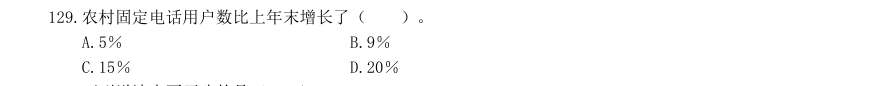

- **A.** 5%
- **B.** 9%
- **C.** 15%
- **D.** 20%

**答案：B**　**考点：增长量计算｜增长量计算（综合）**　**难度：★☆☆☆☆**
**【资料分析·综合分析｜GK-2003-a-X130】**

130. 下列说法中不正确的是( )。

> 材料图见 images/GK-2003-a-X129-m.jpg

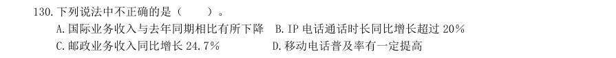

- **A.** 国际业务收入与去年同期相比有所下降
- **B.** IP 电话通话时长同比增长超过20%
- **C.** 邮政业务收入同比增长24.7%
- **D.** 移动电话普及率有一定提高

**答案：C**　**考点：综合分析｜选错误项**　**难度：★★★★☆**