# 2004 年国考行测（A卷）

- 题量：106（含答案 106）
- 模块分布：资料分析20 / 数量关系15 / 言语理解16 / 判断推理35 / 常识判断20
- 试卷编号：`国考-2004-A卷`

## 题目与答案

**【常识判断·时事政治｜GK-2004-a-X001】**
> 材料：注:此套题原题有听力20 道,题型已淘汰,故略去。

1. 根据《中国共产党章程》规定,中国共产党全国代表大会闭会期间的最高领导机关是( )。

- **A.** 总书记
- **B.** 中央政治常委会
- **C.** 中央政治局
- **D.** 中央委员会

**答案：D**　**考点：时事政治｜重要会议**　**难度：★☆☆☆☆**
**【常识判断·地理常识｜GK-2004-a-X002】**

2. 下列国家中,尚未加入欧元区的是( )。

- **A.** 西班牙
- **B.** 比利时
- **C.** 卢森堡
- **D.** 英国

**答案：D**　**考点：地理常识｜世界地理**　**难度：★☆☆☆☆**
**【常识判断·生活常识｜GK-2004-a-X003】**

3. 2003 年1 月1 日起生效的《中华人民共和国政府采购法》所建立的政府采购制度的核心特点是( )。

- **A.** 有偿采购
- **B.** 竞争性招标采购
- **C.** 分散采购
- **D.** 灵活采购

**答案：B**　**考点：生活常识｜历史人文**　**难度：★☆☆☆☆**
**【常识判断·生活常识｜GK-2004-a-X004】**

4. 条件反射的发现者是( )。

- **A.** 巴甫洛夫
- **B.** 弗洛伊德
- **C.** 弗鲁姆
- **D.** 卢因

**答案：A**　**考点：生活常识｜科技常识**　**难度：★☆☆☆☆**
**【常识判断·生活常识｜GK-2004-a-X005】**

5. 联合国安理会常任理事国进行决策的规则是( )。

- **A.** 简单多数规则
- **B.** 绝对多数规则
- **C.** 加权多数规则
- **D.** 全体一致规则

**答案：D**　**考点：生活常识｜生活常识**　**难度：★☆☆☆☆**
**【常识判断·经济常识｜GK-2004-a-X006】**

6. 1947 年,为了帮助欧洲经济复兴,与前苏联抗衡,美国提出了( )。

- **A.** 艾森豪威尔计划
- **B.** 马歇尔计划
- **C.** 巴巴罗莎计划
- **D.** 杜鲁门计划

**答案：B**　**考点：经济常识｜经济常识（待细分）**　**难度：★☆☆☆☆**
**【常识判断·生活常识｜GK-2004-a-X007】**

7. 与私人产品相比,公共产品的核心特征是( )。

- **A.** 强制性
- **B.** 无偿性
- **C.** 排他性
- **D.** 非排他性

**答案：D**　**考点：生活常识｜历史人文**　**难度：★☆☆☆☆**
**【常识判断·生活常识｜GK-2004-a-X008】**

8. 我国政府恢复对澳门行使主权的日期是( )。

- **A.** 36342
- **B.** 36525
- **C.** 36514
- **D.** 36160

**答案：C**　**考点：生活常识｜历史人文**　**难度：★☆☆☆☆**
**【常识判断·地理常识｜GK-2004-a-X009】**

9. 一个国家进入老龄化国家的一个标志就是这个国家60 岁以上的老年人口达到总人口的( )。

- **A.** 25%
- **B.** 20%
- **C.** 15%
- **D.** 10%

**答案：D**　**考点：地理常识｜世界地理**　**难度：★☆☆☆☆**
**【常识判断·地理常识｜GK-2004-a-X010】**

10. 中华人民共和国成立后,第一个与我国建立外交关系的西方国家是( )。

- **A.** 英国
- **B.** 德国
- **C.** 法国
- **D.** 瑞士

**答案：D**　**考点：地理常识｜世界地理**　**难度：★☆☆☆☆**
**【常识判断·生活常识｜GK-2004-a-X011】**

11. “一丝不苟”中的“丝”的本意是( )。

- **A.** 计量单位
- **B.** 丝线
- **C.** 丝绸
- **D.** 发丝

**答案：A**　**考点：生活常识｜历史人文**　**难度：★☆☆☆☆**
**【常识判断·历史人文｜GK-2004-a-X012】**

12. 京剧中的“大花脸”所属的行当是( )。

- **A.** 生
- **B.** 旦
- **C.** 丑
- **D.** 净

**答案：D**　**考点：历史人文｜中国古代史**　**难度：★☆☆☆☆**
**【常识判断·生活常识｜GK-2004-a-X013】**

13. 人类最早使用的金属是( )。

- **A.** 铜
- **B.** 铁
- **C.** 银
- **D.** 铅

**答案：A**　**考点：生活常识｜科技常识**　**难度：★☆☆☆☆**
**【常识判断·科技常识｜GK-2004-a-X014】**

14. 下列不属于哺乳动物的是( )。

- **A.** 蝙蝠
- **B.** 鲸
- **C.** 蜂鸟
- **D.** 海豹

**答案：C**　**考点：科技常识｜科技常识（待细分）**　**难度：★☆☆☆☆**
**【常识判断·生活常识｜GK-2004-a-X015】**

15. 造成大气污染的有害气体是( )。

- **A.** 氮气、氧气
- **B.** 稀有气体、二氧化碳
- **C.** 一氧化碳、二氧化硫
- **D.** 氮气、二氧化碳

**答案：C**　**考点：生活常识｜科技常识**　**难度：★☆☆☆☆**
**【常识判断·生活常识｜GK-2004-a-X016】**

16. 中国最早的工艺百科全书是完成于17 世纪30 年代的《天工开物》。它的作者是( )。

- **A.** 徐霞客
- **B.** 沈括
- **C.** 郦道元
- **D.** 宋应星

**答案：D**　**考点：生活常识｜科技常识**　**难度：★☆☆☆☆**
**【常识判断·法律常识｜GK-2004-a-X017】**

17. 2003 年5 月7 日国务院第7 次常委会议通过、公布,并于公布之日起施行了《突发公共卫生事件应急条例》。 该条例中规定,( )地方人民政府应当建立和完善突发事件监测与预警系统。

- **A.** 省级以上
- **B.** 市级以上
- **C.** 县级以上
- **D.** 乡级以上

**答案：C**　**考点：法律常识｜行政法**　**难度：★★★☆☆**
**【常识判断·历史人文｜GK-2004-a-X018】**

18. 下面的作家是唐宋散文八大家中的四位,其中属于唐朝的一位是( )。

- **A.** 韩愈
- **B.** 欧阳修
- **C.** 苏轼
- **D.** 王安石

**答案：A**　**考点：历史人文｜中国古代史**　**难度：★☆☆☆☆**
**【常识判断·历史人文｜GK-2004-a-X019】**

19. “兼听则明,偏信则暗”这句古代格言出自( )。

- **A.** 《资治通鉴》
- **B.** 《论语》
- **C.** 《荀子》
- **D.** 《史记》

**答案：A**　**考点：历史人文｜中国古代史**　**难度：★☆☆☆☆**
**【常识判断·法律常识｜GK-2004-a-X020】**

20. 《汉谟拉比法典》出自( )。

- **A.** 古埃及
- **B.** 古巴比伦
- **C.** 古罗马
- **D.** 古印度

**答案：B**　**考点：法律常识｜法律常识（待细分）**　**难度：★☆☆☆☆**
**【言语理解·逻辑填空｜GK-2004-a-X021】**

21. 社会上的各种传言和议论,有的是无中生有,有的是空穴来风,我们要善于思索和分辨。“空穴来风”的意 思是( )。

- **A.** 有洞穴没有风进来,比喻无原由的事
- **B.** 有洞穴就有风进来,比喻事情不是完全没有原由的
- **C.** 好像洞穴中的风一样飘忽不定,一会儿这样一会儿那样
- **D.** 好像洞穴中的一股风,它是朝着某个方向吹去的

**答案：B**　**考点：逻辑填空｜虚词与关联词**　**难度：★☆☆☆☆**
**【言语理解·中心理解｜GK-2004-a-X022】**

22. 科学家研究发现,惟有传统中药枸杞其“固本、温平、无毒”的特性能担当“换一种方式补肾”的重任,几 千年来人们对枸杞情有独钟。这段文字中应当删去的一个词是( )。

- **A.** “科学家研究发现”的“发现”
- **B.** “惟有传统中药枸杞”的“惟有”
- **C.** “惟有传统中药枸杞”的“传统”
- **D.** “其‘固本、温平、无毒’的特性”的“其”

**答案：D**　**考点：中心理解｜对策优先**　**难度：★☆☆☆☆**
**【言语理解·逻辑填空｜GK-2004-a-X023】**

23. 放弃了宗教的人,若没有代替宗教的东西,________________________。不过幸好除了宗教还有哲学为人类 提供了获得更高价值的途径——一条比宗教提供的途径更为直接的途径,通过哲学而熟悉的更高价值,比通过宗 教而获得的更高价值,甚至要纯粹得多,因为后者混杂着想象和迷信。填入横线上最恰当的是( )。

- **A.** 便会很自然地去寻找哲学的帮助
- **B.** 只好把自己限于尘世事务而与精神事务绝缘
- **C.** 也不会感到生活有太大的变化
- **D.** 他们照样可以保持内心的平静怡和

**答案：B**　**考点：逻辑填空｜虚词与关联词**　**难度：★★★☆☆**
**【言语理解·逻辑填空｜GK-2004-a-X024】**

24. 尽管国际上对此存在很多争议,意大利文化部门还是决定用蒸馏水清洗米开朗基罗的旷世杰作——“大卫” 雕像。这项工程的目的之一是除去这座高达4.5 米的雕像上的尘土和油污。佛罗伦萨博物馆的负责人说:“这项 工程并不是为了让雕像变得好看。”意大利文化部长已经排除了干洗的可能性。“国际上对此存在很多争议”的 “此”指的是( )。

- **A.** “大卫”雕像是米开朗基罗的旷世杰作
- **B.** 这项工程是为了让雕像变得更好看
- **C.** 决定用蒸馏水清洗“大卫”雕像
- **D.** 要除去这座高达4.5 米的雕像上的尘土和油污

**答案：C**　**考点：逻辑填空｜逻辑填空（待细分）**　**难度：★★★☆☆**
**【言语理解·逻辑填空｜GK-2004-a-X025】**

25. 所谓科学精神,不过是哲学上的多元主义的另一种说法而已。哲学上的多元主义,就是_______________, 否认有什么事物第一原因和宇宙、人类的什么终极目的。填入横线上最恰当的是( )。

- **A.** 否认绝对真理的存在
- **B.** 认为这个世界无须认识
- **C.** 政治上权威主义的根据
- **D.** 一种绝对化的主张

**答案：A**　**考点：逻辑填空｜语境分析**　**难度：★☆☆☆☆**
**【言语理解·逻辑填空｜GK-2004-a-X026】**

26. 大袋鼠是一种奇特的动物。它们平时在原野、灌木丛和森林地带活动,靠吃草为生。它们过群居生活,但没 有固定的集群,常因寻找水源和食物而汇集成一个较大的群体。老鹰、蟒蛇和人们都要捕捉袋鼠,然而对袋鼠来 说最大的危害莫过于干旱,幼小的袋鼠会死亡,母大袋鼠会停止孕育。下面说法正确的是( )。

- **A.** 有的大袋鼠单独行动
- **B.** 大袋鼠常聚集在一起寻找水和食物
- **C.** 威胁大袋鼠最严重的是人们的捕捉
- **D.** 遇到干旱,袋鼠都会死亡

**答案：B**　**考点：逻辑填空｜逻辑填空（待细分）**　**难度：★★★☆☆**
**【言语理解·中心理解｜GK-2004-a-X027】**

27. 电子游戏为我们展现了一个不同于现实生活的新世界。人们在游戏里取得的成功是可以清晰定义而且是可以 实现的。玩家可以在游戏中控制整个世界,从而摆脱现实生活中的焦虑感,使自己的行为在虚拟世界中变得举足 轻重,成为一名英雄。游戏结束,他并没有真的输掉或赢得什么东西。这段话直接支持这样一种观点,即 ( )。

- **A.** 电子游戏完全是虚拟的东西,人们在其中不会真正得到或失去什么
- **B.** 人们可通过电子游戏在真实世界和欲望世界之间寻得一种折中
- **C.** 人们在游戏里的成功是清晰和可实现的,因而不是虚拟的
- **D.** 游戏让人们不付出代价,轻松地满足成就感

**答案：D**　**考点：中心理解｜中心句与主旨**　**难度：★★★★★**
**【言语理解·中心理解｜GK-2004-a-X028】**

28. 科学研究本质上是机会主义的,其目的不在于做或好或坏的实验,而在于解决问题,如果一个问题碰巧笨拙 地解决了,那么优美的方法就永远不会被找寻了。不符合这段话意思的是( )。

- **A.** 研究不在乎方法的笨拙或优美,只要达到解决问题的目的就可以了
- **B.** 科学研究的机会主义致使优美的方法永远不会被找寻
- **C.** 科学研究的目的是解决问题
- **D.** 优美的方法不是科学研究追求的目标

**答案：B**　**考点：中心理解｜转折与因果**　**难度：★☆☆☆☆**
**【言语理解·中心理解｜GK-2004-a-X029】**

29. 少数孩子经历了这样的应试教育,最后还能成长为能够独立思考的人,成长为虚怀若谷、知识渊博的人,这 不能不说是一个奇迹。不符合这段话意思的是( )。

- **A.** 应试教育使孩子丧失独立思考能力
- **B.** 应试教育使孩子知识面狭窄
- **C.** 应试教育使孩子性情狭隘
- **D.** 赞扬少数孩子的卓尔不群

**答案：D**　**考点：中心理解｜转折与因果**　**难度：★☆☆☆☆**
**【言语理解·逻辑填空｜GK-2004-a-X030】**

30. 生态环境保护与人们的现实经济利益之间往往存在着矛盾。退耕还林、野生动植物保护等方面的政策或措施 从长远来看是符合人类利益的,但常常需要牺牲一部分人的现实利益,________。填入横线部分最恰当的是 ( )。

- **A.** 因此人们应当以生态环境为重
- **B.** 因此人们要有长远的眼光
- **C.** 因此矛盾不可避免
- **D.** 因此人们要有自我牺牲精神

**答案：C**　**考点：逻辑填空｜虚词与关联词**　**难度：★★☆☆☆**
**【言语理解·逻辑填空｜GK-2004-a-X031】**

31. “你工作多久挣的钱,才够买一个麦当劳的‘巨无霸’?”要是猛然被这样提问,多数人可能会打个愣,因 为不少人通常更习惯另一种算法,即我一个月的工资够买几个“巨无霸”?这两个问题看上去是一回事,但在统 计学意义上却有着明显的差别。前者是以商品来考查劳动力的价值,后者则是( )。

- **A.** 用劳动力来考查商品的价值
- **B.** 用商品的价值来考查劳动力
- **C.** 用收入来衡量购买力的水平
- **D.** 用购买力衡量收入的水平

**答案：D**　**考点：逻辑填空｜语境分析**　**难度：★★☆☆☆**
**【言语理解·中心理解｜GK-2004-a-X032】**

32. 生长在水中或水边的动植物的遗体是最易被保存下来的,因为保存动植物遗体的必要条件是快速掩埋,而在 淤泥不断淤积的海洋、河流乃至湖泊中,动植物的遗体以及其他东西能够被快速掩埋。这段话主要支持了这样一 种观点,即( )。

- **A.** 动植物遗体很容易在淤泥不断淤积的海洋、河流乃至湖泊中保存下来
- **B.** 只有生长在水中或水边的动植物的遗体才能被保存下来
- **C.** 淤泥不断淤积的海洋、河流乃至湖泊是保存动植物遗体的最佳环境
- **D.** 只要被快速掩埋,动植物遗体就能被保存

**答案：A**　**考点：中心理解｜中心句与主旨**　**难度：★★★★☆**
**【言语理解·逻辑填空｜GK-2004-a-X033】**

33. （本题题干为图形/公式，文字层无题干，图见原卷）

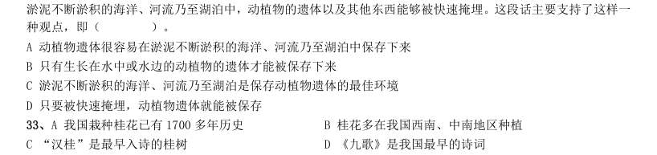

- **A.** 我国栽种桂花已有1700 多年历史
- **B.** 桂花多在我国西南、中南地区种植
- **C.** “汉桂”是最早入诗的桂树
- **D.** 《九歌》是我国最早的诗词

**答案：B**　**考点：逻辑填空｜逻辑填空（待细分）**　**难度：★★★☆☆**
**【言语理解·中心理解｜GK-2004-a-X034】**

34. 我国是桂花的故乡,西南、中南地区是它的原产地。现在各地都有种植。在战国时代,屈原的《九歌》中就 曾多次出现“桂舟”、“桂酒”等词,这是最早以桂入诗的例子。陕西省勉县城南定军山武侯墓前有两株桂花, 相传栽种于汉代,已有1700 多年历史,人们称它们为“汉桂”。 从这段文字,我们可以得知( )。 甲:各国的国情和传统不同,但是对于谋杀和其他严重刑事犯罪实施死刑,至少是大多数人可以接受的。公开宣 判和执行死刑可以有效地阻止恶性刑事案件的发生,它所带来的正面影响比可能存在的负面影响肯定大得多,这 是社会自我保护的一种必要机制。乙:我不能接受你的见解。因为在我看来,对于十恶不赦的罪犯来说,终身监 禁是比死刑更严厉的惩罚,而一般的民众往往以为只有死刑才是严厉的。对上述对话最恰当的评价是( )。

- **A.** 两人对什么是最严厉的刑事惩罚有不同的理解
- **B.** 两人对执行死刑的目的有不同的理解
- **C.** 两人对产生恶性刑事案件的原因有不同的理解
- **D.** 两人对是否大多数人都接受死刑有不同的理解

**答案：A**　**考点：中心理解｜转折与因果**　**难度：★★★★☆**
**【言语理解·逻辑填空｜GK-2004-a-X035】**

35. 叶圣陶、郑振铎等都是江浙人,有着江浙知识分子特有的理性和宽容。他们像朱自清一样,都是新文学的热 心鼓吹者,写得一手漂亮的白话散文。他们接受过五四新文化的洗礼, ,无论对 中西之学,都取平和的一视同仁态度。填入横线上最恰当的是( )。

- **A.** 传统文化的根基也很深
- **B.** 大概都不曾出洋留学
- **C.** 都有一般自由知识分子那种精英气概
- **D.** 与土地的关系比较密切

**答案：A**　**考点：逻辑填空｜语境分析**　**难度：★★☆☆☆**
**【言语理解·中心理解｜GK-2004-a-X036】**

36. 严密的逻辑论证,历史上有一个确实的来历:公开辩论。古典时代的雅典人好辩,还有一套民主选举办法, 雄辩术风行,甚至还有一个奇怪的习惯:两人争辩一件事,可以有彩金,谁辩胜就得彩金。辩证法的原意本是辩 论,一方说话有漏洞,对方力图辩驳,怕输,就要严密,逻辑学显然也是从这来的。不符合这段话意思的是 ( )。

- **A.** 雄辩术曾经在古典时代的雅典风行
- **B.** 辩证法不仅仅是为了在和别人的论辩中取得胜利
- **C.** 为一件事情争论不休在古典时代的雅典可能是很奇怪的
- **D.** 逻辑学的产生可能和古典时代的雅典人好辩有关

**答案：C**　**考点：中心理解｜转折与因果**　**难度：★★★☆☆**
**【数量关系·其他数量关系｜GK-2004-a-X037】**

37. 0.0495×2500+49.5×2.4+51×4.95 的值是( )。

- **A.** 4.95
- **B.** 49.5
- **C.** 495
- **D.** 4950

**答案：C**　**考点：其他数量关系｜其他数量关系（综合）**　**难度：★☆☆☆☆**
**【数量关系·其他数量关系｜GK-2004-a-X038】**

38. 2002×20032003-2003×20022002 的值是( )。 A -60 C 60 D 80

> （本题为图形题，选项为图片，见原卷）

**答案：B**　**考点：其他数量关系｜基础计算**　**难度：★☆☆☆☆**
**【数量关系·其他数量关系｜GK-2004-a-X039】**

39. 99+1919+9999 的个位数字是( )。

- **A.** 1
- **B.** 2
- **C.** 3
- **D.** 7

**答案：D**　**考点：其他数量关系｜基础计算**　**难度：★☆☆☆☆**
**【数量关系·数字推理｜GK-2004-a-X040】**

40. 南岗中学每一位校长都是任职一届,一届任期三年,那么在8 年期间南岗中学最多可能有几位校长? ( )

- **A.** 2
- **B.** 3
- **C.** 4
- **D.** 5

**答案：C**　**考点：数字推理｜数字推理（待细分）**　**难度：★★★★☆**
**【数量关系·最值问题｜GK-2004-a-X041】**

41. 假设五个相异正整数的平均数是15,中位数是18,则此五个正整数中的最大数的最大值可能为( )。

- **A.** 24
- **B.** 32
- **C.** 35
- **D.** 40

**答案：C**　**考点：最值问题｜最值优化**　**难度：★★★★☆**
**【数量关系·几何问题｜GK-2004-a-X042】**

42. 半径为5 厘米的三个圆弧围成如右图所示的区域,其中AB 弧与AD 弧为四分之一圆弧,而BCD 弧是一个半圆 弧,则此区域的面积是多少平方厘米?( )

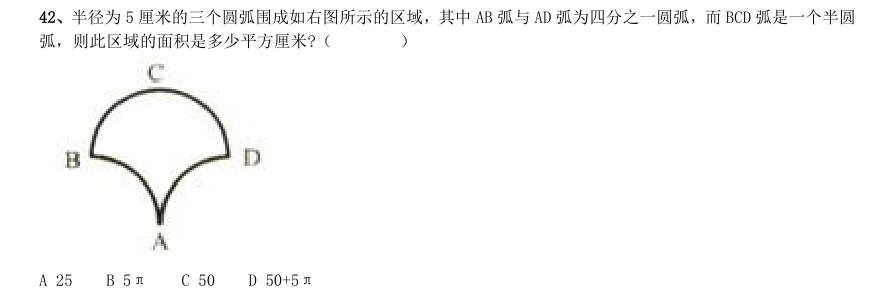

- **A.** 25
- **B.** 5π
- **C.** 50
- **D.** 50+5π

**答案：C**　**考点：几何问题｜平面几何**　**难度：★★★★☆**
**【数量关系·几何问题｜GK-2004-a-X043】**

43. 一个边长为8 的正立方体,由若干个边长为l 的正立方体组成,现在要将大立方体表面涂漆,请问一共有多 少个小立方体被涂上了颜色?( )

- **A.** 296
- **B.** 324
- **C.** 328
- **D.** 384

**答案：A**　**考点：几何问题｜立体几何**　**难度：★★★★☆**
**【数量关系·几何问题｜GK-2004-a-X044】**

44. 右图中心线上半部与下半部都是由3 个红色小三角形,5 个蓝色小三角形与8 个白色小三角形所组成。当把 上半图沿着中心线往下折叠时,有2 对红色小三角形重合,3 对蓝色小三角形重合,以及有2 对红色与白色小三 角形重合,试问有多少对白色小三角形重合?( )

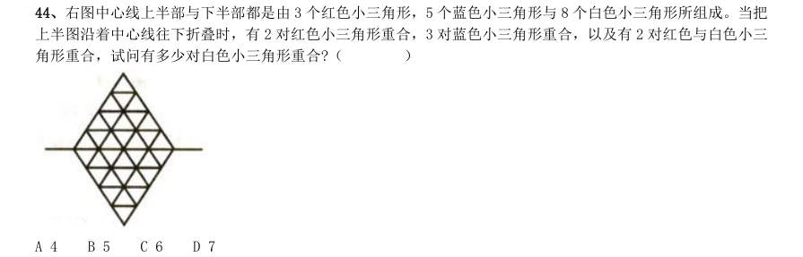

- **A.** 4
- **B.** 5
- **C.** 6
- **D.** 7

**答案：B**　**考点：几何问题｜平面几何**　**难度：★★★★★**
**【数量关系·其他数量关系｜GK-2004-a-X045】**

45. 父亲把所有财物平均分成若干份后全部分给儿子们,其规则是长子拿一份财物和剩下的1/10,次子拿两份 财物和剩下的1/10,三儿子拿三份财物和剩下的1/10,以此类推,结果所有儿子拿到的财物都一样多,请问父 亲一共有几个儿子?( )

- **A.** 6
- **B.** 8
- **C.** 9
- **D.** 10

**答案：C**　**考点：其他数量关系｜和差倍比**　**难度：★★☆☆☆**
**【数量关系·数字推理｜GK-2004-a-X046】**

46. 半径为1 厘米的小圆在半径为5 厘米的固定的大圆外滚动一周,小圆滚了几圈?( )

- **A.** 4
- **B.** 5
- **C.** 6
- **D.** 7

**答案：C**　**考点：数字推理｜分数数列**　**难度：★★★★☆**
**【数量关系·其他数量关系｜GK-2004-a-X047】**

47. 某大学某班学生总数为32 人,在第一次考试中有26 人及格,在第二次考试中有24 人及格,若两次考试中, 都没有及格的有4 人,那么两次考试都及格的人数是( )。

- **A.** 22
- **B.** 18
- **C.** 28
- **D.** 26

**答案：A**　**考点：其他数量关系｜其他数量关系（综合）**　**难度：★☆☆☆☆**
**【数量关系·排列组合｜GK-2004-a-X048】**

48. 林辉在自助餐店就餐,他准备挑选三种肉类中的一种肉类,四种蔬菜中的二种不同蔬菜,以及四种点心中的 一种点心。若不考虑食物的挑选次序,则他可以有多少种不同的选择方法?( )

- **A.** 4
- **B.** 24
- **C.** 72
- **D.** 144

**答案：C**　**考点：排列组合｜基础排列组合**　**难度：★★★★★**
**【数量关系·几何问题｜GK-2004-a-X049】**

49. 欲建一道长100 尺,高7 尺的单层砖墙,能够使用的砖块有两种:长2 尺高1 尺或长1 尺高1 尺且砖块不能 切割。垂直连接砖块必须如右图所示交错间隔,且墙的两端必须砌平整。试问至少需要多少砖块才能建成此道墙?

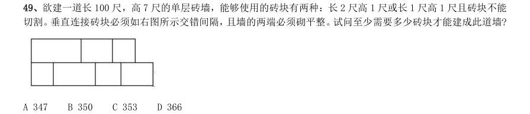

- **A.** 347
- **B.** 350
- **C.** 353
- **D.** 366

**答案：C**　**考点：几何问题｜几何问题（综合）**　**难度：★★★★★**
**【数量关系·数字推理｜GK-2004-a-X050】**

50. 整数64 具有可被它的个位数字所整除的性质。试问在10 和50 之间有多少个整数具有这种性质?( )

- **A.** 15
- **B.** 16
- **C.** 17
- **D.** 18

**答案：C**　**考点：数字推理｜幂次数列**　**难度：★★★★☆**
**【数量关系·行程问题｜GK-2004-a-X051】**

51. 两列对开的列车相遇,第一列车的车速为10 米/秒,第二列车的车速为12.5 米/秒,第二列车上的旅客发 现第一列车在旁边开过时共用了6 秒,则第一列车的长度为多少米?( )

- **A.** 60
- **B.** 75
- **C.** 80
- **D.** 135

**答案：D**　**考点：行程问题｜相遇追及**　**难度：★☆☆☆☆**
**【判断推理·图形推理｜GK-2004-a-X052】**

52. 每道题目的左边4 个图形呈现一定的规律性。你需要在右边所给出的备选答案中选出一个最合理的正确答案。

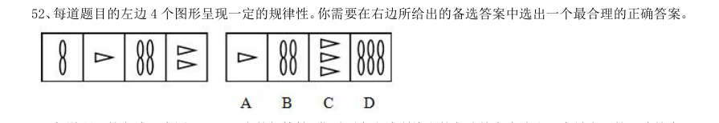

> （本题为图形题，选项为图片，见原卷）

**答案：D**　**考点：图形推理｜数量规律**　**难度：★★★★☆**
**【判断推理·图形推理｜GK-2004-a-X053】**

53. 每道题目的左边4 个图形呈现一定的规律性。你需要在右边所给出的备选答案中选出一个最合理的正确答案。

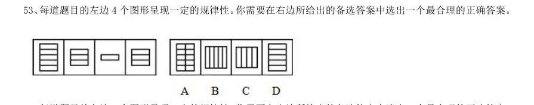

> （本题为图形题，选项为图片，见原卷）

**答案：D**　**考点：图形推理｜属性规律**　**难度：★★★★☆**
**【判断推理·图形推理｜GK-2004-a-X054】**

54. 每道题目的左边4 个图形呈现一定的规律性。你需要在右边所给出的备选答案中选出一个最合理的正确答案。

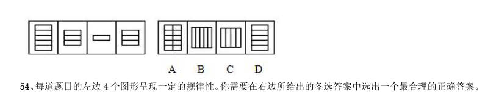

> （本题为图形题，选项为图片，见原卷）

**答案：A**　**考点：图形推理｜数量规律**　**难度：★★★★☆**
**【判断推理·图形推理｜GK-2004-a-X055】**

55. 每道题目的左边4 个图形呈现一定的规律性。你需要在右边所给出的备选答案中选出一个最合理的正确答案。

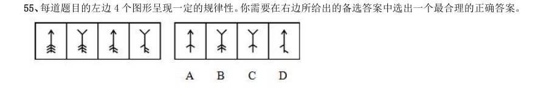

> （本题为图形题，选项为图片，见原卷）

**答案：D**　**考点：图形推理｜数量规律**　**难度：★★★★☆**
**【判断推理·图形推理｜GK-2004-a-X056】**

56. 每道题目的左边4 个图形呈现一定的规律性。你需要在右边所给出的备选答案中选出一个最合理的正确答案。

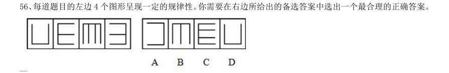

> （本题为图形题，选项为图片，见原卷）

**答案：D**　**考点：图形推理｜属性规律**　**难度：★★★★☆**
**【判断推理·图形推理｜GK-2004-a-X057】**

57. 每道题目的左边4 个图形呈现一定的规律性。你需要在右边所给出的备选答案中选出一个最合理的正确答案。

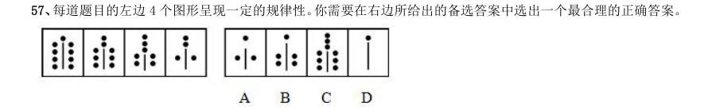

> （本题为图形题，选项为图片，见原卷）

**答案：D**　**考点：图形推理｜属性规律**　**难度：★★★★☆**
**【判断推理·图形推理｜GK-2004-a-X058】**

58. 每道题目的左边4 个图形呈现一定的规律性。你需要在右边所给出的备选答案中选出一个最合理的正确答案。

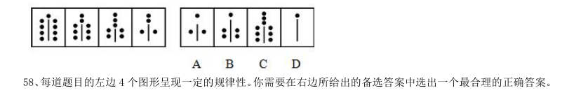

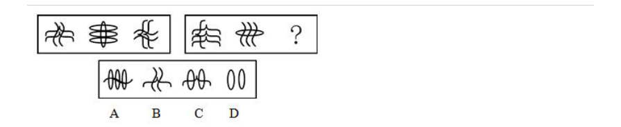

> （本题为图形题，选项为图片，见原卷）

**答案：A**　**考点：图形推理｜数量规律**　**难度：★★★★☆**
**【判断推理·图形推理｜GK-2004-a-X059】**

59. 每道题目的左边4 个图形呈现一定的规律性。你需要在右边所给出的备选答案中选出一个最合理的正确答案。

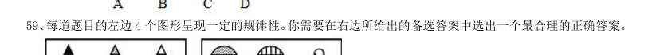

> （本题为图形题，选项为图片，见原卷）

**答案：A**　**考点：图形推理｜位置规律**　**难度：★★★★☆**
**【判断推理·图形推理｜GK-2004-a-X060】**

60. 每道题目的左边4 个图形呈现一定的规律性。你需要在右边所给出的备选答案中选出一个最合理的正确答案。

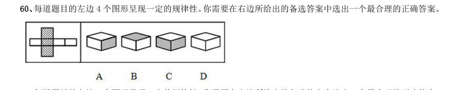

> （本题为图形题，选项为图片，见原卷）

**答案：B**　**考点：图形推理｜折纸盒**　**难度：★★★★☆**
**【判断推理·图形推理｜GK-2004-a-X061】**

61. 每道题目的左边4 个图形呈现一定的规律性。你需要在右边所给出的备选答案中选出一个最合理的正确答案。

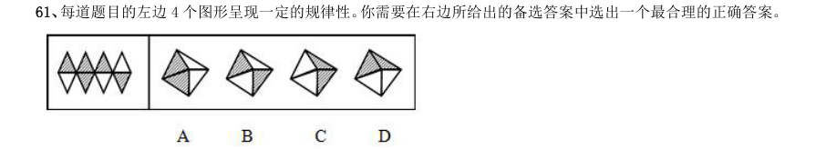

> （本题为图形题，选项为图片，见原卷）

**答案：B**　**考点：图形推理｜折纸盒**　**难度：★★★★☆**
**【判断推理·定义判断｜GK-2004-a-X062】**

62. 知情权是指公民有权知道他应该知道的事情,国家应该最大限度地确认和保障公民知悉、获取信息的权利, 尤其是政务信息的权利。根据上述定义,下列与知情权无关的是( )。

- **A.** 小丽是其父母从小自别人家抱养的孩子,长大后要求知道其生身父母
- **B.** 为满足公众获取信息的权利,某记者通过隐藏拍摄的方法跟踪拍摄明星生活
- **C.** 高女士投诉某产品没有注明产品使用说明和生产日期
- **D.** 英国公众坚持要求政府对凯利自杀事件作出一个交代

**答案：B**　**考点：定义判断｜单定义**　**难度：★★☆☆☆**
**【判断推理·定义判断｜GK-2004-a-X063】**

63. 投机是指为了以后再销售(或暂时售出)商品而购买,以期从其价格变化中获利。根据上述定义,下列属于 投机范畴的是( )。

- **A.** 10 年前老张承包了村里无人要的15 亩果园,如今依靠果树发家致富
- **B.** 小刘最近买了一双皮鞋,因不喜欢样式又转卖给朋友
- **C.** 老杨以10.03 元的价格买入2000 股股票,以11.00 元的价格卖出
- **D.** 王老师买了住房自住,后房价上涨,王老师卖出房屋从中获利

**答案：C**　**考点：定义判断｜单定义**　**难度：★★☆☆☆**
**【判断推理·定义判断｜GK-2004-a-X064】**

64. 行政回避是指行政机关的公务员在行使职权过程中,因与其处理的法律事务有利害关系,为保证实体处理结 果和程序进展的公平性,依法终止其职务的行使并由他人代理的一种程序法律制度。根据上述定义,下列哪种情 况违反了行政回避的规定?( )

- **A.** 丈夫是妻子的直接行政领导
- **B.** 老师提拔自己的学生
- **C.** 在外任职的警察回家乡办案
- **D.** 法官审判自己朋友的儿子

**答案：A**　**考点：定义判断｜单定义**　**难度：★★☆☆☆**
**【判断推理·定义判断｜GK-2004-a-X065】**

65. 复句是指由两个或几个意义上相关、结构上互不包含的单句形式组成的句子。根据上述定义,下列属于复句 的一项是( )。

- **A.** 最后的结果证明,不能仅仅依靠聪明才智,还需付出努力才会成功
- **B.** 远山青翠,晚霞夕照,是这里最美的景色
- **C.** 小张原来是个工人,他搞技术开发,是受了师傅的指点的
- **D.** 树林里,三三两两的少先队员,正在分头采集蘑菇

**答案：C**　**考点：定义判断｜单定义**　**难度：★☆☆☆☆**
**【判断推理·定义判断｜GK-2004-a-X066】**

66. 财产处分行为是指直接发生财产权移转或消灭效果的行为,财产处分行为的结果是使权利移转,权利的内容 的缩小或改变,权利上设定负担以及权利消灭等。根据上述定义,下述行为中不属于财产处分行为的是 ( )。

- **A.** 为担保一笔债务,甲公司将自己所有的房产抵押,抵押行为使甲公司对该房产的所有权受到限制
- **B.** 乙抛弃自己的电视机。抛弃行为使乙对该电视机的所有权消灭
- **C.** 丙与丁订立合同,出卖丙的家传古画,并约定7 日后丙交付古画。合同行为使丙负担着7 日后移转古画所有权的义务
- **D.** 丁免除丙的金钱债务。免除行为使丙不必履行偿还金钱的义务

**答案：A**　**考点：定义判断｜单定义**　**难度：★★☆☆☆**
**【判断推理·定义判断｜GK-2004-a-X067】**

67. 不当得利是指非法定原因而得到利益,致使他人受损失的事实。根据上述定义,下述不构成甲、乙不当得利 关系的是( )。

- **A.** 天下大雨,将甲鱼塘中的数条大鱼冲入乙的鱼塘
- **B.** 乙代为偿还甲欠丁的2 万元
- **C.** 7 月5 日甲乙订立购买大米的合同。7 月10 日甲按照合同向乙付贷款2 万元。7 月15 日乙拒绝给付大米。8 月1 日甲单方面解除合同
- **D.** 甲欠丁2 万元。甲将乙误认为丁,向乙偿还2 万元

**答案：B**　**考点：定义判断｜单定义**　**难度：★★☆☆☆**
**【判断推理·定义判断｜GK-2004-a-X068】**

68. 个人所得税的纳税人是指在中国境内有住所,或者无住所而在境内居住满一年,从中国境内和境外取得所得 的个人;在中国境内无住所又不居住或者无住所而在境内居住不满一年,从中国境内取得所得的个人。根据上述 定义,下列不属于中国个人所得税的纳税人的是( )。

- **A.** 亨利是美国人。应聘在”北京华尔街英语学校”任教6 个月
- **B.** 汤姆是英国人。应聘在”北京华尔街英语学校”任教2 年
- **C.** 高红是美籍华人,在回国探亲两个月内,她在美国工作的公司仍然向她支付工资
- **D.** 李扬是北京大学的教授,她在新加坡出版了一本书,得到一笔稿费

**答案：C**　**考点：定义判断｜单定义**　**难度：★★★☆☆**
**【判断推理·定义判断｜GK-2004-a-X069】**

69. 考试信度是指考试的客观性,指一个考试反映考生真实水平的程度。根据上述定义,对考试信度影响不大的 一项是( )。 A 同一篇作文,王老师给了50 分,李老师却只给了40 分B 许多女生都没有答对这道有关足球比赛的题目 C 考试这天天气特别闷热,使许多同学的发挥受到影响 D 考前李老师押中了两道大题,考后同学们都很高兴

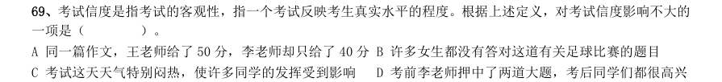

> （本题为图形题，选项为图片，见原卷）

**答案：B**　**考点：定义判断｜单定义**　**难度：★★☆☆☆**
**【判断推理·定义判断｜GK-2004-a-X070】**

70. 行政强制执行是指公民、法人或其他组织不履行法律规定的义务或行政机关依法作出的行政处理决定中规定 的义务,有关国家机关依法强制其履行义务或达到与履行义务状态相同的行为。根据上述定义,下列不属于行政 强制执行行为的是( )。

- **A.** 某税务机关对长期拖欠税费的商户店铺进行封闭,强制其缴纳税金
- **B.** 某市人民法院拍卖一个个体户的私有财产,保证与之相关的法律文书的执行
- **C.** 国家认监委正式对外公布了新的强制性产品认证制度,并强制执行
- **D.** 某法院没收了市公安局的警车一部。要求其按照法律文件对胜诉方进行赔偿

**答案：C**　**考点：定义判断｜单定义**　**难度：★★★☆☆**
**【判断推理·定义判断｜GK-2004-a-X071】**

71. 绝对反义词:也称互补反义词,这类反义词在意义上互相排斥,肯定甲必否定乙,肯定乙必否定甲。同时, 否定甲就必肯定乙,否定乙就肯定甲。根据上述定义,下列属于绝对反义词的一组是( )。

- **A.** 完整——残缺
- **B.** 高兴——生气
- **C.** 寒冷——温暖
- **D.** 卑微——高尚

**答案：A**　**考点：定义判断｜单定义**　**难度：★★☆☆☆**
**【判断推理·逻辑判断｜GK-2004-a-X072】**

72. 某国的人口调查数据表明,未婚的30 岁以上的男性超过这个年龄段的未婚女性,比例大约为10∶1。这些 男性中,大多数确实希望结婚。然而,明显地,除非他们中有许多人娶外国女性,否则大部分人将保持未婚。上 面论述基于下列哪个论断?( )

- **A.** 移民到国外的女性比男性多
- **B.** 与该国男性相同年龄的三十几岁的该国女性宁愿保持未婚
- **C.** 大多数未婚的该国男性不可能娶比他们年龄大的女性D 大多数未婚的该国男性不愿意娶非本国的女性

**答案：C**　**考点：逻辑判断｜前提假设**　**难度：★★★★★**
**【判断推理·逻辑判断｜GK-2004-a-X073】**

73. 1998 年度的统计显示,对中国人的健康威胁最大的三种慢性病,按其在总人口中的发病率排列,依次是乙 型肝炎、关节炎和高血压。其中,关节炎和高血压的发病率随着年龄的增长而增加,而乙型肝炎在各个年龄段的 发病率没有明显的不同。中国人口的平均年龄,在1998 年至2010 年之间,将呈明显上升态势而逐步进入老龄化 社会。根据题干提供的信息,以下哪项结论最为恰当?( )

- **A.** 到2010 年,发病率最高的将是关节炎
- **B.** 到2010 年,发病率最高的将仍是乙型肝炎
- **C.** 在1998 年至2010 年之间,乙型肝炎患者的平均年龄将增大
- **D.** 到2010 年,乙型肝炎的老年患者将多于非老年患者

**答案：C**　**考点：逻辑判断｜结论推出**　**难度：★★★★★**
**【判断推理·逻辑判断｜GK-2004-a-X074】**

74. 一份犯罪调研报告揭示,某市近三年来的严重刑事犯罪案件60%都为已记录在案的350 名惯犯所为。报告 同时揭示,严重刑事犯罪案件的作案者半数以上是吸毒者。如果上述断定都是真的,那么,下列哪项断定一定是 真的?( )

- **A.** 350 名惯犯中可能没有吸毒者
- **B.** 350 名惯犯中一定有吸毒者
- **C.** 350 名惯犯中大多数是吸毒者
- **D.** 吸毒者大多数在350 名惯犯中

**答案：A**　**考点：逻辑判断｜翻译推理**　**难度：★★★☆☆**
**【判断推理·逻辑判断｜GK-2004-a-X075】**

75. 发达国家中冠心病的发病率大约是发展中国家的三倍。有人认为,这主要归咎于发达国家中人们的高脂肪、 高蛋白、高热量的食物摄入。相对来说,发展中国家较少有人具备生这种“富贵病”的条件。其实,这种看法很 难成立。因为,目前发达国家的人均寿命高于70 岁,而发展中国家的人均寿命还不到50 岁。以下哪项如果成立, 最能加强上述反驳?( )

- **A.** 统计资料显示,冠心病患者相对集中在中老年年龄段,即45 岁以上
- **B.** 目前冠心病者呈年轻化趋势
- **C.** 发展中国家人们的高脂肪、高蛋白、高热量食物的摄入量,无论是总量还是人均量,都在逐年增长
- **D.** 相对发展中国家来说,发达国家的人们具有较高的防治冠心病的常识和较好的医疗条件

**答案：A**　**考点：逻辑判断｜削弱论证**　**难度：★★★★★**
**【判断推理·逻辑判断｜GK-2004-a-X076】**

76. 有时为了医治一些危重病人,医院允许使用海洛因作为止痛药。其实,这样做是应当禁止的。因为,毒品贩 子会通过这种渠道获取海洛因,对社会造成严重危害。以下哪个如果为真,最能削弱以上的论证?( )

- **A.** 有些止痛药可以起到和海洛因一样的止痛效果
- **B.** 用于止痛的海洛因在数量上与用于做非法交易的比起来是微不足道的
- **C.** 海洛因如果用量过大就会致死
- **D.** 在治疗过程中,海洛因的使用不会使病人上瘾

**答案：B**　**考点：逻辑判断｜削弱论证**　**难度：★★★☆☆**
**【判断推理·逻辑判断｜GK-2004-a-X077】**

77. 虽然菠菜中含有丰富的钙,但同时含有大量的浆草酸,浆草酸会有力地阻止人体对钙的吸收。因此,一个人 要想摄入足够的钙,就必须用其他含钙丰富的食物来取代菠菜。以下哪个如果为真,最能削弱题干的论证? ( )

- **A.** 大米中不含钙,但含有中和浆草酸并改变其性能的碱性物质
- **B.** 奶制品中的钙含量要高于菠菜,许多经常食用菠菜的人也食用奶制品
- **C.** 在人的日常饮食中,除了菠菜以外,事实上大量的蔬菜都含有钙
- **D.** 菠菜中除了钙以外,还含有其他丰富的营养素;另外,浆草酸只阻止人体对钙的吸收,并不阻止其他营养的吸

**答案：A**　**考点：逻辑判断｜削弱论证**　**难度：★★★★★**
**【判断推理·逻辑判断｜GK-2004-a-X078】**

78. 全国各地的电话公司目前开始为消费者提供电子接线员系统,然而,在近期内,人工接线员并不会因此减少。 除了下列哪项外,其他各项均有助于解释上述现象?( )

- **A.** 需要接线员帮助的电话数量剧增
- **B.** 尽管已经过测试,新的电子接线员系统要全面发挥功能还需进一步调整
- **C.** 如果在目前的合同期内解雇人工接线员,有关方面将负法律责任
- **D.** 新的电子接线员的工作效率两倍于人工接线员

**答案：D**　**考点：逻辑判断｜解释评价**　**难度：★★★☆☆**
**【判断推理·逻辑判断｜GK-2004-a-X079】**

79. 今年M 市开展了一次前所未有的化妆品广告大战。但是调查表明,只有25%的M 市居民实际使用化妆品。 这说明化妆品公司的广告投入有很大的盲目性。以下哪项陈述最有力地加强了上述结论?( )

- **A.** 化妆品公司做广告是因为产品供过于求
- **B.** 去年实际使用化妆品的M 市居民有30%
- **C.** 大多数不使用化妆品的居民不关心其广告宣传D 正是因为有25%的居民使用化妆品,才要针对他们做广告

**答案：B**　**考点：逻辑判断｜加强论证**　**难度：★★★★★**
**【判断推理·逻辑判断｜GK-2004-a-X080】**

80. 第二次世界大战期间,海洋上航行的商船常常遭到轰炸机的袭击,许多商船都先后在船上架设了高射炮。但 是,商船在海上摇晃得比较厉害,用高射炮射击天上的飞机是很难命中的。战争结束后,研究人员发现,从整个 战争期间架设过高射炮的商船的统计资料看,击落敌机的命中率只有4%。因此,研究人员认为,商船上架设高 射炮是得不偿失的。以下哪个如果为真,最能削弱上述研究人员的结论?( )

- **A.** 在战争期间,没有架设高射炮的商船,被击沉的比例高达25%,而架设了高射炮的商船,被击沉的比例只有不到10%
- **B.** 架设了高射炮的商船,即使不能将敌机击中,在某些情况下也可能将敌机吓跑
- **C.** 架设高射炮的费用是一笔不小的投入,而且在战争结束后,为了运行的效率,还要再花费资金将高射炮拆除
- **D.** 一般来说,上述商船用于高射炮的费用,只占整个商船的总价值的极少部分

**答案：A**　**考点：逻辑判断｜削弱论证**　**难度：★★★★★**
**【判断推理·逻辑判断｜GK-2004-a-X081】**

81. 政府应该不允许烟草公司在其营业收入中扣除广告费用。这样的话,烟草公司将会缴纳更多的税金。烟草公 司只好提高自己的产品价格,而产品价格的提高正好可以起到减少烟草购买的作用。以下哪项是题干论点的前 提?( )

- **A.** 烟草公司不可能降低其他方面的成本来抵销多缴的税金
- **B.** 如果它们需要付高额的税金,烟草公司将不再继续做广告
- **C.** 如果烟草公司不做广告,香烟的销售量将受到很大影响
- **D.** 烟草公司由此所增加的税金应该等于价格上涨所增加的盈利

**答案：A**　**考点：逻辑判断｜结论推出**　**难度：★★★★★**
**【判断推理·逻辑判断｜GK-2004-a-X082】**

82. 以前有几项研究表明,食用巧克力会增加食用者患心脏病的可能性。而一项最新的、更为可靠的研究得出的 结论是:食用巧克力与心脏病发病率无关。估计这项研究成果公布以后,巧克力的消费量将会大大增加。上述推 论基于以下哪项假设?( )

- **A.** 尽管有些人知道食用巧克力会增加患心脏病的可能性,却照样大吃特吃
- **B.** 人们从来也不相信进食巧克力会更容易患心脏病的说法
- **C.** 现在许多人吃巧克力是因为他们没有听过巧克力会导致心脏病的说法
- **D.** 现在许多人不吃巧克力完全是因为他们相信巧克力会诱发心脏病

**答案：D**　**考点：逻辑判断｜前提假设**　**难度：★★★★★**
**【判断推理·逻辑判断｜GK-2004-a-X083】**

83. 在评奖会上,A、B、C、D、E、F、G、H 竞争一项金奖。由一个专家小组投票,票数最多的将获金奖。如果A 的票数多于B,并且C 的票数多于D,那么E 将获得金奖。如果B 的票数多于A,或者F 的票数多于G,那么H 将 获得金奖。如果D 的票数多于C,那么F 将获得金奖。如果上述断定都是真的,并且事实上C 的票数多于D,并 且E 并没有获得金奖,以下哪项一定是真的?( )

- **A.** H 获奖
- **B.** F 的票数多于G
- **C.** A 的票数不比B 多
- **D.** B 的票数不比F 多

**答案：C**　**考点：逻辑判断｜翻译推理**　**难度：★★★★★**
**【判断推理·逻辑判断｜GK-2004-a-X084】**

84. 某珠宝商店失窃,甲、乙、丙、丁四人涉嫌被拘审。四人的口供如下:甲:案犯是丙。乙:丁是案犯。丙: 如果我作案,那么丁是主犯。丁:作案的不是我。四个口供中只有一个是假的。如果以上断定为真,则以下哪项 是真的?( )

- **A.** 说假话的是甲,作案的是乙
- **B.** 说假话的是丁,作案的是丙和丁
- **C.** 说假话的是乙,作案的是丙
- **D.** 说假话的是丙,作案的是丙

**答案：B**　**考点：逻辑判断｜翻译推理**　**难度：★★★☆☆**
**【判断推理·逻辑判断｜GK-2004-a-X085】**

85. 某律师事务所共有12 名工作人员。(1)有人会使用计算机;(2)有人不会使用计算机;(3)所长不会使 用计算机。这三个命题中只有一个是真的,以下哪项正确地表示该律师事务所会使用计算机的人数?( )

- **A.** 12 人都会使用
- **B.** 12 人没人会使用
- **C.** 仅有一人会使用
- **D.** 不能确定

**答案：A**　**考点：逻辑判断｜结论推出**　**难度：★★★☆☆**
**【判断推理·逻辑判断｜GK-2004-a-X086】**

86. 亚里士多德学院的门口竖着一块牌子。上面写着“不懂逻辑者不得入内”。这天,来了一群人,他们都是懂 逻辑的人。如果牌子上的话得到准确的理解和严格的执行,那么以下诸断定中,只有一项是真的。这一真的断定 是( )。

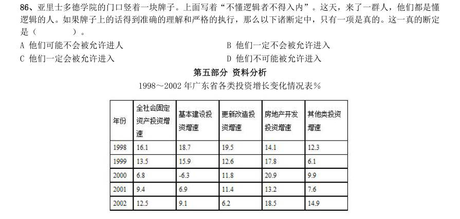

- **A.** 他们可能不会被允许进人
- **B.** 他们一定不会被允许进入
- **C.** 他们一定会被允许进入
- **D.** 他们不可能被允许进入

**答案：A**　**考点：逻辑判断｜翻译推理**　**难度：★★★☆☆**
**【资料分析·增长率计算与比较｜GK-2004-a-X087】**

87. 1998~2002 年广东省各类投资增长变化情况表% 从1998 年~2002 年间,投资增速一直呈下降趋势的是( )。

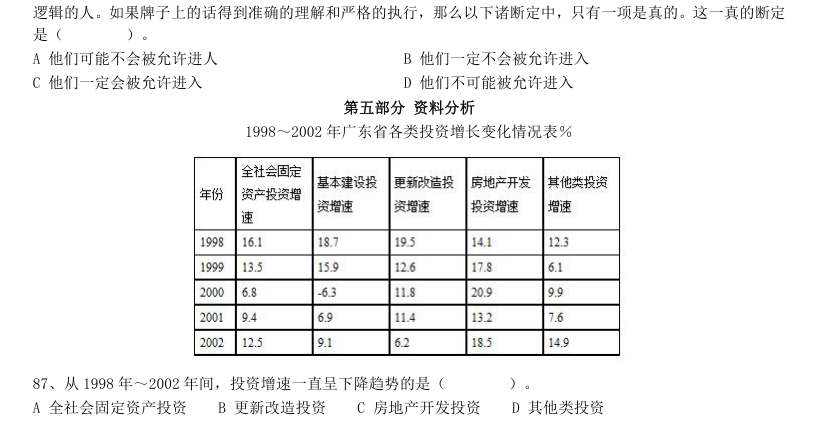

- **A.** 全社会固定资产投资
- **B.** 更新改造投资
- **C.** 房地产开发投资
- **D.** 其他类投资

**答案：B**　**考点：增长率计算与比较｜增长率计算**　**难度：★☆☆☆☆**
**【资料分析·综合分析｜GK-2004-a-X088】**

88. 下面的描述不正确的是( )。

- **A.** 全社会固定资产投资逐年递增
- **B.** 基本建设投资在2000 年的投入要低于1999 年
- **C.** 更新改造投资在2002 年的投入要低于2001 年
- **D.** 其他类投资的增速在2002 年增长最快

**答案：C**　**考点：综合分析｜增长率**　**难度：★★★★☆**
**【资料分析·综合分析｜GK-2004-a-X089】**

89. 从上表可以看出,广东省最重视的投资是( )。

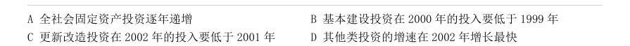

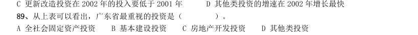

- **A.** 全社会固定资产投资
- **B.** 基本建设投资
- **C.** 房地产开发投资
- **D.** 其他类投资

**答案：C**　**考点：综合分析｜增长率**　**难度：★★★★☆**
**【资料分析·平均数计算｜GK-2004-a-X090】**

90. 从平均水平来看,投资增长最快的年份是( )。

> 材料图见 images/GK-2004-a-X089-m.jpg

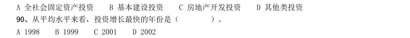

- **A.** 1998
- **B.** 1999
- **C.** 2001
- **D.** 2002

**答案：A**　**考点：平均数计算｜现期平均数**　**难度：★☆☆☆☆**
**【资料分析·综合分析｜GK-2004-a-X091】**

91. 如果1998 年基本建设投资为5 亿元,则2000 年的基本建设投资为( )。

> 材料图见 images/GK-2004-a-X089-m.jpg

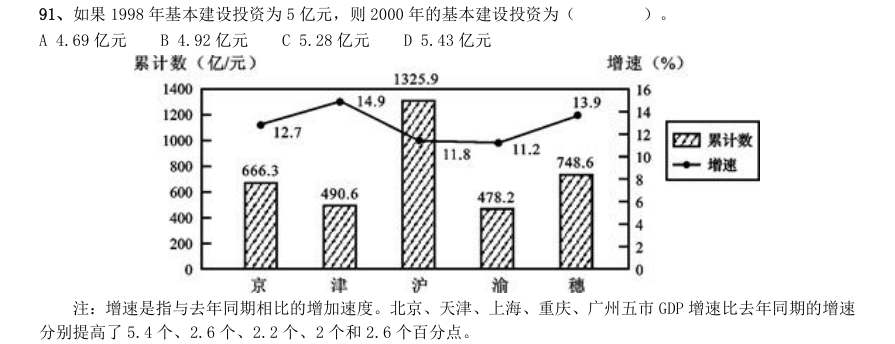

- **A.** 4.69 亿元
- **B.** 4.92 亿元
- **C.** 5.28 亿元
- **D.** 5.43 亿元

**答案：D**　**考点：综合分析｜增长率**　**难度：★★★★☆**
**【资料分析·综合分析｜GK-2004-a-X092】**
> 材料：注:增速是指与去年同期相比的增加速度。北京、天津、上海、重庆、广州五市GDP 增速比去年同期的增速分别提高了5.4 个、2.6 个、2.2 个、2 个和2.6 个百分点。

92. 分别提高了5.4 个、2.6 个、2.2 个、2 个和2.6 个百分点。 2003 年第一季度GDP 总量增长最快的城市是( )。

> 材料图见 images/GK-2004-a-X089-m.jpg

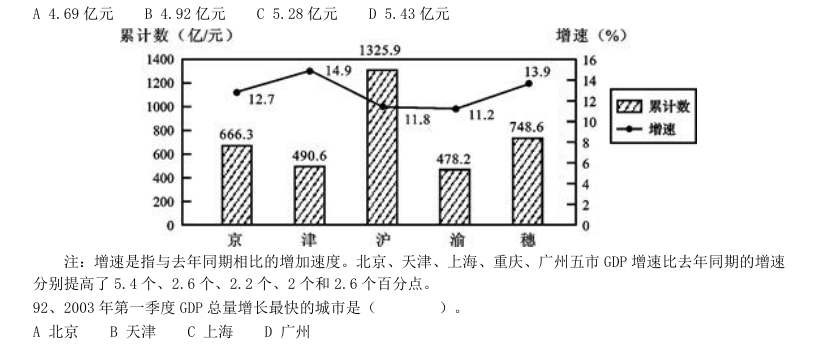

- **A.** 北京
- **B.** 天津
- **C.** 上海
- **D.** 广州

**答案：B**　**考点：综合分析｜增长率**　**难度：★★★★☆**
**【资料分析·增长率计算与比较｜GK-2004-a-X093】**
> 材料：注:增速是指与去年同期相比的增加速度。北京、天津、上海、重庆、广州五市GDP 增速比去年同期的增速分别提高了5.4 个、2.6 个、2.2 个、2 个和2.6 个百分点。

93. 2003 年第一季度GDP 总量和增速均居同一位的城市有( )。

> 材料图见 images/GK-2004-a-X089-m.jpg

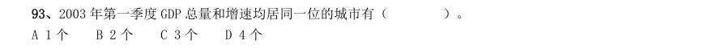

- **A.** 1 个
- **B.** 2 个
- **C.** 3 个
- **D.** 4 个

**答案：C**　**考点：增长率计算与比较｜增长率计算**　**难度：★☆☆☆☆**
**【资料分析·增长率计算与比较｜GK-2004-a-X094】**
> 材料：注:增速是指与去年同期相比的增加速度。北京、天津、上海、重庆、广州五市GDP 增速比去年同期的增速分别提高了5.4 个、2.6 个、2.2 个、2 个和2.6 个百分点。

94. 下列哪个组合的陈述可能正确?( ) I.2003 年上述五个城市GDP 增速均实现两位数增长 II.2003 年广州经济总量首次超过北京 III.2002 年同期重庆GDP 总量也是第五位

> 材料图见 images/GK-2004-a-X089-m.jpg

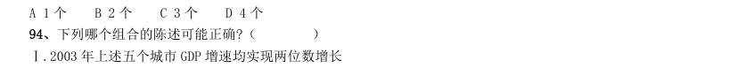

- **A.** I
- **B.** I和III
- **C.** I和II
- **D.** I、II和III

**答案：A**　**考点：增长率计算与比较｜增长率计算**　**难度：★★☆☆☆**
**【资料分析·基期量计算｜GK-2004-a-X095】**
> 材料：注:增速是指与去年同期相比的增加速度。北京、天津、上海、重庆、广州五市GDP 增速比去年同期的增速分别提高了5.4 个、2.6 个、2.2 个、2 个和2.6 个百分点。

95. 2001 年同期GDP 总量位居第一和最后的两个城市分别是( )。

> 材料图见 images/GK-2004-a-X089-m.jpg

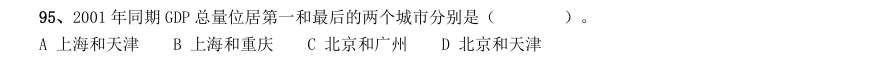

- **A.** 上海和天津
- **B.** 上海和重庆
- **C.** 北京和广州
- **D.** 北京和天津

**答案：A**　**考点：基期量计算｜已知现期与增长率求基期**　**难度：★☆☆☆☆**
**【资料分析·增长率计算与比较｜GK-2004-a-X096】**
> 材料：注:增速是指与去年同期相比的增加速度。北京、天津、上海、重庆、广州五市GDP 增速比去年同期的增速分别提高了5.4 个、2.6 个、2.2 个、2 个和2.6 个百分点。

96. 2002 年第一季度GDP 总量及增速均居第四位的城市是( )。

> 材料图见 images/GK-2004-a-X089-m.jpg

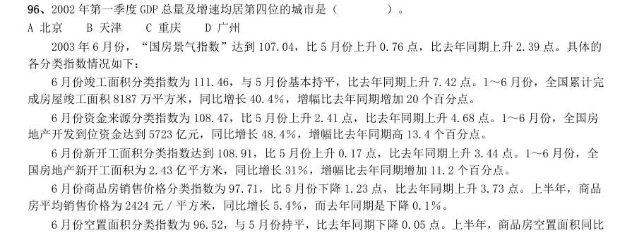

- **A.** 北京
- **B.** 天津
- **C.** 重庆
- **D.** 广州

**答案：C**　**考点：增长率计算与比较｜增长率计算**　**难度：★☆☆☆☆**
**【资料分析·增长率计算与比较｜GK-2004-a-X097】**
> 材料：各分类指数情况如下: 6 月份竣工面积分类指数为111.46,与5 月份基本持平,比去年同期上升7.42 点。1~6 月份,全国累计完 成房屋竣工面积8187 万平方米,同比增长40.4%,增幅比去年同期增加20 个百分点。 6 月份资金来源分类指数为108.47,比5 月份上升2.41 点,比去年同期上升4.68 点。1~6 月份,全国房 地产开发到位资金达到5723 亿元,同比增长48.4%,增幅比去年同期高13.4 个百分点。 6 月份新开工面积分类指数达到108.91,比5 月份上升0.17 点,比去年同期上升3.44 点。1~6 月份,全 国房地产新开工面积为2.43 亿平方米,同比增长31%,增幅比去年同期增加11.2 个百分点。 6 月份商品房销售价格分类指数为97.71,比5 月份下降1.23 点,比去年同期上升3.73 点。上半年,商品 房平均销售价格为2424 元/平方

97. 上半年,完成土 地开发面积7144 万平方米,同比增长40%,增幅比去年同期回落12.7 个百分点。 2002 年的1~6 月份,全国累计完成房屋竣工面积的增幅是( )。

> 材料图见 images/GK-2004-a-X089-m.jpg

- **A.** 40.40%
- **B.** 38.60%
- **C.** 20.40%
- **D.** 18.60%

**答案：C**　**考点：增长率计算与比较｜降幅与增速**　**难度：★★★☆☆**
**【资料分析·增长率计算与比较｜GK-2004-a-X098】**
> 材料：各分类指数情况如下: 6 月份竣工面积分类指数为111.46,与5 月份基本持平,比去年同期上升7.42 点。1~6 月份,全国累计完 成房屋竣工面积8187 万平方米,同比增长40.4%,增幅比去年同期增加20 个百分点。 6 月份资金来源分类指数为108.47,比5 月份上升2.41 点,比去年同期上升4.68 点。1~6 月份,全国房 地产开发到位资金达到5723 亿元,同比增长48.4%,增幅比去年同期高13.4 个百分点。 6 月份新开工面积分类指数达到108.91,比5 月份上升0.17 点,比去年同期上升3.44 点。1~6 月份,全 国房地产新开工面积为2.43 亿平方米,同比增长31%,增幅比去年同期增加11.2 个百分点。 6 月份商品房销售价格分类指数为97.71,比5 月份下降1.23 点,比去年同期上升3.73 点。上半年,商品 房平均销售价格为2424 元/平方

98. 与去年6 月相比,增幅最大的指数是( )。

> 材料图见 images/GK-2004-a-X089-m.jpg

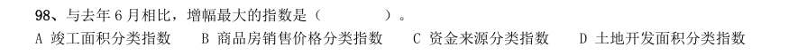

- **A.** 竣工面积分类指数
- **B.** 商品房销售价格分类指数
- **C.** 资金来源分类指数
- **D.** 土地开发面积分类指数

**答案：A**　**考点：增长率计算与比较｜增长率比较**　**难度：★☆☆☆☆**
**【资料分析·基期量计算｜GK-2004-a-X099】**
> 材料：各分类指数情况如下: 6 月份竣工面积分类指数为111.46,与5 月份基本持平,比去年同期上升7.42 点。1~6 月份,全国累计完 成房屋竣工面积8187 万平方米,同比增长40.4%,增幅比去年同期增加20 个百分点。 6 月份资金来源分类指数为108.47,比5 月份上升2.41 点,比去年同期上升4.68 点。1~6 月份,全国房 地产开发到位资金达到5723 亿元,同比增长48.4%,增幅比去年同期高13.4 个百分点。 6 月份新开工面积分类指数达到108.91,比5 月份上升0.17 点,比去年同期上升3.44 点。1~6 月份,全 国房地产新开工面积为2.43 亿平方米,同比增长31%,增幅比去年同期增加11.2 个百分点。 6 月份商品房销售价格分类指数为97.71,比5 月份下降1.23 点,比去年同期上升3.73 点。上半年,商品 房平均销售价格为2424 元/平方

99. 与去年6 月相比,下降的指数是( )。

> 材料图见 images/GK-2004-a-X089-m.jpg

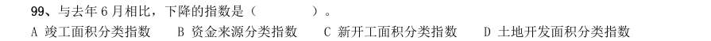

- **A.** 竣工面积分类指数
- **B.** 资金来源分类指数
- **C.** 新开工面积分类指数
- **D.** 土地开发面积分类指数

**答案：D**　**考点：基期量计算｜已知现期与增长率求基期**　**难度：★☆☆☆☆**
**【资料分析·增长率计算与比较｜GK-2004-a-X100】**
> 材料：各分类指数情况如下: 6 月份竣工面积分类指数为111.46,与5 月份基本持平,比去年同期上升7.42 点。1~6 月份,全国累计完 成房屋竣工面积8187 万平方米,同比增长40.4%,增幅比去年同期增加20 个百分点。 6 月份资金来源分类指数为108.47,比5 月份上升2.41 点,比去年同期上升4.68 点。1~6 月份,全国房 地产开发到位资金达到5723 亿元,同比增长48.4%,增幅比去年同期高13.4 个百分点。 6 月份新开工面积分类指数达到108.91,比5 月份上升0.17 点,比去年同期上升3.44 点。1~6 月份,全 国房地产新开工面积为2.43 亿平方米,同比增长31%,增幅比去年同期增加11.2 个百分点。 6 月份商品房销售价格分类指数为97.71,比5 月份下降1.23 点,比去年同期上升3.73 点。上半年,商品 房平均销售价格为2424 元/平方

100. 与上一个月相比,降幅最大的指数是( )。

> 材料图见 images/GK-2004-a-X089-m.jpg

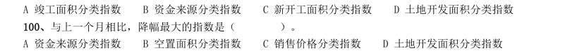

- **A.** 资金来源分类指数
- **B.** 空置面积分类指数
- **C.** 销售价格分类指数
- **D.** 土地开发面积分类指数

**答案：C**　**考点：增长率计算与比较｜增长率比较**　**难度：★☆☆☆☆**
**【资料分析·平均数计算｜GK-2004-a-X101】**
> 材料：各分类指数情况如下: 6 月份竣工面积分类指数为111.46,与5 月份基本持平,比去年同期上升7.42 点。1~6 月份,全国累计完 成房屋竣工面积8187 万平方米,同比增长40.4%,增幅比去年同期增加20 个百分点。 6 月份资金来源分类指数为108.47,比5 月份上升2.41 点,比去年同期上升4.68 点。1~6 月份,全国房 地产开发到位资金达到5723 亿元,同比增长48.4%,增幅比去年同期高13.4 个百分点。 6 月份新开工面积分类指数达到108.91,比5 月份上升0.17 点,比去年同期上升3.44 点。1~6 月份,全 国房地产新开工面积为2.43 亿平方米,同比增长31%,增幅比去年同期增加11.2 个百分点。 6 月份商品房销售价格分类指数为97.71,比5 月份下降1.23 点,比去年同期上升3.73 点。上半年,商品 房平均销售价格为2424 元/平方

101. 2002 年上半年,商品房平均销售价格是( )。

> 材料图见 images/GK-2004-a-X089-m.jpg

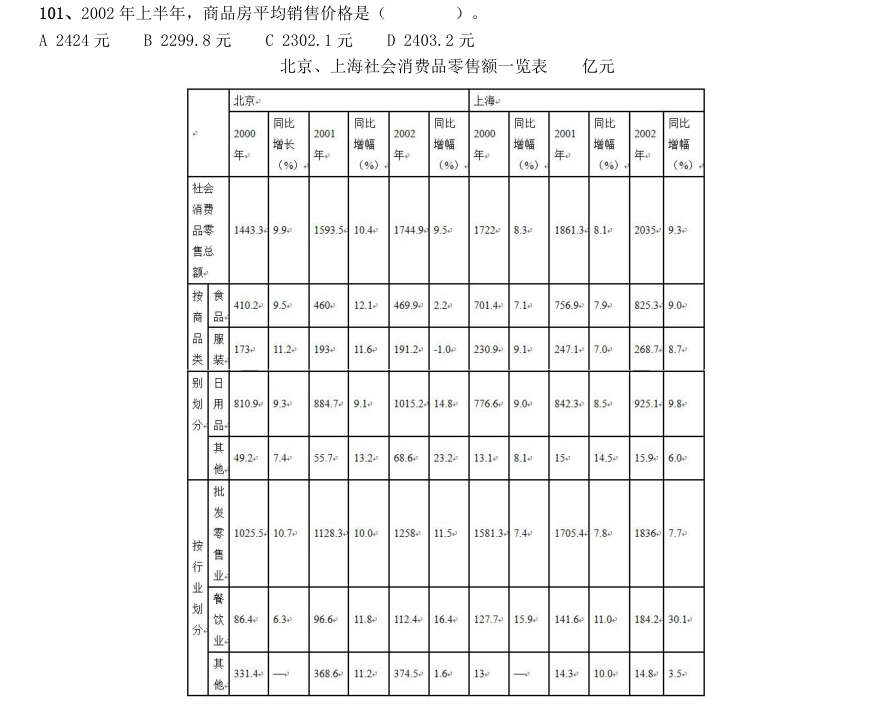

- **A.** 2424 元
- **B.** 2299.8 元
- **C.** 2302.1 元
- **D.** 2403.2 元

**答案：B**　**考点：平均数计算｜现期平均数**　**难度：★☆☆☆☆**
**【资料分析·增长率计算与比较｜GK-2004-a-X102】**

102. 亿元 2002 年北京市社会消费品零售总额相对于2000 年的增幅是( )。

> 材料图见 images/GK-2004-a-X089-m.jpg

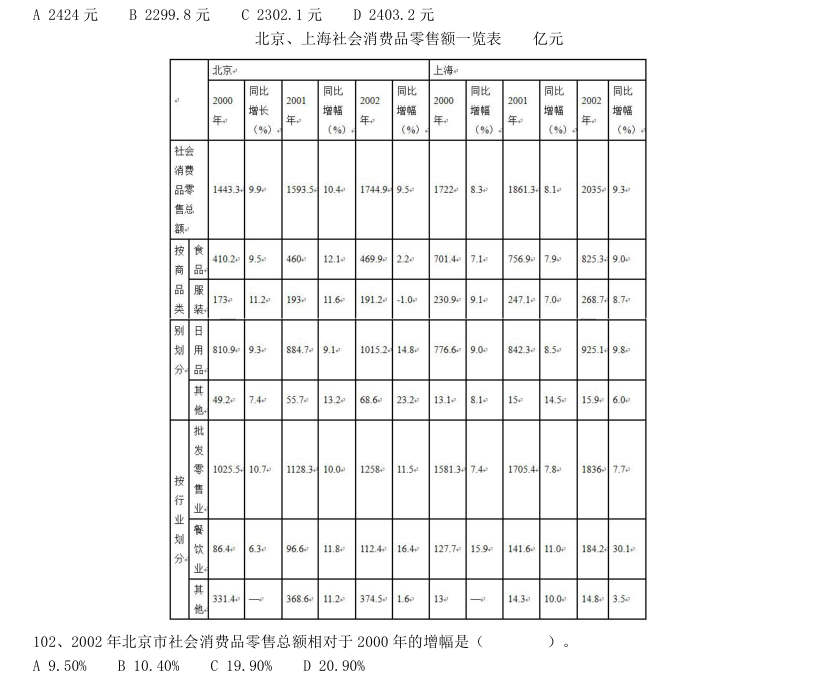

- **A.** 9.50%
- **B.** 10.40%
- **C.** 19.90%
- **D.** 20.90%

**答案：D**　**考点：增长率计算与比较｜增长率计算**　**难度：★☆☆☆☆**
**【资料分析·增长率计算与比较｜GK-2004-a-X103】**

103. 与2001 年相比,2002 年北京和上海两市各类零售总额增幅最大的是( )。

> 材料图见 images/GK-2004-a-X089-m.jpg

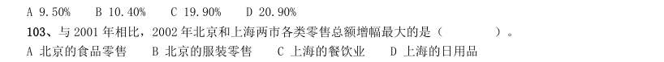

- **A.** 北京的食品零售
- **B.** 北京的服装零售
- **C.** 上海的餐饮业
- **D.** 上海的日用品

**答案：C**　**考点：增长率计算与比较｜增长率比较**　**难度：★☆☆☆☆**
**【资料分析·综合分析｜GK-2004-a-X104】**

104. 2000 年北京批发零售业的零售额为1025.5 亿元,比上海少( )。

> 材料图见 images/GK-2004-a-X089-m.jpg

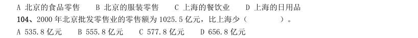

- **A.** 535.8 亿元
- **B.** 555.8 亿元
- **C.** 577.8 亿元
- **D.** 656.8 亿元

**答案：B**　**考点：综合分析｜综合分析（综合）**　**难度：★★★★☆**
**【资料分析·增长率计算与比较｜GK-2004-a-X105】**

105. 2000~2002 年,下列选项中零售额增幅相对最稳定的是( )。

> 材料图见 images/GK-2004-a-X089-m.jpg

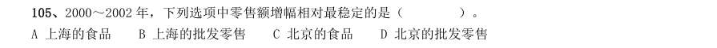

- **A.** 上海的食品
- **B.** 上海的批发零售
- **C.** 北京的食品
- **D.** 北京的批发零售

**答案：B**　**考点：增长率计算与比较｜增长率计算**　**难度：★☆☆☆☆**
**【资料分析·增长率计算与比较｜GK-2004-a-X106】**

106. 2002 年上海食品和服装的零售总额高出北京( )。

> 材料图见 images/GK-2004-a-X089-m.jpg

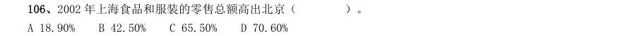

- **A.** 18.90%
- **B.** 42.50%
- **C.** 65.50%
- **D.** 70.60%

**答案：C**　**考点：增长率计算与比较｜增长率计算（综合）**　**难度：★☆☆☆☆**