# 2004 年国考行测（B卷）

- 题量：105（含答案 102）
- 模块分布：资料分析21 / 数量关系15 / 言语理解14 / 判断推理35 / 常识判断20
- 试卷编号：`国考-2004-B卷`

## 题目与答案

**【常识判断·地理常识｜GK-2004-b-X001】**
> 材料：注:此套题原题有听力20 道,题型已淘汰,故略去。

1. 我国国家最高监督权的行使机构是( )。

- **A.** 最高人民法院
- **B.** 最高人民检察院
- **C.** 全国人民代表大会
- **D.** 中共中央纪律检查委员会

**答案：C**　**考点：地理常识｜世界地理**
**【常识判断·地理常识｜GK-2004-b-X002】**

2. 下列国家中,尚未加入欧元区的是( )。

- **A.** 西班牙
- **B.** 比利时
- **C.** 卢森堡
- **D.** 英国

**答案：D**　**考点：地理常识｜世界地理**
**【常识判断·政治常识｜GK-2004-b-X003】**

3. 人类最早使用的金属是( )。

- **A.** 铜
- **B.** 铁
- **C.** 银
- **D.** 铅

**答案：A**　**考点：政治常识｜政治常识（综合）**
**【常识判断·政治常识｜GK-2004-b-X004】**

4. 下列不属于哺乳类的动物是( )。

- **A.** 蝙蝠
- **B.** 鲸
- **C.** 蜂鸟
- **D.** 海豹

**答案：C**　**考点：政治常识｜政治常识（综合）**
**【常识判断·法律常识｜GK-2004-b-X005】**

5. 18 世纪末资产阶级反封建革命斗争的著名纲领性文件,并且以后成为法国宪法序言的是( )。

- **A.** 《自由大宪章》
- **B.** 《权利法案》
- **C.** 《人权宣言》
- **D.** 《独立宣言》

**答案：C**　**考点：法律常识｜宪法**
**【常识判断·政治常识｜GK-2004-b-X006】**

6. 电话的发明者是( )。

- **A.** 摩尔
- **B.** 爱迪生
- **C.** 贝尔
- **D.** 法拉第

**答案：C**　**考点：政治常识｜政治常识（综合）**
**【常识判断·经济常识｜GK-2004-b-X007】**

7. 理性经济人假设是西方经济学理论的逻辑基础,这一理论假设的核心是认为人( )。

- **A.** 追求经济利益的最大化
- **B.** 追求自我利益的最大化
- **C.** 没有利他心
- **D.** 追求经济利益和社会利益的最大化

**答案：B**　**考点：经济常识｜经济常识（综合）**
**【常识判断·政治常识｜GK-2004-b-X008】**

8. 不是德国古典哲学主要代表人物的是( )。

- **A.** 康德
- **B.** 黑格尔
- **C.** 谢林
- **D.** 尼采

**答案：D**　**考点：政治常识｜马克思主义基本原理**
**【常识判断·政治常识｜GK-2004-b-X009】**

9. 作为一般性公文的结构层次序数,正确的是( )。

- **A.** 一、1、1
- **B.** 一、(一)、1、(1)
- **C.** (一)、(1)、1
- **D.** 一、(一)、1、1

**答案：B**　**考点：政治常识｜政治常识（综合）**
**【常识判断·政治常识｜GK-2004-b-X010】**

10. 我国水资源总量居世界第六,但人均水资源占有量为世界平均数的( )。

- **A.** 41641
- **B.** 41643
- **C.** 41645
- **D.** 41647

**答案：B**　**考点：政治常识｜政治常识（综合）**
**【常识判断·政治常识｜GK-2004-b-X011】**

11. 人们常说的“知天命”的年龄是指( )。

- **A.** 40 岁
- **B.** 50 岁
- **C.** 60 岁
- **D.** 80 岁

**答案：B**　**考点：政治常识｜政治常识（综合）**
**【常识判断·地理常识｜GK-2004-b-X012】**

12. 中华人民共和国成立后,第一个与我国建立外交关系的西方国家是( )。

> 同题变体（主记录 GK-2004-a-X010）

- **A.** 英国
- **B.** 德国
- **C.** 法国
- **D.** 瑞士

**答案：D**　**考点：地理常识｜中国地理**
**【常识判断·政治常识｜GK-2004-b-X013】**

13. “一丝不苟”中的“丝”的含义是( )。

- **A.** 计量单位
- **B.** 丝线
- **C.** 丝绸
- **D.** 发丝

**答案：A**　**考点：政治常识｜政治常识（综合）**
**【常识判断·地理常识｜GK-2004-b-X014】**

14. 全球气候变暖是世界各国所关注的问题,大气中能产生温室效应的气体已经发现近30 种,造成温室效应最 重要的气体是( )。

- **A.** 二氧化碳
- **B.** 氟利昂
- **C.** 一氧化二氮
- **D.** 臭氧

**答案：A**　**考点：地理常识｜中国地理**
**【常识判断·政治常识｜GK-2004-b-X015】**

15. 提出“知识就是力量”这句世界名言的是( )。

- **A.** 英国哲学家弗兰西斯·培根
- **B.** 法国启蒙运动的旗手伏尔泰
- **C.** 古希腊哲学家苏格拉底
- **D.** 中国历史上伟大的思想家孔子

**答案：A**　**考点：政治常识｜马克思主义基本原理**
**【常识判断·法律常识｜GK-2004-b-X016】**

16. 2003 年5 月7 日国务院第7 次常务会议通过、公布,并于公布之日起施行了《突发公共卫生事件应急条例》。 该条例规定,( )地方人民政府应当建立和完善突发事件监测与预警系统。

- **A.** 省级以上
- **B.** 市级以上
- **C.** 县级以上
- **D.** 乡级以上

**答案：C**　**考点：法律常识｜行政法**
**【常识判断·历史人文｜GK-2004-b-X017】**

17. “兼听则明,偏信则暗”这一句古代格言出自( )。

- **A.** 《资治通鉴》
- **B.** 《论语》
- **C.** 《荀子》
- **D.** 《史记》

**答案：A**　**考点：历史人文｜中国古代史**
**【常识判断·政治常识｜GK-2004-b-X018】**

18. 属于佛教经典著作的是( )。

- **A.** 《古兰经》
- **B.** 《三玄》
- **C.** 《华严经》
- **D.** 《伪经》

**答案：C**　**考点：政治常识｜政治常识（综合）**
**【常识判断·经济常识｜GK-2004-b-X019】**

19. 经济学领域所谓的“看不见的手”的最初提出者是( )。

- **A.** 亚当·斯密
- **B.** 凯恩斯
- **C.** 大卫·李嘉图
- **D.** 萨谬尔森

**答案：A**　**考点：经济常识｜宏观经济**
**【常识判断·政治常识｜GK-2004-b-X020】**

20. 《汉谟拉比法典》出自( )。

- **A.** 古埃及
- **B.** 古巴比伦
- **C.** 古罗马
- **D.** 古印度

**答案：B**　**考点：政治常识｜政治常识（综合）**
**【言语理解·中心理解｜GK-2004-b-X021】**
> 材料：温馨提示: 第二部分缺一题,在试卷最后补上了,大家别忘了做。

21. 今日日本,学生们最钟情的“考试服”的颜色是藏青色。学生们认为,藏青色是“吉祥色”,有助于考出高 分。心理学家也认为,藏青色有助于稳定情绪,对发挥水平起积极作用。而校方说,要考好主要靠水平,与服装 颜色无关。现考生们仍对藏青色“考试服”一往情深。每年考试前藏青色“考试服”都热销。作者认为藏青色“考 试服”的时兴有无科学道理?( )

- **A.** 作者未作评论
- **B.** 有道理,因为藏青色是“吉祥色”
- **C.** 有道理,因为藏青色有助于稳定情绪
- **D.** 没道理,因为考试成绩与服装颜色无关

**答案：A**　**考点：中心理解｜转折与因果**
**【言语理解·逻辑填空｜GK-2004-b-X022】**

22. 光滑的皮肤和人造的泳衣哪一个在水中的阻力小?这些泳衣采用了特殊的纤维,接缝都放在身体的背面,使 其不会影响运动员的动作。另外,泳衣的重量和色彩也不容忽视。显然,谁都想穿比对手更轻的泳装,后者则涉 及心理因素及品牌的形象问题。句中的“后者”指( )。

- **A.** 接缝都放在身体的背面
- **B.** 这些泳衣采用了特殊的纤维
- **C.** 泳衣的色彩
- **D.** 泳衣的重量

**答案：C**　**考点：逻辑填空｜逻辑填空（综合）**
**【言语理解·逻辑填空｜GK-2004-b-X023】**

23. 每个人睡觉时都要做梦,人在做梦时的睡眠叫有梦睡眠。有梦睡眠时,控制四肢和躯体的神经传导被阻断, 除了脚和手指有知觉外,身体其他部分均处于麻木状态。心跳和呼吸的次数与清醒时差不多,但变得不那么均匀, 体温调节机制受阻,打寒颤和出汗都很难。根据本文,理解准确的是()。

- **A.** 人在做梦时,呼吸和清醒时不完全一样
- **B.** 人在做梦时,心跳和清醒时是相同的
- **C.** 人在做梦时,常常出汗
- **D.** 人在做梦时,全身处于麻木状态

**答案：A**　**考点：逻辑填空｜逻辑填空（综合）**
**【言语理解·逻辑填空｜GK-2004-b-X024】**

24. 曾任全国政协委员的百岁老人袁晓园说:长寿其实没有任何秘诀,想吃就吃,想睡就睡,顺其自然到百年, 这就是我的养生之道。英国哲学家罗素活了98 岁,从来也不认为长寿有什么秘诀,主张该干什么就干什么,想 吃什么就吃什么,一切顺其自然。人体的差异性很大,健康虽有一定之规,但没有什么一成不变的养生之道和长 寿秘诀。对划横线的文字理解准确的是( )。

- **A.** 作者完全同意袁晓园和罗素的主张
- **B.** 作者有保留地同意袁晓园和罗素的主张
- **C.** 作者不同意袁晓园和罗素的主张
- **D.** 作者批评了袁晓园和罗素的主张

**答案：A**　**考点：逻辑填空｜一空**
**【言语理解·标题填入｜GK-2004-b-X025】**

25. 在光滑的冰面上开车是不容易的,可是我在北极见到的芬兰司机,在冰道上开车的时速和在柏油马路上一样 快。为了保障安全,这里的汽车都备有两套轮子,一套是夏季用的普通轮子,一套是适用于冰面的带针的轮子, 公路上的另一奇景是白天行驶的车辆都开着灯,据说这样事故发生率比较低。最适合做本段文字标题的是 ( )。

- **A.** 北极见闻
- **B.** 北极气温
- **C.** 行车规则
- **D.** 行车怪异

**答案：A**　**考点：标题填入｜标题填入**
**【言语理解·逻辑填空｜GK-2004-b-X026】**

26. 尽管国际上对此存在很多争议,意大利文化部门还是决定用蒸馏水清洗米开朗基罗的旷世杰作——《大卫》 雕像。这项工程的目的之一是除去这座高达4.5 米的雕像上的尘土和油污,佛罗伦萨博物馆的负责人说:“这项 工程并不是为了让雕像变得更好看。”意大利文化部长已经排除了干洗的可能性。“国际上对此存在很多争议” 的“此”指的是( )。

> 同题变体（主记录 GK-2004-a-X024）

- **A.** 《大卫》雕像是米开朗基罗的旷世杰作
- **B.** 这项工程是为了让雕像变得更好看
- **C.** 决定用蒸馏水清洗《大卫》雕像
- **D.** 要除去这座高达4.5 米的雕像上的尘土和油污

**答案：C**　**考点：逻辑填空｜逻辑填空（综合）**
**【言语理解·中心理解｜GK-2004-b-X027】**

27. 现在,国际间的技术贸易要比一般商品贸易的增长快得多。因为只有引进了先进技术,本国产品的质量才能 迅速提高,改变那种单靠引进外国商品的情况。因此,现在人们都重视从各国引进那些适应本国生产环境和条件 的先进技术。这段文字谈论的重点是( )。

- **A.** 技术贸易的重要意义和作用
- **B.** 技术贸易和一般商品贸易的不同
- **C.** 要和世界各国进行技术贸易
- **D.** 要根据本国情况改造外国先进技术

**答案：A**　**考点：中心理解｜转折与因果**
**【言语理解·逻辑填空｜GK-2004-b-X028】**

28. 大袋鼠是一种奇怪的动物。它们平时在原野、灌木丛和森林地带活动,靠吃草为生。它们过群居生活,但没 有固定的集群,常因寻找水源和食物而汇集成一个较大的群体。老鹰、蟒蛇和人们都要捕捉袋鼠,然而对袋鼠来 说最大的危害莫过于干旱,幼小的袋鼠会死亡,母袋鼠会停止孕育。下面说法正确的是( )。

- **A.** 有的大袋鼠单独行动
- **B.** 大袋鼠常聚集在一起寻找水和食物
- **C.** 威胁大袋鼠最严重的是人们的捕捉
- **D.** 遇到干旱,袋鼠都会死亡

**答案：B**　**考点：逻辑填空｜逻辑填空（综合）**
**【言语理解·细节判断｜GK-2004-b-X029】**

29. 宾夕法尼亚大学的研究人员已经确定,癌细胞的存活可以归结为一种称作pim-2 的关键酶。这项即将刊登在 《基因和发展》杂志上的发现意味着研究人员对于理解癌细胞在形成肿瘤以前为什么能在人体内存活(对抗体内 自然的免疫系统)取得重要进展。在许多肿瘤中,这种酶的浓度都非常高。从这段文字中可以推出的是( )。

- **A.** 发现了一种被称作pim-2 的关键酶
- **B.** 这项发现即将刊登在《基因和发育》杂志上
- **C.** 在许多肿瘤中,这种酶的浓度都非常高
- **D.** pim-2 对癌细胞的存活起着关键的作用

**答案：D**　**考点：细节判断｜细节判断**
**【言语理解·逻辑填空｜GK-2004-b-X030】**

30. 下棋不仅是一种消遣,还能促使人的个性全面和谐地发展。有些人犯了错误不承认,或尽量加以辩解,而下 棋输了就得承认,用心的人还认真分析和总结自己的失误以提高自己的棋艺。有些人性格比较懦弱,下棋使他们 成为坚强的人。下棋一步一步地走和循序渐进的规则又能锻炼人的意志和毅力。对画线部分理解不准确的是 ( )。

- **A.** 有助于清醒地衡量自己的能力
- **B.** 有助于使人的性格坚强
- **C.** 能使人战胜对方
- **D.** 能使人更有毅力

**答案：C**　**考点：逻辑填空｜逻辑填空（综合）**
**【言语理解·中心理解｜GK-2004-b-X031】**

31. 人们以为芳香剂能净化空气,其实不然,而且实验表明,大多数芳香剂对神经系统有毒害作用,少数还可导 致造血系统损害,对皮肤黏膜有刺激作用等。对一般人来说,偶尔使用芳香剂,不至于造成危害,但家中有呼吸 系统疾病等症状者,最好少用或不用。对这段文字,理解不准确的是( )。

- **A.** 有些芳香剂对空气没有污染
- **B.** 使用芳香剂都会伤害身体
- **C.** 家里有呼吸系统疾病的人,不要用芳香剂
- **D.** 家里没病人,也只偶尔使用芳香剂

**答案：B**　**考点：中心理解｜转折与因果**
**【言语理解·逻辑填空｜GK-2004-b-X032】**

32. 被法国人称为“地下城市”的巴黎下水道,规模很大,设施先进,巴黎下水道虽名为下水道,但还具有其他 各种功能。下水道底部为水渠,上部有各种管道,管道总长度为2100 公里。现在,下水道像河一样可以行船。 昼夜灯火通明,不失为旅游的好去处。巴黎的地下城,还有许多可以通行汽车的地下街道和巨大的停车场。关于 巴黎下水道,下面说法正确的是( )。

- **A.** 可以在里面坐船旅游
- **B.** 有地下街道和娱乐设施
- **C.** 设施齐全,生活方便
- **D.** 管道纵横,长有千米

**答案：A**　**考点：逻辑填空｜逻辑填空（综合）**
**【言语理解·细节判断｜GK-2004-b-X033】**

33. 软件在长期运行和使用中没有磨损、老化、用旧等问题。任何机械、电子设备在运行和使用中,其失效率大 都遵循U 形曲线(即所谓“浴缸曲线”)。那是因为刚一投入使用时各部件尚未灵活运转,常常容易出问题。经 过一段运行,便可以稳定下来。而当设备已经历相当时期的运转,便会出现磨损、老化等问题,会使失效率突然 提高。这意味着已经到达寿命的终点,即将报废了。下列陈述,不符合文意的是()。

- **A.** 软件在运行和使用中不遵循U 形曲线(即所谓“浴缸曲线”)
- **B.** 任何机械、电子设备刚一投入使用时各部件尚未灵活运转,但是越用越好用
- **C.** 软件和机械、电子设备在运行和使用中的表现有很大的不同
- **D.** 软件不像机械、电子设备那样运行一段时间便可以稳定下来

**答案：B**　**考点：细节判断｜细节判断**
**【言语理解·中心理解｜GK-2004-b-X034】**

34. 电子游戏为我们展现了一个不同于现实生活的新世界。人们在游戏里取得的成功是可以清晰定义而且是可以 实现的,玩家可以在游戏中控制整个世界,从而摆脱现实生活中的焦虑感,使自己的行为在虚拟世界中变得举足 轻重,成为一名英雄。游戏结束,他并没有真的输掉或赢得什么东西。这段话直接支持这样一种观点,即()。

> 同题变体（主记录 GK-2004-a-X027）

- **A.** 电子游戏完全是虚幻的东西,人们在其中不会真正得到或失去什么
- **B.** 人们可通过电子游戏在真实世界和欲望世界之间寻得一种折中
- **C.** 人们在游戏里的成功是清晰和可实现的,因而不是虚拟的
- **D.** 游戏让人们不付出代价,轻松地满足成就感

**答案：D**　**考点：中心理解｜转折与因果**
**【数量关系·其他数量关系｜GK-2004-b-X035】**

35. 2002×20032003-2003×20022002 的值是( )。 A C 60 D 80

> （本题为图形题，选项为图片，见原卷）

**答案：B**　**考点：其他数量关系｜基础计算**
**【数量关系·其他数量关系｜GK-2004-b-X036】**

36. 1994×2002-1993×2003 的值是( )。

- **A.** 9
- **B.** 19
- **C.** 29
- **D.** 39

**答案：A**　**考点：其他数量关系｜基础计算**
**【数量关系·数字推理｜GK-2004-b-X037】**

37. 整数64 具有可被它的个位数字所整除的性质。试问在10 和50 之间有多少个整数具有这种性质?( )

> 同题变体（主记录 GK-2004-a-X050）

- **A.** 15
- **B.** 16
- **C.** 17
- **D.** 18

**答案：C**　**考点：数字推理｜数字推理（综合）**
**【数量关系·几何问题｜GK-2004-b-X038】**

38. 设有边长为2 的正立方体。假定在它顶上的面再粘上一个边长为1 的正方体。试问新立方体的表面积比原立 方体的表面积增加的百分比最接近于下面哪一个数?( )

- **A.** 10
- **B.** 15
- **C.** 17
- **D.** 21

**答案：暂缺**　**考点：几何问题｜立体几何**
**【数量关系·行程问题｜GK-2004-b-X039】**

39. 一个油漆匠漆一间房间的墙壁,需要3 天时间。如果用同等速度漆一间长、宽、高都比原来大一倍的房间的 墙壁,那么需要多少天?( )

- **A.** 3
- **B.** 12
- **C.** 24
- **D.** 30

**答案：暂缺**　**考点：行程问题｜基础行程**
**【数量关系·其他数量关系｜GK-2004-b-X040】**

40. 对右图方格板中的两个四边形,表述正确的是( )。

- **A.** 四边形I的面积大于四边形II的面积
- **B.** 四边形I的面积小于四边形II的面积
- **C.** 两个四边形有相同的面积,但I的周长大于II的周长D 两个四边形有相同的面积,但I的周长小于II的周长

**答案：暂缺**　**考点：其他数量关系｜其他数量关系（综合）**
**【数量关系·其他数量关系｜GK-2004-b-X041】**

41. 养鱼塘里养了一批鱼,第一次捕上来200 尾,做好标记后放回鱼塘,数日后再捕上100 尾,发现有标记的鱼 为5 尾,问鱼塘里大约有多少尾鱼?( )

- **A.** 200
- **B.** 4000
- **C.** 5000
- **D.** 6000

**答案：C**　**考点：其他数量关系｜方程与不定方程**
**【数量关系·最值问题｜GK-2004-b-X042】**

42. 一个小于80 的自然数与3 的和是5 的倍数,与3 的差是6 的倍数,这个自然数最大是( )。

- **A.** 32
- **B.** 47
- **C.** 57
- **D.** 72

**答案：C**　**考点：最值问题｜最值优化**
**【数量关系·数字推理｜GK-2004-b-X043】**

43. 把4 个不同的球放入4 个不同的盒子中,每个盒子最多放一个球,有多少种放法?( )

- **A.** 24
- **B.** 4
- **C.** 12
- **D.** 10

**答案：A**　**考点：数字推理｜数字推理（综合）**
**【数量关系·几何问题｜GK-2004-b-X044】**

44. 设S、R、T 三点为一等边三角形的三个顶点,X、Y、Z 为△SRT 三边的中点。若用此六个点中的任意三个点 作顶点,可有多少类面积不等的三角形?( )

- **A.** 2
- **B.** 3
- **C.** 4
- **D.** 5

**答案：B**　**考点：几何问题｜平面几何**
**【数量关系·其他数量关系｜GK-2004-b-X045】**

45. 某大学某班学生总数为32 人,在第一次考试中有26 人及格,在第二次考试中有24 人及格,若两次考试中, 都没有及格的有4 人,那么两次考试都及格的人数是( )。

> 同题变体（主记录 GK-2004-a-X047）

- **A.** 22
- **B.** 18
- **C.** 28
- **D.** 26

**答案：A**　**考点：其他数量关系｜其他数量关系（综合）**
**【数量关系·其他数量关系｜GK-2004-b-X046】**

46. 商品A 比商品B 贵30 元,商品A 涨价50%后,其价格是商品B 的3 倍,则商品A 的价格为( )。

- **A.** 30 元
- **B.** 40 元
- **C.** 50 元
- **D.** 60 元

**答案：D**　**考点：其他数量关系｜方程与不定方程**
**【数量关系·数字推理｜GK-2004-b-X047】**

47. 有红、黄、蓝、白珠子各10 粒,装在一只袋子里,为了保证摸出的珠子有两粒颜色相同,应至少摸出几粒? ( )

- **A.** 3
- **B.** 4
- **C.** 5
- **D.** 6

**答案：C**　**考点：数字推理｜数字推理（综合）**
**【数量关系·最值问题｜GK-2004-b-X048】**

48. 设有9 个硬币,其中有1 分、5 分、1 角以及5 角四种,且每种硬币至少有1 个。若这9 个硬币总值是1.77 元,则5 分硬币必须有几个?( )

- **A.** 1
- **B.** 2
- **C.** 3
- **D.** 4

**答案：C**　**考点：最值问题｜最值问题（综合）**
**【数量关系·年龄问题｜GK-2004-b-X049】**

49. 祖父年龄70 岁,长孙20 岁,次孙13 岁,幼孙7 岁,问多少年后,三个孙子的年龄之和与祖父的年龄相等? ( )

- **A.** 10
- **B.** 12
- **C.** 15
- **D.** 20

**答案：C**　**考点：年龄问题｜年龄和与倍数**
**【判断推理·图形推理｜GK-2004-b-X050】**

50. （本题题干为图形/公式，文字层无题干，图见原卷）

> （本题为图形题，选项为图片，见原卷）

**答案：D**　**考点：图形推理｜样式规律**
**【判断推理·图形推理｜GK-2004-b-X051】**

51. （本题题干为图形/公式，文字层无题干，图见原卷）

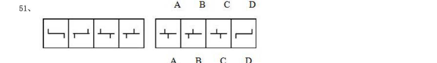

> （本题为图形题，选项为图片，见原卷）

**答案：A**　**考点：图形推理｜位置规律**
**【判断推理·图形推理｜GK-2004-b-X052】**

52. （本题题干为图形/公式，文字层无题干，图见原卷）

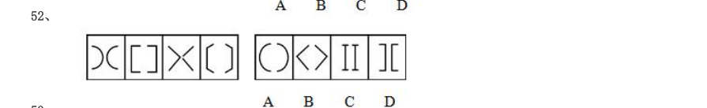

> （本题为图形题，选项为图片，见原卷）

**答案：C**　**考点：图形推理｜位置规律**
**【判断推理·图形推理｜GK-2004-b-X053】**

53. （本题题干为图形/公式，文字层无题干，图见原卷）

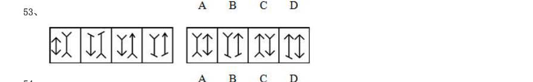

> （本题为图形题，选项为图片，见原卷）

**答案：D**　**考点：图形推理｜样式规律**
**【判断推理·图形推理｜GK-2004-b-X054】**

54. （本题题干为图形/公式，文字层无题干，图见原卷）

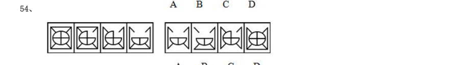

> （本题为图形题，选项为图片，见原卷）

**答案：A**　**考点：图形推理｜图形推理（综合）**
**【判断推理·图形推理｜GK-2004-b-X055】**

55. （本题题干为图形/公式，文字层无题干，图见原卷）

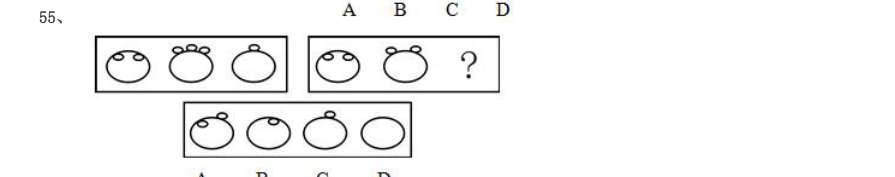

> （本题为图形题，选项为图片，见原卷）

**答案：B**　**考点：图形推理｜图形推理（综合）**
**【判断推理·图形推理｜GK-2004-b-X056】**

56. （本题题干为图形/公式，文字层无题干，图见原卷）

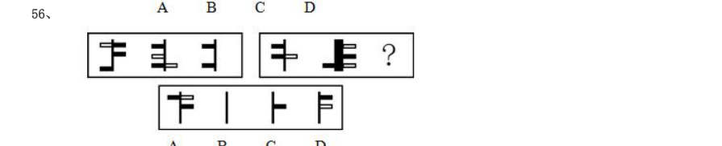

> （本题为图形题，选项为图片，见原卷）

**答案：D**　**考点：图形推理｜数量规律**
**【判断推理·图形推理｜GK-2004-b-X057】**

57. （本题题干为图形/公式，文字层无题干，图见原卷）

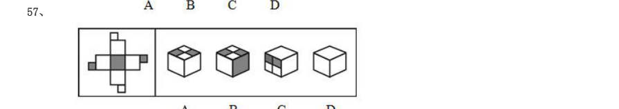

> （本题为图形题，选项为图片，见原卷）

**答案：C**　**考点：图形推理｜数量规律**
**【判断推理·图形推理｜GK-2004-b-X058】**

58. （本题题干为图形/公式，文字层无题干，图见原卷）

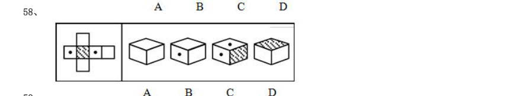

> （本题为图形题，选项为图片，见原卷）

**答案：A**　**考点：图形推理｜数量规律**
**【判断推理·图形推理｜GK-2004-b-X059】**

59. （本题题干为图形/公式，文字层无题干，图见原卷）

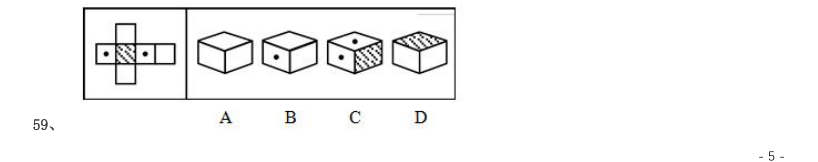

> （本题为图形题，选项为图片，见原卷）

**答案：B**　**考点：图形推理｜立体图形**
**【判断推理·定义判断｜GK-2004-b-X060】**

60. 消费者监督权是指消费者享有对商品和服务以及保护消费者权益的工作进行监督的权利。根据上述定义,下 列行为属于行使消费者监督权范围的是( )。

- **A.** 小赵到商店中专门购买假冒伪劣商品以获取赔偿
- **B.** 一家烤鸡店为战胜对手,向消费者称对手的货源不合格
- **C.** 小张发现某商场的电梯存在安全隐患,立即报告给有关部门
- **D.** 老王在一家商店买回了变质的食品,马上回去要求退换

**答案：C**　**考点：定义判断｜单定义**
**【判断推理·图形推理｜GK-2004-b-X061】**

61. 港口货物吞吐量是指从水路进出港区并经过装卸的货物数量。根据上述定义,下列应记为港口货物吞吐量的 是( )。 A 从大连新港的1 号码头上装10 吨货物运至3 号码头B 从福州港驳运河砂10 吨至厦门港锚地卸下 C 从莆田通过汽车运10 吨货物进福州港区 D 从上海船运10 吨货物,至福州港码头停靠后运往香港

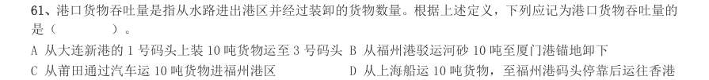

> （本题为图形题，选项为图片，见原卷）

**答案：B**　**考点：图形推理｜数量规律**
**【判断推理·定义判断｜GK-2004-b-X062】**

62. 允诺是一种民事法律行为。民事法律行为可以附条件或期限。条件是不确定的偶然性事实,期限是确定的必 然性事实。根据上述定义,下列允诺中不属于附期限允诺的是( )。

- **A.** 乙允诺甲:待甲60 大寿送甲电视一台
- **B.** 乙允诺甲:临终时将房产送给甲
- **C.** 乙允诺甲:三年后送甲古画一张
- **D.** 乙允诺甲:2004 年送甲轿车一辆

**答案：B**　**考点：定义判断｜单定义**
**【判断推理·定义判断｜GK-2004-b-X063】**

63. 典范借鉴是指从他人(或对方)那里发现、学习并应用最佳做法的过程,以达到帮助改善自身业绩的目的。 根据上述定义,下列属于典范借鉴的是( )。

- **A.** 甲村参考乙村因卖梨枣收入颇丰的做法,同样开始种植梨枣
- **B.** 考生甲某在同桌乙某的帮助下,成绩大幅提高
- **C.** 甲厂吸取生产同产品的乙厂的经验,降低成本,提高效益
- **D.** 甲某看到乙某倒卖盗版光碟赚钱不少,也加入了此行列

**答案：C**　**考点：定义判断｜单定义**
**【判断推理·定义判断｜GK-2004-b-X064】**

64. 考试公平是指所有参加考试的考生在考试过程中都受到完全同等的对待。根据上述定义,下列违反考试公平 的做法的是( )。

- **A.** 某市停止了实行多年的通过考试择优录取的初中招生办法,在初中招生中改用就近入学方式。对于户口所在地几乎等距离地介于几所初中之间的孩子,采用了电脑自动派位方式安排就读学校
- **B.** 有一道试题是关于北京地下铁道建设的讨论。对于北京的考生,这道题没有什么理解困难。但是,这道关于“地下铁道”的题目对于一些来自偏远农村的考生,就感到很困惑
- **C.** 为了参加这个考试,李红已经脱产复习了半年,家里重金为她请了有经验的辅导教师。王丽只能利用业余时间准备考试,每天下班后,还要为残疾的父亲和年幼的弟弟做饭洗衣,常常晚上10 点以后,才能开始看书复习
- **D.** 竞争上岗考试中包含了一些有关西方文学的试题。其实,这些西方文学知识对胜任这个岗位的工作没有多大关

**答案：B**　**考点：定义判断｜单定义**
**【判断推理·定义判断｜GK-2004-b-X065】**

65. 意外事件是指因当事人故意或过失以外的偶然因素而发生的事故。根据上述定义,下列属于意外事件的是 ( )。

- **A.** 医院未给聂某进行过敏皮试就为其注射了青霉素,结果造成其死亡
- **B.** 两个学生在课间打闹玩耍时,一学生用铅笔把另一学生的眼睛戳伤
- **C.** 某仓库保管员酒后昏睡,结果仓库失窃,造成经济损失达数十万元
- **D.** 黄某私自驾驶一报废车辆进行长途运输,途中发生车祸,车毁人亡

**答案：B**　**考点：定义判断｜单定义**
**【判断推理·定义判断｜GK-2004-b-X066】**

66. 紧急避险是指为了使国家、公共利益,本人或者他人的人身财产和其他权利避免正在发生的危险,不得已而 采取的损害另一方较小的合法权益,以保护较大的合法权益的行为。根据上述定义,下列不属于紧急避险的是 ( )。

- **A.** 某客轮忽遇台风,船长凭多年经验决定抛弃大量贵重货物以减轻重量,保护旅客生命安全
- **B.** 小郭正骑车行走,一机动车突然斜冲过来,小郭赶忙躲闪,结果将一香烟摊的货架撞坏
- **C.** 小刘在回家途中遇到劫匪,情急之下,拣起一砖头砸向匪徒
- **D.** 某小区一住户家窗户、阳台都在冒黑烟,物业公司在确定无人的情况下,破门而入

**答案：C**　**考点：定义判断｜单定义**
**【判断推理·定义判断｜GK-2004-b-X067】**

67. 根据语言学习的顺序,把最先学习并使用的语言叫第一语言,把第一语言之后学习和使用的语言叫做第二语 言。根据上述定义,下列不属于第二语言学习的是( )。

- **A.** 出生在中国的日本孩子同时学习汉语和日语
- **B.** 中国学生学习了英语之后又开始学习法语
- **C.** 中国学生出国后同时学习英语和法语
- **D.** 外国留学生来华学习汉语

**答案：A**　**考点：定义判断｜单定义**
**【判断推理·定义判断｜GK-2004-b-X068】**

68. 相对反义词:也称极性反义词。这类反义词在意义上互相对立,肯定甲必否定乙,肯定乙必否定甲;但是, 否定甲不一定就是肯定乙,否定乙也不一定就是肯定甲。根据上述定义,下列属于相对反义词的一组是 ( )。

- **A.** 生——死
- **B.** 曲——直
- **C.** 多——少
- **D.** 有——无

**答案：C**　**考点：定义判断｜单定义**
**【判断推理·定义判断｜GK-2004-b-X069】**

69. 城市管理是指城市政府对城市的公益事业、公共设施和公共事业的管理。根据上述定义,以下选项中不属于 城市管理的是( )。

- **A.** 规划城市建设
- **B.** 加强对城市交通的管理
- **C.** 引导城市市场经济运作
- **D.** 优化、美化城市环境

**答案：C**　**考点：定义判断｜单定义**
**【判断推理·逻辑判断｜GK-2004-b-X070】**

70. 在一项实验中,实验对象的一半作为实验组,食用了大量的某种辣椒。而作为对照组的另一半没有吃这种辣 椒。结果,实验组的认知能力比对照组差得多。这一结果是由于这种辣椒的一种主要成分——维生素E 造成的。 以下哪项如果为真,则最有助于证明这种辣椒中的成分造成这一实验结论?( )

- **A.** 上述结论中所提到的维生素E 在所有蔬菜中都有,为了保证营养必须摄入一定量的这种维生素E
- **B.** 实验组中人们所食用的辣椒数量是在政府食品条例规定的安全用量之内的
- **C.** 第二次实验时,只给一组食用大量辣椒作为实验组,而不高于不食用辣椒的对照组
- **D.** 实验前两组实验对象是按认知能力均等划分的

**答案：D**　**考点：逻辑判断｜削弱**
**【判断推理·逻辑判断｜GK-2004-b-X071】**

71. 某单位在林和张两位候选人中民主选举经理。在选举的前十天进行的民意测验显示,受调查者中36%打算 选林,42%打算选张。而在最后的正式选举中,林的得票率是52%,张的得票率仅是46%。这说明选举前的民 意测验在操作上出现了失误。以下哪项如果是真的,最能削弱上述论证的结论?( )

- **A.** 选举前二十天进行的民意测验显示,林的得票率是32%,张的得票率是40%
- **B.** 在进行民意测验的时候,许多选举者还没拿定主意选谁
- **C.** 在选举的前七天,林为厂里要回了30 万元借款
- **D.** 林在竞选中的演说能力要比张强

**答案：A**　**考点：逻辑判断｜削弱**
**【判断推理·逻辑判断｜GK-2004-b-X072】**

72. 由于近期的干旱和高温,导致海湾盐度增加,引起了许多鱼的死亡。虾虽然可以适应高盐度,但盐度高也给 养虾场带来了不幸。以下哪项如果为真,能够提供解释以上现象的原因?( )

- **A.** 持续的干旱会使海湾的水位下降,这已经引起了有关机构的注意
- **B.** 幼虾吃的有机物在盐度高的环境下几乎难以存活
- **C.** 水温升高会使虾更快速的繁殖
- **D.** 鱼多的海湾往往虾也多,虾少的海湾鱼也不多

**答案：B**　**考点：逻辑判断｜削弱**
**【判断推理·逻辑判断｜GK-2004-b-X073】**

73. 为了挽救濒临灭绝的大熊猫,一种有效的方法是把它们都捕获到动物园进行人工饲养和繁殖。以下哪项如果 为真,最能对上述结论提出质疑?( )

- **A.** 近五年在全世界各动物园中出生的熊猫总数是9 只,而在野生自然环境中出生的熊猫的数字,不可能准确地获得
- **B.** 只有在熊猫生活的自然环境中,才有它们足够吃的嫩竹,而嫩竹几乎是熊猫的唯一食物
- **C.** 动物学家警告,对野生动物的人工饲养将会改变它们的某些遗传特性
- **D.** 提出上述观点的是一个动物园主,他的动机带有明显的商业性

**答案：B**　**考点：逻辑判断｜削弱**
**【判断推理·逻辑判断｜GK-2004-b-X074】**

74. 在世界范围内禁止生产各种破坏臭氧层的化学物质可能仅仅是一种幻想,大量这样的化学物质已经生产出来, 并且以成千上万台冰箱的冷却剂的形式而存在。当这些化学物质到达大气层中的臭氧层时,其作用不可能停止。 因此,没有任何方式可以阻止这类化学物质进一步破坏臭氧层。以下哪项如果为真,则能最严重地削弱以上论证? ( )

- **A.** 不可能精确地测量冰箱里冷却剂这种破坏臭氧层的化学物质的量
- **B.** 不会破坏臭氧层的替代品还未开发出来,并且替代品可能比冰箱目前使用的冷却剂昂贵
- **C.** 即使人们放弃使用冷藏设备,已经存在的冰箱里的冷却剂也是对大气臭氧层的一个威胁
- **D.** 当冰箱的使用寿命结束时,冰箱里的冷却剂可完全回收并且重新利用

**答案：D**　**考点：逻辑判断｜削弱**
**【判断推理·逻辑判断｜GK-2004-b-X075】**

75. 高脂肪、高糖含量的食物有害人的健康。因此,既然越来越多的国家明令禁止未成年人吸烟和喝含酒精的饮 料,那么,为什么不能用同样的方法对待那些有害健康的食品呢?应该明令禁止18 岁以下的人食用高脂肪、高 糖食品。以下哪项如果为真,最能削弱上述建议?( )

- **A.** 许多国家已经把未成年人的标准定在16 岁以下
- **B.** 烟、酒对人体的危害比高脂肪、高糖食物的危害要大
- **C.** 禁止有害健康食品的生产,要比禁止有害健康食品的食用更有效
- **D.** 高脂肪、高糖食品主要危害中年人的健康

**答案：D**　**考点：逻辑判断｜削弱**
**【判断推理·逻辑判断｜GK-2004-b-X076】**

76. 一项对某大学国际经济专业99 届毕业生的调查结果看起来有些问题,当被调查者被问及其在校时学习成绩 的名次时,统计资料表明,有60%的回答者说他们的成绩位于班级的前20 名。如果回答者说的都是真话,那么, 下面哪项能够对上述现象给出更合适的解释?( )

- **A.** 未回答者中也并不是所有人的成绩都在班级的前20 名之外
- **B.** 虽然回答者没有错报成绩,但不排除个别人对于学习成绩的排名有不同的理解
- **C.** 成绩较差的毕业生在被访问时一般没有回答这个有关学习成绩名次的问题
- **D.** 在校学习成绩名次是一个敏感的问题,几乎所有的毕业生都进行略微的美化

**答案：C**　**考点：逻辑判断｜真假推理**
**【判断推理·逻辑判断｜GK-2004-b-X077】**

77. 据最近的统计,在需要同等学历的十个不同职业中,教师的平均工资五年前排名第九位,而目前上升到第六 位;另外,目前教师的平均工资是其他上述职业的平均工资的86%,而五年前只是55%。因此,教师工资相对偏 低的状况有了较大的改善,教师的相对生活水平有了很大的提高。上述论证基于以下哪项假设?( )I 近五年来的通货膨胀率基本保持稳定。II和其他职业一样,教师中的最高工资和最低工资的差别是很悬殊的。III 学历是确定工资标准的主要依据。IV工资是实际收入的主要部分。

- **A.** I、III
- **B.** II、IV
- **C.** III
- **D.** III、IV

**答案：D**　**考点：逻辑判断｜前提假设**
**【判断推理·图形推理｜GK-2004-b-X078】**

78. 面试在求职过程中非常重要。经过面试,如果应聘者的个性不适合待聘工作的要求,则不可能被录用。以上 论断是建立在哪项假设的基础上的?( ) A 必须经过面试才能取得工作,这是工商界的规矩B 面试主持者能够准确地分辨出哪些个性是工作所需要的 C 面试的唯一目的就是测试应聘者的个性 D 若一个人的个性适合工作的要求,他就一定被录用

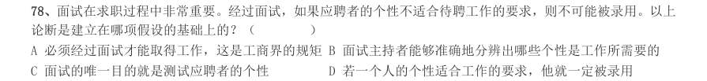

> （本题为图形题，选项为图片，见原卷）

**答案：B**　**考点：图形推理｜图形推理（综合）**
**【判断推理·逻辑判断｜GK-2004-b-X079】**

79. 政府应该不允许烟草公司在其营业收入中扣除广告费用。这样的话,烟草公司将会缴纳更多的税金。烟草公 司只好提高自己的产品价格,而产品价格的提高正好可以起到减少烟草购买的作用。以下哪项是题干论点的前 提?( )

> 同题变体（主记录 GK-2004-a-X081）

- **A.** 烟草公司不可能降低其他方面的成本来抵销多缴的税金
- **B.** 如果它们需要付高额的税金,烟草公司将不再继续做广告
- **C.** 如果烟草公司不做广告,香烟的销售量将受到很大影响
- **D.** 烟草公司由此所增加的税金应该等于价格上涨所增加的盈利

**答案：A**　**考点：逻辑判断｜加强**
**【判断推理·逻辑判断｜GK-2004-b-X080】**

80. 甲、乙、丙、丁四人的血型各不相同,甲说:”我是A 型。“乙说:”我是O 型。“丙说:”我是AB 型。” 丁说:“我不是AB 型。”四个人中只有一个人的话是假的。以下哪项成立?( )

- **A.** 无论谁说假话,都能推出四个人的血型情况
- **B.** 乙的话假,可推出四个人的血型情况
- **C.** 丙的话假,可推出四个人的血型情况
- **D.** 丁的话假,可推出四个人的血型情况

**答案：B**　**考点：逻辑判断｜真假推理**
**【判断推理·逻辑判断｜GK-2004-b-X081】**

81. 有人认为,一个国家如果能有效率地运作经济,就一定能创造财富而变得富有;而这样的一个国家要想保持 政治稳定,它所创造的财富必须得到公正的分配;而财富的公正分配将结束经济风险;但是,风险的存在正是经 济有效运作的不可或缺的先决条件。从上述观点可以得出以下哪项结论?( )

- **A.** 一个国家政治上的稳定和经济上的富有不可能并存
- **B.** 一个国家政治上的稳定和经济上的有效运作不可能并存
- **C.** 一个富有国家的经济运作一定是有效率的
- **D.** 一个政治上不稳定的国家,一定同时充满了经济风险

**答案：B**　**考点：逻辑判断｜归纳推导**
**【判断推理·逻辑判断｜GK-2004-b-X082】**

82. 正是因为有了充足的奶制品作为食物来源,生活在呼伦贝尔大草原的牧民才能摄入足够的钙质。很明显,这 种足够钙质的摄入,对呼伦贝尔大草原的牧民拥有健壮的体魄是必不可少的。以下哪项情况如果存在,最能削弱 上述断定?( )

- **A.** 有的呼伦贝尔大草原的牧民从食物中能摄入足够的钙质,并且有健壮的体魄
- **B.** 有的呼伦贝尔大草原的牧民不具有健壮的体魄,但从食物中摄入的钙质并不少
- **C.** 有的呼伦贝尔大草原的牧民有健壮的体魄,但没有充足的奶制品作为食物来源
- **D.** 有的呼伦贝尔大草原的牧民没有健壮的体魄,但有充足的奶制品作为食物来源

**答案：C**　**考点：逻辑判断｜削弱**
**【判断推理·逻辑判断｜GK-2004-b-X083】**

83. 一次聚会上,麦吉遇到了汤姆、卡尔和乔治三个人,他想知道他们三人分别是干什么的,但三人只提供了以 下信息:三人中一位是律师、一位是推销员、一位是医生;乔治比医生年龄大,汤姆和推销员不同岁,推销员比 卡尔年龄小。根据上述信息麦吉可以推出的结论是( )。

- **A.** 汤姆是律师,卡尔是推销员,乔治是医生
- **B.** 汤姆是推销员,卡尔是医生,乔治是律师
- **C.** 汤姆是医生,卡尔是律师,乔治是推销员
- **D.** 汤姆是医生,卡尔是推销员,乔治是律师

**答案：C**　**考点：逻辑判断｜归纳推导**
**【判断推理·逻辑判断｜GK-2004-b-X084】**

84. 麦角碱是一种可以在植物种子的表层大量滋生的菌类,特别多见于黑麦。麦角碱中含有一种危害人体的有毒 化学物质。黑麦是在中世纪引进欧洲的。由于黑麦可以在小麦难以生长的贫瘠和潮湿的土地上有较好的收成,因 此,就成了那个时代贫穷农民的主要食品来源。上述信息最能支持以下哪项断定?( )

- **A.** 在中世纪以前,麦角碱从未在欧洲出现
- **B.** 在中世纪的欧洲,如果不食用黑麦,就可以避免受到麦角碱所含有毒物质的危害
- **C.** 在中世纪的欧洲,富裕农民比贫穷农民较多地意识到麦角碱所含有毒物质的危害
- **D.** 在中世纪的欧洲,富裕农民比贫穷农民较少地受到麦角碱所含有毒物质的危害

**答案：D**　**考点：逻辑判断｜加强**
**【资料分析·增长率计算与比较｜GK-2004-b-X085】**

85. 1998~2002 年全国电话用户情况图(单位:万户) 全国移动电话用户增长速度最快的是( )。

- **A.** 1999 年
- **B.** 2000 年
- **C.** 2001 年
- **D.** 2002 年

**答案：B**　**考点：增长率计算与比较｜增长率比较**
**【资料分析·基期量计算｜GK-2004-b-X086】**

86. 在2002 年年末电话用户比上年末增加的数量接近( )。

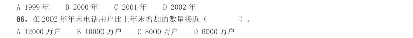

- **A.** 12000 万户
- **B.** 10000 万户
- **C.** 8000 万户
- **D.** 6000 万户

**答案：B**　**考点：基期量计算｜已知现期与增长量求基期**
**【资料分析·基期量计算｜GK-2004-b-X087】**

87. 如果增长趋势与上年保持一致,预计2003 年年末移动电话用户约为( )。

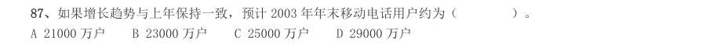

- **A.** 21000 万户
- **B.** 23000 万户
- **C.** 25000 万户
- **D.** 29000 万户

**答案：D**　**考点：基期量计算｜已知现期与增长率求基期**
**【资料分析·基期量计算｜GK-2004-b-X088】**

88. 下列哪一项说法不正确?( )

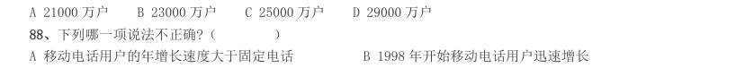

- **A.** 移动电话用户的年增长速度大于固定电话
- **B.** 1998 年开始移动电话用户迅速增长
- **C.** 移动电话和固定电话的增长最多的都是2000 年
- **D.** 2000 年后固定电话的增长速度有所下降

**答案：C**　**考点：基期量计算｜已知现期与增长量求基期**
**【资料分析·基期量计算｜GK-2004-b-X089】**

89. 若2002 年年末全国人口数约是13 亿,则当时全国电话的普及率接近( )。

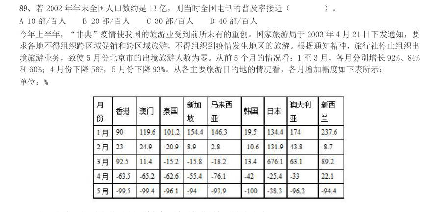

- **A.** 10 部/百人
- **B.** 20 部/百人
- **C.** 30 部/百人
- **D.** 40 部/百人

**答案：C**　**考点：基期量计算｜基期量计算（综合）**
**【资料分析·基期量计算｜GK-2004-b-X090】**

90. 从各主要旅游目的地的情况看,各月增加幅度如下表所示: 单位:% 从1 月到5 月,北京市出境旅游相邻两个月间变化幅度最大的是( )。

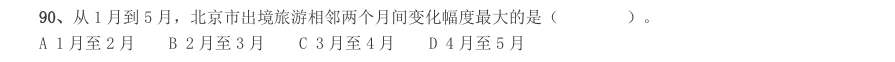

- **A.** 1 月至2 月
- **B.** 2 月至3 月
- **C.** 3 月至4 月
- **D.** 4 月至5 月

**答案：D**　**考点：基期量计算｜已知现期与增长率求基期**
**【资料分析·基期量计算｜GK-2004-b-X091】**

91. 从表中数据看,前5 个月北京出境旅游受“非典”疫情持续影响最长的国家或地区是( )。

- **A.** 泰国
- **B.** 香港
- **C.** 澳门
- **D.** 日本

**答案：A**　**考点：基期量计算｜基期量计算（综合）**
**【资料分析·基期量计算｜GK-2004-b-X092】**

92. 下列哪项描述不正确?( ) A 5 月份北京到新西兰的旅游人数百分比降低幅度最大B 北京到香港和到澳门旅游的人数均是3 月比2 月多 C “非典”疫情对北京五月份出境旅游影响最大 D 5 月北京市出境到各国旅游的人数都是负增长

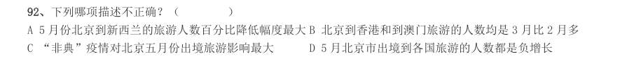

> （本题为图形题，选项为图片，见原卷）

**答案：A**　**考点：基期量计算｜已知现期与增长率求基期**
**【资料分析·基期量计算｜GK-2004-b-X093】**

93. 1 月到5 月,北京出境旅游变化幅度最大的目的地国家或地区是( )。

- **A.** 香港
- **B.** 韩国
- **C.** 日本
- **D.** 澳大利亚

**答案：C**　**考点：基期量计算｜基期量比较**
**【资料分析·基期量计算｜GK-2004-b-X094】**

94. 1 月到5 月,北京市出境旅游的人数变化趋势一致的国家组合是( )。

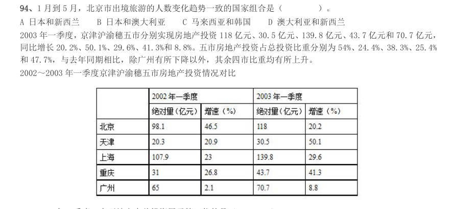

- **A.** 日本和新西兰
- **B.** 日本和澳大利亚
- **C.** 马来西亚和韩国
- **D.** 澳大利亚和新西兰

**答案：B**　**考点：基期量计算｜基期量计算（综合）**
**【资料分析·基期量计算｜GK-2004-b-X095】**

95. 同比增长20.2%、50.1%、29.6%、41.3%和8.8%。五市房地产投资占总投资比重分别为54%、24.4%、38.3%、25.4% 和47.7%,与去年同期相比,除广州有所下降以外,其余四市比重均有所上升。 2002~2003 年一季度京津沪渝穗五市房地产投资情况对比 2003 年一季度,在五地市中总投资居于第三位的是( )。

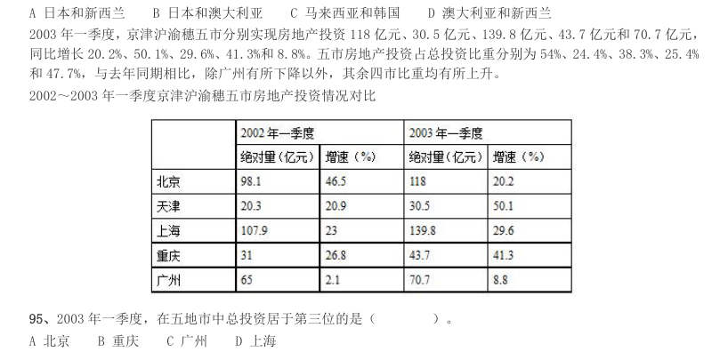

- **A.** 北京
- **B.** 重庆
- **C.** 广州
- **D.** 上海

**答案：B**　**考点：基期量计算｜已知现期与增长率求基期**
**【资料分析·增长率计算与比较｜GK-2004-b-X096】**

96. 如果按照2003 年一季度的增长速度增长,则2004 年一季度天津的房地产投资绝对量(亿元)是( )。

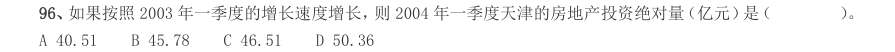

- **A.** 40.51
- **B.** 45.78
- **C.** 46.51
- **D.** 50.36

**答案：B**　**考点：增长率计算与比较｜增长率计算**
**【资料分析·基期量计算｜GK-2004-b-X097】**

97. 从表格分析,下面哪种说法是正确的?( )

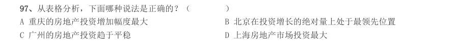

- **A.** 重庆的房地产投资增加幅度最大
- **B.** 北京在投资增长的绝对量上处于最领先位置
- **C.** 广州的房地产投资趋于平稳
- **D.** 上海房地产市场投资最大

**答案：D**　**考点：基期量计算｜已知现期与增长率求基期**
**【资料分析·增长率计算与比较｜GK-2004-b-X098】**

98. 相对于2001 年来说,2002 年一季度房地产投资增速最慢的地区是( )。

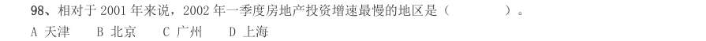

- **A.** 天津
- **B.** 北京
- **C.** 广州
- **D.** 上海

**答案：C**　**考点：增长率计算与比较｜增长率比较**
**【资料分析·基期量计算｜GK-2004-b-X099】**

99. 2003 年一季度房地产投资绝对量增加最多的是( )。

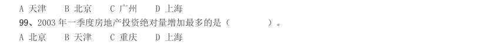

- **A.** 北京
- **B.** 天津
- **C.** 重庆
- **D.** 上海

**答案：D**　**考点：基期量计算｜已知现期与增长量求基期**
**【资料分析·基期量计算｜GK-2004-b-X100】**
> 材料：民生活水平小康实现程度达到94.3%。在12 项小康指标中有10 项达到或者基本达到小康初始水平。但是还有两 项指标,即文化教育娱乐支出比重和人均绿地面积与小康标准有一定差距。

100. 下列表述不正确的是( )。

- **A.** 截至1999 年我国城镇居民生活水平小康实现程度达到94.3%
- **B.** 城市小康各项指标的发展水平不均衡,但均已达到小康标准
- **C.** 我国小康实现程度存在地区差异
- **D.** 我国小康实现程度存在指标差异

**答案：B**　**考点：基期量计算｜基期量计算（综合）**
**【资料分析·综合分析｜GK-2004-b-X101】**

101. 从上述资料中,不能推出的是( )。

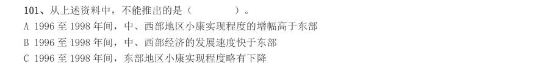

- **A.** 1996 至1998 年间,中、西部地区小康实现程度的增幅高于东部
- **B.** 1996 至1998 年间,中、西部经济的发展速度快于东部
- **C.** 1996 至1998 年间,东部地区小康实现程度略有下降
- **D.** 1996 至1998 年间,西部地区小康实现程度增幅高于中部

**答案：B**　**考点：综合分析｜选错误项**
**【资料分析·基期量计算｜GK-2004-b-X102】**

102. 从上述资料中,能推出的是( )。

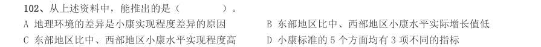

- **A.** 地理环境的差异是小康实现程度差异的原因
- **B.** 东部地区比中、西部地区小康水平实际增长值低
- **C.** 东部地区比中、西部地区小康水平实现程度高
- **D.** 小康标准的5 个方面均有3 项不同的指标

**答案：C**　**考点：基期量计算｜基期量计算（综合）**
**【资料分析·基期量计算｜GK-2004-b-X103】**

103. 城镇居民生活小康标准的五个方面不包括( )。

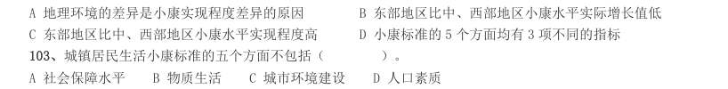

- **A.** 社会保障水平
- **B.** 物质生活
- **C.** 城市环境建设
- **D.** 人口素质

**答案：C**　**考点：基期量计算｜基期量计算（综合）**
**【资料分析·增长率计算与比较｜GK-2004-b-X104】**

104. 1996 年至1998 年,中部地区和西部地区小康实现程度的增幅相差多少个百分点?( )

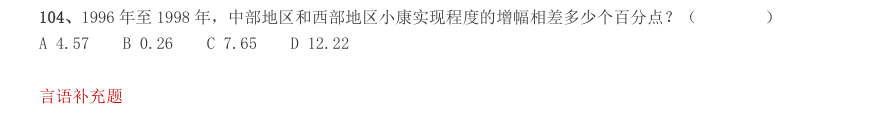

- **A.** 4.57
- **B.** 0.26
- **C.** 7.65
- **D.** 12.22

**答案：B**　**考点：增长率计算与比较｜增长率计算**
**【资料分析·基期量计算｜GK-2004-b-X105】**

105. 社会上的各种传言和议论,有的是无中生有,有的是空穴来风,我们要善于思索和分辨。“空穴来风”的 意思是( )。

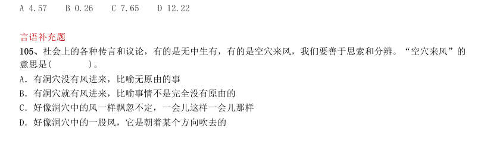

> 同题变体（主记录 GK-2004-a-X021）

- **A.** 有洞穴没有风进来,比喻无原由的事
- **B.** 有洞穴就有风进来,比喻事情不是完全没有原由的
- **C.** 好像洞穴中的风一样飘忽不定,一会儿这样一会儿那样
- **D.** 好像洞穴中的一股风,它是朝着某个方向吹去的

**答案：B**　**考点：基期量计算｜基期量计算（综合）**