# 2005 年国考行测（统一卷）

- 题量：135（含答案 135）
- 模块分布：资料分析19 / 数量关系25 / 言语理解25 / 判断推理46 / 常识判断20
- 试卷编号：`国考-2005-统一卷`

## 题目与答案

**【言语理解·中心理解｜GK-2005-ty-X001】**
> 材料：2005 年中央、国家机关公务员录用考试《行政职业能力测验(一)》试卷 言语理解与表达(共25 题,参考时限25 分钟) 每道题包含一段文字或一个句子,后面是一个不完整的陈述,要求你从四个选项中选出一个来完成 陈述。注意:答案可能是完成对所给文字主要意思的提要,也可能是满足陈述中其他方面的要求,你的 选择应与所提要求最相符合。

1. 我们的一些科普文章常常激 公众的兴趣,原因之一便是枯燥。要把科普文章写得“郁郁乎文哉”, 就需要作家的笔。科学的 发展,为文学写作提供了一座富矿。相信有眼光的文学家一旦领略科 学题材的广阔富饶,便会 在它的无限风光中乐而忘返。 这段文字谈论的是( )。

- **A.** 科普文章对作家的依赖
- **B.** 科学和文学的互相激励作用
- **C.** 科学和文学互相依赖的
- **D.** 科学发展为文学提供了丰富的素材

**答案：B**　**考点：中心理解｜对策优先**
**【言语理解·中心理解｜GK-2005-ty-X002】**

2. 在我国加入世界贸易组织 业科技迅猛发展的形势下,农业面临的竞争首先是科技竞争。只有尽 快提高农民的文化素质和 意识,才能不断推广大批先进实用的农业科技成果,为农业和农村经 济的发展提供有力的科技 。我国将继续推进农业和农村经济结构调整,大力发展优势农产品和 特色产业,将在粮食主产 广50 个优质高产高效品种和10 项关键技术。这些品种和技术的推广 和运用都需要高素质的农民。为此,国家已经决定大力发展农村成人教育,在全国普遍开展农村实 用技术培训,每年将培训农民超过1 亿人次。这段文字的意思是在强调( )。

- **A.** 农民亟需提高科学文化素质
- **B.** 国家加大农业和农村经济结构调整
- **C.** 发展科技才能提高我国农业的竞争力
- **D.** 每年有大量农民接受农村实用技术培训

**答案：A**　**考点：中心理解｜对策优先**
**【言语理解·中心理解｜GK-2005-ty-X003】**

3. 群众的眼睛是雪亮的,但如果缺乏足够的引导和约束,这种“雪亮”有可能变成一种偏执,一种没 有方向的自负。而建立在“多数人”压过“少数人”基础上的制度安排,很可能走进片面和偏狭的 陷阱中。“上级”评议,官员面对的是“一个人”,“公众”评议,官员面对的是“一群人”,只有在 “顶天”的压力和“立地”的责任互相补充下才能真正起到足够的监督作用。自上而下与自下而上 的监督力量有机地结合,才可能在博弈中避免“一个人”的片面和“一群人”的片面。这段文字的 主旨是( )。

- **A.** 质疑群众评议的合理性
- **B.** 群众的意志要得到合理的引导和约束
- **C.** 如何对官员进行有效的监督
- **D.** 怎样在群众和上级间达到平衡

**答案：C**　**考点：中心理解｜主题词**
**【言语理解·中心理解｜GK-2005-ty-X004】**

4. 有一种看法,认为结构游戏只不过是幼儿拼拼凑凑、搬搬运运而已,无须教师过多的参与。其实, 结构游戏如能进行得好,它不但能培养幼儿的搭配能力、空间想象能力、思维能力,而且能促进幼 儿手、脑、眼协调一致的能力和培养幼儿对造型艺术的审美能力。但要使结构游戏发挥出如此的作 用,教师不仅要参与,更要不失时机地示范、指导、点拨,否则,便不可能有这样的效果。 这段文字的主旨是( )。

- **A.** 幼儿的健康发展离不开结构游戏
- **B.** 幼儿教师与幼儿能力的形成有很大关系
- **C.** 合格的幼儿教师应掌握结构游戏的教法
- **D.** 幼儿对造型艺术的审美能力有赖于结构游戏

**答案：B**　**考点：中心理解｜转折与因果**
**【言语理解·逻辑填空｜GK-2005-ty-X005】**

5. 无论什么文章,一旦选进语文教材,就不再是原来意义上的、独立存在的作品,而是整个教材系统 中一个有机组成部分,是“基本功训练的凭借”。“基本功训练的凭借”是( )。

- **A.** 收入语文教材中的各类作品
- **B.** 那些保持原来意义、独立存在的作品
- **C.** 整个教材系统中的一个有机组成部分
- **D.** 那些不再是原来意义上的、独立存在的作品

**答案：A**　**考点：逻辑填空｜逻辑填空（综合）**
**【言语理解·中心理解｜GK-2005-ty-X006】**

6. 上海零点市场调查公司将上海、北京、广州三地家庭的子女教育与养成费用支出情况做了一个比较, 发现三地家庭为子女教育支付给学校的费用水平,以北京为最低;而在其他教育支出方面,以上海 家庭的支出水平显著较低;就总体水平而论,上海孩子所获得的零花钱和所需家长承担的生活费用 也低于京穗。通过这段文字我们可以知道,广州家庭( )。

- **A.** 给孩子的零花钱少于北京
- **B.** 为子女教育支出总体水平高于上海
- **C.** 在其他教育方面的支出水平介于北京、上海之间
- **D.** 为子女教育支付给学校的费用水平介于北京、上海之间

**答案：B**　**考点：中心理解｜转折与因果**
**【言语理解·中心理解｜GK-2005-ty-X007】**

7. 有一种很流行的观点,即认为中国古典美学注重美与善的统一。言下之意则是中国古典美学不那么 重视美与真的统一。笔者认为,中国古典美学比西方美学更看重美与真的统一。它给美既赋予善的 品格,又赋予真的品格,而且真的品格大大高于善的品格。概而言之,中国古典美学在对美的认识 上,是以善为灵魂而以真为最高境界的。 通过这段文字我们可以知道,作者的观点( )。

- **A.** 正确而不流行
- **B.** 流行而不正确
- **C.** 新颖而不流行
- **D.** 流行而不新颖

**答案：C**　**考点：中心理解｜转折与因果**
**【言语理解·中心理解｜GK-2005-ty-X008】**

8. 在西斯廷礼拜堂的天花板上,文艺复兴时期的艺术巨匠米开朗基罗把他笔下的人物描绘得如此雄壮、 有力。在意大利,每当我们看到这些魁伟强劲、丰满秀美的人体艺术作品时,就会深深地感到人类 征服自然、改造自然的勇气和力量,使我们对文艺复兴运动与现代体育的渊缘有了更深刻的理解。 这段文字是在谈文艺复兴运动与( )。

- **A.** 意大利
- **B.** 现代体育
- **C.** 人体艺术
- **D.** 米开朗基罗

**答案：B**　**考点：中心理解｜中心理解（综合）**
**【言语理解·中心理解｜GK-2005-ty-X009】**

9. 去工作而不要以挣钱为目的;去跳舞而不管是否有他人关注;去唱歌而不要想着有人在听;去爱而 忘记所有别人对你的不是;去生活就像这世界是天堂。这段文字意在告诉我们( )。

- **A.** 幸福其实就在一念之间
- **B.** 生活需要多一些想象
- **C.** 走自己的路,让别人说去吧
- **D.** 做事情不要有太强的目的性

**答案：A**　**考点：中心理解｜转折与因果**
**【言语理解·中心理解｜GK-2005-ty-X010】**

10. 人们不喜欢丢掉自己的原有“地盘”,不喜欢丢面子。他们往往陷入一种思想陷阱,也就是经济学 家所说的“沉没成本”,它指一种时间和金钱的投资,只有在产品销售成功后才可顺利回收。在英语 国家中,也被称为“将钱掉进排水沟里”。这段文字意在告诉我们( )。

- **A.** 很多人有怀旧情绪,不善于放弃
- **B.** 所有金钱和时间上的投资都会得到回报
- **C.** 计算投资成本时,应该把“沉没成本”也加进去
- **D.** 当决定是否进行投资的时候,必须忘掉自己过去的投资

**答案：A**　**考点：中心理解｜中心句与主旨**
**【言语理解·中心理解｜GK-2005-ty-X011】**

11. 随着宏观经济调控政策的逐步落实,我国经济增速会适度放缓,对石油天然气资源的需求有所减少, 供求矛盾在一定程度上将得到缓解。根据国际能源署的最新预测,今年我国原油产量将达1.75 亿 吨,比去年增长1%;而原油消费量将有可能突破3 亿吨,比去年增长12%左右;进口将会超过1 亿吨,有可能接近1.2 亿吨,比去年增长30%左右。根据这段文字,我们可以知道( )。

- **A.** 我国原油供给紧张
- **B.** 我国原油消费主要靠进口
- **C.** 我国对进口原油的依赖加大
- **D.** 我国对能源的需求会越来越少

**答案：C**　**考点：中心理解｜对策优先**
**【言语理解·中心理解｜GK-2005-ty-X012】**

12. 假如法庭陪审员过于专业化,他可能因强烈的专业视角而丧失一个普通人的正常视野。法律是为普 通人制定的,也需要普通人来遵守才有效力,同样,司法过程也需要普通人制度化的参与。这段文 字是针对什么问题阐述观点的?( )。

- **A.** 外人干预法庭审理过程
- **B.** 法庭审理案件的程序
- **C.** 法律怎样才会得到有效的遵守
- **D.** 由专业人员担当法庭陪审员

**答案：D**　**考点：中心理解｜对策优先**
**【言语理解·逻辑填空｜GK-2005-ty-X013】**

13. 设立最低工资的初衷是维护低收入的贫穷工人,但到头来这些人却找不到工作。有最低工资的规定, 雇主当然是选聘生产力较高或较“可爱”的了。在美国,最低工资增加了种族歧视——支持这种结 论的研究很多。最低工资制度让一些人找不到工作的原因是( )。

- **A.** 一些雇主有种族歧视
- **B.** 工资太低不能维持生活
- **C.** 没有了报酬上的就业优势
- **D.** 生产力不能满足雇主的要求

**答案：C**　**考点：逻辑填空｜逻辑填空（综合）**
**【言语理解·中心理解｜GK-2005-ty-X014】**

14. 人,就是想探寻宇宙奥秘,觅其所未见,因之为探天险而丧生者已为数众多。人类必须征服自然, 金沙江之类的天堑改变成通途,事关国计民生,造福当今后世。不意缆车之发明却大大发展了旅游 事业,大量赚钱,满足了弱者也能登临天险的好奇心,后果却摧毁了人间天险。对这段文字的主旨 最准确的概括是( )。

- **A.** 缆车的发明可以使自然界的天险变成通途
- **B.** 缆车既使旅游业赚钱,也满足了游客探险的愿望
- **C.** 缆车可以让弱者登临天险而不必担心有生命危险
- **D.** 缆车满足了人的好奇心,也限制了人对自然的探寻

**答案：D**　**考点：中心理解｜对策优先**
**【言语理解·中心理解｜GK-2005-ty-X015】**

15. 从哲学的角度看,不可否认原始儒家思想中存在很多人性的光辉,而从历史的角度看,儒家思想世 俗化之后建构的传统文化,最明显的缺陷就在于没有提供一种包含起码的人道主义精神的底线伦理。 当我们在批判传统文化和创造新文化的时候,应该在人道主义的框架内建立一种起码的道德底线。 这段文字的主旨是( )。

- **A.** 提倡建立底线文明
- **B.** 批判儒家思想的缺陷
- **C.** 批判地继承儒家思想
- **D.** 应创造什么样的新文化

**答案：A**　**考点：中心理解｜对策优先**
**【言语理解·逻辑填空｜GK-2005-ty-X016】**

16. 根据现行的法律、法规,所有与用人单位形成劳动关系的劳动者,不管是签订劳动合同的,还是存 在事实劳动关系的,不管是原有的所谓编内职工,还是所谓的“非正式人员”如农民工、临时工, 都是企业的正式员工,所不同的只是进单位迟早不同或劳动合同长短有别而已。由此可知劳动者之 间没有差别的一方面是( )。

- **A.** 身分
- **B.** 待遇
- **C.** 权利
- **D.** 与企业的关系

**答案：D**　**考点：逻辑填空｜逻辑填空（综合）**
**【言语理解·中心理解｜GK-2005-ty-X017】**

17. 一家饭店有这样一副对联:为名忙,为利忙,忙中偷闲,且喝一杯茶去;劳心苦,劳力苦,苦中作 乐,再斟两壶酒来。这副对联意在强调( )。

- **A.** 现代人争名夺利,沉迷于物质
- **B.** 人们生活艰辛,幸福来之不易
- **C.** 现代人应该适当放慢生活节奏
- **D.** 人们应劳逸结合、会享受生活

**答案：D**　**考点：中心理解｜转折与因果**
**【言语理解·中心理解｜GK-2005-ty-X018】**

18. 长期以来,在传统观念的影响下,对于司法机关在执法过程中侵害公民、法人和其他组织的合法权 益的行为,缺乏有效可行的保障机制来恢复和弥补被侵权人的权利。遭受侵害的当事人不知道怎样 保护自己的合法权益,更没有一条光明、可靠的渠道来支持这种保护。这段文字的主旨是( )。

- **A.** 司法机关执法受到传统观念的深刻影响
- **B.** 司法机关的执法过程也应有法可依、有法必依
- **C.** 目前缺少保障机制来弥补被司法机关侵犯的权利
- **D.** 制定规范和约束司法机关执法过程的法律势在必行

**答案：C**　**考点：中心理解｜转折与因果**
**【言语理解·中心理解｜GK-2005-ty-X019】**

19. 夏天少数人为贪图凉爽,早餐以冷饮代替豆浆和牛奶,这种做法在短时间内不会对身体产生影响, 但长期如此会伤害“胃气”。在早晨,身体各系统器官还未走出睡眠状态,过多食用冰冷的食物,会 使体内各个系统出现挛缩及血流不顺的现象。所以早饭时应首先食用热稀饭、热豆浆等热食,然后 再吃蔬菜、面包、水果和点心等。这段文字主要谈的是( )。

- **A.** 夏天吃早餐的重要性
- **B.** 夏天早餐喝冷饮的危害
- **C.** 夏天早餐应吃什么食物
- **D.** 夏天吃早餐的注意事项

**答案：C**　**考点：中心理解｜对策优先**
**【言语理解·中心理解｜GK-2005-ty-X020】**

20. 近日,有能源专家指出,目前全国不少城市搞“光彩工程”,在当前国内普遍缺电的形势下这是不 适宜的。按照上海电力部门的测算,上海的灯光工程全部开启后,耗电量将达到20 万千瓦时,占整 个城市总发电量的2%,相当于三峡电厂目前对上海的供电容量。 这段文字的主旨是( )。

- **A.** 搞光彩工程对国家和人民无益
- **B.** 现在不宜在各地推广光彩工程
- **C.** 上海整个城市的总发电量不高
- **D.** 上海的灯光工程耗电量惊人

**答案：B**　**考点：中心理解｜转折与因果**
**【言语理解·逻辑填空｜GK-2005-ty-X021】**

21. 俄罗斯防病毒软件供应商——卡斯佩尔斯基实验室于6 月15 日宣布,一个名为29a 的国际病毒编 写小组日前制造出了世界上首例可在手机之间传播的病毒。卡斯佩尔斯基实验室说,29a 小组于15 日将这个名叫“卡比尔”的蠕虫病毒的代码发给了一些反病毒厂商,后者确认该病毒具备在手机之 间传播的功能。该段文字作为一则报纸上的新闻,最适合做该段文字题目的是( )。

- **A.** “卡比尔”蠕虫病毒在俄诞生
- **B.** 29a 的国际病毒编写小组的新贡献
- **C.** 世界首例在手机之间传播的病毒诞生
- **D.** 反病毒厂商确认手机之间可传播病毒

**答案：C**　**考点：逻辑填空｜逻辑填空（综合）**
**【言语理解·中心理解｜GK-2005-ty-X022】**

22. 现代心理学研究认为,当一个人感到烦恼、苦闷、焦虑的时候,他身体的血压和氧化作用就会降低, 而当他心情愉快时整个新陈代谢就会改善。根据这段文字我们知道( )。

- **A.** 人们可以通过调节心情来调节血压
- **B.** 心情好坏与人的身体健康存在密切关系
- **C.** 血压和氧化作用降低说明该人心情不好D.只要心情愉快就可以改善整个新陈代谢

**答案：B**　**考点：中心理解｜转折与因果**
**【言语理解·细节判断｜GK-2005-ty-X023】**

23. 颐和园附近要建的电塔工程,在一片反对的声浪中进入环保听证程序。事件到此并没有画上句号, 它不仅考验着市民维护家园的决心和城市决策者的智慧,还关系到类似颐和园的众多风景名胜资源 和文物的命运。从这段文字我们不能推出的是( )。

- **A.** 电塔工程至此还没有正式开工
- **B.** 电塔工程不是一个错误的决策
- **C.** 多数市民维护家园的决心比较强
- **D.** 受到此种威胁的景点不止是颐和园

**答案：B**　**考点：细节判断｜细节判断**
**【言语理解·细节判断｜GK-2005-ty-X024】**

24. 世界遗产公约规定,世界遗产所在地国家必须保证遗产的真实性和完整性。世界遗产的功能,第一 层是科学研究,第二层是教育功能,最后才是旅游功能。目前很多地方都在逐步改正,但还有诸多 不尽人意的地方。从这段文字我们不能推出的是( )。

- **A.** 世界遗产所在地国家应该妥善保护世界遗产
- **B.** 世界遗产最宝贵的价值是其科学研究价值
- **C.** 目前仍有不少违反世界遗产公约的行为存在
- **D.** 所有世界遗产所在地国家都过分注重其旅游功能

**答案：D**　**考点：细节判断｜细节判断**
**【言语理解·逻辑填空｜GK-2005-ty-X025】**

25. “人造美女”是最近非常抢眼的一个词。爱美之心人皆有之,丑小鸭变成白天鹅的梦想,通过整形 美容手术就可以在短时间内成为现实,对每一位爱美女性来说,都是一种诱惑。目前,整形美容已 成为诸多爱美女性增加个人靓丽指数的时尚选择。与此同时,也有许多女性为此付出了惨痛的代 价......作为文章的引言,该文章最有可能谈的是( )。

- **A.** 整形美容的方法、原理和效果
- **B.** 整形美容受到众多女性的青睐
- **C.** 整形美容给女性生活带来的变化
- **D.** 失败的整形美容所带来的痛苦

**答案：D**　**考点：逻辑填空｜逻辑填空（综合）**
**【数量关系·数字推理｜GK-2005-ty-X026】**
> 材料：数量关系(共25 题,参考时限25 分钟) 本部分包括两种类型的试题: 后从四个供选择的选项中选择你认为最合理的一项,来填补空缺项,使之符合原数列的排列规律。

26. 2,4,12,48,( )。

- **A.** 96
- **B.** 120
- **C.** 240
- **D.** 480

**答案：C**　**考点：数字推理｜等比数列**
**【数量关系·数字推理｜GK-2005-ty-X027】**

27. 1,1,2,6,( )。

- **A.** 21
- **B.** 22
- **C.** 23
- **D.** 24

**答案：D**　**考点：数字推理｜等比数列**
**【数量关系·数字推理｜GK-2005-ty-X028】**

28. 1,3,3,5,7,9,13,15,( ),( )。

- **A.** 19,21
- **B.** 19,23
- **C.** 21,23
- **D.** 27,30

**答案：C**　**考点：数字推理｜递推与多级数列**
**【数量关系·数字推理｜GK-2005-ty-X029】**

29. 1,2,5,14,( )。

- **A.** 31
- **B.** 41
- **C.** 51
- **D.** 61

**答案：B**　**考点：数字推理｜等差数列**
**【数量关系·数字推理｜GK-2005-ty-X030】**

30. 0,1,1,2,4,7,13,( )。

- **A.** 22
- **B.** 23
- **C.** 24
- **D.** 25

**答案：C**　**考点：数字推理｜数字推理（综合）**
**【数量关系·数字推理｜GK-2005-ty-X031】**

31. 1,4,16,49,121,( )。

- **A.** 256
- **B.** 225
- **C.** 196
- **D.** 169

**答案：A**　**考点：数字推理｜幂次数列**
**【数量关系·数字推理｜GK-2005-ty-X032】**

32. 2,3,10,15,26,( )。

- **A.** 29
- **B.** 32
- **C.** 35
- **D.** 37

**答案：C**　**考点：数字推理｜数字推理（综合）**
**【数量关系·数字推理｜GK-2005-ty-X033】**

33. 1,10,31,70,133,( )。

- **A.** 136
- **B.** 186
- **C.** 226
- **D.** 256

**答案：C**　**考点：数字推理｜递推与多级数列**
**【数量关系·数字推理｜GK-2005-ty-X034】**

34. 1,2,3,7,46,( )。

- **A.** 2109
- **B.** 1289
- **C.** 322
- **D.** 147

**答案：A**　**考点：数字推理｜幂次数列**
**【数量关系·数字推理｜GK-2005-ty-X035】**

35. 0,1,3,8,22,63,( )。

- **A.** 163
- **B.** 174
- **C.** 185
- **D.** 196

**答案：C**　**考点：数字推理｜递推与多级数列**
**【数量关系·最值问题｜GK-2005-ty-X036】**
> 材料：文字,要求你迅速、准确地计算出答案。你可以在草稿纸上运算。遇到难题,可以跳过暂时不做,待你 有时间再返回解决它。

36. 分数9 4 、35 17 、 、7 3 、 151 中最大的一个是( )。

- **A.** 9
- **B.** 35
- **C.** 
- **D.** 

**答案：D**　**考点：最值问题｜最值优化**
**【数量关系·其他数量关系｜GK-2005-ty-X037】**

37. (8.4×2.5+9.7)÷(1.05÷1.5+8.4÷0.28)的值为( )。

- **A.** 1
- **B.** 1.5
- **C.** 2
- **D.** 2.5

**答案：A**　**考点：其他数量关系｜其他数量关系（综合）**
**【数量关系·其他数量关系｜GK-2005-ty-X038】**

38. 19991998 的末位数字是( )。

- **A.** 1
- **B.** 3
- **C.** 7
- **D.** 9

**答案：A**　**考点：其他数量关系｜基础计算**
**【数量关系·最值问题｜GK-2005-ty-X039】**

39. 有面值为8 分、1 角和2 角的三种纪念邮票若干张,总价值为1 元2 角2 分,则邮票至少有( )。

- **A.** 7 张
- **B.** 8 张
- **C.** 9 张
- **D.** 10 张

**答案：C**　**考点：最值问题｜最值优化**
**【数量关系·其他数量关系｜GK-2005-ty-X040】**

40. 某市现有70 万人口,如果5 年后城镇人口增加4%,农村人口增加5.4%,则全市人口将增加4.8%, 那么这个市现有城镇人口( )。

- **A.** 30 万
- **B.** 31.2 万
- **C.** 40 万
- **D.** 41.6 万

**答案：A**　**考点：其他数量关系｜方程与不定方程**
**【数量关系·其他数量关系｜GK-2005-ty-X041】**

41. 2003 年7 月1 日是星期二,那么2005 年7 月1 日是( )。

- **A.** 星期三
- **B.** 星期四
- **C.** 星期五
- **D.** 星期六

**答案：C**　**考点：其他数量关系｜日期与钟表**
**【数量关系·行程问题｜GK-2005-ty-X042】**

42. 甲、乙、丙三人沿着400 米环形跑道进行800 米跑比赛,当甲跑1 圈时,乙比甲多跑7 1 圈。丙比甲 少跑7 1 圈。如果他们各自跑步的速度始终不变,那么,当乙到达终点时,甲在丙前面( )。

- **A.** 85 米
- **B.** 90 米
- **C.** 100 米
- **D.** 105 米

**答案：C**　**考点：行程问题｜环形与往返**
**【数量关系·行程问题｜GK-2005-ty-X043】**

43. 某船第一次顺流航行21 千米又逆流航行4 千米,第二天在同一河道中顺流航行12 千米,逆流航行 7 千米,结果两次所用的时间相等。假设船本身速度及水流速度保持不变,则顺水船速与逆水船速 之比是( )。

- **A.** 2.5∶1
- **B.** 3∶1
- **C.** 3.5∶1
- **D.** 4∶1

**答案：B**　**考点：行程问题｜流水行船**
**【数量关系·几何问题｜GK-2005-ty-X044】**

44. 小红把平时节省下来的全部五分硬币先围成一个正三角形,正好用完,后来又改围成一个正方形, 也正好用完。如果正方形的每条边比三角形的每条边少用5 枚硬币,则小红所有五分硬币的总价值 是( )。

- **A.** 1 元
- **B.** 2 元
- **C.** 3 元
- **D.** 4 元

**答案：C**　**考点：几何问题｜平面几何**
**【数量关系·容斥问题｜GK-2005-ty-X045】**

45. 对某单位的100 名员工进行调查,结果发现他们喜欢看球赛、电影和戏剧。其中58 人喜欢看球赛, 38 人喜欢看戏剧,52 人喜欢看电影,既喜欢看球赛又喜欢看戏剧的有18 人,既喜欢看电影又喜欢 看戏剧的有16 人,三种都喜欢看的有12 人,则只喜欢看电影的有( )。

- **A.** 22 人
- **B.** 28 人
- **C.** 30 人
- **D.** 36 人

**答案：A**　**考点：容斥问题｜三集合**
**【数量关系·其他数量关系｜GK-2005-ty-X046】**

46. 一个快钟每小时比标准时间快1 分钟,一个慢钟每小时比标准时间慢3 分钟。如将两个钟同时调到 标准时间,结果在24 小时内,快钟显示10 点整时,慢钟恰好显示9 点整。则此时的标准时间是( )。

- **A.** 9 点15 分
- **B.** 9 点30 分
- **C.** 9 点35 分
- **D.** 9 点45 分

**答案：D**　**考点：其他数量关系｜和差倍比**
**【数量关系·行程问题｜GK-2005-ty-X047】**

47. 商场的自动扶梯以匀速由下往上行驶,两个孩子嫌扶梯走得太慢,于是在行驶的扶梯上,男孩每秒 钟向上走2 个梯级,女孩每2 秒钟向上走3 个梯级。结果男孩用40 秒钟到达,女孩用50 秒钟到达。 则当该扶梯静止时,可看到的扶梯梯级有( )。

- **A.** 80 级
- **B.** 100 级
- **C.** 120 级
- **D.** 140 级

**答案：B**　**考点：行程问题｜基础行程**
**【数量关系·其他数量关系｜GK-2005-ty-X048】**

48. 从1,2,3,4,5,6,7,8,9 中任意选出三个数,使它们的和为偶数,则共有( )种不同的 选法。

- **A.** 40
- **B.** 41
- **C.** 44
- **D.** 46

**答案：C**　**考点：其他数量关系｜和差倍比**
**【数量关系·数字推理｜GK-2005-ty-X049】**

49. 甲对乙说:当我的岁数是你现在岁数时,你才4 岁。乙对甲说:当我的岁数到你现在岁数时,你将 有67 岁。甲乙现在各有( )。

- **A.** 45 岁,26 岁
- **B.** 46 岁,25 岁
- **C.** 47 岁,24 岁
- **D.** 48 岁,23 岁

**答案：B**　**考点：数字推理｜数字推理（综合）**
**【数量关系·其他数量关系｜GK-2005-ty-X050】**

50. 在一次国际会议上,人们发现与会代表中有10 人是东欧人,有6 人是亚太地区的,会说汉语的有6 人。欧美地区的代表占了与会代表总数的23 以上,而东欧代表占了欧美代表的23 以上。由此可见, 与会代表人数可能是( )。

- **A.** 22 人
- **B.** 21 人
- **C.** 19 人
- **D.** 18 人

**答案：C**　**考点：其他数量关系｜和差倍比**
**【判断推理·图形推理｜GK-2005-ty-X051】**

51. 判断推理(共45 题,参考时限40 分钟) 本部分包括四种类型的试题: 1.每道题目的左边4 个图形呈现一定的规律性。你需要在右边所给出的备选答案中选出一个最合 理的正确答案。每道题只有一个正确答案。

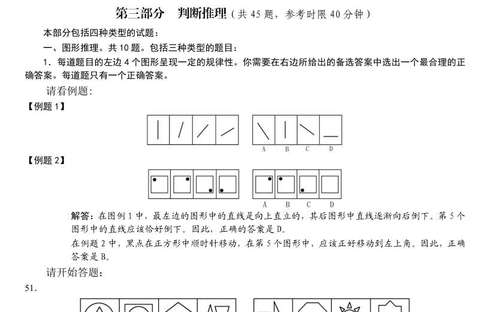

> （本题为图形题，选项为图片，见原卷）

**答案：D**　**考点：图形推理｜图形推理（综合）**
**【判断推理·图形推理｜GK-2005-ty-X052】**

52. （本题题干为图形/公式，文字层无题干，图见原卷）

> （本题为图形题，选项为图片，见原卷）

**答案：C**　**考点：图形推理｜样式规律**
**【判断推理·图形推理｜GK-2005-ty-X053】**

53. （本题题干为图形/公式，文字层无题干，图见原卷）

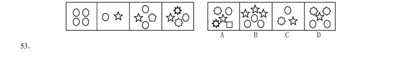

> （本题为图形题，选项为图片，见原卷）

**答案：B**　**考点：图形推理｜图形推理（综合）**
**【判断推理·图形推理｜GK-2005-ty-X054】**

54. 2.每道题包含两套图形和可供选择的4 个图形。这两套图形具有某种相似性,也存在某种差异。 要求你从四个选项中选择你认为最适合取代问号的一个。正确的答案应不仅使两套图形表现出最大的相 似性,而且使第二套图形也表现出自己的特征。

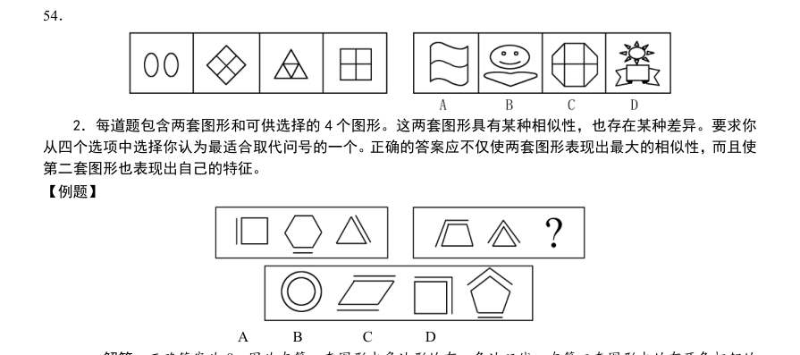

> （本题为图形题，选项为图片，见原卷）

**答案：A**　**考点：图形推理｜图形推理（综合）**
**【判断推理·图形推理｜GK-2005-ty-X055】**

55. （本题题干为图形/公式，文字层无题干，图见原卷）

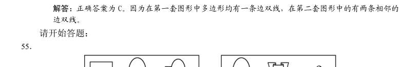

> （本题为图形题，选项为图片，见原卷）

**答案：D**　**考点：图形推理｜位置规律**
**【判断推理·图形推理｜GK-2005-ty-X056】**

56. （本题题干为图形/公式，文字层无题干，图见原卷）

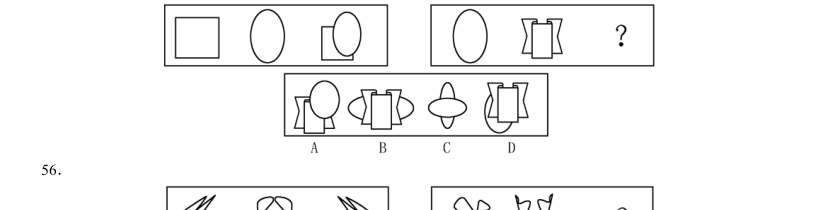

> （本题为图形题，选项为图片，见原卷）

**答案：D**　**考点：图形推理｜属性规律**
**【判断推理·图形推理｜GK-2005-ty-X057】**

57. 3.在右面的4 个图形中,只有一个是由左边的纸板折叠而成。你需要选出正确的一个。

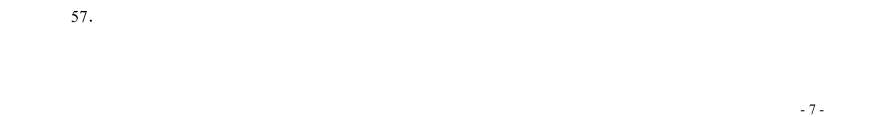

> （本题为图形题，选项为图片，见原卷）

**答案：A**　**考点：图形推理｜图形推理（综合）**
**【判断推理·图形推理｜GK-2005-ty-X058】**

58. （本题题干为图形/公式，文字层无题干，图见原卷）

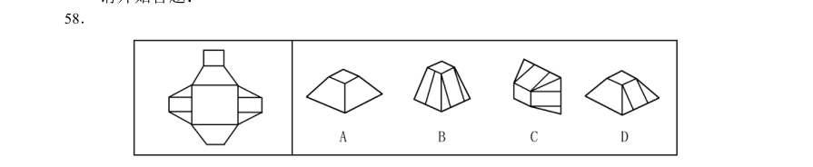

> （本题为图形题，选项为图片，见原卷）

**答案：D**　**考点：图形推理｜图形推理（综合）**
**【判断推理·图形推理｜GK-2005-ty-X059】**

59. （本题题干为图形/公式，文字层无题干，图见原卷）

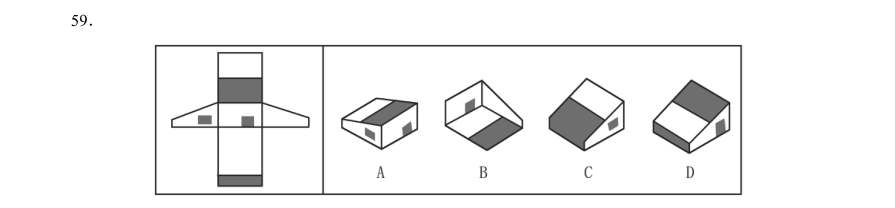

> （本题为图形题，选项为图片，见原卷）

**答案：A**　**考点：图形推理｜位置规律**
**【判断推理·图形推理｜GK-2005-ty-X060】**

60. 据定义从中选出一个最符合或最不符合该定义的答案。注意:假设这个定义是正确的,不容置疑的。 请开始答题:

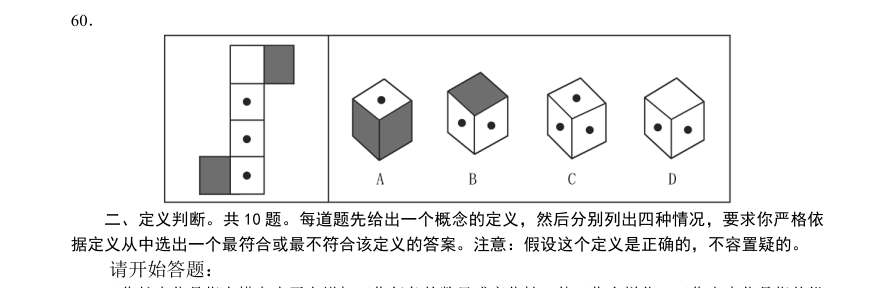

> （本题为图形题，选项为图片，见原卷）

**答案：B**　**考点：图形推理｜位置规律**
**【判断推理·逻辑判断｜GK-2005-ty-X061】**
> 材料：请开始答题:

61. 工作扩大化是指在横向水平上增加工作任务的数目或变化性,使工作多样化。工作丰富化是指从纵 向上赋予员工更复杂、更系列化的工作,使员工有更大的控制权。 下列属于工作丰富化的是( )。

- **A.** 自助餐厅的伙计在面食、沙拉、蔬菜、饮品和甜点部轮换工作
- **B.** 邮政部门的员工从原来只专门分捡邮件增加到也负责分送到各邮政部门
- **C.** 在某传输数据系统公司,员工可以经常提出自己喜欢的工作并随后转入新的岗位
- **D.** 在一家研究所,一个部门主管告诉她的下属,只要在预算内并且合法,他们就可以做想做的任

**答案：B**　**考点：逻辑判断｜逻辑判断（综合）**
**【判断推理·逻辑判断｜GK-2005-ty-X062】**

62. 组织行为塑造有四种方式:正强化指应用有价值的结果增加产生结果的这种行为重复出现的可能性; 负强化指取消或避免不希望的结果;惩罚指处理厌恶的结果;自然消退指撤回或不给予强化的结果。 下列属于负强化的是( )。

- **A.** 对员工批评、斥骂、分派不合意任务、解雇等
- **B.** 给员工设置无法实现的目标,使他从未经历过成功
- **C.** 管理者为某个行为有所改善的员工解除察看处分
- **D.** 赋予充满乐趣、富于挑战性或内容丰富的工作

**答案：B**　**考点：逻辑判断｜加强**
**【判断推理·逻辑判断｜GK-2005-ty-X063】**

63. 主观唯心主义把主观精神(人的感觉、经验、观念、意志等等)作为惟一真实的存在和世界的本原, 客观事物以至整个物质世界都是这种主观精神的产物。下列观点属于主观唯心主义的是( )。

- **A.** 世界的本原是物质
- **B.** 世界是绝对精神的产物
- **C.** 天命主宰人间世界
- **D.** 我思故我在

**答案：D**　**考点：逻辑判断｜逻辑判断（综合）**
**【判断推理·逻辑判断｜GK-2005-ty-X064】**

64. 自我实现预言是指我们对他人的期望会影响到对方的行为,使得对方按照我们对他的期望行事。下 列属于自我实现预言的是( )。

- **A.** 小张本来是一个很普通的孩子,但他的父母望子成龙,于是不惜重金让他读市里最好的高中,但最终小张也只上了一所普通大学
- **B.** 小张是李老师班上一名普通的学生,可是有一天一位智力测量专家告诉李老师小张很有数学天分,于是以后数学课上李老师对小张格外关注,终于在半年后的考试中小张的数学成绩有了很大的提高
- **C.** 今天是小红的生日,她希望爸爸下班时能买生日蛋糕回来,果然爸爸在下班的时候买了一大盒生日蛋糕
- **D.** 小李从小就希望自己能成为一个工程师,当他大学毕业后他终于到一家公司当上了软件工程师

**答案：B**　**考点：逻辑判断｜逻辑判断（综合）**
**【判断推理·逻辑判断｜GK-2005-ty-X065】**

65. 组织公民行为指的是一种由员工自主决定的行为,不包括在员工的正式工作要求当中,但它无疑会 促进组织的有效性。下列属于组织公民行为的是( )。

- **A.** 小李被迫在周末加班
- **B.** 小李按时上下班
- **C.** 小李经常和同事起冲突
- **D.** 小李经常帮助同事

**答案：D**　**考点：逻辑判断｜逻辑判断（综合）**
**【判断推理·逻辑判断｜GK-2005-ty-X066】**

66. 程序化决策是可以确定的、在以前已经做过的决策,它们有客观正确的答案而且可以使用简单的规 则、政策、数学计算来解决。非程序化决策则是全新的、复杂的、无章可循的,它们有各种各样的 解决方案,而且每个方案都各有优缺点。下列属于非程序化决策的是( )。

- **A.** 建筑工人施工
- **B.** 医院接收病人的步骤
- **C.** 企业中定期记录存货
- **D.** 制定公司发展战略

**答案：D**　**考点：逻辑判断｜逻辑判断（综合）**
**【判断推理·逻辑判断｜GK-2005-ty-X067】**

67. 高峰体验指的是人在追求自我实现的历程中,历经基本需求的追寻并获满足之后,在追求自我实现 时所体验到的一种臻于顶峰而又超越时空与自我的心灵满足感与完美感,这种感觉只可意会不能言 传。下列不属于高峰体验的是( )。

- **A.** 运动员登上奥运冠军领奖台时的心理体验
- **B.** 科学家获得诺贝尔奖时的心理体验
- **C.** 观众见证人类首次踏上月球时的心理体验
- **D.** 通过十年寒窗苦读,收到理想的大学录取通知时的心理体验

**答案：C**　**考点：逻辑判断｜逻辑判断（综合）**
**【判断推理·科学推理｜GK-2005-ty-X068】**

68. 特设性修改是指为了使某个科学理论免遭被否证的危险,对该理论进行修改或者增加一些新的假定, 使该理论不具有可否证性或者可检验性。下列属于特设性修改的是( )。

- **A.** 托勒密体系的学者为了使“地心说”符合观察到的天体运行数据,不断增加本轮的数目。到16世纪,托勒密体系的本轮总数一直增加到80 个
- **B.** 亚里士多德的信徒为了坚持一切天体都是完美球体的学说,提出月球上存在的不可检测的物质充满了凹处,使得月球仍然保持完美球体形状
- **C.** 爱因斯坦为了研究特别大和特别快的物体,修改了牛顿的绝对时空体系,提出了相对时空体系,其中包括光速不变论和质量可变论
- **D.** 黎曼等通过修改欧氏几何的第五条公理,创造出了非欧几何学,把数学向前推进了一大步

**答案：B**　**考点：科学推理｜科学推理（综合）**
**【判断推理·逻辑判断｜GK-2005-ty-X069】**

69. 行政许可是指行政机关根据公民、法人或者其他组织的申请,经依法审查,准予其从事特定活动的 行为。下列属于行政许可的是( )。

- **A.** 烟草专卖局为方便市民、扩大市场,特邀请该市的数家有影响的商家增设香烟销售业务,并向他们颁发了烟草专卖许可证
- **B.** 某网吧因违规经营被吊销营业执照转营其他业务
- **C.** 某人为提高专业技能,特向单位申请参加研究生学习,单位领导同意了其申请,并同意在其毕业后为他报销部分学习费用
- **D.** 某人为从事运输,去学习驾驶技术。其考核合格并申请后,公安车辆管理部门为其核发了机动

**答案：D**　**考点：逻辑判断｜逻辑判断（综合）**
**【判断推理·逻辑判断｜GK-2005-ty-X070】**

70. 民法规定,一项允诺可以通过明示或默示方法作出。所谓明示是行为人直接将自主决定的意思表示 于外的允诺方法,包括口头明示和书面明示。下列不属于明示范畴的是( )。

- **A.** 用户以通话形式申请提供服务
- **B.** 用户到营业厅办理信用卡手续
- **C.** 开车到收费停车场停车
- **D.** 授权朋友办理服务申请

**答案：C**　**考点：逻辑判断｜逻辑判断（综合）**
**【判断推理·事件排序｜GK-2005-ty-X071】**
> 材料：件的四种假定发生顺序的四个数字序列,请你选择其中最合乎逻辑的一种事件顺序。

71. (1)考古挖掘 (2)绘制壁画 (3)建造陵墓 (4)拼接图案 (5)盗墓取宝

- **A.** 3—5—1—2—4
- **B.** 3—2—5—1—4
- **C.** 2—3—4—5—1
- **D.** 2—3—5—1—4

**答案：B**　**考点：事件排序｜事件排序**
**【判断推理·事件排序｜GK-2005-ty-X072】**

72. (1)救治无效,家属告状 (2)身患重病,借款购药 (3)企业胜诉,报社致歉 (4)药品鉴定,真伪不同 (5)记者撰文,药厂蒙冤

- **A.** 2—4—1—5—3
- **B.** 5—2—4—1—3
- **C.** 2—1—5—4—3
- **D.** 5—4—2—1—3

**答案：C**　**考点：事件排序｜事件排序**
**【判断推理·事件排序｜GK-2005-ty-X073】**

73. (1)绿叶葱葱,森林茂密 (2)厂房林立,马达轰鸣 (3)钻机飞转,原油滚滚 (4)燃气发电,远程送电 (5)阳光明媚,百花齐放

- **A.** 3—4—5—1—2
- **B.** 5—4—1—2—3
- **C.** 1—2—3—4—5
- **D.** 5—1—3—4—2

**答案：B**　**考点：事件排序｜事件排序**
**【判断推理·事件排序｜GK-2005-ty-X074】**

74. (1)融入异族自谋出路 (2)一支残部向西突围 (3)跨过界河向北征战 (4)战火熄灭回国通商 (5)青年男子被征入伍

- **A.** 3—5—2—1—4
- **B.** 3—2—1—4—5
- **C.** 5—2—3—4—1
- **D.** 5—3—2—1—4

**答案：D**　**考点：事件排序｜事件排序**
**【判断推理·事件排序｜GK-2005-ty-X075】**

75. (1)嫌疑人聚焦在印刷厂一名职工身上 (2)死者所穿衣服完好无损 (3)工作服前襟上有一块补丁 (4)检测碎布片中有油墨成分 (5)现场拾到一块衣服碎片

- **A.** 2—5—1—4—3
- **B.** 2—5—4—3—1
- **C.** 5—2—4—1—3
- **D.** 5—2—3—4—1

**答案：B**　**考点：事件排序｜事件排序**
**【判断推理·事件排序｜GK-2005-ty-X076】**

76. (1)大量有机物积聚 (2)形成石油 (3)复杂的化学变化 (4)剧烈地质变化 (5)古浮游生物残骸沉积海底

- **A.** 1—5—3—4—2
- **B.** 5—4—1—2—3
- **C.** 3—1—2—5—4
- **D.** 5—1—4—3—2

**答案：D**　**考点：事件排序｜事件排序**
**【判断推理·事件排序｜GK-2005-ty-X077】**

77. (1)诸葛亮显示出卓越的军事才华 (2)三顾茅庐 (3)刘备拜诸葛亮为军师 (4)赤壁之战大败曹军 (5)提出三分天下战略

- **A.** 1—4—5—2—3
- **B.** 5—4—3—2—1
- **C.** 2—5—3—4—1
- **D.** 1—2—3—4—5

**答案：C**　**考点：事件排序｜事件排序**
**【判断推理·事件排序｜GK-2005-ty-X078】**

78. (1)商品经济出现 (2)资本主义生产方式产生 (3)生产力发展 (4)资本原始积累 (5)社会分工扩大

- **A.** 1—5—3—4—2
- **B.** 3—4—2—5—1
- **C.** 3—5—1—4—2
- **D.** 1—2—3—5—4

**答案：C**　**考点：事件排序｜事件排序**
**【判断推理·事件排序｜GK-2005-ty-X079】**

79. (1)生命单体 (2)原始水生物 (3)生物大分子 (4)简单有机物 (5)地球生物圈

- **A.** 4—1—2—3—5
- **B.** 3—2—4—5—1
- **C.** 4—3—1—2—5
- **D.** 3—4—2—1—5

**答案：C**　**考点：事件排序｜事件排序**
**【判断推理·事件排序｜GK-2005-ty-X080】**

80. (1)工人失业增多 (2)自由竞争 (3)劳动生产率提高 (4)贫富差距加大 (5)采用先进生产技术

- **A.** 5—3—2—4—1
- **B.** 2—5—3—1—4
- **C.** 5—2—3—4—1
- **D.** 1—2—5—3—4

**答案：B**　**考点：事件排序｜事件排序**
**【判断推理·事件排序｜GK-2005-ty-X081】**
> 材料：据这段陈述,选择一个答案。注意,正确的答案应与所给的陈述相符合,不需要任何附加说明即可以从 陈述中直接推出。

81. 作家在其晚期的作品中没有像其早期那样严格遵守小说结构的成规。由于最近发现的一部他的小说 的结构像他早期的作品一样严格地遵守了那些成规,因此该作品一定创作于他的早期。上面论述所 依据的假设是( )。

- **A.** 作家在其创作晚期比早期更不愿意打破某种成规
- **B.** 随着创作的发展,作家日益意识不到其小说结构的成规
- **C.** 在其职业生涯晚期,该作家是其时代惟一有意打破小说结构成规的作家
- **D.** 作家在其创作生涯的晚期没有写过任何模仿其早期作品风格的小说

**答案：D**　**考点：事件排序｜事件排序（综合）**
**【判断推理·事件排序｜GK-2005-ty-X082】**

82. 尽管新制造的国产汽车的平均油效仍低于新制造的进口汽车,但它在1996 年到1999 年间却显著地 提高了。自那以后,新制造的国产汽车的平均油效没再提高,但新制造的国产汽车与进口汽车在平 均油效上的差距却逐渐缩小。如以上论述正确,那么基于此也一定正确的一项是( )。

- **A.** 新制造的进口汽车的平均油效从1999 年后逐渐降低
- **B.** 新制造的国产汽车的平均油效从1999 年后逐渐降低
- **C.** 1999 年后制造的国产汽车的平均油效高于1999 年后制造的进口汽车的平均油效
- **D.** 1996 年制造的进口汽车的平均油效高于1999 年制造的进口汽车的平均油效

**答案：A**　**考点：事件排序｜事件排序（综合）**
**【判断推理·事件排序｜GK-2005-ty-X083】**

83. 在1970 年到1980 年之间,世界工业的能源消耗量在达到顶峰后下降,1980 年虽然工业总产出量有 显著提高,但工业的能源总耗用量却低于1970 年的水平。这说明,工业部门一定采取了高效节能 措施。最能削弱上述结论的是( )。

- **A.** 1970 年前,许多工业能源的使用者很少注意节约能源
- **B.** 20 世纪70 年代一大批能源密集型工业部门的产量急剧下降
- **C.** 工业总量的增长1970 年到1980 年间低于1960 至1970 年间的增长
- **D.** 20 世纪70 年代,许多行业从使用高价石油转向使用低价的替代物

**答案：D**　**考点：事件排序｜事件排序（综合）**
**【判断推理·事件排序｜GK-2005-ty-X084】**

84. 在某国,10 年前放松了对销售拆锁设备的法律限制后,盗窃案发生率急剧上升。因为合法购置的拆 锁设备被用于大多数盗窃案,所以重新引入对销售该设备的严格限制将有助于减少该国的盗窃发生 率。最有力地支持以上论述的一项是( )。

- **A.** 该国的总体犯罪率在过去10 年中急剧增加了
- **B.** 5 年前引进的对被控盗窃的人更严厉的惩罚对该国盗窃率没什么影响
- **C.** 重新引入对拆锁设备的严格限制不会阻碍执法部门对这种设备的使用
- **D.** 在该国使用的大多数拆锁设备是易坏的,通常会在购买几年后损坏且无法修好

**答案：D**　**考点：事件排序｜事件排序（综合）**
**【判断推理·事件排序｜GK-2005-ty-X085】**

85. 如果一个人增加日进餐次数并且不显著增加所摄入的食物总量,那么他的胆固醇水平会有显著下降。 然而,大多数增加日进餐次数的人同时也摄入了更多的食物。上面陈述支持的观点是( )。

- **A.** 对大多数人而言,胆固醇的水平不受每天吃的食物量的影响
- **B.** 对大多数人而言,每顿饭吃的食物的量取决于吃饭的时间
- **C.** 对大多数人而言,增加每天吃饭的次数将不会导致胆固醇水平显著下降
- **D.** 对大多数人而言,每天吃饭的总量不受每天吃饭的次数影响

**答案：C**　**考点：事件排序｜事件排序（综合）**
**【判断推理·事件排序｜GK-2005-ty-X086】**

86. 政府对基本商品征收的一种税是对出售的每一罐食用油征税两分钱。税务纪录显示,尽管人口数量 保持稳定且税法执行有力,食用油的税收额在税法生效的头两年中还是显著下降了。如果正确,最 有助于解释食用油的税收额下降的一项是( )。

- **A.** 很少家庭在加税后开始生产他们自己的食用油
- **B.** 商人在税法实施后开始用比以前更大的罐子售油
- **C.** 在食用油税实行后的两年,政府开始在许多其他基本商品上征税
- **D.** 食用油罐传统上被用作结婚礼物,税法实施后,用食用油做礼物增多了

**答案：B**　**考点：事件排序｜事件排序（综合）**
**【判断推理·事件排序｜GK-2005-ty-X087】**

87. 与新疆的其他城市一样,库尔勒直至20 世纪80 年代初物价都是很低的,自它成为新疆的石油开采 中心以后,它的物价大幅上升,这种物价上涨可能来自这场石油经济,这是因为新疆那些没有石油 经济的城市仍然保持着很低的物价水平。最准确地描述了上段论述中所采用的推理方法的一项是 ( )。

- **A.** 鉴于条件不存在的时候现象没有发生,所以认为条件是现象的一个原因
- **B.** 鉴于有时条件不存在的条件下现象也会发生,所以认为条件不是现象的前提
- **C.** 由于某一特定事件在现象发生前没有出现,所以认为这一事件不可能引发现象
- **D.** 试图说明某种现象是不可能发生的,而某种解释正确就必须要求这种现象发生

**答案：A**　**考点：事件排序｜事件排序（综合）**
**【判断推理·事件排序｜GK-2005-ty-X088】**

88. 针对某种溃疡,传统疗法可在6 个月内将44%的患者的溃疡完全治愈。针对这种溃疡的一种新疗法 在6 个月的试验中使治疗的80%的溃疡取得了明显改善,61%的溃疡得到了痊愈。由于该试验只治 疗了那些病情比较严重的溃疡,因此这种新疗法显然在疗效方面比传统疗法更显著。为更好地对比 两种疗法的效果,还需要补充的证据是( )。

- **A.** 这两种疗法使用的方法有何不同
- **B.** 这两种疗法的使用成本是否存在很大差别
- **C.** 在6 个月中以传统疗法治疗的该种溃疡的患者中,有多大比例取得了明显改善
- **D.** 在参加6 个月的新疗法试验的患者中,有多大比例的人对康复的比例不满意

**答案：C**　**考点：事件排序｜事件排序（综合）**
**【判断推理·事件排序｜GK-2005-ty-X089】**

89. 当一名司机被怀疑饮用了过多的酒精时,检验该司机走直线的能力与检验该司机血液中的酒精水平 相比,是检验该司机是否适于驾车的更可靠的指标。如果正确,能最好地支持上述观点的一项是 ( )。

- **A.** 观察者们对一个人是否成功地走了直线不能全部达成一致
- **B.** 用于检验血液酒精含量水平的测试是准确、低成本和易于实施的
- **C.** 一些人在血液酒精含量水平很高时,还可以走直线,但却不能完全驾车
- **D.** 由于基因的不同和对酒精的抵抗能力的差别,一些人血液酒精含量水平很高时仍能正常驾车

**答案：D**　**考点：事件排序｜事件排序（综合）**
**【判断推理·事件排序｜GK-2005-ty-X090】**

90. 桌上放着红桃、黑桃和梅花三种牌,共20 张, [1]桌上至少有一种花色的牌少于6 张[2]桌上至少有一种花色的牌多于6 张 [3]桌上任意两种牌的总数将不超过19 张上述论述中正确的是( )。

- **A.** [1]、[2]
- **B.** [1]、[3]
- **C.** [2]、[3]
- **D.** [1]、[2]和[3]

**答案：C**　**考点：事件排序｜事件排序（综合）**
**【判断推理·事件排序｜GK-2005-ty-X091】**

91. 小王:从举办奥运会的巨额耗费来看,观看各场奥运比赛的票价应该要高得多。是奥运会主办者的 广告收入降低了票价。因此,奥运会的现场观众从奥运会拉的广告中获得了经济利益。 小李:你的说法不能成立。谁来支付那些看来导致奥运会票价降低的广告费用?到头来还不是消费 者,包括作为奥运会现场观众的消费者?因为厂家通过提高商品的价格把广告费用摊到了消费者的 身上。下列能够有力地削弱小李对小王反驳的一项是( )。

- **A.** 奥运会的票价一般要远高于普通体育比赛的票价
- **B.** 奥运会的举办带有越来越浓的商业色彩,引起了普遍的不满
- **C.** 利用世界性体育比赛做广告的厂家越来越多,广告费用也越来越高
- **D.** 各厂家的广告支出总体上是一个常量,只是在广告形式上有所选择

**答案：D**　**考点：事件排序｜事件排序（综合）**
**【判断推理·事件排序｜GK-2005-ty-X092】**

92. 北京市是个水资源严重缺乏的城市,但长期以来水价格一直偏低。最近北京市政府根据价值规律拟 调高水价,这一举措将对节约使用该市的水资源产生重大的推动作用。若上述结论成立,下列哪些 项必须是真的( )。 [1]有相当数量的用水浪费是因为水价格偏低造成的 [2]水价格的上调幅度足以对浪费用水的用户产生经济压力 [3]水价格的上调不会引起用户的不满

- **A.** [1]、[2]
- **B.** [1]、[3]
- **C.** [2]、[3]
- **D.** [1]、[2]和[3]

**答案：A**　**考点：事件排序｜事件排序（综合）**
**【判断推理·事件排序｜GK-2005-ty-X093】**

93. 西方发达国家的大学教授几乎都是得到过博士学位的。目前,我国有些高等学校也坚持在招收新教 师时,有博士学位是必要条件,除非是本校的少数优秀硕士毕业生留校。从这段文字中可以推出的 是( )。

- **A.** 在我国,有些高等学校的新教师都有了博士学位
- **B.** 在我国,有些高等学校得到博士学位的教师的比例在增加
- **C.** 大学教授中得到博士学位的比没有得到博士学位的更受学生欢迎
- **D.** 在我国,大多数大学教授已经获得了博士学位,少数正在读在职博士

**答案：B**　**考点：事件排序｜事件排序（综合）**
**【判断推理·事件排序｜GK-2005-ty-X094】**

94. 环境学家关注保护濒临灭绝的动物的高昂费用,提出应通过评估各种濒临灭绝的动物对人类的价值, 以决定保护哪些动物。此法实际不可行,因为,预言一种动物未来的价值是不可能的。评价对人类 现在做出间接但很重要贡献的动物的价值也是不可能的。从这段文字中可以推出的是( )。

- **A.** 保护对人类有直接价值的动物远比保护有间接价值的动物重要
- **B.** 保护没有价值的濒临灭绝的动物比保护有潜在价值的动物更重要
- **C.** 尽管保护所有濒临灭绝的动物是必须的,但在经济上却是不可行的
- **D.** 由于判断动物对人类价值高低的方法并不完善,在此基础上做出的决定也不可靠

**答案：D**　**考点：事件排序｜事件排序（综合）**
**【判断推理·事件排序｜GK-2005-ty-X095】**

95. 研究人员对75 个胎儿进行了跟踪调查,他们中的60 个偏好吸吮右手,15 个偏好吸吮左手。在这些 胎儿出生后成长到10 到12 岁时,研究人员发现,60 个在胎儿阶段吸吮右手的孩子习惯用右手;而 在15 个吸吮左手的胎儿中,有10 个仍旧习惯用左手,另外5 个则变成“右撇子”。从这段文字中, 不能推出的是( )。

- **A.** 大部分人是“右撇子”
- **B.** 人的偏侧性随着年龄的增长不断改变
- **C.** 大多数人的偏侧性在胎儿时期就形成了
- **D.** “左撇子”可能变成“右撇子”,而“右撇子”很难变成“左撇子”

**答案：B**　**考点：事件排序｜事件排序（综合）**
**【常识判断·政治常识｜GK-2005-ty-X096】**
> 材料：常识判断(共20 题,参考时限10 分钟) 根据题目要求,在四个选项中选出一个正确答案。 请开始答题:

96. 在我国,“公民”一词的含义是指( )。

- **A.** 年满18 周岁具有我国国籍的人
- **B.** 具有我国国籍的人
- **C.** 享有政治权利的人
- **D.** 出生在我国的人

**答案：B**　**考点：政治常识｜政治常识（综合）**
**【常识判断·政治常识｜GK-2005-ty-X097】**

97. 下列行为中,没有违反《中华人民共和国妇女权益保障法》的是( )。

- **A.** 某单位辞退了怀孕的小李
- **B.** 某单位招收了一位年满17 周岁的未成年女工
- **C.** 由于家庭生活困难,老王让自己正在上小学的女儿辍学回家干活
- **D.** 某公司未经王女士同意,以营利为目的,将其肖像印发在广告画上

**答案：B**　**考点：政治常识｜政治常识（综合）**
**【常识判断·政治常识｜GK-2005-ty-X098】**

98. 下列行为中,没有违反《中华人民共和国未成年人保护法》的是( )。

- **A.** 父母逼迫19 周岁的女儿嫁给一外地人
- **B.** 某小学将学习成绩垫底的王某开除
- **C.** 某网吧负责人让16 岁的小明进网吧玩游戏
- **D.** 由于家庭生活困难,老王不让自己10 岁的儿子上学

**答案：A**　**考点：政治常识｜政治常识（综合）**
**【常识判断·政治常识｜GK-2005-ty-X099】**

99. 在我国,乡、民族乡、镇的人民政府与村民委员会、居民委员会的关系是( )。

- **A.** 领导与被领导关系
- **B.** 委托与被委托关系
- **C.** 监督与被监督关系
- **D.** 指导与被指导关系

**答案：D**　**考点：政治常识｜政治常识（综合）**
**【常识判断·法律常识｜GK-2005-ty-X100】**

100. 按照我国现行宪法规定,有权制定和发布行政法规的国家机关是(

> （本题为图形题，选项为图片，见原卷）

**答案：D**　**考点：法律常识｜宪法**
**【常识判断·政治常识｜GK-2005-ty-X101】**

101. 2003 年1 月1 日, 《中华人民共和国政府采购法》正式开始生效。所谓的政府采购,本质上是( )。

- **A.** 政府直接购买商品和劳务
- **B.** 政府依法购买商品和劳务
- **C.** 政府委托民营企业为其购买商品和劳务
- **D.** 政府在购买商品和劳务的过程中,引入竞争性的招投标机制

**答案：D**　**考点：政治常识｜政治常识（综合）**
**【常识判断·政治常识｜GK-2005-ty-X102】**

102. 根据现代统计学的研究成果,“关键的事情总是少数,一般的事情常常是多数。”这意味着管理工 作最应该重视( )。

- **A.** 灵活、及时、适度
- **B.** 客观、精确、具体
- **C.** 突出重点,强调例外
- **D.** 协调计划和组织工作

**答案：D**　**考点：政治常识｜政治常识（综合）**
**【常识判断·政治常识｜GK-2005-ty-X103】**

103. 组织的领导者应该学会“弹钢琴”,这种说法指的是( )。

- **A.** 领导者要全面地看问题
- **B.** 领导者要集中精力于领导和决策工作
- **C.** 领导者应该是懂行的专家
- **D.** 领导者应该具有开放型的性格

**答案：A**　**考点：政治常识｜政治常识（综合）**
**【常识判断·经济常识｜GK-2005-ty-X104】**

104. 作为调节社会经济运行的一种重要经济杠杆,提高税率通常将( )。

- **A.** 提高政府的财政收入
- **B.** 抑制投资,有利于防止经济过热
- **C.** 刺激消费
- **D.** 提高税收管理的效率

**答案：B**　**考点：经济常识｜宏观经济**
**【常识判断·经济常识｜GK-2005-ty-X105】**

105. 在社会经济运行中,当通货膨胀率上升时,一般会导致( )。

- **A.** 失业率上升
- **B.** 失业率保持稳定不变
- **C.** 失业率下降
- **D.** 失业率波动不定

**答案：C**　**考点：经济常识｜宏观经济**
**【常识判断·地理常识｜GK-2005-ty-X106】**

106. 中央和地方的国家机构职权的划分,所遵循的原则是( )。

- **A.** 在中央的统一领导下,充分发挥地方的主动性、积极性
- **B.** 在中央的统一领导下,充分发挥地方的主动性、创造性
- **C.** 在中央的统一领导下,充分发挥地方的自主性、积极性
- **D.** 在中央的统一领导下,充分发挥地方的自主性、创造性

**答案：A**　**考点：地理常识｜世界地理**
**【常识判断·政治常识｜GK-2005-ty-X107】**

107. 《中华人民共和国对外贸易法》不适用于( )。

- **A.** 货物进出口
- **B.** 技术进出口
- **C.** 香港地区货物进出口
- **D.** 国际服务贸易

**答案：C**　**考点：政治常识｜政治常识（综合）**
**【常识判断·政治常识｜GK-2005-ty-X108】**

108. 李某将与其有私仇的王某打昏在地后逃跑,此时张某路过,见王某不省人事,遂将其所带手表、 钱物偷走。本案中( )。

- **A.** 李某、张某构成共同犯罪
- **B.** 李某构成故意伤害罪,张某构成盗窃罪
- **C.** 李某构成故意伤害罪,张某构成抢劫罪
- **D.** 李某、张某共同构成故意伤害罪、盗窃罪

**答案：B**　**考点：政治常识｜政治常识（综合）**
**【常识判断·地理常识｜GK-2005-ty-X109】**

109. 我国在今后将逐步推开( ),重大违法违规案件、因盲目决策造成的资源浪费和国有资产流失、 单纯追求速度而片面提供优惠政策造成国家和人民群众利益受到重大损害等三大领域将成为审计 的重点。

- **A.** 民主审计
- **B.** 依法审计
- **C.** 审计风暴
- **D.** 绩效审计

**答案：D**　**考点：地理常识｜世界地理**
**【常识判断·政治常识｜GK-2005-ty-X110】**

110. 在全国人大闭会期间,全国人大常委会根据国务院总理的提名,有权决定的人选不包括( )。

- **A.** 秘书长
- **B.** 审计长
- **C.** 财政部部长
- **D.** 国务委员

**答案：D**　**考点：政治常识｜政治常识（综合）**
**【常识判断·政治常识｜GK-2005-ty-X111】**

111. 张某家住北京市东城区,在朝阳区有一处商业用房,市拆迁办(在西城区)决定对其房屋拆迁,张某 不服,诉至法院,应由( )受理。

- **A.** 朝阳区法院
- **B.** 东城区法院
- **C.** 西城区法院
- **D.** 以上三个法院都可以

**答案：A**　**考点：政治常识｜政治常识（综合）**
**【常识判断·法律常识｜GK-2005-ty-X112】**

112. 现行宪法规定,国务院对各部、各委员会发布的不适当命令、指示和规章有权( )。

- **A.** 改变
- **B.** 发回
- **C.** 改变或者撤销
- **D.** 撤销

**答案：C**　**考点：法律常识｜宪法**
**【常识判断·法律常识｜GK-2005-ty-X113】**

113. 法律规范生效的时间,如无明文规定,依照惯例应该是( )。

- **A.** 通过三个月后
- **B.** 批准之日
- **C.** 公布之日
- **D.** 公布三个月后

**答案：C**　**考点：法律常识｜法律常识（综合）**
**【常识判断·政治常识｜GK-2005-ty-X114】**

114. 中国摄影协会所属的法人类别是( )。

- **A.** 机关法人
- **B.** 事业单位法人
- **C.** 社会团体法人
- **D.** 企业法人

**答案：C**　**考点：政治常识｜政治常识（综合）**
**【常识判断·政治常识｜GK-2005-ty-X115】**

115. 我国最基层人民政府是( )。

- **A.** 乡(镇)人民政府
- **B.** 街道办事处
- **C.** 县人民政府
- **D.** 村民委员会

**答案：A**　**考点：政治常识｜政治常识（综合）**
**【资料分析·增长率计算与比较｜GK-2005-ty-X116】**
> 材料：资料分析(共20 题,参考时限20 分钟) 所给出的图、表或一段文字均有5 个问题要你回答。你应根据资料提供的信息进行分析、比较、计 算和判断处理。 请开始答题: 一、根据下表回答116~120 题。

116. 2001 年、2002 年全国高等学校各学科学生数(单位:千人) 2001 年 2002 年 毕业生 在校生 毕业生 在校生 哲学 0.9 5.4 1.0 6.6 经济学 57.3 359.9 65.9 466.4 法学 61.5 387.9 80.0 474.8 教育学 52.6 374.5 79.8 470.3 文学 157.8 1059.3 198.5 1368.3 历史学 10.2 53.4 11.7 55.6 理学 115.8 716.3 131.5 852.2 工学 349.1 2491.2 459.8 3085.0 农学 28.5 186.0 36.3 216.0 医学 62.6 529.4 79.5 656.6 管理学 139.9 1027.5 193.2 1381.7 合计 1036.2 7190.8 1337.2 9033.5 2002 年的在校生中,工学学生所占的比例约是( )。

- **A.** 15%
- **B.** 20%
- **C.** 34%
- **D.** 40%

**答案：C**　**考点：增长率计算与比较｜增长率计算（综合）**
**【资料分析·增长率计算与比较｜GK-2005-ty-X117】**

117. 2002 年与2001 年相比,毕业生增长率最大的学科是( )。

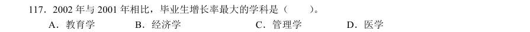

- **A.** 教育学
- **B.** 经济学
- **C.** 管理学
- **D.** 医学

**答案：A**　**考点：增长率计算与比较｜增长率比较**
**【资料分析·增长率计算与比较｜GK-2005-ty-X118】**

118. 2002 年与2001 年相比,在校生增长率超过20%的学科有( )。

- **A.** 3 个
- **B.** 8 个
- **C.** 10 个
- **D.** 11 个

**答案：B**　**考点：增长率计算与比较｜增长率计算**
**【判断推理·逻辑判断｜GK-2005-ty-X119】**

119. 如果数据中的在校生不包括毕业生,那么2002 年高校共约招了( )。

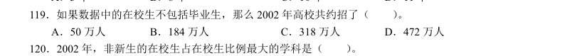

- **A.** 50 万人
- **B.** 184 万人
- **C.** 318 万人
- **D.** 472 万人

**答案：C**　**考点：逻辑判断｜翻译推理**
**【资料分析·比重计算与比较｜GK-2005-ty-X120】**

120. 2002 年,非新生的在校生占在校生比例最大的学科是( )。

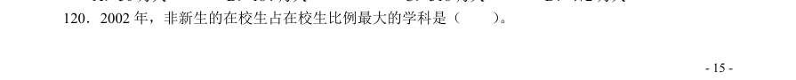

- **A.** 哲学
- **B.** 历史学
- **C.** 法学
- **D.** 经济学

**答案：B**　**考点：比重计算与比较｜现期比重**
**【资料分析·基期量计算｜GK-2005-ty-X121】**
> 材料：环渤海经济区正逐步成为引人注目的经济增长第三极,而京津冀在环渤海经济区占有举足轻重的位 置。但以北京、天津为核心的京津冀城市群分布比较散乱,彼此间的空间联系松散且薄弱,重复建设问 题比较严重,资源浪费现象普遍存在。2003 年,北京、天津两市人均GDP 分别超过或接近3 万元,城 镇居民可支配收入均高于全国平均水平,而河北人均GDP 刚刚突破1 万元,城镇居民可支配收入7239 元,比全国平均水平低14.6%,比北京市低近一半;从市场开放度看,京津两市由于享受开放城市、 沿海城市、开放区、开发区等优惠政策较早,在引进资金、扩大出口等方面占据了绝对优势。相比之下, 河北省的开放步伐虽然也在不断加快,但在利用外资、外贸出口等方面的能力差距较大。

121. 2003 年京津冀的经济实力比较 地区 人均 GDP(元) 经济增 长率(%) 城镇人均可支 配收入(元) 三个产业结构比 固定资产投资 增长率(%) 进出口增 长率(%) 北京市 36613 10.5 13883 2.60:36.0:61.4 18.9 30.4 天津市 28574 14.5 10313 3.70:50.8:45.5 20.9 28.7 河北省 10513 11.6 15.0:51.5:33.5 22.9 34.7 从上述材料中无法得知的是( )。

- **A.** 京津冀的产业联系不紧密
- **B.** 京津冀的城市布局不合理
- **C.** 京津冀的重复建设严重
- **D.** 京津冀的经济水平落差大

**答案：A**　**考点：基期量计算｜已知现期与增长率求基期**
**【资料分析·综合分析｜GK-2005-ty-X122】**

122. 京津冀三个地区中,2003 年城镇人均可支配收入占人均GDP 的比例由大到小排序正确的是( )。

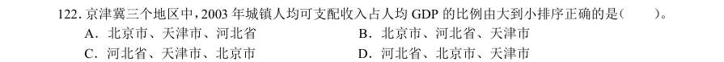

- **A.** 北京市、天津市、河北省
- **B.** 北京市、河北省、天津市
- **C.** 河北省、天津市、北京市
- **D.** 河北省、北京市、天津市

**答案：D**　**考点：综合分析｜排序与图示判断**
**【资料分析·基期量计算｜GK-2005-ty-X123】**

123. 如果天津市2002 年的固定资产投资为5000 万元,且2004 年的固定资产投资和2003 年保持同比 增长,则天津市在2004 年的固定资产投资额约为( )。

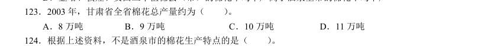

- **A.** 6200 万元
- **B.** 6800 万元
- **C.** 7300 万元
- **D.** 7900 万元

**答案：C**　**考点：基期量计算｜已知现期与增长率求基期**
**【资料分析·基期量计算｜GK-2005-ty-X124】**

124. 就河北省而言,要想加快京津冀经济一体化进程,河北省单方面无法做到的是( )。

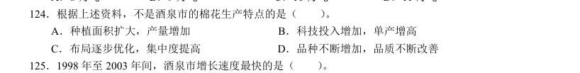

- **A.** 尽快提高经济实力
- **B.** 合理形成各区域的职能分工
- **C.** 大力发展工业制造业
- **D.** 尽快发展壮大民间投资

**答案：B**　**考点：基期量计算｜基期量计算（综合）**
**【资料分析·平均数计算｜GK-2005-ty-X125】**

125. 北京市城镇人均可支配收入约比全国平均水平高( )。

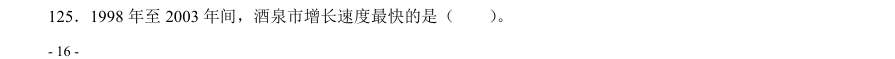

- **A.** 15%
- **B.** 22%
- **C.** 64%
- **D.** 102%

**答案：C**　**考点：平均数计算｜现期平均数**
**【资料分析·基期量计算｜GK-2005-ty-X126】**

126. 1993-2003 年某国国内生产总值指数 年 份 国民生产总值 国内生产总值 第一产业 第二产业 第三产业 人均国内生产总值 108.7 108.7 102.0 115.8 104.9 106.8 98.4 98.4 98.2 97.5 100.4 96.9 107.6 107.6 97.8 113.3 109.5 106.2 111.7 111.7 104.1 115.0 113.7 110.2 107.6 107.6 106.1 108.2 107.8 106.1 107.8 107.8 98.5 113.6 105.9 106.5 105.2 105.2 107.0 101.9 110.4 103.9 109.3 109.1 111.5 105.6 113.0 107.5 111.1 110.9 108.3 110.4 115.2 109.3 115.3 115.2 112.9 114.5 119.4 113.7 113.2 113.5 101.8 118.6 118.3 111.9 说明:本题中指数的计算方法为:当年的数值与上一年数值的比乘以100。举例来说,假设第一年的数值为m,第二年的数值为n,则第二 年的指数为100×(n/m)。 假设1995 年的国内生产总值为200 亿,那么1996 年的国内生产总值为( )。

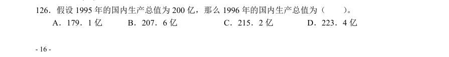

- **A.** 179.1 亿
- **B.** 207.6 亿
- **C.** 215.2 亿
- **D.** 223.4 亿

**答案：D**　**考点：基期量计算｜基期量计算（综合）**
**【资料分析·平均数计算｜GK-2005-ty-X127】**

127. 与上一年相比,人均国内生产总值增长最快的年份是( )。

- **A.** 1994 年
- **B.** 1996 上
- **C.** 2002 年
- **D.** 2003 年

**答案：C**　**考点：平均数计算｜平均数增长率**
**【资料分析·平均数计算｜GK-2005-ty-X128】**

128. 第三产业的指数超过人均国内生产总值的年份有( )。

- **A.** 5 个
- **B.** 7 个
- **C.** 9 个
- **D.** 11 个

**答案：C**　**考点：平均数计算｜现期平均数**
**【资料分析·平均数计算｜GK-2005-ty-X129】**

129. 2003 年与2001 年相比,人均国内生产总值增长了( )。

- **A.** 25.6%
- **B.** 27.2%
- **C.** 6.5%
- **D.** 24.3%

**答案：B**　**考点：平均数计算｜现期平均数**
**【资料分析·基期量计算｜GK-2005-ty-X130】**

130. 下面不正确的叙述是( )。

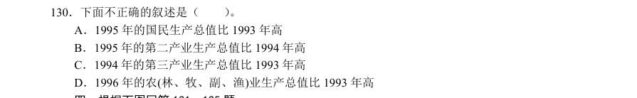

- **A.** 1995 年的国民生产总值比1993 年高
- **B.** 1995 年的第二产业生产总值比1994 年高
- **C.** 1994 年的第三产业生产总值比1993 年高
- **D.** 1996 年的农(林、牧、副、渔)业生产总值比1993 年高

**答案：D**　**考点：基期量计算｜基期量计算（综合）**
**【资料分析·基期量计算｜GK-2005-ty-X131】**

131. 2003 年部分城市日照时数 北京的日照时数超过200 小时的月份有( )。

- **A.** 8 个
- **B.** 9 个
- **C.** 10 个
- **D.** 11 个

**答案：A**　**考点：基期量计算｜基期量计算（综合）**
**【资料分析·基期量计算｜GK-2005-ty-X132】**

132. 哈尔滨日照最多和最低月份的日照时数的比值最接近( )。

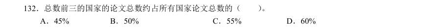

- **A.** 2.5
- **B.** 3.0
- **C.** 3.2
- **D.** 3.8

**答案：C**　**考点：基期量计算｜基期量比较**
**【资料分析·基期量计算｜GK-2005-ty-X133】**

133. 在5 月至7 月的三个月中,日照时数之和最大的城市是( )。

- **A.** 北京
- **B.** 哈尔滨
- **C.** 上海
- **D.** 拉萨

**答案：B**　**考点：基期量计算｜基期量比较**
**【资料分析·基期量计算｜GK-2005-ty-X134】**

134. 上海日照时数相差最大的两个月是( )。

- **A.** 1 月和3 月
- **B.** 2 月和5 月
- **C.** 2 月和7 月
- **D.** 10 月和12 月

**答案：C**　**考点：基期量计算｜基期量比较**
**【资料分析·综合分析｜GK-2005-ty-X135】**

135. 针对上图日照数据,下面说法不正确的是( )。

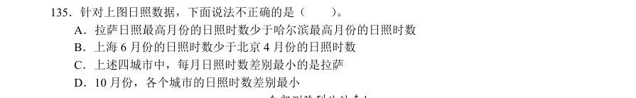

- **A.** 拉萨日照最高月份的日照时数少于哈尔滨最高月份的日照时数
- **B.** 上海6 月份的日照时数少于北京4 月份的日照时数
- **C.** 上述四城市中,每月日照时数差别最小的是拉萨
- **D.** 10 月份,各个城市的日照时数差别最小

**答案：D**　**考点：综合分析｜选错误项**