# 2007 年国考行测（统一卷）

- 题量：140（含答案 140）
- 模块分布：资料分析20 / 数量关系20 / 言语理解40 / 判断推理35 / 常识判断25
- 试卷编号：`国考-2007-统一卷`

## 题目与答案

**【言语理解·中心理解｜GK-2007-ty-X001】**
> 材料：项中选出一个最恰当的答案。

1. 法国语言学家梅耶说:“有什么样的文化,就有什么样的语言。”所以,语言的工具性本身就有文化性。如 果只重视听、说、读、写的训练或语言、词汇和语法规则的传授,以为这样就能理解英语和用英语进行交际,往 往会因为不了解语言的文化背景,而频频出现语词歧义、语用失误等令人尴尬的现象。 这段文字作者的观点是:

- **A.** 语言兼具工具性和文化性
- **B.** 语言教学中文化教学的特点
- **C.** 语言教学中文化教学应受到重视
- **D.** 交际中出现各种语用错误的原因

**答案：C**　**考点：中心理解｜转折与因果**　**难度：★★★☆☆**
**【言语理解·中心理解｜GK-2007-ty-X002】**

2. 在今天的商业世界中,供过于求是普遍现象。为了说服顾客买自己的产品,大规模竞争就在同类商品的生产 企业之间展开了,他们得经常设法向消费者提醒自己产品的名字和优等的质量,这就需要靠广告。 对这段文字概括最恰当的是:

- **A.** 广告是商业世界的必然产物
- **B.** 各商家之间用广告开展竞争
- **C.** 广告就是要说服顾客买东西
- **D.** 广告是经济活动中供过于求的产物

**答案：D**　**考点：中心理解｜对策优先**　**难度：★★☆☆☆**
**【言语理解·中心理解｜GK-2007-ty-X003】**

3. 空间探索自开始以来一直受到指责,但我们已经成功地通过卫星进行远程通信、预报天气、开采石油,空间 探索项目还会有助于我们发现新能源和新化学元索,而那些化学元素也许会帮助我们治愈现在的不治之症。 这段文字主要告诉我们,空间探索:

- **A.** 利弊并存
- **B.** 可治绝症
- **C.** 很有争议
- **D.** 意义重大

**答案：D**　**考点：中心理解｜转折与因果**　**难度：★★☆☆☆**
**【言语理解·中心理解｜GK-2007-ty-X004】**

4. 行为科学研究显示,工作中的人际关系通常不那么复杂,也宽松些,可能是由于这种人际关系更有规律,更 易于预料,因此也更容易协调,因为人们知道他们每天都要共同努力,相互协作,才能完成一定的工作。 这段文字主要是在强调:

- **A.** 普通的人际关系缺乏规律
- **B.** 工作人员之间的关系比较简单
- **C.** 共同的目标使工作人员很团结
- **D.** 维系良好的人际关系要靠共同努力

**答案：B**　**考点：中心理解｜转折与因果**　**难度：★★☆☆☆**
**【言语理解·中心理解｜GK-2007-ty-X005】**

5. 政府每出台一项经济政策,都会改变某些利益集团的收益预期,出于自利,这些利益集团总会试图通过各种 行为选择,来抵消政策对他们造成的损失,此时如果政府果真因此而改变原有的政策,其结果不仅使政府出台的 政策失效,更严重的是使政府的经济调控能力因丧失公信力而不断下降。 这段文字主要论述了:

- **A.** 政府制定经济政策遇到的阻力
- **B.** 政府要对其制定的政策持续贯彻
- **C.** 制定经济政策时必须考虑到的因素
- **D.** 政府对宏观经济的调控能力

**答案：B**　**考点：中心理解｜转折与因果**　**难度：★★★☆☆**
**【言语理解·中心理解｜GK-2007-ty-X006】**

6. 在新一轮没有硝烟的经济战场上,经济增长将主要依靠科技进步。而解剖中国科技创新结构,可以看出,在 中国并不缺乏研究型大学、国家实验室,最缺乏的是企业参与的研究基地以及研究型企业。企业资助、共建、独 资创立的科研机构。像美国的贝尔实验室,就是这种研究基地。 这段文字的主旨是:

- **A.** 要充分发挥企业在科技创新中的重要作用
- **B.** 中国不缺乏研究型大学,缺乏的是研究型企业
- **C.** 加强企业参与的研究基地建设是中国经济腾飞的必经之路
- **D.** 企业资助、共建、独资创立的科研机构是提高企业效益的关键

**答案：A**　**考点：中心理解｜转折与因果**　**难度：★★☆☆☆**
**【言语理解·中心理解｜GK-2007-ty-X007】**

7. 某公司的经验充分显示出,成功的行销运作除了有赖专门的行销部门外,还需要有优异的产品,精密的市场 调研,更少不了专业的业务部门、公关部门、擅长分析的财务部门以及物流后勤等部门的全力配合与支持。如果 行销部门独强而其他部门弱,或是行销部门与其他部门不合,或是公司各部门无法有效地整合,都会让行销运作 无法顺利有效地进行,难以发挥应有的强大威力。这段文字主要强调的是:

- **A.** 该公司各个部门的有效整合是其成功的关键
- **B.** 注重团队合作是该公司取得成功的宝贵经验
- **C.** 成功的行销运作可以给企业带来巨大的经济效益
- **D.** 行销部门只有与其他部门紧密配合才能更好地发挥作用

**答案：D**　**考点：中心理解｜对策优先**　**难度：★★★★☆**
**【言语理解·下文推断｜GK-2007-ty-X008】**

8. 中国很早就有鲛人的传说。魏晋时代,有关鲛人的记述渐多渐细,在曹植、左思、张华的诗文中都提到过鲛 人,传说中的鲛人过着神秘的生活,干宝《搜神记》载:“南海之外,有鲛人,水居,如鱼,不废织绩。其眼, 泣,则能出珠。”虽然不断有学者做出鲛人为海洋动物或人鱼之类的考证,我个人还是认为他们是在海洋生活的 人类,其生活习性对大陆人而言很陌生,为他们增添了神秘色彩。 作者接下来最有可能主要介绍的是:

- **A.** 关于鲛人的考证
- **B.** 鲛人的神秘传说
- **C.** 有关鲛人的诗文
- **D.** 鲛人的真正居处

**答案：A**　**考点：下文推断｜下文推断**　**难度：★★★★☆**
**【言语理解·中心理解｜GK-2007-ty-X009】**

9. 信息时代,信息的存在形式与以往的信息形态不同,它是以声、光、电、磁、代码等形态存在的,这使它具 有“易转移性”,即容易被修改、窃取或非法传播和使用,加之信息技术应用日益广泛,信息技术产品所带来的 各种社会效应也是人们始料未及的。在信息社会,人与人之间的直接交往大大减少,取而代之的是间接的、非面 对面的、非直接接触的新式交往。这种交往形式多样,信息相关人的行为难以用传统的伦理准则去约束。 作为一篇文章的引言,这段文字后面将要谈论的内容最可能的是:

- **A.** 信息存在形式的更新
- **B.** 信息社会与信息伦理
- **C.** 人际交往形式的多样化
- **D.** 信息技术产品与生活方式

**答案：B**　**考点：中心理解｜转折与因果**　**难度：★★★★☆**
**【言语理解·中心理解｜GK-2007-ty-X010】**

10. 虽然世界因发明而辉煌,但发明家个体仍常常寂寞地在逆境中奋斗。市场只认同其有直接消费价值的产品, 很少有人会为发明家的理想“买单”。世界上有职业的教师和科学家,因为人们认识到教育和科学对人类的重要 性,教师和科学家可以衣食无忧地培育学生,探究宇宙;然而,世界上没有“发明家”这种职业,也没有人付给 发明家薪水。 这段文字主要想表达的是:

- **A.** 世界的发展进步离不开发明
- **B.** 发明家比科学家等处境艰难
- **C.** 发明通常不具有直接消费价值
- **D.** 社会应对发明家提供更多保障

**答案：D**　**考点：中心理解｜对策优先**　**难度：★★★☆☆**
**【言语理解·标题填入｜GK-2007-ty-X011】**

11. 为什么有些领导者不愿意承担管理过程中的“教练”角色?为什么很多领导者不愿意花时间去教别人?一方面 是因为辅导员工要花去大量的时间,而领导者的时间本来就是最宝贵的资源。另一个原因则在于对下属的辅导是 否能够收到预期的效果,是一件很难说清的事情。因为有很多知识和方法是“只可意会,不可言传”的。而从更 深的层次来说,“教练”角色要求领导者兼具心理学家和教育学家的素质,这也是一般人难以具备的。 最适合做本段文字标题的是:

- **A.** 效率低下,领导之过
- **B.** 团队意识亟待增强
- **C.** 员工培训,岂容忽视
- **D.** 做领导易,做“教练”难

**答案：D**　**考点：标题填入｜标题填入**　**难度：★★★★☆**
**【言语理解·中心理解｜GK-2007-ty-X012】**

12. 在一天八小时的工作时间里,真正有效的工作时间平均约六个小时左右,如果一个人工作不太用心,则很可 能一天的有效工作时间只有四小时;但如果另一个人特别努力,绝大部分心思都投注在工作上,即便下班时间, 脑子里还不断思考工作上的事情,产生新的创意,思索问题的解决方案等,同样一天下来,可能可以积累相当于 十二个小时的工作经验,长期如此,则两个人同样工作十年之后,前者可能只积累相当于六七年的工作经验,但 后者却已经拥有相当于二十年的工作经验。 这段文字主要强调的是:

- **A.** 习惯
- **B.** 方法
- **C.** 态度
- **D.** 经验

**答案：C**　**考点：中心理解｜转折与因果**　**难度：★★★★☆**
**【言语理解·中心理解｜GK-2007-ty-X013】**

13. 英国科学家指出,在南极上空,大气层中的散逸层顶在过去40 年中下降了大约8 公里。在欧洲上空,也得 出了类似的观察结论。科学家认为,由于温室效应,大气层可能会持续收缩。在21 世纪,预计二氧化碳浓度会 增加一倍,这会使太空边界缩小20 公里,使散逸层以上区域——热电离层的密度继续变小,正在收缩的大气层 至少对卫星会有不可预料的影响。 这段文字的主要意思是:

- **A.** 太空边界缩小的幅度会逐渐加大
- **B.** 温室效应会使大气层继续收缩
- **C.** 大气层中的散逸层顶会不断下降
- **D.** 正在收缩的大气层对卫星的影响不可预料

**答案：B**　**考点：中心理解｜转折与因果**　**难度：★★★★☆**
**【言语理解·中心理解｜GK-2007-ty-X014】**

14. 即使社会努力提供了机会均等的制度,人们还是会在初次分配中形成收入差距。由于在市场经济中资本也要 取得报酬,拥有资本的人还可以通过拥有资本来获取报酬,就更加拉大了初次分配中的收入差距,所以当采用市 场经济体制后,为了缩小收入分配差距,就必须通过由国家主导的再分配过程来缩小初次分配中所形成的差距, 否则,就会由于收入分配差距过大,形成社会阶层的过度分化和冲突,导致生产过剩的矛盾。 这段文字主要谈论的是:

- **A.** 收入均衡难以实现
- **B.** 再分配过程必不可少
- **C.** 分配差距源于制度
- **D.** 收入分配体制必须改革

**答案：B**　**考点：中心理解｜对策优先**　**难度：★★★★☆**
**【言语理解·中心理解｜GK-2007-ty-X015】**

15. 调查显示,新闻记者的职业和网络关系密切,但只占上网人数的1.8%;与大量青少年学生网民(占总数的 19.3%)相比,教师和党政企事业单位的领导干部上网太少(分别占网民总数的5%和3.4%);与月收入500 元以 下和500 元~1000 元的人群(分别占网民总数的21%和29%)相比,收入较高的人们的上网比例并没有很大提高; 从事商贸活动的人员上网人数只占总数的5.8%。 与这段文字文意相符的是:

- **A.** 职业与上网没有直接关系
- **B.** 网络成为现代人获取信息的主要来源
- **C.** 电子商务没有在中国获得真正的发展
- **D.** 收入越高,上网人数的比例越高

**答案：A**　**考点：中心理解｜中心理解（综合）**　**难度：★★★★☆**
**【言语理解·中心理解｜GK-2007-ty-X016】**

16. 电于产品容易受到突然断电的损害,断电可能是短暂的,才十分之一秒,但对于电子产品却可能是破坏性的。 为了防止这种情况发生,不间断电源被广泛应用于计算机系统,通讯系统以及其它电子设备,不间断电源把交流 电转变成直流电,再对蓄电池充电。这样,在停电时,蓄电池即可以弥补断电的间歇。 这段文字主要谈论的是:

- **A.** 断电对电于产品的损害
- **B.** 如何用蓄电池防止断电损害
- **C.** 防止断电损害电子产品的办法
- **D.** 不间断电源的工作原理及功能

**答案：D**　**考点：中心理解｜主题词**　**难度：★★★☆☆**
**【言语理解·中心理解｜GK-2007-ty-X017】**

17. 城市竞争力的高低,从本质上讲,不仅仅取决于硬环境的好坏一一基础设施水平的高低、经济实力的强弱、 产业结构的优劣、自然环境是否友好等,还取决于软环境的优劣,这个软环境是由社会秩序、公共道德、文化氛 围、教育水准、精神文明等诸多人文元素组成的,而这一切主要取决于市民的整体素质。 这段文字意在说明:

- **A.** 人文元素组成了城市竟争力的软环境
- **B.** 软环境取决于市民的整体索质的高低
- **C.** 城市竞争力由硬环境和软环境共同决定
- **D.** 提高市民整体素质有助于提高城市竟争力

**答案：D**　**考点：中心理解｜转折与因果**　**难度：★★★☆☆**
**【言语理解·中心理解｜GK-2007-ty-X018】**

18. 许多国家的首脑在就职前并不具有丰富的外交经验,但这并没有妨碍他们做出成功的外交决策。一个人,只 要有高度的政治敏感性、准确的信息分析能力和果断的勇气,就能很快地学会如何做出成功的外交决策。对于一 个缺少以上三种素养的外交决策者来说,丰富的外交经验并没有什么价值。 这段文字意在说明:

- **A.** 外交经验无助于做出正确的外交决策
- **B.** 外交经验来自于经年累月的外交实践
- **C.** 成功的外交决策因人而效果有所不同
- **D.** 外交决策者的素质比外交经验更重要

**答案：D**　**考点：中心理解｜中心句与主旨**　**难度：★★★☆☆**
**【言语理解·中心理解｜GK-2007-ty-X019】**

19. 以制度安排和政策导向方式表现出来的集体行为,不过是诸多个人意愿与个人选择的综合表现。除非我们每 一个人都关心环境,并采取具体的行动,否则,任何政府都不会有动力(或压力)推行环保政策。即使政府制定 了完善的环保法规,但如果每个公民都不主动遵守,那么,再好的环保法规也达不到应有的效果。 这段文字主要支持的一个观点是:

- **A.** 政府有责任提高全民的环保意识
- **B.** 完善的法规是环保政策成败的关键
- **C.** 政府制定的环保法规应该体现公民个人意愿
- **D.** 每个公民都应当提高自己的环保意识

**答案：D**　**考点：中心理解｜中心句与主旨**　**难度：★★★☆☆**
**【言语理解·中心理解｜GK-2007-ty-X020】**

20. 科学家发现大脑灰质内部的海马体能充当记忆储存箱的功能,但是这个储存区城的分辨能力并不强,对相同 的大脑区城的刺激,可以让它产生真实的和虚假的记忆,为了把真实记忆从虚假记忆中分离出来,研究人员提出 了通过背景回忆来加强记忆的方法,如果某些事情没有真正发生过,就很难通过这种方法加强人脑对它的记忆。 这段文字主要讲述的是:

- **A.** 真实记忆和虚假记忆的关系
- **B.** 分辨真实记忆和虚假记忆的方法
- **C.** 大脑灰质内部海马体的作用
- **D.** 虚假记忆是如何产生的

**答案：B**　**考点：中心理解｜转折与因果**　**难度：★★★☆☆**
**【言语理解·逻辑填空｜GK-2007-ty-X021】**

21. 忠实与通顺,作为翻译的标准,应该是统一的整体,不能把两者割裂开来,与原意 的文字,不 管多么通顺,都称不上是翻译;同样,译文词不达意也起不到翻译的作用。 填入划横线部分最恰当的一项是:

- **A.** 不谋而合
- **B.** 截然相反
- **C.** 如出一辙
- **D.** 大相径庭

**答案：D**　**考点：逻辑填空｜成语辨析**　**难度：★☆☆☆☆**
**【言语理解·逻辑填空｜GK-2007-ty-X022】**

22. 新古典经济学以市场为导向的主张在西方环境政策的形成中起到了重要作用,但其研究方法也受到广泛 的 ,有人认为,完全市场化的环境政策其结果会适得其反,由人类活动引起的环境损害将有增无减。 填入划横线部分最恰当的一项是:

- **A.** 批评
- **B.** 怀疑
- **C.** 关注
- **D.** 批判

**答案：A**　**考点：逻辑填空｜一空**　**难度：★★☆☆☆**
**【言语理解·逻辑填空｜GK-2007-ty-X023】**

23. 人们一般都认为艺术家是“神经质”的,他们的行为像16 个月大的婴儿,这种观点是 的, 事实上,‘发疯”的艺术家是很 的,我所遇到的许多艺术家都是极具组织头脑、非常成熟的个体。 填入划横线部分最恰当的一项是:

- **A.** 正确普遍
- **B.** 片面稀少
- **C.** 偏颇稀缺
- **D.** 错误少见

**答案：D**　**考点：逻辑填空｜一空**　**难度：★★☆☆☆**
**【言语理解·逻辑填空｜GK-2007-ty-X024】**

24. 今天的人类居住在一个空间探索和虚拟现实的完全现代化的世界里,但他们的活动和石器时代的 狩猎者的活动基于 的智力本质,例如,在受到威胁时进行对抗的本能,以及交换信息和分享秘密的动 力。 填入划横线部分最恰当的一项是:

- **A.** 其实不同
- **B.** 尽管同样
- **C.** 虽然不同
- **D.** 尽管类似

**答案：B**　**考点：逻辑填空｜一空**　**难度：★★☆☆☆**
**【言语理解·逻辑填空｜GK-2007-ty-X025】**

25. 当体育界、工业界和其他领域中的一些领导者将他们的成功归因于一种高度 的意识时,一个社 会还是应该更好地为那些即将成为领导者的年轻人灌输一种 的意识。 填入横线部分最恰当的一项是:

- **A.** 竞争合作
- **B.** 大局协作
- **C.** 协作分工
- **D.** 危机团队

**答案：A**　**考点：逻辑填空｜一空**　**难度：★☆☆☆☆**
**【言语理解·逻辑填空｜GK-2007-ty-X026】**

26. 虽然很多员工觉得很难控制工作中的压力,但是至少当他们回家时是 的,然而,随着工作本质 的变化,家也已经不再是曾经的避难所了。 填入横线部分最恰当的一项是:

- **A.** 愉快
- **B.** 清闲
- **C.** 悠闲
- **D.** 轻松

**答案：D**　**考点：逻辑填空｜一空**　**难度：★☆☆☆☆**
**【言语理解·逻辑填空｜GK-2007-ty-X027】**

27. 据说泰山是古代名匠鲁班的弟子,天资聪颖,心灵手巧,干活总是 ,但往往耽误了鲁班的事, 于是惹恼了鲁班,被撵出了“班门”。 填入划横线部分最恰当的一项是:

- **A.** 巧夺天工
- **B.** 别出心裁
- **C.** 尽善尽美
- **D.** 任劳任怨

**答案：B**　**考点：逻辑填空｜成语辨析**　**难度：★☆☆☆☆**
**【言语理解·逻辑填空｜GK-2007-ty-X028】**

28. 节约其实就是这样的 行为,表现在我们的日常生活中,它就是空调开多少度之类的细枝末节的 问题,就是买大排量还是小排量轿车之类的问题,就是是否选择一次性卫生筷之类的问题。 填入划横线部分最恰当的一项是:

- **A.** 简单
- **B.** 琐碎
- **C.** 日常
- **D.** 普通

**答案：B**　**考点：逻辑填空｜一空**　**难度：★★☆☆☆**
**【言语理解·逻辑填空｜GK-2007-ty-X029】**

29. 在一个如此欧洲化的地方,欧盟宪法理所当然成为了当地的一个焦点话题,令人感到 的是,这里不是 赞成的声音最响亮的地方,而是反对者的天下。 填入划横线部分最恰当的一项是:

- **A.** 遗憾
- **B.** 扫兴
- **C.** 惊奇
- **D.** 意外

**答案：D**　**考点：逻辑填空｜一空**　**难度：★☆☆☆☆**
**【言语理解·逻辑填空｜GK-2007-ty-X030】**

30. 《拾穗者》本来描写的是农村夏收劳动的一个极其 的场面,可是它在当时所产生的艺术效果却 远不是画家所能 的。 填入横线部分最恰当的一项是:

- **A.** 热闹设想
- **B.** 平凡意料
- **C.** 火热控制
- **D.** 忙碌想象

**答案：B**　**考点：逻辑填空｜成语辨析**　**难度：★☆☆☆☆**
**【言语理解·逻辑填空｜GK-2007-ty-X031】**

31. 去世100 年后,挪威最伟大的文学家 是易卜生,他给挪威民族带来的荣誉,比别的任何挪威 人都要多,然而,这个人生前从不 自己是挪威人——他是他自己的祖国和上帝。 填入划横线部分最恰当的一项是:

- **A.** 已经知道
- **B.** 始终认为
- **C.** 依然承认
- **D.** 公认希望

**答案：C**　**考点：逻辑填空｜一空**　**难度：★☆☆☆☆**
**【言语理解·逻辑填空｜GK-2007-ty-X032】**

32. 美元贬值可以有效提高美国企业的国际竞争力,同时打击其他国家对美出口的能力。而促使美元贬值的有效 手段就是推高市场的原油价格,使人们对经济前景持 态度, 美元下跌。 填入划横线部分最恰当的一项是:

- **A.** 悲观带动
- **B.** 观望遏制
- **C.** 怀疑阻止
- **D.** 乐观导致

**答案：A**　**考点：逻辑填空｜一空**　**难度：★☆☆☆☆**
**【言语理解·逻辑填空｜GK-2007-ty-X033】**

33. 钧瓷以其古朴的 ,精湛的 ,复杂的配釉,湖光山色,云霞雾霭,人兽花鸟虫鱼等 等变化无穷的图形色彩和奇妙的韵味,被列为中国宋代“五大名瓷”之首。 填入划线部分最恰当的一项是:

- **A.** 造型技术
- **B.** 外形工艺
- **C.** 外形技术
- **D.** 造型工艺

**答案：D**　**考点：逻辑填空｜一空**　**难度：★☆☆☆☆**
**【言语理解·逻辑填空｜GK-2007-ty-X034】**

34. 在繁忙的工作之余,时常拿起相机,游走于城市的大街小巷,去探寻城市中那些 的古迹和古迹 后面那些有韵味的老故事。 填入横线部分最恰当的一项是:

- **A.** 闻名遐迩
- **B.** 门庭冷落
- **C.** 鲜为人知
- **D.** 人迹罕至

**答案：C**　**考点：逻辑填空｜成语辨析**　**难度：★☆☆☆☆**
**【言语理解·逻辑填空｜GK-2007-ty-X035】**

35. 由于疏于 ,院里的房屋大多十分陈旧,与旁边修建得簇新的正乙祠戏楼相比要 得 多,不过在院中我们依稀还可以看到正乙祠当年的身影。 填入划横线部分最恰当的一项是:

- **A.** 修饰寒酸
- **B.** 修葺逊色
- **C.** 管理破败
- **D.** 维护杂乱

**答案：B**　**考点：逻辑填空｜一空**　**难度：★☆☆☆☆**
**【言语理解·逻辑填空｜GK-2007-ty-X036】**

36. 发展与壮大文化产业,既要盯着市场做文章, 文化生产部门的自我生存能力,最大限度地让文 化产品增值;又不能唯市场是从,一味 市场低层次需求,让那些格调不高的文化产品大行其道。 填入划横线部分最恰当的一项是:

- **A.** 扩大限制
- **B.** 维护满足
- **C.** 提高降低
- **D.** 增强迎合

**答案：D**　**考点：逻辑填空｜一空**　**难度：★★☆☆☆**
**【言语理解·逻辑填空｜GK-2007-ty-X037】**

37. 人在知觉过程中,不是 地把知觉对象的特点登记下来,而是以过去的知识经验为依据,力求对 知觉对象做出某种解释,使它具有一定的意义。 填入划横线部分最恰当的一项是:

- **A.** 被动
- **B.** 主观
- **C.** 积极
- **D.** 简单

**答案：A**　**考点：逻辑填空｜一空**　**难度：★☆☆☆☆**
**【言语理解·逻辑填空｜GK-2007-ty-X038】**

38. 心理学家发现,手势和话语在交流时具有同样的丰富性,手和嘴 表达着说话人的意思,人们听 故事时,如果在听到声音的同时能够看见讲故事人的手势,他们对故事理解的准确度要比 听到声音 时增加10%。 填入横线部分最恰当的一项是:

- **A.** 分别单纯
- **B.** 共同单纯
- **C.** 独立单独
- **D.** 一致单独

**答案：B**　**考点：逻辑填空｜一空**　**难度：★★☆☆☆**
**【言语理解·逻辑填空｜GK-2007-ty-X039】**

39. 白话文、英文、德文并不一定代表____,文言文也不一定代表____。在文言文的世界里,我们可以发现太多 批判的精神,太多超越现代的观念,太多先进的思想。 填入横线部分最恰当的一项是:

- **A.** 开放守旧
- **B.** 现代传统
- **C.** 现代落后
- **D.** 高雅庸俗

**答案：C**　**考点：逻辑填空｜一空**　**难度：★☆☆☆☆**
**【言语理解·逻辑填空｜GK-2007-ty-X040】**

40. 法制要产生真正作用,还有赖于权力体系内外均衡力量格局的培育:当具体法规的执行人面对足 以 他的力量时,他必须担心任何微小的违规与失误;而当客观上不存在足以制衡他的力量时,设计 再精密的法规也可能被他任意 、歪曲,甚至视若无物。 填入划横线部分最恰当的一项是:

- **A.** 约束理解
- **B.** 约束解释
- **C.** 监督理解
- **D.** 监督解释

**答案：D**　**考点：逻辑填空｜一空**　**难度：★★☆☆☆**
**【数量关系·数字推理｜GK-2007-ty-X041】**

41. 2,12,36,80,()

- **A.** 100
- **B.** 125
- **C.** 150
- **D.** 175

**答案：C**　**考点：数字推理｜幂次数列**　**难度：★★★★☆**
**【数量关系·数字推理｜GK-2007-ty-X042】**

42. 1,3,4,1,9,()

- **A.** 5
- **B.** 11
- **C.** 14
- **D.** 64

**答案：D**　**考点：数字推理｜幂次数列**　**难度：★★★★☆**
**【数量关系·数字推理｜GK-2007-ty-X043】**

43. 0,9,26,65,124,()

- **A.** 165
- **B.** 193
- **C.** 217
- **D.** 239

**答案：C**　**考点：数字推理｜幂次数列**　**难度：★★★★☆**
**【数量关系·数字推理｜GK-2007-ty-X044】**

44. 0,4,16,40,80,()

- **A.** 160
- **B.** 128
- **C.** 136
- **D.** 140

**答案：D**　**考点：数字推理｜数字推理（综合）**　**难度：★★★★☆**
**【数量关系·数字推理｜GK-2007-ty-X045】**

45. 0,2,10,30,()

- **A.** 68
- **B.** 74
- **C.** 60
- **D.** 70

**答案：A**　**考点：数字推理｜幂次数列**　**难度：★★★★☆**
**【数量关系·其他数量关系｜GK-2007-ty-X046】**

46. 某高校2006 年度毕业学生7650 名,比上年度增长2%,其中本科生毕业数量比上年度减少2%,而研究生毕 业数量比上年度增加10%,那么,这所高校今年毕业的本科生有:

- **A.** 3920 人
- **B.** 4410 人
- **C.** 4900 人
- **D.** 5490 人

**答案：C**　**考点：其他数量关系｜方程与不定方程**　**难度：★☆☆☆☆**
**【数量关系·几何问题｜GK-2007-ty-X047】**

47. 现有边长1 米的一个木质正方体,已知将其放入水里,将有0.6 米浸入水中。如果将其分割成边长0.25 米 的小正方体,并将所有的小正方体都放入水中,直接和水接触的表面积总量为:

- **A.** 3.4 平方米
- **B.** 9.6 平方米
- **C.** 13.6 平方米
- **D.** 16 平方米

**答案：C**　**考点：几何问题｜立体几何**　**难度：★★★★★**
**【数量关系·排列组合｜GK-2007-ty-X048】**

48. 把144 张卡片平均分成若干盒,每盒在10 张到40 张之间,则共有多少种不同的分法:

- **A.** 4
- **B.** 5
- **C.** 6
- **D.** 7

**答案：B**　**考点：排列组合｜插空法**　**难度：★★★★★**
**【数量关系·最值问题｜GK-2007-ty-X049】**

49. 从一副完整的扑克牌中,至少抽出多少张牌,才能保证至少6 张牌的花色相同:

- **A.** 21
- **B.** 22
- **C.** 23
- **D.** 24

**答案：C**　**考点：最值问题｜最值优化**　**难度：★★★★☆**
**【数量关系·其他数量关系｜GK-2007-ty-X050】**

50. 小明和小强参加同一次考试,如果小明答对的题目占题目总数的3/4,小强答对了27 道题,他们两人都答 对的题目占题目总数的2/3,那么两人都没有答对的题目共有:

- **A.** 3 道
- **B.** 4 道
- **C.** 5 道
- **D.** 6 道

**答案：D**　**考点：其他数量关系｜和差倍比**　**难度：★☆☆☆☆**
**【数量关系·其他数量关系｜GK-2007-ty-X051】**

51. 学校举办一次中国象棋比赛,有10 名同学参加,比赛采用单循环赛制,每名同学都要与其他9 名同学比赛 一局。比赛规则,每局棋胜者得2 分,负者得0 分,平局两人各得1 分。比赛结束后,10 名同学的得分各不相 同,已知:(1)比赛第一名与第二名都是一局都没有输过;(2)前两名的得分总和比第三名多20 分;(3)第 四名的得分与最后四名的得分和相等。 那么,排名第五名的同学的得分是:

- **A.** 8 分
- **B.** 9 分
- **C.** 10 分
- **D.** 11 分

**答案：D**　**考点：其他数量关系｜和差倍比**　**难度：★★★★★**
**【数量关系·其他数量关系｜GK-2007-ty-X052】**

52. 某班男生比女生人数多80%,一次考试后,全班平均成级为75 分,而女生的平均分比男生的平均分高20%, 则此班女生的平均分是:

- **A.** 84 分
- **B.** 85 分
- **C.** 86 分
- **D.** 87 分

**答案：A**　**考点：其他数量关系｜方程与不定方程**　**难度：★☆☆☆☆**
**【数量关系·行程问题｜GK-2007-ty-X053】**

53. A B 两站之间有一条铁路,甲、乙两列火车分别停在A 站和B 站,甲火车4 分钟走的路程等于乙火车5 分钟走的路程,乙火车上午8 时整从B 站开往A 站,开出一段时问后,甲火车从A 站出发开往B 站,上午9 时整 两列火车相遇,相遇地点离A B 两站的距离比是15:16,那么,甲火车在什么时刻从A 站出发开往B 站:

- **A.** 8 时12 分
- **B.** 8 时15 分
- **C.** 8 时24 分
- **D.** 8 时30 分

**答案：B**　**考点：行程问题｜相遇追及**　**难度：★★★★☆**
**【数量关系·行程问题｜GK-2007-ty-X054】**

54. 32 名学生需要到河对岸去野营,只有一条船,每次最多载4 人(其中需1 人划船),往返一次需要5 分钟, 如果9 时整开始渡河,9 时17 分时,至少有多少人还在等待渡河:

- **A.** 16
- **B.** 17
- **C.** 19
- **D.** 22

**答案：C**　**考点：行程问题｜环形与往返**　**难度：★☆☆☆☆**
**【数量关系·其他数量关系｜GK-2007-ty-X055】**

55. 一名外国游客到北京旅游,他要么上午出去游玩,下午在旅馆休息,要么上午休息,下午出去游玩,而下雨 天他只能一天都待在屋里。期间,不下雨的天数是12 天,他上午待在旅馆的天数为8 天,下午待在旅馆的天数 为12 天,他在北京共待了多少天:

- **A.** 16 天
- **B.** 20 天
- **C.** 22 天
- **D.** 24 天

**答案：A**　**考点：其他数量关系｜其他数量关系（综合）**　**难度：★★☆☆☆**
**【数量关系·几何问题｜GK-2007-ty-X056】**

56. 甲、乙两个容器均有50 厘米深,底面积之比为5:4,甲容器水深9 厘米,乙容器水深5 厘米,再往两个容 器各注入同样多的水,直到水深相等,这时两容器的水深是:

- **A.** 20 厘米
- **B.** 25 厘米
- **C.** 30 厘米
- **D.** 35 厘米

**答案：B**　**考点：几何问题｜平面几何**　**难度：★★★★★**
**【数量关系·工程问题｜GK-2007-ty-X057】**

57. 一篇文章,现有甲、乙、丙三人,如果由甲、乙两人合作翻译,需要10 小时完成,如果由乙、丙两人合作 翻译,需要12 小时完成。现在先由甲、丙两人合作翻译4 小时,剩下的再由乙单独去翻译,需要12 小时才能完 成,则,这篇文章如果全部由乙单独翻译,要多少个小时完成:

- **A.** 15
- **B.** 18
- **C.** 20
- **D.** 25

**答案：A**　**考点：工程问题｜给定时间型**　**难度：★★★☆☆**
**【数量关系·其他数量关系｜GK-2007-ty-X058】**

58. 共有20 个玩具交给小王手工制作完成。规定,制作的玩具每合格一个得5 元,不合格一个扣2 元,未完成 的不得不扣。最后小王共收到56 元,那么他制作的玩具中,不合格的共有多少个:

- **A.** 2
- **B.** 3
- **C.** 5
- **D.** 7

**答案：A**　**考点：其他数量关系｜方程与不定方程**　**难度：★★☆☆☆**
**【数量关系·最值问题｜GK-2007-ty-X059】**

59. 一个车队有三辆汽车,担负着五家工厂的运输任务,这五家工厂分别需要7、9、4、10、6 名装卸工,共计 36 名;如果安排一部分装卸工跟车装卸,则不需要那么多装卸工,而只需要在装卸任务较多的工厂再安排一些 装卸工就能完成装卸任务,那么在这种情况下,总共至少需要多少名装卸工才能保证各厂的装卸需求:

- **A.** 26
- **B.** 27
- **C.** 28
- **D.** 29

**答案：A**　**考点：最值问题｜最值优化**　**难度：★★★★★**
**【数量关系·其他数量关系｜GK-2007-ty-X060】**

60. 有一食品店某天购进了6 箱食品,分别装着饼干和面包,重量分别为8、9、16、20、22、27 千克。该店当 天只卖出1 箱面包,在剩下的5 箱中饼干的重量是面包的两倍,则当天食品店购进了多少千克面包:

- **A.** 44
- **B.** 45
- **C.** 50
- **D.** 52

**答案：D**　**考点：其他数量关系｜和差倍比**　**难度：★★☆☆☆**
**【判断推理·图形推理｜GK-2007-ty-X061】**

61. 请从所给的四个选项中,选择最合适的一个填入问号处,使之呈现一定的规律性:

> （本题为图形题，选项为图片，见原卷）

**答案：B**　**考点：图形推理｜位置规律**　**难度：★★★☆☆**
**【判断推理·图形推理｜GK-2007-ty-X062】**

62. 请从所给的四个选项中,选择最合适的一个填入问号处,使之呈现一定的规律性:

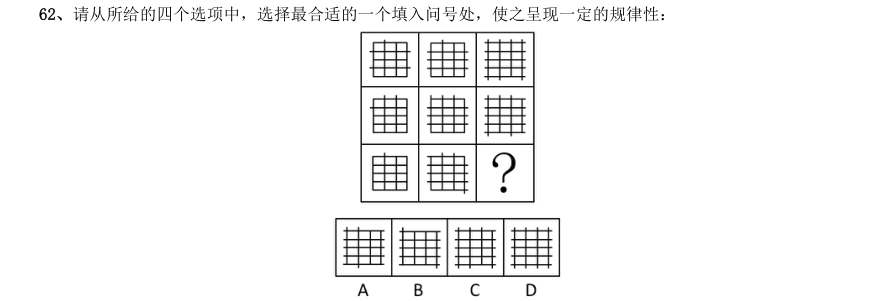

> （本题为图形题，选项为图片，见原卷）

**答案：A**　**考点：图形推理｜数量规律**　**难度：★★★☆☆**
**【判断推理·图形推理｜GK-2007-ty-X063】**

63. 请从所给的四个选项中,选择最合适的一个填入问号处,使之呈现一定的规律性:

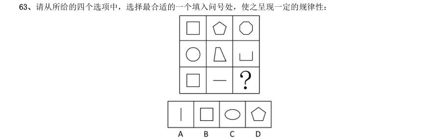

> （本题为图形题，选项为图片，见原卷）

**答案：D**　**考点：图形推理｜图形推理（综合）**　**难度：★★★☆☆**
**【判断推理·图形推理｜GK-2007-ty-X064】**

64. 请从所给的四个选项中,选择最合适的一个填入问号处,使之呈现一定的规律性:

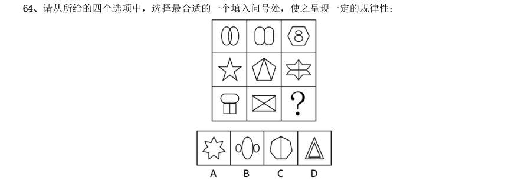

> （本题为图形题，选项为图片，见原卷）

**答案：A**　**考点：图形推理｜数量规律**　**难度：★★★☆☆**
**【判断推理·图形推理｜GK-2007-ty-X065】**

65. 请从所给的四个选项中,选择最合适的一个填入问号处,使之呈现一定的规律性:

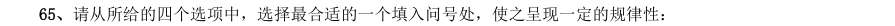

> （本题为图形题，选项为图片，见原卷）

**答案：A**　**考点：图形推理｜位置规律**　**难度：★★★☆☆**
**【判断推理·定义判断｜GK-2007-ty-X066】**

66. Email 营销是指在用户事先许可的前提下。通过电子邮件的方式向目标用户传递有价值信息的一种网络营销 手段。Email 营销有三个基本要素:基于用户许可、通过电子邮件传递信息、信息对用户是有价值的。三个要素 缺少一个,都不能称之为有效的Email 营销。 根据上述定义,下列属于有效的Email 的一项是:

- **A.** 小王2002 年成为某品牌产品的会员,该产品定期给他用电子邮件发送电子刊物,人会期满一年后,小王决定退会,但他在网上进行退会操作没有成功,该产品还继续发来信息
- **B.** 小李在某门户网站注册了免费邮箱,注册时注明愿意接收有关医疗保健和体育比赛方面的信息。使用邮箱后,该网站经常向他的邮箱发送包括医疗保健以及商品折扣方面的信息
- **C.** 小赵曾经给某厂商留下地址,希望对方免费邮寄相关资料,后来他收到一份电子邮件,没有发件人姓名、地址、身份,标题是“产品目录”。他恐怕该邮件有病毒,没有打开就将其删除了
- **D.** 小高收到一封邮件,标题为“免费赠卡,直接消费”。打开后,发现收件人一栏只有一个地址,但却不是自

**答案：B**　**考点：定义判断｜单定义**　**难度：★★★★☆**
**【判断推理·定义判断｜GK-2007-ty-X067】**

67. 可更新资源是指能够通过自然力以某一增长率保持或增加蕴藏量的自然资源,如太阳能、大气、水等,当代 人消费的数量不会便后代人消费的数量减少;又如森林、各种野生动植物等,不人为破坏基本上保持稳定。 根据上述定义,下列说法正确的是:

- **A.** 风吹绿了草原,草原是可更新资源
- **B.** 煤由太阳能转化而形成,因此是可更新资源
- **C.** 很多金属机械报废后可以回收,因此是可更新资源
- **D.** 地球上的淡水资浑已经非常稀少,属于不可更新资源

**答案：A**　**考点：定义判断｜单定义**　**难度：★★☆☆☆**
**【判断推理·定义判断｜GK-2007-ty-X068】**

68. 定性思维是指根据事物的性质和属性来认识事物,确定和判断事物的思维方法。 根据上述定义,下列属于定性思维的是:

- **A.** 2005 年某省信息产业完成增加值110 亿元,保持了较快的增长速度。
- **B.** 由于循环经济带来了生态环境的改善,每年冬季近2 万只白天鹅飞临某市
- **C.** 某镇做大做强织袜业,在许多大城市中一双袜子卖到100 元的高价,说明其质量优良、品牌过硬
- **D.** 某市“十五期间”生产总值、财政收入、城镇居民人均可支配收入年均递增25%以上,进出口贸易总额、海

**答案：D**　**考点：定义判断｜单定义**　**难度：★★☆☆☆**
**【判断推理·定义判断｜GK-2007-ty-X069】**

69. 社会从众倾向是指当群体规范被成员接受以后就会成为控制和影响群体成员的手段,使成员在知觉、判断、 信念和行为上表现与群体中多数人相一致的现象。 根据上述定义,下列情况中没有社会从众倾向的是:

- **A.** 小李因工作进度慢而被同事们责难,他只好利用业余时间加班赶上
- **B.** 学生小李认为张老师对自己的期望值太高了,但一想老师就是老师,他表面上还是接受了
- **C.** 春节放长假,小王准备假期旅游,但看到同事们都打算回家团聚也决定先回家团聚
- **D.** 刘先生在旅游时看到有几个游客自觉地收集垃圾保护环境,心里很赞赏,但自己却不好意思做

**答案：B**　**考点：定义判断｜单定义**　**难度：★★☆☆☆**
**【判断推理·定义判断｜GK-2007-ty-X070】**

70. 实绩原则就是以下属的实绩为依据,给予适当方式的激励。根据上述定义,下列情况遵循实绩原则的是:

- **A.** 因为小赵是实验室里学历最高、能力最强的人员,所以他得到了高额奖金
- **B.** 酒店员工小刘喜爱自己的工作,每天情绪饱满笑容可掬,受到经理的表扬
- **C.** 推销员李小姐工作认真负贵,兢兢业业,虽然镇售额一般,但客户访问量远高于其他同事,因而被提拔
- **D.** 某连锁洗衣店虽然收费较高,但因质量一流,服务周到取得了同行中的最好利润,受到总公司的奖励

**答案：D**　**考点：定义判断｜单定义**　**难度：★★☆☆☆**
**【判断推理·定义判断｜GK-2007-ty-X071】**

71. 危机管理策划是指为防止爆发危机或者危机发生后为减少、消除危机带来的风险与损失,通过策划手段使人 更有效地掌握事物和社会舆论的一些办法与措施的综合过程。根据上述定义,下列不属于危机管理策划的一项是:

- **A.** 听到海啸警报后,海边的游客飞快地向高处撤离
- **B.** 李平参加考试后,特意带了两支铅笔以备万一
- **C.** 面对突如其来的地震,小张被震倒在地,所幸躲过一劫
- **D.** 某企业因负债累累,无力清偿到期债务向法院提出破产申请

**答案：C**　**考点：定义判断｜单定义**　**难度：★★☆☆☆**
**【判断推理·定义判断｜GK-2007-ty-X072】**

72. 企业信息化是指企业利用现代技术,通过深化开发和广泛利用资源,不断提高生产、经营、管理、决策效率 和水平的过程。根据上述定义,下列不属于企业信息化的是:

- **A.** 学校建立计算机网络平台使校内信息资源得到充分利用
- **B.** 将全部企业业务乃至全部企业管理实现信息化的计算机集成制造系统
- **C.** 将离散型和流程型生产的质量、设施、控制、数据和通信等结合起来,实现广泛的管理信思集成
- **D.** 制定原材料零部件采购加工计划,以保证能在规定的时间、地点得到需要的物料数量,并引进计算机进行辅

**答案：A**　**考点：定义判断｜单定义**　**难度：★★☆☆☆**
**【判断推理·定义判断｜GK-2007-ty-X073】**

73. 印象管理是指一个人通过一定的方式影响别人形成的对自己的印象的过程,它是自我调节的一个重要方面, 也包括了与他人的社会互动,是自我认知观点的核心,人类的一种基本动机是,不论个体在组织内部还是组织外 部,都渴望被别人积极看待,避免被别人消极看待,试图使别人积极看待自己的努力叫获得性印象管理,而尽可 能弱化自己的不足或避免使别人消极的看待自己的防御性措施是保护性印象管理 下列属于保护性印象管理的是:

- **A.** 林处长平易近人,总是以身作则,最近单位为灾区募捐,他捐的钱物最多
- **B.** 小张新来单位,对老员工孟某的意见总虚心接受,并常常表示自己很佩服他
- **C.** 小李工作后朋友很少,但他对同事说,他在大学读书时,学习和体育非常好,朋友也很多
- **D.** 公司领导分配小王一项任务,小王很久没有完成,领导催促他时,他说,这段时间我很忙,我会尽力完成”

**答案：C**　**考点：定义判断｜单定义**　**难度：★★★★☆**
**【判断推理·定义判断｜GK-2007-ty-X074】**

74. 借口就是承认活动本身是错的,但是当事人否认他应当承担责任,辩解则是承认应当对活动承担责任,但是 当事人否认这项活动是错的,面对失败的事件时,人们使用借口以尽可能地减轻自己应当承担的责任;而人们使 用辩解的目的是试图重新界定有争议的行动,使之看起来不至于太差。 根据上述定义,下列属于辩解的是:

- **A.** 小李失去了一笔业务,给公司造成了一定损失,他说,这是由于他腿伤发作迟到了半个小时造成的
- **B.** 某部门工作出现失误,负责人说:“他们决定时根本就没有征求我的意见,我对此一无所知”
- **C.** 某国消费者对在包装中加入一氧化碳使肉类看起来红润新鲜的做法表示质疑,但该国食品管理局称这种做法“总体上”是安全的
- **D.** 某公司产品出现质量问题,声明说这是由于他们使用了其他公司生产的不合格部件造成的

**答案：C**　**考点：定义判断｜单定义**　**难度：★★★★☆**
**【判断推理·定义判断｜GK-2007-ty-X075】**

75. 行政征用是行政机关为了公共利益和公共目的,依法强制获得公民、法人财产的使用权或所有权,并给予其 合理补偿的一种行政法律制度。根据上述定义,下列不属于行政征用的是:

- **A.** 两年前镇建的一个经济开发园区占用了杨军家的承包地,杨军经多次努力,终于拿到了合理的补偿
- **B.** 某公安机关在破案时,由于情况紧急,使用了王某的摩托车,后来支付给王某一些费用
- **C.** 一项国家重点工程项目需占用某市农民的土地,当地政府给予被征用土地的农民各种补偿费用与安置费,并对多余的劳动力进行了安置
- **D.** 某地发生洪灾,为了抗洪,政府从几个建筑公司调集了沙子,给予他们一定的补偿

**答案：A**　**考点：定义判断｜单定义**　**难度：★★☆☆☆**
**【判断推理·类比推理｜GK-2007-ty-X076】**

76. 太空:卫星

- **A.** 铁轨:火车
- **B.** 公路:自行车
- **C.** 机场:直升飞机
- **D.** 城市:公共汽车

**答案：D**　**考点：类比推理｜对应关系**　**难度：★☆☆☆☆**
**【判断推理·类比推理｜GK-2007-ty-X077】**

77. 阳光:紫外线

- **A.** 电脑:辐射
- **B.** 海水:氯化钠
- **C.** 混合物:单质
- **D.** 微波炉:微波

**答案：B**　**考点：类比推理｜逻辑关系**　**难度：★☆☆☆☆**
**【判断推理·类比推理｜GK-2007-ty-X078】**

78. 正方形:边长

- **A.** 矩形:对角线
- **B.** 菱形:高
- **C.** 圆形:半径
- **D.** 三角形:底边

**答案：C**　**考点：类比推理｜对应关系**　**难度：★☆☆☆☆**
**【判断推理·类比推理｜GK-2007-ty-X079】**

79. 盐:咸

- **A.** 花:香
- **B.** 丝:棉
- **C.** 光:亮
- **D.** 墨:臭

**答案：C**　**考点：类比推理｜逻辑关系**　**难度：★☆☆☆☆**
**【判断推理·类比推理｜GK-2007-ty-X080】**

80. 七夕:织女

- **A.** 除夕:晚会
- **B.** 清明:先烈
- **C.** 重阳:茱萸
- **D.** 端午:屈原

**答案：D**　**考点：类比推理｜对应关系**　**难度：★☆☆☆☆**
**【判断推理·类比推理｜GK-2007-ty-X081】**

81. 时钟:手表

- **A.** 电脑:鼠标
- **B.** 火车:飞机
- **C.** 电视机:遥控器
- **D.** 录音机:收音机

**答案：B**　**考点：类比推理｜逻辑关系**　**难度：★☆☆☆☆**
**【判断推理·类比推理｜GK-2007-ty-X082】**

82. 窗帘:隐私

- **A.** 文件:机密
- **B.** 日记:心情
- **C.** 消防栓:火警
- **D.** 防护栏:安全

**答案：D**　**考点：类比推理｜对应关系**　**难度：★☆☆☆☆**
**【判断推理·类比推理｜GK-2007-ty-X083】**

83. 家父:父亲

- **A.** 老妪:老伴
- **B.** 鼻祖:祖宗
- **C.** 作者:笔者
- **D.** 鄙人:自已

**答案：D**　**考点：类比推理｜对应关系**　**难度：★☆☆☆☆**
**【判断推理·类比推理｜GK-2007-ty-X084】**

84. 消毒:手术

- **A.** 动员:开会
- **B.** 生产:销售
- **C.** 启动:驾驶
- **D.** 彩排:演出

**答案：C**　**考点：类比推理｜逻辑关系**　**难度：★☆☆☆☆**
**【判断推理·类比推理｜GK-2007-ty-X085】**

85. 枪:子弹

- **A.** 汽车:汽油
- **B.** 门:窗户
- **C.** 桌子:椅子
- **D.** 表带:手表

**答案：A**　**考点：类比推理｜逻辑关系**　**难度：★☆☆☆☆**
**【判断推理·逻辑判断｜GK-2007-ty-X086】**

86. 许多上了年纪的老北京都对小时候庙会上看到的各种绝活念念不忘。如今,这些绝活有了更为正式的称呼一 一民间艺术,然而,随着社会现代化进程加快,中国民俗文化面临前所未有的生存危机,城市环境不断变化,人 们兴趣爱好快速分流和转移,加上民间艺术人才逐渐流失,这一切都使民间艺术发展面临困境。 从这段文字可以推出:

- **A.** 市场化是民间艺术的出路
- **B.** 民俗文化需要抢救性保护
- **C.** 城市建设应突出文化特色
- **D.** 应提高民间艺术人才的社会地位

**答案：B**　**考点：逻辑判断｜归纳推导**　**难度：★★★★☆**
**【判断推理·逻辑判断｜GK-2007-ty-X087】**

87. 盛世兴收藏。随着物质生活的改善,人们精神需求更加丰富,神州大地兴起了收藏热。然而,由于过多地掺 入功利色彩,热得多少有些浮躁,热得缺少点文化的灵魂。最近,北京举办了几次鉴宝活动,请专家为民间收藏 鉴别藏品。携宝而来者甚众,真正淘到真品的寥寥无几;一些人耗资数万、数十万,却看走眼了,得到的赝品。 从这段文字可以推出:

- **A.** 收藏需要具备专业知识
- **B.** 收藏需要加以正确引导
- **C.** 收藏市场亟需一批专业鉴宝人才
- **D.** 鉴宝活动有利于净化收藏市场

**答案：B**　**考点：逻辑判断｜归纳推导**　**难度：★★★★☆**
**【判断推理·逻辑判断｜GK-2007-ty-X088】**

88. 公司有人建议,只要员工都在承诺书上签字承诺不迟到,公司就取消上下班打卡制度。如果有人迟到那么所 有员工的当月奖金均被扣除。公司采纳了建议,结果还是有员工迟到,但是,员工小刘仍拿到了当月奖金。 从这段文字可以推出:

- **A.** 小刘从未迟到过
- **B.** 其他员工没有拿到奖金
- **C.** 公司有人没在承诺书上签字
- **D.** 迟到的人不是该公司的正式员工

**答案：C**　**考点：逻辑判断｜翻译推理**　**难度：★★★★☆**
**【判断推理·逻辑判断｜GK-2007-ty-X089】**

89. 研究发现,人类利用婴儿和成人之间形态上的差异作为重要的行为线索,幼年的特征可以唤起成年慈爱和养 育之心。许多动物的外形和行为具有人类婴儿的特征,人们被这样的动物所吸引,把它们培养成宠物。 这一结论最适宜用来解释的是:

- **A.** 某些对童年时代过分留念的人会在穿衣打扮方面表现出明显幼稚化的倾向
- **B.** 子女长大成人离开家庭后,老人们喜欢养宠物,寄托抚爱之情,打发寂寞时光
- **C.** 长期以来,迪斯尼的艺术家赋予温良可爱的卡通形象米老鼠越来越年轻化外形
- **D.** 在生活方面被过度照顾的孩子。心理成长会受到一定影响,往往表现得比较脆弱

**答案：B**　**考点：逻辑判断｜解释评价**　**难度：★★★★★**
**【判断推理·逻辑判断｜GK-2007-ty-X090】**

90. 在许多鸟群中,首先发现捕食者的鸟会发出警戒的叫声,于是鸟群散开,有一种理论认为,发出叫声的鸟通 过将注意力吸引到自己身上而拯救了同伴,即为了鸟群的利益而自我牺牲。 最能直接削弱上述结论的一项是:

- **A.** 许多鸟群栖息时,会有一些鸟轮流担任警戒,危险时发出叫声,以此增加群体的生存机会
- **B.** 喊叫的鸟想找到更为安全的位置,但是不敢擅自打破原有的队形,否则捕食者会发现脱离队形的单个鸟
- **C.** 危险来临时,喊叫的鸟和同伴相比可能处于更安全的位置,它喊叫是为了提醒它的伴侣
- **D.** 鸟群之间存在亲缘关系、同胞之间有相同的墓因,喊叫的鸟虽然有可能牺牲自己,但却可以挽救更多的同胞,

**答案：B**　**考点：逻辑判断｜削弱**　**难度：★★★★★**
**【判断推理·逻辑判断｜GK-2007-ty-X091】**

91. 读者上网阅读各类网络小说已成为阅读新时尚,“点击率小说”在网络小说的基础上脱颖而出,成为一种新 的出版模式。网络上的作品因为高点击率走红出版,网络写手可以获得版税;网站因为人气赚取高点击率;出版 社因为高点击率和人气判断市场,赢得市场销售业绩。为了获得更高的点击率,有的专业写手甚至根据出版商的 要求写书。 根据这段文字,无法推出的是:

- **A.** 网络阅读将取代传统的阅读模式
- **B.** 点击率小说受到网站和出版商的大力欢迎
- **C.** 网络写手必须满足读者需求,作品才会有较高的点击率
- **D.** 点击率小说使网络写手、网站与出版社建立起“三赢”的出版模式

**答案：A**　**考点：逻辑判断｜逻辑判断（综合）**　**难度：★★★★★**
**【判断推理·逻辑判断｜GK-2007-ty-X092】**

92. 一本仅用十几万字写出中国上下五千年文明史的普及读物《中国读本》,继在我国创下累计发行 余 万册的骄人成绩后,又开始走出中国走向世界,根据这段文字,可以推出的是:

- **A.** 历史图书应该走普及化、大众化道路
- **B.** 越来越多的外国人对中国历史感兴趣
- **C.** 《中国读本》可能授权国外出版商出版
- **D.** 越是大众的、越是民族的,越容易走向世界

**答案：C**　**考点：逻辑判断｜归纳推导**　**难度：★★★☆☆**
**【判断推理·逻辑判断｜GK-2007-ty-X093】**

93. 水上滑板风驰电掣,五彩缤纷,受到人们的广泛欢迎,它能把一只小船驶向任何地方,年轻人对此颇为青睐, 这一项目的日益普及产生了水上滑板的管理问题,在这个问题上,我们不能不倾向于对之进行严格管制的观点, 根据这段文字,可以推出的是:

- **A.** 水上滑板的普及带来了管理难题
- **B.** 年轻人是水上滑板管理的主要对象
- **C.** 水上滑板如何管理目前尚无定论
- **D.** 严格管制将进一步推动水上滑板的普及

**答案：C**　**考点：逻辑判断｜归纳推导**　**难度：★★★★☆**
**【判断推理·逻辑判断｜GK-2007-ty-X094】**

94. 信任离不开互相尊重,信任是保持长期人际关系的基础。但是某些私人关系的维护,例如友谊,还需要有共 同的爱好。长期的友谊离不开互相尊重和共同爱好的支持。 根据这段文字,可以知道:

- **A.** 在长期的人际关系中.相互尊重意味着信任
- **B.** 仅由信任和相互尊重支撑的友谊不会持续太久
- **C.** 建立在共同爱好基础上的友谊会比其他关系更持久
- **D.** 由相互尊重和共同爱好支撑的私人关系总会持续很久

**答案：B**　**考点：逻辑判断｜加强**　**难度：★★★☆☆**
**【判断推理·逻辑判断｜GK-2007-ty-X095】**

95. 2004 年,在全球范围内,笔记本电脑的销售量为4900 万台,几乎是2000 年销售量的2 倍,在市场的占有 率从20.3%上升到28.5%,与此同时,成本从每台2126 美元下降到1116 美元。分析人士预测,到2008 年笔记本 电脑的销售量终会超过台式电脑的销售量。 最能支持上述论断的一项是:

- **A.** 新型的台式电脑即将问世
- **B.** 中国已成为笔记本电脑的消费大国
- **C.** 市场对笔记本电脑的需求仍将持续上升
- **D.** 价格已成为影响笔记本电脑销售的重要因素

**答案：C**　**考点：逻辑判断｜削弱**　**难度：★★★★☆**
**【常识判断·法律常识｜GK-2007-ty-X096】**

96. 民族区域自治制度,特别行政区制度是我国宪法制度中具有自身特色的两项制度。下列对这两项制度的表达 不正确的是:

- **A.** 民族自治地方包括自治区、自治州、自治县
- **B.** 自治区可以制定自治条例、单行条例,报全国人大常委会批准后生效
- **C.** 特别行政区行政长官在当地通过选举或协商产生,由中央人民政府任命
- **D.** 特别行政区的高度自治权包括立法权、行政管理权、独立的司法权和终审权、独立的外交权

**答案：D**　**考点：法律常识｜宪法**　**难度：★★★★☆**
**【常识判断·政治常识｜GK-2007-ty-X097】**

97. 小李是某市工商局副局长,因工作需要派到某国有企业担任一定职务,在该国有企业工作时间为一年,工作 期,其人事行政关系仍在原单位,这种公务员交流的形式称为:

- **A.** 调任
- **B.** 转任
- **C.** 轮岗
- **D.** 挂职锻炼

**答案：D**　**考点：政治常识｜政治常识（综合）**　**难度：★★★☆☆**
**【常识判断·法律常识｜GK-2007-ty-X098】**

98. 我国宪法规定了公民的基本权利和义务,公民在法律面前一律平等,下列关于我国公民基本权利的表述,不 正确的是:

- **A.** 国家培养和选拔妇女干部,实行男女同工同酬
- **B.** 年满18 周岁,未被剥夺政治权利的中国公民均享有选举权和被选举权
- **C.** 社会、经济、文化教育方面的权利不包括公民年老、疾病、丧失劳动能力时的物质帮助权
- **D.** 国家保护华侨的正当权益,保护归侨和侨眷的合法权益

**答案：C**　**考点：法律常识｜宪法**　**难度：★★★★☆**
**【常识判断·政治常识｜GK-2007-ty-X099】**

99. 某市政府所属A 行政机关作出行政处罚决定后被撤销,其职能由市政府所属B 行政机关继续行使。受到行政 处罚的公民不服,准备提起行政复议。此时他应以()为行政复议被申请人。

- **A.** A 机关B
- **B.** 机关
- **C.** 市政府
- **D.** 省政府

**答案：B**　**考点：政治常识｜政治常识（综合）**　**难度：★★★☆☆**
**【常识判断·政治常识｜GK-2007-ty-X100】**

100. 下列规范性文件中不得设定行政许可的是:

- **A.** 法律
- **B.** 县级政府的决定
- **C.** 行政法规
- **D.** 地方性法规

**答案：B**　**考点：政治常识｜政治常识（综合）**　**难度：★★☆☆☆**
**【常识判断·法律常识｜GK-2007-ty-X101】**

101. 孙某委托吴某为代理人购买一批货物,吴某的下列行为中,违反法律法规的是:

- **A.** 无谋生重病,停止了购买货物事宜,并通知了孙某
- **B.** 及时将购买货物过程中的情况报告给孙某
- **C.** 经孙某同意,另行委托林某,办理购买事宜
- **D.** 与陆某恶意串通,以明显不合理的高价格购入货物

**答案：D**　**考点：法律常识｜民法典**　**难度：★★☆☆☆**
**【常识判断·法律常识｜GK-2007-ty-X102】**

102. 我国刑法规定的完全不负刑事责任的年龄为不满:

- **A.** 14 周岁
- **B.** 16 周岁
- **C.** 18 周岁
- **D.** 20 周岁

**答案：A**　**考点：法律常识｜刑法**　**难度：★★☆☆☆**
**【常识判断·政治常识｜GK-2007-ty-X103】**

103. 下列关于肖像权的表述中,不正确的是:

- **A.** 法人也有肖像权
- **B.** 公民的肖像权受到侵犯时,有权请求精神损害赔偿
- **C.** 使用公民的肖像,应当按照合同约定的用途和规定进行
- **D.** 公民享有肖像权,未经本人同意,不得以营利为目的使用公民的肖像

**答案：A**　**考点：政治常识｜政治常识（综合）**　**难度：★★☆☆☆**
**【常识判断·法律常识｜GK-2007-ty-X104】**

104. 按照我国有关的法律规定,遗产继承的第一顺序继承人为:

- **A.** 配偶子女父母
- **B.** 兄弟配偶子女
- **C.** 子女父母兄弟
- **D.** 父母兄弟配偶

**答案：A**　**考点：法律常识｜民法典**　**难度：★★☆☆☆**
**【常识判断·政治常识｜GK-2007-ty-X105】**

105. 赵某与黄某2003 年1 月结婚,2005 年10 月协议离婚,但在财产分配上发生争议,下列不属于夫妻共同财 产的是:

- **A.** 2004 年8 月黄某出版一部小说所获得的稿费1 万元
- **B.** 2005 年3 月赵某因车祸受伤所得到的医疗费用赔偿2 万元
- **C.** 2003 年6 月赵某父母赠与赵某、黄某一幢房屋,价值25 万元
- **D.** 2004 年12 月,赵某与黄某共同购置的一套高档家具,价值4 万元

**答案：B**　**考点：政治常识｜政治常识（综合）**　**难度：★★★★☆**
**【常识判断·政治常识｜GK-2007-ty-X106】**

106. 下列关于有限责任公司的监事会的表述,不正确的是:

- **A.** 公司的董事长、总经理可以兼任监事
- **B.** 监事会应当包括股东代表和适当比例的职工代表
- **C.** 监事须忠实履行义务,维护公司利益,不得利用职权牟取私利
- **D.** 股东人数较少或规模较小的有限责任公司可设一至二名监事,不设监事会

**答案：A**　**考点：政治常识｜政治常识（综合）**　**难度：★★☆☆☆**
**【常识判断·政治常识｜GK-2007-ty-X107】**

107. 关于股份和股票的以下表述,不正确的是:

- **A.** 股票可以流通并可以设置质押
- **B.** 股票是证明股东权力的有价证券
- **C.** 股票是股份的存在形式,股份是股票的价值内容
- **D.** 股票的形式记载事项可以由发行股票的公司自行决定

**答案：D**　**考点：政治常识｜政治常识（综合）**　**难度：★★☆☆☆**
**【常识判断·法律常识｜GK-2007-ty-X108】**

108. 如果两个以上行政机关共同作出同一具体行政行为,当事人对该具体行政行为如何提起行政诉讼:

- **A.** 必须以作出具体行政行为的行政机关的共同上级行政机关为被告
- **B.** 可以以共同作出具体行政行为的任何一个行政机关为被告
- **C.** 必须以共同作出具体行政行为的行政机关为共同被告
- **D.** 可以以作出具体行政行为的行政机关的共同上级行政机关为被告

**答案：C**　**考点：法律常识｜行政法**　**难度：★★★★☆**
**【常识判断·法律常识｜GK-2007-ty-X109】**

109. 根据我国《商标法》的有关规定,不可以作为商标申请注册的是:

- **A.** 数字
- **B.** 三维标志
- **C.** 颜色组合
- **D.** 音乐

**答案：D**　**考点：法律常识｜法律常识（综合）**　**难度：★★☆☆☆**
**【常识判断·法律常识｜GK-2007-ty-X110】**

110. 下列关于诉讼程序的选项中,可以适用简易程序审理的是:

- **A.** 发回重审的案件
- **B.** 共同诉讼中,原告一方有50 人
- **C.** 甲起诉乙,要求乙返还借款3000 元,但起诉时乙下落不明
- **D.** 甲起诉乙合同违约,当事人双方对争议的事实陈述基本一致,无原则分歧

**答案：D**　**考点：法律常识｜刑法**　**难度：★★☆☆☆**
**【常识判断·法律常识｜GK-2007-ty-X111】**

111. 甲和乙因合同纠纷诉至法院,诉讼过程中发现下列情形,不应回避的是:

- **A.** 证人刘某,是乙的妻子
- **B.** 审判员王某,是甲的哥哥
- **C.** 合议庭审判员于某与该案的审理结果有利害关系
- **D.** 合议庭组成人员中的陪审员周某,是甲的弟弟

**答案：A**　**考点：法律常识｜民法典**　**难度：★★☆☆☆**
**【常识判断·法律常识｜GK-2007-ty-X112】**

112. 某人因犯罪被判处剥夺政治权利一年,在此期问,他依法可以行使下列哪些权利或实施哪些行为:

- **A.** 选举权和被选举权
- **B.** 担任国家机关的公务员
- **C.** 担任某公办大学的普通教师
- **D.** 言论、集会、出版、结社、游行、示威自由的权利

**答案：A**　**考点：法律常识｜宪法**　**难度：★★☆☆☆**
**【常识判断·政治常识｜GK-2007-ty-X113】**

113. 下列人员中,可暂予监外执行的是:

- **A.** 马某被判拘役,其声称女儿正在读小学,需要其接送
- **B.** 周某被判无期徒刑,在狱中多次自杀未遂,致使生活不能自理、
- **C.** 刘某被判有期徒刑3 年,服刑过程中患有严重疾病需要保外就医
- **D.** 韩某被判有期徒刑5 年,其声称丈夫在外地工作,老母病重,儿子年幼,需要其照顾

**答案：C**　**考点：政治常识｜政治常识（综合）**　**难度：★★★★☆**
**【常识判断·经济常识｜GK-2007-ty-X114】**

114. 在对外贸易过程中,不是保护国内产业的合法手段的一项是:

- **A.** 反倾销措施
- **B.** 反补贴措施
- **C.** 保障措施
- **D.** 拒绝进口

**答案：D**　**考点：经济常识｜经济常识（综合）**　**难度：★★☆☆☆**
**【常识判断·地理常识｜GK-2007-ty-X115】**

115. 我国《保守国家秘密法》将国家秘密的密级分为:

- **A.** 二级
- **B.** 三级
- **C.** 四级
- **D.** 五级

**答案：B**　**考点：地理常识｜世界地理**　**难度：★★☆☆☆**
**【常识判断·政治常识｜GK-2007-ty-X116】**

116. 某大学在学校内进行道路整修,施工中没有设置道路整修警示标志,致过路学生受伤。对此,由谁承担责 任:

- **A.** 该学校
- **B.** 受害人自己
- **C.** 该学校和受害人
- **D.** 该学校的上级主管部门

**答案：A**　**考点：政治常识｜政治常识（综合）**　**难度：★★☆☆☆**
**【常识判断·政治常识｜GK-2007-ty-X117】**

117. 在我国,下列所得中,可以免纳个人所得锐的是:

- **A.** 保险赔款
- **B.** 利息、股息、红利所得
- **C.** 偶然所得
- **D.** 财产转让所得

**答案：A**　**考点：政治常识｜政治常识（综合）**　**难度：★★☆☆☆**
**【常识判断·法律常识｜GK-2007-ty-X118】**

118. 根据我国相关法律的规定,( )的行政处罚只能由法律加以设定。

- **A.** 责令停产停业
- **B.** 吊销企业营业执照
- **C.** 限制人身自由
- **D.** 没收非法财产

**答案：C**　**考点：法律常识｜行政法**　**难度：★★☆☆☆**
**【常识判断·法律常识｜GK-2007-ty-X119】**

119. 按照我国有关仲裁的法律规定,属于双方当事人之间仲裁得以进行的必要条件的是:

- **A.** 双方争议必须是经济纠纷
- **B.** 双方当事人都同意进行仲裁
- **C.** 由人民法院决定仲裁
- **D.** 当事人一方到仲裁庭立案

**答案：B**　**考点：法律常识｜民法典**　**难度：★★☆☆☆**
**【常识判断·政治常识｜GK-2007-ty-X120】**

120. 下列财产中,不能用于抵押的是:

- **A.** 抵押人所有的机器
- **B.** 抵押人依法有权处分的交通运输工具
- **C.** 抵押人依法有权处分的国有的土地使用权
- **D.** 抵押人所有的房屋,但因没有及时归还银行贷款被暂时查封

**答案：D**　**考点：政治常识｜政治常识（综合）**　**难度：★★☆☆☆**
**【资料分析·比重计算与比较｜GK-2007-ty-X121】**
> 材料：根据资料所提供的信息进行分析、比较、计算和判断处理。 (一) 2006 年五月份北京市消费品市场较为活跃,实现社会消费品零售额272.2 亿元,创今年历史第二高,据统 计,1~5 月份全市累计实现社会消费品零售额1312.7 亿元,比去年同期增长12.5%。 汽车销售继续支持北京消费品市场的繁荣。5 月份,全市机动车类销售量为5.4 万辆,同比增长23.9%,据 对限额以上批发零售贸易企业统计,汽车类商品当月实现零售额32.3 亿元,占限额以上批发零售贸易企业零售 额比重的20.3%。 据对限额以上批发零售贸易企业统计。5 月份,家具类、建筑及装潢材料类销售延续了4 月的高幅增长,持 续旺销,零售额同比增长了50%,其中,家具类商品零售额同比增长了27.3%。建筑及装潢材料类商品零售额同 比增长了60.8%。

121. 同时由于季节变换和节日商家促销的共同作用,家电销售大幅增长,限额以上批发零售家用电 器和音像器材类商品零售额同比增长13.6%。 北京市2006 年5 月份限额以上批发零售贸易企业社会消费品零售额占社会消费品零售总额的百分比约为:

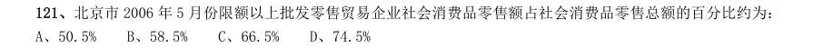

- **A.** 50.5%
- **B.** 58.5%
- **C.** 66.5%
- **D.** 74.5%

**答案：B**　**考点：比重计算与比较｜现期比重**　**难度：★★★☆☆**
**【资料分析·平均数计算｜GK-2007-ty-X122】**

122. 若保持同比增长不变,预计北京市2007 年前5 个月平均每月的社会消费品销售额:

- **A.** 将接近255 亿元
- **B.** 将接近280 亿元
- **C.** 将接近300 亿元
- **D.** 将突破300 亿元

**答案：C**　**考点：平均数计算｜现期平均数**　**难度：★☆☆☆☆**
**【资料分析·比重计算与比较｜GK-2007-ty-X123】**

123. 2006 年5 月份,限额以上批发零售贸易企业中,家具类商品零售额占家具类和建筑及装潢材料类商品零售 额的比例是:

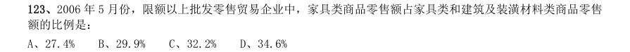

- **A.** 27.4%
- **B.** 29.9%
- **C.** 32.2%
- **D.** 34.6%

**答案：A**　**考点：比重计算与比较｜现期比重**　**难度：★☆☆☆☆**
**【资料分析·综合分析｜GK-2007-ty-X124】**

124. 下列说法正确的是: I.2006 年1-5 月份北京市每月平均社会消费品零售额比去年同期增长12.5% II.2006 年5 月份家具类、建筑及装潢材料类、家电类限额以上批发零售贸易企业零售额的增长率相比较,建筑 及装潢材料类增长最快 III.2005 年北京市机动车类销售量约为4.36 万辆

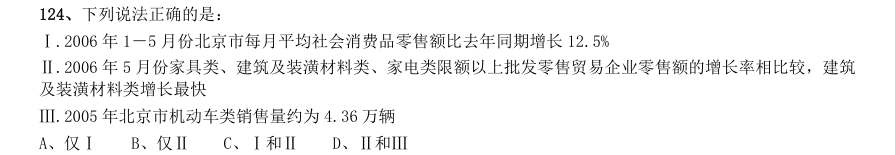

- **A.** 仅I
- **B.** 仅II
- **C.** I和II
- **D.** II和III

**答案：C**　**考点：综合分析｜选错误项**　**难度：★★★★★**
**【资料分析·综合分析｜GK-2007-ty-X125】**

125. 下列说法肯定正确地是:

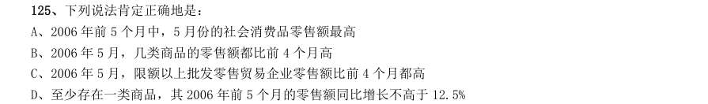

- **A.** 2006 年前5 个月中,5 月份的社会消费品零售额最高
- **B.** 2006 年5 月,几类商品的零售额都比前4 个月高
- **C.** 2006 年5 月,限额以上批发零售贸易企业零售额比前4 个月都高
- **D.** 至少存在一类商品,其2006 年前5 个月的零售额同比增长不高于12.5%

**答案：D**　**考点：综合分析｜选错误项**　**难度：★★★★★**
**【资料分析·综合分析｜GK-2007-ty-X126】**

126. 下列行业中,每单位取水量中耗水量最少的是:

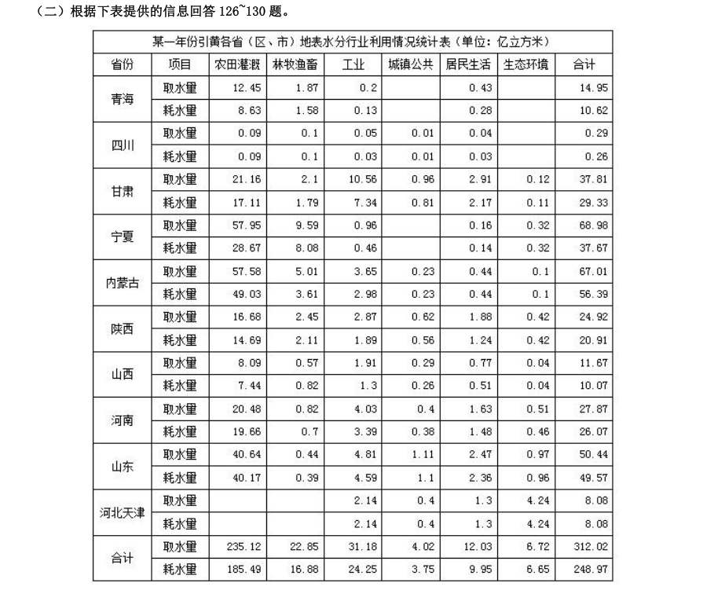

- **A.** 林牧渔畜
- **B.** 工业
- **C.** 居民生活
- **D.** 生态环境

**答案：A**　**考点：综合分析｜选正确项**　**难度：★★★★☆**
**【资料分析·综合分析｜GK-2007-ty-X127】**

127. 下列省份中,每单位耗水量所需取水量最少的是:

> 材料图见 images/GK-2007-ty-X126-m.jpg

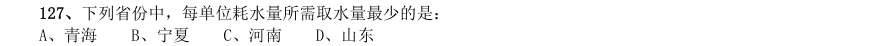

- **A.** 青海
- **B.** 宁夏
- **C.** 河南
- **D.** 山东

**答案：D**　**考点：综合分析｜选正确项**　**难度：★★★★☆**
**【资料分析·比重计算与比较｜GK-2007-ty-X128】**

128. 内蒙古的地表水取水量与耗水量分别占全河地表水取水量与耗水量的比重约是:

> 材料图见 images/GK-2007-ty-X126-m.jpg

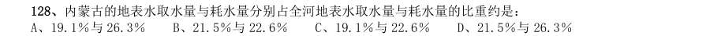

- **A.** 19.1%与26.3%
- **B.** 21.5%与22.6%
- **C.** 19.1%与22.6%
- **D.** 21.5%与26.3%

**答案：B**　**考点：比重计算与比较｜现期比重**　**难度：★☆☆☆☆**
**【资料分析·比重计算与比较｜GK-2007-ty-X129】**

129. 引黄各省(区、市)中地表水取水量最大的三个省份的取水量之和与最小的三个省份的取水量之和,占全 河地表水取水量的比重分别约是:

> 材料图见 images/GK-2007-ty-X126-m.jpg

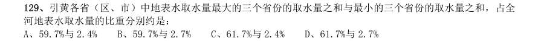

- **A.** 59.7%与2.4%
- **B.** 59.7%与2.7%
- **C.** 61.7%与2.4%
- **D.** 61.7%与2.7%

**答案：B**　**考点：比重计算与比较｜现期比重**　**难度：★★☆☆☆**
**【资料分析·综合分析｜GK-2007-ty-X130】**

130. 下列说法正确的是:

> 材料图见 images/GK-2007-ty-X126-m.jpg

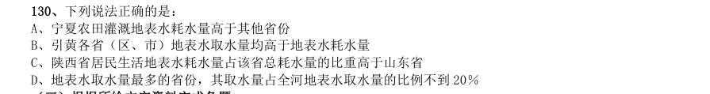

- **A.** 宁夏农田灌溉地表水耗水量高于其他省份
- **B.** 引黄各省(区、市)地表水取水量均高于地表水耗水量
- **C.** 陕西省居民生活地表水耗水量占该省总耗水量的比重高于山东省
- **D.** 地表水取水量最多的省份,其取水量占全河地表水取水量的比例不到20%

**答案：C**　**考点：综合分析｜选错误项**　**难度：★★★★★**
**【资料分析·综合分析｜GK-2007-ty-X131】**
> 材料：2005 年全国专利审查与专利代理业务研讨会宣布,预计在“十一五”期间,我国专利申请总量将达346 万 件,其中发明专利申请总量将达到140 万件,实用新型专利申请总量将达到89 万件,外观设计专利申请总量将 达到117 万件。 据介绍,我国专利审批总体能力在“十五”期间大幅提高,审查周期大幅缩短。发明专利人均待审量由“十 五"初期(2001 年)的154 件下降到“十五”末期(2005 年)的85 件,平均结案周期从“十五”初期的53 个月缩短 至“十五”末期的24 个月。 改革开放以来,我国专利申请量和授予量增长速度迅猛。1985 年4 月1 日至2005 年8 月31 日,我国受 理的三类专利申请总量达到258.5 万件,其中前100 万件历时15 年整,而第二个100 万件历时仅4 年零2 个月; 至2005 年8 月31 日,三种专利的授予总量达到140.38 万件。

131. 其中,2004 年共受理专利申请35.38 万件,同比 增长14.7%;2004 年共授予专利19.02 万件,同比增长4.4%。我国的实用新型专利、外观设计专利和商标的年 申请量已经跃居世界第一,其中90%以上为国内申请。 与2003 年相比,2004 年我国专利的授予比例(授予比例=专利申请授予量/专利申请受理量):

> 材料图见 images/GK-2007-ty-X126-m.jpg

- **A.** 提高了5.3 个百分点
- **B.** 降低了5.3 个百分点
- **C.** 提高了9.5 个百分点
- **D.** 降低了9.5 个百分点

**答案：B**　**考点：综合分析｜选正确项**　**难度：★★★★★**
**【资料分析·综合分析｜GK-2007-ty-X132】**

132. 1985 年4 月1 日至2005 年8 月31 日,我国受理的专利申请中,最后约58.5 万件专利的受理历时:

> 材料图见 images/GK-2007-ty-X126-m.jpg

- **A.** 15 个月
- **B.** 14 个月
- **C.** 10 个月
- **D.** 8 个月

**答案：A**　**考点：综合分析｜选正确项**　**难度：★★★★☆**
**【资料分析·平均数计算｜GK-2007-ty-X133】**

133. 与1985 年4 月1 日至2000 年4 月1 日间专利申请平均受理时间相比,2000 年4 月1 日至2004 年6 月1 日间专利申请的平均受理时间下降了:

> 材料图见 images/GK-2007-ty-X126-m.jpg

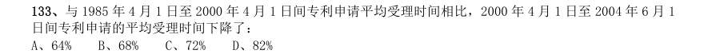

- **A.** 64%
- **B.** 68%
- **C.** 72%
- **D.** 82%

**答案：C**　**考点：平均数计算｜现期平均数**　**难度：★★☆☆☆**
**【资料分析·比重计算与比较｜GK-2007-ty-X134】**

134. 下列说法正确的有: 1预计“十一五"期间,外观设计专利申请总量将占到专利申请总量的1/3 强 2“十五”末期平均结案周期不到“十五”初期的一半 31985 年4 月1 日至2005 年8 月31 间,我国专利的授予比例超过了50% 41985 年4 月1 日至2005 年8 月31 日间,我国受理的专利申请中,第二个100 万件所用时间不到总时间的20%

> 材料图见 images/GK-2007-ty-X126-m.jpg

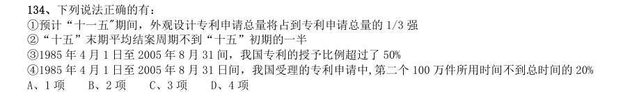

- **A.** 1 项
- **B.** 2 项
- **C.** 3 项
- **D.** 4 项

**答案：C**　**考点：比重计算与比较｜现期比重**　**难度：★★★☆☆**
**【资料分析·综合分析｜GK-2007-ty-X135】**

135. 下列说法正确的是:

> 材料图见 images/GK-2007-ty-X126-m.jpg

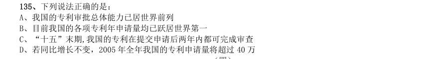

- **A.** 我国的专利审批总体能力已居世界前列
- **B.** 目前我国的各项专利年申请量均已跃居世界第一
- **C.** “十五”末期,我国的专利在提交申请后两年内都可完成审查
- **D.** 若同比增长不变,2005 年全年我国的专利申请量将超过40 万

**答案：D**　**考点：综合分析｜选错误项**　**难度：★★★★☆**
**【资料分析·比重计算与比较｜GK-2007-ty-X136】**

136. 从1998 年到2004 年,美洲地区啤酒消费量占世界啤酒消费总量的比重:

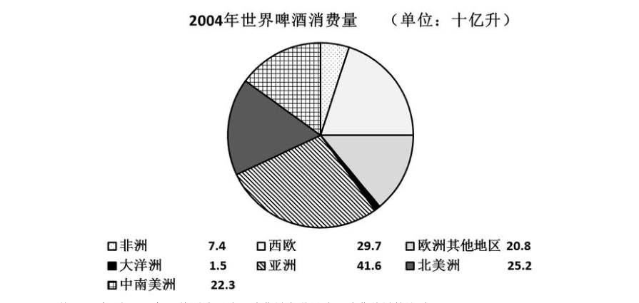

- **A.** 下降了3 个百分点
- **B.** 下降了2 个百分点
- **C.** 下降了1 个百分点
- **D.** 上升了1 个百分点

**答案：A**　**考点：比重计算与比较｜现期比重**　**难度：★☆☆☆☆**
**【资料分析·比重计算与比较｜GK-2007-ty-X137】**

137. 1998 年至2004 年啤酒消费量增长最快的两个地区,其啤酒消费量2004 年占世界啤酒消费量的比重约是:

> 材料图见 images/GK-2007-ty-X136-m.jpg

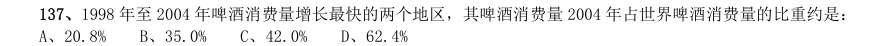

- **A.** 20.8%
- **B.** 35.0%
- **C.** 42.0%
- **D.** 62.4%

**答案：C**　**考点：比重计算与比较｜现期比重**　**难度：★☆☆☆☆**
**【资料分析·综合分析｜GK-2007-ty-X138】**

138. 与亚洲相比,整个欧洲的啤酒消费量:

> 材料图见 images/GK-2007-ty-X136-m.jpg

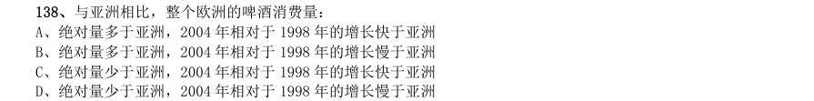

- **A.** 绝对量多于亚洲,2004 年相对于1998 年的增长快于亚洲
- **B.** 绝对量多于亚洲,2004 年相对于1998 年的增长慢于亚洲
- **C.** 绝对量少于亚洲,2004 年相对于1998 年的增长快于亚洲
- **D.** 绝对量少于亚洲,2004 年相对于1998 年的增长慢于亚洲

**答案：B**　**考点：综合分析｜选正确项**　**难度：★★★★★**
**【资料分析·综合分析｜GK-2007-ty-X139】**

139. 关于啤酒消费量,下列说法错误的是:

> 材料图见 images/GK-2007-ty-X136-m.jpg

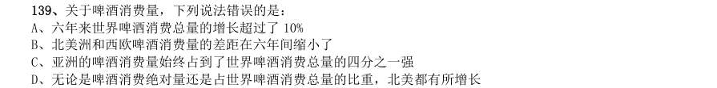

- **A.** 六年来世界啤酒消费总量的增长超过了10%
- **B.** 北美洲和西欧啤酒消费量的差距在六年间缩小了
- **C.** 亚洲的啤酒消费量始终占到了世界啤酒消费总量的四分之一强
- **D.** 无论是啤酒消费绝对量还是占世界啤酒消费总量的比重,北美都有所增长

**答案：D**　**考点：综合分析｜选错误项**　**难度：★★★★★**
**【资料分析·综合分析｜GK-2007-ty-X140】**

140. 若中国1998 年的啤酒消费量为205 亿升,2004 年的啤酒消费量为291 亿升,则下列说法一定正确的是:

> 材料图见 images/GK-2007-ty-X136-m.jpg

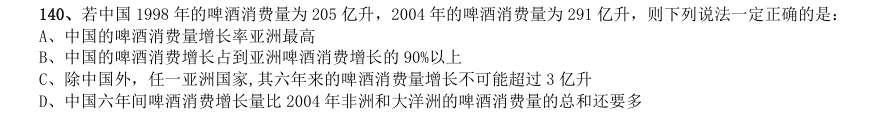

- **A.** 中国的啤酒消费量增长率亚洲最高
- **B.** 中国的啤酒消费增长占到亚洲啤酒消费增长的90%以上
- **C.** 除中国外,任一亚洲国家,其六年来的啤酒消费量增长不可能超过3 亿升
- **D.** 中国六年间啤酒消费增长量比2004 年非洲和大洋洲的啤酒消费量的总和还要多

**答案：B**　**考点：综合分析｜选错误项**　**难度：★★★★★**