# 2008 年国考行测（统一卷）

- 题量：138（含答案 138）
- 模块分布：资料分析20 / 数量关系19 / 言语理解39 / 判断推理35 / 常识判断25
- 试卷编号：`国考-2008-统一卷`

## 题目与答案

**【言语理解·中心理解｜GK-2008-ty-X001】**
> 材料：项中选出一个最恰当的答案。

1. 在古典传统里,和谐的反面是千篇一律:“君子和而不同,小人同而不和”,所以和谐的一个条件是对于多 样性的认同。中国人甚至在孔子之前就有了对于和谐的经典认识与体现。中国古代的音乐艺术很发达,特别是一 些中国乐器,像钟、磬、瑟等各种完全不同的乐器按照一定的韵律奏出动听的音乐,但如果只有一种乐器就会非 常单调。 对这段文字概括最准确的是:

- **A.** 和谐源于中国古典音乐
- **B.** 差异是和谐的必要条件
- **C.** 中国人很早产生了和谐观念
- **D.** 音乐是对和谐的经典认识和体现

**答案：B**　**考点：中心理解｜转折与因果**
**【言语理解·中心理解｜GK-2008-ty-X002】**

2. “黑马”一词其实是从英语舶来的,原指体育界一鸣惊人的后起之秀,后指实力难测的竞争者或在某一领域 独树一帜的人,无贬义或政治含义。首先在英文中使用“黑马”的人,是英国前首相迪斯雷利,他在一本小说中 这样描写赛马的场面:“两匹公认拔尖的赛马竟然落后了,一匹‘黑马’,以压倒性优势飞奔。看台上的观众惊 呼:‘黑马!黑马!’”从此,“黑马”便成了一个有特殊意义的名词。 这段文字的主要意思是:

- **A.** 论证“黑马”词义的起源
- **B.** 阐释“黑马”一词的内涵
- **C.** 分析“黑马”词义的演变
- **D.** 介绍“黑马”的感情色彩

**答案：A**　**考点：中心理解｜对策优先**
**【言语理解·中心理解｜GK-2008-ty-X003】**

3. 中国的沙漠的确为世界上的科学家提供了与火星环境最为相似的实验室。科学家们已经去过了地球上最为寒 冷的南极洲,也去过了地球上最为干燥的智利阿塔卡马沙漠,但他们真正需要的是将这两者结合起来的极端环境。 这段文字重在说明:

- **A.** 中国沙漠为外星研究提供理想场所
- **B.** 中国沙漠比南极洲更适合进行生物研究
- **C.** 科学家为何选择中国沙漠作为研究对象
- **D.** 具有最极端的环境是中国沙漠的主要特点

**答案：A**　**考点：中心理解｜对策优先**
**【言语理解·中心理解｜GK-2008-ty-X004】**

4. 中国古人将阴历月的大月定为30 天,小月定为29 天,一年有12 个月,即354 天,比阳历年少了11 天 多。怎么办呢?在19 个阴历年里加7 个闰月,就和19 个阳历年的长度几乎相等。这个周期的发明巧妙地 解决了阴阳历调和的难题,比希腊人梅冬的发明早了160 年。 这段文字主要阐明的是:

- **A.** 古代阴历中闰月设置的规律与作用
- **B.** 中国古代历法在当时有先进水平
- **C.** 阴阳历调和问题在古代是个世界性问题
- **D.** 中国古代如何解决阴阳历差异问题

**答案：D**　**考点：中心理解｜对策优先**
**【言语理解·中心理解｜GK-2008-ty-X005】**

5. 湿地指的是陆地和水体之间的过渡带,和森林、海洋一起并称地球三大生态体系,在维护生物多样性、调节 气候、抵御洪水等方面起着重要作用。1998 年那次长江大洪水让人们终于意识到湿地(尤其是和长江相通的许 许多多湖泊和沼泽地)能够对洪水起到缓冲的作用。可是,许多湖泊因为围湖造田的需要而被人为隔离了,只留 下一个很少开启的水闸和长江相通。于是,这些自然形成的水网被拦腰斩断,遇到洪水便无能为力了。 这段文字意在说明:

- **A.** 围湖造田是一项弊大于利的错误举措
- **B.** 占用湿地是造成长江洪水的重要因素
- **C.** 人类应该反省自身行为对环境的破坏
- **D.** 应该充分发挥湿地对洪水的缓冲作用

**答案：D**　**考点：中心理解｜对策优先**
**【言语理解·中心理解｜GK-2008-ty-X006】**

6. 作为一个拥有五千年不间断文明史的古国,我国拥有十分丰富的非物质文化遗产。这些活态的文化不仅构成 了中华民族深厚的文化底蕴,也承载着中华民族文化渊源的基因。但随着我国现代化建设的加速,文化标准化以 及环境条件的变化,尚有不计其数的文化遗产正处于濒危状态,它们犹如一个个影子,随时都可能消亡。 对这段文字概括最准确的是:

- **A.** 文化遗产保护工作要有新思路
- **B.** 要重视现代化建设带来的新问题
- **C.** 新形势下亟须加强文化遗产保护
- **D.** 诸多因素威胁着文化遗产的生存状态

**答案：D**　**考点：中心理解｜对策优先**
**【言语理解·中心理解｜GK-2008-ty-X007】**

7. 能源价格高并非全是坏事,因为价格杠杆自会调节石油的流向,确保人类以剩下的石油找到更好的新能源, 而不是全用到几十年前根本不存在的使夏天变凉爽的能源需求上。实际上,如果我们遵循价格杠杆,甚至无需教 育消费者,人人都会做出理智的选择。那些价格杠杆不起作用的地方,多是机制本身有问题的地方,改进机制, 才能使价格杠杆更有效。 这段文字的核心观点是:

- **A.** 改革体制是充分发挥价格杠杆作用的前提
- **B.** 能源的无谓浪费问题应该受到应有的重视
- **C.** 提高能源价格有利于合理利用与节约能源
- **D.** 要充分发挥价格杠杆调节能源流向的作用

**答案：D**　**考点：中心理解｜对策优先**
**【言语理解·中心理解｜GK-2008-ty-X008】**

8. 商业设计也许越来越被赋予艺术创作和欣赏的价值,但它根本的出发点和落脚点永远是把产品的特质用艺术 的方式展现给顾客。如果一项商业设计不能让人联想到产品并对之产生好感,即使它再精美、再具创意,也不能 算是成功的设计。说到底,广告在创意之外最重要的还是关联性,我们不想被一个美轮美奂的作品吸引,结果却 看不出它与所代言的商品之间存在任何联系。 对这段文字概括最准确的是:

- **A.** 独特的创意并非成就商业设计的绝对要素
- **B.** 对于设计来说,吸引顾客应该是第一位的
- **C.** 成功的设计必须能够艺术地展现产品特质
- **D.** 商业设计应尽量强调广告与产品的关联性

**答案：C**　**考点：中心理解｜对策优先**
**【言语理解·中心理解｜GK-2008-ty-X009】**

9. 中国消费信贷市场的现状,使得对中国银行业投入巨资的西方银行在信用卡业务上仍是投资,没有盈利。不 过,外资银行对中国信用卡市场并没有失掉信心。虽然中国的消费者没有透支消费的习惯,而这个“硬币”的另 一面是中国居民的个人负债率很低,中国内地的个人消费信用市场才刚刚开始发展,这对外资银行是极具吸引力 的。 这段文字中的“硬币”指代的是:

- **A.** 中国银行业
- **B.** 中国消费信贷市场
- **C.** 中国消费者的消费习惯
- **D.** 中国居民的经济状况

**答案：C**　**考点：中心理解｜转折与因果**
**【言语理解·中心理解｜GK-2008-ty-X010】**

10. “缩略”是赶路人与时间搏斗的一种方式。也许,赶路人自有不得不缩略的苦衷,其中也许不乏积极因素, 但从根本上说,所谓缩略,就是把一切尽快转化为物,转化为钱,转化为欲,转化为形式,直奔功利而去。缩略 的标准是物质的而非精神的,是功利的而非审美的,是形式的而非内涵的。缩略之所以能够实现,其秘诀在于把 精神性的水分一点点挤出去,像压缩饼干似的,卡路里倒是足够,滋味却没有了。对一次性的短暂人生来说,这 不能不说是一种遗憾。 这段文字着重抒发怎样的感慨:

- **A.** 急于实现目标,必然付出代价
- **B.** 淹没在物欲中的人生是枯燥无味的
- **C.** 人们只重目的,忽略了过程的享受
- **D.** 时间可以转化为钱,却无法转化为美

**答案：B**　**考点：中心理解｜对策优先**
**【言语理解·语句排序｜GK-2008-ty-X011】**

11. 将以下6 个句子重新排列组合: 1 任何心理活动,任何创作,也许都具有“一次性”。 2 揣度别人是很困难的。子非鱼,安知鱼之乐? 3 作者的回顾,事后的创作谈,能在多大程度上与实际创作情状复合,是值得怀疑的。 4 甚至揣度自己也未见得容易多少。 5 人不能把脚两次伸进同一条河里。 6 比方说这篇小说写过这么久了,尽管我现在能尽力回忆当时写作的心境,但时过境迁,当时的心境是绝对不 可能再完整准确地重现了。 排列组合最连贯的是:

- **A.** 365241
- **B.** 516324
- **C.** 163524
- **D.** 246351

**答案：D**　**考点：语句排序｜语句排序**
**【言语理解·中心理解｜GK-2008-ty-X012】**

12. 歌德评价帕格尼尼“在琴弦上展现了火一样的灵魂”。巴黎人为他的琴声陶醉,忘记了当时正在流行的霍乱。 在维也纳,一个盲人听到他的琴声,以为是一个乐队在演奏,当得知这只是一个叫帕格尼尼的意大利人用一把小 提琴奏出的声音时,盲人大叫一声:“这是个魔鬼!” 这段文字意在强调帕格尼尼:

- **A.** 火一样的激情
- **B.** 魔鬼般的演奏
- **C.** 超强的模仿力
- **D.** 高超的表演力

**答案：D**　**考点：中心理解｜对策优先**
**【言语理解·中心理解｜GK-2008-ty-X013】**

13. 费孝通在反思一生学术研究时,提出“文化自觉论”。他说:“生活在一定文化中的人对其文化有‘自知之 明’,明白它的来历、形成的过程、所具有的特色和它发展的趋向,自知之明是为了加强文化转型的自主能力, 取得决定适应新环境、新时代文化选择的自主地位。” 根据这段文字,“文化自觉”的主要作用是:

- **A.** 使文化的发展方向更为可控
- **B.** 使人们能更加适应不断发展的文化
- **C.** 使人们更深刻地了解文化的来源和特点
- **D.** 使不同文化之间的融合和转变更为容易

**答案：A**　**考点：中心理解｜对策优先**
**【言语理解·中心理解｜GK-2008-ty-X014】**

14. 一个年轻人寄了许多份简历到一些广告公司应聘,其中有一家公司写了一封信给他:“虽然你自认为文采很 好,但从你的来信中,我们发现了许多语法错误,甚至有一些错别字。”这个青年想如果这是真的,我应该感谢 他们告诉我,然后改正。于是他给这个公司写了一封感谢信。几天后,他再次收到这家公司的信函,通知他被录 用了。 这段文字主要想告诉我们:

- **A.** 机会往往在不经意获得
- **B.** 公司招聘时更看重求职者的态度
- **C.** 谦虚能获得更多知识和别人的尊重
- **D.** 良好的文字功底是成功求职的前提

**答案：B**　**考点：中心理解｜对策优先**
**【言语理解·中心理解｜GK-2008-ty-X015】**

15. 气候变暖将会使中纬度地区因蒸发强烈而变得干旱,现在农业发达的地区将退化成草原,高纬度地区则会增 加降水,温带作物将可以在此安家。但就全球来看,气候变暖对世界经济的负面影响是主要的,得到好处的仅是 局部地区。 这段文字旨在说明气候变暖:

- **A.** 会使全球降水总量减少
- **B.** 对局部地区来说利大于弊
- **C.** 将给世界经济带来消极影响
- **D.** 将导致世界各国农业结构发生变化

**答案：C**　**考点：中心理解｜对策优先**
**【言语理解·逻辑填空｜GK-2008-ty-X016】**

16. 华盛顿国立气象研究所的墙上有这么一句话:“当我们做对了,没有人会记得;当我们做错了,没有人会忘 记。” 气象研究所的墙上写这句话的目的是:

- **A.** 希望人们多理解气象工作的困难和苦衷
- **B.** 督促员工致力于杜绝工作中的任何差错
- **C.** 劝勉员工甘于默默无闻、不计个人名利
- **D.** 突出气象研究工作本身所具有的特殊性

**答案：B**　**考点：逻辑填空｜逻辑填空（综合）**
**【言语理解·中心理解｜GK-2008-ty-X017】**

17. 虽然黑猩猩和人类的进化史大约有99 . %是共同的,但大多数思想家把黑猩猩视为与人类毫不相干 的怪物,而把自己看成是万物之主。对一个进化论者来说,情况绝非如此。认为某一物种比另一物种高尚是毫无 客观依据的。不论是黑猩猩和人类,还是蜥蜴和真菌,都是经过长达30 亿年的所谓自然选择这一过程进化而 来的。 这段文字意在阐明:

- **A.** 大多数思想家并不理解进化论的思想
- **B.** 真正的思想家应对所有物种一视同仁
- **C.** 所有物种事实上都是自然选择的结果
- **D.** 黑猩猩与人类的进化史实际极为相似

**答案：B**　**考点：中心理解｜转折与因果**
**【言语理解·中心理解｜GK-2008-ty-X018】**

18. 几次拿起《十字路口的顽童》 这本书,几次又放下,因为不时会有画面打断我的思路,那是在我18 年 的教书生涯中遇到的一个个顽童的画面。有意思的是,其他学生凝固在我记忆中的是“图片”形象;而他们却是 “视频”故事,他们所占据的老师“内存”实在是比其他孩子要大得多。这段文字表达的主要意思是:

- **A.** 漫长的教学生涯给“我“留下很多回忆
- **B.** 顽童让“我“想起曾经发生的许多故事
- **C.** 顽皮学生留给“我“的印象更为生动深刻
- **D.** 这本书触动“我“对教学生涯的许多联想

**答案：C**　**考点：中心理解｜对策优先**
**【言语理解·中心理解｜GK-2008-ty-X019】**

19. 汽车是对环境影响较大的商品,汽车厂商支持环保事业、进行环保宣传,似乎是理所应当的。环保应当是汽 车企业在发展中必须认真考虑的因素,但要求汽车企业没有利润甚至亏损来做环保,显然是不现实的,而且也不 会持久。汽车企业在发展的同时采取新的技术措施,尽量减少对环境的污染,符合社会发展大趋势,才是长久之 策。 这段文字的核心观点是:

- **A.** 环保与实现企业利润存在矛盾
- **B.** 发展环保事业应该注重从实际出发
- **C.** 技术革新是解决汽车影响环境问题的关键
- **D.** 汽车企业应在发展的同时充分重视环境保护

**答案：C**　**考点：中心理解｜对策优先**
**【言语理解·中心理解｜GK-2008-ty-X020】**

20. 20 世纪60 年代以前,世界各国普遍注重防洪的工程措施,即通过修建大堤、水库等水利设施对洪水进 行控制。但在60 年代以后,世界各国在防洪规划中越来越重视非工程措施的运用,即通过洪水预警、灾情评估、 洪灾保险等多种手段,结合各种工程措施,从而尽可能减少洪灾对人类经济、环境和社会发展的影响。 这段文字主要谈的是:

- **A.** 世界各国防洪理念的转变
- **B.** 世界各国控制洪水的新途径
- **C.** 单纯重视防洪工程不能有效控制洪水
- **D.** 非工程措施逐渐成为防洪规划的主导

**答案：A**　**考点：中心理解｜对策优先**
**【言语理解·逻辑填空｜GK-2008-ty-X021】**

21. 建设资源节约型、环境友好型社会要注意______,目前要着重解决影响社会经济发展,特别是严重危害人民 群众健康的水污染、空气污染加剧问题。 填入画横线部分最恰当的一项是:

- **A.** 可持续性
- **B.** 轻重缓急
- **C.** 孰轻孰重
- **D.** 先后次序

**答案：B**　**考点：逻辑填空｜成语辨析**
**【言语理解·逻辑填空｜GK-2008-ty-X022】**

22. 对一篇规范的论文,因版面限制而去砍综述、删注释,实在是 的不智之举。 填入画横线部分最恰当的一项是:

- **A.** 削足适履
- **B.** 扬汤止沸
- **C.** 矫枉过正
- **D.** 舍本逐末

**答案：A**　**考点：逻辑填空｜成语辨析**
**【言语理解·逻辑填空｜GK-2008-ty-X023】**

23. 中华民族一直以其强烈的责任意识享誉世界,在建立市场经济体制的新的历史时期,尤其需要 人 们的责任意识,这既是构建社会主义和谐社会的必然 ,也是时代的呼唤。 填入画横线部分最恰当的一项是:

- **A.** 增强要求
- **B.** 提高结果
- **C.** 加强需要
- **D.** 提升

**答案：A**　**考点：逻辑填空｜一空**
**【言语理解·逻辑填空｜GK-2008-ty-X024】**

24. 中国古代数学家对“一次同余论”的研究有 的独创性和继承性,“大衍求一术”在世界数学史 上的崇高地位是不容 的。正因为这样,在西方数学史著作中,一直公正地称求解一次同余组的剩余 定理为“中国剩余定理”。 填入画横线部分最恰当的一项是:

- **A.** 完全否定
- **B.** 明确忽视
- **C.** 绝对动摇
- **D.** 明显

**答案：D**　**考点：逻辑填空｜一空**
**【言语理解·逻辑填空｜GK-2008-ty-X025】**

25. 随着广播、电视和报纸等大众传媒进人千家万户、覆盖城乡,其对社会舆论的影响力 扩大,越 来越成为广大群众的主要信息来源,在很大程度上 着社会舆论。 填入画横线部分最恰当的一项是:

- **A.** 日益影响
- **B.** 逐步控制
- **C.** 渐渐干扰
- **D.** 不断

**答案：D**　**考点：逻辑填空｜成语辨析**
**【言语理解·逻辑填空｜GK-2008-ty-X026】**

26. 近现代西方科学与人文两种文化经历了融合、冲突和消解三个时期,反映到教育理念上也相应地经历了科学 教育与人文教育的相互 、越走越远和共同反思三个阶段。这一历史发展表明,过分强调科学文化和科学教育, 必然导致对人文的 ;而过分强调人文文化和人文教育,也会带来对科学技术的漠视。 填入画横线部分最恰当的一项是:

- **A.** 渗透排挤
- **B.** 结合无视
- **C.** 渗透轻视
- **D.** 结合

**答案：C**　**考点：逻辑填空｜一空**
**【言语理解·逻辑填空｜GK-2008-ty-X027】**

27. 上世纪 年代,赞助商的美元滚滚而来,赛车水平和速度 般地飞跃,同时飞跃的还有车手的 性。 从此,规则制定者的头号任务就是让赛车慢下来。 填入画横线部分最恰当的一项是:

- **A.** 奇迹技术
- **B.** 闪电危险
- **C.** 魔术冒险
- **D.** 戏剧

**答案：B**　**考点：逻辑填空｜一空**
**【言语理解·逻辑填空｜GK-2008-ty-X028】**

28. 企业到底是不是适合开展连锁经营?能不能开展连锁经营?面对这两个问题,一些企业往往 , 发展 时机。 填入画横线部分最恰当的一项是:

- **A.** 无所适从贻误
- **B.** 一筹莫展痛失
- **C.** 举棋不定耽误
- **D.** 优柔寡断

**答案：A**　**考点：逻辑填空｜成语辨析**
**【言语理解·逻辑填空｜GK-2008-ty-X029】**

29. 事实证明:自从资本市场诞生以来,股市从来就不是一个投资场所, 都是投机者在博弈。股票的价格从 来就没有在经济学者理论上的 价格驻足。更多的是在泡沫和负泡沫之间来回奔波。 填入画横线部分最恰当的一项是:

- **A.** 实际稳定
- **B.** 基本均衡
- **C.** 事实稳定
- **D.** 本质

**答案：B**　**考点：逻辑填空｜一空**
**【言语理解·逻辑填空｜GK-2008-ty-X030】**

30. 由于古人视彗星出现为不祥, 对其非常重视,几乎每一次出现都有比较 的记录。 填入画横线部分最恰当的一项是:

- **A.** 因此隐晦
- **B.** 加之准确
- **C.** 故而详细
- **D.** 反而

**答案：C**　**考点：逻辑填空｜一空**
**【言语理解·逻辑填空｜GK-2008-ty-X031】**

31. 一个从小吮吸母文化长大的人一旦来到异国他乡,往往会遭遇“文化冲击”(CultureShock),有人更 地 译为“文化休克”;这种不适应所在地文化、怀念故国文化的现象,就是乡愁。为了排遣深深的乡思、尽快适应 和融人新的环境,大多数人都采取了 的态度。 填入画横线部分最恰当的一项是:

- **A.** 巧妙事在为人
- **B.** 形象兼容并蓄
- **C.** 生动入乡随俗
- **D.** 夸张

**答案：C**　**考点：逻辑填空｜成语辨析**
**【言语理解·逻辑填空｜GK-2008-ty-X032】**

32. 有了国内外巨大的价差,石油企业更愿意将成品油销往海外。同时,国际石油投机商也迅速抓住了这个机会, 以来料加工为 ,将低价成品油大量出口到境外大赚一笔,这样的情况又造成国内成品油供应紧张, 了国 内油品市场。 填入画横线部分最恰当的一项是:

- **A.** 手段影响
- **B.** 掩护扭曲
- **C.** 名义抑制
- **D.** 幌子

**答案：B**　**考点：逻辑填空｜一空**
**【言语理解·逻辑填空｜GK-2008-ty-X033】**

33. 疯狂扩散的蓝藻起初并没有使人们感到 。往年正常情况下,它顶多影响太湖的一些景观,不会带来什么 骚乱。雨季一来,这些小生物会被大量的雨水冲刷稀释,人们会渐渐 它,直到第二年的来临。还有一些农民 把它们捞起来当肥料, 地称之为“海油”。 填人画横线部分最恰当的一项是:

- **A.** 焦虑淡忘亲切
- **B.** 担忧漠视形象
- **C.** 异样适应生动
- **D.** 奇怪

**答案：A**　**考点：逻辑填空｜一空**
**【言语理解·逻辑填空｜GK-2008-ty-X034】**
> 材料：幽默

34. 在当代,发展的竞争归根到底取决于人口素质。谁人口素质高、人力资本 ,谁就占据先机,谁就会走在 发展的 ;谁人口素质低、人力资本 不够,谁就会丧失发展的机遇,跟不上时代前进的步伐。 填人画横线部分最恰当的一项是:

- **A.** 丰富前沿累积
- **B.** 充足前锋积累
- **C.** 强大前端聚集
- **D.** 雄厚

**答案：D**　**考点：逻辑填空｜一空**
**【言语理解·逻辑填空｜GK-2008-ty-X035】**
> 材料：积聚

35. 水资源 不是能够无限供给的,可持续发展的 应当是建立污水回收系统,循环利用。多数城市的污水 处理率还较低,污水处理费仅是自来水水费的一半左右,而仅凭 我们就能判断,使污水重新进入城市水源循 环的费用一定比采集清洁水的费用高得多 填人画横线部分最恰当的一项是:

- **A.** 自然目标想象
- **B.** 既然途径观察
- **C.** 显然思路直觉
- **D.** 当然

**答案：C**　**考点：逻辑填空｜一空**
**【言语理解·逻辑填空｜GK-2008-ty-X036】**
> 材料：常识

36. 在为学(不管学什么)的道路上, 来说,并不存在可以 的“捷径”;但是,我们却 避免或者少 走弯路。这就需要有人给初学者指点门径,告诉他们正确的学习方法和步骤。 填人画横线部分最恰当的一项是:

- **A.** 一般一蹴而就应该
- **B.** 目前一帆风顺

**答案：A**　**考点：逻辑填空｜成语辨析**
**【言语理解·逻辑填空｜GK-2008-ty-X038】**
> 材料：C、总体 平步青云 尽量 D、客观 唾手可得 必须 37、10 年过去了,1997 年泰株大幅贬值诱发的东南亚金融危机给整个地区带来的痛楚和无奈似乎还 。发生 在泰国的危机竟然波及整个东南亚地区,对泰株汇率的“矫正”迅速 为地区金融危机,至今仍让人 。 填入画横线部分最恰当的一项是: A、记忆犹新 蔓延 扼腕叹息 B、恍如昨日 扩展 谈虎色变 C、历历在目 演变 心存余悸 D、历久弥新 衍生 不寒而栗

38. 不同管理层次、不同岗位上的人员,不管其工作内容有多大的 ,均有其工作的目标和重点。我们必 须 目标,抓住重点,有所取舍,集中 做属于我们该做的事。 填入画横线部分最恰当的一项是:

- **A.** 差距制定物力
- **B.** 差别明确精力
- **C.** 区别实现财力
- **D.** 差异

**答案：B**　**考点：逻辑填空｜一空**
**【言语理解·逻辑填空｜GK-2008-ty-X039】**
> 材料：人力

39. 在这种人才供需状况下,简单地把市场当时 不了的东西弄到某种库房里暂时存放, 它的上市时间, 显然不是解决问题的办法, 你能把它们在库房里放一辈子。问题的关键其实在于,你得能让这些人在出库时 正好避开供大于求的行业,最好还落在供不应求的行业中。 填入画横线部分最恰当的一项是:

- **A.** 接受预测似乎
- **B.** 容纳改变或许
- **C.** 转化控制既然
- **D.** 消化

**答案：D**　**考点：逻辑填空｜一空**
**【言语理解·逻辑填空｜GK-2008-ty-X040】**
> 材料：除非

40. 作为一个公司领导,不需要、也不可能事必躬亲,但一定要 ,能够在注重细节当中比他人观察得更细 致、 ,在某一细节的操作上做出榜样,并形成 ,使每个员工都不敢马虎,无法 。只有 这样,企业的工作才能真正做细。 填入画横线部分最恰当的一项是:

- **A.** 明察秋毫周密威慑力搪塞
- **B.** 明辨是非周详使命感推脱
- **C.** 抓大放小透彻好习惯塞责
- **D.** 高瞻远瞩

**答案：A**　**考点：逻辑填空｜成语辨析**
**【数量关系·数字推理｜GK-2008-ty-X041】**
> 材料：内聚力 敷衍

41. 157,65,27,11,5,( )

- **A.** 4
- **B.** 3
- **C.** 2
- **D.** 1

**答案：D**　**考点：数字推理｜数字推理（综合）**
**【数量关系·其他数量关系｜GK-2008-ty-X042】**

42. （本题题干为图形/公式，文字层无题干，图见原卷）

- **A.** 12
- **B.** 14
- **C.** 16
- **D.** 20

**答案：C**　**考点：其他数量关系｜和差倍比**
**【数量关系·数字推理｜GK-2008-ty-X043】**

43. 1,2/3,5/8,13/21,( )

- **A.** 21/33
- **B.** 35/64
- **C.** 41/70
- **D.** 34/55

**答案：D**　**考点：数字推理｜分数与组合数列**
**【数量关系·数字推理｜GK-2008-ty-X044】**

44. 67,54,46,35,29,( )

- **A.** 13
- **B.** 15
- **C.** 18
- **D.** 20

**答案：D**　**考点：数字推理｜数字推理（综合）**
**【数量关系·数字推理｜GK-2008-ty-X045】**

45. 14,20,54,76,( )

- **A.** 104
- **B.** 116
- **C.** 126
- **D.** 144

**答案：C**　**考点：数字推理｜幂次数列**
**【数量关系·其他数量关系｜GK-2008-ty-X046】**

46. 若x,y,z 是三个连续的负整数,并且x>y>z,则下列表达式中正奇数的是:

- **A.** yz-x
- **B.** (x-y)(y-z)
- **C.** x-yz
- **D.** x(y+z)

**答案：B**　**考点：其他数量关系｜其他数量关系（综合）**
**【数量关系·其他数量关系｜GK-2008-ty-X047】**

47. 已知 ,那么 的值是多少:

- **A.** 
- **B.** 
- **C.** 
- **D.** 

**答案：B**　**考点：其他数量关系｜其他数量关系（综合）**
**【数量关系·数字推理｜GK-2008-ty-X048】**

48. 是一个等差数列, , ,则数列前13 项之和是:

- **A.** 32
- **B.** 36
- **C.** 156
- **D.** 182

**答案：C**　**考点：数字推理｜等差数列**
**【数量关系·几何问题｜GK-2008-ty-X049】**

49. 相同表面积的四面体,六面体,正十二面体以及正二十面体,其中体积最大的是:

- **A.** 四面体
- **B.** 六面体
- **C.** 正十二面体
- **D.** 正二十面体

**答案：D**　**考点：几何问题｜立体几何**
**【数量关系·几何问题｜GK-2008-ty-X050】**

50. 一个面积为2 平方米的长方形纸张,对折3 次后得到的小长方形的面积是:

- **A.** 
- **B.** 
- **C.** 
- **D.** 

**答案：C**　**考点：几何问题｜平面几何**
**【数量关系·其他数量关系｜GK-2008-ty-X051】**

51. 编一本书的书页,用了270 个数字(重复的也算,如页码115 用了2 个1 和1 个5,共3 个数字),问这本 书一共有多少页:

- **A.** 117
- **B.** 126
- **C.** 127
- **D.** 189

**答案：B**　**考点：其他数量关系｜和差倍比**
**【数量关系·其他数量关系｜GK-2008-ty-X053】**
> 材料：表示丙当前的年龄,下列哪一项能表示乙 的当前年龄: A、 B、 C、 D、

53. 为节约用水,某市决定用水收费实行超额超收,标准用水量以内每吨2.5 元,超过标准的部分加倍收费。某 用户某月用水15 吨,交水费62.5 元,若该用户下个月用水12 吨,则应交水费多少钱:

- **A.** 42.5 元
- **B.** 47.5 元
- **C.** 50 元
- **D.** 55 元

**答案：B**　**考点：其他数量关系｜方程与不定方程**
**【数量关系·其他数量关系｜GK-2008-ty-X054】**

54. 某零件加工厂按照工人完成的合格零件和不合格零件支付工资,工人每做出一个合格零件能得到工资10 元, 每做一个不合格零件将被扣除5 元,已知某人一天共做了12 个零件,得工资90 元,那么他在这一天做了多少个 不合格零件:

- **A.** 2
- **B.** 3
- **C.** 4
- **D.** 6

**答案：A**　**考点：其他数量关系｜和差倍比**
**【数量关系·其他数量关系｜GK-2008-ty-X055】**

55. 小华在练习自然数求和,从1 开始,数着数着他发现自己重复数了一个数。在这种情况下,他将所数的全部 数求平均,结果为7.4,请问他重复的那个数是:

- **A.** 2
- **B.** 6
- **C.** 8
- **D.** 10

**答案：B**　**考点：其他数量关系｜和差倍比**
**【数量关系·最值问题｜GK-2008-ty-X056】**

56. 共有100 个人参加某公司的招聘考试,考试内容共有5 道题,1-5 题分别有80 人,92 人,86 人,78 人, 和74 人答对,答对了3 道和3 道以上的人员能通过考试,请问至少有多少人能通过考试:

- **A.** 30
- **B.** 55
- **C.** 70
- **D.** 74

**答案：C**　**考点：最值问题｜最值优化**
**【数量关系·排列组合｜GK-2008-ty-X057】**

57. 一张节目表上原有3 个节目,如果保持这3 个节目的相对顺序不变,再添进去2 个新节目,有多少种安排方 法:

- **A.** 20
- **B.** 12
- **C.** 6
- **D.** 4

**答案：A**　**考点：排列组合｜基础排列组合**
**【数量关系·利润问题｜GK-2008-ty-X058】**

58. 某商场促销,晚上八点以后全场商品在原来折扣基础上再打9.5 折,付款时满400 元再减100 元,已知某鞋 柜全场8.5 折,某人晚上九点多去该鞋柜买了一双鞋,花了384.5 元,问这双鞋的原价为多少钱:

- **A.** 550
- **B.** 600
- **C.** 650
- **D.** 700

**答案：B**　**考点：利润问题｜折扣与促销**
**【数量关系·行程问题｜GK-2008-ty-X059】**

59. 甲、乙、丙、丁四个人去图书馆借书,甲每隔5 天去一次,乙每隔11 天去一次,丙每隔17 天去一次,丁每 隔29 天去一次。如果5 月18 日他们四个人在图书馆相遇,问下一次四个人在图书馆相遇是几月几号:

- **A.** 10 月18 日
- **B.** 10 月14 日
- **C.** 11 月18 日
- **D.** 11 月14 日

**答案：D**　**考点：行程问题｜相遇追及**
**【数量关系·其他数量关系｜GK-2008-ty-X060】**

60. 甲、乙、丙三种货物,如果购买甲3 件、乙7 件、丙1 件需花3.15 元,如果购买甲4 件、乙10 件、丙1 件 需花4.2 元,那么购买甲、乙、丙各1 件需花多少钱:

- **A.** 1.05
- **B.** 1.4
- **C.** 1.85
- **D.** 2.1

**答案：A**　**考点：其他数量关系｜方程与不定方程**
**【判断推理·图形推理｜GK-2008-ty-X061】**

61. 请从所给的四个选项中,选择最合适的一个填入问号处,使之呈现一定的规律性:

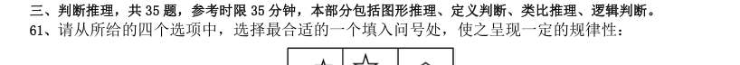

> （本题为图形题，选项为图片，见原卷）

**答案：D**　**考点：图形推理｜数量规律**
**【判断推理·图形推理｜GK-2008-ty-X062】**

62. 请从所给的四个选项中,选择最合适的一个填入问号处,使之呈现一定的规律性:

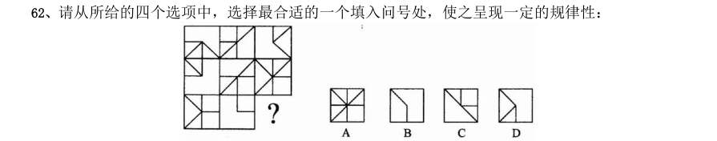

> （本题为图形题，选项为图片，见原卷）

**答案：D**　**考点：图形推理｜样式规律**
**【判断推理·图形推理｜GK-2008-ty-X063】**

63. 请从所给的四个选项中,选择最合适的一个填入问号处,使之呈现一定的规律性:

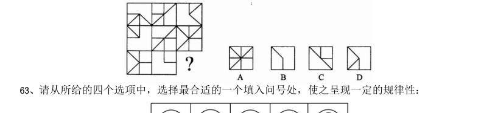

> （本题为图形题，选项为图片，见原卷）

**答案：D**　**考点：图形推理｜数量规律**
**【判断推理·图形推理｜GK-2008-ty-X064】**

64. 请从所给的四个选项中,选择最合适的一个填入问号处,使之呈现一定的规律性:

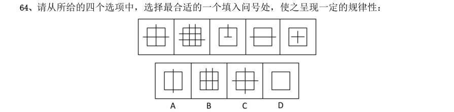

> （本题为图形题，选项为图片，见原卷）

**答案：C**　**考点：图形推理｜图形推理（综合）**
**【判断推理·图形推理｜GK-2008-ty-X065】**

65. 下面四个所给的选项中,哪一选项的盒子不能由左边给定的图形做成( )。

> （本题为图形题，选项为图片，见原卷）

**答案：C**　**考点：图形推理｜数量规律**
**【判断推理·图形推理｜GK-2008-ty-X066】**

66. 立体农业是指农作物复合群体在时空上的充分利用。根据不同作物的不同特性,如高秆与矮秆、富光与耐荫、 早熟与晚熟、深根与浅根、豆科与禾本科,利用它们在生长过程中的时空差,合理地实行科学的间种、套种、混 种、轮种等配套种植,形成多种作物、多层次、多时序的立体交叉种植结构。根据上述定义,下列属于立体农业 的是:

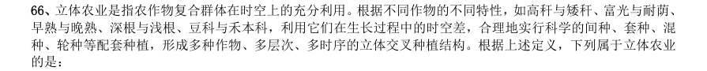

- **A.** 甲在自己的玉米地里种植大豆
- **B.** 乙在自己承包的鱼塘不但养鱼,还种植了很多莲藕
- **C.** 丙在南方某地区承包了十亩稻田,特意引种了高产的水稻新品种
- **D.** 丁前年承包了一座山,他在山上种植了大量苹果树,并在山上养殖了大量蜜蜂

**答案：A**　**考点：图形推理｜立体图形**
**【判断推理·定义判断｜GK-2008-ty-X067】**

67. 天然孳息是指按照物质的自然生长规律而产生的果实与动物的出产物,与原物分离前,是原物的一部分。天 然孳息,由所有权人取得;既有所有权人又有用益物权人的,由用益物权人取得。当事人另有约定的,按照约定。 根据上述定义,下列不属于天然孳息的是:

- **A.** 送给他人的猫崽
- **B.** 从羊身上剪下的羊毛
- **C.** 牛被宰杀后发现的牛黄
- **D.** 公园里的柿子树所结的果实

**答案：A**　**考点：定义判断｜单定义**
**【判断推理·定义判断｜GK-2008-ty-X068】**

68. 绿色壁垒是指一些国家和国际组织通过制定环境标准和法规,为保护生态环境、人类以及动植物生命安全与 健康而直接或间接采取的各种限制或者禁止贸易的措施,它是能对进出口贸易产生影响的一种非关税贸易壁垒。 根据上述定义,下列属于绿色壁垒行为的是:

- **A.** 某大型连锁超市只销售通过绿色食品检验的进口农产品
- **B.** 一家纺织品进出口公司销往欧洲的10 余吨棉纱因检测出含有德国禁用的偶氮染料而停止出口
- **C.** 某公司向国外出口大蒜,因途中货轮上的温控设施出问题,部分大蒜到港后变质,结果所有大蒜被退回
- **D.** 一家工厂生产的木质卧室家具在美国市场销售量非常可观,但由于美国提高了木质卧室家具的关税,其出口

**答案：B**　**考点：定义判断｜单定义**
**【判断推理·定义判断｜GK-2008-ty-X069】**

69. 失语症是指由于神经中枢病损导致抽象信号思维障碍,而丧失口语、文字的表达和领悟能力的临床症侯群。 根据上述定义,下列可能患失语症的是:

- **A.** “狼孩“回归社会后无法与人进行言语交流
- **B.** 幼时高烧听力受损致使发音有极大缺陷,影响交流
- **C.** 因受刺激精神失常,造成言语理解和表达上的困难
- **D.** 因车祸头部受创,虽能模仿他人言语但经常答非所问

**答案：D**　**考点：定义判断｜单定义**
**【判断推理·定义判断｜GK-2008-ty-X070】**

70. 职业枯竭是指人们在自己长期从事的工作重压之下,产生身心能量被工作耗尽的感觉。根据上述定义,下列 属于职业枯竭状态的是:

- **A.** 老周不能胜任自己现有的工作,每天都会忙得焦头烂额
- **B.** 刚参加工作的小李觉得这份工作太累,产生了跳槽的念头
- **C.** 刘经理每天工作繁忙,缺乏充足的休息,情绪也越来越糟糕
- **D.** 在从事过许多不同的职业之后,老王觉得所有工作都索然无味

**答案：C**　**考点：定义判断｜单定义**
**【判断推理·定义判断｜GK-2008-ty-X071】**

71. 价格垄断行为是指经营者通过相互串通或者滥用市场支配地位,操纵市场调节价,扰乱正常的生产经营秩序, 损害其他经营者或者消费者合法权益,或者危害社会公共利益的行为。 根据上述定义,下列不属于价格垄断行为的是:

- **A.** 几家大型电视机生产企业通过协议联手操纵价格
- **B.** 某商场为了吸引顾客将部分商品低于成本价销售
- **C.** 拥有专利权的工厂凭借市场支配地位,在经销商提货时强制限定转售价格
- **D.** 一家占市场份额70%的大企业以回扣、赠送等方式变相降价,致使商品市场价低于成本价

**答案：B**　**考点：定义判断｜单定义**
**【判断推理·定义判断｜GK-2008-ty-X072】**

72. 生态移民是指为了保护某个地区特殊的生态或让某个地区的生态得到修复而进行的移民,也指因自然环境恶 劣,不具备就地扶贫的条件而将当地人民整体迁出的移民。 根据上述定义,下列属于生态移民的是:

- **A.** 贵州省某山区因土地出现石质化现象,该地区村民被迁往他乡
- **B.** 几百年前,中原一带的居民为躲避战争,整体迁到南方,成为客家人
- **C.** 某村落位于山谷中,交通十分不便,为更快致富,村民集体研究决定移居山外
- **D.** 张三的父母家住三峡库区,由于修水库,其父母将家产变卖,来到上海与张三一起居住

**答案：A**　**考点：定义判断｜单定义**
**【判断推理·定义判断｜GK-2008-ty-X073】**

73. 危机公关是指由于企业管理不善、同行竞争甚至遭遇恶意破坏或者是外界特殊事件的影响,而给企业或者品 牌带来危机,企业针对危机所采取的一系列自救行动,包括消除影响、恢复形象等。 根据上述定义,下列属于危机公关的是( )。

- **A.** 由于台风影响,某企业的户外广告牌被风吹倒,企业派员工前去修复
- **B.** 某企业由于重要生产设备被盗,严重影响生产,高层领导召开紧急会议,研究对策
- **C.** 某企业在行业竞争中失去领先地位,利润大幅下滑,企业高层领导决定转向新的领域
- **D.** 某大型餐饮集团的一个连锁店由于卫生状况差被曝光后,该集团领导通过媒体向公众道歉,并借此机会发布

**答案：D**　**考点：定义判断｜单定义**
**【判断推理·定义判断｜GK-2008-ty-X074】**

74. 附加值是附加价值的简称,是在产品原有价值的基础上,通过生产过程中的有效劳动新创造的价值,即附加 在产品原有价值上的新价值。 根据上述定义,以下行为提高了产品附加价值的是:

- **A.** 某明星为娱乐活动优胜者的奖品签名
- **B.** 雨天商贩以高于市场价的价格在景区内销售雨具
- **C.** 某生产饮料的厂家将产品由过去的罐装变为塑料包装
- **D.** 个体商贩请人在白色T 恤上画上各种漂亮的图案后出售

**答案：D**　**考点：定义判断｜单定义**
**【判断推理·定义判断｜GK-2008-ty-X075】**

75. 流通加工是指物品在从生产地到使用的过程中,根据需要施加包装、分割、计量、分拣、刷标志、帖标准、 组装等简单作业的总称。 根据上述定义,下列属于流通加工的是:

- **A.** 某工厂采购布匹、钮扣等材料,加工成时装并在市场上销售
- **B.** 某运输公司在冷藏车皮中保存水果,使之在运到目的地时更新鲜
- **C.** 杂货店将购时的西红柿按质量分成每斤1 元和每斤2 元两个档次销售
- **D.** 某批发商在运输玻璃杯的过程中,为杯子加上防震外包装,以避免某碎裂

**答案：D**　**考点：定义判断｜单定义**
**【判断推理·类比推理｜GK-2008-ty-X076】**

76. 法律:约束

- **A.** 新闻:广播
- **B.** 政策:规范
- **C.** 历史:借鉴
- **D.** 制度:学问

**答案：B**　**考点：类比推理｜语法关系**
**【判断推理·类比推理｜GK-2008-ty-X077】**

77. 京剧:芭蕾

- **A.** 指南针:火药
- **B.** 唐装:油画
- **C.** 佛教:基督教
- **D.** 武术:拳击

**答案：D**　**考点：类比推理｜逻辑关系**
**【判断推理·类比推理｜GK-2008-ty-X078】**

78. 安居乐业:颠沛流离

- **A.** 吸收:放弃
- **B.** 简单:杂乱
- **C.** 雪中送炭:雪上加霜
- **D.** 巧夺天工:鬼斧神工

**答案：C**　**考点：类比推理｜语义关系**
**【判断推理·类比推理｜GK-2008-ty-X079】**

79. 蛹:蝶

- **A.** 丑小鸭:白天鹅
- **B.** 胚胎:婴儿
- **C.** 种子:花朵
- **D.** 蝌蚪:青蛙

**答案：D**　**考点：类比推理｜逻辑关系**
**【判断推理·类比推理｜GK-2008-ty-X080】**

80. 窑:陶瓷

- **A.** 学校:学生
- **B.** 烤箱:面包
- **C.** 砖场:砖
- **D.** 整数:自然数

**答案：B**　**考点：类比推理｜对应关系**
**【判断推理·类比推理｜GK-2008-ty-X081】**

81. 国家:政府:行政

- **A.** 公司:经理部:经理
- **B.** 野战军:作战部:参谋
- **C.** 董事会:经理部:职员
- **D.** 总司令:军官:命令

**答案：B**　**考点：类比推理｜逻辑关系**
**【判断推理·类比推理｜GK-2008-ty-X082】**

82. 争议:仲裁:听证

- **A.** 诉讼:审判:旁听
- **B.** 通货膨胀:宏观调控:货币政策
- **C.** 突发事故:现场抢救:善后处理
- **D.** 交通安全:交通法规:交通警察

**答案：A**　**考点：类比推理｜对应关系**
**【判断推理·类比推理｜GK-2008-ty-X083】**

83. 岩石:矿物:成份

- **A.** 森林:树木:木材
- **B.** 粘土:沙子:石头
- **C.** 器官:组织:功能
- **D.** 酒精:饮料:果汁

**答案：C**　**考点：类比推理｜逻辑关系**
**【判断推理·类比推理｜GK-2008-ty-X084】**

84. ( )对于 知识 ,相当于 分析 对于( )

- **A.** 书本理论
- **B.** 学习结论
- **C.** 学问研究
- **D.** 学生

**答案：B**　**考点：类比推理｜语义关系**
**【判断推理·类比推理｜GK-2008-ty-X085】**

85. 电子政务 对于 纸张 ,相当于 ( ) 对于 ( )

- **A.** 电子邮件信封
- **B.** 网络歌手歌迷
- **C.** 网上购物现金
- **D.** 电脑游戏

**答案：C**　**考点：类比推理｜对应关系**
**【判断推理·逻辑判断｜GK-2008-ty-X086】**

86. 历史上一度盛行的古埃及、古巴比伦、古玛雅的语言文字已成历史尘埃,世界上现存的6000 多种语言文字, 平均每两周就消失一种。由此推算,到2050 年,世界上将有90%的语言文字灭绝。 以下哪项如果为真,最能反驳以上观点:

- **A.** 有许多语言文学家正在研究这些语言文字
- **B.** 古代语言文字往往是随着文明被征服而灭绝的
- **C.** 许多濒危语言文字已经得到了重视和有效的保护
- **D.** 现代的非文盲比例与古代相比有非常显著的降低

**答案：C**　**考点：逻辑判断｜削弱**
**【判断推理·逻辑判断｜GK-2008-ty-X087】**

87. 史书记载,春秋战国时期的古滇国历时五百余年,在云南历史上的地位颇为重要。古滇国的青铜文化吸收和 融合了不同地区和民族的文化精华。然而东汉以后,古滇国却神秘消失;唐代以后的史书上,竟没留下任何记载。 近年来,抚仙湖南岸江川县李家山墓葬群出土了数千件古滇青铜器,抚仙湖北岸相连的晋宁石寨山曾出土滇王印。 据此,考古学家推测云南抚仙湖水下古城就是神秘消失的古滇王城。 以下哪项如果为真,最能支持上述推测:

- **A.** 在抚仙湖水下古城,也发现了大量青铜器
- **B.** 按考古常规看,王国都城附近都是墓葬群
- **C.** 抚仙湖水下古城与史料记载的古滇国都位于今云南省境内
- **D.** 据专家推测,抚仙湖水下古城与古滇国处于同一历史时期

**答案：B**　**考点：逻辑判断｜加强**
**【判断推理·逻辑判断｜GK-2008-ty-X088】**

88. 从2005 年7 月开始,敦煌研究院对莫高窟采用了预约参观办法。这一措施合理有效地调控和平衡了游客流 量,一方面加强了对洞窟的保护,另一方面给游客提供了更加优质的服务。实施预约参观办法以来,来莫高窟参 观的人数逐年递增,年游客接待量由2004 年的45 万人次增加到2006 年的55 万人次。 由此可以推出:

- **A.** 莫高窟预约参观的办法为游客提供了便利
- **B.** 合理配置人力、物力资源可以实现利益最大化
- **C.** 预约参观办法实施前莫高窟的游客流量不均衡
- **D.** 科学合理地利用自然和人文资源能创造更大价值

**答案：C**　**考点：逻辑判断｜加强**
**【判断推理·逻辑判断｜GK-2008-ty-X089】**

89. 某小学向当地教育行政主管部门申请增购一辆校车,以加强对师生的接送能力。该教育行政主管部门否决了 这项申请,理由是:校车的数量必须与学校规模和师生数量相配套。根据该校目前的师生数量和规模,现有的校 车已经足够了。以下哪一项假设最能支持教育行政主管部门的决定:

- **A.** 调查显示,租用校车比购买校车更经济
- **B.** 该小学的校车中,至少近期不会有车辆报废
- **C.** 该地区小学适龄儿童数量今后不会有大的增长
- **D.** 该教育行政主管部门没有扩大该校师生规模的计划

**答案：B**　**考点：逻辑判断｜加强**
**【判断推理·逻辑判断｜GK-2008-ty-X090】**

90. 甲、乙、丙三名学生参加一次考试,试题一共十道,每道题都是判断题,每题10 分,判断正确得10 分,判 断错误得零分,满分100 分。他们的答题情况如下: 考试成绩公布后,三个人都是70 分,由此可以推出,1-10 题的正确答案是:

- **A.** ×、×、√、√、√、×、√、×、√、×
- **B.** ×、×、√、√、√、√、√、×、√、×
- **C.** ×、×、√、√、√、√、√、√、√、×
- **D.** ×、×、√、×、√、√、√、√、√、×

**答案：B**　**考点：逻辑判断｜归纳推导**
**【判断推理·逻辑判断｜GK-2008-ty-X091】**

91. 有专家建议,为盘活土地资源,有效保护耕地,让农民像城市人一样住进楼房是个不错的选择,这样就可以 将农民现有的住房“叠起来”,从而节省大量土地资源。 以下哪项如果为真,最能削弱上述专家的观点:

- **A.** 由于农民的生活习惯,他们大多表示不愿意住楼房
- **B.** 建楼房消耗的资源与建现有的农民住房消耗的资源差不多
- **C.** 有农民表示,即使搬进楼房居住,他们也不会将现有的房子拆掉
- **D.** 农民住进楼房后远离田地,影响农业生产,会从效益上降低土地资源的利用

**答案：D**　**考点：逻辑判断｜削弱**
**【判断推理·逻辑判断｜GK-2008-ty-X092】**

92. 我国酸雨主要出现于长江以南,北方只有零星分布。这是因为北方常有沙尘天气,来自沙漠的沙尘和当地土 壤都偏碱性。 由此可以推出:

- **A.** 长江以北地区的酸性污染物排放较少
- **B.** 长江以南地区的土壤偏碱性的较少
- **C.** 沙尘天气可有效降近酸雨出现的几率
- **D.** 有酸雨的地区出现沙尘天气的几率较小

**答案：C**　**考点：逻辑判断｜归纳推导**
**【判断推理·逻辑判断｜GK-2008-ty-X093】**

93. 有专家认为,家庭装修中使用符合环保标准的建材只能保证有害物质的含量符合相关行业要求,并不代表完 全不含有害物质。因此在装修中大量甚至过度使用建材,仍会导致有害物质累积超标。 由此可以推出:

- **A.** 建材行业应该进一步严格环保标准
- **B.** 建材行业应努力降低产品的有害物质含量
- **C.** 挑选好的建材可以有效避免室内空气质量不合格
- **D.** 适量使用建材才能减少室内空气中的有害物质

**答案：D**　**考点：逻辑判断｜归纳推导**
**【判断推理·逻辑判断｜GK-2008-ty-X094】**

94. 为适应城市规划调整及自身发展的需要,某商业银行计划对全市营业网点进行调整,拟减员3%,并撤销三 个位于老城区的营业网点,这三个营业网点的人数正好占该商业银行总人数的3%。计划实施后,上述三个营业 网点被撤销,整个商业银行实际减员1.5%。此过程中,该银行内部人员有所调整,但整个银行只有减员,没有 增员。 据此可知,下列陈述正确的有( )。 I、有的营业网点调入了新成员 II、没有一个营业网点调入新成员的总数超出该银行原来总人数的1.5% III、被撤销营业网点中的留任人员不超过该银行原来总人数的1.5%

- **A.** 只有I
- **B.** 只有I和II
- **C.** 只有II和III
- **D.** I、II和III

**答案：A**　**考点：逻辑判断｜翻译推理**
**【判断推理·逻辑判断｜GK-2008-ty-X095】**

95. 最近一项调查显示,近年来在某市高收入人群中,本地人占70%以上,这充分说明外地人在该市获得高收入 相当困难。 以下哪项如果为真,才能支持上述结论:

- **A.** 外地人占该市总人口的比例高达40%
- **B.** 外地人占该市总人口的比例不足30%
- **C.** 该市中低收入人群中,外地人占40%
- **D.** 该市中低收入人群中,本地人占不足30%

**答案：A**　**考点：逻辑判断｜削弱**
**【常识判断·法律常识｜GK-2008-ty-X096】**

96. 下列关于法律体系的表述中,不正确的是:

- **A.** 法律体系由法律部门组成
- **B.** 我国社会主义法律体系尚不完备
- **C.** 中华法系也即我国的社会主义法律体系
- **D.** 法律体系是一国法律有机联系的统一体

**答案：C**　**考点：法律常识｜法律常识（综合）**
**【常识判断·法律常识｜GK-2008-ty-X097】**

97. 我国有权制定行政法规的主体,限于:

- **A.** 国务院
- **B.** 国务院和省级人民政府
- **C.** 国务院及国务院各部、各委员会
- **D.** 国务院和省级人民政及较大市的人民政府

**答案：A**　**考点：法律常识｜宪法**
**【常识判断·法律常识｜GK-2008-ty-X098】**

98. 某省人民政府和规章与国务院某一部门的规章不一致,按照法律规定,下列做法正确的是:

- **A.** 由国务院裁决
- **B.** 由最高人民法院裁决
- **C.** 由国务院法制办公室裁决
- **D.** 由全国人民代表大会常务委员会对违法的规章予以撤销

**答案：A**　**考点：法律常识｜宪法**
**【常识判断·法律常识｜GK-2008-ty-X099】**

99. 我国对法律溯及力问题,实行的原则是:

- **A.** 法在任何情况下均溯及既往
- **B.** 法在任何情况下均不溯及既往
- **C.** 法在一般情况下均溯及既往,但为了更好地保护公民、法人或者其他组织的权利和利益而作的特别规定除外
- **D.** 法在一般情况下不溯及既往,但为了更好地保护公民、法人或者其他组织的权利和利益而作的特别规定除外

**答案：D**　**考点：法律常识｜行政法**
**【常识判断·法律常识｜GK-2008-ty-X100】**

100. 根据我国宪法和有关法律的规定,下列构成违宪或违法的行为是:

- **A.** 国家主席代表中华人民共和国接受外国使节
- **B.** 某自治州人民代表大会常务委员会制定本自治州的《自治条例》
- **C.** 国务院某部发布《关于认真学习贯彻<行政机关公务员处分条例>的通知》
- **D.** 国务院根据全国人民代表大会常务委员会的授权决定,对储蓄存款利息所得减征个人所得税

**答案：A**　**考点：法律常识｜宪法**
**【常识判断·政治常识｜GK-2008-ty-X101】**

101. 下列人员中,通常由县级以上地方各级人民代表大会选举产生的是:

- **A.** 局长、厅长、委员会主任
- **B.** 副局长、副厅长、委员会副主任
- **C.** 人民法院副院长、人民检察院副检察长
- **D.** 副省长、副市长、副州长、副县长、副区长

**答案：D**　**考点：政治常识｜政治常识（综合）**
**【常识判断·政治常识｜GK-2008-ty-X102】**

102. 下列关于土地所有权的说法中正确的是:

- **A.** 土地全部属于国家所有
- **B.** 城市土地属于国家所有
- **C.** 土地全部属于集体所有
- **D.** 农村和城市郊区的土地,除由法律规定属于集体所有的以外,属于国家所有

**答案：B**　**考点：政治常识｜政治常识（综合）**
**【常识判断·法律常识｜GK-2008-ty-X103】**

103. “行政机关实施行政管理,应当依照法律、法规、规章的规定进行;没有法律、法规、规章的规定,行政 机关不得作出影响公民、法人和其他组织合法权益或者增加公民,法人和其他组织义务的决定”。这主要体现了 依法行政中的哪一项要求:

- **A.** 合法行政
- **B.** 合理行政
- **C.** 程序正当
- **D.** 诚实守信

**答案：A**　**考点：法律常识｜行政法**
**【常识判断·政治常识｜GK-2008-ty-X104】**

104. 小王参加公务员录用考试被某机关录用,在试用期内因违反公务员纪律被取消录用,小王不服,他可以采 取的正确做法是:

- **A.** 向人民政府申请行政复议
- **B.** 向人民法院提起行政诉讼
- **C.** 向公务员主管部门提出申诉
- **D.** 向人事争议仲裁委员会申请仲裁

**答案：C**　**考点：政治常识｜政治常识（综合）**
**【常识判断·法律常识｜GK-2008-ty-X105】**

105. 下列哪一情形,不在人民法院受理的行政诉讼案件的范围内:

- **A.** 税务机关对纳税人采取的强制执行措施
- **B.** 工商行政管理机关拒绝颁发企业法人营业执照
- **C.** 公安机关对现行犯或者重大嫌疑分子的刑事拘留
- **D.** 中国证券监督管理委员会对上市公司的罚款决定

**答案：C**　**考点：法律常识｜行政法**
**【常识判断·法律常识｜GK-2008-ty-X106】**

106. 根据法律规定,以下属于行政裁决的是:

- **A.** 深圳仲裁委员会对民事纠纷的仲裁
- **B.** 山西省人民政府对污染环境企业的限期治理决定
- **C.** 某人事争议仲裁委员会对履行聘任合同争议的裁决
- **D.** 国家知识产权局专利复审委员会根据利害关系人申请,宣告某专利权无效

**答案：D**　**考点：法律常识｜民法典**
**【常识判断·法律常识｜GK-2008-ty-X107】**

107. 按照《律师法》规定,申请领取律师执业证书,司法行政机关应当自收到申请之日起30 日内作出是否颁发 的决定,而按照《行政许可法》的规定,行政机关一般应当自受理行政许可申请之日起20 日内作出行政许可决 定。2004 年7 月初,张某向省司法厅申请领取律师执业证书,司法厅的正确做法是:

- **A.** 依据《律师法》,在30 日内作出是否颁发的决定
- **B.** 依据《行政许可法》,在20 日内作出是否颁发的决定
- **C.** 因法律关于期限的规定不一致,报请全国人大常委会裁决后再作决定
- **D.** 可以选择依据《律师法》或者《行政许可法》关于期限的规定作出决定

**答案：A**　**考点：法律常识｜行政法**
**【常识判断·法律常识｜GK-2008-ty-X108】**

108. 关于主动公开的政府信息,行政机关的下列哪一做法符合《政府信息公开条例》的规定:

- **A.** 甲县规定,乡、镇政府制作的政府信息,统一由县政府负责公开
- **B.** 乙市一项行政事业性收费的标准发生变动,在标准变动以后第30 日予以公开
- **C.** 丙区规定,行政机关应当编制、公布政府信息公开指南或政府信息公开目录,并及时更新
- **D.** 丁市政府在市图书馆设置政府信息查阅场所,并配备相应的设备,为公民、法人或者其他组织获取政府信息

**答案：D**　**考点：法律常识｜行政法**
**【常识判断·地理常识｜GK-2008-ty-X109】**

109. 卫生部和国家工商行政管理总局对某国有企业共同作出一项行政处罚,该企业不服欲申请行政复议,应当 如何处理:

- **A.** 该企业应当向国务院申请行政复议,由国务院作出行政复议决定
- **B.** 该企业可以同时向两个机构申请行政复议,由国务院作出行政复议决定
- **C.** 该企业可以同时向这两个机构申请行政复议,由作出具体行政行为的国务院机构共同作出行政复议决定
- **D.** 该企业可以向其中任何一个机构申请行政复议,由作出具体行政行为的国务院机构共同作出行政复议决定

**答案：D**　**考点：地理常识｜世界地理**
**【常识判断·经济常识｜GK-2008-ty-X110】**

110. 对于完善依法行政的财政保障机制,下列做法正确的是:

- **A.** 行政经费统一由财政纳入预算予以保障,并实行国库集中支付
- **B.** 完善分散灵活的公共财政体制,逐步实现规范的部门预算,统筹安排和规范使用财政资金,提高财政资金使用效益
- **C.** 清理和规范行政事业性收费等政府非税收入;统一行政机关工作人员工资和津补贴制度,迅速解决同一地区不同行政机关相同职级工作人员收入差距较大的矛盾
- **D.** 行政机关不得设立任何形式的“小金库“;严格执行“收支两条线“制度。行政事业性收费和罚没收入应当

**答案：A**　**考点：经济常识｜宏观经济**
**【常识判断·经济常识｜GK-2008-ty-X111】**

111. 王某与他人合作投资成立了一家有限责任公司,王某任法定代表人。后来公司倒闭,公司资产不足以偿还 债务。公司的债权人要求王某偿还不足部分。下列说法正确的是:

- **A.** 王某投资成立有限责任公司,王某无需承担公司债务
- **B.** 王某是公司的投资人,公司的债权人可以要求王某偿还
- **C.** 王某是公司的法定代表人,公司的债权人可以要求王某偿还
- **D.** 王某与他人合作投资,王某应当按照出资比例对公司的债务承担偿还责任

**答案：A**　**考点：经济常识｜微观与市场**
**【常识判断·法律常识｜GK-2008-ty-X112】**

112. 根据《国家赔偿法》的规定,国家赔偿的主要方式是:

- **A.** 支付赔偿金
- **B.** 返还财产
- **C.** 消除影响
- **D.** 恢复原状

**答案：A**　**考点：法律常识｜法律常识（综合）**
**【常识判断·政治常识｜GK-2008-ty-X113】**

113. 张某11 周岁,小学五年级学生,经常在其学校门口的一家小卖部买零食和一些学习用品,部分赊账,年终 时共欠小卖部340 元。小卖部老板拿着账单要求张某父亲付款,遭到张某父亲拒绝。 下列说法正确的是:

- **A.** 张某购买零食和学习用品的行为是无效的民事行为,其父亲作为监护人,无需赔偿
- **B.** 张某购买零食和学习用品的行为是合法有效的民事行为,其父亲作为监护人,应当付款
- **C.** 张某购买零食和学习用品的行为是无效的民事行为,其父亲作为监护人,应当赔偿
- **D.** 张某购买零食和学习用品的行为是合法有效的民事行为,应当由其自己付款,不应当由其父亲付款。

**答案：B**　**考点：政治常识｜政治常识（综合）**
**【常识判断·政治常识｜GK-2008-ty-X114】**

114. 方某在晚上牵狗散步,狗突然挣脱绳索,奔向童某(3 岁),并咬伤童某。当时童某父亲正在用手机给朋 友打电话。关于本案,下列说法正确的是:

- **A.** 方某应当负全部责任
- **B.** 方某和童某父亲都要承担责任
- **C.** 意外事件,方某不需要承担责任
- **D.** 童某父亲没有看管好自己的孩子,应当负全部责任

**答案：A**　**考点：政治常识｜政治常识（综合）**
**【常识判断·政治常识｜GK-2008-ty-X115】**

115. 陈某与陆某是邻居。陈某家建房挖地基,导致陆某房屋墙面出现裂缝。陆某遂找陈某要求修缮,遭到陈某 拒绝。关于本案,下列说法正确的是:

- **A.** 陈某不可以挖地建房,因为挖地建房会损坏邻居陆某的房屋
- **B.** 陆某家墙面出现裂缝,属于意外事件,陈某不需要承担责任
- **C.** 陈某可以挖地建房,但对邻居陆某房屋造成的损害应当给予赔偿
- **D.** 陈某在自家的地基上建房,造成陆某家的墙面出现裂缝,不需要承担责任

**答案：C**　**考点：政治常识｜政治常识（综合）**
**【常识判断·法律常识｜GK-2008-ty-X116】**

116. 我国《合同法》对买卖合同中标的物风险的负担作出了较为详细的规定;下列有关风险负担的表述正确的 是:

- **A.** 特定物的风险在合同成立后即由买受人承担
- **B.** 需要运输的标的物,自交付给买受人后风险转移给买受人
- **C.** 在途货物的风险除另有约定外自合同成立后即转移给买受人
- **D.** 在由于标的存在质量瑕疵,买受人拒绝受领的情况下,风险转移给买受人

**答案：C**　**考点：法律常识｜民法典**
**【常识判断·政治常识｜GK-2008-ty-X117】**

117. 关于国有资产管理,下列说法不正确的是:

- **A.** 国家举办的事业单位对其直接支配的动产享有所有权
- **B.** 国家出资的企业,由国务院、地方人民政府依照法律,行政法规规定分别代表国家履行出资人职责,享有出资人权益
- **C.** 履行国有财产管理、监督职责的机构及其工作人员,应当促进国有财产保值增值
- **D.** 违反国有财产管理规定,在企业合并过程中,擅自对外提供担保造成国有财产损失的,应当依法承担法律责

**答案：A**　**考点：政治常识｜政治常识（综合）**
**【常识判断·政治常识｜GK-2008-ty-X118】**

118. 甲欲杀死乙,在乙饭碗里投放毒药,不料朋友丙分食了乙的饭菜,甲为了杀死乙,没有阻止丙,结果导致 乙和丙均中毒死亡。甲对丙死亡所持的心理态度是:

- **A.** 过于自信的过失
- **B.** 疏忽大意的过失
- **C.** 间接故意
- **D.** 直接故意

**答案：C**　**考点：政治常识｜政治常识（综合）**
**【常识判断·政治常识｜GK-2008-ty-X119】**

119. 王某持匕首抢劫张某,在争斗中王某头部撞击墙角昏迷倒地,匕首掉在地上。张某见状,捡起匕首往王某 心脏部位猛刺数下,导致王某死亡。对于张某用匕首刺死王某的行为,下列说法正确的是:

- **A.** 属于正当防卫,不负刑事责任
- **B.** 属于意外事件,不负刑事责任
- **C.** 属于防卫过当,应当负刑事责任
- **D.** 属于故意杀人,应当负刑事责任

**答案：D**　**考点：政治常识｜政治常识（综合）**
**【常识判断·法律常识｜GK-2008-ty-X120】**

120. 下列关于共同犯罪的说法,正确的是:

- **A.** 被胁迫的人,在身体受到强制、完全丧失意志自由时实施某种危害行为的,也是胁从犯
- **B.** 乙组织妇女卖淫,丙为其寻找卖淫女、联系嫖客,但从不直接参与管理活动。对丙应当以乙组织卖淫罪的共犯论处
- **C.** 甲是某国有控股公司的财务人员,在某晚故意不关财务室窗子、不锁保险柜,然后指使中学生乙(16 周岁)潜入财务室窃取甲保管的公款、甲乙构成贪污罪共犯
- **D.** 丁是某国有保险机构工作人员,唆使投保人戊将自己投保的汽车烧毁后向保险公司理赔,然后利用自己办理

**答案：A**　**考点：法律常识｜刑法**
**【资料分析·增长率计算与比较｜GK-2008-ty-X121】**
> 材料：根据资料所提供的信息进行分析、比较、计算和判断处理。 (一)根据所给图表、文字资料完成各题。 以2004 年为例,年印刷量在10 亿对开张以上的企业有30 家,其中印刷量增长的企业占90%,而且全部增 长5%以上,增长率达两位数的企业占66.67%。年印刷量在5 亿至10 亿对开张之间的企业有26 家,其中印刷 量增长的有25 家,增长率达到两位数的有19 家。 到了2005 年,年印刷量在10 亿对开张以上的企业有29 家,其中印刷量增长的有17 家,增长5%以上的有 11 家,而保持两位数增长的有8 家。印刷量减少的企业有11 家。年印刷量在5 亿至10 亿对开张之间的企业有 31 家,其中印刷量增长的有20 家,增长5%以上的有16 家,保持两位数增长的有13 家。印刷量减少的企业有 10 家。 再看2006 年,年印刷量在10 亿对开张以上的企业有31 家,其中印刷量增长的有19 

121. 年印刷量在5 亿至10 亿对开张之间的企业有28 家,其中印刷量增长的有20 家,增长5%以上的有14 家,保持两位数增长的有7 家。印刷量减少的企业有8 家。 2004 年印刷量增长率在5%以上的企业有多少家:

- **A.** 19
- **B.** 49
- **C.** 55
- **D.** 无法判断

**答案：D**　**考点：增长率计算与比较｜增长率计算**
**【资料分析·比重计算与比较｜GK-2008-ty-X122】**

122. 2005 年,年印刷量在5 亿对开张以上的企业中,印刷量增长率为负的企业所占比例是:

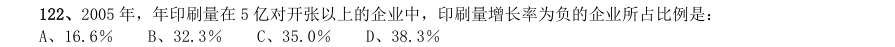

- **A.** 16.6%
- **B.** 32.3%
- **C.** 35.0%
- **D.** 38.3%

**答案：C**　**考点：比重计算与比较｜现期比重**
**【资料分析·基期量计算｜GK-2008-ty-X123】**

123. 2006 年,年印刷量在10 亿对开张以上的企业中,印刷量增长5%以上,且低于10%的企业有多少家:

- **A.** 3
- **B.** 4
- **C.** 5
- **D.** 8

**答案：B**　**考点：基期量计算｜已知现期与增长率求基期**
**【资料分析·综合分析｜GK-2008-ty-X124】**

124. 以下关于1994 至2006 年年印刷量、年增长率的说法中,正确的是:

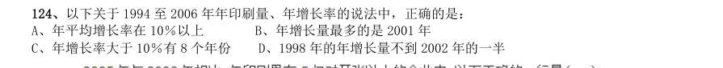

- **A.** 年平均增长率在10%以上
- **B.** 年增长量最多的是2001 年
- **C.** 年增长率大于10%有8 个年份
- **D.** 1998 年的年增长量不到2002 年的一半

**答案：A**　**考点：综合分析｜选错误项**
**【资料分析·基期量计算｜GK-2008-ty-X125】**

125. （本题题干为图形/公式，文字层无题干，图见原卷）

> （本题为图形题，选项为图片，见原卷）

**答案：B**　**考点：基期量计算｜已知现期与增长率求基期**
**【资料分析·增长率计算与比较｜GK-2008-ty-X126】**

126. 根据资料,下列可以解释报纸印刷量增长率变化的事例是:

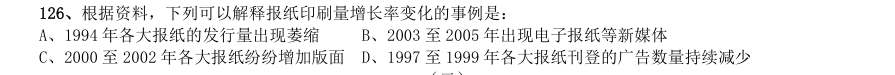

- **A.** 1994 年各大报纸的发行量出现萎缩
- **B.** 2003 至2005 年出现电子报纸等新媒体
- **C.** 2000 至2002 年各大报纸纷纷增加版面
- **D.** 1997 至1999 年各大报纸刊登的广告数量持续减少

**答案：B**　**考点：增长率计算与比较｜增长率计算**
**【资料分析·基期量计算｜GK-2008-ty-X127】**

127. 1990-2002 年间,当地人民食物获取状况恶化的地区是:

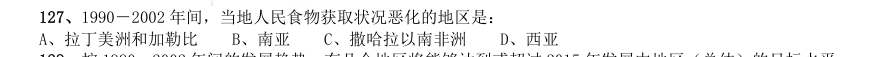

- **A.** 拉丁美洲和加勒比
- **B.** 南亚
- **C.** 撒哈拉以南非洲
- **D.** 西亚

**答案：D**　**考点：基期量计算｜基期量计算（综合）**
**【资料分析·基期量计算｜GK-2008-ty-X128】**

128. 按1990-2002 年间的发展趋势,有几个地区将能够达到或超过2015 年发展中地区(总体)的目标水平:

- **A.** 3 个
- **B.** 4 个
- **C.** 5 个
- **D.** 6 个

**答案：B**　**考点：基期量计算｜基期量计算（综合）**
**【资料分析·平均数计算｜GK-2008-ty-X129】**

129. 若南亚地区1992 年总人口数为15 亿,该地区平均人口年增长率为2%,那么2002 年南亚地区饥饿人口总 量为多少亿人:

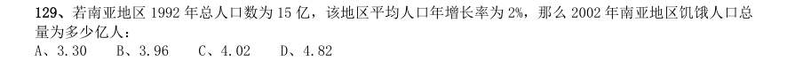

- **A.** 3.30
- **B.** 3.96
- **C.** 4.02
- **D.** 4.82

**答案：C**　**考点：平均数计算｜平均数增长率**
**【资料分析·基期量计算｜GK-2008-ty-X130】**

130. 下列说法中,不能从图示信息中获得支持的是: I.1992-2002 年间,北非饥饿人口的数量并没有因人口总量的变化而变化 II.1992-2002 年间,东南亚和南亚地区的饥饿人口比例基本能反映发展中地区的总体概况 III.1992-2002 年间,发展中地区的饥饿人口主要集中在南亚地区和撒哈拉以南非洲地区 IV.1992-2002 年间,东亚地区在改善人民饥饿状况的工作方面最为突出

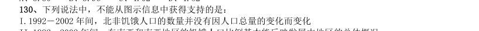

- **A.** I
- **B.** II 和III
- **C.** I 和III
- **D.** I 和IV

**答案：C**　**考点：基期量计算｜基期量计算（综合）**
**【资料分析·基期量计算｜GK-2008-ty-X131】**
> 材料：某市2005 年就该市城镇居民和农民参加体育锻炼及其影响因素,开展了一项调查。调查结束后按城乡、性 别分别进行了统计,统计结果如下两张表所示。

131. 表1:2005 年某市城镇居民和农民参加体育锻炼项目情况统计(%) 城镇 农村 男 女 武术健身气功 6.0 2.1 4.7 5.9 健身操舞秧歌 12.8 8.0 3.8 20.1 健美力量练习 7.3 5.8 8.5 5.4 自行车 23.8 21.0 24.7 21.8 登山 14.9 10.4 14.4 13.8 球类 16.8 37.9 19.9 步行 63.7 72.3 57.9 72.7 游泳 17.6 4.1 16.4 13.9 跑步 23.8 25.9 29.2 19.1 其他 13.3 9.5 11.9 13.3 表2:2005 年某市城镇居民和农民参加体育锻炼的影响因素(%) 城镇 农村 男 女 缺乏组织 8.8 3.6 7.0 7.4 缺乏指导 7.8 4.7 7.1 6.8 缺乏场地设施 13.2 8.0 12.1 14.1 工作忙、缺少时间 21.8 21.5 32.7 24.6 家务忙、缺少时间 9.2 20.8 17.6 10.5 体力工作多,不用参加 3.4 15.9 7.8 11.8 惰性 4.9 7.5 15.9 6.7 没兴趣 1.4 9.1 6.8 6.1 在各项体育项目的普及程度上,农村与城镇相比:

- **A.** 登山高于城镇
- **B.** 步行低于城镇
- **C.** 自行车高于城镇
- **D.** 健身操舞秧歌低于城镇

**答案：D**　**考点：基期量计算｜基期量计算（综合）**
**【资料分析·基期量计算｜GK-2008-ty-X132】**

132. 与男性相比,在女性中更普及的两个体育项目是:

- **A.** 球类步行
- **B.** 跑步游泳
- **C.** 步行健身操舞秧歌
- **D.** 健身操舞秧歌跑步

**答案：C**　**考点：基期量计算｜基期量计算（综合）**
**【资料分析·比重计算与比较｜GK-2008-ty-X133】**

133. 根据表2,在被调查的全体人群中,选择“缺乏组织”的人占全体人群的比例可能是:

- **A.** 5.2%
- **B.** 6.2%
- **C.** 7.1%
- **D.** 8.2%

**答案：C**　**考点：比重计算与比较｜现期比重**
**【资料分析·基期量计算｜GK-2008-ty-X134】**

134. 无法从表2 获得支持的判断是:

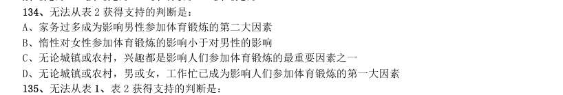

- **A.** 家务过多成为影响男性参加体育锻炼的第二大因素
- **B.** 惰性对女性参加体育锻炼的影响小于对男性的影响
- **C.** 无论城镇或农村,兴趣都是影响人们参加体育锻炼的最重要因素之一
- **D.** 无论城镇或农村,男或女,工作忙已成为影响人们参加体育锻炼的第一大因素

**答案：C**　**考点：基期量计算｜基期量计算（综合）**
**【资料分析·基期量计算｜GK-2008-ty-X135】**

135. 无法从表1、表2 获得支持的判断是:

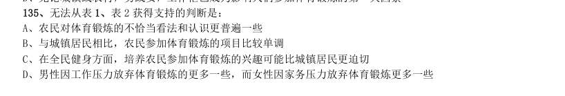

- **A.** 农民对体育锻炼的不恰当看法和认识更普遍一些
- **B.** 与城镇居民相比,农民参加体育锻炼的项目比较单调
- **C.** 在全民健身方面,培养农民参加体育锻炼的兴趣可能比城镇居民更迫切
- **D.** 男性因工作压力放弃体育锻炼的更多一些,而女性因家务压力放弃体育锻炼更多一些

**答案：D**　**考点：基期量计算｜基期量计算（综合）**
**【资料分析·比重计算与比较｜GK-2008-ty-X136】**

136. 表1:2001 至2005 年世界主要国家和地区经济增长率比较(%) 国家和地区 2001 年 2002 年 2003 年 2004 年 2005 年 2001 至2005 年 平均增长率 世界总计 2.4 3.0 4.1 5.3 4.9 4.0 发达国家和地区 1.2 1.5 1.9 3.2 2.6 2.1 美国 0.8 1.6 2.5 3.9 3.2 2.4 欧盟 2.0 1.3 1.4 2.4 1.8 1.8 日本 0.2 -0.3 1.8 2.3 2.6 1.4 发展中国家和地区 4.1 4.8 6.7 7.7 7.4 6.3 中国 7.5 8.3 10.0 10.1 10.2 9.5 印度 3.9 4.7 7.2 8.0 8.5 6.4 俄罗斯 5.1 4.7 7.3 7.2 6.4 6.1 巴西 1.3 1.9 0.5 4.9 2.3 2.2 马来西亚 0.3 4.4 5.5 7.2 5.2 4.5 亚洲四小龙 中国香港 0.5 1.9 3.2 8.6 7.3 4.3 中国台湾 -2.2 4.2 3.4 6.1 4.1 3.1 韩国 3.8 7.0 3.1 4.7 4.0 4.5 新加坡 -1.9 3.2 2.9 8.7 6.4 3.9 表2:2001 至2005 年国内生产总值居世界前10 位国家比较(亿美元) 位次 2001 年 2005 年 国家和地区 国内生 产总值 占世界的比 重(%) 国家和地区 国内生 产总值 占世界的比 重(%) 世界总计 315750 世界总计 443849 美国 100759 31.9 美国 124551 28.1 日本 41624 13.2 日本 45059 10.2 德国 18913 6.0 德国 27819 6.3 英国 14313 4.5 中国 22289 5.0 法国 13398 4.2 英国 21926 4.9 中国 13248 4.2 法国 21102 4.8 意大利 10904 3.5 意大利 17230 3.9 加拿大 2.2 西班牙 11237 2.5 墨西哥 2.0 加拿大 11152 2.5 西班牙 1.9 巴西 1.8 2005 年和2001 年相比较,国内生产总值占世界比重变化幅度最大的国家是:

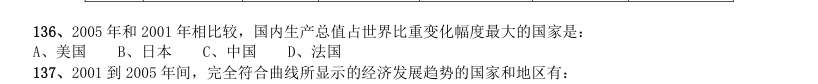

- **A.** 美国
- **B.** 日本
- **C.** 中国
- **D.** 法国

**答案：A**　**考点：比重计算与比较｜现期比重**
**【资料分析·基期量计算｜GK-2008-ty-X137】**

137. 2001 到2005 年间,完全符合曲线所显示的经济发展趋势的国家和地区有:

- **A.** 2 个
- **B.** 3 个
- **C.** 4 个
- **D.** 5 个

**答案：B**　**考点：基期量计算｜已知现期与增长率求基期**
**【资料分析·综合分析｜GK-2008-ty-X138】**

138. 下面描述不正确的是:

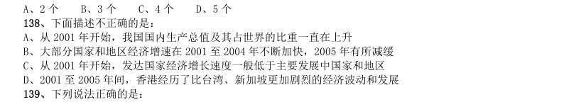

- **A.** 从2001 年开始,我国国内生产总值及其占世界的比重一直在上升
- **B.** 大部分国家和地区经济增速在2001 至2004 年不断加快,2005 年有所减缓
- **C.** 从2001 年开始,发达国家经济增长速度一般低于主要发展中国家和地区
- **D.** 2001 至2005 年间,香港经历了比台湾、新加坡更加剧烈的经济波动和发展

**答案：D**　**考点：综合分析｜选错误项**
**【资料分析·综合分析｜GK-2008-ty-X139】**

139. 下列说法正确的是: I.2001 至2005 年间,与主要发展中国家相比,亚洲四小龙的经济增长相对放慢 II.2001 至2005 年间,日本经济开始摆脱“停滞”状态,经济形势逐渐好转 III.2001 至2005 年间,国内生产总值在世界排名的变化趋势和其占世界比重的变化趋势是一致的

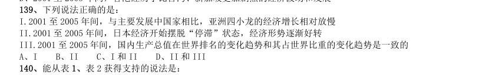

- **A.** I
- **B.** II
- **C.** I 和II
- **D.** II 和III

**答案：C**　**考点：综合分析｜选错误项**
**【资料分析·基期量计算｜GK-2008-ty-X140】**

140. 能从表1、表2 获得支持的说法是: I.整个世界的财富越来越集中到少数几个发达国家中 II.传统的世界经济强国在世界经济中的排名和地位已经发生了根本性变化 III.主要的发展中国家在世界经济中扮演着越来越重要的角色

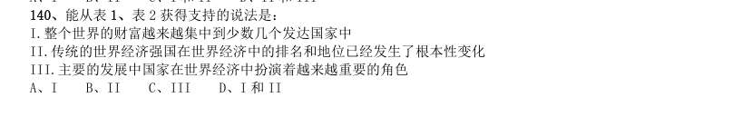

- **A.** I
- **B.** II
- **C.** III
- **D.** I 和II

**答案：C**　**考点：基期量计算｜已知现期与增长量求基期**