# 2010 年国考行测（统一卷）

- 题量：140（含答案 100）
- 模块分布：资料分析25 / 数量关系15 / 言语理解40 / 判断推理35 / 常识判断25
- 试卷编号：`国考-2010-统一卷`

## 题目与答案

**【言语理解·逻辑填空｜GK-2010-ty-X001】**
> 材料：项中选出一个最恰当的答案。

1. “诗是不可译的,中国古典诗歌更是不可译的。”爱好古典诗歌的中国人,包括不少作家、学者、翻译家常 常如是说,语气中带着七分 三分 。然而,话说回来,如果没有翻译,中国古典诗歌如何走 出国门,走向世界呢? 依此填入划横线部分最恰当的一项是:

- **A.** 自豪遗憾
- **B.** 无奈悲伤
- **C.** 感伤埋怨
- **D.** 骄傲惭愧

**答案：A**　**考点：逻辑填空｜一空**　**难度：★★☆☆☆**
**【言语理解·逻辑填空｜GK-2010-ty-X002】**

2. 茶艺与茶道精神是中国茶文化的核心,“艺”是指制茶、烹茶、品茶等艺茶之术,“道”是指艺茶过程中所 ______的精神。有道而无艺,那是______的理论;有艺而无道,艺则无精、无神。 依此填入画横线部分最恰当的一项是:

- **A.** 传达虚浮
- **B.** 包涵虚无
- **C.** 贯穿空洞
- **D.** 体现枯燥

**答案：C**　**考点：逻辑填空｜一空**　**难度：★★☆☆☆**
**【言语理解·逻辑填空｜GK-2010-ty-X003】**

3. 从20 世纪90 年代“人类基因工程”计划启动之日起,美国、日本、欧洲等展开了一场激烈的基因专利争夺 战,因为谁拥有专利,就意味着谁能在国际上获得______基因产业的“王牌”,谁就能拥有今后基因开发的庞大 市场,为此,美国等少数发达国家大量地将阶段性研究成果______申请了专利。 依此填入画横线部分最恰当的一项是:

- **A.** 垄断抢先
- **B.** 操作独立
- **C.** 控制自发
- **D.** 专营及时

**答案：A**　**考点：逻辑填空｜一空**　**难度：★★★☆☆**
**【言语理解·逻辑填空｜GK-2010-ty-X004】**

4. 明代工艺品的名字大都先强调年号,然后再强调东西本身。但景泰蓝不是在景泰年间出现,而是在元代就出 现了。到了景泰年间,皇家的重视使它 ,因此有了今天这样一个通俗易懂且带有文学色彩的名字—— 景泰蓝。 依此填入划横线部分最恰当的一项是:

- **A.** 如日中天
- **B.** 名声大噪
- **C.** 声名鹊起
- **D.** 享誉中外

**答案：C**　**考点：逻辑填空｜成语辨析**　**难度：★★☆☆☆**
**【言语理解·逻辑填空｜GK-2010-ty-X005】**

5. 五四运动后,许多人开始追求真理。追求真理的人们开始用新的眼光看中国、看世界,从对各种社会思潮、 政治主张和政治力量的______中认真思考,逐渐看到西方的种种社会______,开始怀疑资产阶级共和国的救国方 案。 依此填入画横线部分最恰当的一项是:

- **A.** 识别通病
- **B.** 甄别矛盾
- **C.** 辨别现象
- **D.** 鉴别弊端

**答案：D**　**考点：逻辑填空｜一空**　**难度：★★☆☆☆**
**【言语理解·逻辑填空｜GK-2010-ty-X006】**

6. 世界主要经济发展发达国家和地区目前已就发展低碳经济达成共识:以经济发展模式由“高碳”向“低碳” 转型为 ,通过市场机制下的经济手段推动低碳经济的发展,以减缓人类活动对气候的破坏并逐渐 达到一种互相 的良性发展状态。 依此填入画横线部分最恰当的一项是:

- **A.** 契机适应
- **B.** 目标协调
- **C.** 手段促进
- **D.** 标志制约

**答案：A**　**考点：逻辑填空｜一空**　**难度：★★☆☆☆**
**【言语理解·逻辑填空｜GK-2010-ty-X007】**

7. 与先秦不同,新生代的中国研究人员不愿意 接受古籍中的描写,在希冀精确追溯中国历史的 尝试中,他们所 的是实物、数据以及更为“西式”的方法。 依此填入划横线部分最恰当的一项是:

- **A.** 被动依靠
- **B.** 全盘倚重
- **C.** 直接擅长
- **D.** 无端强调

**答案：B**　**考点：逻辑填空｜一空**　**难度：★☆☆☆☆**
**【言语理解·逻辑填空｜GK-2010-ty-X008】**

8. 研究发现,睡眠存在障碍与很多疾病有着难以______的联系。有时候通过改善睡眠状态,可连带对另一种疾 病的治疗起到______的功效。 依此填入画横线部分最恰当的一项是:

- **A.** 割裂一石二鸟
- **B.** 分割正本清源
- **C.** 确认投石问路
- **D.** 区分釜底抽薪

**答案：A**　**考点：逻辑填空｜成语辨析**　**难度：★☆☆☆☆**
**【言语理解·逻辑填空｜GK-2010-ty-X009】**

9. 古训“失之毫厘,谬以千里”与“胡蜂效应” ,两者都告诫要特别注意初始条件。对微小差别 应该保持高度的灵敏度和警觉性。事物发展结果往往对初始条件具有较为敏感的依赖性,初始条件的极其细微的 改变,都会在系统后期出现 ,从而引起结果的极大差异。 依此填入划横线部分最恰当的一项是:

- **A.** 殊途同归问题
- **B.** 不谋而合歪曲
- **C.** 异曲同工偏差
- **D.** 大同小异变异

**答案：C**　**考点：逻辑填空｜成语辨析**　**难度：★★☆☆☆**
**【言语理解·逻辑填空｜GK-2010-ty-X010】**

10. 对大多数人来说,岗位是个人历练成长的基石,除了极少数的人能 创建自己的事业,大多数人 都必须走一条相同的路:在岗位上磨练,依托 奠定未来事业的基础。 依此填入划横线部分最恰当的一项是:

- **A.** 直接组织
- **B.** 主动团队
- **C.** 独立同事
- **D.** 一手集体

**答案：A**　**考点：逻辑填空｜一空**　**难度：★☆☆☆☆**
**【言语理解·逻辑填空｜GK-2010-ty-X011】**

11. 胡蜂在本能下______营造自己的生活、生存中心。它的巢是______的房子。蔡伦在改进造纸术之前目睹过胡 蜂的建筑过程而受到启发,无疑便是世界上最早的仿生学家了。 依此填入画横线部分最恰当的一项是:

- **A.** 独具匠心名不虚传
- **B.** 自然而然货真价实
- **C.** 兢兢业业巧夺天工
- **D.** 无师自通名副其实

**答案：D**　**考点：逻辑填空｜成语辨析**　**难度：★★☆☆☆**
**【言语理解·逻辑填空｜GK-2010-ty-X012】**

12. 在现实生活中,做人的学问往往比做事的学问更具有实用价值,更重要也更难掌握。做事仅靠技术就 能 ,做人则是一门弹性极强的艺术。讲求的是无法量化和 的分寸感,做事学一次即有 毕业的可能,做人却活到老学到老,要一辈子下功夫。 依此填入划横线部分最恰当的一项是:

- **A.** 独当一面学习
- **B.** 如鱼得水把握
- **C.** 游刃有余控制
- **D.** 臻于佳境复制

**答案：D**　**考点：逻辑填空｜成语辨析**　**难度：★★☆☆☆**
**【言语理解·逻辑填空｜GK-2010-ty-X013】**

13. “器大者声必闳,志高者意必远。”新闻作品要想成为历史的“宏音”、时代的“响箭”,新闻记者就必须 胸怀全局 、深入 新闻的理性力量,使新闻语言具有一种理性美。 依此填入划横线部分最恰当的一项是:

- **A.** 高瞻远瞩分析
- **B.** 高屋建瓴发掘
- **C.** 见微知著彰显
- **D.** 由表及里剖析

**答案：B**　**考点：逻辑填空｜成语辨析**　**难度：★☆☆☆☆**
**【言语理解·逻辑填空｜GK-2010-ty-X014】**

14. 既然编全集,希望完整地 某一文人学者的形象,正反两方面的资料便都应该保留下来。可说实 话,古往今来,经得起这么折腾的人物不是很多,你很认真地为其辑佚、整理、不放过任何 ,好不容易 弄出全集来,不只没加分,还减分。 依此填入划横线部分最恰当的一项是:

- **A.** 描绘蛛丝马迹
- **B.** 还原一鳞半爪
- **C.** 展现闲言细语
- **D.** 呈现只言片语

**答案：D**　**考点：逻辑填空｜成语辨析**　**难度：★★☆☆☆**
**【言语理解·逻辑填空｜GK-2010-ty-X015】**

15. 媒介的诞生是为了推动人类社会的发展,而人们使用媒介的独特性也是为了不断提升和完善自己的生活,这 两者本来都有良好的______。然而,科学技术与人类意识发展上的失衡,导致媒介在被过度使用的过程中有时会 脱离人的______。 依此填入画横线部分最恰当的一项是:

- **A.** 出发点掌控
- **B.** 适应性规划
- **C.** 侧重点控制
- **D.** 目的性约束

**答案：A**　**考点：逻辑填空｜一空**　**难度：★★☆☆☆**
**【言语理解·逻辑填空｜GK-2010-ty-X016】**

16. 在确立以夏、商、周为核心的中国上古史基本框架的基础上,“夏商周断代工程”将历谱推定、文献梳理、 考古与碳十四测定等课题研究成果加以整合,提出了夏商周年表。尽管这个年代表还有不够 之处,但它 的提出毕竟标志着中国的上古史已不是 的传说,而是可信的历史了。 依此填入划横线部分最恰当的一项是:

- **A.** 细致子虚乌有
- **B.** 精准虚无缥缈
- **C.** 合理扑朔迷离
- **D.** 精确空穴来风

**答案：B**　**考点：逻辑填空｜成语辨析**　**难度：★★★☆☆**
**【言语理解·逻辑填空｜GK-2010-ty-X017】**

17. 成本过高是可再生能源发展的最大 。就电力而言,风电是最接近商业化的可再生能源,但成本仍然 比火力发电高;太阳能发电成本就更高了,是火电的数倍。因而降低成本是可再生能源 化发展的关键。 依此填入划横线部分最恰当的一项是:

- **A.** 阻碍产业
- **B.** 障碍规模
- **C.** 问题市场
- **D.** 瓶颈现代

**答案：B**　**考点：逻辑填空｜一空**　**难度：★★☆☆☆**
**【言语理解·逻辑填空｜GK-2010-ty-X018】**

18. 面对不断出现的消费和产业成长热点,企业的注意力应首先放在寻求高成长产业的“先进入” 上, 以 供不应求阶段的高额利润,而其进入者不断增加,竞争加剧后,企业则应将重点放在低成本为 的 价格竞争上,以保住和扩大市场份额。 依此填入划横线部分最恰当的一项是:

- **A.** 缺口垄断特征
- **B.** 前景瓜分手段
- **C.** 机遇谋取基础
- **D.** 许可获取支撑

**答案：C**　**考点：逻辑填空｜一空**　**难度：★★☆☆☆**
**【言语理解·逻辑填空｜GK-2010-ty-X019】**

19. 颜真卿“守其正,全其节”的气节备受后世______,人见其书,往往______他的人品。欧阳修称“其字画刚 劲独立,不袭前迹,有似其为人”,即使对其楷书有些______的米芾,也认为可以从颜体中感到一种“昂然不可 侵犯之色”。 依此填入画横线部分最恰当的一项是:

- **A.** 推崇联想微词
- **B.** 仰慕追怀保留
- **C.** 称颂认同不满
- **D.** 赞誉映照非议

**答案：A**　**考点：逻辑填空｜一空**　**难度：★★☆☆☆**
**【言语理解·逻辑填空｜GK-2010-ty-X020】**

20. 回到故乡时,发现故乡的传统生活方式正在消亡,村里的人们曾经拥有一个 而完整的精神世界,但 是外面的世界改变了这一切,这个村正在 而又急速的转型,只是生活在其中的人 。 依此填入划横线部分最恰当的一项是:

- **A.** 美好不着痕迹似信非信
- **B.** 淳朴潜移默化漠然无知
- **C.** 单一默不作声懵懵懂懂
- **D.** 封闭悄无声息浑然不觉

**答案：D**　**考点：逻辑填空｜成语辨析**　**难度：★★☆☆☆**
**【言语理解·中心理解｜GK-2010-ty-X021】**

21. 法国著名寓言作家拉封·丹笔下有这样一则寓言:北风和南风比威力,看谁能把行人身上的大衣吹掉。北风 呼呼地刮,想让凛冽的狂风刮走人们身上的衣服,结果行人为抵御寒冷侵袭,把大衣裹得更紧。南风徐徐吹动, 温暖和煦,行人觉得很暖和,便解开纽扣,脱掉了大衣,南风获胜。 这个寓言意在告诉人们:

- **A.** 方法得当柔可克刚
- **B.** 实践是检验真理的唯一标准
- **C.** 具体问题具体分析
- **D.** 工欲善其事,必先利其器

**答案：A**　**考点：中心理解｜转折与因果**　**难度：★★★☆☆**
**【言语理解·中心理解｜GK-2010-ty-X022】**

22. 呈现大自然多样性的热带森林是许多动物最后的栖息地,它们的存在对人类来说极其重要。面对热带森林被 严重破坏的状况,人们很容易忘记,这是温带地区大部分森林已经遭遇过的:在已开发地区,大量原始森林消失 了;在开发区,尤其在严重降雨区平原森林砍伐严重,一旦那些山坡的植物被冲坏,就会引起诸如洪水和泥土坍 塌等问题。多数植物种类分布广泛,能够承受局部砍伐并幸存下来,但也有些种类分布范围很狭窄,过量砍伐会 使之永远消失。 根据这段文字,可以看出作者的意图是:

- **A.** 呼吁重视与加强对温带森林的保护
- **B.** 说明温带森林实际上更易遭到破坏
- **C.** 分析乱砍滥伐森林的严重后果
- **D.** 强调森林对人类生存的重要性

**答案：D**　**考点：中心理解｜转折与因果**　**难度：★★★★☆**
**【言语理解·中心理解｜GK-2010-ty-X023】**

23. 有人说,凡是知识都是科学的,凡是科学都是无颜色的,并且在追求知识时,我们要知道没有颜色的态度, 假使这种说法不随意扩大,我也认同。但我们要知道,只要是一个活生生的人,便必然有颜色。对无颜色的知识 的追求,必定潜伏着一种有颜色的力量,在后面或底层加以推动。这一推动力量,不仅决定一个人追求知识的方 向与成果,也决定一个人对知识是否真诚。 这段文字中“有颜色的力量”指的是:

- **A.** 研究态度
- **B.** 价值取向
- **C.** 道德水准
- **D.** 兴趣爱好

**答案：B**　**考点：中心理解｜对策优先**　**难度：★★★★☆**
**【言语理解·中心理解｜GK-2010-ty-X024】**

24. 中国古代的科学著作大多是经验型的总结,而不是理论型的探讨,所记各项发明都是为了解决国家与社会生 活中的实际问题,而不是试图在某一研究领域获得重大突破。从研究方法上来说,中国科技重视综合性的整体研 究,重视从总体上把握事物,而不是把研究对象从错综复杂的联系中分离出来,独立研究它们的实体和属性,细 致探讨它们的奥秘。这使得中国古代的科学技术没有向更高层次发展。 这段文字重在说明:

- **A.** 研究方法的缺陷使中国古代科技长期停滞不前
- **B.** 解决实际问题是推动中国古代科技发展的动力
- **C.** 中国古代的科学研究关注的重点及其历史背景
- **D.** 中国古代的科技水平没有长足进步的根本原因

**答案：D**　**考点：中心理解｜中心句与主旨**　**难度：★★★★☆**
**【言语理解·中心理解｜GK-2010-ty-X025】**

25. 古希腊古罗马是西方文明的摇篮,西方哲学、美学及各种艺术形式始于此,西方的音乐文化也由此开始,这 个时期出现过最早基于口头传唱的希腊长诗,如《伊利亚特》和《奥德赛》;数学家毕达哥拉斯揭示了音乐与数 学之间的关系;著名的三大悲剧家埃斯库罗斯、欧里庇得斯、索福克勒斯既是戏剧家也是音乐家,在他们的戏剧 中,音乐发挥了奇妙的作用。 从这段文字可以看出,古希腊古罗马时期音乐文化的特点是:

- **A.** 含义比现在更为狭窄
- **B.** 与其他艺术及科学联系密切
- **C.** 与艺术和哲学有严格的区分
- **D.** 内容主要涉及数学和戏剧

**答案：B**　**考点：中心理解｜中心句与主旨**　**难度：★★★★☆**
**【言语理解·中心理解｜GK-2010-ty-X026】**

26. 传统的动物资源保护措施主要是划定保护区或建立保种基础。这些措施能很好地保护物种的多样性,但也存 在一些缺点:保护区面积大,偷猎现象屡禁不止;建立良种基地保护地方品种投资大,时间长,容易出现近亲繁 殖、物种衰退等现象。试管、克隆、冷冻保存等生物技术新成果的问世,为动物遗传资源的保护和利用开辟了新 途径,建造“动物诺亚方舟”不再是天方夜谭。 这段文字主要介绍了:

- **A.** 保护动物物种多样性所取得的突破性进展
- **B.** 动物资源保护促成了生物技术新成果的诞生
- **C.** 生物技术的进步为动物资源保护开辟了新天地
- **D.** 传统资源保护措施所遇到的困难和取得的进步

**答案：C**　**考点：中心理解｜中心句与主旨**　**难度：★★★★☆**
**【言语理解·中心理解｜GK-2010-ty-X027】**

27. 今天,随着科学技术的迅速发展,人们的物质与精神文化需求日益增长,小范围、低水平的科普活动已经不 适应时代的发展。“理解科学”这个大“科普”,便成为迫切需要全社会关注的重大课题。随着科学技术的纵深 发展,科学技术逐渐形成了自己的概念和逻辑体系,也渐渐远离了大众的视线与常识。人们很难凭借以往的知识 结构和经验,来准确理解科学及其所引起的各种变化,很难判断其社会价值与意义,这就使得一些科学技术成为 横亘在人类发展道路上的知识壁垒。 这段文字意在说明:

- **A.** 公民的科学素养与飞速发展的科学存在差距
- **B.** 提高科普工作水平所面临的种种困难
- **C.** 现代科学技术有成为知识壁垒的可能
- **D.** 在新形势下提升科普工作水平的必要性

**答案：D**　**考点：中心理解｜对策优先**　**难度：★★★★☆**
**【言语理解·下文推断｜GK-2010-ty-X028】**

28. 几千年前,在非洲湿热的原始森林里,土著居民围着火堆,跟随各种复杂节奏自由而热烈地边舞边唱。这种 歌声,也许在某些“文明人”眼里算不上音乐。然而,这样的声音却是最原始的,是在恶劣环境里顽强的本能所 发出的生命之音,如果说布鲁斯音乐是很多音乐的根源,那么,上面所说的便是这个根源的根源。 这段文字是一篇文章的引言,文章接下来最应该讲述的是:

- **A.** 人类本能在原始音乐中的表现
- **B.** 布鲁斯音乐与土著音乐的源流关系
- **C.** 土著音乐产生的历史背景
- **D.** 自然环境与音乐风格的关系

**答案：B**　**考点：下文推断｜下文推断**　**难度：★★★☆☆**
**【言语理解·中心理解｜GK-2010-ty-X029】**

29. 一只小型广告灯箱一年可以杀死约35 万只昆虫。亮如白昼的夜晚还会严重影响昆虫特别是成虫的生命周期。 昆虫是自然界食物链中的一个重要环节,很多小型动物、鸟类和蝙蝠以昆虫为主要食物,许多植物靠昆虫授粉, 如果昆虫的种类和数量发生变化,必将严重影响生态环境。过度的照明对能源浪费和环境污染的压力更是不言而 喻。 这段文字意在强调:

- **A.** 光照对动植物生长的主要影响
- **B.** 自然界各物种之间的关系密切
- **C.** 光污染对自然生态平衡的干扰
- **D.** 昆虫在自然界中的重要作用

**答案：C**　**考点：中心理解｜转折与因果**　**难度：★★★☆☆**
**【言语理解·中心理解｜GK-2010-ty-X030】**

30. 有人说,经济领域与道德领域的规则不一样,经济领域强调的是“经济人”角色,以取得更大、更多的利润 为做事原则;而道德领域则要求奉献、利他、互助等。其实,经济领域固然有供求信号、等价交换、产权明晰、 利润最大化等规则,但既然它是人们的社会活动,道德原则也会每时每刻渗透其中,两者难以清晰地割裂开来。 这段文字意在强调:

- **A.** 市场经济中伦理道德的作用是必然存在的
- **B.** 社会性是经济领域和道德领域的共同属性
- **C.** 社会活动中各领域的价值观念在相互渗透
- **D.** 在社会活动中需兼顾经济原则与道德原则

**答案：A**　**考点：中心理解｜中心句与主旨**　**难度：★★★☆☆**
**【言语理解·中心理解｜GK-2010-ty-X031】**

31. 与硬实力相比,软实力偏重的是一种影响力、一种精神性。一个城市的软实力是外界对这个城市吸引力、感 染力的直觉反应和头脑印记,是市民对这座城市的认同与依恋,是城市管理者智慧与情怀的折射。软实力与硬实 力结合,构成了一个城市的整体实力,而两者相加并非一个常数,软实力直接影响着硬实力效能的发挥。软实力 像一条绳子,硬实力像一堆硬干柴,绳子虽软,却可以把硬干柴紧紧捆绑在一起,形成铸造一座美好城市的巨大 能量。 这段文字意在说明:

- **A.** 城市整体实力的概念及其构成
- **B.** 城市软实力的内涵及其重要性
- **C.** 城市软实力和硬实力各有侧重
- **D.** 城市软实力和硬实力相得益彰

**答案：B**　**考点：中心理解｜主题词**　**难度：★★★★☆**
**【言语理解·中心理解｜GK-2010-ty-X032】**

32. 改革开放以来,我国经济总体上保持了高速增长态势,但劳动就业的增长却远远低于经济增长的速度。目前, 尽管我国服务业吸纳劳动就业的比重在不断上升,甚至已经成为吸纳就业的主力军,并且基本消化了包括从农业 和制造业中转移出来的劳动力存量在内的所有新增劳动力,但与发达国家相比,它对劳动就业的贡献率还是太低。 我们务必利用产业结构调整和增长模式转变的机会,发掘服务业对发展经济和扩大就业的巨大潜力。 这段文字主要说明了:

- **A.** 产业结构调整是我国服务业快速发展的重要契机
- **B.** 服务业是保障我国就业快速增长的重要推动因素
- **C.** 我国服务业对劳动就业的吸纳能力有待进一步拓展
- **D.** 就业与经济增长不一致的主要原因在于服务业发展滞后

**答案：C**　**考点：中心理解｜主题词**　**难度：★★★★☆**
**【言语理解·语句排序｜GK-2010-ty-X033】**

33. 1单纯罗列史料,构不成历史 2只有在史料引导下发挥想象力,才能把历史人物和事件的丰富内涵表现出来 3历史研究不仅需要发掘史料,而且需要史学家通过史料发挥合理想象 4所谓合理想象,就是要尽可能避免不实之虚构 5这是一种悖论,又难以杜绝 6但是,只要想象就难以避免不实虚构出现 将以上6 个句子重新排列,语序正确的是:

- **A.** 456321
- **B.** 312465
- **C.** 562146
- **D.** 134652

**答案：B**　**考点：语句排序｜语句排序**　**难度：★★★★★**
**【言语理解·语句排序｜GK-2010-ty-X034】**

34. 1在丹麦、瑞典等北欧国家发现和出土的大量石斧、石制矛头、箭头和其他石制工具以及用树干造出的独木 舟便是遗证 2陆地上的积冰融化后,很快就出现了苔藓、地农和细草,这些冻土原始植物引来了驯鹿等动物 3又常年受着从西面和西南面刮来的大西洋暖湿气流的影响,很适合生物的生长 4动物又吸引居住在中欧的猎人在夏天来到北欧狩猎 5北欧虽说处于高纬度地区,但这一带正是北大西洋暖流流经的地方 6这大约发生在公元前8000 年到公元前6000 年的中石器时代 将以上6 个句子重新排列,语序正确的是:

- **A.** 624153
- **B.** 523416
- **C.** 653241
- **D.** 532461

**答案：D**　**考点：语句排序｜语句排序**　**难度：★★★★★**
**【言语理解·中心理解｜GK-2010-ty-X035】**

35. 避讳是为了表示对封建君主和尊者的敬畏,必须避免直接说出他们的名字而采用别的方式加以表达,它是封 建宗法制度的产物,又是家天下和尊祖敬宗的体现。它起源于西周,完备于秦汉,盛行于唐宋,到清代的雍正、 乾隆年间发展到极致。避讳作为封建社会特有的禁忌制度目前已经消亡了,但是,不许犯忌和害怕犯忌的双向心 理并没有消除,避讳已经演变为某些趋吉避凶的习俗,在现实生活中的影响依然存在。 根据这段文字,以下说法正确的是:

- **A.** 封建社会的发展使得避讳愈来愈严格
- **B.** 趋吉避凶的心理使人们进行各种避讳
- **C.** 在当今现实生活中仍然存在避讳现象
- **D.** 避讳由统治者运用国家权力强令实行

**答案：C**　**考点：中心理解｜对策优先**　**难度：★★★★☆**
**【言语理解·中心理解｜GK-2010-ty-X036】**

36. 在安科莱,以畜牧为生的希马人和以农业为生的伊鲁人共同居住;在亚利桑那,纳瓦霍人以前靠狩猎和采集 为生,现在主要以畜牧为主,他们与经营农业的霍皮人为邻;澳洲东南沿海地带以前住着以狩猎和劫掠粮食为生 的土著居民,现在却住着从事农业、畜牧业及工业的欧洲人。 作者列举这些事实意在说明:

- **A.** 环境迫使人们接受某种生活方式
- **B.** 人们对自然环境有很强的适应能力
- **C.** 不同文化的族群完全有可能和谐相处
- **D.** 地理环境并非人类生产方式的决定因素

**答案：D**　**考点：中心理解｜中心句与主旨**　**难度：★★★☆☆**
**【言语理解·中心理解｜GK-2010-ty-X037】**

37. 哲学曾经是一种生活方式。所谓苏格拉底的哲学,不只是和别人对话的方法,以及他在对话中提出的种种理 论,更是他不立文字、浪迹街头、四处与人闲聊的生活方式。哲学从一开始就不是一种书面的研究,而是一种过 日子的办法。只不过我们后来都忘记了这段,把它变成远离日常的艰深游戏。即便是很多人眼中刻板的康德,也 不忘区分“学院意义的哲学”和“入世意义的哲学”,并且以后者为尊。 这段文字意在说明:

- **A.** 哲学源于生活,应服务于民众
- **B.** 如今的哲学发展偏离了他的本质
- **C.** 康德和苏格拉底的哲学观念一脉相承
- **D.** 当代人们对哲学的诠释方式发生了改变

**答案：A**　**考点：中心理解｜中心句与主旨**　**难度：★★★★☆**
**【言语理解·中心理解｜GK-2010-ty-X038】**

38. 炮制技术被认为是中医药的核心技术,也是中医独有的传统技能,掌握它就等于掌握了中医药市场。国外企 业通常通过在我国开办饮片加工厂、聘请国内炮制专家“偷学”炮制技术,目前这样的外资企业达到几十家。这 是因为,一些地方政府对国家在特殊领域的规定并不了解,无从管起;还有一些地方政府虽明知这些规定,但为 了经济指标,对此不管不顾。调研表明,国内实际饮片厂数量比国家药监局公布的多几百家。 这段文字意在表明:

- **A.** 国家应加强对炮制技术保密工作的管理
- **B.** 政府应加强对设立中药饮片厂的资格审查
- **C.** 我国中医药行业的发展受到外资企业的威胁
- **D.** 地方政府应该加强对中医药行业相关规定的了解

**答案：A**　**考点：中心理解｜对策优先**　**难度：★★★★☆**
**【言语理解·中心理解｜GK-2010-ty-X039】**

39. 世界记忆工程是世界遗产项目的延续。世界遗产项目是联合国教科文组织于1972 年发起的,比世界记忆工 程早20 年,它关注的是自然和人工环境中具有突出意义和普遍价值的文化和自然遗产,如具有历史、美学、考 古、科学和人类学研究价值的建筑物或遗址。而世界记忆工程关注的是文献遗产,具体讲就是手稿、图书馆和档 案馆保存的任何介质的珍贵文件,以及口述历史的记录等。 根据这段文字,世界遗产项目与世界记忆工程的主要区别体现在:

- **A.** 文化与档案
- **B.** 实物与遗迹
- **C.** 实物与记录
- **D.** 遗产与文献

**答案：C**　**考点：中心理解｜转折与因果**　**难度：★★★★☆**
**【言语理解·中心理解｜GK-2010-ty-X040】**

40. 中国古代礼制要求服装尽力遮掩身体的各种凹凸,在裁制冕服时可以忽略人体各部位的三维数据,不需要进 行细致的测量。冕服章纹要有效地体现等级区别,图案就必须清晰可辨、鲜明突出。这使中国古代服饰中与服饰 图案相关的绘、染、织、绣等工艺技术相当发达,也使中国古代服装的裁制向着有利于突出图案的方向发展。与 西方重视身体三维数据、要求服装紧窄合体的立体剪裁法不同,中国古代无论是冕服对人所占空间的扩大,还是 图案对冕服平面风格的要求,都指向了中国传统服装宽大适体的平面剪裁法。 这段文字意在说明:

- **A.** 礼制对官员服装的规定制约了中国古代服饰艺术的发展
- **B.** 中西方剪裁方法的分化以冕服的产生与发展为特征
- **C.** 中国古代服装的剪裁方法推动了印染技术的发展
- **D.** 礼制的要求使中国传统服装采用了平面剪裁法

**答案：D**　**考点：中心理解｜对策优先**　**难度：★★★★☆**
**【数量关系·数字推理｜GK-2010-ty-X041】**

41. 1,6,20,56,144,( )

- **A.** 256
- **B.** 244
- **C.** 352
- **D.** 384

**答案：C**　**考点：数字推理｜等差数列**　**难度：★★★★☆**
**【数量关系·数字推理｜GK-2010-ty-X042】**

42. 1,2,6,15,40,104,()

- **A.** 273
- **B.** 329
- **C.** 185
- **D.** 225

**答案：A**　**考点：数字推理｜递推与多级数列**　**难度：★★★★☆**
**【数量关系·数字推理｜GK-2010-ty-X043】**

43. 3,2,11,14,( ),34

- **A.** 18
- **B.** 21
- **C.** 24
- **D.** 27

**答案：D**　**考点：数字推理｜幂次数列**　**难度：★★★★☆**
**【数量关系·数字推理｜GK-2010-ty-X044】**

44. 2,3,7,16,65,321,( )

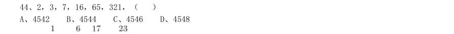

- **A.** 4542
- **B.** 4544
- **C.** 4546
- **D.** 4548

**答案：C**　**考点：数字推理｜幂次数列**　**难度：★★★★☆**
**【数量关系·数字推理｜GK-2010-ty-X045】**

45. 1, , , , ,( )

- **A.** 28/45
- **B.** 117/191
- **C.** 31/47
- **D.** 122/199

**答案：D**　**考点：数字推理｜分数与组合数列**　**难度：★★★★☆**
**【数量关系·排列组合｜GK-2010-ty-X046】**

46. 某单位订阅了30 份学习材料发放给3 个部门,每个部门至少发放9 份材料。问一共有多少种不同的发放方 法:

- **A.** 7
- **B.** 9
- **C.** 10
- **D.** 12

**答案：C**　**考点：排列组合｜基础排列组合**　**难度：★★★★★**
**【数量关系·其他数量关系｜GK-2010-ty-X047】**

47. 某高校对一些学生进行问卷调查。在接受调查的学生中,准备参加注册会计师考试的有63 人,准备参加英 语六级考试的有89 人,准备参加计算机考试的有47 人,三种考试都准备参加的有24 人,准备选择两种考试都 参加的有46 人,不参加其中任何一种考试的有15 人。问接受调查的学生共有多少人:

- **A.** 120
- **B.** 144
- **C.** 177
- **D.** 192

**答案：A**　**考点：其他数量关系｜和差倍比**　**难度：★★★☆☆**
**【数量关系·其他数量关系｜GK-2010-ty-X048】**

48. 某地劳动部门租用甲、乙两个教室开展农村实用人才培训。两教室均有5 排座位,甲教室每排可坐10 人, 乙教室每排可坐9 人。两教室当月共举办该培训27 次,每次培训均座无虚席,当月培训1290 人次。 问甲教室当月共举办了多少次这项培训:

- **A.** 8
- **B.** 10
- **C.** 12
- **D.** 15

**答案：D**　**考点：其他数量关系｜基础计算**　**难度：★★★☆☆**
**【数量关系·最值问题｜GK-2010-ty-X049】**

49. 某城市居民用水价格为:每户每月不超过5 吨的部分按4 元/吨收取,超过5 吨不超过10 吨的部分按6 元/ 吨收取,超过10 吨的部分按8 元/吨收取。某户居民两个月共交水费108 元,则该户居民这两个月用水总量最多 为多少吨:

- **A.** 21
- **B.** 24
- **C.** 17.25
- **D.** 21.33

**答案：A**　**考点：最值问题｜最值优化**　**难度：★★★★★**
**【数量关系·其他数量关系｜GK-2010-ty-X050】**

50. 一公司销售部有4 名区域销售经理,每人负责的区域数相同,每个区域都正好有两名销售经理负责,而任意 两名销售经理负责的区域只有1 个相同。 问这4 名销售经理总共负责多少个区域的业务:

- **A.** 12
- **B.** 8
- **C.** 6
- **D.** 4

**答案：C**　**考点：其他数量关系｜其他数量关系（综合）**　**难度：★★☆☆☆**
**【数量关系·利润问题｜GK-2010-ty-X051】**

51. 一商品的进价比上月低了5%,但超市仍按上月售价销售,其利润率提高了6 个百分点,则超市上月销售该 商品的利润率为:

- **A.** 12%
- **B.** 13%
- **C.** 14%
- **D.** 15%

**答案：C**　**考点：利润问题｜基础利润**　**难度：★☆☆☆☆**
**【数量关系·年龄问题｜GK-2010-ty-X052】**

52. 一位长寿老人生于19 世纪90 年代,有一年他发现自己的年龄的平方刚好等于当年的年份。问这位老人出生 于哪一年?

- **A.** 1894 年
- **B.** 1892 年
- **C.** 1898 年
- **D.** 1896 年

**答案：B**　**考点：年龄问题｜年龄问题（综合）**　**难度：★☆☆☆☆**
**【数量关系·最值问题｜GK-2010-ty-X053】**

53. 科考队员在冰面上钻孔获取样本,测量不同空心之间的距离,获得的部分数据分别为1 米、3 米、6 米、12 米、24 米、48 米。问科考队员至少钻了多少个孔:

- **A.** 4
- **B.** 5
- **C.** 6
- **D.** 7

**答案：D**　**考点：最值问题｜最值优化**　**难度：★★★★☆**
**【数量关系·行程问题｜GK-2010-ty-X054】**

54. 某旅游部门规划一条从甲景点到乙景点的旅游线路,经测试,旅游船从甲到乙顺水匀速行驶需3 小时;从乙 返回甲逆水匀速行驶需4 小时,假设水流速度恒定,甲乙之间的距离为y 公里,旅游船在静水中匀速行驶y 公里 需 小时,则 满足的方程为:

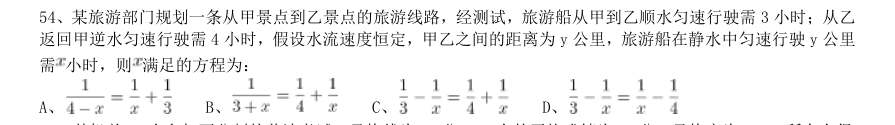

- **A.** 
- **B.** 
- **C.** 
- **D.** 

**答案：D**　**考点：行程问题｜流水行船**　**难度：★★☆☆☆**
**【数量关系·其他数量关系｜GK-2010-ty-X055】**

55. 某机关20 人参加百分制的普法考试,及格线为60 分,20 人的平均成绩为88 分,及格率为95%。所有人得 分均为整数,且彼此得分不同。问成绩排名第十的人最低考了多少分:

- **A.** 88
- **B.** 89
- **C.** 90
- **D.** 91

**答案：暂缺**　**考点：其他数量关系｜其他数量关系（综合）**　**难度：★☆☆☆☆**
**【判断推理·图形推理｜GK-2010-ty-X056】**

56. 从所给的四个选项中,选择最合适的一个填入问号处,使之呈现一定的规律性:

> （本题为图形题，选项为图片，见原卷）

**答案：暂缺**　**考点：图形推理｜图形推理（综合）**　**难度：★★★☆☆**
**【判断推理·图形推理｜GK-2010-ty-X057】**

57. 请从所给的四个选项中,选择最合适的一个填入问号处,使之呈现一定的规律性:

> （本题为图形题，选项为图片，见原卷）

**答案：暂缺**　**考点：图形推理｜图形推理（综合）**　**难度：★★★☆☆**
**【判断推理·图形推理｜GK-2010-ty-X058】**

58. 请从所给的四个选项中,选择最合适的一个填入问号处,使之呈现一定的规律性:

> （本题为图形题，选项为图片，见原卷）

**答案：暂缺**　**考点：图形推理｜图形推理（综合）**　**难度：★★★☆☆**
**【判断推理·图形推理｜GK-2010-ty-X059】**

59. 请从所给的四个选项中,选择最合适的一个填入问号处,使之呈现一定的规律性:

> （本题为图形题，选项为图片，见原卷）

**答案：暂缺**　**考点：图形推理｜图形推理（综合）**　**难度：★★★☆☆**
**【判断推理·图形推理｜GK-2010-ty-X060】**

60. 从所给的四个选项中,选择最合适的一个填入问号处,使之呈现一定的规律性:

> （本题为图形题，选项为图片，见原卷）

**答案：暂缺**　**考点：图形推理｜图形推理（综合）**　**难度：★★★☆☆**
**【判断推理·图形推理｜GK-2010-ty-X061】**

61. 从所给的四个选项中,选择最合适的一个填入问号处,使之呈现一定的规律性:

> （本题为图形题，选项为图片，见原卷）

**答案：暂缺**　**考点：图形推理｜图形推理（综合）**　**难度：★★★☆☆**
**【判断推理·图形推理｜GK-2010-ty-X062】**

62. 从所给的四个选项中,选择最合适的一个填入问号处,使之呈现一定的规律性:

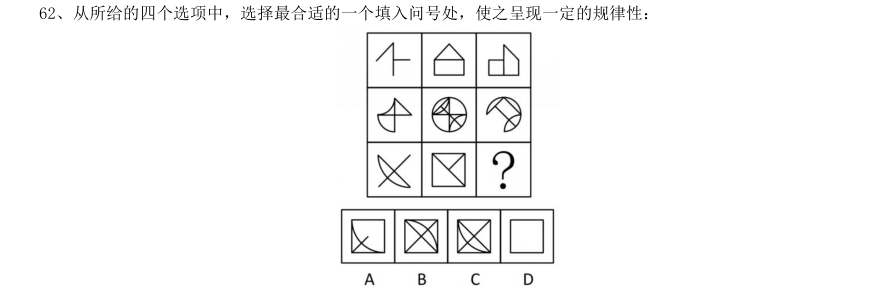

> （本题为图形题，选项为图片，见原卷）

**答案：暂缺**　**考点：图形推理｜图形推理（综合）**　**难度：★★★☆☆**
**【判断推理·图形推理｜GK-2010-ty-X063】**

63. 从所给的四个选项中,选择最合适的一个填入问号处,使之呈现一定的规律性:

> （本题为图形题，选项为图片，见原卷）

**答案：暂缺**　**考点：图形推理｜图形推理（综合）**　**难度：★★★☆☆**
**【判断推理·图形推理｜GK-2010-ty-X064】**

64. 左边给定的是纸盒的外表面,下面哪一项能由它折叠而成:

> （本题为图形题，选项为图片，见原卷）

**答案：暂缺**　**考点：图形推理｜图形推理（综合）**　**难度：★★★☆☆**
**【判断推理·图形推理｜GK-2010-ty-X065】**

65. 左边给定的是纸盒的外表面,下面哪一项能由它折叠而成:

> （本题为图形题，选项为图片，见原卷）

**答案：暂缺**　**考点：图形推理｜图形推理（综合）**　**难度：★★★☆☆**
**【判断推理·定义判断｜GK-2010-ty-X066】**

66. 差别比例税率是指一种税设两个或两个以上的税率,不同纳税人按不同比例计算应纳税额的税率;累进税率 是指随着征税对象的数额由低到高逐级累进,所使用的税率也随之逐级提高的税率。 根据上述定义,下列各项中所提到的税率,属于差别比例税率的是:

- **A.** 对于某企业来说,需缴纳25%的企业所得税,还需缴纳5%的营业税
- **B.** 我国个人所得税中对工资薪金所得适用的税率随工资薪金所得增多而逐渐增多,从5%到45%共分为九档
- **C.** 2009 年1 月20 日至12 月31 日,我国对1.6 升及以下排量的乘用车按5%征收车辆购置税,对1.6 升以上排量乘用车按10%征收车辆购置税
- **D.** 我国自2009 年1 月1 日起实施成品油税费改革,将成品油价内征收的汽油消费税单位税额每升提高0.8 元,

**答案：暂缺**　**考点：定义判断｜单定义**　**难度：★★★☆☆**
**【判断推理·逻辑判断｜GK-2010-ty-X067】**

67. 美国社会学家默顿将社会功能划分为显功能和潜功能两个层次,显功能是有助于系统的调整和适应的客观后 果,这种适应和调整是系统中的参与者所期望达到或能预料、认识到的;潜功能是没有被预料也没有被认识的客 观后果。 下列选项不包含对潜功能描述的一项是:

- **A.** 电视剧《渴望》播放期间,万人空巷,社会治安明显好转
- **B.** 张某根据自己的家庭收入状况,贷款30 万买了一套房子,由于利率上升,自己的生活变得捉襟见肘
- **C.** 为抵御外族入侵,秦始皇修筑了长城,客观上促进了我国民间建筑工艺的发展
- **D.** 来自偏远山区的小刘为了摆脱贫困,让父母过上好日子,从小刻苦学习,做事认真,没几年功夫就成为一家

**答案：暂缺**　**考点：逻辑判断｜逻辑判断（综合）**　**难度：★★★★★**
**【判断推理·定义判断｜GK-2010-ty-X068】**

68. 角色模糊是指个人所体验到的工作角色定位的不确定性,包括工作职责的不确定、工作目标的不确定等,因 此常造成工作流程上的混乱和工作效率的低下。 根据上述定义,下列属于角色模糊的是:

- **A.** 张大夫身兼数职,是某医院骨科主任,同时又担任该医院的副院长、该地区医学会委员等,工作繁忙使他日益憔悴
- **B.** 苏丽刚升任客服部的副总监,有些事务她不知道是否该自己处理,如果处理了是否会超出目前的权限,也不知道去问谁,对于这些事务她通常就不处理
- **C.** 小陈刚当上小学老师,想跟学生做朋友,尽管她现在跟学生的关系很亲密,可她发现学生们不怕她,不听话,甚至作业也不交
- **D.** 小张刚参加工作,满怀热情,一心想在工作岗位上充分发挥自己的专业特长,但却不得不经常做些与其专业

**答案：暂缺**　**考点：定义判断｜单定义**　**难度：★★☆☆☆**
**【判断推理·定义判断｜GK-2010-ty-X069】**

69. 生态入侵是指人们有意识或者无意识地把某些生物带入适宜其栖息和繁衍的地区,使得该生物种群不断扩大, 分布区不断稳定地扩展,从而危害当地的生产和生活,改变当地生态环境的过程。 根据上述定义,下列属于生态入侵的是:

- **A.** 某实验室由于管理不当将试验用的致病性结核菌株散播了出去,造成结核病在周围居民中流行
- **B.** 美国科学家将从我国引进的野生大豆与当地品种杂交,培育出抗大豆萎黄病的优良品种,该品种现已彻底取代了美国传统大豆
- **C.** 某地发生大面积放射性核素泄露,使某种植物发生变异,其繁殖能力超强,逐渐取代了该地域内的其他植物
- **D.** 产于南美洲的凤眼莲花朵艳丽,曾经作为观赏植物被我国引进,致使云南滇池因为凤眼莲的疯狂蔓延而鱼虾

**答案：暂缺**　**考点：定义判断｜单定义**　**难度：★★★☆☆**
**【判断推理·定义判断｜GK-2010-ty-X070】**

70. 宜家效应是指劳动会增加人们对劳动成果的感情,当人们自己动手制作东西时,他们都会觉得自己的创作特 别有价值。 根据上述定义,下列最能体现宜家效应的是:

- **A.** 让人们亲手做折纸,然后连同他人做的折纸放在一起竞价,结果大家都愿意为自己做的折纸出更高的价钱
- **B.** 某公司为方便人们制作蛋糕,推出方便蛋糕粉,使蛋糕的制作非常简单
- **C.** 某家具生产商生产的家具需要顾客买回家后,按照产品说明书来完成家具的拼装组合工作
- **D.** 学校鼓励学生自己动手制作各种教具,不仅锻炼了学生的动手能力,还节约了教学成本

**答案：暂缺**　**考点：定义判断｜单定义**　**难度：★★☆☆☆**
**【判断推理·定义判断｜GK-2010-ty-X071】**

71. 证实性偏见是指过于关注支持自己决策的信息。当我们在主观上认为某种观点正确的时候,往往倾向于寻找 那些能够支持这一观点的信息,而忽略掉那些可能推翻这一观点的信息。 根据上述定义,下列属于证实性偏见的是:

- **A.** 小张前天夜里梦见自己的钱包被偷,昨天钱包真的被偷了;昨晚他又梦见自己被车撞,结果今天一整天没敢出门
- **B.** 小张总觉得室友最近的表现很反常,好像出什么事了,第二天公安局的人找到小张询问情况,证实了他的猜测,室友被扯进了一起盗窃案
- **C.** 自从小王产生辞职的念头以后,总觉得经理处处刁难他,甚至看不起他,就连经理和他开个玩笑,都认为是对他的嘲笑
- **D.** 小林今年未考上重点大学,他明知是因为自己实力不够,但他总是对同学说:“要不是考试前患了感冒,我

**答案：暂缺**　**考点：定义判断｜单定义**　**难度：★★★☆☆**
**【判断推理·定义判断｜GK-2010-ty-X072】**

72. 存疑时有利于被告原则是指在刑事诉讼中遇到事实无法查清或查清事实所需成本过高的情况,依照有利于被 告的原则判决。 根据上述定义,下列表现符合该原则的是:

- **A.** 因缺少直接证据证实被告人有罪,法院对被告人做出无罪判决
- **B.** 无法确定某犯罪行为是否超过追诉时效时,应当追诉
- **C.** 检察机关认为被告人犯罪情节显著轻微,决定免于起诉
- **D.** 法院在认定被告人犯有数罪或一罪之间存在疑问时,发回公安机关补充侦查

**答案：暂缺**　**考点：定义判断｜单定义**　**难度：★★☆☆☆**
**【判断推理·定义判断｜GK-2010-ty-X073】**

73. 同类群体影响力是指人们对他人(尤其是类似群体)的行为总会做出某种反应;类似程度越高,影响力就越 大。比如对某种良好行为规范大力宣传,往往会成为所谓的"磁心",吸引人们仿效。 下列做法中不会带来同类群体影响力的是:

- **A.** 某地节水办告知那些用水量高的用户,他们的用水量明显高出了周围的邻居
- **B.** 某森林公园设置告示牌,告知偷盗林木者将受到高于林木价钱10 倍的罚款
- **C.** 酒店在房间内放置标语,提醒客人大多数客人都不是每天要更换毛巾
- **D.** 老师在墙报上贴小红花,表扬那些完成作业好,守纪律的小学生

**答案：暂缺**　**考点：定义判断｜定义判断（综合）**　**难度：★★★☆☆**
**【判断推理·定义判断｜GK-2010-ty-X074】**

74. 蓄积器官是毒物在体内的蓄积部位,毒物在蓄积器官内的浓度高于其他器官,但对蓄积器官不一定显示毒作 用。这种毒作用也可以通过某种病理生理机制,由另一个器官表现出来,这种器官叫作效应器官。 根据上述定义,下列判断正确的是:

- **A.** 大气污染物中的铅经肺吸收后可转移并积存于人的骨骼中,损害骨骼造血系统,所以铅的蓄积器官是肺
- **B.** 大气污染物中的二氧化硫经人体的上呼吸道和气管吸入人体,并直接刺激上呼吸道和气管,所以上呼吸道和气管是蓄积器官
- **C.** 有机磷酸酯农药作用于神经系统,会造成神经突触处乙酰胆碱蓄积,使人产生流涎、瞳孔缩小等症状,所以神经系统是有机磷酸酯的效应器官
- **D.** 沉积于网状内皮系统的放射性核素对肝、脾损伤较重,引起中毒性肝炎,所以网状内皮系统是蓄积器官

**答案：暂缺**　**考点：定义判断｜单定义**　**难度：★★★☆☆**
**【判断推理·定义判断｜GK-2010-ty-X075】**

75. 偶然防卫是指在客观上被害人正在或者即将对被告人或他人的人身进行不法侵害,但被告人主观上没有认识 到这一点,出于非法侵害的目的而对被害人使用了武力,客观上起到了人身防卫的效果。 根据上述定义,下列行为不属于偶然防卫的一项是:

- **A.** 甲与乙积怨很深,某日发生冲突后,甲回家拿了手枪打算去杀乙,两人在路上正好碰上,甲先开枪杀死了乙,但开枪时不知乙的右手已抓住口袋中的手枪正准备对其射击
- **B.** 甲正准备枪杀乙时,丙在后面对甲先开了一枪,将其打死,而丙在开枪时并不知道甲正准备杀乙,纯粹是出于报复泄恨的目的杀甲,结果保护了乙的生命
- **C.** 甲与乙醉酒后发生激烈冲突,两人相互厮打至马路上,正当甲要捡起路边砖头击打乙时,围观群众中有人喊“警察来啦”,甲受惊吓不慎跌落路边河沟溺水身亡,乙安全无事
- **D.** 甲身穿警服带着电警棍,冒充警察去“抓赌”,甲抓住乙搜身时,乙将甲打伤后逃离,甲未能得手

**答案：暂缺**　**考点：定义判断｜单定义**　**难度：★★★☆☆**
**【判断推理·类比推理｜GK-2010-ty-X076】**

76. 身份证:身份

- **A.** 执业证:资格
- **B.** 结婚证:配偶
- **C.** 房产证:房屋
- **D.** 毕业证:学位

**答案：暂缺**　**考点：类比推理｜类比推理（综合）**　**难度：★☆☆☆☆**
**【判断推理·类比推理｜GK-2010-ty-X077】**

77. 茶壶:紫砂:雕刻

- **A.** 电线:金属:生产
- **B.** 马路:柏油:铺设
- **C.** 房门:木材:油漆
- **D.** 夹克:布料:制作

**答案：暂缺**　**考点：类比推理｜类比推理（综合）**　**难度：★☆☆☆☆**
**【判断推理·类比推理｜GK-2010-ty-X078】**

78. 骨骼 对于 ( ) 相当于 ( ) 对于 房屋

- **A.** 人体..梁柱
- **B.** 上肢..窗户
- **C.** 关节..钢筋
- **D.** 肌肉..电梯

**答案：暂缺**　**考点：类比推理｜类比推理（综合）**　**难度：★☆☆☆☆**
**【判断推理·类比推理｜GK-2010-ty-X079】**

79. ( ) 对于 大脑 相当于 资料 对于 ( )

- **A.** 智力..书籍
- **B.** 记忆..硬盘
- **C.** 细胞..图书馆
- **D.** 学习..阅读

**答案：暂缺**　**考点：类比推理｜类比推理（综合）**　**难度：★☆☆☆☆**
**【判断推理·类比推理｜GK-2010-ty-X080】**

80. ( ) 对于 建筑 相当于 计划 对于 ( )

- **A.** 设计..成果
- **B.** 图纸..工作
- **C.** 材料..战略
- **D.** 施工..目标

**答案：暂缺**　**考点：类比推理｜类比推理（综合）**　**难度：★☆☆☆☆**
**【判断推理·逻辑判断｜GK-2010-ty-X081】**

81. 海洋中珊瑚的美丽颜色来自于其体内与之共存的藻类生物,其中虫黄藻是最重要的一类单细胞海藻。二者各 取所需,相互提供食物。全球气候变暖造成的海水升温导致虫黄藻等藻类大量死亡,进而造成珊瑚本身死亡,引 发珊瑚礁白化现象,然而研究发现,珊瑚能通过选择耐热的其他藻类生物等途径,来应对气候变暖带来的挑战。 以下哪项如果为真,将削弱这一研究发现:

- **A.** 一些虫黄藻能够比耐热的其他藻类耐受更高的海水温度
- **B.** 有些藻类耐热性的形成需要一个长期的过程
- **C.** 有些虫黄藻逐渐适应了海水温度的升高并存活下来
- **D.** 有些已白化的珊瑚礁中也发现了死去的耐热藻类生物

**答案：暂缺**　**考点：逻辑判断｜削弱**　**难度：★★★★★**
**【判断推理·逻辑判断｜GK-2010-ty-X082】**

82. 有医学研究显示,吃维生素和矿物质补充剂对人体没有显著帮助,有时甚至会对人体造成伤害。一些医生给 出劝告,不要再吃维生素和矿物质补充剂了,而应该通过均衡的饮食来补充人体所需的维生素和矿物质。 以下哪项如果为真,最能削弱上述研究结果:

- **A.** 一项对3 万名妇女进行的7 年追踪调查发现,服用维生素D 加上钙补充剂并没有给她们的身体造成伤害
- **B.** 一项对1 万名男性展开的8 年追踪调查显示,不服用维生素和矿物质补充剂并没有增加他们患病的风险
- **C.** 一项对1 万名发达地区和欠发达地区老年人的对照调查显示,他们的健康状况差异不显著
- **D.** 一项对2 万名儿童展开的3 年追踪调查显示,不服用维生素和矿物质补充剂的儿童,营养缺乏的发生率较高

**答案：暂缺**　**考点：逻辑判断｜削弱**　**难度：★★★★★**
**【判断推理·逻辑判断｜GK-2010-ty-X083】**

83. 甲乙丙丁四人的车分别为白色、银色、蓝色和红色。在问到他们各自车的颜色时,甲说:“乙的车不是白色。” 乙说:“丙的车是红色的。”丙说:“丁的车不是蓝色的。”丁说:“甲、乙、丙三人中有一个人的车是红色的, 而且只有这个人说的是实话。” 如果丁说的是实话,那么以下说法正确的是:

- **A.** 甲的车是白色的,乙的车是银色的
- **B.** 乙的车是蓝色的,丙的车是红色的
- **C.** 丙的车是白色的,丁的车是蓝色的
- **D.** 丁的车是银色的,甲的车是红色的

**答案：暂缺**　**考点：逻辑判断｜翻译推理**　**难度：★★★★☆**
**【判断推理·逻辑判断｜GK-2010-ty-X084】**

84. 在一次考古发掘中,考古人员在一座唐代古墓中发现多片先秦时期的夔文(音kui,一种变体的龙文)陶片。 对此,专家解释说,由于雨水冲刷等原因,这些先秦时期的陶片后来被冲至唐代的墓穴中。 以下哪项如果为真,最能质疑上述专家的观点:

- **A.** 在这座唐代古墓中还发现多件西汉时期的文物
- **B.** 这座唐代古墓保存完好,没有漏水、毁塌迹象
- **C.** 并非只有先秦时期才使用夔文,唐代文人以书写夔文为能事
- **D.** 唐代的墓葬风俗是将墓主生前喜爱的物品随同墓主一同下葬

**答案：暂缺**　**考点：逻辑判断｜削弱**　**难度：★★★★☆**
**【判断推理·逻辑判断｜GK-2010-ty-X085】**

85. 以下是一则广告:本网络文学培训班有着其他同类培训班所没有的特点,除了传授高超的写作技巧、帮助同 学打开认识世界的多维视角和宏观视野、丰富学员的文化知识和艺术涵养外,还负责向毕业班学员提供切实有效 的就业咨询。去年进行咨询的毕业班学员,100%都找到了工作。为了在网络文学创作事业上开创一片天地,欢迎 加入我们的行列。 为了确定该广告的可信任,以下相关问题必须询问清楚的是: I 去年共举办了多少期这类培训班,共有多少学员毕业? II 去年有多少毕业班学员进行了就业咨询? III 对于找到工作的学员,就业咨询究竟起到了什么作用? IV 咨询者找到的是否都是网络文学创作工作?

- **A.** I、II、III 和IV
- **B.** I、II 和III
- **C.** II、III 和IV
- **D.** III、IV

**答案：暂缺**　**考点：逻辑判断｜逻辑判断（综合）**　**难度：★★★★★**
**【判断推理·逻辑判断｜GK-2010-ty-X086】**

86. 在由发展中国家向经济发达国家前进的过程中,大量资本支持是必不可少的条件,而高储蓄率是获得大量资 本的必要条件。就目前来说,中国正处于经济起飞时期,因此储蓄率高是当前经济发展中一种正常而合理的现象。 由此可以推出:

- **A.** 有了大量的资本支持,就可以实现由发展中国向发达国家的跨越
- **B.** 有了高储蓄率,就可以获得大量的资本支持
- **C.** 如果没有获得大量的资本支持,说明储蓄率不高
- **D.** 如果没有高储蓄率,就不能实现向发达国家的转变

**答案：暂缺**　**考点：逻辑判断｜加强**　**难度：★★★★☆**
**【判断推理·逻辑判断｜GK-2010-ty-X087】**

87. 当代知名的动漫设计大师,绝大部分还没从动漫设计学校毕业就已经离开学校,开始自己的动漫设计生涯。 因此,有人认为动漫设计的专业学习对学生们今后的职业发展并没能提供有力的帮助。 以下哪项如果为真,能够最有力地反驳上述推论:

- **A.** 动漫设计大师都承认,他们学习了动漫设计学校的基础课程
- **B.** 知名动漫公司在招聘设计师时,很看重应聘人员的毕业院校
- **C.** 调查显示,动漫设计学校毕业生的平均年收入要显著高于同类院校其他专业的毕业生
- **D.** 在动漫设计行业中职业发展比较好的从业者,基本都毕业于动漫设计学校

**答案：暂缺**　**考点：逻辑判断｜削弱**　**难度：★★★★★**
**【判断推理·逻辑判断｜GK-2010-ty-X088】**

88. 以往,境内企业进出口只能以美元或第三方货币结算,在合同签约至合同执行完毕期间汇率的变化会使企业 的实际盈收出现波动,现在银行推出了人民币结算业务。由于人民币是境内企业的本币,合同计价和企业运营的 主要货币相一致,境内企业在合同签订前能够切实了解交易的成本和收入,从而防范了汇率风险。因经,使用跨 境贸易人民币结算业务的企业必定会增多。 以下哪项为真,最佳作为上述论证的前提条件:

- **A.** 有了跨境贸易人民币结算业务,开展对外贸易的企业数量会越来越多
- **B.** 在与国内企业发展贸易时,由于人民币币值保持稳定,境外企业愿意使用人民币作为结算货币
- **C.** 有了跨境贸易人民币结算业务,国内企业可以更方便地将跨境贸易开展到世界各地
- **D.** 由于国内巨大的市场空间,越来越多的境外企业愿意与国内企业开展贸易往来

**答案：暂缺**　**考点：逻辑判断｜前提假设**　**难度：★★★★★**
**【判断推理·逻辑判断｜GK-2010-ty-X089】**

89. 某国人口总量自2005 年起开始下降,预计到2100 年,该国人口总数将只有现在的一半。为此,该国政府出 台了一系列鼓励生育的政策。但到目前为止,该国妇女平均只生育1.3 个孩子,远低于维持人口正常更新的水平 (2.07 个)。因此,有人认为该国政府实施的这些鼓励生育的政策没有达到预期效果。 以下哪项如果为真,最能反驳上述论断:

- **A.** 该国政府实施的这些鼓励生育的政策是一项长期国策,短时间内看不出效果
- **B.** 如果该国政府没有出台鼓励生育政策,该国儿童人口总数会比现在低很多
- **C.** 如果该国政府出台更加有效的鼓励生育政策,就可以提高人口数量
- **D.** 近年来该国人口总数呈缓慢上升的趋势

**答案：暂缺**　**考点：逻辑判断｜削弱**　**难度：★★★★★**
**【判断推理·逻辑判断｜GK-2010-ty-X090】**

90. 甲国生产了一种型号为su-34 的新型战斗机,乙国在是否要引进这种战斗机的问题上,出现了两种不同的声 音。支持者认为su-34 较以往引进的su-30 有更加强大的对地攻击作战能力。 以下哪项如果为真,最能削弱支持者的声音:

- **A.** 目前市场上有比su-34 性能更好的其他型号战斗机
- **B.** su-30 足以满足对地攻击的需要,目前乙国需要提升的是对空攻击作战能力
- **C.** 目前还没有实际数据显示究竟是su-34 有更加强大的对地攻击作战能力
- **D.** 甲乙两国目前在双边贸易中存在诸多摩擦,引入su-34 会有很多实际困难

**答案：暂缺**　**考点：逻辑判断｜削弱**　**难度：★★★★★**
**【资料分析·比重计算与比较｜GK-2010-ty-X091】**
> 材料：根据资料所提供的信息进行分析、比较、计算和判断处理。 (一)根据以下资料,完成各题。 中国汽车工业协会发布的2009 年4 月份中国汽车产销数据显示,在其他国家汽车销售进一步疲软的情况下, 国内乘用车销量却持续上升,当月销量已达83.1 万辆,比3 月份增长7.59%,同比增长37.37%。 乘用车细分为基本型乘用车(轿车)、多功能车(MPV)、运动型多用途车(SUV)和交叉型乘用车。其中, 轿车销量比三月份增长8.3%,同比增长33.04%;MPV 销量比3 月份下降3.54%,同比下降4.05%;SUV 销量比3 月份增长19.27%,同比增长22.55%;交叉型乘用车销量比3 月份增长3.62%,同比增长70.66%。

91. 轿车、MPV、SUV、 和交叉型乘用车销量占4 月份乘用车总销量的比重分别为71%、2%、6%和21%。 与上年同期相比,2009 年4 月份乘用车销量约增长了多少万辆:

- **A.** 13.2
- **B.** 22.6
- **C.** 31.1
- **D.** 40.4

**答案：暂缺**　**考点：比重计算与比较｜现期比重**　**难度：★★★☆☆**
**【资料分析·综合分析｜GK-2010-ty-X092】**

92. 2009 年3 月份轿车销量约为多少万辆:

- **A.** 64
- **B.** 59
- **C.** 54
- **D.** 50

**答案：暂缺**　**考点：综合分析｜综合分析（综合）**　**难度：★★★★☆**
**【资料分析·综合分析｜GK-2010-ty-X093】**

93. 2008 年4 月,SUV 销量比MPV 销量约:

- **A.** 少2.3 万辆
- **B.** 多2.3 万辆
- **C.** 少3.4 万辆
- **D.** 多3.4 万辆

**答案：暂缺**　**考点：综合分析｜综合分析（综合）**　**难度：★★★★☆**
**【资料分析·综合分析｜GK-2010-ty-X094】**

94. 关于2009 年3 月份各种车型销量在总销量中所占比重的描述,以下正确的是:

- **A.** 交叉型乘用车低于21%
- **B.** SUV 超过6%
- **C.** MPV 超过2%
- **D.** 轿车超过71%

**答案：暂缺**　**考点：综合分析｜选正确项**　**难度：★★★★☆**
**【资料分析·综合分析｜GK-2010-ty-X095】**

95. 关于2009 年4 月乘用车销量的描述不正确的是:

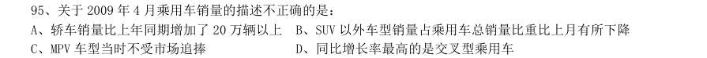

- **A.** 轿车销量比上年同期增加了20 万辆以上
- **B.** SUV 以外车型销量占乘用车总销量比重比上月有所下降
- **C.** MPV 车型当时不受市场追捧
- **D.** 同比增长率最高的是交叉型乘用车

**答案：B**　**考点：综合分析｜选错误项**　**难度：★★★★☆**
**【资料分析·综合分析｜GK-2010-ty-X096】**
> 材料：2008 年,某省农产品进出口贸易总额为7.15 亿美元,比上年增长25.2%。其中,出口额为5.02 亿美元,增 长22.1%;进口额为2.13 亿美元,增长33.2%。农产品进出口贸易额占全省对外贸易总额的4.5%。出口额居前5 位的产品为蔬菜、畜产品、水果、粮食和茶叶,而绿茶出口额占茶叶出口额的四分之三。全省农产品对东欧、非 洲、拉美等国家和地区的市场进一步开拓,出口额比上一年进一步增长。

96. 其中,对美国的出口额增长16.0%;对 日本的出口额增长7.3%;对韩国的出口额增长59.8%;对东盟的出口额增长58.6%。 2008 年,该省的对外贸易总额约为多少亿美元:

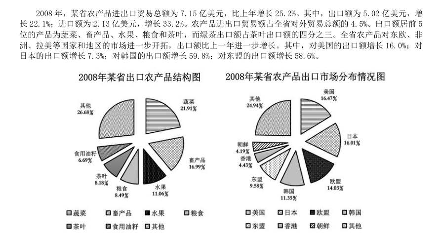

- **A.** 158.89
- **B.** 134.66
- **C.** 91.78
- **D.** 79.25

**答案：A**　**考点：综合分析｜选正确项**　**难度：★★★★★**
**【资料分析·综合分析｜GK-2010-ty-X097】**

97. 2008 年,该省的绿茶出口额约为多少万美元:

> 材料图见 images/GK-2010-ty-X096-m.jpg

- **A.** 4387
- **B.** 3080
- **C.** 2255
- **D.** 1307

**答案：B**　**考点：综合分析｜选正确项**　**难度：★★★★☆**
**【资料分析·增长量计算｜GK-2010-ty-X098】**

98. 2008 年,该省农产品对外贸易顺差比上年增长了:

> 材料图见 images/GK-2010-ty-X096-m.jpg

- **A.** 5%
- **B.** 15%
- **C.** 25%
- **D.** 35%

**答案：B**　**考点：增长量计算｜增长量计算（综合）**　**难度：★☆☆☆☆**
**【资料分析·增长量计算｜GK-2010-ty-X099】**

99. 与2007 年相比,2008 年该省出口韩国的农产品总额约增长了多少万美元:

> 材料图见 images/GK-2010-ty-X096-m.jpg

- **A.** 5100
- **B.** 4500
- **C.** 3200
- **D.** 2100

**答案：D**　**考点：增长量计算｜增长量计算（415 份数法）**　**难度：★☆☆☆☆**
**【资料分析·综合分析｜GK-2010-ty-X100】**

100. 能够从上述资料中推出的是:

> 材料图见 images/GK-2010-ty-X096-m.jpg

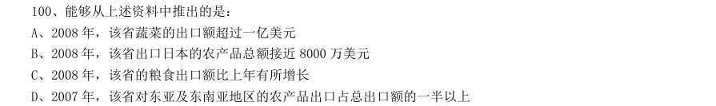

- **A.** 2008 年,该省蔬菜的出口额超过一亿美元
- **B.** 2008 年,该省出口日本的农产品总额接近8000 万美元
- **C.** 2008 年,该省的粮食出口额比上年有所增长
- **D.** 2007 年,该省对东亚及东南亚地区的农产品出口占总出口额的一半以上

**答案：A**　**考点：综合分析｜选错误项**　**难度：★★★★★**
**【资料分析·综合分析｜GK-2010-ty-X101】**

101. 2007 年,下列国家(地区)中人口最少的是:

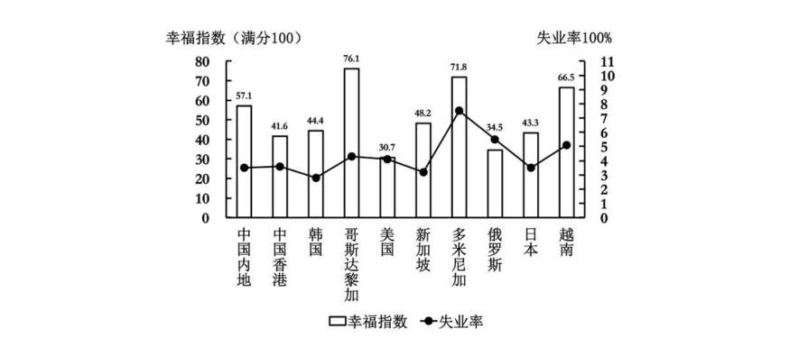

- **A.** 中国香港
- **B.** 哥斯达黎加
- **C.** 新加坡
- **D.** 多米尼加

**答案：B**　**考点：综合分析｜选正确项**　**难度：★★★★☆**
**【资料分析·综合分析｜GK-2010-ty-X102】**

102. 资料中失业率最高与最低的国家(地区),其幸福指数相差:

> 材料图见 images/GK-2010-ty-X101-m.jpg

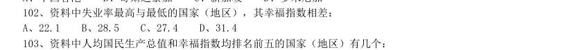

- **A.** 22.1
- **B.** 28.5
- **C.** 27.4
- **D.** 31.4

**答案：C**　**考点：综合分析｜选正确项**　**难度：★★★★☆**
**【资料分析·平均数计算｜GK-2010-ty-X103】**

103. 资料中人均国民生产总值和幸福指数均排名前五的国家(地区)有几个:

> 材料图见 images/GK-2010-ty-X101-m.jpg

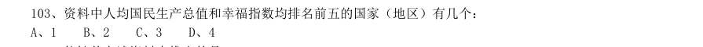

- **A.** 1
- **B.** 2
- **C.** 3
- **D.** 4

**答案：A**　**考点：平均数计算｜现期平均数**　**难度：★☆☆☆☆**
**【资料分析·综合分析｜GK-2010-ty-X104】**

104. 能够从上述资料中推出的是:

> 材料图见 images/GK-2010-ty-X101-m.jpg

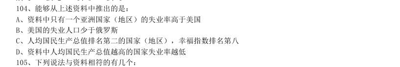

- **A.** 资料中只有一个亚洲国家(地区)的失业率高于美国
- **B.** 美国的失业人口少于俄罗斯
- **C.** 人均国民生产总值排名第二的国家(地区),幸福指数排名第八
- **D.** 资料中人均国民生产总值越高的国家失业率越低

**答案：A**　**考点：综合分析｜选错误项**　**难度：★★★★☆**
**【资料分析·综合分析｜GK-2010-ty-X105】**

105. 下列说法与资料相符的有几个: 1.国民生产总值小于1000 亿美元的国家(地区),幸福指数均高于其他国家(地区); 2.人口过亿的国家(地区)失业率越低,幸福指数越高; 3.比中国内地失业率低的国家(地区),幸福指数均低于中国内地; 4.人均国民生产总值超过2 万美元的国家(地区),幸福指数均低于其他国家(地区)。

> 材料图见 images/GK-2010-ty-X101-m.jpg

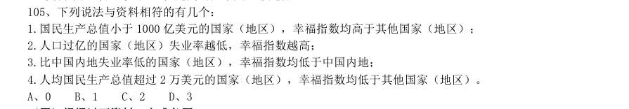

- **A.** 0
- **B.** 1
- **C.** 2
- **D.** 3

**答案：C**　**考点：综合分析｜判断个数**　**难度：★★★★★**
**【资料分析·平均数计算｜GK-2010-ty-X106】**

106. 2009 年1-5 月,邮电系统平均每月订销报纸、杂志约多少亿份:

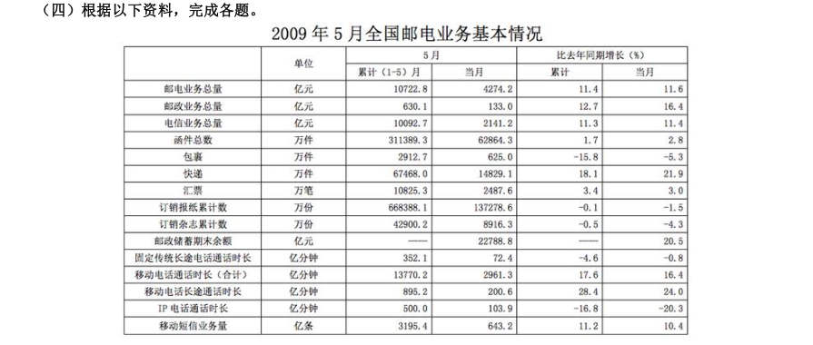

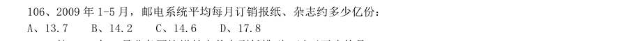

- **A.** 13.7
- **B.** 14.2
- **C.** 14.6
- **D.** 17.8

**答案：B**　**考点：平均数计算｜现期平均数**　**难度：★☆☆☆☆**
**【资料分析·综合分析｜GK-2010-ty-X107】**

107. 按2009 年5 月业务同比增长率从高到低排列,以下正确的是:

> 材料图见 images/GK-2010-ty-X106-m.jpg

- **A.** 函件—包裹—快递
- **B.** 汇票—包裹—快递
- **C.** 快递—汇票—函件
- **D.** 函件—汇票—包裹

**答案：C**　**考点：综合分析｜选正确项**　**难度：★★★★☆**
**【资料分析·倍数计算｜GK-2010-ty-X108】**

108. 2008 年1-5 月,移动电话长途通话时长约是固定传统长途电话通话时长的多少倍:

> 材料图见 images/GK-2010-ty-X106-m.jpg

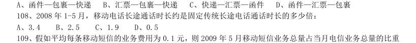

- **A.** 3.4
- **B.** 2.5
- **C.** 1.9
- **D.** 0.5

**答案：C**　**考点：倍数计算｜是几倍**　**难度：★☆☆☆☆**
**【资料分析·比重计算与比较｜GK-2010-ty-X109】**

109. 假如平均每条移动短信的业务费用为0.1 元,则2009 年5 月移动短信业务总量占当月电信业务总量的比重 约为:

> 材料图见 images/GK-2010-ty-X106-m.jpg

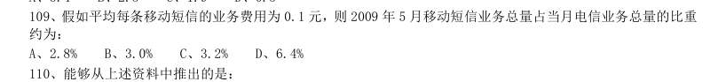

- **A.** 2.8%
- **B.** 3.0%
- **C.** 3.2%
- **D.** 6.4%

**答案：B**　**考点：比重计算与比较｜现期比重**　**难度：★☆☆☆☆**
**【资料分析·综合分析｜GK-2010-ty-X110】**

110. 能够从上述资料中推出的是:

> 材料图见 images/GK-2010-ty-X106-m.jpg

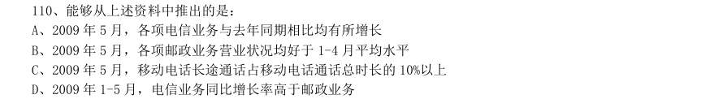

- **A.** 2009 年5 月,各项电信业务与去年同期相比均有所增长
- **B.** 2009 年5 月,各项邮政业务营业状况均好于1-4 月平均水平
- **C.** 2009 年5 月,移动电话长途通话占移动电话通话总时长的10%以上
- **D.** 2009 年1-5 月,电信业务同比增长率高于邮政业务

**答案：B**　**考点：综合分析｜选错误项**　**难度：★★★★★**
**【资料分析·年均增长率｜GK-2010-ty-X111】**

111. 1949-2008 年,我国卫生机构平均每年约增加:

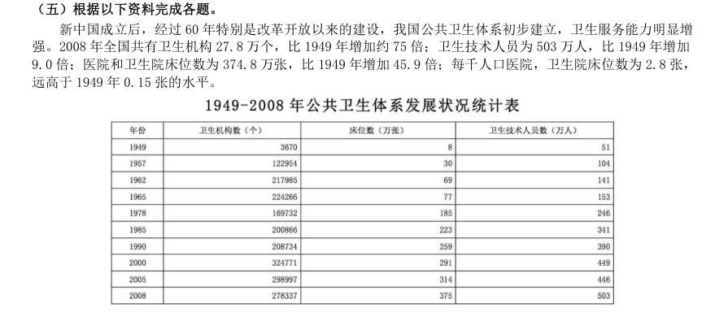

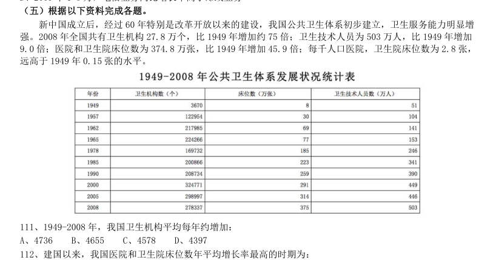

- **A.** 4736
- **B.** 4655
- **C.** 4578
- **D.** 4397

**答案：B**　**考点：年均增长率｜年均增长率计算**　**难度：★☆☆☆☆**
**【资料分析·年均增长率｜GK-2010-ty-X112】**

112. 建国以来,我国医院和卫生院床位数年平均增长率最高的时期为:

> 材料图见 images/GK-2010-ty-X111-m.jpg

- **A.** 1957-1962 年
- **B.** 1962-1965 年
- **C.** 1965-1978 年
- **D.** 1978-1985 年

**答案：A**　**考点：年均增长率｜年均增长率比较**　**难度：★☆☆☆☆**
**【资料分析·年均增长率｜GK-2010-ty-X113】**

113. 与1978 年相比,2008 年平均每个卫生机构的卫生技术人员数约增加了:

> 材料图见 images/GK-2010-ty-X111-m.jpg

- **A.** 5%
- **B.** 15%
- **C.** 25%
- **D.** 35%

**答案：C**　**考点：年均增长率｜年均增长率计算**　**难度：★☆☆☆☆**
**【资料分析·平均数计算｜GK-2010-ty-X114】**

114. 2008 年,每万人拥有的卫生机构数量约是1949 年的多少倍:

> 材料图见 images/GK-2010-ty-X111-m.jpg

- **A.** 3
- **B.** 8
- **C.** 15
- **D.** 30

**答案：D**　**考点：平均数计算｜现期平均数**　**难度：★☆☆☆☆**
**【资料分析·综合分析｜GK-2010-ty-X115】**

115. 能够从上述资料中推出的是:

> 材料图见 images/GK-2010-ty-X111-m.jpg

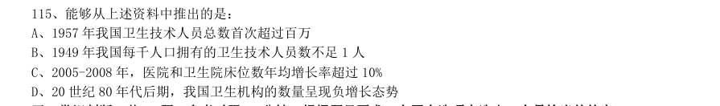

- **A.** 1957 年我国卫生技术人员总数首次超过百万
- **B.** 1949 年我国每千人口拥有的卫生技术人员数不足1 人
- **C.** 2005-2008 年,医院和卫生院床位数年均增长率超过10%
- **D.** 20 世纪80 年代后期,我国卫生机构的数量呈现负增长态势

**答案：A**　**考点：综合分析｜选正确项**　**难度：★★★★★**
**【常识判断·政治常识｜GK-2010-ty-X116】**

116. 关于新中国成立60 周年取得的成就,下列说法不正确的是:

- **A.** 截止2008 年底,我国已成为世界第三大经济体
- **B.** 截止2008 年底,我国进出口贸易总额已跃居世界第一
- **C.** 2008 年我国国民平均受教育年限已提高到8.7 年,相当于初中文化程度
- **D.** 我国人均期望寿命由新中国成立前的不足40 岁上升到70 多岁

**答案：B**　**考点：政治常识｜政治常识（综合）**　**难度：★★★★☆**
**【常识判断·经济常识｜GK-2010-ty-X117】**

117. 改革开放以来,我国主要区域政策经历了不同的阶段: 1以经济特区为重心的沿海地区优先发展阶段; 2以缩小区域差异为导向的西部大开发阶段; 3以浦东开发为龙头的沿江沿边地区重点发展阶段; 4以区域协调发展为导向的共同发展阶段。 这四个阶段按时间顺序排列为:

- **A.** 1234
- **B.** 1324
- **C.** 2314
- **D.** 2134

**答案：B**　**考点：经济常识｜经济常识（综合）**　**难度：★★★★☆**
**【常识判断·政治常识｜GK-2010-ty-X118】**

118. 关于我国重大工程与建设项目,下列说法不正确的是:

- **A.** 三峡工程是目前世界上建筑规模最大的水利工程
- **B.** “嫦娥一号”是中国自主研发的首个月球探测卫星
- **C.** 2008 年建成通车的杭州湾跨海大桥是目前世界上最长的桥梁
- **D.** 2006 年全线通车青藏铁路是目前世界上海拔最高的铁路

**答案：C**　**考点：政治常识｜政治常识（综合）**　**难度：★★★★☆**
**【常识判断·政治常识｜GK-2010-ty-X119】**

119. 下列关于国际组织的表述不正确的是:

- **A.** 蒙古国是上海合作组织的成员国之一
- **B.** 国际货币基金组织是联合国的专门机构
- **C.** 博鳌亚洲论坛是第一个总部设在中国的国际会议组织
- **D.** 石油输出国组织通过实行石油生产配额制维护石油生产国利益

**答案：A**　**考点：政治常识｜政治常识（综合）**　**难度：★★☆☆☆**
**【常识判断·经济常识｜GK-2010-ty-X120】**

120. 在经济衰退时期,有利于扩大内需的政策措施是:

- **A.** 提高税率
- **B.** 提高存款准备金率
- **C.** 降低税率
- **D.** 缩减财政支出

**答案：C**　**考点：经济常识｜宏观经济**　**难度：★★☆☆☆**
**【常识判断·经济常识｜GK-2010-ty-X121】**

121. 衡量一个国家经济总量的指标不包括:

- **A.** 国内生产总值
- **B.** 国民总收入
- **C.** 外汇储备
- **D.** 货币总量

**答案：D**　**考点：经济常识｜经济指标**　**难度：★★☆☆☆**
**【常识判断·政治常识｜GK-2010-ty-X122】**

122. 下列关于中国近代史上的事件表述不正确的是:

- **A.** 北洋水师是19 世纪末中国建立的第一支近代海军舰队
- **B.** 第五次反“围剿”失败后,中国工农红军开始长征
- **C.** 中国人民解放军第二炮兵组建于20 世纪60 年代中期
- **D.** 日军在东北发动的“七七事变”标志着全面侵华战争的开始

**答案：D**　**考点：政治常识｜政治常识（综合）**　**难度：★★★★☆**
**【常识判断·地理常识｜GK-2010-ty-X123】**

123. 关于我国的湖泊,下列叙述正确的是:

- **A.** 海拔最低的湖在四川
- **B.** 海拔最高的湖在新疆
- **C.** 最大的淡水湖在江西
- **D.** 最大的咸水湖在西藏

**答案：A**　**考点：地理常识｜中国地理**　**难度：★★☆☆☆**
**【常识判断·政治常识｜GK-2010-ty-X124】**

124. 一艘油轮自科威特港驶往大连,其最短航线为:

- **A.** 波斯湾→红海→马六甲海峡→南海→黄海→东海
- **B.** 波斯湾→阿拉伯海→马六甲海峡→南海→东海→黄海
- **C.** 红海→阿拉伯海→孟加拉湾→南海→东海→黄海
- **D.** 红海→孟加拉湾→马六甲海峡→南海→黄海→东海

**答案：B**　**考点：政治常识｜政治常识（综合）**　**难度：★★☆☆☆**
**【常识判断·政治常识｜GK-2010-ty-X125】**

125. 下列对哲学家及其思想的认定不正确的是:

- **A.** 老子早于庄子,庄子早于韩非子
- **B.** 亚里士多德师从柏拉图,柏拉图师从苏格拉底
- **C.** 毛泽东的实践观同于列宁,列宁的实践观同于马克思
- **D.** 尼采的非理性主义源于叔本华,叔本华的非理性主义源于培根

**答案：D**　**考点：政治常识｜马克思主义基本原理**　**难度：★★☆☆☆**
**【常识判断·政治常识｜GK-2010-ty-X126】**

126. “四书五经”中的“四书”指的是:

- **A.** 《诗经》《孟子》《孝经》《尔雅》
- **B.** 《周易》《尚书》《礼记》《春秋》
- **C.** 《大学》《中庸》《论语》《孟子》
- **D.** 《尚书》《周易》《论语》《孝经》

**答案：C**　**考点：政治常识｜政治常识（综合）**　**难度：★★☆☆☆**
**【常识判断·科技常识｜GK-2010-ty-X127】**

127. 下列关于现代科技的说法中,正确的是:

- **A.** 杂交水稻是通过基因重组改变水稻的基因来提高产量的
- **B.** 纳米材料是指结构单元的尺度达到纳米级而原有性能保持不变的材料
- **C.** 高温超导体是指其超导临界温度在摄氏零度以上
- **D.** 转基因食品是指转移动植物的基因并加以改变,制造出具备新特征的食品

**答案：A**　**考点：科技常识｜基础科学**　**难度：★★★★☆**
**【常识判断·科技常识｜GK-2010-ty-X128】**

128. 下列有关能源的表述正确的是:

- **A.** 目前核电站对核能的利用方式分为核聚变和核裂变两种
- **B.** 氢气是一种可实现二氧化碳零排放的能源
- **C.** 太阳能电池的工作原理是光化学转换
- **D.** 可燃冰是一种稀缺的能源资源

**答案：A**　**考点：科技常识｜基础科学**　**难度：★★☆☆☆**
**【常识判断·政治常识｜GK-2010-ty-X129】**

129. 下列对人物及其贡献表述不正确的是:

- **A.** 凯恩斯撰写了《国富论》,使经济学成为一门独立科学
- **B.** 孟德尔发现遗传学定律,为遗传因子理论奠定了框架基础
- **C.** 冯·诺依曼开创了现代计算机理论,其体系结构沿用至今
- **D.** 法拉第发现电磁感应定律,并据此发明了早期的发电机

**答案：A**　**考点：政治常识｜马克思主义基本原理**　**难度：★★★★☆**
**【常识判断·政治常识｜GK-2010-ty-X130】**

130. 下列关于武器装备的说法不正确的是:

- **A.** 核潜艇装备的主要是核武器
- **B.** “歼十”战斗机是国产飞机
- **C.** 弩是中国最早发明的
- **D.** AK-47 是前苏联研制的一种自动步枪

**答案：A**　**考点：政治常识｜政治常识（综合）**　**难度：★★☆☆☆**
**【常识判断·政治常识｜GK-2010-ty-X131】**

131. 我国社会主义民族关系的基本特征是:平等、团结、互助、( )。

- **A.** 合作
- **B.** 繁荣
- **C.** 友爱
- **D.** 和谐

**答案：D**　**考点：政治常识｜政治常识（综合）**　**难度：★★☆☆☆**
**【常识判断·政治常识｜GK-2010-ty-X132】**

132. 如果父亲和孩子都是A 型血,那么孩子的母亲的血型有几种可能:

- **A.** 四种
- **B.** 三种
- **C.** 两种
- **D.** 一种

**答案：A**　**考点：政治常识｜政治常识（综合）**　**难度：★★☆☆☆**
**【常识判断·政治常识｜GK-2010-ty-X133】**

133. 关于宇宙的起源,最具代表性、影响最大的理论是:

- **A.** 黑洞理论
- **B.** 大爆炸理论
- **C.** 暗物质学说
- **D.** 能量守恒定律

**答案：A**　**考点：政治常识｜政治常识（综合）**　**难度：★★☆☆☆**
**【常识判断·政治常识｜GK-2010-ty-X134】**

134. 下列关于医学知识的说法不正确的是:

- **A.** 肝脏的主要功能之一是分解排除血液中的毒素
- **B.** 放疗中要使用放射线进行照射
- **C.** 砒霜在中医里可以入药
- **D.** 针灸中的“灸”是指用针扎刺人体穴位

**答案：D**　**考点：政治常识｜政治常识（综合）**　**难度：★★☆☆☆**
**【常识判断·生活常识｜GK-2010-ty-X135】**

135. 下列有关生活常识的叙述正确的是:

- **A.** 空调工作的时候有水流出而冰箱没有,由此可判断常见的家用空调和电冰箱的制冷原理不同
- **B.** 鸡蛋带壳在微波炉中加热比较好,这样受热更快更均匀
- **C.** 液晶电视机与等离子电视机的成像原理相同
- **D.** 使用无磷洗衣粉是因为磷易造成环境水体富营养化,破坏水质

**答案：D**　**考点：生活常识｜生活常识**　**难度：★★★★☆**
**【常识判断·地理常识｜GK-2010-ty-X136】**

136. 下列关于我国上下级国家之间关系的说法正确的是:

- **A.** 上下级人民政府之间是领导与被领导的关系
- **B.** 上下级人民政府之间是业务指导与被指导的关系
- **C.** 上下级人民代表大会之间是领导与被领导的关系
- **D.** 上下级人民法院之间是领导与被领导的关系,上下级人民检察院之间是监督与被监督的关系

**答案：A**　**考点：地理常识｜世界地理**　**难度：★★★★☆**
**【常识判断·地理常识｜GK-2010-ty-X137】**

137. 下列关于国家行政机关之间的说法正确的是:

- **A.** 各级国家行政机关都有权实施行政处罚
- **B.** 行政诉讼实行举证责任倒置原则,因此,行政机关承担全部举证责任
- **C.** 国家行政机关公务员被判处刑罚的,给予开除处分
- **D.** 国务院的法定会议形式分为国务院常务会议、国务院全体会议、国务院办公会议

**答案：A**　**考点：地理常识｜世界地理**　**难度：★★★★☆**
**【常识判断·政治常识｜GK-2010-ty-X138】**

138. 下列做法符合《政府信息公开条列》的是:

- **A.** 甲县规定,乡、镇的政府信息统一由县政府负责公开
- **B.** 乙省不允许本省内各级行政机关提供政府信息时收取任何费用
- **C.** 丙区规定行政机关应当编制,公布政府信息公开指南或政府信息公开目录并及时更新
- **D.** 丁市政府在图书馆设置政府信息查询场所并配备相应的设备,为公民、法人或者其他组织获取政府信息提供

**答案：A**　**考点：政治常识｜政治常识（综合）**　**难度：★★★★☆**
**【常识判断·生活常识｜GK-2010-ty-X139】**

139. 根据《食品安全法》,下列说法正确的:

- **A.** 对食品生产、食品流通实施监督的部门分别为质量监督部门、工商行政管理部门
- **B.** 食品安全监督管理部门在进行抽样检验时,不需要购买样品
- **C.** 名人在虚假广告中向消费者推荐食品,使消费者的合法权益受到损害的,应当由食品生产经营者和销售者承担连带责任
- **D.** 食品安全监督管理部门可以对食品实施免检

**答案：A**　**考点：生活常识｜生活常识**　**难度：★★★★☆**
**【常识判断·政治常识｜GK-2010-ty-X140】**

140. 下列说法正确的是:

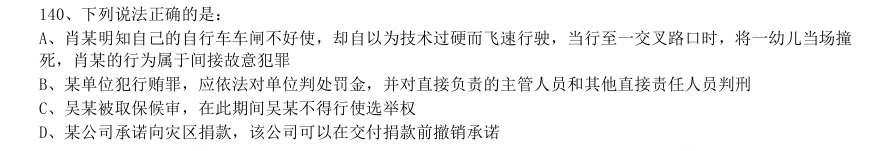

- **A.** 肖某明知自己的自行车车闸不好使,却自以为技术过硬而飞速行驶,当行至一交叉路口时,将一幼儿当场撞死,肖某的行为属于间接故意犯罪
- **B.** 某单位犯行贿罪,应依法对单位判处罚金,并对直接负责的主管人员和其他直接责任人员判刑
- **C.** 吴某被取保候审,在此期间吴某不得行使选举权
- **D.** 某公司承诺向灾区捐款,该公司可以在交付捐款前撤销承诺

**答案：A**　**考点：政治常识｜政治常识（综合）**　**难度：★★★★☆**