# 2011 年国考行测（统一卷）

- 题量：135（含答案 135）
- 模块分布：资料分析15 / 数量关系15 / 言语理解40 / 判断推理40 / 常识判断25
- 试卷编号：`国考-2011-统一卷`

## 题目与答案

**【常识判断·时事政治｜GK-2011-ty-X001】**

1. 社会建设与人民幸福安康息息相关,党的十七大报告提出,要加快推进以改善民生为重点的社会建设,下列 各项不属于社会建设范畴的是:

- **A.** 在学校建立贫困生资助体系
- **B.** 为低收入家庭提供住房保障
- **C.** 扩大各项社会保险的覆盖范围
- **D.** 强化政府服务职能,建设服务型政府

**答案：D**　**考点：时事政治｜政策文件**　**难度：★★☆☆☆**
**【常识判断·生活常识｜GK-2011-ty-X002】**

2. 随着综合国力的提升,我国在国际社会中的作用与影响越来越突出,下列说法正确的是:

- **A.** 我国的出口贸易额在“金砖四国”中位居第二
- **B.** 我国目前是二十国集团中唯一的亚洲发展中国家
- **C.** 我国在哥本哈根气候峰会上提出了单位GDP 碳减排的量化目标
- **D.** 我国已与周边所有邻国建立正式的外交关系

**答案：A**　**考点：生活常识｜其他常识（综合）**　**难度：★★☆☆☆**
**【常识判断·科技常识｜GK-2011-ty-X003】**

3. 我国的能源条件可以概括为:

- **A.** 缺煤、富油、少气
- **B.** 富煤、缺油、少气
- **C.** 缺煤、缺油、多气
- **D.** 富煤、富油、多气

**答案：B**　**考点：科技常识｜基础科学**　**难度：★★☆☆☆**
**【常识判断·生活常识｜GK-2011-ty-X004】**

4. 关于我国第六次人口普查,下列表述正确的是:

- **A.** 其标准时点是2010 年1 月1 日至2010 年12 月31 日
- **B.** 所取得的数据不得作为对普查对象实施处罚的依据
- **C.** 所需经费由中央政府完全负担,列入相应年度的财政预算
- **D.** 采用按户口所在地登记的原则

**答案：A**　**考点：生活常识｜其他常识（综合）**　**难度：★★☆☆☆**
**【常识判断·生活常识｜GK-2011-ty-X005】**

5. 2010 年7 月,党中央、国务院召开了西部大开发工作会议,总结西部大开发10 年取得的巨大成就和丰富经 验,全面分析国内外形势和西部大开发面临的新机遇、新挑战。 关于西部大开发战略,下列表述不正确的是:

- **A.** 西部大开发在我国区域协调发展总体战略中居于优先地位
- **B.** 西部大开发战略实施的最主要目的是解决沿海同内地的贫富差距
- **C.** 西部大开发覆盖地域指陕、甘、宁、青、新西北五省(区)及西藏自治区
- **D.** 实施西部大开发的核心工作是保障和改善民生

**答案：C**　**考点：生活常识｜其他常识（综合）**　**难度：★★★★★**
**【常识判断·历史人文｜GK-2011-ty-X006】**

6. 在西柏坡时期,党中央:1领导了解放区的土改运动;2召开了党的七届二中全会;3组织指挥了辽沈、淮 海、平津三大战役。 上述历史事件出现的先后顺序是:

- **A.** 132
- **B.** 213
- **C.** 231
- **D.** 312

**答案：A**　**考点：历史人文｜中国古代史**　**难度：★★★☆☆**
**【常识判断·法律常识｜GK-2011-ty-X007】**

7. 下列说法不符合法律规定的是:

- **A.** 甲村村委会在村民会议上提交了修建学校的经费筹集方案
- **B.** 乙村村委会与村民李某签订山林承包合同,承包期为10 年,到期后,村委会又将山林承包给该村村民赵某
- **C.** 丙村有一座石灰矿,丙村村委会组织该村村民成立丙村经济合作社,以经济合作社的名义申请石灰矿的采矿许可证
- **D.** 丁村享有选举权的村民有500 人,其中300 人参与了村委会主任选举,候选人王某、张某和黄某分别获得选

**答案：D**　**考点：法律常识｜法律常识（综合）**　**难度：★★★★☆**
**【常识判断·生活常识｜GK-2011-ty-X008】**

8. 根据我国《国防动员法》的有关规定,在国家的主权、统一、领土完整和安全遭受威胁时,决定全国总动员 或局部动员和发布动员令的分别是:

- **A.** 全国人民代表大会、国务院总理
- **B.** 国家主席、国务院总理
- **C.** 全国人民代表大会常务委员会、国家主席
- **D.** 全国人民代表大会常务委员长、国家主席

**答案：C**　**考点：生活常识｜生活常识**　**难度：★★★☆☆**
**【常识判断·生活常识｜GK-2011-ty-X009】**

9. 下列关于我国人大代表选举的表述,不正确的是:

- **A.** 1953 年通过的选举法规定,全国人大代表的选举,各省按每80 万人选代表1 人,直辖市和人口在50 万以上的直辖市按每10 万人选代表1 人
- **B.** 1979 年修订的选举法规定,自治州、县、自治县人大代表中,农村每一代表的人口数4 倍于镇每一代表所代表的人口数、省、自治区人大为5:1,全国人大为8:1
- **C.** 1995 年修改的选举法规定,省、自治区和全国人大代表中,农村每一代表与城市每一代表所代表的人口数为4:1,自治州、县、自治县仍是4:1
- **D.** 2010 年修改的选举法规定,全国人民代表大会代表名额,按照每一代表所代表的城乡人口数2:1 的原则,

**答案：A**　**考点：生活常识｜其他常识（综合）**　**难度：★★★★☆**
**【常识判断·科技常识｜GK-2011-ty-X010】**

10. 下列关于人类航天史的说法,正确的是:

- **A.** 载人飞船首次在地球轨道上实现交会和对接是在20 世纪60 年代
- **B.** 前苏联宇航员加加林是世界上第一个进行太空行走的人
- **C.** 成功将世界上第一颗人造地球卫星送入太空的是美国
- **D.** 首次实现登月的载人飞船是"阿波罗13 号"

**答案：A**　**考点：科技常识｜科技成就**　**难度：★★★★☆**
**【常识判断·科技常识｜GK-2011-ty-X011】**

11. 新中国成立后,我国在一些前沿技术领域取得了一批具有较大国际影响力的创新成果,下列全部属于近30 年来取得的重大突破的一组是:

- **A.** 哥德巴赫猜想、载人航天、古生物考古、南水北调
- **B.** 月球探测、核电工程、反西格玛负超子、陆相成油理论
- **C.** 超大规模集成电路、第三代移动通信、高性能计算机、超级杂交水稻
- **D.** 激光照排技术、量子通信、古生物考古、人工合成牛胰岛素结晶

**答案：A**　**考点：科技常识｜基础科学**　**难度：★★★★★**
**【常识判断·生活常识｜GK-2011-ty-X012】**

12. 关于我国的军衔制度,下列说法正确的是:

- **A.** 士兵军衔肩章版面底色有棕绿色、天蓝色、黑色三种
- **B.** 一般分帅、将、校、尉、士五个等级
- **C.** 刘伯承、陈毅、粟裕等人曾被授予元帅军衔
- **D.** 中国人民解放军第一次实行军衔制度是在1949 年

**答案：A**　**考点：生活常识｜其他常识（综合）**　**难度：★★☆☆☆**
**【常识判断·生活常识｜GK-2011-ty-X013】**

13. 关于中国交通建设,下列说法不正确的是:

- **A.** 目前国道线采用数字编号,分别以1、2、3、4 开头
- **B.** 我国自建的第一条铁路--京张铁路由詹天佑主持设计修建
- **C.** 20 世纪50 年代,新中国第一架自制飞机在南昌试飞成功
- **D.** 宋元时期的泉州港是当时世界上最大的贸易港口之一

**答案：A**　**考点：生活常识｜生活常识**　**难度：★★★★☆**
**【常识判断·经济常识｜GK-2011-ty-X014】**

14. 汇率变动会对一国对外经济活动产生影响,假如某国货币升值,则下列表述不正确的是:

- **A.** 不利于出口贸易
- **B.** 有利于公民出境旅游
- **C.** 会导致热钱流入
- **D.** 有利于消除贸易逆差

**答案：D**　**考点：经济常识｜宏观经济**　**难度：★★☆☆☆**
**【常识判断·经济常识｜GK-2011-ty-X015】**

15. 下列关于我国经济发展现状的表述,不正确的是:

- **A.** 人均国民生产总值已超过3000 美元
- **B.** 黄金储备量已超过1000 吨
- **C.** 对石油进口的依存度已接近30%
- **D.** 第三产业增加值已接近第二产业

**答案：A**　**考点：经济常识｜微观与市场**　**难度：★★☆☆☆**
**【常识判断·生活常识｜GK-2011-ty-X016】**

16. 我国民族关系中的“三个离不开”是指:

- **A.** 少数民族的发展离不开自身的努力,离不开发达地区的帮助,离不开国家民族政策的支持
- **B.** 汉族离不开少数民族,少数民族离不开汉族,少数民族之间也相互离不开
- **C.** 民族关系的和谐离不开经济发展,离不开民族政策教育,离不开法制建设
- **D.** 各民族的团结离不开共同繁荣,离不开共同发展,离不开共同进步

**答案：B**　**考点：生活常识｜其他常识（综合）**　**难度：★★★★☆**
**【常识判断·生活常识｜GK-2011-ty-X017】**

17. 2010 年新成立的我国第三个副省级新区是:

- **A.** 新疆喀什
- **B.** 上海浦东
- **C.** 天津滨海
- **D.** 重庆两江

**答案：D**　**考点：生活常识｜其他常识（综合）**　**难度：★★☆☆☆**
**【常识判断·地理常识｜GK-2011-ty-X018】**

18. 下列有关地震的表述,不正确的是:

- **A.** 2008 年四川汶川地震是我国自1949 年以来破坏性最强、波及范围最广的一次地震
- **B.** 我国位于世界两大地震带——环太平洋地震带与欧亚地震带之间
- **C.** 我国的地震带主要分布在台湾、西南、西北、华北、东南沿海等五个区域
- **D.** 震源的深度越浅,地震破坏力越大,波及范围也越广

**答案：A**　**考点：地理常识｜地理常识（综合）**　**难度：★★★★☆**
**【常识判断·历史人文｜GK-2011-ty-X019】**

19. 京剧作为我国著名剧种,和中医、国画并称为中国三大国粹,下列关于京剧的表述正确的是:

- **A.** 人们习惯上称戏班、剧团为“杏园”
- **B.** 京剧行当中的“净”是指女性角色
- **C.** “梅派”唱腔创始人是京剧艺术大师梅兰芳先生
- **D.** 《梁山伯与祝英台》是京剧经典曲目之一

**答案：A**　**考点：历史人文｜历史人文（综合）**　**难度：★★☆☆☆**
**【常识判断·历史人文｜GK-2011-ty-X020】**

20. 关于我国的出土文物,下列说法正确的是:

- **A.** 湖南长沙马王堆汉墓出土了素纱禅衣
- **B.** 西安附近出土了大量殷商时期的刻有文字的龟甲和兽骨
- **C.** 越王勾践剑是战国时期兵器冶炼技术的杰出成果
- **D.** 洛阳出土的唐三彩以红、蓝、白三种颜色为主

**答案：A**　**考点：历史人文｜中国古代史**　**难度：★★☆☆☆**
**【常识判断·地理常识｜GK-2011-ty-X021】**

21. 在几千年人类文明发展进程中,亚洲、非洲、美洲、欧洲都留下许多宝贵的文学、艺术和建筑遗产,下列文 化遗产属于同一个大洲的是:

- **A.** 《最后的晚餐》、雕塑“思想者”、雕塑“大卫”
- **B.** 胡夫金字塔、狮身人面像、帕特农神庙
- **C.** 《百年孤独》、《老人与海》、《海底两万里》
- **D.** 《飞鸟集》、《高老头》、《源氏物语》

**答案：A**　**考点：地理常识｜世界地理**　**难度：★★☆☆☆**
**【常识判断·历史人文｜GK-2011-ty-X022】**

22. 下列有关书法艺术的表达,正确的是:

- **A.** 东汉著名书法家张芝被称为“书圣”
- **B.** 唐代书法家颜真卿是楷书四大家之一
- **C.** 《真书千字文》是唐代著名书法家怀素的代表作
- **D.** “苏、黄、米、蔡”中的“黄”指的是黄公望

**答案：A**　**考点：历史人文｜中国古代史**　**难度：★★☆☆☆**
**【常识判断·科技常识｜GK-2011-ty-X023】**

23. 下列有关天文知识的表述,正确的是:

- **A.** 开普勒制成人类历史上第一台天文望远镜,并证实了哥白尼学说
- **B.** 四象青龙、白虎、朱雀、玄武分别代表东、西、南、北四个方向
- **C.** 世界最早的哈雷彗星记录是《诗经》中的"鲁庄公七年星陨如雨"
- **D.** 月食发生时地球、月球、太阳在一条直线上,且月球居中

**答案：A**　**考点：科技常识｜科技成就**　**难度：★★★★☆**
**【常识判断·生活常识｜GK-2011-ty-X024】**

24. 下列关于日常生活中的做法,不正确的是:

- **A.** 为了使用方便和最大限度地利用材料,机器上用的螺母大多是六角形
- **B.** 在加油站不能使用手机,是因为手机在使用时产生的射频火花很容易引起爆炸,发生危险
- **C.** 交通信号灯中红色被用做停车信号是因为红色波长最长
- **D.** 家中遇到煤气泄漏事件应立即使用房间的电话报警

**答案：D**　**考点：生活常识｜生活常识**　**难度：★★★★☆**
**【常识判断·生活常识｜GK-2011-ty-X025】**

25. 下列有关生活常识的说法,不正确的是:

- **A.** 夏天不宜穿深色衣服,深色衣服比浅色衣服更易吸收辐射热
- **B.** 驱肠虫药若饭后服用,不易达到最好的驱虫效果
- **C.** 按照建筑采光要求,相同高度的住宅群,昆明的楼房间距应该比哈尔滨的楼房间距大
- **D.** 在汽车玻璃清洗液中加入适当比例的酒精,可使其抗冻效果更好

**答案：C**　**考点：生活常识｜生活常识**　**难度：★★★★☆**
**【言语理解·逻辑填空｜GK-2011-ty-X026】**
> 材料：项中选出一个最恰当的答案。

26. 荀子认为,人的知识、智慧、品德等,都是由后天学习、积累而来的,他专门写了《劝学》篇,论述学习的 重要性,肯定人是教育和环境的产物,倡导 、日积月累、不断求知的学习精神。 填入画横线部分最恰当的一项是:

- **A.** 孜孜不倦
- **B.** 坚忍不拔
- **C.** 按部就班
- **D.** 一丝不苟

**答案：A**　**考点：逻辑填空｜逻辑填空（综合）**　**难度：★★☆☆☆**
**【言语理解·逻辑填空｜GK-2011-ty-X027】**

27. 目前我国高校博物馆的数量已有150 多座,然而这些博物馆却很寂寞,终年 ,有的连自己学 校的师生都不知晓,有的由于没有展出条件,众多的宝贝常年灰尘满面,利用率很低,至于说到免费开放和惠及 民众,更是很 的话题。 依次填入画横线部分最恰当的一项是:

- **A.** 门可罗雀遥远
- **B.** 无人问津突兀
- **C.** 门庭冷落生僻
- **D.** 人迹罕至超前

**答案：A**　**考点：逻辑填空｜两空**　**难度：★★☆☆☆**
**【言语理解·逻辑填空｜GK-2011-ty-X028】**

28. 信用卡从根本上改变了我们的花钱方式,当我们用现金买东西时,购买行为就涉及到实际的损失——我们的 钱包变空了,然而,信用卡却把交易行为 化了,这样我们实际上就不容易感觉到花钱的消极面了。脑成 像试验表明,刷卡真的会降低脑岛的活动水平,而脑岛是与消极情绪有关的脑区。信用卡的实质就是 我们, 让我们感觉不到付账的痛苦。 依次填入画横线部分最恰当的一项是:

- **A.** 合理麻痹
- **B.** 抽象麻醉
- **C.** 简单迷惑
- **D.** 概念蒙蔽

**答案：B**　**考点：逻辑填空｜两空**　**难度：★★★☆☆**
**【言语理解·逻辑填空｜GK-2011-ty-X029】**

29. 如果孩子只能在美术课上画画,往往会变得很 :他们总是用同一系列颜色表现同一类主题,画 中充斥着令人担忧的“现实主义”,毫无 可言。 依次填入画横线部分最恰当的一项是:

- **A.** 固执灵气
- **B.** 刻板新意
- **C.** 保守创新
- **D.** 单调理想

**答案：B**　**考点：逻辑填空｜两空**　**难度：★☆☆☆☆**
**【言语理解·逻辑填空｜GK-2011-ty-X030】**

30. 过去的25 年中,尽管经历着通货膨胀和经济衰退,美国人的消费能力始终没有减退,背后最主要的推力就 是个人信贷业的异常 ,尽管个别客户可能破产,但总体上,个人消费信贷是 的。 依次填入画横线部分最恰当的一项是:

- **A.** 活跃节节攀升
- **B.** 频繁安然无虞
- **C.** 繁荣有利可图
- **D.** 发达高枕无忧

**答案：A**　**考点：逻辑填空｜两空**　**难度：★★☆☆☆**
**【言语理解·逻辑填空｜GK-2011-ty-X031】**

31. 人类千万年的历史中,最 的不是令人目眩的科技,不是大师们浩瀚的经典,而是实现了对权力 的 ,实现了把权力关进笼子的梦想。 依次填入画横线部分最恰当的一项是:

- **A.** 珍贵约束
- **B.** 重大限制
- **C.** 成功束缚
- **D.** 难得控制

**答案：A**　**考点：逻辑填空｜两空**　**难度：★☆☆☆☆**
**【言语理解·逻辑填空｜GK-2011-ty-X032】**

32. 互联网怎样影响了我们的社会和生活,这看上去好像是个 的话题,每个人都能说上几句,但事 实上,有几个人能把这个问题说清楚,说细致,说出点儿新意,说出点儿可意会不可言传的 。 依次填入画横线部分最恰当的一项是:

- **A.** 见仁见智理由
- **B.** 众说纷纭道理
- **C.** 历久弥新独见
- **D.** 老生常谈妙处

**答案：D**　**考点：逻辑填空｜两空**　**难度：★★☆☆☆**
**【言语理解·逻辑填空｜GK-2011-ty-X033】**

33. 要解决孩子上幼儿园难的问题, 是各级政府要把学前教育经费纳入地方财政预算,提高投入比 例,增加公办幼儿园的数量,以满足城乡居民子女的入园需求。 填入画横线部分最恰当的一项是:

- **A.** 当务之急
- **B.** 首当其冲
- **C.** 理所当然
- **D.** 无可置疑

**答案：A**　**考点：逻辑填空｜成语辨析**　**难度：★☆☆☆☆**
**【言语理解·逻辑填空｜GK-2011-ty-X034】**

34. 在高楼林立的现代都市里,在人们的 中,本已零落的古建筑更加凋零,每天都面临着彻底消失 的命运,如果教育能让孩子从小感受古建筑所蕴含的魅力,让他们懂得珍惜,就能最终积累出保护古代建筑 最 的力量。 依次填入画横线部分最恰当的一项是:

- **A.** 忙碌可靠
- **B.** 漠视坚实
- **C.** 误解基础
- **D.** 麻木强大

**答案：B**　**考点：逻辑填空｜两空**　**难度：★★☆☆☆**
**【言语理解·逻辑填空｜GK-2011-ty-X035】**

35. 任何城市的演变都是城市的历史与新元素的 ,城市的历史和历史建筑应当是我们的资源、城市 的特色,而不应被看作城市建设的 。 依次填入画横线部分最恰当的一项是:

- **A.** 融会贯通负担
- **B.** 兼收并蓄阻力
- **C.** 此消彼长包袱
- **D.** 相辅相成障碍

**答案：D**　**考点：逻辑填空｜两空**　**难度：★☆☆☆☆**
**【言语理解·逻辑填空｜GK-2011-ty-X036】**

36. 对经典的质疑不会使经典变得 ,反倒有助于公众更加清醒地认识经典的意义所在,并正确对待 经典中可能存有的某些 。 依次填入画横线部分最恰当的一项是:

- **A.** 一文不值不足
- **B.** 平淡无奇缺陷
- **C.** 百无一用弊病
- **D.** 暗淡无光瑕疵

**答案：D**　**考点：逻辑填空｜两空**　**难度：★☆☆☆☆**
**【言语理解·逻辑填空｜GK-2011-ty-X037】**

37. 在金属发展史上,从陨铁的锻制到人工冶炼铁的出现,这一演进绝不是 的,而是经历了长达 600 年以上的 。 依次填入画横线部分最恰当的一项是:

- **A.** 一蹴而就摸索
- **B.** 自然而然努力
- **C.** 一朝一夕改进
- **D.** 轻而易举发展

**答案：A**　**考点：逻辑填空｜两空**　**难度：★☆☆☆☆**
**【言语理解·逻辑填空｜GK-2011-ty-X038】**

38. “不畏浮云遮望眼,只缘身在最高层”。只要我们站在时代的前沿,以历史的眼光 世界大势, 以战略家的智慧 未来,以互利共赢的精神致力于发展,以务实开放的态度 区域合作, 我们就能克服前进道路上的艰难险阻,不断谱写出本地区和平、发展与繁荣的新篇章。 依次填入画横线部分最恰当的一项是:

- **A.** 运筹展望促进
- **B.** 观察把握推动
- **C.** 分析赢得加强
- **D.** 洞察谋划推进

**答案：D**　**考点：逻辑填空｜三空及以上**　**难度：★★★☆☆**
**【言语理解·逻辑填空｜GK-2011-ty-X039】**

39. 北极地区冰湖的逐渐融化,更 的意义在于北冰洋上将出现新航道,新航道的出现可以让环北极 地区国家 提出对北极地区的主权主张,不仅可以使本国获得经济和军事利益,而且可以直接对其他 国家的科学考察、经济开发等活动进行 。 依次填入画横线部分最恰当的一项是:

- **A.** 深远趁机干预
- **B.** 现实方便限制
- **C.** 重要合法监控
- **D.** 直接明确介入

**答案：A**　**考点：逻辑填空｜三空及以上**　**难度：★★☆☆☆**
**【言语理解·逻辑填空｜GK-2011-ty-X040】**

40. 从某种意义上来说,大脑就像肌肉一样,如果 锻炼某个部分,就会使该区域增强。科学家发现 小提琴演奏家的大脑中用来控制左手的区域远大于常人,因为左手按压琴弦的工作比较 ,而右手拉 弓弦则相对简单,同样,阅读盲文的盲人,其大脑中很大的区域 给触觉。 依次填入画横线部分最恰当的一项是:

- **A.** 长期紧张安排
- **B.** 反复繁琐分配
- **C.** 直接劳累划分
- **D.** 刻意复杂预留

**答案：B**　**考点：逻辑填空｜三空及以上**　**难度：★★★☆☆**
**【言语理解·逻辑填空｜GK-2011-ty-X041】**

41. 品牌一词,“品”在前,“牌”在后。这说明要先有“品”,才有“牌”。也就是说,要是没有好的产品做 支撑,单靠打广告、搞赞助,即使能做出个名牌,也只是 。这方面的教训 。所谓的“品”, 不仅指“产品”“品质”,还包括企业的“品行”,也就是说企业还要积极地履行社会责任。 依次填入画横线部分最恰当的一项是:

- **A.** 掩耳盗铃比比皆是
- **B.** 昙花一现不胜枚举
- **C.** 名实不符振聋发聩
- **D.** 浮光掠影屡见不鲜

**答案：B**　**考点：逻辑填空｜两空**　**难度：★★★☆☆**
**【言语理解·逻辑填空｜GK-2011-ty-X042】**

42. 相对于中原地区,黄河上游人们的生活与风俗我并不熟悉,无法一下子 到心灵层面的东西。但 我还是带着 去拍摄,去体验普通人生活在令人敬畏的大自然和 的历史面前是什么情 形。 依次填入画横线部分最恰当的一项是:

- **A.** 感受疑问悠久
- **B.** 碰触好奇变迁
- **C.** 深入憧憬沉寂
- **D.** 捕捉敬意沧桑

**答案：D**　**考点：逻辑填空｜三空及以上**　**难度：★★☆☆☆**
**【言语理解·逻辑填空｜GK-2011-ty-X043】**

43. 一部本来颇有可能写成论文状的著作,读来却丝毫没有艰涩之感,反而 ,实在 。 要知道,在这样一个高速运转的社会里,一本 的书往往会被放在桌子上做临时杯垫用。 依次填入画横线部分最恰当的一项是:

- **A.** 妙趣横生难能可贵令人费解
- **B.** 引人入胜匠心独具高深莫测
- **C.** 深入浅出叹为观止曲高和寡
- **D.** 平易近人不可多得枯燥无味

**答案：A**　**考点：逻辑填空｜三空及以上**　**难度：★☆☆☆☆**
**【言语理解·逻辑填空｜GK-2011-ty-X044】**

44. 皮影戏在我国流传地域广阔,在长期的 过程中,其音乐唱腔的风格与韵律都 了各自地 方戏曲、曲艺、民间小调的精华,从而形成了众多 的流派。 依次填入画横线部分最恰当的一项是:

- **A.** 演变融汇标新立异
- **B.** 演化吸收异彩纷呈
- **C.** 传承借鉴家喻户晓
- **D.** 积淀汲取风格迥异

**答案：B**　**考点：逻辑填空｜三空及以上**　**难度：★☆☆☆☆**
**【言语理解·逻辑填空｜GK-2011-ty-X045】**

45. 许多人善意地对某人建言,内容值得一提,但时机不对,反而造成当事人的 与羞愤。有的 人讲话内容 ,时机也对,但对象不够成熟,讲得再多也 ,对不同的对象, 要能讲出适合他听的话。 依次填入画横线部分最恰当的一项是:

- **A.** 尴尬精辟徒劳无益
- **B.** 不齿丰富白费口舌
- **C.** 误解透彻无济于事
- **D.** 苦恼鲜明枉费心机

**答案：A**　**考点：逻辑填空｜三空及以上**　**难度：★★☆☆☆**
**【言语理解·中心理解｜GK-2011-ty-X046】**

46. 中国历代异常发达的政治哲学和历史哲学早就无数次地告诫世人:权力的私有及日益专横,只能导致万民涂 炭、王朝崩溃的惨祸。但是所有这些深痛剖析永远难以进入法律层面而成为制约统治权力的刚性力量,所以它们 只能转而定型为一种“代偿”方式,即思辨、文学和伦理等领域中的深深涵咏和喟叹。因此,在中晚唐开端的中 国皇权社会后期文化中,以李商隐等人的作品为代表,不仅“咏史”之作数量日益庞大,而且诸多经典之作极其 警策,具有空前沉郁的历史悲剧感。 对这段文字的主旨概括最准确的是:

- **A.** 告诫世人吸取历史兴亡的深刻教训
- **B.** 剖析权力私有必然造成社会危机
- **C.** 评价李商隐等唐代诗人的创作成就
- **D.** 说明咏史诗作诞生的社会政治背景

**答案：D**　**考点：中心理解｜转折与因果**　**难度：★★★★☆**
**【言语理解·中心理解｜GK-2011-ty-X047】**

47. 在美国,学术界、工商界 、主管部门和多数消费者倾向于认为用豆浆代替牛奶是一种更健康的选择。不过, 绝大多数西方人很不喜欢豆味,所以美国的豆浆有进一步去除或掩盖豆味的操作,而中国人就会觉得这样一点儿 豆浆味也没有。对奶味的偏好和对豆味的排斥,是豆浆在西方不够受欢迎的主要原因。此外,豆浆在保存过程中 比牛奶容易发生聚集下沉,这也给豆浆成为牛奶那样的方便食品带来了难度。保存难度高,加上市场需求量不是 那么大,导致美国豆浆的价格远远高于牛奶。 对这段文字的主旨概括最准确的是:

- **A.** 对比中国人和西方人对豆浆口味的不同喜好
- **B.** 探究豆浆在西方市场不受欢迎的根本原因
- **C.** 剖析豆浆在美国市场上价格偏高的原因
- **D.** 指出豆浆打入美国市场所必需的技术手段

**答案：C**　**考点：中心理解｜转折与因果**　**难度：★★★★☆**
**【言语理解·中心理解｜GK-2011-ty-X048】**

48. 美国著名学者伊顿曾预言:“我们深信,在不久的将来,我们国家的最高经济利益,将主要取决于我们同胞 的创造才智,而不取决于自然资源。”伊顿的预言在今天已经变为现实。金融危机、能源和矿产资源价格急剧上 涨,世界经济滞涨风险苗头显现,国民的创新能力得到许多国家前所未有的重视。 这段文字意在强调:

> （本题为图形题，选项为图片，见原卷）

**答案：C**　**考点：中心理解｜主题词**　**难度：★★★☆☆**
**【言语理解·逻辑填空｜GK-2011-ty-X049】**

49. 人类的平均寿命越来越长,但是人类所观察到的癌症发生率也越来越高。在分析这种趋势的时候,很多人会 把它归结为现代食物的品质越来越差,于是时不时有人发出“某某食物致癌”的言论,总能吸引一堆眼球;如果 指出这种“致癌的食物”跟现代技术有关, 。 填入画横线部分最恰当的一句是:

- **A.** 那就更容易得到公众的普遍认同
- **B.** 那就应该分析其关联性到底有多大
- **C.** 那也不能作为反对现代技术的理由
- **D.** 那么据此得出的结论就往往只是初步的

**答案：A**　**考点：逻辑填空｜逻辑填空（综合）**　**难度：★★☆☆☆**
**【言语理解·中心理解｜GK-2011-ty-X050】**

50. 信息时代里的企业就像一个完整的人,组织如骨骼,资金如血液,信息如神经。信息流就是生命线,信息系 统是神经系统,顾客需求是刺激源。在统一的数字神经系统下,从决策者到管理者再到执行者,从人到机器,如 果信息可以一路顺畅,整个企业就能用一个大脑思考。这颗数字大脑不仅要对多样化、个性化的顾客需求做出及 时准确的反应,还要在对这类信息资源的筛选和分析汇总中不断寻找新的机遇,拓展进步的空间,打造时刻贴近 顾客需求的无缝隙的服务品牌。 这段文字意在强调:

- **A.** 打造知名品牌是企业长远发展的基础
- **B.** 应高度重视企业各个环节的有效整合
- **C.** 如何对顾客需求做出及时准确的反应
- **D.** 信息系统对企业具有至关重要的意义

**答案：D**　**考点：中心理解｜转折与因果**　**难度：★★★★☆**
**【言语理解·中心理解｜GK-2011-ty-X051】**

51. 诗人从生活和大自然中捕捉灵感,将语言剪裁成诗;知音的理解和回响,可以使诗的意象和隐藏其中的思想 感情浮现出来。“天地一沙鸥”,“海上生明月”,“悠然见南山”,经由后人的吟诵品味,其意象更为深化; “巴山夜雨”,“易水悲歌”,“汉关秦月”,“江山风光”和人物诗文相互烘托,转化为跨时空的文化符号, 丰富了文学的内容,影响着一代代人的精神面貌。 这段文字的关键词是:

- **A.** 诗知音意象
- **B.** 自然灵感文化
- **C.** 生活感情品味
- **D.** 文学符号精神

**答案：A**　**考点：中心理解｜对策优先**　**难度：★★★★☆**
**【言语理解·中心理解｜GK-2011-ty-X052】**

52. 甜菜的上部叶片垂直生长,叶簇呈漏斗形,这种生长方式所形成的叶面空间的配制结构,极有利于光照的吸 收,提高植株和群体的光合效率。而车前草的叶片是轮生的,叶片夹角为137.5 度,这正是圆的黄金分割的弦角, 叶片按照这个角度生长,可以充分利用光照。梨树随着树干长高,叶片沿对数螺旋上升,每个叶片都不会遮蔽下 面的叶片。 这段文字意在说明:

- **A.** 光照吸收率是影响植物生长的关键因素
- **B.** 暗合数学规律的叶片结构对植物生长有利
- **C.** 不同的生长环境造成了植物叶片生长的差异
- **D.** 对光照的吸收影响叶片的生长角度

**答案：B**　**考点：中心理解｜对策优先**　**难度：★★★☆☆**
**【言语理解·中心理解｜GK-2011-ty-X053】**

53. 纵观世界流行音乐史,你会发现它基本上就是黑、白两种不同文化的融合史,而且总是由黑人提供原始素材, 然后白人把它“偷”过来,并加以完善,最终作为一种崭新的商品推向全球。牙买加由于其特殊的地理位置,成 为这一融合的最大受益者,这种模式也被顺理成章地推广到田径领域,终于成就了牙买加田径运动的辉煌。 这段文字主要谈论:

- **A.** 世界流行音乐史的发展模式
- **B.** 文化融合给牙买加带来的好处
- **C.** 地理位置在文化交流中的特殊意义
- **D.** 黑人和白人对音乐、体育的不同贡献

**答案：B**　**考点：中心理解｜转折与因果**　**难度：★★★☆☆**
**【言语理解·中心理解｜GK-2011-ty-X054】**

54. 目前,我国正处于产业结构调整的关键阶段。在当前的世界经济危机中,我们已有的外贸主导型经济模式可 持续性越来越小。农业是经济危机的避风港,只有通过强农惠农、提高农业综合生产能力和粮食市场竞争力,来 全面提高农民的收入,推动农村经济的大发展和广阔的农村市场需求的大升级,才能全面扩大内需,推动我国外 向型经济向内向型经济的顺利转型。 对这段文字的主旨概括最准确的是:

- **A.** 当前我国扩大内需最有效的途径应是大力发展农业
- **B.** 世界经济危机可以成为我国经济转型的一个契机
- **C.** 当前我国产业结构调整的重点是农业生产结构的调整
- **D.** 强农惠农政策是当前我国转变经济发展方式的必然要求

**答案：D**　**考点：中心理解｜对策优先**　**难度：★★★★☆**
**【言语理解·细节判断｜GK-2011-ty-X055】**

55. 世界茶叶生产的基本规律是“南红北绿”,即: 较低纬度地区(如印度、肯尼亚)只能生产优质红茶,相 对较高纬度的地区(北纬25°~30°)最适宜生产优质绿茶。国际茶价历来绿茶高于红茶。茶叶主产国印度、 印尼、斯里兰卡的绿茶品质都不高,以上三国从上个世纪70 年代开始"红改绿",企图占领国际绿茶市场,均以 失败告终。我国名优绿茶主要分布在山区,拥有丰富的农村劳动力资源和较低的劳动力成本,发展绿茶产业具有 明显的比较优势。 以下说法与原文相符的是:

- **A.** 目前国际市场上红茶供过于求
- **B.** 印度绿茶价格高于国际绿茶均价
- **C.** 中国绿茶在国际市场上具有竞争实力
- **D.** 国际茶叶市场上出现"红改绿"的趋势

**答案：C**　**考点：细节判断｜细节判断**　**难度：★★★★☆**
**【言语理解·中心理解｜GK-2011-ty-X056】**

56. 纵观各国货币发展历史,货币国际化虽然给所在国带来一定风险,但却远远低于所带来的好处。从老百姓的 角度看,本国货币的国际化程度高,就意味着在出国旅行、消费、留学的过程中,可以较为便利地用本币进行支 付,不必经过繁琐的汇兑程序;从政府的角度看,国际货币发行国,可以通过发行本国货币为国际赤字融资,相 对于别的国家征收了“铸币税”,其中的好处不言而喻。因此,许多国家的货币都“争先恐后” 地走向国际化。 这段文字意在:

- **A.** 揭示促使货币国际化的原因
- **B.** 说明实现货币国际化的结果
- **C.** 提醒货币国际化潜藏的危险
- **D.** 剖析货币国际化的实现途径

**答案：A**　**考点：中心理解｜转折与因果**　**难度：★★★★☆**
**【言语理解·中心理解｜GK-2011-ty-X057】**

57. 在以前的对外传播和交往中,我们的外交官经常会遇到这样的情况:外国人在中国博大精深、错综复杂的文 化历史面前望而却步,甚至连我们自己也无法精要地描述这一深刻变动的古老文明,我们提出的“和平崛起”“和 谐世界”等战略框架和口号,更多地着眼于国外的战略决策者,而不是针对那些普普通通,对中国不甚了解的国 外民众,用现代形象管理学的标准来衡量,我们的“广告词”和“象征符号”还不太贴近群众,在视觉触摸感和 情感想象力上,还总让人感到有些缺憾。 这段文字探讨的核心问题是:

- **A.** 外交官在对外交往中遭遇的困境
- **B.** 古老文明走向世界需要突破的难关
- **C.** 我国在对外传播和交往中存在的误区
- **D.** 中西不同文化间客观上存在的隔膜

**答案：C**　**考点：中心理解｜对策优先**　**难度：★★★★☆**
**【言语理解·细节判断｜GK-2011-ty-X058】**

58. 我们今天所依循的谈论中国古代绘画的文字全都出自中国文人之手,也正因为如此,中国文人已长时期主宰 了绘画讨论的空间,他们已惯于从自己的着眼点出发,选择对文人艺术家有利的观点。而如今——或者早该如此 ——已是我们对他们提出抗衡的时候了,并且也应该质疑他们眼中所谓的好画家或好作品。许多优秀的非文人艺 术家都因为文人的偏见而未能获得应有的认可,在此,我们应该一一重新给予他们客观的评价和应有的地位。 下列说法与原文相符的是:

- **A.** 文人艺术家的鉴赏水平落后于他们的创作水平
- **B.** 古代很多有才华的文人艺术家因偏见而被埋没
- **C.** 文人在中国绘画理论领域长期居于强势地位
- **D.** 古代文人画与非文人画的趣味分歧由来已久

**答案：C**　**考点：细节判断｜细节判断**　**难度：★★★★☆**
**【言语理解·中心理解｜GK-2011-ty-X059】**

59. 一般来说,一个社会的监督体系是由多方面力量组成的,媒体监督不应成为其中的主要力量,更不应“一枝 独秀”,因为这个体系还应该包括公众监督、制度监督等多个方面,任何一方面的缺失,都会使整个体系出现明 显漏洞。单纯依靠一种监督力量,对于任何一个社会来说都是“不安全”的,因为不同的监督力量,在整个体系 中扮演的角色是不同的。媒体监督相对于制度监督等方式而言,是一种非强制性的监督,不仅受制于舆论环境, 而且监督效果在很大程度上取决于监督对象的态度。因此,将整个社会监督的“希望”全部寄托在媒体身上,既 不科学,也不现实。 这段文字针对的主要问题是:

- **A.** 目前媒体监督被赋予过多的期望
- **B.** 社会监督未引起监督对象的足够重视
- **C.** 媒体监督的效果尚不理想
- **D.** 强制性监督的作用未得到充分发挥

**答案：A**　**考点：中心理解｜对策优先**　**难度：★★★★☆**
**【言语理解·语句排序｜GK-2011-ty-X060】**

60. 1它们没有超过一千年的家谱 2金鱼是世界上养殖最普遍的宠物鱼类 3不过有一件事是可以确定的 4却没有多少证据证实它们是什么时候被驯养的 5只有少数几个国家还没有引进 6尽管我们知道金鱼原产于中国 将以上6 个句子重新排列,语序正确的是:

- **A.** 253164
- **B.** 253641
- **C.** 256431
- **D.** 643125

**答案：C**　**考点：语句排序｜语句排序**　**难度：★★★★★**
**【言语理解·语句排序｜GK-2011-ty-X061】**

61. 1就可能走向思维的误区 2这无疑是最好的强国路径 3对于经济增长和民众福利来说,更重要的是人均意义上的增长,而不是总量意义上的增长 4当然,也不能说总量意义上的增长没有意义,毕竟有很多事情是由“总体实力”决定的 5简单的通过增加劳动力供给的数量来推动总量意义上的增长 6如果人均意义上的增长快,却能够在提高民众福利的同时提高“总体实力” 将以上6 个句子重新排列,语序正确的是:

- **A.** 351462
- **B.** 462351
- **C.** 516234
- **D.** 625134

**答案：A**　**考点：语句排序｜语句排序**　**难度：★★★★★**
**【言语理解·语句排序｜GK-2011-ty-X062】**

62. 1商代以后,随着文字的出现,书写需求增加,周宣王时期“刑夷始制墨”,出现了颗粒状人工墨 2到了以彩陶为典型特征的仰韶文化时期,已经有了用来研磨颜料的研磨器—石研 3这些长过半米的大石器,是用来加工粮食的 4砚起源于研磨器,目前已知最早的研磨器是距今七、八千年的裴李岗、磁山文化时期的石磨盘和石磨棒 5此后,用于研墨的石研,就成为早期的砚 将以上5 个句子重新排列,语序正确的是:

- **A.** 13452
- **B.** 43215
- **C.** 13425
- **D.** 43251

**答案：B**　**考点：语句排序｜语句排序**　**难度：★★★★★**
**【言语理解·中心理解｜GK-2011-ty-X063】**

63. 文明和文化是不同的。文明使所有的地方所有的民族越来越相似,按照德国人埃利亚斯《文明的进程》的说 法,文明是一个群体社会中大家按照同一规则生活,就好像按照一个节拍跳舞,不至于踩到脚一样;而文化使一 个民族与别的民族不同,它是与生俱来的,不是规则而是习惯。其实城市化也可以这样看:城市迅速发展,摩天 大楼变成城市象征,这其实是现代文明在世界各个角落强势发展的结果。但是,我们又希望文明不要压倒文化, “同一”不要消灭“差异”。 这段文字意在:

- **A.** 质疑现代文明忽略民族个性的趋势
- **B.** 探究城市化进程与文明发展的关系
- **C.** 强调城市化进程中保存文化的必要性
- **D.** 比较文明与文化对人类发展的不同影响

**答案：C**　**考点：中心理解｜转折与因果**　**难度：★★★★☆**
**【言语理解·中心理解｜GK-2011-ty-X064】**

64. 中小企业由于规模有限、力量较小,不论是技术创新还是市场扩展,很多事情依靠每个企业单打独斗既不可 能,也不经济。因此,发展中小企业的协会和服务组织,对中小企业的发展十分重要。这类组织既可以是综合性 的,也可以是专业性的。事实证明,中小企业的发展与这类服务组织的发展之间存在着很大的相关性。积极参与 和支持这类组织的发展和运作是中小企业的分内之事,虽然会花费一定的精力,付出一定的代价,但这种付出和 代价是值得的。 这段文字意在说明:

- **A.** 发展中小企业协会和服务组织将成为大势所趋
- **B.** 中小企业应意识到参与协会和服务组织的意义
- **C.** 现实状况下中小企业协会和服务组织大有可为
- **D.** 中小企业参与协会和服务组织才能提高竞争力

**答案：B**　**考点：中心理解｜转折与因果**　**难度：★★★★☆**
**【言语理解·中心理解｜GK-2011-ty-X065】**

65. 有些被宣称为“清热下火”的凉茶,其实连茶的远亲都算不上,它们不是普通的“茶叶”,只是含些中草药 提取液。从现代医学角度看,人体的许多症状跟中医所说的“热”“火”类似,而这些症状,有许多是会自然减 退的,不管喝凉茶还是白水,一段时间后都会减轻。另一方面,在理论上完全可能有中草药的某些成分正好对某 些症状有效,所以不少人喝了凉茶,觉得清了“热”,下了“火”,这并不奇怪。但是,这样一种“有效”却符 合大众的思维方式,但凡质疑这些功效的言论都会招来大量消费者“现身说法”的攻击,也就成了顺理成章之事。 这段文字意在说明:

- **A.** 乱喝凉茶可能会对健康不利
- **B.** 很多消费者并不了解凉茶的实质
- **C.** 某些凉茶“清热下火”的功能值得怀疑
- **D.** 凉茶中真正发挥功效的是中草药成分

**答案：B**　**考点：中心理解｜转折与因果**　**难度：★★★★☆**
**【数量关系·行程问题｜GK-2011-ty-X066】**

66. 小王步行的速度比跑步慢50%,跑步的速度比骑车慢50%。如果他骑车从A 城去B 城,再步行返回A 城共需 要2 小时。 问小王跑步从A 城到B 城需要多少分钟:

- **A.** 45
- **B.** 48
- **C.** 56
- **D.** 60

**答案：B**　**考点：行程问题｜环形与往返**　**难度：★☆☆☆☆**
**【数量关系·工程问题｜GK-2011-ty-X067】**

67. 甲、乙、丙三个工程队的效率比为6:5:4,现将A、B 两项工作量相同的工程交给这三个工程队,甲队负责A 工程,乙队负责B 工程,丙队参与A 工程若干天后转而参与B 工程。两项工程同时开工,耗时16 天同时结束。 问丙队在A 工程中参与施工多少天:

- **A.** 6
- **B.** 7
- **C.** 8
- **D.** 9

**答案：A**　**考点：工程问题｜给定时间型**　**难度：★★★☆☆**
**【数量关系·行程问题｜GK-2011-ty-X068】**

68. 甲、乙两人在长30 米的泳池内游泳,甲每分钟游37.5 米,乙每分钟游52.5 米,两人同时分别从泳池的两 端出发,触壁后原路返回,如是往返。如果不计转向的时间,则从出发开始计算的1 分50 秒内两人共相遇了多 少次:

- **A.** 2
- **B.** 3
- **C.** 4
- **D.** 5

**答案：B**　**考点：行程问题｜环形与往返**　**难度：★★☆☆☆**
**【数量关系·其他数量关系｜GK-2011-ty-X069】**

69. 某公司去年有员工830 人,今年男员工人数比去年减少6%,女员工人数比去年增加5%,员工总数比去年增 加3 人。 问今年男员工有多少人:

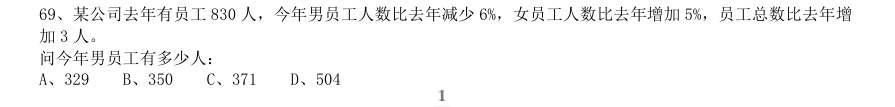

- **A.** 329
- **B.** 350
- **C.** 371
- **D.** 504

**答案：A**　**考点：其他数量关系｜和差倍比**　**难度：★☆☆☆☆**
**【数量关系·利润问题｜GK-2011-ty-X070】**

70. 受原材料涨价影响,某产品的总成本比之前上涨了 ,而原材料成本在总成本中的比重提高了2.5 个百分点。 问原材料的价格上涨了多少:

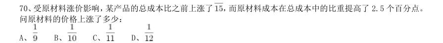

- **A.** 
- **B.** 
- **C.** 
- **D.** 

**答案：A**　**考点：利润问题｜基础利润**　**难度：★☆☆☆☆**
**【数量关系·利润问题｜GK-2011-ty-X071】**

71. 某商店花10000 元进了一批商品,按期望获得相当于进价25%的利润来定价,结果只销售了商品总量的30%。 为尽快完成资金周转,商店决定打折销售,这样卖完全部商品后,亏本1000 元。 问商店是按定价打几折销售的:

- **A.** 九折
- **B.** 七五折
- **C.** 六折
- **D.** 四八折

**答案：C**　**考点：利润问题｜折扣与促销**　**难度：★★☆☆☆**
**【数量关系·排列组合｜GK-2011-ty-X072】**

72. 甲、乙两个科室各有4 名职员,且都是男女各半,现从两个科室中选出4 人参加培训,要求女职员比重不得 低于一半,且每个科室至少选 1 人。 问有多少种不同的选法:

- **A.** 67
- **B.** 63
- **C.** 53
- **D.** 51

**答案：D**　**考点：排列组合｜基础排列组合**　**难度：★★★★★**
**【数量关系·其他数量关系｜GK-2011-ty-X073】**

73. 小赵,小钱,小孙一起打羽毛球,每局两人比赛 ,另一人休息,三人约定每一局的输方下一局休息,结束 时算了一下,小赵休息了2 局,小钱共打了8 局,小孙共打了5 局,则参加第9 局比赛的是:

- **A.** 小钱和小孙
- **B.** 小赵和小钱
- **C.** 小赵和小孙
- **D.** 以上皆有可能

**答案：B**　**考点：其他数量关系｜和差倍比**　**难度：★★☆☆☆**
**【数量关系·排列组合｜GK-2011-ty-X074】**

74. 某市对52 种建筑防水卷材产品进行质量抽检,其中有8 种产品的低温柔度不合格,10 种产品的可溶物含量 不达标,9 种产品的接缝剪切性能不合格,同时两项不合格的有7 种,有1 种产品这三项都不合格,则三项全部 合格的建筑防水卷材产品有多少种:

- **A.** 37
- **B.** 36
- **C.** 35
- **D.** 34

**答案：D**　**考点：排列组合｜基础排列组合**　**难度：★★★★★**
**【数量关系·几何问题｜GK-2011-ty-X075】**

75. 用一个平面将一个边长为1 的正四面体切分为两个完全相同的部分,则切面的最大面积为:

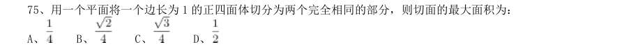

- **A.** 
- **B.** 
- **C.** 
- **D.** 

**答案：B**　**考点：几何问题｜平面几何**　**难度：★★★★☆**
**【数量关系·年龄问题｜GK-2011-ty-X076】**

76. 某单位共有A、B、C 三个部门,三部门人员平均年龄分别为38 岁,24 岁,42 岁,A 和B 两部门人员平均年 龄为30 岁,B 和C 两部门人员平均年龄为34 岁,该单位全体人员的平均年龄为多少岁:

- **A.** 34
- **B.** 36
- **C.** 35
- **D.** 37

**答案：C**　**考点：年龄问题｜年龄和与倍数**　**难度：★★☆☆☆**
**【数量关系·其他数量关系｜GK-2011-ty-X077】**

77. 同时打开游泳池的A B 两个进水管,加满水需1 小时30 分钟,且A 管比B 管多进水180 立方米。若单独 打开A 管,加满水需2 小时40 分钟,则B 管每分钟进水多少立方米:

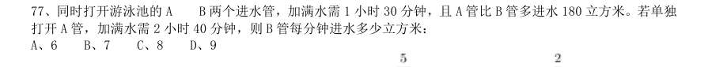

- **A.** 6
- **B.** 7
- **C.** 8
- **D.** 9

**答案：B**　**考点：其他数量关系｜和差倍比**　**难度：★★☆☆☆**
**【数量关系·其他数量关系｜GK-2011-ty-X078】**

78. 某城市共有A、B、C、D、E 五个区,A 区人口是全市人口的 ,B 区人口是A 区人口的 ,C 区人口是D 区和 E 区人口总数的 ,A 区比C 区多3 万人。全市共有多少万人:

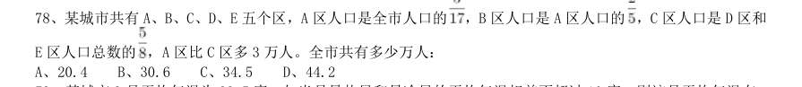

- **A.** 20.4
- **B.** 30.6
- **C.** 34.5
- **D.** 44.2

**答案：D**　**考点：其他数量关系｜和差倍比**　**难度：★★☆☆☆**
**【数量关系·最值问题｜GK-2011-ty-X079】**

79. 某城市9 月平均气温为28.5 度,如当月最热日和最冷日的平均气温相差不超过10 度,则该月平均气温在 30 度及以上的日子最多有多少天:

- **A.** 24
- **B.** 25
- **C.** 26
- **D.** 27

**答案：B**　**考点：最值问题｜最值优化**　**难度：★★★★☆**
**【数量关系·其他数量关系｜GK-2011-ty-X080】**

80. 一个班的学生排队,如果排成3 人一排的队列,则比2 人一排的队列少8 排;如果排成4 人一排的队列,则 比3 人一排的队列少5 排,这个班的学生如果按5 人一排来排队的话,队列有多少排:

- **A.** 9
- **B.** 10
- **C.** 11
- **D.** 12

**答案：C**　**考点：其他数量关系｜方程与不定方程**　**难度：★★☆☆☆**
**【判断推理·图形推理｜GK-2011-ty-X081】**

81. 从所给的四个选项中,选择最合适的一个填入问号处,使之呈现一定的规律性:

> （本题为图形题，选项为图片，见原卷）

**答案：C**　**考点：图形推理｜位置规律**　**难度：★★★☆☆**
**【判断推理·图形推理｜GK-2011-ty-X082】**

82. 左边给定的是纸盒外表面的展开图,右边哪一项能由它折叠而成?请把它找出来:

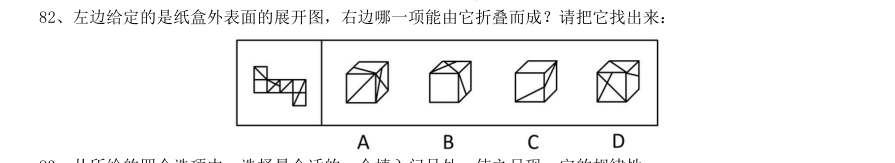

> （本题为图形题，选项为图片，见原卷）

**答案：D**　**考点：图形推理｜折纸盒**　**难度：★★★☆☆**
**【判断推理·图形推理｜GK-2011-ty-X083】**

83. 从所给的四个选项中,选择最合适的一个填入问号处,使之呈现一定的规律性:

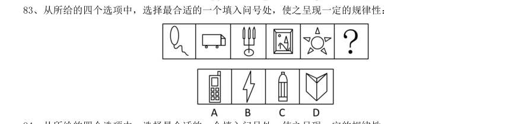

> （本题为图形题，选项为图片，见原卷）

**答案：A**　**考点：图形推理｜图形推理（综合）**　**难度：★★★☆☆**
**【判断推理·图形推理｜GK-2011-ty-X084】**

84. 从所给的四个选项中,选择最合适的一个填入问号处,使之呈现一定的规律性:

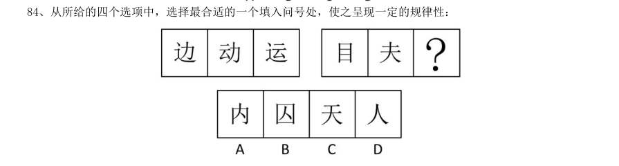

> （本题为图形题，选项为图片，见原卷）

**答案：B**　**考点：图形推理｜样式规律**　**难度：★★★☆☆**
**【判断推理·图形推理｜GK-2011-ty-X085】**

85. 从所给的四个选项中,选择最合适的一个填入问号处,使之呈现一定的规律性:

> （本题为图形题，选项为图片，见原卷）

**答案：C**　**考点：图形推理｜数量规律**　**难度：★★★☆☆**
**【判断推理·图形推理｜GK-2011-ty-X086】**

86. 把下面的六个图形分为两类,使每一类图形都有各自的共同特征或规律,分类正确的一项是:

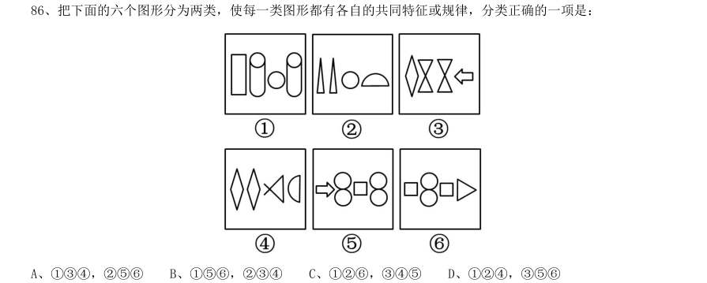

- **A.** 134,256
- **B.** 156,234
- **C.** 126,345
- **D.** 124,356

**答案：B**　**考点：图形推理｜分组分类**　**难度：★★★☆☆**
**【判断推理·图形推理｜GK-2011-ty-X087】**

87. 把下面的六个图形分为两类,使每一类图形都有各自的共同特征或规律,分类正确的一项是:

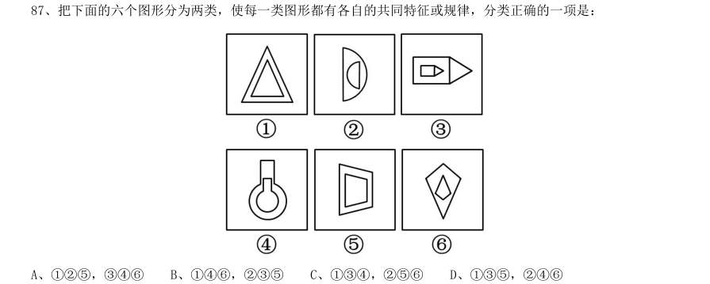

- **A.** 125,346
- **B.** 146,235
- **C.** 134,256
- **D.** 135,246

**答案：B**　**考点：图形推理｜属性规律**　**难度：★★★☆☆**
**【判断推理·图形推理｜GK-2011-ty-X088】**

88. 把下面的六个图形分为两类,使每一类图形都有各自的共同特征或规律,分类正确的一项是:

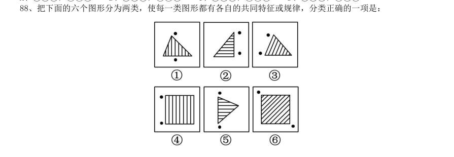

- **A.** 136,245
- **B.** 135,246
- **C.** 134,256
- **D.** 156,234

**答案：C**　**考点：图形推理｜数量规律**　**难度：★★★☆☆**
**【判断推理·图形推理｜GK-2011-ty-X089】**

89. 把下面的六个图形分为两类,使每一类图形都有各自的共同特征或规律,分类正确的一项是:

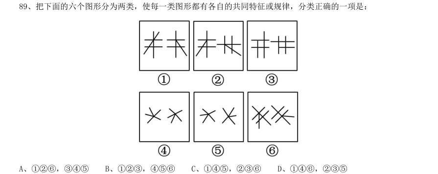

- **A.** 126,345
- **B.** 123,456
- **C.** 145,236
- **D.** 146,235

**答案：D**　**考点：图形推理｜位置规律**　**难度：★★★☆☆**
**【判断推理·图形推理｜GK-2011-ty-X090】**

90. 把下面的六个图形分为两类,使每一类图形都有各自的共同特征或规律,分类正确的一项是:

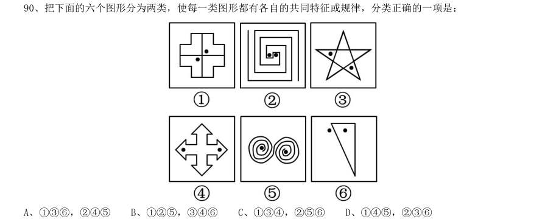

- **A.** 136,245
- **B.** 125,346
- **C.** 134,256
- **D.** 145,236

**答案：A**　**考点：图形推理｜分组分类**　**难度：★★★☆☆**
**【判断推理·定义判断｜GK-2011-ty-X091】**

91. “社会人”假设是组织行为学家提出的一种与管理有关的人性假设。“社会人”假设认为,人们在工作中得 到的物质利益对于调动其生产积极性是次要的,人们最重视在工作中与周围的人友好相处,良好的人际关系对于 调动人的工作积极性起决定作用。 根据上述定义,下列哪项是基于“社会人”假设的管理方式:

- **A.** 员工的奖金与绩效挂钩,并且实行秘薪制
- **B.** 鼓励、支持员工利用业余时间参加职业培训
- **C.** 对不同年龄层的员工实行不同的管理措施
- **D.** 上级和下级不同程度地参与企业决策的研究和讨论

**答案：D**　**考点：定义判断｜单定义**　**难度：★★☆☆☆**
**【判断推理·定义判断｜GK-2011-ty-X092】**

92. 顺从是指互动中的一方自愿或主动地调整自己的行为,按另一方的要求行事,即一方服从另一方。顺应的含 义比顺从更广泛,除了有顺从的含义外,还指互动的双方或各方都调整自己的行为,以实现互相适应。 根据上述定义,下列行为属于顺应的是:

- **A.** 王某经常将垃圾堆放在家门口,影响了居民楼内的环境卫生,邻居们向他提出意见后,王某家门口变得干净起来
- **B.** 小燕经常出色地完成各项工作,经理根据小燕的表现在员工大会上表扬了她,并给予奖励
- **C.** 某食品厂因存在不正当竞争行为,被工商部门处以20 万元罚款,该厂以罚款过重为由提起行政复议,上级工商部门作出罚款10 万元的决定
- **D.** 强盛公司与荣发公司有意进行合作,经过多轮激烈地磋商,双方都降低了自己的条件,从而实现了合作目标

**答案：D**　**考点：定义判断｜单定义**　**难度：★★★☆☆**
**【判断推理·定义判断｜GK-2011-ty-X093】**

93. 体验营销是指企业采用让目标顾客观摩、聆听、尝试、试用等方式,使其亲身体验企业提供的产品或服务, 让顾客实际感知产品或服务的品质或性能,从而促使顾客认知,喜好并购买的一种营销方式。 根据上述定义,下列采用了体验营销方式的是:

- **A.** 某美容公司举办了一场以“亲子教育”为主题的消费者联谊会,把“为消费者着想”的经营理念传递给潜在的客户
- **B.** 某服装公司邀请批发商参加其产品推广介绍会,在会上安排了表演、小竞赛、新产品试用等活动
- **C.** 某公司为维护行业领军地位,多次举办全国性的行业讨论会,邀请其部分消费者参与研讨
- **D.** 某化妆品公司先打开国外市场,树立国际品牌形象,然后在国内以电视购物的方式传播销售,逐步占领国内

**答案：B**　**考点：定义判断｜单定义**　**难度：★★★☆☆**
**【判断推理·定义判断｜GK-2011-ty-X094】**

94. 行政指令是指行政主体依靠行政组织的权威,运用行政手段,包括行政命令、指示、规定、条例及规章制度 等措施,按照行政组织的系统和层次进行行政管理活动的方法。 根据上述定义,下列描述不属于行政指令的是:

- **A.** 体育局局长签发嘉奖令,表彰在全运会上取得优异成绩的运动员和教练员
- **B.** 消费者协会同中国家用电器协会正式发布《太阳能热水器选购指南》
- **C.** 市教育局紧急电话通知,要求全市中小学、幼儿园加强校园安全管理
- **D.** 市消防大队对未经消防设计备案擅自施工的违法工程下发《责令改正通知书》

**答案：B**　**考点：定义判断｜单定义**　**难度：★★★☆☆**
**【判断推理·定义判断｜GK-2011-ty-X095】**

95. 政策性收益是指由于某些政策、法规的变动而导致的个体收益,这种收益不会导致整个社会财富的增长,只 会导致整个社会财富的重新分配。 根据上述定义,下列涉及政策性收益的是:

- **A.** 由于市相关部门联合整治经营环境,小张经营的书店效益明显好转,每月营业额增加5000 元
- **B.** 歹徒意欲行凶,小王挺身而出制服了歹徒,因此获得市政府见义勇为奖5 万元
- **C.** 由于国家加大西部开发力度,某县获得了5000 万元专项水利建设基金
- **D.** 由于利率调整,小李的存款利息比此前每月增加100 元

**答案：D**　**考点：定义判断｜单定义**　**难度：★★☆☆☆**
**【判断推理·定义判断｜GK-2011-ty-X096】**

96. 反应性相倚是指在沟通过程中,沟通双方都以对方的行为作为自己行为的依据,做出相应的反应,而并不按 照原来的计划进行沟通。 根据上述定义,下列属于反应性相倚的是:

- **A.** 妈妈得知小明考试失利准备劝慰一番,但她发现小明的情绪并未受到影响,于是放弃了劝慰小明的打算
- **B.** 王厂长在大会上宣读了关于加强劳动纪律的发言稿,由于制定的措施不合理,职工在下面议论纷纷,但他还是完成了自己的发言
- **C.** 张老师认为他为学生准备的口试题目并不难,但是仍有一些学生回答不出,当学生要求张老师提示时,张老师断然拒绝
- **D.** 小李同意按照编辑意见修改稿件,但希望保留原文的写作风格,与编辑沟通后,编辑表示同意

**答案：D**　**考点：定义判断｜单定义**　**难度：★★☆☆☆**
**【判断推理·定义判断｜GK-2011-ty-X097】**

97. 附款行政行为是指除行政法规明确规定外,行政主体根据实际需要在主内容基础上附加从属性内容的行政行 为。这里的附款就是附加条件,是行政主体规定(而不是行政法规规定)的某种将来不确定事实或行为,该条件 是否符合将决定法律行为的效力。 根据上述定义,下列属于附款行政行为的是:

- **A.** 某省物价局在关于小儿广谱止泻口服液的价格批复中规定该药物每盒不得高于36 元,此价格从2009 年9 月30 日起执行
- **B.** 某税务所对王某(现在外地打工)偷税行为作出的处理决定是:处王某罚款1500 元,所处罚款及所欠税款待王某回乡后缴清
- **C.** 交通警察李某对超速驾驶的刘某作出罚款100 元的处罚决定,同时告知刘某应在规定的时间内到指定地点缴纳罚款,逾期需缴纳滞纳金
- **D.** 某市人民政府为发展地方经济,规划未来五年内在本市南部建立高新技术产业开发区,吸引一批高新技术企

**答案：B**　**考点：定义判断｜单定义**　**难度：★★★☆☆**
**【判断推理·定义判断｜GK-2011-ty-X098】**

98. 反向诱导是指政府、媒体等主体所采取的措施或者宣传活动,在实际的社会生活中不但没有收到预期的效果, 反而导致了与预期相反的社会现象大量出现。 根据上述定义,下列属于反向诱导的是:

- **A.** 某影院为了让观众摘下帽子,在银幕上打出通告:“本院允许老年人戴帽观赏。”结果通告一出,许多观众纷纷摘下了帽子
- **B.** 某单位要求员工统一着装,结果招致单位很多女员工的强烈反对,最后只好不了了之
- **C.** 高温季节供水相对紧张,某市自来水公司贴出告示,告知市民近期不会停水,结果导致很多市民在家中大量囤水备用
- **D.** 某电视台播放预防心理疾病的讲座,很多市民对号入座,觉得自己得了心理疾病,纷纷打电话咨询

**答案：C**　**考点：定义判断｜单定义**　**难度：★★☆☆☆**
**【判断推理·定义判断｜GK-2011-ty-X099】**

99. 仿生设计学以自然界万事万物的“形”“色”“音”“功能”“结构”等为研究对象,有选择地在设计过程 中应用这些特征原理,同时结合仿生学的研究成果,为设计提供新的思想、新的原理、新的方法和新的途径。其 中,结构仿生设计学主要研究生物体和自然界物质存在的内部结构原理在设计中的应用问题,适用于产品设计和 建筑设计。 根据上述定义,下列属于结构仿生设计的是:

- **A.** 设计师根据鱼鳔的作用原理发明了潜艇
- **B.** 科学家发明了能够模仿鱼类声音的电子诱鱼器
- **C.** 受变色龙的启发,军方设计出适用于野外作战的迷彩服
- **D.** 我们的祖先有巢氏受鸟类在树上筑巢的启发,发明“巢居”以防御猛兽的攻击

**答案：D**　**考点：定义判断｜单定义**　**难度：★★☆☆☆**
**【判断推理·定义判断｜GK-2011-ty-X100】**

100. 非正式组织是指人们在共同工作或相互接触中,以感情、性格、爱好相投为基础形成的若干人群。这些群 体不受正式组织的行政部门和管理层次等的限制,也没有明确规定的正式结构,但在其内部形成一些特定的关系 结构,自然涌现出自己的“领导者”,形成一些不成文的行为准则和规范。 根据上述定义,下列提及的人群属于非正式组织的是:

- **A.** 老王过生日,邀请了十多位同事在自己家中聚会
- **B.** 小刘下班后和本单位的几名年轻人一起踢足球
- **C.** 小张是校学生会文艺部部长,经他介绍,几名同学参加了文艺演出
- **D.** 几位退休职工自发成立老人曲艺社,利用周末时间在社区演出

**答案：D**　**考点：定义判断｜单定义**　**难度：★★★★☆**
**【判断推理·类比推理｜GK-2011-ty-X101】**

101. 航线:飞行

- **A.** 土壤:种植
- **B.** 煤炭:发电
- **C.** 提纲:发言
- **D.** 地基:建筑

**答案：C**　**考点：类比推理｜对应关系**　**难度：★☆☆☆☆**
**【判断推理·类比推理｜GK-2011-ty-X102】**

102. 树根:根雕

- **A.** 纸张:剪纸
- **B.** 陶土:瓷器
- **C.** 竹子:竹排
- **D.** 水泥:砚台

**答案：A**　**考点：类比推理｜对应关系**　**难度：★☆☆☆☆**
**【判断推理·类比推理｜GK-2011-ty-X103】**

103. 亦步亦趋:主见

- **A.** 兴高采烈:恐惧
- **B.** 优柔寡断:果断
- **C.** 鼠目寸光:眼力
- **D.** 孤陋寡闻:胆识

**答案：B**　**考点：类比推理｜语义关系**　**难度：★☆☆☆☆**
**【判断推理·类比推理｜GK-2011-ty-X104】**

104. 导游:旅行社:行程

- **A.** 职员:公司:总结
- **B.** 演员:剧院:表演
- **C.** 教师:学校:大纲
- **D.** 司机:车队:驾照

**答案：C**　**考点：类比推理｜对应关系**　**难度：★☆☆☆☆**
**【判断推理·类比推理｜GK-2011-ty-X105】**

105. 车轮:汽车:运输

- **A.** 衣服:衣架:晒衣
- **B.** 镜片:眼镜:读书
- **C.** 听筒:电话:通话
- **D.** 墨汁:毛笔:书法

**答案：C**　**考点：类比推理｜逻辑关系**　**难度：★☆☆☆☆**
**【判断推理·类比推理｜GK-2011-ty-X106】**

106. 治疗:患者:医院

- **A.** 付款:顾客:商场
- **B.** 观看:观众:影院
- **C.** 判罚:裁判:赛场
- **D.** 改造:罪犯:监狱

**答案：D**　**考点：类比推理｜类比推理（综合）**　**难度：★☆☆☆☆**
**【判断推理·类比推理｜GK-2011-ty-X107】**

107. 刀:屠夫:肉

- **A.** 剪刀:裁缝:布料
- **B.** 粉笔:老师:黑板
- **C.** 法律:法官:犯人
- **D.** 相机:记者:摄影

**答案：A**　**考点：类比推理｜对应关系**　**难度：★☆☆☆☆**
**【判断推理·类比推理｜GK-2011-ty-X108】**

108. ( )对于 吉祥 相当于 狼烟 对于( )

- **A.** 和平战争
- **B.** 麒麟信号
- **C.** 盛世烽火
- **D.** 凤凰入侵

**答案：D**　**考点：类比推理｜语义关系**　**难度：★☆☆☆☆**
**【判断推理·类比推理｜GK-2011-ty-X109】**

109. ( )对于 绿茶 相当于 音乐 对于( )

- **A.** 龙井浪漫
- **B.** 早春娱乐
- **C.** 咖啡绘画
- **D.** 健康情操

**答案：C**　**考点：类比推理｜逻辑关系**　**难度：★☆☆☆☆**
**【判断推理·类比推理｜GK-2011-ty-X110】**

110. ( )对于 表达 相当于 信件 对于( )

- **A.** 比喻沟通
- **B.** 文字载体
- **C.** 感情抒情
- **D.** 交流包裹

**答案：A**　**考点：类比推理｜语义关系**　**难度：★☆☆☆☆**
**【判断推理·逻辑判断｜GK-2011-ty-X111】**

111. 据某知名房产中介机构统计,2010 年9 月份第二周全国十大城市的商品房成交量总体呈上涨趋势,并且与 8 月份第二周相比上涨幅度更明显。如果没有其他因素抑制,按照这种趋势发展,9 月份或将创新政以来成交量 最高水平,虽然现在还不能明确楼市完全回暖,但未来楼价调控的压力还是很大的。 下列最有可能是上述论证前提假设的是:

- **A.** 炒房者将大量资金投入楼市
- **B.** 国家对楼价的调控手段不足
- **C.** 消费者对房子的购买热情没有减退
- **D.** 楼市成交量的增长会带动楼价的上涨

**答案：D**　**考点：逻辑判断｜加强**　**难度：★★★★★**
**【判断推理·逻辑判断｜GK-2011-ty-X112】**

112. 研究人员认为,如果母亲在怀孕的头几个月接触杀虫剂较多,那么出生的婴儿在智力上可能较差。他们认 为,妇女怀孕后不久胚胎大脑便开始发育,因此怀孕前期是婴儿大脑发育的关键时期,接触杀虫剂较多可能改变 孕妇体内正在发育的胚胎大脑周围的环境。 以下哪项如果为真,最能支持研究人员的观点:

- **A.** 由于母亲接触杀虫剂较多,导致许多婴儿提前出生
- **B.** 杀虫剂对人们的健康是一个潜在的威胁,它还会导致帕金森症、癌症和心理疾病等很多疾病
- **C.** 此前的研究已经发现,较多地接触杀虫剂会导致孕妇的甲状腺出现问题,而孕妇的甲状腺状况会影响胎儿的智力发育
- **D.** 研究人员对1500 个孕妇进行了跟踪调查,发现较多地接触杀虫剂的孕妇所生育的孩子在数学和语言学科上表

**答案：C**　**考点：逻辑判断｜加强**　**难度：★★★★★**
**【判断推理·逻辑判断｜GK-2011-ty-X113】**

113. 知己知彼,才能百战不殆。这句话同样适用于人际交往之中,一个人只有先了解自己,才能了解别人;任 何人也只信赖充分了解他的人,包括他自己。试想,如果一个人根本不了解你,他如何值得你信赖呢? 由此可以推出:

- **A.** 只有信赖自己,才能信赖别人
- **B.** 不了解自己,就不会被任何人信赖
- **C.** 他充分了解你,所以他值得你信赖
- **D.** 充分了解自己,就可以获得许多人的信赖

**答案：B**　**考点：逻辑判断｜翻译推理**　**难度：★★★★☆**
**【判断推理·逻辑判断｜GK-2011-ty-X114】**

114. 研究人员对四川地区出生的一批恐龙骨骼化石进行分析后发现,骨骼化石内的砷、钡、铬、铀、稀土元素 等含量超高,与现代陆生动物相比,其体内的有毒元素要高出几百甚至上千倍。于是一些古生物学家推测这些恐 龙死于慢性中毒。 如果以下各项为真,不能质疑上述推测的是:

- **A.** 恐龙化石附近土壤中的有毒元素会渗进化石
- **B.** 恐龙化石内还有很多相应的解毒元素
- **C.** 这批恐龙化石都是老年恐龙,属于自然死亡
- **D.** 在恐龙化石附近的植物化石里,有毒元素含量很少

**答案：D**　**考点：逻辑判断｜削弱**　**难度：★★★★☆**
**【判断推理·逻辑判断｜GK-2011-ty-X115】**

115. 从世界经济的发展历程来看,如果一国或者地区的经济保持着稳定的增长速度,大多数商品和服务的价格 必然会随之上涨,只要这种涨幅始终在一个较小的区间内就不会对经济造成负面影响。 由此可以推出,在一定时期内:

- **A.** 如果大多数商品价格上涨,说明该国经济在稳定增长
- **B.** 如果大多数商品价格涨幅过大,对该国经济必然有负面影响
- **C.** 如果大多数商品价格不上涨,说明该国经济没有保持稳定增长
- **D.** 如果经济发展水平下降,该国的大多数商品价格也会下降

**答案：C**　**考点：逻辑判断｜翻译推理**　**难度：★★★★★**
**【判断推理·逻辑判断｜GK-2011-ty-X116】**

116. 北京市为了缓解交通压力实行机动车辆限行政策,每辆机动车周一到周五都要限行一天,周末不限行。某 公司有

- **A.** 今天是周四
- **B.** 今天是周六
- **C.** A 车周三限行
- **D.** C 车周五限行

**答案：A**　**考点：逻辑判断｜逻辑判断（综合）**　**难度：★★★☆☆**
**【判断推理·逻辑判断｜GK-2011-ty-X117】**

117. 2008 年上半年原油期货价格一度上涨到每桶147 美元,是2000 年同期价格的4.2 倍,年均增长20%,而同 期世界经济年均增长率在5%左右,世界石油消费需求并没有出现跳跃式的、急剧的增长。这说明原油价格的迅 速攀升并不是由于世界石油供求关系的变化引起的,而是国际投机资本在石油期货市场进行疯狂投机的结果。 如果以下各项为真,哪项不能质疑上述推论:

- **A.** 2000 年至2008 年,各国政府普遍加大了石油的战略储备量
- **B.** 较小的经济增长率总带来较大的石油需求增长率
- **C.** 石油需求变化率和石油价格变化率并不对称
- **D.** 即便对于国际投机资本身,投资石油期货也是风险巨大

**答案：D**　**考点：逻辑判断｜削弱**　**难度：★★★★★**
**【判断推理·逻辑判断｜GK-2011-ty-X118】**

118. 一项最新研究发现,经常喝酸奶能降低儿童患上蛀牙的风险。在此之前,也有研究人员提出酸奶可预防儿 童蛀牙,还有研究显示,黄油、奶酪和牛奶对预防蛀牙并没有明显效果。虽然多喝酸奶对儿童的牙齿有保护作用, 但酸奶能降低蛀牙风险的原因仍不明确。目前一种说法是酸奶中所含的蛋白质附着在牙齿表面,从而预防有害酸 侵蚀牙齿。 以下哪项如果为真,最能支持这项研究发现:

- **A.** 黄油、奶酪和牛奶的蛋白质成分没有酸奶丰富,对儿童牙齿的防蛀效果不明显
- **B.** 儿童牙龈的牙釉质处于未成熟阶段,对抗酸腐蚀的能力低,人工加糖的酸奶会增加蛀牙的风险
- **C.** 有研究表明,儿童每周至少食用4 次酸奶可将蛀牙发生率降低15%
- **D.** 世界有许多国家的科学家都在研究酸奶对预防儿童蛀牙的作用

**答案：C**　**考点：逻辑判断｜加强**　**难度：★★★★★**
**【判断推理·逻辑判断｜GK-2011-ty-X119】**

119. S 市规定,适龄儿童须接种麻疹疫苗,适龄儿童必须接受义务教育,下图表示: 1990 年到2010 年间S 市儿童数量的一些统计,其中M 表示接受义务教育的儿童总数,N 表示新生儿总数,P 表 示接种麻疹疫苗的儿童总数,下面哪一项最能解释2000 年到2010 年间S 市接受义务教育的儿童总数与接种麻疹 疫苗的儿童总数下降程度的不同:

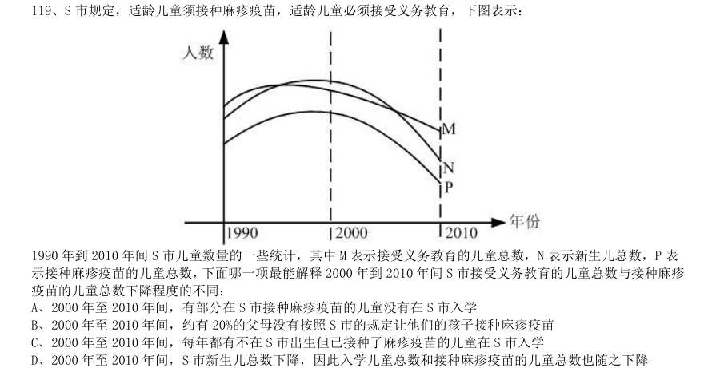

- **A.** 2000 年至2010 年间,有部分在S 市接种麻疹疫苗的儿童没有在S 市入学
- **B.** 2000 年至2010 年间,约有20%的父母没有按照S 市的规定让他们的孩子接种麻疹疫苗
- **C.** 2000 年至2010 年间,每年都有不在S 市出生但已接种了麻疹疫苗的儿童在S 市入学
- **D.** 2000 年至2010 年间,S 市新生儿总数下降,因此入学儿童总数和接种麻疹疫苗的儿童总数也随之下降

**答案：C**　**考点：逻辑判断｜解释评价**　**难度：★★★★★**
**【判断推理·逻辑判断｜GK-2011-ty-X120】**

120. 提起极地冰,很多人眼前总是浮现一幅洁白无瑕、晶莹剔透的景观。然而,在北纬71 度、西经168 度附近 的北冰洋海域,“雪龙”号首次驶入一片“脏”冰区,只见一块淡蓝色的浮冰中间夹杂了许多脏兮兮的黄色冰块, 这种黄色冰块,既出现在当年的新生冰块上,也出现在多年冰块上。对于“人类造成的污染已经殃及极地浮冰” 的说法,有专家解释说这只是生活在极地冰中的一种特有生物--黄褐色的冰藻。 如果以下各项为真,能够反驳专家上述观点的是:

- **A.** 在新生冰块上形成冰藻需要多年
- **B.** 北极冰中生长有冰藻并不是普遍现象
- **C.** 近年来人类踏上北极的次数逐年增加
- **D.** 北冰洋周围的陆地有沙尘天气

**答案：A**　**考点：逻辑判断｜削弱**　**难度：★★★★★**
**【资料分析·综合分析｜GK-2011-ty-X121】**

121. 下列四种谷物中,2008 年与2000 年相比全世界增产量最多的是:

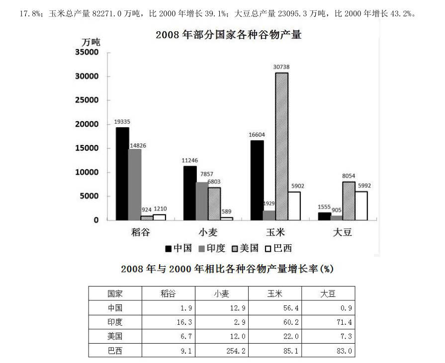

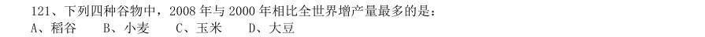

- **A.** 稻谷
- **B.** 小麦
- **C.** 玉米
- **D.** 大豆

**答案：C**　**考点：综合分析｜选正确项**　**难度：★★★★☆**
**【资料分析·平均数计算｜GK-2011-ty-X122】**

122. 将每个国家的四种谷物按2008 年的产量分别排序,哪个国家产量排名第一的谷物与2000 年相比产量增长 率最高:

> 材料图见 images/GK-2011-ty-X121-m.jpg

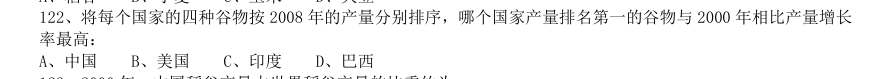

- **A.** 中国
- **B.** 美国
- **C.** 印度
- **D.** 巴西

**答案：D**　**考点：平均数计算｜现期平均数**　**难度：★☆☆☆☆**
**【资料分析·比重计算与比较｜GK-2011-ty-X123】**

123. 2000 年,中国稻谷产量占世界稻谷产量的比重约为:

> 材料图见 images/GK-2011-ty-X121-m.jpg

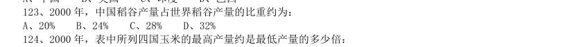

- **A.** 20%
- **B.** 24%
- **C.** 28%
- **D.** 32%

**答案：D**　**考点：比重计算与比较｜现期比重**　**难度：★☆☆☆☆**
**【资料分析·倍数计算｜GK-2011-ty-X124】**

124. 2000 年,表中所列四国玉米的最高产量约是最低产量的多少倍:

> 材料图见 images/GK-2011-ty-X121-m.jpg

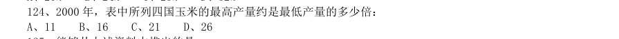

- **A.** 11
- **B.** 16
- **C.** 21
- **D.** 26

**答案：C**　**考点：倍数计算｜是几倍**　**难度：★☆☆☆☆**
**【资料分析·综合分析｜GK-2011-ty-X125】**

125. 能够从上述资料中推出的是:

> 材料图见 images/GK-2011-ty-X121-m.jpg

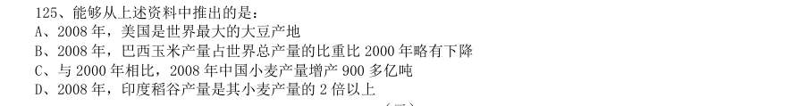

- **A.** 2008 年,美国是世界最大的大豆产地
- **B.** 2008 年,巴西玉米产量占世界总产量的比重比2000 年略有下降
- **C.** 与2000 年相比,2008 年中国小麦产量增产900 多亿吨
- **D.** 2008 年,印度稻谷产量是其小麦产量的2 倍以上

**答案：A**　**考点：综合分析｜选错误项**　**难度：★★★★★**
**【资料分析·倍数计算｜GK-2011-ty-X126】**
> 材料：2010 年上半年,全国原油产量为9848 万吨,同比增长5.3%,上年同期为下降1%。进口原油11797 万吨(海 关统计),增长30.2%。原油加工量20586 万吨,增长17.9%,增速同比加快16.4 个百分点。成品油产量中,汽 油产量增长6%,增速同比减缓7.9 个百分点;柴油产量增长28.1%,增速同比加快15.8 个百分点。 据行业统计,2010 年上半年成品油表观消费量10963 万吨,同比增长12.5%。其中,一、二季度分别增长 16.3%和9.2%。 201O 年6 月份,布伦特原油平均价格为75.28 美元/桶,比上月回落1.75 美元/桶,同比上涨10.4%。结合 国际市场油价变化情况,国家于6 月1 日将汽油、柴油批发价格分别下调230 元/吨和220 元/吨。 2010 年上半年,全国天然气产量459 亿立方米,同比增长10.8%,增速同比加快3.2 个百分点。

126. 其中,石油 天然气开采业利润1319 亿元,同比增长1.67 倍,上年同期为下降75.8%,炼油行业利润326 亿元,同比下降25.7%, 上年同期为增长1.8 倍。 2010 年上半年全国原油产量比2008 年同期约增长了:

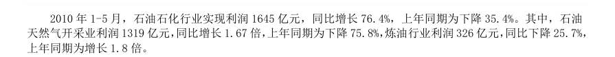

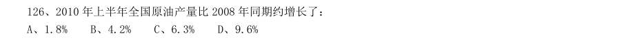

- **A.** 1.8%
- **B.** 4.2%
- **C.** 6.3%
- **D.** 9.6%

**答案：B**　**考点：倍数计算｜基期倍数**　**难度：★★★☆☆**
**【资料分析·增长量计算｜GK-2011-ty-X127】**

127. 2010 年上半年,全国成品油表观消费量同比增加了约多少万吨:

> 材料图见 images/GK-2011-ty-X126-m.jpg

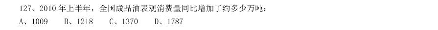

- **A.** 1009
- **B.** 1218
- **C.** 1370
- **D.** 1787

**答案：B**　**考点：增长量计算｜增长量计算（415 份数法）**　**难度：★☆☆☆☆**
**【资料分析·平均数计算｜GK-2011-ty-X128】**

128. 2010 年5 月份,布伦特原油的平均价格约为每桶多少美元:

> 材料图见 images/GK-2011-ty-X126-m.jpg

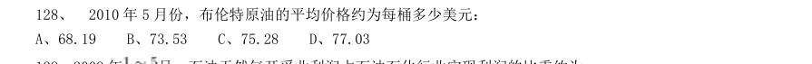

- **A.** 68.19
- **B.** 73.53
- **C.** 75.28
- **D.** 77.03

**答案：D**　**考点：平均数计算｜现期平均数**　**难度：★☆☆☆☆**
**【资料分析·比重计算与比较｜GK-2011-ty-X129】**

129. 2009 年 月,石油天然气开采业利润占石油石化行业实现利润的比重约为:

> 材料图见 images/GK-2011-ty-X126-m.jpg

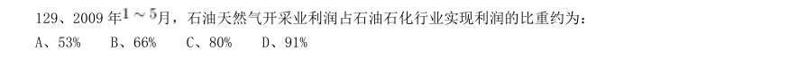

- **A.** 53%
- **B.** 66%
- **C.** 80%
- **D.** 91%

**答案：A**　**考点：比重计算与比较｜现期比重**　**难度：★☆☆☆☆**
**【资料分析·综合分析｜GK-2011-ty-X130】**

130. 能够从上述资抖中推出的是:

> 材料图见 images/GK-2011-ty-X126-m.jpg

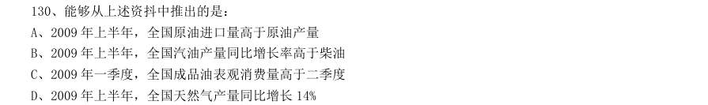

- **A.** 2009 年上半年,全国原油进口量高于原油产量
- **B.** 2009 年上半年,全国汽油产量同比增长率高于柴油
- **C.** 2009 年一季度,全国成品油表观消费量高于二季度
- **D.** 2009 年上半年,全国天然气产量同比增长14%

**答案：A**　**考点：综合分析｜选错误项**　**难度：★★★★★**
**【资料分析·增长量计算｜GK-2011-ty-X131】**

131. 2010 年一季度,我国水产品出口额比上年同期约增长了多少亿美元:

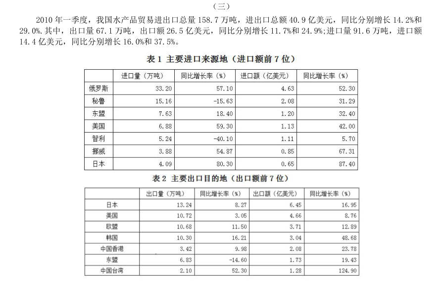

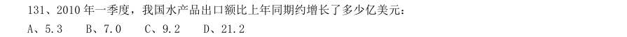

- **A.** 5.3
- **B.** 7.0
- **C.** 9.2
- **D.** 21.2

**答案：A**　**考点：增长量计算｜增长量计算（415 份数法）**　**难度：★☆☆☆☆**
**【资料分析·综合分析｜GK-2011-ty-X132】**

132. 2010 年一季度,我国水产品主要进口来源地,按进口量从小到大排序正确的是:

> 材料图见 images/GK-2011-ty-X131-m.jpg

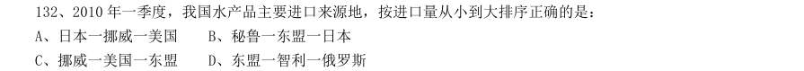

- **A.** 日本一挪威一美国
- **B.** 秘鲁一东盟一日本
- **C.** 挪威一美国一东盟
- **D.** 东盟一智利一俄罗斯

**答案：C**　**考点：综合分析｜排序与图示判断**　**难度：★★★★☆**
**【资料分析·比重计算与比较｜GK-2011-ty-X133】**

133. 2010 年一季度,我国与美国水产品进出口贸易额占我国水产品进出口贸易总额的比重约为:

> 材料图见 images/GK-2011-ty-X131-m.jpg

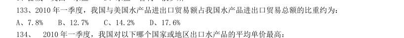

- **A.** 7.8%
- **B.** 12.7%
- **C.** 14.2%
- **D.** 17.6%

**答案：C**　**考点：比重计算与比较｜现期比重**　**难度：★☆☆☆☆**
**【资料分析·平均数计算｜GK-2011-ty-X134】**

134. 2010 年一季度,我国对以下哪个国家或地区出口水产品的平均单价最高:

> 材料图见 images/GK-2011-ty-X131-m.jpg

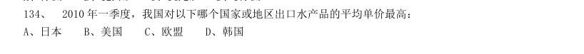

- **A.** 日本
- **B.** 美国
- **C.** 欧盟
- **D.** 韩国

**答案：A**　**考点：平均数计算｜现期平均数**　**难度：★☆☆☆☆**
**【资料分析·综合分析｜GK-2011-ty-X135】**

135. 能够从上述资料中推出的是:

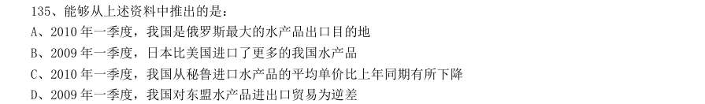

- **A.** 2010 年一季度,我国是俄罗斯最大的水产品出口目的地
- **B.** 2009 年一季度,日本比美国进口了更多的我国水产品
- **C.** 2010 年一季度,我国从秘鲁进口水产品的平均单价比上年同期有所下降
- **D.** 2009 年一季度,我国对东盟水产品进出口贸易为逆差

**答案：A**　**考点：综合分析｜选错误项**　**难度：★★★★★**