# 2017 年国考行测（副省级）

- 题量：135（含答案 134）
- 模块分布：资料分析20 / 数量关系15 / 言语理解40 / 判断推理40 / 常识判断20
- 试卷编号：`国考-2017-副省级`

## 题目与答案

**【常识判断·法律常识｜GK-2017-fs-X001】**

1. 根据我国宪法,下列表述错误的是:

- **A.** 我国形成了人民代表大会制度、中国共产党领导的多党合作和政治协商制度以及基层群众自治制度等民主形式
- **B.** 为追查刑事犯罪,公安机关、检察机关、审判机关可依法对公民的通信进行检查
- **C.** 我国在普通地方、民族自治地方和特别行政区建立了相应的地方制度
- **D.** 一切组织和个人都负有实施宪法和保证宪法实施的职责

**答案：B**　**考点：法律常识｜宪法**　**难度：★★★★☆**
**【常识判断·法律常识｜GK-2017-fs-X002】**

2. 依据刑法修正案(九)的规定,下列说法错误的是:

- **A.** 对伪造货币罪不再处以死刑
- **B.** 对代替他人参加高考的行为应作出行政处罚
- **C.** 组织群众在医院闹事、造成严重损失的行为是犯罪行为
- **D.** 编造虚假险情在微信中传播、严重扰乱社会秩序的行为是犯罪行为

**答案：B**　**考点：法律常识｜刑法**　**难度：★★☆☆☆**
**【常识判断·生活常识｜GK-2017-fs-X003】**

3. 关于中国外交,下列说法错误的是:

- **A.** 二十世纪八九十年代,邓小平提出“韬光养晦、有所作为”的外交战略
- **B.** “另起炉灶”是毛泽东在新中国成立前夕提出的外交方针
- **C.** 周恩来和陈毅都曾担任过外交部长
- **D.** 委内瑞拉是第一个同新中国建交的拉丁美洲国家

**答案：D**　**考点：生活常识｜其他常识（综合）**　**难度：★★☆☆☆**
**【常识判断·经济常识｜GK-2017-fs-X004】**

4. 在银行的资产负债表中,客户存款属于:

- **A.** 资产
- **B.** 权益
- **C.** 资金
- **D.** 负债

**答案：D**　**考点：经济常识｜宏观经济**　**难度：★★☆☆☆**
**【常识判断·生活常识｜GK-2017-fs-X005】**

5. 关于我国著名园林,下列说法正确的是:

- **A.** 《枫桥夜泊》涉及的城市是留园所在地
- **B.** 十二兽首曾是颐和园的镇园之宝
- **C.** 承德避暑山庄始建于明代崇祯年间
- **D.** 苏州拙政园整体呈现均衡对称的格局

**答案：A**　**考点：生活常识｜其他常识（综合）**　**难度：★★☆☆☆**
**【常识判断·历史人文｜GK-2017-fs-X006】**

6. 我国古代用“金”“石”“丝”“竹”指代不同材质、类别的乐器。下列诗词涉及“竹”的是:

- **A.** 珠帘夕殿闻钟磬,白日秋天忆鼓鼙
- **B.** 主人有酒欢今夕,请奏鸣琴广陵客
- **C.** 深秋帘幕千家雨,落日楼台一笛风
- **D.** 哀筝一弄湘江曲,声声写尽湘波绿

**答案：C**　**考点：历史人文｜中国古代史**　**难度：★★☆☆☆**
**【常识判断·生活常识｜GK-2017-fs-X007】**

7. 柏拉图认为处于变化之中的事物不是真正的存在,持这种理念的人会认为以下哪项最真实?

- **A.** 一棵树
- **B.** 勾股定理
- **C.** 人的照片
- **D.** 关于马的概念

**答案：B**　**考点：生活常识｜其他常识（综合）**　**难度：★★☆☆☆**
**【常识判断·历史人文｜GK-2017-fs-X008】**

8. 司马谈《论六家要旨》:“ 1 博而寡要,劳而少功,是以其事难尽从;然其序君臣父子之礼,列夫妇长 幼之别,不可易也。 2 俭而难遵,是以其事不可遍循;然其强本节用,不可废也。 3 严而少恩;然其正 君臣上下之分,不可改矣。 4 使人俭而善失真;然其正名实,不可不察也。” 1234处应分别填入:

- **A.** 儒家、墨家、道家、法家
- **B.** 道家、名家、墨家、儒家
- **C.** 儒家、墨家、法家、名家
- **D.** 儒家、法家、兵家、名家

**答案：C**　**考点：历史人文｜中国古代史**　**难度：★★★★★**
**【常识判断·生活常识｜GK-2017-fs-X009】**

9. 下列艺术领域与专业术语对应有误的是:

- **A.** 摄影:噪点、景深
- **B.** 绘画:散点透视、写意
- **C.** 音乐:调式、声部
- **D.** 舞蹈:变位跳、变奏

**答案：D**　**考点：生活常识｜其他常识（综合）**　**难度：★★☆☆☆**
**【常识判断·历史人文｜GK-2017-fs-X010】**

10. 与 共同构成中国诗歌传统源头的《楚辞》,主要作者是因谗去国、被流放到蛮荒之地的屈原, 他用“ ”这一著名诗句,表现了岁月蹉跎、时不我待的恐惧。 文中画横线部分应依次填入:

- **A.** 《庄子》长太息以掩涕兮,哀民生之多艰
- **B.** 《庄子》日月忽其不淹兮,春与秋其代序
- **C.** 《诗经》惟草木之零落兮,恐美人之迟暮
- **D.** 《诗经》路漫漫其修远兮,吾将上下而求索

**答案：C**　**考点：历史人文｜中国古代史**　**难度：★★★☆☆**
**【常识判断·科技常识｜GK-2017-fs-X011】**

11. 掩星是一种天文现象,指一个天体在另一个天体与观测者之间通过而产生的遮蔽现象。科学家经常借助观察 这一现象来判断星体是否有大气层。当行星掩过遥远恒星,如果恒星变得模糊之后才消失,那么可以认为:

- **A.** 该行星有稠密的大气层
- **B.** 该恒星有稠密的大气层
- **C.** 该行星无大气层或大气层稀薄
- **D.** 该恒星无大气层或大气层稀薄

**答案：A**　**考点：科技常识｜科技常识（综合）**　**难度：★★★☆☆**
**【常识判断·地理常识｜GK-2017-fs-X012】**

12. 关于图中所标示的海峡,下列说法错误的是:

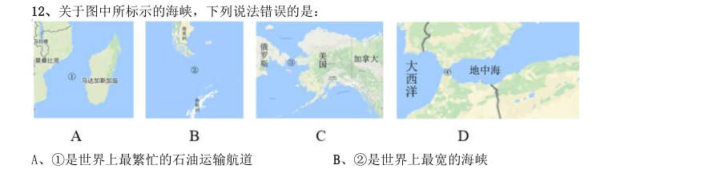

- **A.** 1是世界上最繁忙的石油运输航道
- **B.** 2是世界上最宽的海峡
- **C.** 3的海峡中心线是国际日期变更线的一部分
- **D.** 4的附近地区夏季炎热干燥,冬季温和多雨

**答案：A**　**考点：地理常识｜中国地理**　**难度：★★☆☆☆**
**【常识判断·科技常识｜GK-2017-fs-X013】**

13. 2016 年3 月,阿尔法围棋程序(AlphaGo)对战世界围棋冠军、职业九段选手李世石,以4:1 的总比分获胜。 阿尔法围棋程序的工作原理基于下列哪项技术?

- **A.** 量子计算
- **B.** 深度学习
- **C.** 纳米技术
- **D.** 基因编辑

**答案：B**　**考点：科技常识｜科技成就**　**难度：★★★☆☆**
**【常识判断·地理常识｜GK-2017-fs-X014】**

14. 下列矿物与其用途对应错误的是:

- **A.** 燧石—取火
- **B.** 石灰岩—生产水泥
- **C.** 石棉—促进燃烧
- **D.** 石英—制作半导体

**答案：C**　**考点：地理常识｜地理常识（综合）**　**难度：★★☆☆☆**
**【常识判断·生活常识｜GK-2017-fs-X015】**

15. 下列与汽车有关的说法错误的是:

- **A.** 手动挡和自动挡汽车的主要区别在于是否人为控制离合装置
- **B.** 冬天路面结冰时在车轮上挂铁链是为了增大摩擦
- **C.** 遥控钥匙通过发射无线电波控制车门的开关
- **D.** 手刹的制动原理是切断汽车的动力系统

**答案：D**　**考点：生活常识｜其他常识（综合）**　**难度：★★☆☆☆**
**【常识判断·科技常识｜GK-2017-fs-X016】**

16. 下列关于航天器的说法正确的是:

- **A.** “风云”系列气象卫星通过光纤实现与地面的数据传输
- **B.** “玉兔”号月球车在月球上行走的动力驱动是电动车
- **C.** “长征一号”属于二级运载火箭
- **D.** “北斗二号”属于通信广播卫星

**答案：B**　**考点：科技常识｜科技成就**　**难度：★★☆☆☆**
**【常识判断·生活常识｜GK-2017-fs-X017】**

17. 关于垃圾分类处理,下列说法错误的是:

- **A.** 速冻饺子的包装袋属于厨余垃圾
- **B.** 塑料制品不可采用深度填埋的处理方法
- **C.** 果皮等食品类废物可进行堆肥处理
- **D.** 红色的收集容器用于收集有害垃圾

**答案：A**　**考点：生活常识｜生活常识**　**难度：★★☆☆☆**
**【常识判断·生活常识｜GK-2017-fs-X018】**

18. 氢气是重要的工业燃料,下列关于氢气的说法正确的是:

- **A.** 氢气在氧气中燃烧发出明亮的红色火焰
- **B.** 电解水生成氢气的过程是一个吸热过程
- **C.** 人工降雨过程中通常使用氢气作催化剂
- **D.** 氢气在自然界中含量很少,故为稀有气体

**答案：B**　**考点：生活常识｜其他常识（综合）**　**难度：★★☆☆☆**
**【常识判断·地理常识｜GK-2017-fs-X019】**

19. 小王冬季从北京首都国际机场乘坐航班去某个机场,到达后发现手表显示的时间为18 点30 分,而机场所在 地时间为22 点30 分,他去的可能是以下哪个城市?

- **A.** 华盛顿
- **B.** 马尼拉
- **C.** 曼彻斯特
- **D.** 惠灵顿

**答案：D**　**考点：地理常识｜世界地理**　**难度：★★★☆☆**
**【常识判断·生活常识｜GK-2017-fs-X020】**

20. 关于农业生产中使用的草木灰,下列说法错误的是:

- **A.** 在种有大白菜的地里撒上草木灰可防病虫害
- **B.** 花卉移栽时,可以用草木灰做底料增加养分
- **C.** 育苗时,草木灰和氮肥同时施用效果更好
- **D.** 往鱼塘撒用草木灰能够降低鱼类的发病率

**答案：C**　**考点：生活常识｜其他常识（综合）**　**难度：★★☆☆☆**
**【言语理解·逻辑填空｜GK-2017-fs-X021】**

21. 物理学研究与艺术创作有异曲同工之妙,若是不能_______,就只能千锤百炼,通过成年累月的辛苦工作来 解开暗物质的谜团了。 填入画横线部分最恰当的一项是:

- **A.** 妙手偶得
- **B.** 一蹴而就
- **C.** 守株待兔
- **D.** 灵机一动

**答案：A**　**考点：逻辑填空｜一空**　**难度：★☆☆☆☆**
**【言语理解·逻辑填空｜GK-2017-fs-X022】**

22. 在这个万物互通互联的时代,单个企业是无法“ ”的,只有人人安全、合作伙伴都安全、整个环 境都安全,才能最大限度地保障自己的网络安全,这也是网络安全的更高等级——生态安全。 填入画横线部分最恰当的一项是:

- **A.** 明哲保身
- **B.** 自力更生
- **C.** 独善其身
- **D.** 自给自足

**答案：C**　**考点：逻辑填空｜逻辑填空（综合）**　**难度：★★☆☆☆**
**【言语理解·逻辑填空｜GK-2017-fs-X023】**

23. 卫星轨道数据是一类需要严格保密的数据,卫星所有人将卫星的位置和运行路线视为机密资料。拥有卫星的 那些企业担心泄密会使自己丧失竞争 ,因为把 的定位信息泄露出去,可能会向竞争对手 暴露自己的实力,政府也担心这会危害国家安全。 依次填入画横线部分最恰当的一项是:

- **A.** 筹码详细
- **B.** 能力准确
- **C.** 机遇隐藏
- **D.** 优势确切

**答案：D**　**考点：逻辑填空｜两空**　**难度：★★☆☆☆**
**【言语理解·逻辑填空｜GK-2017-fs-X024】**

24. 各国在对外交往中常常会形成一套相对 的话语体系,特别是拥有自己的核心话语。对外话语不 仅体现一国的外交政策,更 了一国对外沟通的基本态度和价值。 依次填入画横线部分最恰当的一项是:

- **A.** 灵活承载
- **B.** 固定代表
- **C.** 独立说明
- **D.** 集中体现

**答案：B**　**考点：逻辑填空｜两空**　**难度：★☆☆☆☆**
**【言语理解·逻辑填空｜GK-2017-fs-X025】**

25. 近年来,多部科幻电影在各大影院热播,黑洞、白洞、虫洞等都是人们 的天文学前沿概念,人类 似乎在不久的将来就可以通过虫洞快速抵达太阳系外的宜居星球。但实际上,近年来星际飞行理论并没有突破性 进展,深空探测在可以预见的将来还只能 于对太阳系内天体的探测。 依次填入画横线部分最恰当的一项是:

- **A.** 如数家珍满足
- **B.** 了如指掌倾向
- **C.** 津津乐道局限
- **D.** 念念不忘受制

**答案：C**　**考点：逻辑填空｜一空**　**难度：★★★☆☆**
**【言语理解·逻辑填空｜GK-2017-fs-X026】**

26. 家庭是社会的基本单元,家庭功能受损,已经并将继续产生深远后果。规模庞大的留守儿童,是中国独有的 城乡二元体制的产物。解决这一问题_______,且无法毕其功于一役,多项改革不可能_______,但严峻的现实提 醒我们,多层次的行动、全方位的改革必须启动或加速。 依次填入画横线部分最恰当的一项是:

- **A.** 迫在眉睫万无一失
- **B.** 千头万绪立竿见影
- **C.** 千难万险齐头并进
- **D.** 错综复杂避重就轻

**答案：B**　**考点：逻辑填空｜两空**　**难度：★★★☆☆**
**【言语理解·逻辑填空｜GK-2017-fs-X027】**

27. 对于科学家来说,数学公式可以展现大自然的基本原理,或者将复杂的东西简洁地表达出来,这的确 。 但对普通大众中的一些人而言,公式也可能是令人生畏、晦涩难懂的;然而对另外一些人来说,正是公式 的 使其变得迷人:即使不能理解公式的含义,我们也可以被它打动,因为我们知道,有些公式蕴含着 一些超出我们理解能力的含义。 依次填入画横线部分最恰当的一项是:

- **A.** 妙不可言神秘
- **B.** 独树一帜深奥
- **C.** 无与伦比周密
- **D.** 叹为观止严谨

**答案：A**　**考点：逻辑填空｜一空**　**难度：★★★☆☆**
**【言语理解·逻辑填空｜GK-2017-fs-X028】**

28. 密码学的历史大致可以追溯到两千年前,相传古罗马名将凯撒为了防止敌方截获情报,便使用密码传送情报。 凯撒的做法很 ,就是为二十几个罗马字母建立一张对应表,如果不知道对应表,即使拿到情报也是 。 依次填入画横线部分最恰当的一项是:

- **A.** 别致前功尽弃
- **B.** 隐蔽枉费心机
- **C.** 简单徒劳无功
- **D.** 精妙无所适从

**答案：C**　**考点：逻辑填空｜一空**　**难度：★★☆☆☆**
**【言语理解·逻辑填空｜GK-2017-fs-X029】**

29. 水污染防治之难,在于水的 。水自源头奔流而下,被沿岸居民、企业反复利用,任何环节疏于治 理,都可能让水变脏。水往低处流的特性,也导致“上游排污,下游遭殃”,上游地区的污水如不加处理直流下 游,下游往往 也难以应对。 依次填入画横线部分最恰当的一项是:

- **A.** 循环性殚精竭虑
- **B.** 地域性一掷千金
- **C.** 流动性竭尽全力
- **D.** 便利性废寝忘食

**答案：C**　**考点：逻辑填空｜两空**　**难度：★★☆☆☆**
**【言语理解·逻辑填空｜GK-2017-fs-X030】**

30. 处在互联网时代,中小型民营书店虽然无法在出版规模、价格、渠道等方面和大型发行集团、出版社、传媒 集团展开竞争,但可以专注于某一特色, ,市场空间小而利润不小。网络的传播与沟通效应、数据平台 的挖掘分析能力,能够帮助独立书店更便捷地触及到读者的思想和需求,并 需求,引导消费。 依次填入画横线部分最恰当的一项是:

- **A.** 发扬光大发现
- **B.** 画龙点睛刺激
- **C.** 锦上添花满足
- **D.** 拾遗补缺创造

**答案：D**　**考点：逻辑填空｜两空**　**难度：★★★☆☆**
**【言语理解·逻辑填空｜GK-2017-fs-X031】**

31. 未来将会怎样,不可准确预知,但格局和 总有踪迹可循。在信息技术、互联网发展所 的 巨大变革面前,时代和社会呼唤产生一批真正的未来学家,能够站在历史和现实的关口,对信息社会的未来有所 把握,为未来人们的生产和生活、选择和行为提供一些理论上的 。 依次填入画横线部分最恰当的一项是:

- **A.** 轨迹带来解释
- **B.** 方向造成设想
- **C.** 路径导致服务
- **D.** 趋势引发指导

**答案：D**　**考点：逻辑填空｜三空及以上**　**难度：★★★☆☆**
**【言语理解·逻辑填空｜GK-2017-fs-X032】**

32. 传统曲艺中一两个演员借助简单的手持道具,靠说唱完成一场表演,没有过硬的功夫不行,不会与观 众 更不行。修养高深的曲艺表演者会使用各种手段拉近与观众的情感距离, 引领观众参与 艺术创造。在基本没有舞台布景和“灯服道效”相配合的 表演环境中,曲艺演员要靠自身的表演征服 观众,其难度远远大于其他舞台表演艺术。 依次填入画横线部分最恰当的一项是:

- **A.** 交流主动简约
- **B.** 对话巧妙临时
- **C.** 沟通间接单一
- **D.** 互动快速虚拟

**答案：A**　**考点：逻辑填空｜三空及以上**　**难度：★★★☆☆**
**【言语理解·逻辑填空｜GK-2017-fs-X033】**

33. 在长期积累中,传统媒体在新闻信息采集、加工和传播方面形成了一套比较 的方法、流程、标准 和机制,虽然有单一乃至僵化的缺陷,但 ,对保证传统媒体的权威性发挥了重要作用。具有高度专业水平 的内容对任何媒体都是 的,这是媒体安身立命之本。 依次填入画横线部分最恰当的一项是:

- **A.** 系统无独有偶求之不得
- **B.** 成熟不可否认不可或缺
- **C.** 普遍显而易见独一无二
- **D.** 先进不言自明至关重要

**答案：B**　**考点：逻辑填空｜三空及以上**　**难度：★★☆☆☆**
**【言语理解·逻辑填空｜GK-2017-fs-X034】**

34. 实际上,靠强制手段和利益驱使评上的“文明城市”,只不过是 罢了。只有每一位市民发自内心 地 “文明城市”理念,从身边点滴小事做起,做文明有礼的城市人,“文明城市”自然 。 依次填入画横线部分最恰当的一项是:

- **A.** 自欺欺人认同水到渠成
- **B.** 沽名钓誉拥护不期而至
- **C.** 装腔作势赞同实至名归
- **D.** 掩耳盗铃维护名副其实

**答案：A**　**考点：逻辑填空｜三空及以上**　**难度：★★☆☆☆**
**【言语理解·逻辑填空｜GK-2017-fs-X035】**

35. 一个拥有工匠精神、推崇工匠精神的国家和民族,必然会少一些浮躁,多一些纯粹;少一些投机取巧,多一 些 ;少一些 ,多一些专注持久;少一些 ,多一些优品精品。 依次填入画横线部分最恰当的一项是:

- **A.** 实事求是好高骛远偷工减料
- **B.** 兢兢业业口是心非花里胡哨
- **C.** 脚踏实地急功近利粗制滥造
- **D.** 稳扎稳打杀鸡取卵敷衍了事

**答案：C**　**考点：逻辑填空｜三空及以上**　**难度：★☆☆☆☆**
**【言语理解·中心理解｜GK-2017-fs-X036】**

36. 在城镇化初、中期,美国奉行自由经济理论,市场机制起主要作用,联邦政府调控手段薄弱,导致过度郊区 化,造成城镇发展规划结构性失衡、城市无序扩张蔓延、土地资源浪费严重、生态环境破坏等一系列问题。对此, 在城镇化后期,美国政府逐步加大调控力度,通过立法和行政干预,加强了城市规划和产业规划布局,逐步重视 环境保护,特别是上世纪90 年代,美国政府提出的“精明增长”运动,对城镇化建设产生了深刻影响。 这段文字给我们的启示是:

- **A.** 政府要重视推进城镇与农村的均衡发展
- **B.** 生态环境是城镇化进程中首要考虑的问题
- **C.** 城镇化建设与经济协调发展方能取得成效
- **D.** 政府应该对城镇化发展施行规划与干预

**答案：D**　**考点：中心理解｜对策优先**　**难度：★★★★☆**
**【言语理解·中心理解｜GK-2017-fs-X037】**

37. 在古代,对未知世界的恐惧感不只属于儿童。中世纪的绘图师们在绘制地图时,并不把未知地带留为空白, 而是画上海蛇和想象中的怪兽,并标记“此处有龙”。几个世纪以来,探险家们穿越大洋,攀登高山,逐渐在地 图上把这些想象替换成了真实的标记。现如今,我们可以从外太空拍摄照片,感叹地球之美。通信网络造就了“地 球村”,世界变得越来越小了。 这段文字的核心观点是:

- **A.** 科技让世界更美好
- **B.** 知识是治疗恐惧的良药
- **C.** 读万卷书,行万里路
- **D.** 吾生也有涯,而知也无涯

**答案：B**　**考点：中心理解｜主题词**　**难度：★★★☆☆**
**【言语理解·中心理解｜GK-2017-fs-X038】**

38. 随着全球气候变暖、冰层融化,南北极所蕴含的巨大能源资源、航道优势等被充分发掘出来,其战略意义愈 发凸显。据估算,仅北极地区的煤炭、石油、天然气储量就分别占到全世界潜在储量的25%、13%、30%。同时, 极地的战略位置也尤为重要。如今,为赢得竞争优势,不仅美国、俄罗斯、加拿大等极地国家纷纷根据各自的国 家利益制定极地战略,而且一些非极地国家和集团也积极参与极地事务,使得极地地区形势骤然变化。作为新兴 战略热点,围绕极地尤其是北极地区的国际斗争将日趋复杂和激烈。 这段文字意在强调:

- **A.** 大国的积极参与使得极地地区形势复杂化
- **B.** 各国应从全球战略高度看待极地地区问题
- **C.** 围绕北极地区的国际斗争即将拉开帷幕
- **D.** 极地成为世界各国战略博弈的热点地区

**答案：D**　**考点：中心理解｜中心句与主旨**　**难度：★★★★☆**
**【言语理解·中心理解｜GK-2017-fs-X039】**

39. 自明清以来,大众对于国史最熟悉的段落,大概是“三国”,这主要得力于罗贯中所写的史传文学《三国演 义》。《三国演义》“据实指陈,非属臆造”,但题材取舍、人物描写、故事演绎则广纳传说和野史素材,并借 助艺术虚构。在受众那里,《三国演义》经常被当作三国信史,故清代史家章学诚称其“七分实事,三分虚构, 以至观者往往为之惑乱”。这种“惑乱”,就是信史与史传文学两者间的矛盾性给读者带来的困惑。“文”与“史” 固然不可分家,但又不能混淆,也不能相互取代。一旦以“文”代“史”,便会导致“惑乱”。 这段文字主要说的是:

- **A.** 史传文学的生命力在于适度的史学真实性
- **B.** 史传文学是文学性与史学价值的对立统一
- **C.** 人们应避免落入以“文”代“史”的窠臼
- **D.** “文史分家”是评价史传文学的重要标准

**答案：C**　**考点：中心理解｜转折与因果**　**难度：★★★★☆**
**【言语理解·标题填入｜GK-2017-fs-X040】**

40. 海洋学家揭开了珊瑚礁颜色绚丽多变的秘密。原来,珊瑚虫体内负责控制色素生成的基因存在多种变异,激 活的基因越多,珊瑚颜色就越明亮鲜艳。这些色素对与珊瑚共生并为之提供食物的海藻有保护作用。在日照强烈 的地方,为了避免海藻被阳光杀死,珊瑚虫便会生成更多色素,珊瑚的颜色就会更鲜艳。 最适合做这段文字标题的是:

- **A.** 保卫海藻
- **B.** 多彩珊瑚之谜
- **C.** 阳光与珊瑚
- **D.** 乐于奉献的珊瑚虫

**答案：B**　**考点：标题填入｜标题填入**　**难度：★★★☆☆**
**【言语理解·下文推断｜GK-2017-fs-X041】**

41. 在文字还不普及的时代,民间故事承担了培养人生观、道德观、伦理观的职能,听故事是人们学习传统文化、 自然知识、人生哲学等的重要渠道。然而,飞速发展的现代科技正在深刻改变着人们的生活方式,也极大地影响 着人们的接受习惯和审美趣味。当下的年轻人对传统文化的感知和了解,更多的是通过影视作品、网络小说、电 子游戏等途径,年轻人对传统民间故事中的一些经典形象越来越陌生,不少专家学者表示,打捞“失落”的民间 故事刻不容缓。 接下来最可能讲的是:

- **A.** 让民间故事为现代人接受的途径
- **B.** 民间故事与传统文化之间的关系
- **C.** 年轻一代对民间故事的了解状况
- **D.** 现代科技对民间故事传播的冲击

**答案：A**　**考点：下文推断｜下文推断**　**难度：★★★★☆**
**【言语理解·语句排序｜GK-2017-fs-X042】**

42. 1未开采的煤炭只是一种能源储备,只有开采出来,价值才能得到发挥 2充分挖掘并应用大数据这座巨大而未知的宝藏,将成为企业转型升级的关键 3有人把大数据比喻为蕴藏能量的煤矿 4数据作为一种资源,在“沉睡”的时候是很难创造价值的,需要进行数据挖掘 5大数据是一种在获取、存储、管理、分析方面规模大大超出传统数据库软件工具能力范围的数据集合 6与此类似,大数据并不在“大”,而在于“用” 将以上6 个句子重新排列,语序正确的是:

- **A.** 312546
- **B.** 534612
- **C.** 352146
- **D.** 543162

**答案：D**　**考点：语句排序｜语句排序**　**难度：★★★★★**
**【言语理解·语句排序｜GK-2017-fs-X043】**

43. 1让世代居住在古城的居民全搬到城外,破坏了历史街区的真实与完整,不利于古城文化遗产和原生态文化 的保护与传承 2人口流动是一个长期自然发展的过程 3既要保护古城历史文化遗存、历史街区等物质载体,也要传承风土人情、生活习俗等文化生态,实现传统文化 生活和古城文明的延续 4仅就商业运营来说,这种模式在一些地方也并不成功 5如果把古城内的物质文化遗产比作人的“肌肉和骨架”,那么非物质文化遗产就是人体里流淌的“血液”,两 者密不可分 6现在有种现象,政府或公司把古城里的街区甚至整体城区买下来,把原来居民安置到城外,然后引来商户进城 经营 将以上6 个句子重新排列,语序正确的是:

- **A.** 142635
- **B.** 256341
- **C.** 536214
- **D.** 612453

**答案：C**　**考点：语句排序｜语句排序**　**难度：★★★★★**
**【言语理解·中心理解｜GK-2017-fs-X044】**

44. 植物的光合作用,是地球上最为有效的固定太阳光能的过程,人类消耗的石油、天然气等,其实都是远古时 期植物光合作用的直接或间接产物。地球每年经光合作用产生的物质有1730 亿至2200 亿吨,其中蕴含的能量相 当于全世界能源消耗总量的10 到20 倍,但目前的利用率不到 。光合作用是高效利用太阳能的最好榜样,破 解光合作用的神秘机制,将为建立“人工光合作用系统”、继而开发清洁高效的新能源奠定基础。 这段文字主要说的是:

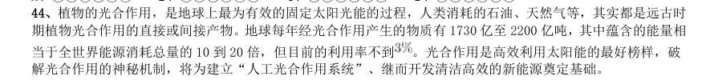

- **A.** 破解光合作用机制的重要意义
- **B.** 植物光合作用的神秘机制
- **C.** 提高光合作用利用率的途径
- **D.** 太阳能与植物光合作用的关系

**答案：A**　**考点：中心理解｜中心句与主旨**　**难度：★★★★☆**
**【言语理解·中心理解｜GK-2017-fs-X045】**

45. 当炫耀式旅游成了目的,扎堆往知名景点挤,也就在意料之中,其实旅游作为一种现代的生活方式,可以有 多样化的功能。如果是为了教育,可以带孩子去看名山大川、古城遗迹,帮助他们了解国家的历史和文化传统; 如果是为了休闲放松,可以去海边、深山,或者就近选择市郊的农家小院,能短暂逃避尘世喧嚣就好。理性面对 旅游目的,寻找合适的度假所在,才是健康的旅游观念,才能更好地享受旅游的快乐。旅游观念转型升级,旅游 市场分化,人满为患的现象才可能消失,旅行中的快乐亦会更加醇厚。 根据这段文字,旅游观念的“转型升级”指的是:

- **A.** 实现多样化的功能
- **B.** 理性面对旅游目的
- **C.** 赋予旅游实际意义
- **D.** 享受旅行中的快乐

**答案：B**　**考点：中心理解｜中心句与主旨**　**难度：★★★★☆**
**【言语理解·中心理解｜GK-2017-fs-X046】**

46. 印象中,文物给我的常是一种高冷、神秘、刻板、枯燥的印象,仿佛都是遥不可及的东西,和百科知识别无 二致,与普通人的生活多有隔膜。尔后,逐渐有一些机会听到收藏家回忆他们和某一文物相遇、相守的故事,或 充满人情世故,或有彼此坚守,交织着个人的情感,也打捞起历史的点滴。我便开始对文物有了新鲜的认识,似 乎还能感受到老物件的温度,意识到原来“文”是中心,“物”只是载体;收藏文物的目的就是为了传播文化, 而不是仅仅将其作为物品小心翼翼地收藏起来。 根据这段文字,下列哪项最好地阐明了作者对文物的看法?

- **A.** 睹物思人
- **B.** 物尽其用
- **C.** 超然物外
- **D.** 寄情于物

**答案：D**　**考点：中心理解｜中心句与主旨**　**难度：★★★★☆**
**【言语理解·中心理解｜GK-2017-fs-X047】**

47. 现代信息网络技术、微电子技术和虚拟技术,把人们的视野扩展到一个全新的领域。人们不仅可以借助计算 机技术建立作战实验室,把对历史经验的归纳和对未来的预测融为一体,将计算机自动推理与专家经验指导结合 起来,而且能通过合成动态的人工模拟战场、造就逼真的作战环境,为战略理论研究开启新的渠道和广阔空间。 许多国家以此为依据,提出新的作战原则和理论,并在此基础上形成了本国的国家安全战略,从而实现了国家安 全谋划从经验决策到科学决策的转变。 这段文字意在强调:

- **A.** 现代科技有助于科学制定国家安全战略
- **B.** 现代信息网络技术的发展革新了战争方式
- **C.** 国家安全谋划正从经验决策向科学决策转变
- **D.** 作战原则和理论依赖于科学技术的创新和发展

**答案：A**　**考点：中心理解｜主题词**　**难度：★★★★☆**
**【言语理解·逻辑填空｜GK-2017-fs-X048】**

48. 现在许多学者在讨论“全球变暖”这一话题时,常将其作为“科学问题”来讨论。实际上,在涉及这种超长 时段的复杂问题时,现在许多标准的科学验证方法都是有局限性的,因而从历史的角度来讨论这个问题,有其特 殊意义。但众所周知,历史学家在建构历史时,必须依赖史料之外的东西,而“全球变暖”涉及长时段的气候变 迁,文字记载往往十分缺乏,只能通过地质材料间接推测;而且地球不是人类,它的行为和规律,不可能借助“史 料之外的东西”来推测。所以, 。 填入画横线部分最恰当的一句是:

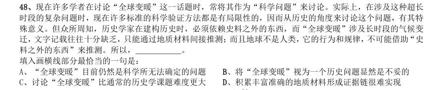

- **A.** “全球变暖”目前仍然是科学所无法确定的问题
- **B.** 将“全球变暖”视为一个历史问题显然是不妥的
- **C.** 讨论“全球变暖”比通常的历史学课题难度更大
- **D.** 积累丰富准确的地质材料形成证据链很难实现

**答案：C**　**考点：逻辑填空｜逻辑填空（综合）**　**难度：★★★★☆**
**【言语理解·细节判断｜GK-2017-fs-X049】**

49. 调查显示,青年创业过程中最大的困难是资金问题, 的人认为缺乏足够的资金是主要困难。而很多人 尽管缺乏资金,也不愿意去贷款或融资,这反映出很多创业者在创业过程中有保守的心态。另一个比较突出的困 难是同行竞争过度,占 。调研过程中发现,青年创业的领域比较集中,如大学生群体更倾向于电商、计算 机技术支持等方面的创业,青年农民更愿意从事自己比较熟悉的种植和养殖业等,这种同质化的创业在形成规模 效应的同时,也难免会带来过度竞争。 以下说法与原文相符的是:

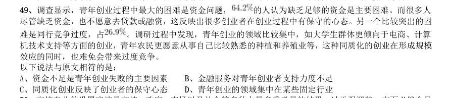

- **A.** 资金不足是青年创业失败的主要因素
- **B.** 金融服务对青年创业者支持力度不足
- **C.** 同质化创业反映了创业者的保守心态
- **D.** 青年创业的领域集中在某些固定行业

**答案：D**　**考点：细节判断｜细节判断**　**难度：★★★★☆**
**【言语理解·中心理解｜GK-2017-fs-X050】**

50. 高校专业的设置应该是高校、政府、市场以及社会等多种力量多重考量的结果,过于强调某一方面必然会导 致失衡。要实现相对合理和均衡,就要在制度上提供平台,比如确保大学在设置专业时经过教授委员会或学术委 员会等专门机构的集体论证。教育主管部门也应推动并尊重现代大学治理模式,在专业设置上给专业组织更多的 自主权。在消除不合理的制度因素之后,社会在评价高校专业时,才能有可能以理性平和的心态看待不同专业的 就业状况,而不是把就业率的红牌等同于“专业不好”。 这段文字意在强调:

- **A.** 教育主管部门应给予大学更多的自主权
- **B.** 制度建设是保证专业评估合理性的基础
- **C.** 高校的专业设置应该考虑多方面因素
- **D.** 就业率不是评价专业好坏的唯一标准

**答案：C**　**考点：中心理解｜对策优先**　**难度：★★★★☆**
**【言语理解·逻辑填空｜GK-2017-fs-X051】**
> 材料：根据所给材料,回答51~55 题。 技术为自身的生存和发展而战,并且有着独特的生命周期。我们可以将其划分为以下几个阶段:首先是先 驱阶段。技术的先决条件已经存在,梦想家们可能会考虑把这些元素放在一起。然而即便这些梦想此时已经记录 在案,人们也不会将其视为发明创造,比如达·芬奇曾经绘制过很多有说服力的飞机和汽车图画,但人们并不认 为他是在发明创造。其次是发明阶段。这一阶段在人类文化当中相当有名。此一阶段时间比较短,从某些方面 来看,这就像 。在这个阶段当中,发明家们把科学技术、好奇心与决心结合起来,通常再加上一定的表 演技巧,将各种方法以新的方式结合在一起,给生活带来一种全新的技术。第三个阶段是发展阶段。新发明会 得到那些溺爱它们的监护者(也许还包括最初的发明者)的保护和支持。通常这一阶段比发明阶段要重要,可能 还包括额外的创造,这些额外创造比那个独创性发明更重要。当年,许多工匠已经手工制作

51. 当人们发现这些新技术确实无法改变既有秩序之后,技术的保守派便以此为依据,证明以 前的技术方法确实可以永存。对逐渐老化的技术来说,这通常只是一个短暂的胜利。另一种新技术很快就会出 现,它总能成功地将原有技术逼到过时的舞台上。在生命周期的这个部分,技术在逐渐衰败的状态当中度过了晚 年,它的最初目的和功能现在都被一个更活泼的竞争对手比下去了。这一阶段约占技术整个生命周期的至。最 终,技术成为“老古董”,就像马赫轻便马车、拨弦键琴、机电式计算器一样,不得不黯然离场。 填入文中画横线部分最恰当的一句是:

- **A.** 怀胎数月最终分娩的过程一样
- **B.** 流星划过夜空那样璀璨而耀眼
- **C.** 人类当年在月球上迈出第一步
- **D.** 人类文明酝酿以及发展的过程

**答案：A**　**考点：逻辑填空｜逻辑填空（综合）**　**难度：★★★★☆**
**【言语理解·中心理解｜GK-2017-fs-X052】**

52. 作者举亨利·福特的例子是为了说明:

- **A.** 汽车产业中的工匠精神决定着工艺水平
- **B.** 技术产业的发展决定了技术应用的前景
- **C.** 技术推广中的额外发明比独创发明更关键
- **D.** 独创性发明本身并不一定具有核心竞争力

**答案：C**　**考点：中心理解｜中心句与主旨**　**难度：★☆☆☆☆**
**【言语理解·逻辑填空｜GK-2017-fs-X053】**

53. 下列哪种现象可能发生在技术发展的“挑战者时期”?

- **A.** 数码相机抢夺胶卷相机的市场
- **B.** 打字机的功能完全被电脑所代替
- **C.** 凡尔纳小说已有对潜艇的构想
- **D.** 人们的日常生活离不开智能手机

**答案：A**　**考点：逻辑填空｜逻辑填空（综合）**　**难度：★☆☆☆☆**
**【言语理解·逻辑填空｜GK-2017-fs-X054】**

54. 根据文章,下列说法正确的是:

- **A.** 技术的成熟期持续时间较短
- **B.** 关键元素的缺失会导致技术停滞不前
- **C.** “老古董”指技术已臻于完美,无需改进
- **D.** “短暂的胜利”指原有技术的胜利

**答案：D**　**考点：逻辑填空｜逻辑填空（综合）**　**难度：★☆☆☆☆**
**【言语理解·中心理解｜GK-2017-fs-X055】**

55. 这篇文章主要谈论的是:

- **A.** 新兴技术的进阶之路
- **B.** 技术的生命周期
- **C.** 新旧技术的优劣比较
- **D.** 技术对社会的影响

**答案：B**　**考点：中心理解｜中心句与主旨**　**难度：★☆☆☆☆**
**【言语理解·逻辑填空｜GK-2017-fs-X056】**
> 材料：根据所给材料,回答56~60 题。 我们的生活被各式各样的信息塞满挤爆,常常来不及消化,就被迫接收下一个信息,这导致信息的传递处于 无意识处理的状态,很多问题都来不及深入思考。长期下来,我们的大脑容易被既定的观念限制,看似精明却往 往漏洞百出。商家、推销员、诈骗集团等紧紧抓住这一特点,巧妙操弄生活中的各种信息,制造一个又一个骗局, 我们则比想象中更容易落入圈套,还认为自己做出了正确的决策。骗局的根源之一:其实我们活在大脑创造的 虚拟世界中。当我们在看世界时,我们是真的“直接”看到了世界,还是只是“间接”看到了世界呢?很多人 可能会认为我们当然是直接看到了世界,但事实上,我们只是间接看到了世界。我们的各种感觉和经验,完全是 大脑解码后传递给我们的产物。当我们看到、听到、闻到、尝到或摸到东西时,我们真正“接触”到的,只是大 脑对这个世界的“理解”。1我们所有的知觉经验,完全是大脑的产物。大脑通

56. 当我们无法意识到这些庞大的无意识信息处理过程时, 这些会偷偷影响我们行为的因素,就很容易成为被人利用的漏洞。 下面这个段落最适合放在文中哪个位置? 大脑预设人脸一定是凸出来的,不可能是凹进去的。这种类似的预设在“大部分”状态下都是恒定的,因此在演 化过程中,它们已经被写入大脑的默认值之中。在这种情况下,即使科学家制造出脸向内凹的人脸模型,在人类 的视觉与大脑解码系统中,我们看到的人脸模型仍然是凸出的。

- **A.** 1
- **B.** 2
- **C.** 3
- **D.** 4

**答案：C**　**考点：逻辑填空｜逻辑填空（综合）**　**难度：★★★★☆**
**【言语理解·逻辑填空｜GK-2017-fs-X057】**

57. 关于认知不可穿透性,下列说法正确的是:

- **A.** 与大脑为了求快而建立的快捷计算方式有关
- **B.** 是大脑创造出来的一种知觉假象
- **C.** 发生在大脑中的电生理信号被转化成知觉意识之前
- **D.** 意志力无法穿透的认知对象是相对不重要的信息

**答案：A**　**考点：逻辑填空｜逻辑填空（综合）**　**难度：★☆☆☆☆**
**【言语理解·逻辑填空｜GK-2017-fs-X058】**

58. 填入文中最后一段画横线部分最恰当的一句是:

- **A.** 任何选择都是要付出代价的
- **B.** 大脑的选择往往是无意识的
- **C.** 大脑对重要性的判断可能出错
- **D.** 信息的重要与否可能因时而异

**答案：A**　**考点：逻辑填空｜逻辑填空（综合）**　**难度：★☆☆☆☆**
**【言语理解·逻辑填空｜GK-2017-fs-X059】**

59. 下列哪组词语能更好地解释为什么大脑容易受骗? 1无意识信息处理 2思考捷径 3意志力薄弱 4信息过载 5知觉假象

- **A.** 234
- **B.** 125
- **C.** 245
- **D.** 134

**答案：B**　**考点：逻辑填空｜逻辑填空（综合）**　**难度：★☆☆☆☆**
**【言语理解·中心理解｜GK-2017-fs-X060】**

60. 这篇文章意在说明:

- **A.** 很多认知现象是无法通过意志力去矫治的
- **B.** 大脑由于进化形成了不可逆转的认知结构
- **C.** 大脑并不像我们想象得那般可靠与完美
- **D.** 掌握大脑运转机制才能更好地应对骗局

**答案：暂缺**　**考点：中心理解｜转折与因果**　**难度：★☆☆☆☆**
**【数量关系·利润问题｜GK-2017-fs-X061】**

61. 面包房购买一包售价为15 元/千克的白糖,取其中的一部分加水溶解形成浓度为20%的糖水12 千克,然后 将剩余的白糖全部加入后溶解,糖水浓度变为25%,问购买白糖花了多少元钱?

- **A.** 45
- **B.** 48
- **C.** 36
- **D.** 42

**答案：B**　**考点：利润问题｜基础利润**　**难度：★★☆☆☆**
**【数量关系·年龄问题｜GK-2017-fs-X062】**

62. 某人出生于20 世纪70 年代,某年他发现从当年起连续10 年自己的年龄均与当年年份数字之和相等(出生 当年算0 岁)。问他在以下哪一年时,年龄为9 的整数倍?

- **A.** 2006 年
- **B.** 2007 年
- **C.** 2008 年
- **D.** 2009 年

**答案：B**　**考点：年龄问题｜年龄和与倍数**　**难度：★☆☆☆☆**
**【数量关系·其他数量关系｜GK-2017-fs-X063】**

63. 为维护办公环境,某办公室四人在工作日每天轮流打扫卫生,每周一打扫卫生的人给植物浇水。7 月5 日周 五轮到小玲打扫卫生,下一次小玲给植物浇水是哪天?

- **A.** 7 月15 日
- **B.** 7 月22 日
- **C.** 7 月29 日
- **D.** 8 月5 日

**答案：C**　**考点：其他数量关系｜其他数量关系（综合）**　**难度：★☆☆☆☆**
**【数量关系·利润问题｜GK-2017-fs-X064】**

64. 某超市购入每瓶200 毫升和500 毫升两种规格的沐浴露各若干箱,200 毫升沐浴露每箱20 瓶,500 毫升沐浴 露每箱12 瓶。定价分别为14 元/瓶和25 元/瓶。货品卖完后,发现两种规格沐浴露的销售收入相同,那么这批 沐浴露中,200 毫升的最少有几箱?

- **A.** 3
- **B.** 8
- **C.** 10
- **D.** 15

**答案：D**　**考点：利润问题｜利润问题（综合）**　**难度：★★★☆☆**
**【数量关系·概率问题｜GK-2017-fs-X065】**

65. 某次知识竞赛试卷包括3 道每题10 分的甲类题,2 道每题20 分的乙类题以及1 道30 分的丙类题。参赛者 赵某随机选择其中的部分试题作答并全部答对,其最终得分为70 分。问赵某未选择丙类题的概率为多少?

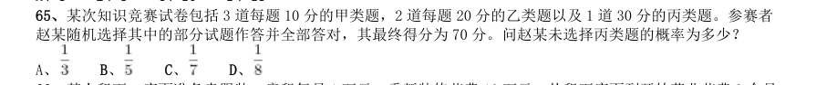

- **A.** 
- **B.** 
- **C.** 
- **D.** 

**答案：D**　**考点：概率问题｜摸球与抽取**　**难度：★★★★★**
**【数量关系·利润问题｜GK-2017-fs-X066】**

66. 某人租下一店面准备卖服装,房租每月1 万元,重新装修花费10 万元。从租下店面到开始营业花费3 个月 时间。开始营业后第一个月,扣除所有费用后的纯利润为3 万元。如每月纯利润都比上月增加2000 元而成本不 变,问该店在租下店面后第几个月内收回投资?

- **A.** 7
- **B.** 8
- **C.** 9
- **D.** 10

**答案：A**　**考点：利润问题｜基础利润**　**难度：★★★☆☆**
**【数量关系·最值问题｜GK-2017-fs-X067】**

67. 某抗洪指挥部的所有人员中,有2/3 的人在前线指挥抢险。由于汛情紧急,又增派6 人前往,此时在前线指 挥抢险的人数占总人数的75%。如该抗洪指挥部需要保留至少10%的人员在应急指挥中心,那么最多还能再增派 多少人去前线?

- **A.** 8
- **B.** 9
- **C.** 10
- **D.** 11

**答案：C**　**考点：最值问题｜最值优化**　**难度：★★★★★**
**【数量关系·最值问题｜GK-2017-fs-X068】**

68. 小张需要在5 个长度分别为15 秒、53 秒、22 秒、47 秒和23 秒的视频片段中选取若干个,合成为一个长度 在80~90 秒之间的宣传视频。如果每个片段均需完整使用且最多使用一次,并且片段间没有空闲时段,问他按 照要求可能做出多少个不同的视频?

- **A.** 12
- **B.** 6
- **C.** 24
- **D.** 18

**答案：A**　**考点：最值问题｜最值优化**　**难度：★★★★★**
**【数量关系·几何问题｜GK-2017-fs-X069】**

69. 一块种植花卉的矩形土地如图所示,AD 边长是AB 的2 倍,E 是CD 的中点,甲、乙、丙、丁、戊区域分别种 植白花、红花、黄花、紫花、白花。问种植白花的面积占矩形土地面积的:

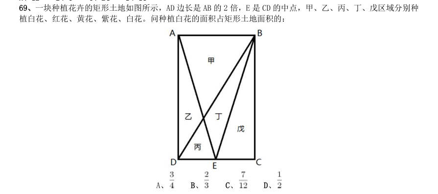

- **A.** 
- **B.** 
- **C.** 
- **D.** 

**答案：C**　**考点：几何问题｜平面几何**　**难度：★★★★★**
**【数量关系·概率问题｜GK-2017-fs-X070】**

70. 某集团企业5 个分公司分别派出1 人去集团总部参加培训,培训后再将5 人随机分配到这5 个分公司,每个 分公司只分配1 人。问5 个参加培训的人中,有且仅有1 人在培训后返回原分公司的概率:

- **A.** 低于20%
- **B.** 在20%~30%之间
- **C.** 在30%~35%之间
- **D.** 大于35%

**答案：D**　**考点：概率问题｜摸球与抽取**　**难度：★★★★★**
**【数量关系·其他数量关系｜GK-2017-fs-X071】**

71. 某商铺甲乙两组员工利用包装礼品的边角料制作一批花朵装饰门店。甲组单独制作需要10 小时,乙组单独 制作需要15 小时,现两组一起做,期间乙组休息了1 小时40 分,完成时甲组比乙组多做300 朵。问这批花有多 少朵?

- **A.** 600
- **B.** 900
- **C.** 1350
- **D.** 1500

**答案：B**　**考点：其他数量关系｜和差倍比**　**难度：★★☆☆☆**
**【数量关系·工程问题｜GK-2017-fs-X072】**

72. 工厂有5 条效率不同的生产线。某个生产项目如果任选3 条生产线一起加工,最快需要6 天整,最慢需要 12 天整;5 条生产线一起加工,则需要5 天整。问如果所有生产线的产能都扩大一倍,任选2 条生产线一起加工 最多需要多少天完成?

- **A.** 11
- **B.** 13
- **C.** 15
- **D.** 30

**答案：C**　**考点：工程问题｜给定时间型**　**难度：★★☆☆☆**
**【数量关系·行程问题｜GK-2017-fs-X073】**

73. 一正三角形小路如右图所示,甲乙两人从A 点同时出发,朝不同方向沿小路散步,已知甲的速度是乙的2 倍。 问以下哪个坐标图能准确描述两人之间的直线距离与时间的关系(横轴为时间,纵轴为直线距离)?

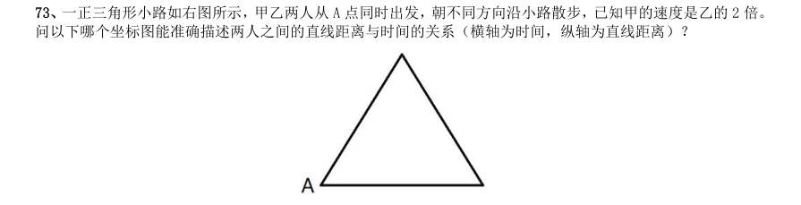

> （本题为图形题，选项为图片，见原卷）

**答案：D**　**考点：行程问题｜基础行程**　**难度：★★☆☆☆**
**【数量关系·几何问题｜GK-2017-fs-X074】**

74. 将一个棱长为整数的正方体零件切掉一个角,截面是面积为 的三角形,问其棱长最小为多少?

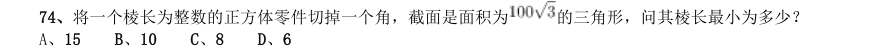

> （本题为图形题，选项为图片，见原卷）

**答案：A**　**考点：几何问题｜立体几何**　**难度：★★★★★**
**【数量关系·几何问题｜GK-2017-fs-X075】**

75. 某次军事演习中,一架无人机停在空中对三个地面目标点进行侦察。已知三个目标点在地面上的连线为直角 三角形,两个点之间的最远距离为600 米。问无人机与三个点同时保持500 米距离时,其飞行高度为多少米?

- **A.** 500
- **B.** 600
- **C.** 300
- **D.** 400

**答案：D**　**考点：几何问题｜平面几何**　**难度：★★★★★**
**【判断推理·图形推理｜GK-2017-fs-X076】**

76. 从所给的四个选项中,选择最合适的一个填入问号处,使之呈现一定的规律性:

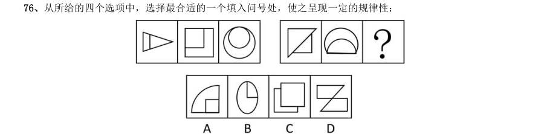

> （本题为图形题，选项为图片，见原卷）

**答案：C**　**考点：图形推理｜位置规律**　**难度：★★★☆☆**
**【判断推理·图形推理｜GK-2017-fs-X077】**

77. 从所给的四个选项中,选择最合适的一个填入问号处,使之呈现一定的规律性:

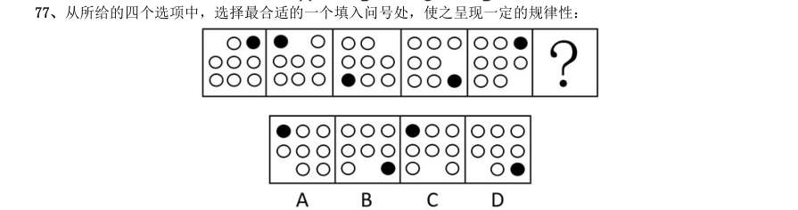

> （本题为图形题，选项为图片，见原卷）

**答案：C**　**考点：图形推理｜位置规律**　**难度：★★★☆☆**
**【判断推理·图形推理｜GK-2017-fs-X078】**

78. 从所给的四个选项中,选择最合适的一个填入问号处,使之呈现一定的规律性:

> （本题为图形题，选项为图片，见原卷）

**答案：A**　**考点：图形推理｜样式规律**　**难度：★★★☆☆**
**【判断推理·图形推理｜GK-2017-fs-X079】**

79. 从所给的四个选项中,选择最合适的一个填入问号处,使之呈现一定的规律性:

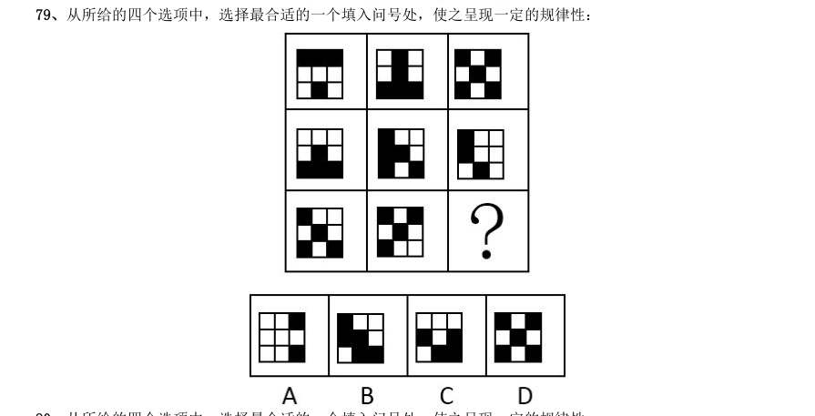

> （本题为图形题，选项为图片，见原卷）

**答案：A**　**考点：图形推理｜样式规律**　**难度：★★★☆☆**
**【判断推理·图形推理｜GK-2017-fs-X080】**

80. 从所给的四个选项中,选择最合适的一个填入问号处,使之呈现一定的规律性:

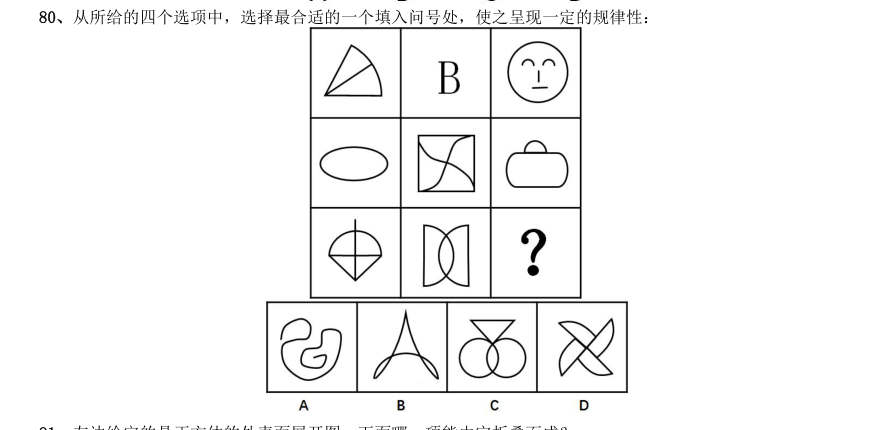

> （本题为图形题，选项为图片，见原卷）

**答案：B**　**考点：图形推理｜数量规律**　**难度：★★★☆☆**
**【判断推理·图形推理｜GK-2017-fs-X081】**

81. 左边给定的是正方体的外表面展开图,下面哪一项能由它折叠而成?

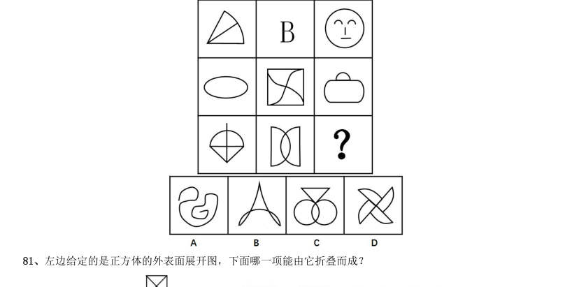

> （本题为图形题，选项为图片，见原卷）

**答案：D**　**考点：图形推理｜折纸盒**　**难度：★★★☆☆**
**【判断推理·图形推理｜GK-2017-fs-X082】**

82. 下图中的立体图形1是由立体图形2,3和4组合而成,下列哪一项不能填入问号处?

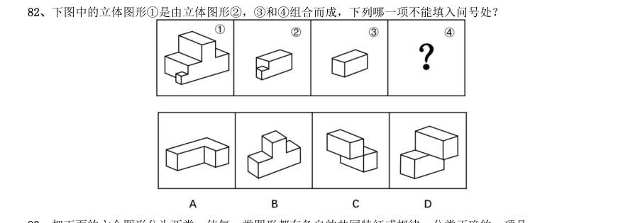

> （本题为图形题，选项为图片，见原卷）

**答案：B**　**考点：图形推理｜立体拼合**　**难度：★★★☆☆**
**【判断推理·图形推理｜GK-2017-fs-X083】**

83. 把下面的六个图形分为两类,使每一类图形都有各自的共同特征或规律,分类正确的一项是:

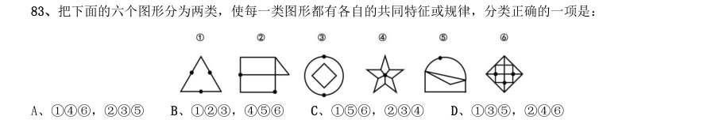

- **A.** 146,235
- **B.** 123,456
- **C.** 156,234
- **D.** 135,246

**答案：D**　**考点：图形推理｜位置规律**　**难度：★★★☆☆**
**【判断推理·图形推理｜GK-2017-fs-X084】**

84. 把下面的六个图形分为两类,使每一类图形都有各自的共同特征或规律,分类正确的一项是:

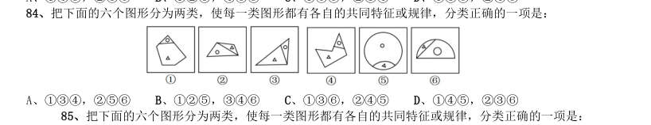

- **A.** 134,256
- **B.** 125,346
- **C.** 136,245
- **D.** 145,23

**答案：A**　**考点：图形推理｜数量规律**　**难度：★★★☆☆**
**【判断推理·图形推理｜GK-2017-fs-X085】**

85. 把下面的六个图形分为两类,使每一类图形都有各自的共同特征或规律,分类正确的一项是:

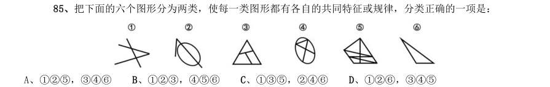

- **A.** 125,346
- **B.** 123,456
- **C.** 135,246
- **D.** 126,345

**答案：C**　**考点：图形推理｜数量规律**　**难度：★★★☆☆**
**【判断推理·定义判断｜GK-2017-fs-X086】**

86. 语句的示意功能是指通过语句表达某种通知、告诫、命令或请求,目的在于要求别人按照语句表达的思想, 做出或不做出某种行为。 根据上述定义,下列没有反映语句的示意功能的是:

- **A.** 全体学生请到操场集合
- **B.** 请您务必不要践踏草坪
- **C.** 禁止生产假冒伪劣产品
- **D.** 销售部现在应该在开会

**答案：D**　**考点：定义判断｜单定义**　**难度：★★☆☆☆**
**【判断推理·定义判断｜GK-2017-fs-X087】**

87. 水利工程是用于控制和调配自然界的地表水和地下水,达到除害兴利目的而修建的工程。 根据上述定义,下列不涉及水利工程的是:

- **A.** 城市污水处理厂利用微生物分解吸收水中的有机物
- **B.** 水电站利用水力发电技术,将水能转化为电能
- **C.** 农业上建设合理开发利用地下水的灌溉设施,以满足作物生长需要
- **D.** 在水利枢纽中设河岸泄洪道以防止因洪水超过水库容量而漫顶造成溃坝

**答案：A**　**考点：定义判断｜单定义**　**难度：★★☆☆☆**
**【判断推理·定义判断｜GK-2017-fs-X088】**

88. 火力投射密度是指军事行动中军事部门在单位时间内的最大弹药发射量。它是现代军事学中衡量作战部队战 斗力的重要指标之一。 根据上述定义,以下属于通过增大火力投射密度来加强部队战斗力的是:

- **A.** 某步兵师在普通士兵中选拔特等射手编入狙击班,进而能够更有效地杀伤敌人的有生力量
- **B.** 某国将其部队列装的半自动步枪全部更换为全自动步枪,增加了子弹的发射频率
- **C.** 某炮兵部队将原计划两小时的炮火掩护时间延长为三小时,更有效地杀伤了掩体中的敌人
- **D.** 某军事科研单位研制出更先进的炮火定位系统,能够将火力打击的误差由半径200 米缩小到50 米

**答案：B**　**考点：定义判断｜单定义**　**难度：★★☆☆☆**
**【判断推理·定义判断｜GK-2017-fs-X089】**

89. 货币性资产是指持有的现金及将以固定或可确定金额的货币收取的资产,包括现金、应收账款和应收票据以 及准备持有至到期的债券等。非货币性资产则是指货币性资产以外的资产,这些资产在将来为企业带来的经济利 益(即货币金额)是不固定的或不可确定的。 根据上述定义,下列属于货币性资产的是:

- **A.** 某服装厂的库存货物
- **B.** 某汽车公司用于出租的车辆
- **C.** 某通讯企业旗下手机品牌的商标权
- **D.** 某化工集团按照国家规定获得的技术补贴

**答案：D**　**考点：定义判断｜单定义**　**难度：★★☆☆☆**
**【判断推理·定义判断｜GK-2017-fs-X090】**

90. 埋伏营销是指企业利用媒体和公众对重大事件的关注,通过举办与重大事件相关的活动,使自己与重大事件 产生关联,从而引起消费者的联想和媒体的注意。这类营销通常是隐蔽的、突发的,不以赞助者的身份出现,却 对自己的品牌悄无声息地进行了宣传。 根据上述定义,下列不属于埋伏营销的是:

- **A.** 某矿泉水公司邀请著名运动员为其代言,并将广告投放在电视媒体的黄金时段和一些大型酒店的视频媒体中
- **B.** 地震发生后,某户外用品公司向灾区捐赠价值100 万元的帐篷,并举行了捐赠仪式
- **C.** 某市举办中小学生知识竞赛,一出版集团在现场向参与者免费发放其出版的图书
- **D.** 世界一级方程式锦标赛比赛期间,观众席中时不时会有人挥舞着印有某轮胎企业商标的彩色旗帜

**答案：A**　**考点：定义判断｜单定义**　**难度：★★★☆☆**
**【判断推理·定义判断｜GK-2017-fs-X091】**

91. 自由落体运动是指物体只在重力作用下从静止开始下落的运动。这种运动只有在真空条件下才能发生,在有 空气时,如果空气的阻力作用比较小,可以忽略不计,则物体的下落可以近似看作自由落体运动。 根据上述定义,下列可以近似看作自由落体运动的是:

- **A.** 熟透了的苹果从树上被风吹落
- **B.** 飞行中的飞机被导弹击中坠落
- **C.** 抛过来的皮球没被接住,掉在地上
- **D.** 冬日中午,冰棱融化后从屋檐掉下

**答案：D**　**考点：定义判断｜单定义**　**难度：★★☆☆☆**
**【判断推理·定义判断｜GK-2017-fs-X092】**

92. 著名科学家、科学史学家普赖斯提出:如果K 代表参与某一专业领域的人数,那么这个数字的平方根大致等 于为这个领域做出一半贡献的排名在前的那部分人的人数。 根据上述定义,下列符合普赖斯观点的是:

- **A.** 某国出版协会统计了本国的期刊,发现与经济有关的期刊大约有150 种,所有与经济有关的科研论文中,有一半发表在其中的13 种期刊上
- **B.** 某县有20 万农业人口,统计发现,过去一年全县的粮食总产量中,大约一半粮食产量是由450 位左右的种粮大户贡献的
- **C.** 某组织统计过去一年全世界公开举办的音乐会的演奏曲目,发现所有演奏曲目是由大约250 位作曲家完成的,其中大约一半的曲目来自于16 位作曲家
- **D.** 某销售奢侈品的网店过去一年的访问量为10 万人次,但去年全部的销售额中,大约一半的销售额是由其中大

**答案：C**　**考点：定义判断｜单定义**　**难度：★★☆☆☆**
**【判断推理·定义判断｜GK-2017-fs-X093】**

93. 隐匿定位策略是指当一类产品不被消费者看好时,公司能够在不打破产品种类界限的情况下,合法地利用某 些策略消除消费者对这类产品的偏见,使消费者转而接受它们,实现更好的销量。 根据上述定义,下列没有运用隐匿定位策略的是:

- **A.** 某公司生产的游戏机销量不佳,公司决定将产品升级并提出创建家庭娱乐平台的概念,该游戏机因此变得畅销
- **B.** 某公司开发了家庭机器人,但消费者并不感兴趣。该公司调整思路,推出一种可爱的、不做家务的机器狗,一上市就大受欢迎
- **C.** 某公司推出一种小型电脑,由于定价高而鲜有问津。该公司在产品宣传中强调其可作为移动数字化设备等,与低端产品区分开,从而打开销路
- **D.** 某公司推出新款SUV 车型,但少有人问津,于是公司又推出一款价格昂贵的跑车,消费者觉得SUV 性价比更

**答案：A**　**考点：定义判断｜单定义**　**难度：★★★☆☆**
**【判断推理·定义判断｜GK-2017-fs-X094】**

94. 参照依赖是指个体基于某个参照点对得失价值进行判断,参照点之上,个体感受是收益,反之感受为损失。 损失和收益的感知取决于参照点的选择。 根据上述定义,下列不属于参照依赖的是:

- **A.** 张女士因为生育和哺乳不得不暂停工作半年,失去了很多客户,心里很苦恼,但看到自己健康活泼的儿子,又变得高兴起来
- **B.** 小张原本对收入很满意,他听说跟自己同时进公司、现在同是项目经理的小李收入比自己高10%后,对收入没有那么满意了
- **C.** 研究者设计了一项实验:告知被试他们邻居的月水电支出比他们低,结果发现被试下个月的家庭能耗显著降低了
- **D.** 姐姐期中考试得了99 分,期末考试得了95 分,妈妈批评了她;弟弟期中考试得了75 分,期末考试得了85

**答案：C**　**考点：定义判断｜单定义**　**难度：★★☆☆☆**
**【判断推理·定义判断｜GK-2017-fs-X095】**

95. 传递关系指的是对任意的元素

- **A.** 自然数中的大于关系
- **B.** 生活中的同学关系
- **C.** 家庭中的父子关系
- **D.** 食物链的天敌关系

**答案：A**　**考点：定义判断｜单定义**　**难度：★☆☆☆☆**
**【判断推理·类比推理｜GK-2017-fs-X096】**

96. 白醋:消毒

- **A.** 热水器:加热
- **B.** 汽油:去渍
- **C.** 白糖:调味
- **D.** 人参:滋补

**答案：B**　**考点：类比推理｜对应关系**　**难度：★☆☆☆☆**
**【判断推理·类比推理｜GK-2017-fs-X097】**

97. 成百:上千

- **A.** 三教:九流
- **B.** 三头:六臂
- **C.** 千变:万化
- **D.** 千方:百计

**答案：C**　**考点：类比推理｜逻辑关系**　**难度：★☆☆☆☆**
**【判断推理·类比推理｜GK-2017-fs-X098】**

98. 生死:存亡

- **A.** 轻重:缓急
- **B.** 亲疏:长幼
- **C.** 真伪:对错
- **D.** 好坏:优劣

**答案：D**　**考点：类比推理｜语义关系**　**难度：★☆☆☆☆**
**【判断推理·类比推理｜GK-2017-fs-X099】**

99. 踢皮球:互相推诿

- **A.** 燕归巢:时过境迁
- **B.** 破天荒:闻所未闻
- **C.** 睁眼瞎:目不识丁
- **D.** 纸老虎:不堪一击

**答案：C**　**考点：类比推理｜语义关系**　**难度：★☆☆☆☆**
**【判断推理·类比推理｜GK-2017-fs-X100】**

100. 战术:战争:胜负

- **A.** 血型:人种:胖瘦
- **B.** 诉状:案件:输赢
- **C.** 策略:竞选:成败
- **D.** 经验:能力:高低

**答案：C**　**考点：类比推理｜逻辑关系**　**难度：★☆☆☆☆**
**【判断推理·类比推理｜GK-2017-fs-X101】**

101. 观众:电视:新闻

- **A.** 士兵:靶场:命令
- **B.** 渔夫:渔船:渔汛
- **C.** 教师:课堂:知识
- **D.** 消费者:消费指南:优惠信息

**答案：D**　**考点：类比推理｜对应关系**　**难度：★☆☆☆☆**
**【判断推理·类比推理｜GK-2017-fs-X102】**

102. 寒:寒冷:寒舍

- **A.** 甘:甘甜:甘愿
- **B.** 恨:仇恨:怨恨
- **C.** 肤:皮肤:肌肤
- **D.** 讽:讽刺:讥讽

**答案：A**　**考点：类比推理｜语义关系**　**难度：★☆☆☆☆**
**【判断推理·类比推理｜GK-2017-fs-X103】**

103. 设计:发放:问卷

- **A.** 播放:快进:磁带
- **B.** 制定:执行:政策
- **C.** 复制:修改:文字
- **D.** 预习:复习:考试

**答案：B**　**考点：类比推理｜类比推理（综合）**　**难度：★☆☆☆☆**
**【判断推理·类比推理｜GK-2017-fs-X104】**

104. 教案对于( )相当于( )对于分类

- **A.** 课件;信息
- **B.** 教学;归类
- **C.** 提纲;商品
- **D.** 授课;标准

**答案：D**　**考点：类比推理｜语义关系**　**难度：★☆☆☆☆**
**【判断推理·类比推理｜GK-2017-fs-X105】**

105. 故人西辞黄鹤楼对于( )相当于( )对于怀古

- **A.** 出游;越王勾践破吴归
- **B.** 场所;千古兴亡多少事
- **C.** 送别;折戟沉沙铁未销
- **D.** 离别;西出阳关无故人

**答案：C**　**考点：类比推理｜对应关系**　**难度：★☆☆☆☆**
**【判断推理·逻辑判断｜GK-2017-fs-X106】**

106. 某网购平台发布了一份网购调研报告,分析亚洲女性的网购特点。分析显示,当代亚洲女性在网购服饰、 化妆品方面的决定权为88%,在网购家居用品方面的决定权为85%。研究者由此认为,那些喜爱网购的亚洲女性 在家庭中拥有更大的控制权。 以下哪项如果为真,最能反驳上述结论?

- **A.** 喜爱网购的亚洲女性的网购支出只占其家庭消费支出的25%
- **B.** 亚洲女性中,习惯上网购物的人数只占女性总人数的30%左右
- **C.** 亚洲女性在购买贵重商品时往往会与丈夫商量,共同决定
- **D.** 一些亚洲女性经济不独立,对家庭收入没有贡献

**答案：A**　**考点：逻辑判断｜削弱**　**难度：★★★★★**
**【判断推理·逻辑判断｜GK-2017-fs-X107】**

107. 公元250 年至800 年,玛雅文明还十分发达,城市繁荣,庄稼收成也很喜人。气候记录显示,这一时期玛 雅地区的降水量相对较高。此后玛雅文明开始衰落。从公元820 年左右起,在连续95 年的时间里,该地区开始 经历断断续续的干旱,有些地方的干旱甚至持续了数十年之久。许多专家由此认为,9 世纪的气候变化或许正是 玛雅文明消亡的原因。 以下哪项如果为真,最能支持上述专家的观点?

- **A.** 在9 世纪衰退的玛雅城市大多分布在南部,使用木材进行的建造活动也大大减少
- **B.** 和所有大型农耕文明一样,玛雅人的社会很大程度上依赖于农作物,干旱导致农产品减少,严重影响玛雅人的生存
- **C.** 大多数玛雅城市是在公元850 年到925 年之间衰落的,和干旱发生的时间高度重合
- **D.** 公元1000 年至1075 年期间,玛雅地区石雕和其他建造活动减少了将近一半,而那时当地又一次遭受了严重

**答案：B**　**考点：逻辑判断｜加强**　**难度：★★★★★**
**【判断推理·逻辑判断｜GK-2017-fs-X108】**

108. 人体的大脑与血液之间有一道“血脑屏障”,任何起安眠作用的物质首先必须能穿过这个屏障才能起效。 牛奶中含有一种名为色氨酸的氨基酸能够穿过血脑屏障,制造诱发睡眠的荷尔蒙5-羟色胺,因此人们认为睡前 喝牛奶是促进睡眠非常有效的方法。 以下哪项如果为真,最能削弱上述结论?

- **A.** 皮肤温度上升,入睡速度就快,故而喝一杯热牛奶就如同洗热水浴一样,能够加快入睡速度
- **B.** 小份的牛奶所含的色氨酸总量不足以让身体的激素水平发生较大的波动,只有喝大量的牛奶助眠效果才会好
- **C.** 米饭等碳水化合物助眠效果更好,它们会刺激胰岛素的合成,让色氨酸以外的氨基酸进入肌肉组织,从而使色氨酸更易进入大脑
- **D.** 牛奶中蕴含许多种类的氨基酸,这些物质进入血液后,会争抢穿过血脑屏障的通道,从而降低色氨酸穿过血

**答案：D**　**考点：逻辑判断｜削弱**　**难度：★★★★★**
**【判断推理·逻辑判断｜GK-2017-fs-X109】**

109. 阿尔茨海默病是一种较为严重的疾病,4 号基因突变曾被认为是阿尔茨海默病的一项致病因素。但近期有 科学家提出导致这一复杂疾病的病因可能很简单,就是一些能引起脑部感染的微生物,如HSV-1 病毒。 以下哪项如果为真,最能支持上述科学家的观点?

- **A.** 携带4 号突变基因同时感染了HSV-1 病毒的人群罹患阿尔茨海默病的概率会比单独具有此类突变基因的群体高2 倍
- **B.** 当大鼠脑部受到HSV-1 感染时,携带4 号突变基因的大鼠产生的病毒DNA 是正常大鼠的14 倍
- **C.** 有些携带4 号突变基因的患者使用抗病毒药物治疗后,其病情有所好转
- **D.** 在一些健康老年人的大脑中也存在着HSV-1 病毒

**答案：A**　**考点：逻辑判断｜加强**　**难度：★★★★★**
**【判断推理·逻辑判断｜GK-2017-fs-X110】**

110. 研究显示,约200 万年前,人类开始使用石器处理食物,例如切肉和捣碎植物。与此同时,人类逐渐演化 形成较小的牙齿和脸型,以及更弱的咀嚼肌和咬力。因此研究者推测,工具的使用减弱了咀嚼的力量,从而导致 人类脸型的变化。 以下哪项如果为真,最能削弱上述研究者的观点?

- **A.** 对与人类较为接近的灵长类动物进行研究,发现它们白天有一半时间用于咀嚼,它们的口腔肌肉非常发达、脸型也较大
- **B.** 200 万年前人类食物类型发生了变化,这加速了人类脸型的变化
- **C.** 在利用石器处理食物后,越来越多的食物经过了程度更高的处理,变得易于咀嚼
- **D.** 早期人类进化出较小的咀嚼结构,这一过程使其他变化成为可能,比如大脑体积的增大

**答案：B**　**考点：逻辑判断｜削弱**　**难度：★★★★★**
**【判断推理·逻辑判断｜GK-2017-fs-X111】**

111. 针对地球冰川的研究发现,当冰川之下的火山开始喷发后,会快速产生蒸汽流,爆炸式穿透冰层,释放灰 烬进入高空,并且产生出沸石、硫化物和黏土等物质。日前人们发现,在火星表面的一些圆形平顶山丘也探测到 这些矿物质,并且广泛而大量地存在。因此,人们推测火星早期是覆盖着冰原的,那里曾有过较多的火山活动。 要得到上述结论,需要补充的前提是:

- **A.** 近日火星侦察影像频谱仪发现,火星南极存在火山
- **B.** 火星地质活动不活跃,地表地貌大部分形成于远古较活跃的时期
- **C.** 沸石、硫化物和黏土这三类物质是仅在冰川下的火山活动后才会产生的独特物质
- **D.** 在火星平顶山丘的岩石中发现了某种远古细菌,说明这里很可能曾经有水源

**答案：C**　**考点：逻辑判断｜前提假设**　**难度：★★★★★**
**【判断推理·逻辑判断｜GK-2017-fs-X112】**

112. 复活节岛是位于太平洋上的一座孤岛。在报道中,复活节岛文明的衰落常作为一个警世故事,讲述人类肆 意采伐棕榈树林,致使肥沃的土壤流失,最终导致岛中食物短缺,文明自此衰落。然而近日有专家提出,复活节 岛文明的衰落与树木砍伐并无必然联系。 以下哪项如果为真,最能支持上述专家的观点?

- **A.** 大约公元1200 年,岛上居民开始砍伐棕榈树,用于建造木船,运送大型石质雕像
- **B.** 考古发现,当岛上最后的树木(棕榈树)被砍伐之后,仍有大量原住居民生活着,其农业耕作的水平没有下降
- **C.** 花粉分析表明,早在公元800 年,森林的毁灭就已经开始,岛屿地层中的大棕榈树和其他树木的花粉越来越少
- **D.** 1772 年荷兰殖民者开始登陆复活节岛,并对当地居民进行奴役,那时岛上的土著人口是4000 人,到1875 年

**答案：B**　**考点：逻辑判断｜加强**　**难度：★★★★★**
**【判断推理·逻辑判断｜GK-2017-fs-X113】**

113. 教练在甲、乙、丙三人背上分别贴了三个数字,三人都能看到对方的数字,但是看不到自己的数字,甲、 乙、丙背上的数字分别用

- **A.** A>B>C
- **B.** C>B>A
- **C.** B>C>A
- **D.** B>A>C

**答案：A**　**考点：逻辑判断｜真假推理**　**难度：★★★☆☆**
**【判断推理·逻辑判断｜GK-2017-fs-X114】**

114. 在某公司中,李明帮助了王刚,而王刚帮助了赵贤。李明纳税比赵贤多。 由此可以推出:

- **A.** 王刚纳税比赵贤多
- **B.** 李明纳税和王刚一样多
- **C.** 有人帮助了一个纳税比他多的人
- **D.** 有人帮助了一个纳税比他少的人

**答案：D**　**考点：逻辑判断｜归纳推导**　**难度：★★★☆☆**
**【判断推理·逻辑判断｜GK-2017-fs-X115】**

115. 大学毕业的张、王、李、赵4 人应聘到了同一家大型公司,每人负责一项工作,其中一人做行政管理,一 人做销售,一人做研发,另一人做安保。 已知: 1张不做行政管理,也不做安保; 2王不做行政管理,也不做研发; 3如果张没有做研发,那么赵也没有做行政管理; 4李不做行政管理,也不做安保; 5赵不做研发,也不做安保。 由此可以推出:

- **A.** 张做销售,李做研发
- **B.** 赵做研发,李做销售
- **C.** 李做销售,张做研发
- **D.** 李做研发,赵做安保

**答案：C**　**考点：逻辑判断｜翻译推理**　**难度：★★★★★**
**【资料分析·增长率计算与比较｜GK-2017-fs-X116】**
> 材料：理。 (一) 某市2015 年全年粮食总产量4.16 万吨,同比下降2.3%;甘蔗产量0.57 万吨,下降23.6%;油料产量0.12 万吨,增长32.4%;蔬菜产量15.79 万吨,下降3.4%;水果产量7.84 万吨,增长7.4%。 全年水产品产量29.16 万吨,同比增长3.6%,其中海洋捕捞1.09 万吨,与上年持平;海水养殖6.07 万吨, 增长89.5%;淡水捕捞0.18 万吨,增长1.1%;淡水养殖21.81 万吨,下降7.9%。

116. 2010-2015 年某市粮食产量及其增速 2014 年该市蔬菜产量比水果产量约高多少万吨?

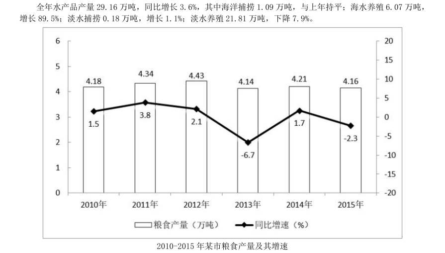

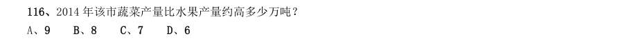

- **A.** 9
- **B.** 8
- **C.** 7
- **D.** 6

**答案：A**　**考点：增长率计算与比较｜增长率比较**　**难度：★★☆☆☆**
**【资料分析·综合分析｜GK-2017-fs-X117】**

117. “十二五”期间,该市粮食总产量在以下哪个范围?

> 材料图见 images/GK-2017-fs-X116-m.jpg

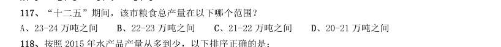

- **A.** 23-24 万吨之间
- **B.** 22-23 万吨之间
- **C.** 21-22 万吨之间
- **D.** 20-21 万吨之间

**答案：C**　**考点：综合分析｜选正确项**　**难度：★★★★☆**
**【资料分析·综合分析｜GK-2017-fs-X118】**

118. 按照2015 年水产品产量从多到少,以下排序正确的是:

> 材料图见 images/GK-2017-fs-X116-m.jpg

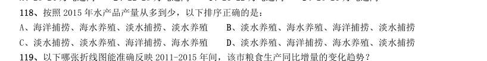

- **A.** 海洋捕捞、海水养殖、淡水捕捞、淡水养殖
- **B.** 淡水养殖、海水养殖、海洋捕捞、淡水捕捞
- **C.** 淡水捕捞、淡水养殖、海洋捕捞、海水养殖
- **D.** 淡水养殖、海洋捕捞、海水养殖、淡水捕捞

**答案：B**　**考点：综合分析｜排序与图示判断**　**难度：★★★★☆**
**【资料分析·增长量计算｜GK-2017-fs-X119】**

119. 以下哪张折线图能准确反映2011-2015 年间,该市粮食生产同比增量的变化趋势?

> 材料图见 images/GK-2017-fs-X116-m.jpg

> （本题为图形题，选项为图片，见原卷）

**答案：A**　**考点：增长量计算｜增长量计算（415 份数法）**　**难度：★☆☆☆☆**
**【资料分析·综合分析｜GK-2017-fs-X120】**

120. 能够从上述资料中推出的是:

> 材料图见 images/GK-2017-fs-X116-m.jpg

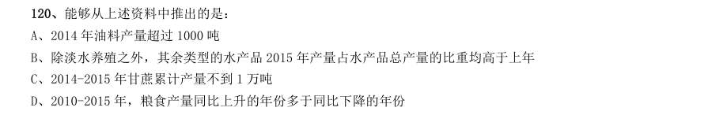

- **A.** 2014 年油料产量超过1000 吨
- **B.** 除淡水养殖之外,其余类型的水产品2015 年产量占水产品总产量的比重均高于上年
- **C.** 2014-2015 年甘蔗累计产量不到1 万吨
- **D.** 2010-2015 年,粮食产量同比上升的年份多于同比下降的年份

**答案：A**　**考点：综合分析｜选错误项**　**难度：★★★★★**
**【资料分析·增长率计算与比较｜GK-2017-fs-X121】**
> 材料：截至2014 年末,我国共有博物馆3658 个,占文物机构总数的43.5%。全国文化机构拥有文物藏品4063.58 万件,比上年末增加222.77 万件。其中,博物馆文物藏品2929.97 万件,文物商店文物藏品770.00 万件。文物 藏品中,一级文物9.82 万件,二级文物68.82 万件,三级文物340.51 万件。

121. 2014 年全国文物机构共安排基本陈列9996 个,比上年增长19.1%;举办临时展览11174 个,增长15.8%; 接待观众84256 万人次,增长12.8%,其中博物馆接待观众71774 万人次,占文物机构接待观众总人次的85.2%。 2014 年,我国文物机构相关指标同比增速最快的是:

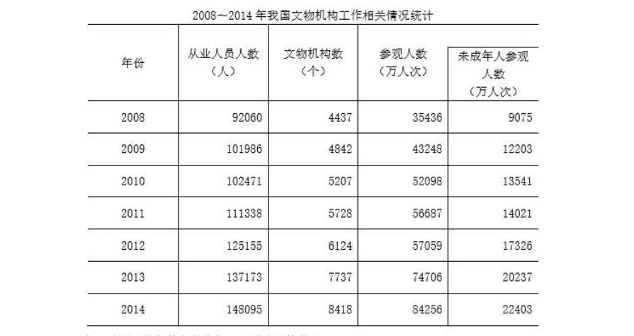

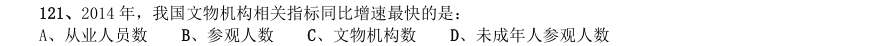

- **A.** 从业人员数
- **B.** 参观人数
- **C.** 文物机构数
- **D.** 未成年人参观人数

**答案：B**　**考点：增长率计算与比较｜增长率比较**　**难度：★★★☆☆**
**【资料分析·比重计算与比较｜GK-2017-fs-X122】**

122. 2014 年末,我国一、二、三级文物总量占全部文物藏品的比重最接近以下哪个数字?

> 材料图见 images/GK-2017-fs-X121-m.jpg

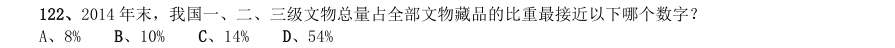

- **A.** 8%
- **B.** 10%
- **C.** 14%
- **D.** 54%

**答案：B**　**考点：比重计算与比较｜现期比重**　**难度：★☆☆☆☆**
**【资料分析·平均数计算｜GK-2017-fs-X123】**

123. 2014 年,平均每家博物馆接待观众人次数约是其他文物机构的多少倍?

> 材料图见 images/GK-2017-fs-X121-m.jpg

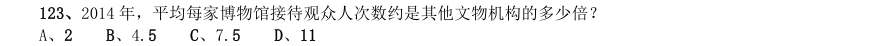

- **A.** 2
- **B.** 4.5
- **C.** 7.5
- **D.** 11

**答案：C**　**考点：平均数计算｜现期平均数**　**难度：★☆☆☆☆**
**【资料分析·比重计算与比较｜GK-2017-fs-X124】**

124. 2008~2014 年间,文物机构参观者中未成年人占比超过三成的年份有几个?

> 材料图见 images/GK-2017-fs-X121-m.jpg

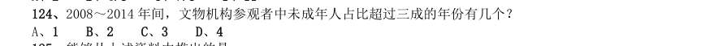

- **A.** 1
- **B.** 2
- **C.** 3
- **D.** 4

**答案：A**　**考点：比重计算与比较｜现期比重**　**难度：★☆☆☆☆**
**【资料分析·综合分析｜GK-2017-fs-X125】**

125. 能够从上述资料中推出的是:

> 材料图见 images/GK-2017-fs-X121-m.jpg

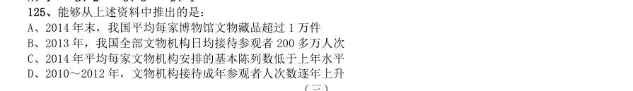

- **A.** 2014 年末,我国平均每家博物馆文物藏品超过1 万件
- **B.** 2013 年,我国全部文物机构日均接待参观者200 多万人次
- **C.** 2014 年平均每家文物机构安排的基本陈列数低于上年水平
- **D.** 2010~2012 年,文物机构接待成年参观者人次数逐年上升

**答案：A**　**考点：综合分析｜选错误项**　**难度：★★★★★**
**【资料分析·比重计算与比较｜GK-2017-fs-X126】**
> 材料：2015 年我国钟表全行业实现工业总产值约675 亿元,同比增长3.2%,增速比上年同期提高1.7 个百分点。 全行业全年生产手表10.7 亿只,同比增长3.9%,完成产值约417 亿元,同比增长4.3%,增速提高1.9 个 百分点;生产时钟(含钟心)5.2 亿只,同比下降3.7%,完成产值162 亿元,同比下降4.7%,降幅扩大1.3 个百分点;钟表零配件、定时器及其他计时仪器产值96 亿元,同比增长14.3%,增速基本保持上年水平。 2015 年我国钟表行业规模以上工业企业主营业务收入365.8 亿元,同比增长8.7%;实现利润23.4 亿元, 与上年相比下降1.5%,而2015 年轻工行业主营业务利润率(利润/主营业务收入)的平均水平为7.57%。

126. 2015 年我国钟表行业海关进出口总额为92.5 亿美元,同比增长4%,完成出口总额为57.7 亿美元,同比增 长8.3%,进口额34.8 亿美元。出口总额中加工贸易额占47%,较上年缩小2 个百分点。 2015 年我国钟表全行业生产时钟(含钟心)的产值与2013 年相比约:

> 材料图见 images/GK-2017-fs-X121-m.jpg

- **A.** 上升了11%
- **B.** 下降了11%
- **C.** 上升了8%
- **D.** 下降了8%

**答案：D**　**考点：比重计算与比较｜两期比重差**　**难度：★★★☆☆**
**【资料分析·平均数计算｜GK-2017-fs-X127】**

127. 2015 年钟表全行业平均每制造一只手表,能实现约多少元的产值?

> 材料图见 images/GK-2017-fs-X121-m.jpg

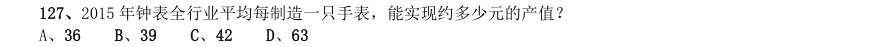

- **A.** 36
- **B.** 39
- **C.** 42
- **D.** 63

**答案：B**　**考点：平均数计算｜现期平均数**　**难度：★☆☆☆☆**
**【资料分析·平均数计算｜GK-2017-fs-X128】**

128. 2015 年我国钟表行业规模以上工业企业主营业务利润率比轻工行业平均水平:

> 材料图见 images/GK-2017-fs-X121-m.jpg

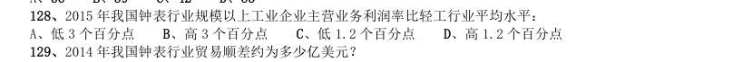

- **A.** 低3 个百分点
- **B.** 高3 个百分点
- **C.** 低1.2 个百分点
- **D.** 高1.2 个百分点

**答案：C**　**考点：平均数计算｜现期平均数**　**难度：★☆☆☆☆**
**【资料分析·综合分析｜GK-2017-fs-X129】**

129. 2014 年我国钟表行业贸易顺差约为多少亿美元?

> 材料图见 images/GK-2017-fs-X121-m.jpg

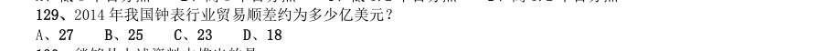

- **A.** 27
- **B.** 25
- **C.** 23
- **D.** 18

**答案：D**　**考点：综合分析｜选正确项**　**难度：★★★★☆**
**【资料分析·综合分析｜GK-2017-fs-X130】**

130. 能够从上述资料中推出的是:

> 材料图见 images/GK-2017-fs-X121-m.jpg

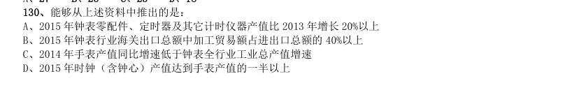

- **A.** 2015 年钟表零配件、定时器及其它计时仪器产值比2013 年增长20%以上
- **B.** 2015 年钟表行业海关出口总额中加工贸易额占进出口总额的40%以上
- **C.** 2014 年手表产值同比增速低于钟表全行业工业总产值增速
- **D.** 2015 年时钟(含钟心)产值达到手表产值的一半以上

**答案：A**　**考点：综合分析｜选错误项**　**难度：★★★★★**
**【资料分析·增长率计算与比较｜GK-2017-fs-X131】**

131. 中国新能源汽车产业各类技术专利申请情况表 单位:件 年份 整车制造 电动机制造 储能装置制 造 零部件 配件制造 传能装置制 造 表中新能源汽车产业零部件配件制造技术专利申请数增速最快的年份为:

> 材料图见 images/GK-2017-fs-X121-m.jpg

- **A.** 2005 年
- **B.** 2002 年
- **C.** 2014 年
- **D.** 2010 年

**答案：A**　**考点：增长率计算与比较｜增长率比较**　**难度：★★☆☆☆**
**【资料分析·倍数计算｜GK-2017-fs-X132】**

132. “十二五”期间整车制造专利申请总数约是“十五”期间总数的多少倍?

> 材料图见 images/GK-2017-fs-X121-m.jpg

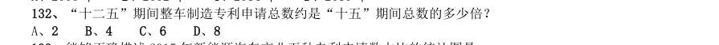

- **A.** 2
- **B.** 4
- **C.** 6
- **D.** 8

**答案：C**　**考点：倍数计算｜是几倍**　**难度：★☆☆☆☆**
**【资料分析·比重计算与比较｜GK-2017-fs-X133】**

133. 能够正确描述2015 年新能源汽车产业五种专利申请数占比的统计图是:

> 材料图见 images/GK-2017-fs-X121-m.jpg

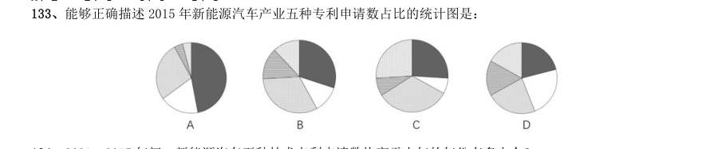

> （本题为图形题，选项为图片，见原卷）

**答案：B**　**考点：比重计算与比较｜现期比重**　**难度：★☆☆☆☆**
**【资料分析·基期量计算｜GK-2017-fs-X134】**

134. 2001~2015 年间,新能源汽车五种技术专利申请数均高于上年的年份有多少个?

> 材料图见 images/GK-2017-fs-X121-m.jpg

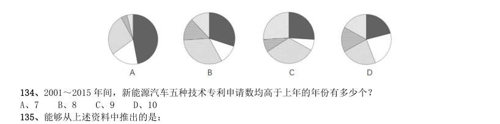

- **A.** 7
- **B.** 8
- **C.** 9
- **D.** 10

**答案：B**　**考点：基期量计算｜基期量计算（综合）**　**难度：★☆☆☆☆**
**【资料分析·综合分析｜GK-2017-fs-X135】**

135. 能够从上述资料中推出的是:

> 材料图见 images/GK-2017-fs-X121-m.jpg

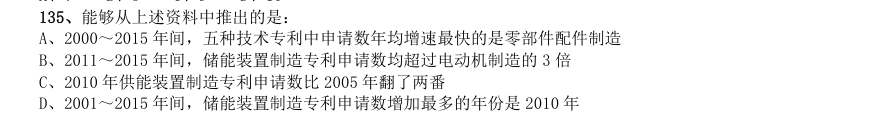

- **A.** 2000~2015 年间,五种技术专利中申请数年均增速最快的是零部件配件制造
- **B.** 2011~2015 年间,储能装置制造专利申请数均超过电动机制造的3 倍
- **C.** 2010 年供能装置制造专利申请数比2005 年翻了两番
- **D.** 2001~2015 年间,储能装置制造专利申请数增加最多的年份是2010 年

**答案：A**　**考点：综合分析｜选错误项**　**难度：★★★★★**