# 2018 国考（副省级）·行测

- 题量：135（含答案 133）
- 考试类型：国考
- 模块分布：资料分析20 / 数量关系15 / 言语理解40 / 判断推理40 / 常识判断20
- 试卷编号：`国考-2018-副省级`

## 题目与答案

**【2018 国考（副省级）·第 1 题】常识判断·法律常识｜GK-2018-fs-X001**

1. 我国宪法对非公有制经济的规定进行了几次修改,按时间先后排序正确的是: 1允许发展私营经济,采取“引导、监督、管理”的方针 2在法律规定范围内的个体经济、私营经济等非公有制经济,是社会主义市场经济的重要组成部分 3鼓励、支持和引导非公有制经济的发展,并对非公有制经济依法实行监督和管理 4非公有制经济仅限于个体经济,不包括私营经济,且个体经济处于补充地位

- **A.** 1243
- **B.** 1324
- **C.** 4132
- **D.** 4123

**答案：D**　**考点：法律常识｜宪法**　**难度：★★★★★**
**【2018 国考（副省级）·第 2 题】常识判断·生活常识｜GK-2018-fs-X002**

2. 关于2015 年中央军委改革工作会议召开以来进行的改革,下列说法错误的是:

- **A.** 全面停止军队有偿服务活动
- **B.** 组建中央军委联勤保障部队
- **C.** 军委机关由多部门制改为总部制
- **D.** 成立陆军领导机构和战略支援部队

**答案：C**　**考点：生活常识｜时政热点**　**难度：★★☆☆☆**
**【2018 国考（副省级）·第 3 题】常识判断·生活常识｜GK-2018-fs-X003**

3. 下列关于“三农”问题的说法错误的是:

- **A.** 民政部门是农民专业合作社登记机关
- **B.** 征地补偿费的使用、分配方案,经村民会议讨论决定方可办理
- **C.** 深入推进农业供给侧结构性改革是当前和今后一个时期农业农村工作的主线
- **D.** 村民委员会作出的决定侵害村民合法权益的,受侵害的村民可以申请人民法院予以撤销

**答案：A**　**考点：生活常识｜法律常识**　**难度：★★★★☆**
**【2018 国考（副省级）·第 4 题】常识判断·生活常识｜GK-2018-fs-X004**

4. 关于我国自主研发的新成果,下列说法错误的是:

- **A.** 在世界上首次实现卫星与地面之间的量子通信
- **B.** 实现总装下线的“蛟龙一600”属于水陆两栖飞机
- **C.** 已成功下潜的“潜龙二号”是有缆遥控水下机器人D、超级计算机“神威•太湖之光”的运算速度居世界第一

**答案：C**　**考点：生活常识｜科技常识**　**难度：★★★★☆**
**【2018 国考（副省级）·第 5 题】常识判断·法律常识｜GK-2018-fs-X005**

5. 下列说法符合我国著作权法规定的是:

- **A.** 中国公民未发表的作品不享有著作权
- **B.** 外国人的作品首先在中国境内出版的,享有著作权
- **C.** 美术作品出版后,该美术作品原件的展览权归出版人享有
- **D.** 合作作品的著作权保护期截止于最早死亡的作者死亡后第五十年

**答案：B**　**考点：法律常识｜法律常识（待细分）**　**难度：★★☆☆☆**
**【2018 国考（副省级）·第 6 题】常识判断·地理常识｜GK-2018-fs-X006**

6. 关于2017 年新调整的海洋伏季休渔制度,下列说法错误的是:

- **A.** 各类作业方式休渔时间均有所延长
- **B.** 首次将南海的单层刺网纳入休渔范围
- **C.** 统一了所有海域的休渔结束时间
- **D.** 首次要求为捕捞渔船配套服务的捕捞辅助船同步休渔

**答案：C**　**考点：地理常识｜世界地理**　**难度：★★☆☆☆**
**【2018 国考（副省级）·第 7 题】常识判断·生活常识｜GK-2018-fs-X007**

7. 甲国与乙国因领土纠纷发生争端,下列说法不符合国际法相关规定的是:

- **A.** 甲乙两国可以派出外交使节进行谈判,这是解决争端最直接的方法
- **B.** 甲乙两国可以约定将争端交付仲裁机构处理,但仲裁裁决不具有法律制裁性质
- **C.** 丙国可以调停者的身份参加两国的谈判,但其提出的解决方案对甲乙两国没有约束力
- **D.** 甲乙两国可用请求书方式将争端提交国际法院,国际法院作出的判决交由联合国强制执行

**答案：B**　**考点：生活常识｜法律常识**　**难度：★★★★☆**
**【2018 国考（副省级）·第 8 题】常识判断·经济常识｜GK-2018-fs-X008**

8. 下列金融机构与其可以从事的金融业务对应正确的是:

- **A.** 商业银行——股票承销业务
- **B.** 人寿保险公司——医疗责任保险业务
- **C.** 小额贷款公司——城乡居民储蓄存款业务
- **D.** 中国出口信用保险公司——海外投资保险业务

**答案：D**　**考点：经济常识｜宏观经济**　**难度：★★☆☆☆**
**【2018 国考（副省级）·第 9 题】常识判断·历史人文｜GK-2018-fs-X009**

9. 下面是对我国一份近代历史文献的描述:是一份改革内政和建设国家的新方案;是发展资本主义的近代化纲 领;因脱离当时社会现实而未能实施。 这份文献可能是:

- **A.** 《海国图志》
- **B.** 《资政新篇》
- **C.** 《天朝田亩制度》
- **D.** 《中华民国临时约法》

**答案：B**　**考点：历史人文｜中国古代史**　**难度：★★★☆☆**
**【2018 国考（副省级）·第 10 题】常识判断·历史人文｜GK-2018-fs-X010**

10. 下列研究课题与其查阅的主要参考文献对应错误的是:

- **A.** 商周时代的艺术成就——《中国青铜时代》
- **B.** 南宋都城的城市建设——《从平城到洛阳》
- **C.** 晚清的政治改良运动——《从甲午到戊戌》
- **D.** 明末中西文化交流史——《利玛窦与中国》

**答案：B**　**考点：历史人文｜中国古代史**　**难度：★★☆☆☆**
**【2018 国考（副省级）·第 11 题】常识判断·历史人文｜GK-2018-fs-X011**

11. 某高校学生会干事小王负责策划一个民族文化展示周活动,下列哪个设计方案不合适?

- **A.** 请维吾尔族学生表演手鼓舞
- **B.** 请蒙古族学生制作奶茶
- **C.** 请朝鲜族学生展示唐卡
- **D.** 请彝族学生展示花腰刺绣

**答案：C**　**考点：历史人文｜中国古代史**　**难度：★★☆☆☆**
**【2018 国考（副省级）·第 12 题】常识判断·生活常识｜GK-2018-fs-X012**

12. 美国社会学家帕森斯认为:在公元前的第一个千年之内,“哲学的突破”以截然不同的方式分别发生在希腊、 以色列、印度和中国等地。下列思想观点产生于这一时代的是:

- **A.** 致虚守静,道法自然
- **B.** 心外无物,心外无理
- **C.** 人民为主,工商皆本
- **D.** 师夷长技,中体西用

**答案：A**　**考点：生活常识｜历史人文**　**难度：★★★☆☆**
**【2018 国考（副省级）·第 13 题】常识判断·历史人文｜GK-2018-fs-X013**

13. 下列诗句所描述情景出现的时间与图中标示的时间段,对应正确的是:

- **A.** 今夜月明人尽望,不知秋思落谁家——41之间
- **B.** 接天莲叶无穷碧,映日荷花别样红——23之间
- **C.** 天街小雨润如酥,草色遥看近却无——12之间
- **D.** 半盏屠苏犹未举,灯前小草写桃符——34之间

**答案：D**　**考点：历史人文｜文学与文化**　**难度：★★☆☆☆**
**【2018 国考（副省级）·第 14 题】常识判断·地理常识｜GK-2018-fs-X014**

14. 下列哪一现象与季风气候不存在因果关系?

- **A.** 塔里木河在夏季进入汛期
- **B.** 华北地区在初春频发寒潮
- **C.** 我国东北的工业区一般建在城市的东北或西南
- **D.** 夏季长江入海口附近海域的盐度比其他季节低

**答案：A**　**考点：地理常识｜中国地理**　**难度：★★☆☆☆**
**【2018 国考（副省级）·第 15 题】常识判断·地理常识｜GK-2018-fs-X015**

15. 关于下列地区的说法错误的是:

- **A.** 欧洲北海:既是著名产油区,又是著名渔场
- **B.** 波斯湾地区:既是著名产油区,又是古文明发祥地
- **C.** 湄公河流域:既是小麦主产区,又是佛教圣地
- **D.** 五大湖区:既有世界上面积最大的淡水湖,又跨美加两国边境线

**答案：C**　**考点：地理常识｜中国地理**　**难度：★★☆☆☆**
**【2018 国考（副省级）·第 16 题】常识判断·科技常识｜GK-2018-fs-X016**

16. 假如地球重力加速度减为现在的一半,下列数值不会发生变化的是:

- **A.** 鱼在相同水深下受到的压强
- **B.** 船在水中的吃水深度
- **C.** 人在体重计上的称量结果
- **D.** 人可以举起的石块的最大质量

**答案：B**　**考点：科技常识｜科技常识（待细分）**　**难度：★★☆☆☆**
**【2018 国考（副省级）·第 17 题】常识判断·地理常识｜GK-2018-fs-X017**

17. 9 月底,小李开启了欧洲之旅。他先参加了一场盛大的啤酒节,随后参观了海德公园并瞻仰了马克思墓,最 后参观了欧盟总部。问小李依次游历了哪几座城市?

- **A.** 慕尼黑、伦敦、布鲁塞尔
- **B.** 米兰、柏林、阿姆斯特丹
- **D.** 巴黎、汉堡、布鲁塞尔

**答案：A**　**考点：地理常识｜世界地理**　**难度：★★★☆☆**
**【2018 国考（副省级）·第 18 题】常识判断·生活常识｜GK-2018-fs-X018**

18. 下列与果树有关的说法正确的是:

- **A.** 富含氮的肥料可促进果树开花结果
- **B.** 杏树是耐旱能力比较弱的树种
- **C.** 冬季不需要对果树进行病虫防治
- **D.** 嫁接是一种常用的果树繁殖方式

**答案：D**　**考点：生活常识｜科技常识**　**难度：★★☆☆☆**
**【2018 国考（副省级）·第 19 题】常识判断·生活常识｜GK-2018-fs-X019**

19. 关于北斗七星,下列说法正确的是:

- **A.** 北斗七星的相对位置始终不变
- **B.** 北斗七星是七颗亮度相等的恒星
- **C.** 北斗七星中的开阳星与其辅星构成双星
- **D.** 古代“斗牛”中的“斗”指北斗七星

**答案：C**　**考点：生活常识｜科技常识**　**难度：★★☆☆☆**
**【2018 国考（副省级）·第 20 题】常识判断·生活常识｜GK-2018-fs-X020**

20. 下列关于蛋白质的说法错误的是:

- **A.** 蛋白质是鸟类羽毛的构成成分
- **B.** 蛋白质缺乏会导致儿童发育迟缓
- **C.** 蛋白质摄入过量会在人体内转化为脂肪
- **D.** 植物蛋白比动物蛋白更易被人类消化吸收

**答案：D**　**考点：生活常识｜科技常识**　**难度：★★☆☆☆**
**【2018 国考（副省级）·第 21 题】言语理解·逻辑填空｜GK-2018-fs-X021**
> 材料：答案。

21. 如今,一批70 后、80 后甚至更年轻的年画传承人涌现出来。这些年轻人开始有了清醒的文化自觉,对中华 传统文化怀有浓厚的兴趣,怀着敬畏之心钻研,并不 ,急于进入市场大潮,冯骥才称他们为“年画的新 力量”。 填入画横线部分最恰当的一项是:

- **A.** 随波逐流
- **B.** 沽名钓誉
- **C.** 好高骛远
- **D.** 人云亦云

**答案：A**　**考点：逻辑填空｜成语辨析**　**难度：★★☆☆☆**
**【2018 国考（副省级）·第 22 题】言语理解·逻辑填空｜GK-2018-fs-X022**

22. 情绪并不是独立存在的,它常常伴随着信息而传播。作为一种态度,情绪不仅能够 人们对所 传播信息的认知,还会在一定程度上指导人们的行为。积极的情绪会促进人们积极地认识世界,消极的情绪则可 能给他人甚至整个社会带来破坏性后果。人在情绪失控时,很容易不顾后果地做出 的举动。 依次填入画横线部分最恰当的一项是:

- **A.** 影响危险
- **B.** 左右出格
- **C.** 干扰反常
- **D.** 支配冲动

**答案：该题答案缺失，见原卷**　**考点：逻辑填空｜语境分析**　**难度：★★★☆☆**
**【2018 国考（副省级）·第 23 题】言语理解·逻辑填空｜GK-2018-fs-X023**

23. 在联合国教科文组织通过的《文化多样性宣言》和《保护非物质文化遗产公约》里,文化的多样性都被比喻 成生物的多样性。因为人类的文化创造和遗存就像人类的基因,包含了过去世代累积的信息和发展的可能性。有 些看似 的东西,今天不知道它有什么重要性,但以后可能会影响到人类的发展。 填入画横线部分最恰当的一项是:

- **A.** 司空见惯
- **B.** 转瞬即逝
- **C.** 微不足道
- **D.** 一成不变

**答案：C**　**考点：逻辑填空｜成语辨析**　**难度：★★★☆☆**
**【2018 国考（副省级）·第 24 题】言语理解·逻辑填空｜GK-2018-fs-X024**

24. 历史认识的局限性成就了历史研究的魅力。历史认识有局限性,才需要人们不断拷问、修正和创新。如果研 究者因此而敬畏研究对象,兢兢业业, ,这正是历史研究的幸事。反之,如果把历史认识的局限性作为规 避责任的遁词和主观臆断的托词,人们就会愈发相信历史毫无 可言。 依次填入画横线部分最恰当的一项是:

- **A.** 身体力行科学性
- **B.** 恪尽职守公平性
- **C.** 如履薄冰客观性
- **D.** 谨言慎行系统性

**答案：C**　**考点：逻辑填空｜语境分析**　**难度：★★★☆☆**
**【2018 国考（副省级）·第 25 题】言语理解·逻辑填空｜GK-2018-fs-X025**

25. 射电天文学的进步把人们的视线引向了宇宙遥远的边缘,那里 了更多有关宇宙起源和演化的关键线索。 天文学家都渴望拥有威力更加强大的射电望远镜,谁拥有了这种望远镜,谁就更有可能站立在现代物理学和天文 学的潮头, ,成为破解宇宙之谜的领军力量。 依次填入画横线部分最恰当的一项是:

- **A.** 暗藏胜券在握
- **B.** 隐藏捷足先登
- **C.** 埋藏首当其冲
- **D.** 潜藏独占鳌头

**答案：该题答案缺失，见原卷**　**考点：逻辑填空｜成语辨析**　**难度：★★☆☆☆**
**【2018 国考（副省级）·第 26 题】言语理解·逻辑填空｜GK-2018-fs-X026**

26. 黄河三角洲是中国大河三角洲中海陆变迁最 的地区,特别是黄河口地区造陆速率之快、尾闾 迁徙之频繁,更为世界罕见。黄河三角洲的 受黄河水沙条件和海洋动力作用的制约,黄河来沙使 海岸堆积向海洋推进,海洋动力作用又使海岸侵蚀向陆地推进。 依次填入画横线部分最恰当的一项是:

- **A.** 壮观形成
- **B.** 复杂形态
- **C.** 剧烈演化
- **D.** 活跃演变

**答案：D**　**考点：逻辑填空｜语境分析**　**难度：★★☆☆☆**
**【2018 国考（副省级）·第 27 题】言语理解·逻辑填空｜GK-2018-fs-X027**

27. 中俄计划携手建设从莫斯科出发,穿越哈萨克斯坦通往北京的欧亚高速运输走廊。新铁路的兴建可能要耗时 八至十年。从工程的规模及价值来看,它堪与苏伊士运河 。后者大幅缩短了通航里程及时间,迅速对全 球贸易产生了 的影响。 依次填入画横线部分最恰当的一项是:

- **A.** 比肩不可估量
- **B.** 媲美旷日持久
- **C.** 争雄超乎预期
- **D.** 匹敌源源不断

**答案：A**　**考点：逻辑填空｜语境分析**　**难度：★★☆☆☆**
**【2018 国考（副省级）·第 28 题】言语理解·逻辑填空｜GK-2018-fs-X028**

28. 就文学创作而言,人工智能未来有可能在编剧或网络文学方面有所 ,毕竟除了一小部分杰出的作品外, 无论剧本创作还是网络文学,都比较依赖标准化的情节与词语搭配。而文学作品的 程度越高,越有可能人 工智能化。 依次填入画横线部分最恰当的一项是:

- **A.** 建树程式化
- **B.** 发展通俗化
- **C.** 贡献规范化
- **D.** 突破模式化

**答案：D**　**考点：逻辑填空｜实词辨析**　**难度：★★☆☆☆**
**【2018 国考（副省级）·第 29 题】言语理解·逻辑填空｜GK-2018-fs-X029**

29. 早在上世纪70 年代末,钱学森就曾多次提出:国防科技的发展不能 于“追尾巴”“照镜子”,而 是要 地开拓新领域和新方向。比如英国人针对重机枪机动性差的弱点,发明了坦克,一举撕裂了枪炮林 立的僵持局面。这类非对称式的发展思路有助于打破先进国家的技术垄断,形成后发优势。 依次填入画横线部分最恰当的一项是:

- **A.** 拘泥与众不同
- **B.** 满足独辟蹊径
- **C.** 沉迷标新立异
- **D.** 止步别具匠心

**答案：B**　**考点：逻辑填空｜语境分析**　**难度：★★★☆☆**
**【2018 国考（副省级）·第 30 题】言语理解·逻辑填空｜GK-2018-fs-X030**

30. 大国兴衰构成了世界历史的重要篇章,许多学者和政治家 探寻其中的逻辑线索,产生了许多著述宏 论。然而,对大国兴衰的原因难有最终答案,这不仅在于问题本身的 ,更是因为世界在变化,不同国 家兴衰的轨迹不可能简单重复。因此,对这一问题的探讨永远不会 。 依次填入画横线部分最恰当的一项是:

- **A.** 殚精竭虑阶段性终结
- **B.** 废寝忘食多样性沉寂
- **C.** 呕心沥血复杂性过时
- **D.** 兢兢业业模糊性停止

**答案：C**　**考点：逻辑填空｜语境分析**　**难度：★★★☆☆**
**【2018 国考（副省级）·第 31 题】言语理解·逻辑填空｜GK-2018-fs-X031**

31. 一些人对传统文化的理解存在误区,认为凡是老祖宗传下来的文化遗产,就不能有丝毫的改变,必须在当 代 地得到传承。这种认识或许有助于 传统文化的经典性,但这也决定了传统文化只能被小众欣赏。 这名为保护传统,实则 了传统与现实,终将使得传统文化被历史尘埃所湮没。 依次填入画横线部分最恰当的一项是:

- **A.** 一板一眼凸显混淆
- **B.** 原汁原味维护模糊
- **C.** 原封不动保持割裂
- **D.** 一字不差发扬阻断

**答案：C**　**考点：逻辑填空｜语境分析**　**难度：★★★☆☆**
**【2018 国考（副省级）·第 32 题】言语理解·逻辑填空｜GK-2018-fs-X032**

32. 近年来,西方观众对中国功夫片的套路、动作、术语等已颇为熟悉,中国功夫的神秘感、陌生感在他们眼中 逐渐 ,所以中国功夫片要体现作品的 ,很有难度。当下国产功夫电影在制作和传播方面并 非 ,收获的口碑和奖杯都很难超越传统功夫片。 依次填入画横线部分最恰当的一项是:

- **A.** 淡化独特性高枕无忧
- **B.** 消失差异性一帆风顺
- **C.** 褪去艺术性无懈可击
- **D.** 消逝创新性尽善尽美

**答案：B**　**考点：逻辑填空｜语境分析**　**难度：★★☆☆☆**
**【2018 国考（副省级）·第 33 题】言语理解·逻辑填空｜GK-2018-fs-X033**

33. 一方面,受世界经济 影响,大宗资源产品价格走低,资源型企业纷纷陷入困境,资源型城市财政收 入也急剧下降,无力增加投入;另一方面,随着经济发展进入新常态,大规模经济刺激已经 ,来自中央政 府的强力支持相应减弱,资源型城市债务扩张趋于收紧。资源型城市转型面临的资金约束日益 。 依次填入画横线部分最恰当的一项是:

- **A.** 下行失效紧张
- **B.** 萎缩放缓强化
- **C.** 低迷弱化严重
- **D.** 恶化减退明显

**答案：C**　**考点：逻辑填空｜语境分析**　**难度：★★★☆☆**
**【2018 国考（副省级）·第 34 题】言语理解·逻辑填空｜GK-2018-fs-X034**

34. 漆画有其他画种达不到的效果,同时也有它的 。它不能像油画、水粉画那样自由地运用冷暖色彩, 不能像素描那样丰富地运用明暗层次,不善于逼真地、 地再现对象。事实上,在似与不似之间表现对象, 才是漆画最 的地方。 依次填入画横线部分最恰当的一项是:

- **A.** 问题出神入化出色
- **B.** 短板惟妙惟肖难得
- **C.** 缺陷面面俱到独到
- **D.** 局限栩栩如生擅长

**答案：D**　**考点：逻辑填空｜语境分析**　**难度：★★☆☆☆**
**【2018 国考（副省级）·第 35 题】言语理解·逻辑填空｜GK-2018-fs-X035**

35. 在执行任务期间,“反潜持续追踪无人艇”一旦发现目标的 ,就会使用声纳系统对目标进行 定 位并跟踪,同时借助传感器技术进行信息 。逼近目标时,无人艇会通过声学图像,确定目标潜艇的型号等 信息,再将数据传输到反潜指挥中心,由中心指派就近的反潜平台赶往目标海域,摧毁敌艇。 依次填入画横线部分最恰当的一项是:

- **A.** 踪迹精确搜集
- **B.** 意图精准汇总
- **C.** 动向主动筛选
- **D.** 线索自动匹配

**答案：A**　**考点：逻辑填空｜语境分析**　**难度：★★★☆☆**
**【2018 国考（副省级）·第 36 题】言语理解·中心理解｜GK-2018-fs-X036**

36. 南京在历史上的名字变化或褒或贬,根本源头在于统治者的好恶。不惟南京,同样原因也引发了其他地名的 变迁,宋廷平定方腊起义之后,深恨江南百姓造反,艺术修养最高的皇帝宋徽宗遂在地名上做文章:方腊的两个 活动区域,歙州被改成徽州,取的是“徽”的本意“捆绑束缚”;睦州则被改成严州,意思更是不言自明的。相 比之下,朱元璋为避国号讳,取“海定则波宁”之义,将明州改成宁波,已是很“友好”了。 这段文字主要介绍了:

- **A.** 地名变迁背后的政治因素
- **B.** 历史事件对地名的影响
- **C.** 古代帝王在地名方面的偏好
- **D.** 统治者对某些地域的好恶

**答案：A**　**考点：中心理解｜中心句与主旨**　**难度：★★★★☆**
**【2018 国考（副省级）·第 37 题】言语理解·中心理解｜GK-2018-fs-X037**

37. 虽然中国的救灾能力在经历过多次大型自然灾害后有了较大的提升,但是防灾教育依然落后。中国扶贫基金 会2015 年对中国公众的防灾意识进行了调查,结果显示,仅有24.3%的城市居民表示关注灾害应对的相关知识, 这一数据在农村仅为11%。此外,只有不到4%的城市居民在日常生活中做了基本的防灾准备,超过半数的农村居 民从未参加过任何防灾培训。形同虚设的防灾教育无法提高民众的自救能力,等到灾难发生后才开始组织学习, 逝去的生命已经无法挽回。 这段文字意在说明:

- **A.** 防灾教育比救灾更重要
- **B.** 中国的防灾教育亟待加强
- **C.** 防灾教育是提高自救能力的基础
- **D.** 城市与农村在防灾教育上严重失衡

**答案：B**　**考点：中心理解｜转折与因果**　**难度：★★★★★**
**【2018 国考（副省级）·第 38 题】言语理解·下文推断｜GK-2018-fs-X038**

38. 食品行业是关系人民群众切身需求与经济社会和谐稳定的民生行业。但目前来看,我国食品供给体系总体呈 现出中低端产品过剩、中高端和个性化产品供给严重不足的问题,消费者对国外产品的依赖程度越来越高。特别 在当前速度换挡、结构调整、动力转换的经济新常态下,深入推进食品行业供给侧改革,是实现食品行业健康、 长远发展的必然选择。食品标准既是国家食品安全治理体系中的重要组成部分,又是引导食品生产质量的主要风 向标,因此,深化食品行业供给侧结构性改革的关键在于构建一套先进的食品行业标准。 这段文字接下来最可能讲的是:

- **A.** 目前国内食品行业存在的主要问题
- **B.** 国外构建食品行业标准的经验教训
- **C.** 构建食品行业标准要重点关注的问题
- **D.** 深化食品行业供给侧改革的具体措施

**答案：C**　**考点：下文推断｜下文推断**　**难度：★★★★★**
**【2018 国考（副省级）·第 39 题】言语理解·中心理解｜GK-2018-fs-X039**

39. 民族的文化传统和历史的文化信息被大量地记载于历史经典文献中。除了经典文献,还有各种各样的历史文 物,作为历史文化的载体被代代相传地保存下来。传统村落就是这样一个历史文化载体,相对于经典文献和文物, 它所承载的有关中华民族文化的历史信息更具鲜活性,是中华民族文明发展史的“实证”。它比文字、文物更能 真实地反映中华民族不同地域、不同族群的生产生活方式、道德伦理观念以及民族习俗风情。因此,我们有充分 的理由重视传统村落,保护传统村落。 这段文字意在强调:

- **A.** 保护传统村落对保护民族历史文化有着重要意义
- **B.** 应采取多种方式和途径传承、保护民族历史文化
- **C.** 传统村落是中华历史文化的重要载体和现实体现
- **D.** 传统村落文化较之经典文献更能鲜活地展现历史

**答案：A**　**考点：中心理解｜转折与因果**　**难度：★★★★★**
**【2018 国考（副省级）·第 40 题】言语理解·中心理解｜GK-2018-fs-X040**

40. 新工业革命浪潮中,很多制造业大国都在押注智能制造。中国既是制造大国,也是使用大国,如果数据是工 业4.0 时代创造价值的原材料,那中国无疑是资源最多的国家。但数据并不会直接创造价值,就像是现金流而非 固定资产决定一个企业的兴衰一样。真正为企业带来价值的是数据流,是数据经过实时分析后及时地流向决策链 的各个环节,成为面向用户、创造价值与服务的内容和依据。虽然德国是工业4.0 的发起者,但作为控制器、物 联网技术和生产设备的提供者,德国只是基础技术的供应商,直接面向客户的价值创造端却是中国。 这段文字意在强调:

- **A.** 我国在新工业革命浪潮中面临新的机遇
- **B.** 我国应当充分挖掘数据资源的潜在价值
- **C.** 数据资源拥有者在智能制造方面更具优势
- **D.** 数据流是企业在工业4.0 时代领先的关键

**答案：B**　**考点：中心理解｜中心句与主旨**　**难度：★★★★★**
**【2018 国考（副省级）·第 41 题】言语理解·中心理解｜GK-2018-fs-X041**

41. 随着智能手机的功能不断增加,手机电池有限的续航能力已不能满足待机需要,充电宝顺理成章地成为高频 应用。而共享充电准入门槛低,线下布局容易,只要抓住“流量”和“刚需”,共享充电几乎是一桩可以看得见 盈利的生意。随着标准的最后敲定,5G 时代或在2019~2020 年到来。进入5G 时代,视频内容、视频电话、视 频直播、高清网络游戏等都将考验手机电池的续航能力,成熟的共享充电场景或将消除这一顾虑。 这段文字主要介绍了共享充电的:

- **A.** 盈利模式
- **B.** 应用场景
- **C.** 销售策略
- **D.** 市场前景

**答案：D**　**考点：中心理解｜对策优先**　**难度：★★★★☆**
**【2018 国考（副省级）·第 42 题】言语理解·中心理解｜GK-2018-fs-X042**

42. 自然资源核算的对象,主要是矿产、森林、耕地和水资源等。挪威和加拿大等林业发达的国家,会更重视森 林资源的核算。我国则主要强调森林、耕地和水资源的核算。这是因为矿产和化石能源固然重要,但其市场化程 度也非常高。然而,森林、耕地和水资源的性质完全不同。它们向人类提供的“产品”,如粮食、木材和水产等, 只是其贡献的一部分,更重要的还是其提供的生态服务,如承载生态系统、维护生物多样性等,所有这些生态服 务都是不能进口的。 这段文字主要说明:

- **A.** 我国为什么选择特定自然资源为主要核算对象
- **B.** 正确选择自然资源核算对生态文明建设很重要
- **C.** 不同国家对自然资源核算对象的选择各有偏重
- **D.** 矿产和化石能源与其他资源在性质上存在不同

**答案：A**　**考点：中心理解｜转折与因果**　**难度：★★★★☆**
**【2018 国考（副省级）·第 43 题】言语理解·中心理解｜GK-2018-fs-X043**

43. 自海洋石油钻井平台、潜艇等超大型货物相继出现以来,半潜船才渐渐找寻到自己的用武之地。半潜船装运 货物既可利用独特的沉浮方式,又能借助码头设施采用滚装、滑装、吊装等多种方式,具有很强的灵活性和方便 性。此外,半潜船大多具有自航能力,航速可达到15 节以上,能大大缩短重要设备的运输周期。同时,由于自 身携带设备少,燃料消耗少,半潜船续航能力可达到数万公里。更为重要的是,半潜船是通过半潜方式在水中航 行,吃水较深,甲板常常与水面一致,因而抗击大风大浪的稳定性极高。 根据这段文字,以下说法正确的是:

- **A.** 半潜船仅能采用沉浮方式装载货物
- **B.** 半潜船的主要不足是速度相对缓慢
- **C.** 半潜船较稳是由于航行时吃水较深
- **D.** 在超大型货物出现后半潜船才出现

**答案：C**　**考点：中心理解｜转折与因果**　**难度：★★★★★**
**【2018 国考（副省级）·第 44 题】言语理解·语句排序｜GK-2018-fs-X044**

44. 1有些鸟类就因为食物缺乏、体能补充不足而夭折在迁徙途中 2迁徙距离愈远,消耗脂肪愈多 3因此,鸟类栖息地食物的充足就显得极为重要 4飞越沙漠和大海的迁徙鸟类,由于途中无法获取食物,必须不停顿地一次完成迁徙,故而需要存储的脂肪更多 一些 5有的鸟种迁飞前脂肪积累可达体重的50%,有的鸟种迁飞结束时减重可达44% 6鸟类迁徙期间的能量消耗完全依赖体内以脂肪形式储存的能量 将以上6 个句子重新排列,语序正确的是:

- **A.** 624531
- **B.** 631254
- **C.** 456213
- **D.** 423156

**答案：A**　**考点：语句排序｜语序排列**　**难度：★★★★★**
**【2018 国考（副省级）·第 45 题】言语理解·语句排序｜GK-2018-fs-X045**

45. 1以此来看,种植一些价廉物美的乡土草木,更易于达到上述效果,更能满足适地、适物以及“好种、好管、 好活、好看”的绿化需求 2绿化具有生态、经济和社会三种效益 3所以在城市绿化上选择这些乡土草木资源,更能体现自己的品牌和地方特色,有助于营造有特色的园林城市风 格 4城市绿化是以栽种植物来改善城市环境的活动 5乡土草木资源是长期自然选择的结果,不仅能适应本地的生态环境,而且不需要特别的投入 6同时,各个城市都有不同的市情,有的城市还有自己的市花、市树 将以上6 个句子重新排列,语序正确的是:

- **A.** 256314
- **B.** 421563
- **C.** 214536
- **D.** 435162

**答案：B**　**考点：语句排序｜语序排列**　**难度：★★★★★**
**【2018 国考（副省级）·第 46 题】言语理解·中心理解｜GK-2018-fs-X046**

46. 隐身战机目前主要依靠外形设计和材料表面涂层,来降低其可探测性,实现雷达隐身。但是,受现有技术和 材料水平以及战机制造难度、机动性能,造价与后续费用、维护保障方便性等诸多限制,隐身战机不得不在上述 几方面做出一定平衡,因此一般不可能实现全方位和全电磁波段的所谓全隐身,特别是它在执行特殊任务,携带 或挂载暴露在机体外的非隐形配置时,隐身能力要下降很多。 这段文字意在:

- **A.** 介绍制造隐身战机的困境
- **B.** 分析隐身战机的设计缺陷
- **C.** 探讨隐身战机的技术难点
- **D.** 阐述隐身战机的隐身原理

**答案：B**　**考点：中心理解｜转折与因果**　**难度：★★★★☆**
**【2018 国考（副省级）·第 47 题】言语理解·逻辑填空｜GK-2018-fs-X047**

47. 当我们仔细观察当今世界上的主流火箭时,就会发现它们用的发动机、燃料箱等都是上世纪的产物。比如要 在2018 年首飞的太空发射系统用的是改进过的航天飞机的火箭发动机,燃料箱用的是改进过的航天飞机的外挂 燃料箱,两侧的固体燃料推进器用的也是改进过的航天飞机的固体燃料推进器。 。火箭是非常复杂的东 西,设计并制造火箭需要考虑的因素太多,就连火箭制造商们也只能去选择一些经受过时间考验的产物,从而确 保产品的可靠性。 填入画横线部分最恰当的一句是:

- **A.** 这是因为新技术的推广需要一定的时间
- **B.** 这并不意味着火箭技术没有任何新的进展
- **C.** 事实上,制造火箭的材料并不都是前沿科技产物
- **D.** 也就是说,在火箭这个领域内并不是最新的就是好的

**答案：D**　**考点：逻辑填空｜语境分析**　**难度：★★★★★**
**【2018 国考（副省级）·第 48 题】言语理解·中心理解｜GK-2018-fs-X048**

48. 农村社区化建设目前尚处于探索阶段。“村改居”是城镇化发展的具体表现,也是公共服务向农村社区延伸、 让农民共享改革发展成果的必然要求。长期以来,城乡二元结构导致城市与农村割裂发展,农村地区发展滞后, 公共服务能力薄弱。在城镇化大潮中的“村改居”,就是要打破城乡分治的制度藩篱,因地制宜地让农民也能享 受到和城里人一样的社会保障和公共服务。各地经济发展水平不一、农民对公共服务的要求各异,这就决定了“村 改居”的路径、公共服务的提供种类和农村社区的保障水平等必然“因村而异”。 这段文字意在强调:

- **A.** “村改居”是农村社区化建设的有益探索
- **B.** “村改居”顺利推进的要领在于因地制宜
- **C.** 城乡共享公共服务是农村发展的关键一步
- **D.** 打破城乡二元界限才能促进城镇化的发展

**答案：B**　**考点：中心理解｜中心句与主旨**　**难度：★★★★★**
**【2018 国考（副省级）·第 49 题】言语理解·中心理解｜GK-2018-fs-X049**

49. 目前,国内的多家快递企业开始尝试拓展无人机送货业务,这样既能缓解地面交通拥堵,又能提高快递企业 运营效率。但是,自无人机技术应用以来,安全事故屡屡发生。无人机在快递业的大规模应用,还可能对空管秩 序造成极大冲击。特别是引入人工智能的无人机技术,逐渐摆脱了人工干预,而且还会随着“经验”的不断积累, 优化自己的飞行路线。一旦对其监管落实不到位,极有可能产生不堪设想的后果。对此,我们应采取切实有效的 措施,最大限度地发挥人工智能在无人机领域的优势,防止其可能产生的社会危害。 这段文字意在说明:

- **A.** 无人机的广泛应用需技术和监管共同发力
- **B.** 引入人工智能的无人机技术潜在风险更大
- **C.** 快递企业引入无人机业务的时机尚不成熟
- **D.** 发展人工智能需要更多地考虑其安全隐患

**答案：A**　**考点：中心理解｜转折与因果**　**难度：★★★★★**
**【2018 国考（副省级）·第 50 题】言语理解·中心理解｜GK-2018-fs-X050**

50. 干扰致偏是对抗精确制导武器打击的一种有效手段。精确制导武器之所以威胁巨大,关键在于能够直击要害。 高精度打击的前提是弹载制导机构必须准确锁定目标,并实时接收制导修正信号。如果制导信号被压制干扰,或 修正信息不准确,制导武器就无法精确命中目标,威力大打折扣。如果说传统的伪装防护技术是利用“易容术” 将目标隐藏起来,干扰致偏防护技术就是给来袭导弹戴上“磨砂镜”,让其看不清、瞄不准,使制导机构沿着错 误的方向偏离目标,而且这种技术对于无法转入地下的重要阵地目标的防护更具实用价值。 根据这段文字,可以将“干扰致偏”最准确地概括为:

- **A.** 伪装防护技术的“烟雾弹”
- **B.** 导弹制导信号的“跟踪器”
- **C.** 精确制导武器的“迷魂散”
- **D.** 地上阵地目标的“防护伞”

**答案：C**　**考点：中心理解｜对策优先**　**难度：★★★★★**
**【2018 国考（副省级）·第 51 题】言语理解·中心理解｜GK-2018-fs-X051**
> 材料：1人类有五种基本的感觉功能,分别是视觉、听觉、触觉、嗅觉和味觉,这是没有争议的。但有人坚持认为 人类还有一种神秘的“第六感”,可以感知貌似无形的物体。好莱坞甚至还拍摄过一部同名电影,声称有人可以 见到死去的人,甚至可以和他们对话,这就不靠谱了。 2不过,科学界确实有“第六感”一说,指的是人类对于自身空间位置的感觉,科学术语称为“本体感受”。 这个第六感很难用简单通俗的语言加以描述,一来是因为这是关于自己身体的感觉,大家都见怪不怪了;二来这 种感觉的形成机制较为复杂,需要动用全身的感觉器官来完成,不像其他五种感觉那样有专门的器官负责执行。 3从研究的角度看,任何一种生物性状,如果难以研究,那就试试去掉它,看看失去这种性状后的生物会有 怎样的表现。天生缺乏第六感的人很难找,但美国国立卫生研究院的学者卡斯滕·伯内曼教授却有幸找到了两位。 两人都是女性,一位9 岁,另一位19 岁。两人最初是因为髋

51. 下面这段文字最适合放在文中的哪个位置? 奇妙的是,失去了这个基因的两位女孩不但活着,而且身体大致健康,这就引起了伯内曼教授极大的兴趣。进一 步研究发现,两人的皮肤感觉功能都有问题,她们感觉不到震动的音叉。如果用软毛刷子轻轻刷过两人的手掌心, 两人都感觉不到。但如果用软毛刷子轻轻刷过有汗毛的皮肤,两人虽然可以感觉得到,但却觉得像是有人拿小针 扎似的,而不是像大多数人那样会有一种美好的感觉。

- **A.** 3和4之间
- **B.** 4和5之间
- **C.** 5和6之间
- **D.** 7和8之间

**答案：B**　**考点：中心理解｜中心句与主旨**　**难度：★★★★☆**
**【2018 国考（副省级）·第 52 题】言语理解·逻辑填空｜GK-2018-fs-X052**

52. 填入第6段中画横线部分最恰当的一句是:

- **A.** 关节的严重变形影响了她们的方位感
- **B.** 两人的小臂上居然没有任何神经知觉
- **C.** 第六感的形成与视觉能力有着很大的关系
- **D.** 两人对自己身体的空间位置没有任何感觉

**答案：D**　**考点：逻辑填空｜语境分析**　**难度：★☆☆☆☆**
**【2018 国考（副省级）·第 53 题】言语理解·逻辑填空｜GK-2018-fs-X053**

53. 根据伯内曼的研究,缺乏第六感的人有可能轻松完成的事情是:

- **A.** 不用看琴键也能弹钢琴
- **B.** 经过练习掌握计算机盲打技术
- **C.** 和正常人一样听到窗外鸟的叫声
- **D.** 闭着眼睛将杯盖扣到手中的水杯上

**答案：C**　**考点：逻辑填空｜逻辑填空（待细分）**　**难度：★☆☆☆☆**
**【2018 国考（副省级）·第 54 题】言语理解·逻辑填空｜GK-2018-fs-X054**

54. 下列与PIEZO2 基因有关的说法错误的是:

- **A.** 并非人类特有的基因
- **B.** 在人类群体中有不同的亚型
- **C.** 突变可能导致人体部分骨骼变形
- **D.** 会因胚胎发育过程中受损而出现变异

**答案：D**　**考点：逻辑填空｜逻辑填空（待细分）**　**难度：★☆☆☆☆**
**【2018 国考（副省级）·第 55 题】言语理解·标题填入｜GK-2018-fs-X055**

55. 下列哪项最适合做本文的标题?

- **A.** “第六感”的基因证据
- **B.** 寻找神秘的“第六感”
- **C.** “第六感”是如何形成的
- **D.** 破译“第六感”的遗传密码

**答案：A**　**考点：标题填入｜标题填入**　**难度：★☆☆☆☆**
**【2018 国考（副省级）·第 56 题】言语理解·逻辑填空｜GK-2018-fs-X056**
> 材料：1此前有一些研究表明,把年轻小鼠的血液注入到老年小鼠体内,可以让老年小鼠返老还童。这给人一种提 示,人类可以通过输入年轻人的血液来实现抗御衰老和延长寿命的愿望。尽管这种抗衰老的方式存在伦理问题, 但在当时被视为一种突破。 2最近又有新的研究表明,这种抗御衰老的方式可能只是梦想,而非理想。 32016 年11 月22 日,加州大学伯克利分校生物工程系副教授伊琳娜·康博伊的研究小组在《自然通讯》 杂志网络版上发表了一项研究,结果显示,“年轻的血液”并不能成为逆转衰老的“有效药物”,但是在某些方 面可能有益。 4康博伊等人的研究不同于此前的一些血液交换研究,而是在年轻小鼠和老年小鼠之间进行可控制变量的血 液交换,也就是只能进行血液交换,不涉及其他物质的交换,例如排除器官共享对换血效果的影响。 5康博伊研究小组采用一种新的由计算机控制的血液交换设备,血液交换仅通过年轻小鼠和老年小鼠颈静脉 上的导管

56. 关于康博伊研究小组的实验,下列说法正确的是:

- **A.** 两只小鼠通过外科手术完成了换血实验
- **B.** 新旧血液交换后需要5 天才能充分混合
- **C.** 老年小鼠的肝脏组织发生了年轻化改变
- **D.** 换血实验对于年轻小鼠来说有更大影响

**答案：D**　**考点：逻辑填空｜逻辑填空（待细分）**　**难度：★☆☆☆☆**
**【2018 国考（副省级）·第 57 题】言语理解·逻辑填空｜GK-2018-fs-X057**

57. 填入第6段画横线部分最恰当的一句是:

- **A.** 年轻血液可以使老年小鼠的大部分组织年轻化
- **B.** 老年小鼠输入年轻血液对逆转衰老没多大作用
- **C.** 输入年轻血液反而会加剧老年小鼠的记忆衰退
- **D.** 老年小鼠的血液质量跟身体再生能力密切相关

**答案：B**　**考点：逻辑填空｜语境分析**　**难度：★☆☆☆☆**
**【2018 国考（副省级）·第 58 题】言语理解·逻辑填空｜GK-2018-fs-X058**

58. 若在实验中观察到下列哪种现象,最能支持第7段中“惊人的结果”?

- **A.** 年轻小鼠大脑海马体中的神经元没有出现再生
- **B.** 年轻小鼠的食量和活动量保持不变
- **C.** 年老小鼠的伤口愈合疤痕更小了一些
- **D.** 年老小鼠肌肉组织有一小部分确实获得了再生能力

**答案：A**　**考点：逻辑填空｜语境分析**　**难度：★☆☆☆☆**
**【2018 国考（副省级）·第 59 题】言语理解·逻辑填空｜GK-2018-fs-X059**

59. 下列哪项不是对康博伊研究小组的实验提出的质疑?

- **A.** 没有明确指出抑制因子的物质成分
- **B.** 两只体重30 克的小鼠交换了150 微升血液
- **C.** 在两只小鼠换血5 天后得出了观察结果
- **D.** 两只小鼠分别相当于人的20 岁和80 岁

**答案：D**　**考点：逻辑填空｜语境分析**　**难度：★☆☆☆☆**
**【2018 国考（副省级）·第 60 题】言语理解·中心理解｜GK-2018-fs-X060**

60. 作者赞同下列哪种观点?

- **A.** 换血能让人返老还童
- **B.** 抑制因子是否存在还需进一步证实
- **C.** 康博伊研究小组的结论支持了主流观点
- **D.** 康博伊研究小组的实验存在伦理问题

**答案：B**　**考点：中心理解｜中心句与主旨**　**难度：★☆☆☆☆**
**【2018 国考（副省级）·第 61 题】数量关系·利润问题｜GK-2018-fs-X061**

61. 甲商店购入400 件同款夏装。7 月以进价的1.6 倍出售,共售出200 件;8 月以进价的1.3 倍出售,共售出 100 件;9 月以进价的0.7 倍将剩余的100 件全部售出,总共获利15000 元。问这批夏装的单件进价为多少元?

- **A.** 125
- **B.** 144
- **C.** 100
- **D.** 120

**答案：A**　**考点：利润问题｜基础利润**　**难度：★★★☆☆**
**【2018 国考（副省级）·第 62 题】数量关系·行程问题｜GK-2018-fs-X062**

62. 一辆汽车第一天行驶了5 个小时,第二天行驶了600 公里,第三天比第一天少行驶200 公里,三天共行驶了 18 个小时。已知第一天的平均速度与三天全程的平均速度相同,问三天共行驶了多少公里?

- **A.** 800
- **B.** 900
- **C.** 1000
- **D.** 1100

**答案：B**　**考点：行程问题｜等距离平均速度**　**难度：★★☆☆☆**
**【2018 国考（副省级）·第 63 题】数量关系·其他数量关系｜GK-2018-fs-X063**

63. 企业某次培训的员工中有369 名来自A 部门,412 名来自B 部门。现分批对所有人进行培训,要求每批人数 相同且批次尽可能少。如果有且仅有一批培训对象同时包含来自A 和B 部门的员工,那么该批中有多少人来自B 部门?

- **A.** 14
- **B.** 32
- **C.** 57
- **D.** 65

**答案：C**　**考点：其他数量关系｜和差倍比**　**难度：★★☆☆☆**
**【2018 国考（副省级）·第 64 题】数量关系·概率问题｜GK-2018-fs-X064**

64. 某单位的会议室有5 排共40 个座位,每排座位数相同。小张和小李随机入座,则他们坐在同一排的概率:

- **A.** 不高于15%
- **B.** 高于15%但低于20%
- **C.** 正好为20%
- **D.** 高于20%

**答案：B**　**考点：概率问题｜摸球与抽取**　**难度：★★★★☆**
**【2018 国考（副省级）·第 65 题】数量关系·几何问题｜GK-2018-fs-X065**

65. 将一块长24 厘米、宽16 厘米的木板分割成一个正方形和两个相同的圆形,其余部分弃去不用。在弃去不用 的部分面积最小的情况下,圆的半径为多少厘米?

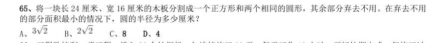

- **A.** 
- **B.** 
- **C.** 8
- **D.** 4

**答案：D**　**考点：几何问题｜平面几何**　**难度：★★★★☆**
**【2018 国考（副省级）·第 66 题】数量关系·工程问题｜GK-2018-fs-X066**

66. 工程队接到一项工程,投入80 台挖掘机。如连续施工30 天,每天工作10 小时,正好按期完成。但施工过 程中遭遇大暴雨,有10 天时间无法施工。工期还剩8 天时,工程队增派70 台挖掘机并加班施工。问工程队若想 按期完成,平均每天需多工作多少个小时?

- **A.** 1.5
- **B.** 2
- **C.** 2.5
- **D.** 3

**答案：B**　**考点：工程问题｜给定效率型**　**难度：★★★☆☆**
**【2018 国考（副省级）·第 67 题】数量关系·工程问题｜GK-2018-fs-X067**

67. 书法大赛的观众对5 幅作品进行不记名投票。每张选票都可以选择5 幅作品中的任意一幅或多幅,但只有在 选择不超过2 幅作品时才为有效票。5 幅作品的得票数(不考虑是否有效)分别为总票数的69%、63%、44%、58% 和56%。问本次投票的有效率最高可能为多少?

- **A.** 65%
- **B.** 70%
- **C.** 75%
- **D.** 80%

**答案：B**　**考点：工程问题｜给定效率型**　**难度：★★★☆☆**
**【2018 国考（副省级）·第 68 题】数量关系·工程问题｜GK-2018-fs-X068**

68. 企业花费600 万元升级生产线,升级后能耗费用降低了10%,人工成本降低了30%。如每天的产量不变,预 计在400 个工作日后收回成本。如果升级前人工成本为能耗费用的3 倍,问升级后每天的人工成本比能耗费用高 多少万元?

- **A.** 1.2
- **B.** 1.5
- **C.** 1.8
- **D.** 2.4

**答案：C**　**考点：工程问题｜工程问题（综合）**　**难度：★★☆☆☆**
**【2018 国考（副省级）·第 69 题】数量关系·利润问题｜GK-2018-fs-X069**

69. 枣园每年产枣2500 公斤,每公斤固定盈利18 元。为了提高土地利用率,现决定明年在枣树下种植紫薯(产 量最大为10000 公斤),每公斤固定盈利3 元。当紫薯产量大于400 公斤时,其产量每增加n 公斤将导致枣的产 量下降0.2n 公斤。问该枣园明年最多可能盈利多少元?

- **A.** 46176
- **B.** 46200
- **C.** 46260
- **D.** 46380

**答案：B**　**考点：利润问题｜基础利润**　**难度：★★★☆☆**
**【2018 国考（副省级）·第 70 题】数量关系·排列组合｜GK-2018-fs-X070**

70. 某企业国庆放假期间,甲、乙和丙三人被安排在10 月1 号到6 号值班。要求每天安排且仅安排1 人值班, 每人值班2 天,且同一人不连续值班2 天。问有多少种不同的安排方式?

- **A.** 15
- **B.** 24
- **C.** 30
- **D.** 36

**答案：C**　**考点：排列组合｜基础排列组合**　**难度：★★★★★**
**【2018 国考（副省级）·第 71 题】数量关系·行程问题｜GK-2018-fs-X071**

71. 一艘非法渔船作业时发现其正右方有海上执法船,于是沿下图所示方向左转30°后,立即以15 节(1 节=1 海里/小时)的速度逃跑,同时执法船沿某一直线方向匀速追赶,并正好在某一点追上。已知渔船在被追上前逃 跑的距离刚好与其发现执法船时与执法船的距离相同,问执法船的速度为多少节?

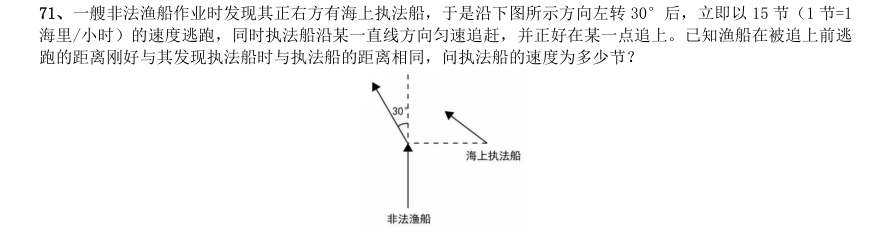

- **A.** 20
- **B.** 30
- **C.** 
- **D.** 

**答案：D**　**考点：行程问题｜相遇追及**　**难度：★★★☆☆**
**【2018 国考（副省级）·第 72 题】数量关系·利润问题｜GK-2018-fs-X072**

72. 某公司A 商品利润为定价的30%,前年销量为10 万个;B 商品利润为定价的40%,前年销量为4 万个。去年 公司将A B 商品捆绑销售,售价为前年两种商品定价之和的90%,共卖出8 万套,总利润比前年增加了20%。 如两种商品去年的成本与前年相同,则前年A 商品的定价为B 商品定价的:

- **A.** 24%
- **B.** 25%
- **C.** 30%
- **D.** 36%

**答案：A**　**考点：利润问题｜基础利润**　**难度：★★★☆☆**
**【2018 国考（副省级）·第 73 题】数量关系·最值问题｜GK-2018-fs-X073**

73. 某新能源汽车企业计划在A、B、C、D 四个城市建设72 个充电站,其中在B 市建设的充电站数量占总数的 1/3,在C 市建设的充电站数量比A 市多6 个,在D 市建设的充电站数量少于其他任一城市。问至少要在C 市建 设多少个充电站?

- **A.** 20
- **B.** 18
- **C.** 22
- **D.** 21

**答案：D**　**考点：最值问题｜最值优化**　**难度：★★★★★**
**【2018 国考（副省级）·第 74 题】数量关系·最值问题｜GK-2018-fs-X074**

74. 某饲料厂原有旧粮库存Y 袋,现购进X 袋新粮后,将粮食总库存的1/3 精加工为饲料。被精加工为饲料的新 粮最多为A1 袋,最少为A2 袋。如所有旧粮、新粮每袋重量相同,则以下哪个坐标图最能准确描述A1、A2 分别 与X 的关系?

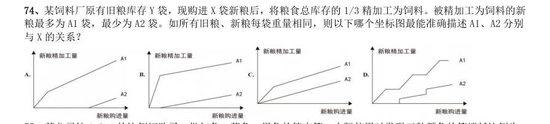

> （本题为图形题，选项为图片，见原卷）

**答案：A**　**考点：最值问题｜最值优化**　**难度：★★★★★**
**【2018 国考（副省级）·第 75 题】数量关系·其他数量关系｜GK-2018-fs-X075**

75. 某公司按1:3:4 的比例订购了一批红色、蓝色、黑色的签字笔,实际使用时发现三种颜色的笔消耗比例为 1:4:5。当某种颜色的签字笔用完时,发现另两种颜色的签字笔共剩下100 盒。此时又购进三种颜色签字笔总共 900 盒,从而使三种颜色的签字笔可以同时用完。问新购进黑色签字笔多少盒?

- **A.** 450
- **B.** 425
- **C.** 500
- **D.** 475

**答案：A**　**考点：其他数量关系｜和差倍比**　**难度：★★★☆☆**
**【2018 国考（副省级）·第 76 题】判断推理·图形推理｜GK-2018-fs-X076**

76. 从所给的四个选项中,选出最合适的一个填入问号处,使之呈现一定的规律性:

> （本题为图形题，选项为图片，见原卷）

**答案：D**　**考点：图形推理｜图形推理（待细分）**　**难度：★★★★☆**
**【2018 国考（副省级）·第 77 题】判断推理·图形推理｜GK-2018-fs-X077**

77. 从所给的四个选项中,选出最合适的一个填入问号处,使之呈现一定的规律性:

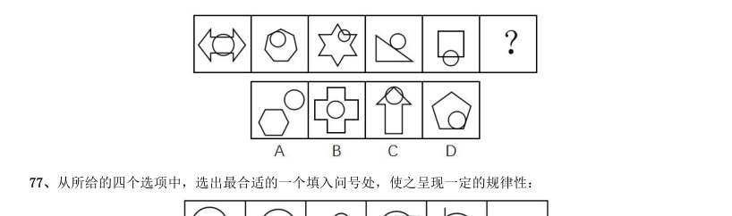

> （本题为图形题，选项为图片，见原卷）

**答案：C**　**考点：图形推理｜属性规律**　**难度：★★★★☆**
**【2018 国考（副省级）·第 78 题】判断推理·图形推理｜GK-2018-fs-X078**

78. 从所给的四个选项中,选出最合适的一个填入问号处,使之呈现一定的规律性:

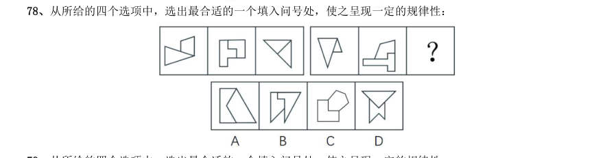

> （本题为图形题，选项为图片，见原卷）

**答案：D**　**考点：图形推理｜属性规律**　**难度：★★★★☆**
**【2018 国考（副省级）·第 79 题】判断推理·图形推理｜GK-2018-fs-X079**

79. 从所给的四个选项中,选出最合适的一个填入问号处,使之呈现一定的规律性:

> （本题为图形题，选项为图片，见原卷）

**答案：C**　**考点：图形推理｜样式规律**　**难度：★★★★☆**
**【2018 国考（副省级）·第 80 题】判断推理·图形推理｜GK-2018-fs-X080**

80. 左图给定的是正方体纸盒的外表面,下面哪一项能由它折叠而成?

> （本题为图形题，选项为图片，见原卷）

**答案：D**　**考点：图形推理｜折纸盒**　**难度：★★★★☆**
**【2018 国考（副省级）·第 81 题】判断推理·图形推理｜GK-2018-fs-X081**

81. 左图为给定的多面体,从任一角度观看,下面哪一项不可能是该多面体的视图?

> （本题为图形题，选项为图片，见原卷）

**答案：D**　**考点：图形推理｜三视图**　**难度：★★☆☆☆**
**【2018 国考（副省级）·第 82 题】判断推理·图形推理｜GK-2018-fs-X082**

82. 下面四个立体图形中,哪一项不能用一个平面分割为两个完全相同或互为镜像的部分?

> （本题为图形题，选项为图片，见原卷）

**答案：B**　**考点：图形推理｜立体图形**　**难度：★★★★☆**
**【2018 国考（副省级）·第 83 题】判断推理·图形推理｜GK-2018-fs-X083**

83. 把下面的六个图形分为两类,使每一类图形都有各自的共同特征或规律,分类正确的一项是:

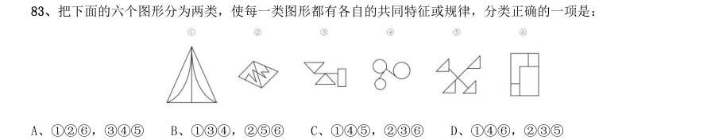

- **A.** 126,345
- **B.** 134,256
- **C.** 145,236
- **D.** 146,235

**答案：A**　**考点：图形推理｜分组分类**　**难度：★★☆☆☆**
**【2018 国考（副省级）·第 84 题】判断推理·图形推理｜GK-2018-fs-X084**

84. 把下面的六个图形分为两类,使每一类图形都有各自的共同特征或规律,分类正确的一项是:

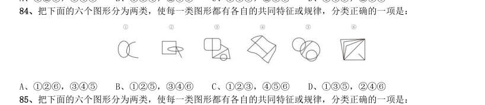

- **A.** 126,345
- **B.** 125,346
- **C.** 123,456
- **D.** 135,246

**答案：B**　**考点：图形推理｜分组分类**　**难度：★★☆☆☆**
**【2018 国考（副省级）·第 85 题】判断推理·图形推理｜GK-2018-fs-X085**

85. 把下面的六个图形分为两类,使每一类图形都有各自的共同特征或规律,分类正确的一项是:

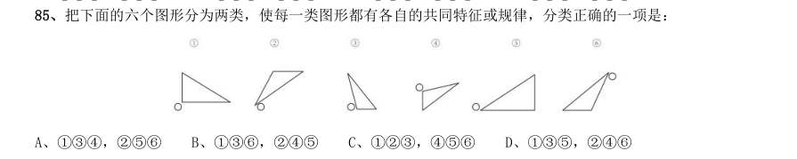

- **A.** 134,256
- **B.** 136,245
- **C.** 123,456
- **D.** 135,246

**答案：A**　**考点：图形推理｜分组分类**　**难度：★★☆☆☆**
**【2018 国考（副省级）·第 86 题】判断推理·定义判断｜GK-2018-fs-X086**

86. 伦理信用是指人们交往中由一定的预先约定、契约、承诺、誓言等引发的一种伦理关系,其蕴涵的合理秩序 则凝结为遵守诺言、履行约定的道德准则,人们基于对信用伦理关系合理秩序的理解和规则的践行便形成了相应 的道德品行。 根据上述定义,下列涉及伦理信用的是:

- **A.** 陈某看到一群人在围殴邻居的孩子,他一边报警,一边跑上前去大声喝止
- **B.** 赵某答应了丈夫的临终请求,在丈夫去世后,对丈夫前妻留下的两个孩子视如己出,将他们抚养成人
- **C.** 王某父亲曾借给张某10 万元,王父去世后,王某要求张某还钱
- **D.** 李某家乡发生洪涝灾害,不少农民颗粒无收,父亲要求他发动其公司员工和微信圈朋友捐钱捐物

**答案：B**　**考点：定义判断｜单定义**　**难度：★★★☆☆**
**【2018 国考（副省级）·第 87 题】判断推理·定义判断｜GK-2018-fs-X087**

87. 系统脱敏法是一种心理治疗法,当患者面前出现引起焦虑和恐惧的刺激物时,引导患者放松,使患者逐渐消 除焦虑与恐惧,不再对该刺激物产生病理性反应。它包括快速脱敏法和接触脱敏法等。前者是治疗者陪伴病人置 身于令病人感到恐惧的情景,直到病人不再紧张为止。后者是通过示范,让病人逐渐与所惧怕的对象接触,最终 达到克服恐惧的目的。 根据上述定义,如果要治疗一名特别害怕蛇的孩子,下列治疗方法中属于接触脱敏法的是:

- **A.** 让孩子旁观别人触摸、拿起和放下蛇的过程后,再慢慢让孩子逐渐接近和触摸蛇
- **B.** 带孩子去室内蛇类养殖场,看各种不同种类的蛇,看多了自然就不再害怕了
- **C.** 给孩子讲有关蛇的有趣的童话故事,引发孩子开心的情绪,逐渐减少对蛇的恐惧
- **D.** 录下孩子看见蛇后恐惧害怕的表情和动作,然后一遍又一遍地把这些视频放给孩子看

**答案：A**　**考点：定义判断｜单定义**　**难度：★★★★☆**
**【2018 国考（副省级）·第 88 题】判断推理·定义判断｜GK-2018-fs-X088**

88. 独立证明法和归谬法是间接论证的两种方法,其中独立证明法是通过证明与被反驳命题相矛盾的命题为真, 从而确定被反驳命题为假的方法。归谬法就是由所要反驳的命题为真,引出荒谬的结论,从而证明所要反驳的命 题为假。 根据上述定义,下列论证中使用了独立证明法的是:

- **A.** 甲:人类是由猿猴进化而来的。乙:不可能!有哪一个人见过,哪一只猴子变成了人?
- **B.** 甲:天不生仲尼,万古如长夜。乙:难道仲尼以前的人都生活在黑暗之中?
- **C.** 甲:人性本恶。乙:如果真的人性本恶,那么道德规范又从何而来呢?
- **D.** 甲:温饱是谈道德的先决条件。乙:温饱绝不是谈道德的先决条件。古往今来,没有解决衣食之困的社会也

**答案：D**　**考点：定义判断｜单定义**　**难度：★★★☆☆**
**【2018 国考（副省级）·第 89 题】判断推理·定义判断｜GK-2018-fs-X089**

89. 定向调控指政府针对不同调控领域,制定清晰明确的调控政策,使调控更具针对性。相机调控指政府根据市 场情况和各项调节措施的特点,灵活决定当前应采取哪一种或几种政策措施,重在“预调、微调”。定向调控是 “做什么”,相机调控是“怎么做”。 根据上述定义,下列属于相机调控的是:

- **A.** 甲国政府于年初提出了经济增长率和就业水平的“下限”、物价涨幅的“上限”等工作目标
- **B.** 乙国政府提出“双引擎”策略:一是对小微企业、“三农”等市场主体“减负”;二是支持公共产品、公共服务建设,拉动投资。由各地制定具体措施
- **C.** 丙国政府根据一二三四线城市房地产市场的不同特点,制定了有针对性的契税、房贷政策
- **D.** 丁国政府实行产品和服务的生产及销售完全由自由市场的自由价格机制所引导、产权明晰的经济政策

**答案：C**　**考点：定义判断｜单定义**　**难度：★★★☆☆**
**【2018 国考（副省级）·第 90 题】判断推理·定义判断｜GK-2018-fs-X090**

90. 法律的当然解释是指法律虽然没有明确规定某一事项,但依规范目的,该事项应当被解释为适用这一法律规 定。其解释方法有举重以明轻和举轻以明重。前者是指对于某一应当被允许的行为,举一个情节比其严重而被允 许的规定,以说明其应当被允许。后者是指对于某一应当被禁止的行为,举一个情节比其轻微而被禁止的规定, 以说明其应当被禁止。 根据上述定义,下列判断正确的是:

- **A.** 法律规定禁止在公园采摘树叶,依据举轻以明重,在公园攀折树枝的行为应当被禁止
- **B.** 唐律规定主人打死夜无故入人家者无罪,依据举轻以明重,主人打伤夜无故入人家者无罪
- **C.** 法律规定禁止携带小型动物,依据举重以明轻,携带大型动物的行为应当被禁止
- **D.** 法律规定16 周岁以下的未成年人不承担刑事责任,依据举重以明轻,15 周岁的未成年人不承担刑事责任

**答案：A**　**考点：定义判断｜单定义**　**难度：★★★★☆**
**【2018 国考（副省级）·第 91 题】判断推理·定义判断｜GK-2018-fs-X091**

91. 人耳对一个声音的感受性会因另一个声音的存在而发生改变。一个声音能被人耳听到的最低值会因另一声音 的出现而提高,这种现象就是听觉掩蔽。 根据上述定义,下列符合听觉掩蔽的是:

- **A.** 吵闹的课间,老师得大声说话,同学们才能听到
- **B.** 长时间戴耳机听音乐,会觉得听到的音量逐渐变小
- **C.** 人类无法听到蝙蝠等动物发出来的超声波
- **D.** 安静的房间内,我们能够听到闹钟“滴答”的声音

**答案：A**　**考点：定义判断｜单定义**　**难度：★★☆☆☆**
**【2018 国考（副省级）·第 92 题】判断推理·定义判断｜GK-2018-fs-X092**

92. 异质型人力资本是指某个特定历史阶段中具有边际收益递增生产力形态的人力资本,表现为拥有者所具有的 独特能力,这些能力主要包括:综合协调能力、判断决策能力、学习创新能力和承担风险能力等。 根据上述定义,下列不涉及异质型人力资本的是:

- **A.** 某厂长期亏损,李某担任厂长后施行了大刀阔斧的改革,很快使工厂扭亏为盈
- **B.** 技术员陈某潜心钻研技术,他将人们认为不太可能整合的两种技术巧妙结合在一起,大大降低了生产成本
- **C.** 某包装厂效益平平,设计师王某应聘到该厂后,由于他的设计新颖、风格清新,一下子使该厂的包装产品畅销起来
- **D.** 某厂聘请某院士担任技术顾问,一大批风险投资公司慕名而来,一些高学历人才也陆续加盟

**答案：D**　**考点：定义判断｜单定义**　**难度：★★★☆☆**
**【2018 国考（副省级）·第 93 题】判断推理·定义判断｜GK-2018-fs-X093**

93. 符号现象是指表意上没有相关性的甲乙两事物,当我们用甲事物代表乙事物时,甲事物就可以视为乙事物的 符号。 根据上述定义,下列不属于符号现象的是:

- **A.** 消防车的警笛声
- **B.** 医疗机构使用的十字标记
- **C.** 法院大门上雕刻的天平图案
- **D.** 体育比赛裁判员的哨声

**答案：C**　**考点：定义判断｜单定义**　**难度：★★☆☆☆**
**【2018 国考（副省级）·第 94 题】判断推理·定义判断｜GK-2018-fs-X094**

94. 数客互动管理是指通过先进的电子通讯和网络手段,达到企业与目标客户群之间高效、直接、自主、往复的 沟通,从而满足客户的个性化需要。 根据上述定义,下列属于数客互动管理的是:

- **A.** 某市政府在官网设立市长信箱,广泛收集各方面的意见,及时答复群众质询,努力改进政府工作
- **B.** 某玩具公司建立网络交流平台,家长只要将需要的玩具类型、价格、功能等提交给平台,公司就可以及时生产出来
- **C.** 某家具生产企业通过收集网络海量数据,进行市场需求分析,及时调整家具风格
- **D.** 某热水器厂家根据客户提供的信息,定期与客户联系,为客户提供免费检修服务

**答案：B**　**考点：定义判断｜单定义**　**难度：★★☆☆☆**
**【2018 国考（副省级）·第 95 题】判断推理·逻辑判断｜GK-2018-fs-X095**

95. 蜂鸣式营销是一种通过向潜在消费者直接提供企业产品或服务,使其获得产品或服务体验的销售方式。根据 上述定义,下列不属于蜂鸣式营销的是:

- **A.** 某软件公司在网上推出一款试用版软件,用户可免费试用三个月
- **B.** 某公司聘请演员在各大城市繁华地区扮演情侣,邀请可能成为目标客户的路人为他们拍照,借机向其宣传新款相机的功能
- **C.** 某企业定期向用户发送邮件,寄送产品杂志,推送优惠信息,并承诺购买产品一个月内不满意可以无条件退货
- **D.** 某饮料公司让营销人员频频出现在街道、咖啡馆、酒吧、超市等场所,请路人品尝不同口味的饮料来宣传自

**答案：C**　**考点：逻辑判断｜结论推出**　**难度：★★★★☆**
**【2018 国考（副省级）·第 96 题】判断推理·类比推理｜GK-2018-fs-X096**

96. 法律:法盲

- **A.** 文字:文盲
- **B.** 雪地:雪盲
- **C.** 地图:路盲
- **D.** 黑暗:夜盲

**答案：A**　**考点：类比推理｜对应关系**　**难度：★☆☆☆☆**
**【2018 国考（副省级）·第 97 题】判断推理·类比推理｜GK-2018-fs-X097**

97. 羔羊跪乳:乌鸦反哺

- **A.** 昙花一现:惊鸿一瞥
- **B.** 魂不附体:失魂落魄
- **C.** 锋芒毕露:锐不可当
- **D.** 朽木难雕:孺子可教

**答案：B**　**考点：类比推理｜语义关系**　**难度：★☆☆☆☆**
**【2018 国考（副省级）·第 98 题】判断推理·类比推理｜GK-2018-fs-X098**

98. 花椒:麻

- **A.** 月亮:圆
- **B.** 水泥:硬
- **C.** 饮料:冷
- **D.** 火焰:热

**答案：D**　**考点：类比推理｜对应关系**　**难度：★☆☆☆☆**
**【2018 国考（副省级）·第 99 题】判断推理·类比推理｜GK-2018-fs-X099**

99. 众人拾柴:火焰高

- **A.** 多行不义:必自毙
- **B.** 打破沙锅:问到底
- **C.** 敬酒不吃:吃罚酒
- **D.** 四海之内:皆兄弟

**答案：A**　**考点：类比推理｜语义关系**　**难度：★☆☆☆☆**
**【2018 国考（副省级）·第 100 题】判断推理·类比推理｜GK-2018-fs-X100**

100. 闪电战:战术:突袭

- **A.** 润滑油:机械:减震
- **B.** 戈壁滩:地形:干旱
- **C.** 防空洞:轰炸:隐蔽
- **D.** 斑马线:标记:通过

**答案：D**　**考点：类比推理｜逻辑关系**　**难度：★☆☆☆☆**
**【2018 国考（副省级）·第 101 题】判断推理·类比推理｜GK-2018-fs-X101**

101. 飞禽走兽:大雁:海鸥

- **A.** 珍馐美馔:山珍:海味
- **B.** 花鸟鱼虫:鹦鹉:画眉
- **C.** 锦衣玉食:蟒袍:霞帔
- **D.** 卧虎藏龙:猛虎:蛟龙

**答案：C**　**考点：类比推理｜逻辑关系**　**难度：★☆☆☆☆**
**【2018 国考（副省级）·第 102 题】判断推理·类比推理｜GK-2018-fs-X102**

102. 蛋:卤蛋:松花蛋

- **A.** 豆:红豆:四季豆
- **B.** 油:牛油:植物油
- **C.** 瓜:丝瓜:白兰瓜
- **D.** 茶:白茶:乌龙茶

**答案：D**　**考点：类比推理｜逻辑关系**　**难度：★☆☆☆☆**
**【2018 国考（副省级）·第 103 题】判断推理·类比推理｜GK-2018-fs-X103**

103. 净水器 对于( )相当于( )对于 汽缸

- **A.** 滤芯;蒸汽机
- **B.** 设备;元件
- **C.** 家庭;发动机
- **D.** 自来水;活塞

**答案：A**　**考点：类比推理｜逻辑关系**　**难度：★☆☆☆☆**
**【2018 国考（副省级）·第 104 题】判断推理·类比推理｜GK-2018-fs-X104**

104. 日记 对于( )相当于( )对于 数据

- **A.** 纪念;查证
- **B.** 经历;内存
- **C.** 年鉴;计算机
- **D.** 日期;图片

**答案：B**　**考点：类比推理｜对应关系**　**难度：★☆☆☆☆**
**【2018 国考（副省级）·第 105 题】判断推理·类比推理｜GK-2018-fs-X105**

105. 原始部落 对于( )相当于( ) 对于 先进科技

- **A.** 热带丛林;文明古国
- **B.** 边远小镇;创业园区
- **C.** 茹毛饮血;现代都市
- **D.** 钻木取火;宇宙航行

**答案：C**　**考点：类比推理｜对应关系**　**难度：★☆☆☆☆**
**【2018 国考（副省级）·第 106 题】判断推理·逻辑判断｜GK-2018-fs-X106**

106. 扶贫必扶智。让贫困地区的孩子们接受良好教育,是扶贫开发的重要任务,也是阻断贫困代际传递的重要 途径。 以上观点的前提是:

- **A.** 贫困的代际传递导致教育的落后
- **B.** 富有阶层大都受过良好教育
- **C.** 扶贫工作难,扶智工作更难
- **D.** 知识改变命运,教育成就财富

**答案：D**　**考点：逻辑判断｜前提假设**　**难度：★★☆☆☆**
**【2018 国考（副省级）·第 107 题】判断推理·逻辑判断｜GK-2018-fs-X107**

107. 有一种理论认为,距今约5000 万年前,生活在马达加斯加岛上的环尾狐猴、狐蝠以及其他哺乳动物的祖先 当年乘坐天然的“木筏”,来到了马达加斯加这座位于印度洋的岛屿上。根据这一理论,来自非洲大陆东南部的 哺乳动物当年漂流到马达加斯加,它们利用的交通工具是大原木或者漂浮的植被。在上演漂流记前,风暴将它们 卷入大海,在洋流的带动下,这些古代“难民”漂流数周,来到马达加斯加。 以下哪项如果为真,不能支持上述漂流理论?

- **A.** 5000 万年前,两个大陆板块周围的洋流曾一度向东流动,也就是流向马达加斯加
- **B.** 小型哺乳动物天生新陈代谢缓慢,能够在没有太多食物和淡水的情况下存活数周
- **C.** 在从非洲大陆东南部到达马达加斯加的动物中,没有大象,狮子等超重超大哺乳动物
- **D.** 5000 万年前,非洲大陆和马达加斯加之间的距离与今天不同

**答案：D**　**考点：逻辑判断｜加强论证**　**难度：★★★★★**
**【2018 国考（副省级）·第 108 题】判断推理·逻辑判断｜GK-2018-fs-X108**

108. 有调查显示,部分学生缺乏创造力。研究者认为,具有创造力的孩子在幼年时都比较淘气,而在一些家庭, 小孩如果淘气就会被家长严厉呵斥,这导致他们只能乖乖听话,创造力就有所下降。 这项调查最能支持的论断是:

- **A.** 幼年是创造力发展的关键时期
- **B.** 教育方式会影响孩子创造力的发展
- **C.** 幼年听话的孩子长大之后可能缺乏创造力
- **D.** 有些家长对小孩淘气倾向于采取比较严厉的态度

**答案：B**　**考点：逻辑判断｜加强论证**　**难度：★★★☆☆**
**【2018 国考（副省级）·第 109 题】判断推理·逻辑判断｜GK-2018-fs-X109**

109. 某省游泳队进行了为期一个月的高原集训,集训最后一日所有队员进行了一次队内测试,几位教练预测了 一下队员的成绩: 张教练说:这次集训时间短,没人会达标。 孙教练说:有队员会达标。 王教练说:省运会冠军或国家队队员可达标。 测试结束后,只有一位教练的预测是正确的。 由此可以推出:

- **A.** 没有人达标
- **B.** 全队都达标了
- **C.** 省运会冠军达标
- **D.** 国家队队员未达标

**答案：D**　**考点：逻辑判断｜结论推出**　**难度：★★★★☆**
**【2018 国考（副省级）·第 110 题】判断推理·逻辑判断｜GK-2018-fs-X110**

110. 某公司30 岁以下的年轻员工中有一部分报名参加了公司在周末举办的外语培训班。该公司的部门经理一致 同意在本周末开展野外拓展训练。所有报名参加外语培训班的员工都反对在本周末开展拓展训练。 由此可以推出:

- **A.** 所有部门经理年龄都在30 岁以上
- **B.** 该公司部门经理中有人报名参加了周末的外语培训班
- **C.** 报名参加周末外语培训班的员工都是30 岁以下的年轻人
- **D.** 有些30 岁以下的年轻员工不是部门经理

**答案：D**　**考点：逻辑判断｜翻译推理**　**难度：★★★☆☆**
**【2018 国考（副省级）·第 111 题】判断推理·逻辑判断｜GK-2018-fs-X111**

111. 人们普遍认为,保持乐观心态会促进健康。但一项对7 万名50 岁左右的女性进行的长达十年的追踪研究发 现,长期保持乐观心态的被试与悲观被试在死亡率上并没有差异,研究者据此认为,心态乐观与否与健康没有关 系。 以下哪项如果为真,最能质疑研究者的结论?

- **A.** 在这项研究的被试中悲观的人更多患有慢性疾病,虽然尚未严重到致命的程度
- **B.** 与悲观的人相比,乐观的人患病后会更积极主动地治疗
- **C.** 乐观的人往往对身体不会特别关注,有时一些致命性疾病无法及早发现
- **D.** 女性更善于维持和谐的人际关系,而良好的人际关系有助于健康

**答案：A**　**考点：逻辑判断｜削弱论证**　**难度：★★★★★**
**【2018 国考（副省级）·第 112 题】判断推理·逻辑判断｜GK-2018-fs-X112**

112. 开车斗气、胡乱变线、强行超车等“路怒症”是一种被称为间歇性、暴发性障碍(IED)的心理疾病。有研究 发现,IED 患者弓形虫检测呈阳性的比例是非IED 组的两倍。研究者认为,弓形虫感染有可能是导致包括“路怒 症”在内的IED 的罪魁祸首。 以下哪项如果为真,无法支持研究者的观点?

- **A.** 感染了弓形虫的老鼠往往更大胆、更敢于冒险,也因此更容易被猫抓到
- **B.** 弓形虫使大脑中控制威胁反应的神经元受到过度刺激,易引发攻击行为
- **C.** 对弓形虫检测呈阳性的IED 患者施以抗虫感染治疗之后,冲动行为减少
- **D.** 弓形虫是猫身上的一种原生动物寄生虫,但猫是比较温顺的动物

**答案：D**　**考点：逻辑判断｜加强论证**　**难度：★★★★★**
**【2018 国考（副省级）·第 113 题】判断推理·逻辑判断｜GK-2018-fs-X113**

113. 日前,研究人员发明了一种弹性超强的新材料,这种材料可以由1 英寸被拉伸到100 英寸以上,同时这一 材料可以自行修复且能通过电压控制动作。因此研究者认为,利用该材料可以制成人工肌肉,替代人体肌肉,从 而为那些肌肉损伤后无法恢复功能的患者带来福音。 以下哪项如果为真,不能支持研究者的观点?

- **A.** 该材料制成的人工肌肉在受到破坏或损伤后能立即启动修复机制,比正常肌肉的康复速度快
- **B.** 该材料在电刺激下会发生膨胀或收缩,具有良好的柔韧性,与正常肌肉十分接近
- **C.** 目前,该材料研制成的人工肌肉尚不能与人体神经很好的契合,无法实现精准抓取物体等动作
- **D.** 一般材料如果被破坏,需通过溶剂修复或热修复复原,而该材料在室温下就能自行恢复

**答案：C**　**考点：逻辑判断｜加强论证**　**难度：★★★★★**
**【2018 国考（副省级）·第 114 题】判断推理·逻辑判断｜GK-2018-fs-X114**

114. 自上世纪50 年代以来,全球每年平均爆发的大型龙卷风的次数从10 次左右上升至15 次。与此同时,人类 活动激增,全球气候明显变暖,有人据此认为,气候变暖导致龙卷风爆发次数增加。 以下哪项如果为真,不能削弱上述结论?

- **A.** 龙卷风的类型多样,全球变暖后,小型龙卷风出现的次数并没有明显的变化
- **B.** 气候温暖是龙卷风形成的一个必要条件,几乎所有龙卷风的形成都与当地较高的温度有关
- **C.** 尽管全球变暖,龙卷风依然最多地发生在美国的中西部地区,其他地区的龙卷风现象并不多见
- **D.** 龙卷风是雷暴天气(即伴有雷击和闪电的局地对流性天气)的产物,只要在雷雨天气下出现极强的空气对流,

**答案：B**　**考点：逻辑判断｜削弱论证**　**难度：★★★★★**
**【2018 国考（副省级）·第 115 题】判断推理·逻辑判断｜GK-2018-fs-X115**

115. 某次会议讨论期间,甲、乙、丙、丁、戊被安排在一张圆桌前进行讨论,圆桌边放着标有1~5 号的五张座 椅(未必按序排列)。实际讨论时,甲、乙、丙、丁、戊5 人均未按顺序坐在1~5 号的座椅上,已知: (1)甲坐在1 号座椅右边第二张座椅上; (2)乙坐在5 号座椅左边第二张座椅上; (3)丙坐在3 号座椅左边第一张座椅上; (4)丁坐在2 号座椅左边第一张座椅上。 如果丙坐在1 号座椅上,则可知甲坐的是哪个座椅?

- **A.** 2 号
- **B.** 3 号
- **C.** 4 号
- **D.** 5 号

**答案：C**　**考点：逻辑判断｜翻译推理**　**难度：★★★★★**
**【2018 国考（副省级）·第 116 题】资料分析·综合分析｜GK-2018-fs-X116**
> 材料：2016 年“一带一路”沿线64 个国家GDP 之和约为12.0 万亿美元,占全球GDP 的16.0%;人口总数约为32.1 亿人,占全球总人口的43.4%;对外贸易总额(进口额+出口额)约为71885.6 亿美元,占全球贸易总额的21.7%。

116. 2016 年全球贸易总额约为多少万亿美元?

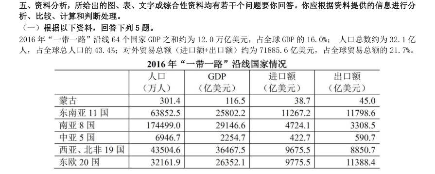

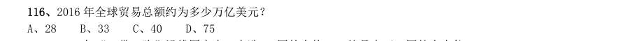

- **A.** 28
- **B.** 33
- **C.** 40
- **D.** 75

**答案：B**　**考点：综合分析｜比重**　**难度：★★★★☆**
**【2018 国考（副省级）·第 117 题】资料分析·平均数计算｜GK-2018-fs-X117**
> 材料：2016 年“一带一路”沿线64 个国家GDP 之和约为12.0 万亿美元,占全球GDP 的16.0%;人口总数约为32.1 亿人,占全球总人口的43.4%;对外贸易总额(进口额+出口额)约为71885.6 亿美元,占全球贸易总额的21.7%。

117. 2016 年“一带一路”沿线国家中,东欧20 国的人均GDP 约是中亚5 国的多少倍?

> 材料图见 images/GK-2018-fs-X116-m.jpg

- **A.** 2.5
- **B.** 3.6
- **C.** 5.3
- **D.** 11.7

**答案：A**　**考点：平均数计算｜现期平均数**　**难度：★☆☆☆☆**
**【2018 国考（副省级）·第 118 题】资料分析·综合分析｜GK-2018-fs-X118**
> 材料：2016 年“一带一路”沿线64 个国家GDP 之和约为12.0 万亿美元,占全球GDP 的16.0%;人口总数约为32.1 亿人,占全球总人口的43.4%;对外贸易总额(进口额+出口额)约为71885.6 亿美元,占全球贸易总额的21.7%。

118. “一带一路”沿线主要区域中,2016 年进口额与出口额数值相差最大的是:

> 材料图见 images/GK-2018-fs-X116-m.jpg

- **A.** 东南亚11 国
- **B.** 南亚8 国
- **C.** 西亚、北非19 国
- **D.** 东欧20 国

**答案：D**　**考点：综合分析｜综合分析（综合）**　**难度：★★★★☆**
**【2018 国考（副省级）·第 119 题】资料分析·比重计算与比较｜GK-2018-fs-X119**
> 材料：2016 年“一带一路”沿线64 个国家GDP 之和约为12.0 万亿美元,占全球GDP 的16.0%;人口总数约为32.1 亿人,占全球总人口的43.4%;对外贸易总额(进口额+出口额)约为71885.6 亿美元,占全球贸易总额的21.7%。

119. 2016 年,蒙古GDP 约占全球总体GDP 的:

> 材料图见 images/GK-2018-fs-X116-m.jpg

- **A.** 0.61‰
- **B.** 1.56‰
- **C.** 0.06‰
- **D.** 0.16‰

**答案：D**　**考点：比重计算与比较｜现期比重**　**难度：★☆☆☆☆**
**【2018 国考（副省级）·第 120 题】资料分析·综合分析｜GK-2018-fs-X120**
> 材料：2016 年“一带一路”沿线64 个国家GDP 之和约为12.0 万亿美元,占全球GDP 的16.0%;人口总数约为32.1 亿人,占全球总人口的43.4%;对外贸易总额(进口额+出口额)约为71885.6 亿美元,占全球贸易总额的21.7%。

120. 关于“一带一路”沿线国家2016 年状况,能够从上述资料中推出的是:

> 材料图见 images/GK-2018-fs-X116-m.jpg

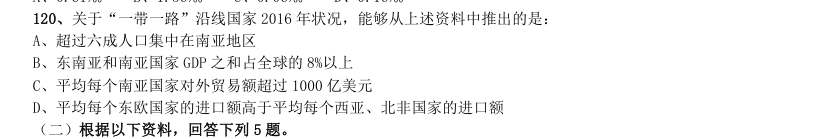

- **A.** 超过六成人口集中在南亚地区
- **B.** 东南亚和南亚国家GDP 之和占全球的8%以上
- **C.** 平均每个南亚国家对外贸易额超过1000 亿美元
- **D.** 平均每个东欧国家的进口额高于平均每个西亚、北非国家的进口额

**答案：C**　**考点：综合分析｜平均数**　**难度：★★★★☆**
**【2018 国考（副省级）·第 121 题】资料分析·增长量计算｜GK-2018-fs-X121**

121. 2016 年在线旅游市场交易规模约比上年增加了:

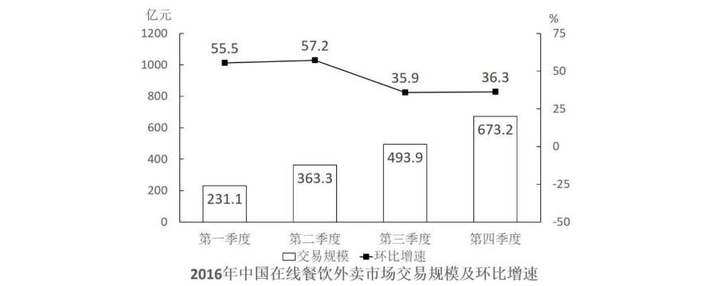

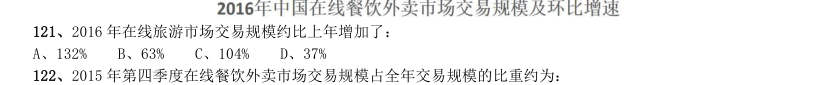

- **A.** 132%
- **B.** 63%
- **C.** 104%
- **D.** 37%

**答案：D**　**考点：增长量计算｜增长量计算（综合）**　**难度：★☆☆☆☆**
**【2018 国考（副省级）·第 122 题】资料分析·比重计算与比较｜GK-2018-fs-X122**

122. 2015 年第四季度在线餐饮外卖市场交易规模占全年交易规模的比重约为:

> 材料图见 images/GK-2018-fs-X121-m.jpg

- **A.** 21%
- **B.** 28%
- **C.** 37%
- **D.** 49%

**答案：B**　**考点：比重计算与比较｜现期比重**　**难度：★☆☆☆☆**
**【2018 国考（副省级）·第 123 题】资料分析·综合分析｜GK-2018-fs-X123**

123. 如按2016 年移动出行市场同比增长趋势估算,2018 年该市场规模将为:

> 材料图见 images/GK-2018-fs-X121-m.jpg

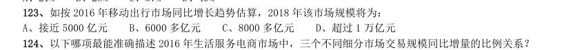

- **A.** 接近5000 亿元
- **B.** 6000 多亿元
- **C.** 8000 多亿元
- **D.** 超过1 万亿元

**答案：C**　**考点：综合分析｜增长率**　**难度：★★★★☆**
**【2018 国考（副省级）·第 124 题】资料分析·增长量计算｜GK-2018-fs-X124**

124. 以下哪项最能准确描述2016 年生活服务电商市场中,三个不同细分市场交易规模同比增量的比例关系?

> 材料图见 images/GK-2018-fs-X121-m.jpg

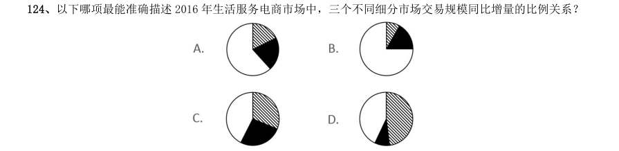

> （本题为图形题，选项为图片，见原卷）

**答案：C**　**考点：增长量计算｜增长量比较**　**难度：★☆☆☆☆**
**【2018 国考（副省级）·第 125 题】资料分析·综合分析｜GK-2018-fs-X125**
> 材料：2016 年“一带一路”沿线64 个国家GDP 之和约为12.0 万亿美元,占全球GDP 的16.0%;人口总数约为32.1 亿人,占全球总人口的43.4%;对外贸易总额(进口额+出口额)约为71885.6 亿美元,占全球贸易总额的21.7%。
116、2016 年全球贸易总额约为多少万亿美元?
A、28B、33C、40D、75117、2016 年“一带一路”沿线国家中,东欧20 国的人均GDP 约是中亚5 国的多少倍?
A、2.5B、3.6C、5.3D、11.7118、“一带一路”沿线主要区域中,2016 年进口额与出口额数值相差最大的是:A、东南亚11 国B、南亚8 国C、西亚、北非19 国D、东欧20 国119、2016 年,蒙古GDP 约占全球总体GDP 的:A、0.61‰B、1.56‰C、0.06‰D、0.16‰120、关于“一带一路”沿线国家2016 年状况,能够从上述资料中推

125. 能够从上述资料中推出的是:

> 材料图见 images/GK-2018-fs-X121-m.jpg

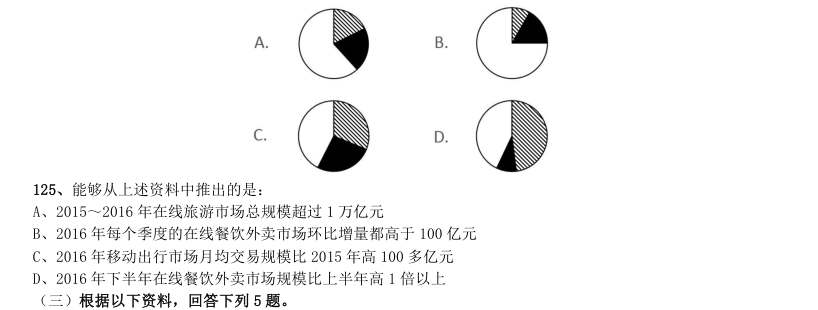

- **A.** 2015~2016 年在线旅游市场总规模超过1 万亿元
- **B.** 2016 年每个季度的在线餐饮外卖市场环比增量都高于100 亿元
- **C.** 2016 年移动出行市场月均交易规模比2015 年高100 多亿元
- **D.** 2016 年下半年在线餐饮外卖市场规模比上半年高1 倍以上

**答案：A**　**考点：综合分析｜倍数**　**难度：★★★★★**
**【2018 国考（副省级）·第 126 题】资料分析·平均数计算｜GK-2018-fs-X126**
> 材料：2016 年,全国城市公园数量排名前五的省份依次是广东、浙江、江苏、山东和云南,公园数量分别为3512 个、1171 个、942 个、828 个和683 个。

126. 其中,广东省的公园面积达到65318 公顷,占全国公园面积的比重超过 17%;公园绿地面积达到89591 公顷,占全国公园绿地面积的比重约为14%。 注:公园绿地指具有公园作用的所有绿地的统称,即公园性质的绿地,并非公园中的绿地面积,包括综合公园、 专类公园、带状公园、街旁游乐园和社区公园等。 2016 年,佛山市平均每个公园的面积约为多少公顷?

- **A.** 10
- **B.** 15
- **C.** 20
- **D.** 25

**答案：A**　**考点：平均数计算｜现期平均数**　**难度：★★★☆☆**
**【2018 国考（副省级）·第 127 题】资料分析·综合分析｜GK-2018-fs-X127**
> 材料：2016 年,全国城市公园数量排名前五的省份依次是广东、浙江、江苏、山东和云南,公园数量分别为3512 个、1171 个、942 个、828 个和683 个。

127. 2016 年,全国公园绿地面积约为多少万公顷?

> 材料图见 images/GK-2018-fs-X126-m.jpg

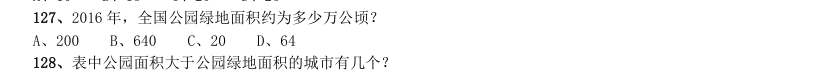

- **A.** 200
- **B.** 640
- **C.** 20
- **D.** 64

**答案：D**　**考点：综合分析｜比重**　**难度：★★★★☆**
**【2018 国考（副省级）·第 128 题】资料分析·综合分析｜GK-2018-fs-X128**
> 材料：2016 年,全国城市公园数量排名前五的省份依次是广东、浙江、江苏、山东和云南,公园数量分别为3512 个、1171 个、942 个、828 个和683 个。

128. 表中公园面积大于公园绿地面积的城市有几个?

> 材料图见 images/GK-2018-fs-X126-m.jpg

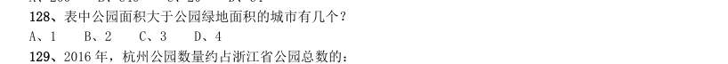

- **A.** 1
- **B.** 2
- **C.** 3
- **D.** 4

**答案：B**　**考点：综合分析｜综合分析（综合）**　**难度：★★★★☆**
**【2018 国考（副省级）·第 129 题】资料分析·比重计算与比较｜GK-2018-fs-X129**
> 材料：2016 年,全国城市公园数量排名前五的省份依次是广东、浙江、江苏、山东和云南,公园数量分别为3512 个、1171 个、942 个、828 个和683 个。

129. 2016 年,杭州公园数量约占浙江省公园总数的:

> 材料图见 images/GK-2018-fs-X126-m.jpg

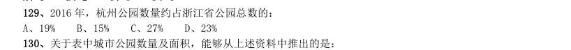

- **A.** 19%
- **B.** 15%
- **C.** 27%
- **D.** 23%

**答案：A**　**考点：比重计算与比较｜现期比重**　**难度：★☆☆☆☆**
**【2018 国考（副省级）·第 130 题】资料分析·综合分析｜GK-2018-fs-X130**
> 材料：2016 年,全国城市公园数量排名前五的省份依次是广东、浙江、江苏、山东和云南,公园数量分别为3512 个、1171 个、942 个、828 个和683 个。

130. 关于表中城市公园数量及面积,能够从上述资料中推出的是:

> 材料图见 images/GK-2018-fs-X126-m.jpg

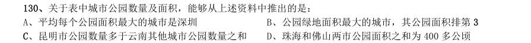

- **A.** 平均每个公园面积最大的城市是深圳
- **B.** 公园绿地面积最大的城市,其公园面积排第3
- **C.** 昆明市公园数量多于云南其他城市公园数量之和
- **D.** 珠海和佛山两市公园面积之和为400 多公顷

**答案：C**　**考点：综合分析｜平均数**　**难度：★★★★☆**
**【2018 国考（副省级）·第 131 题】资料分析·增长率计算与比较｜GK-2018-fs-X131**
> 材料：2017 年1~2 月,全国造船完工936 万载重吨,同比增长123%;承接新船订单221 万载重吨,同比增长133%。 2 月末,手持船舶订单9207 万载重吨,同比下降22.6%,比2016 年末下降7.6%。 2017 年1~2 月,全国完工出口船907 万载重吨,同比增长127%;承接出口船订单191 万载重吨,同比增长 122%。2 月末,手持出口船订单8406 万载重吨,同比下降25.9%。 2017 年1~2 月,53 家重点监测的造船企业(以下简称重点企业)造船完工912 万载重吨,同比增长133%; 承接新船订单197 万载重吨,同比增长119%。2 月末,手持船舶订单8874 万载重吨,同比下降23.1%。

131. 2017 年1~2 月,重点企业完工出口船886 万载重吨,同比增长138%;承接出口船订单171 万载重吨,同比 增长109%。2 月末,手持出口船订单8129 万载重吨,同比下降26.6%。 2016 年末全国手持船舶订单较同年2 月末:

> 材料图见 images/GK-2018-fs-X126-m.jpg

- **A.** 降低16.2%
- **B.** 降低2.2%
- **C.** 增加16.2%
- **D.** 增加2.2%

**答案：A**　**考点：增长率计算与比较｜降幅与增速**　**难度：★★★☆☆**
**【2018 国考（副省级）·第 132 题】资料分析·比重计算与比较｜GK-2018-fs-X132**
> 材料：2017 年1~2 月,全国造船完工936 万载重吨,同比增长123%;承接新船订单221 万载重吨,同比增长133%。 2 月末,手持船舶订单9207 万载重吨,同比下降22.6%,比2016 年末下降7.6%。 2017 年1~2 月,全国完工出口船907 万载重吨,同比增长127%;承接出口船订单191 万载重吨,同比增长 122%。2 月末,手持出口船订单8406 万载重吨,同比下降25.9%。 2017 年1~2 月,53 家重点监测的造船企业(以下简称重点企业)造船完工912 万载重吨,同比增长133%; 承接新船订单197 万载重吨,同比增长119%。2 月末,手持船舶订单8874 万载重吨,同比下降23.1%。

132. 设2017 年1~2 月出口船完工量占全国造船完工量比重为X,同期出口船承接订单量占全国承接新船订单 量比重为Y,2 月末手持出口船订单量占全国手持船舶订单量比重为Z,则有:

> 材料图见 images/GK-2018-fs-X126-m.jpg

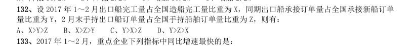

- **A.** X>Y>Z
- **B.** X>Z>Y
- **C.** Y>X>Z
- **D.** Y>Z>X

**答案：B**　**考点：比重计算与比较｜现期比重**　**难度：★★☆☆☆**
**【2018 国考（副省级）·第 133 题】资料分析·增长率计算与比较｜GK-2018-fs-X133**
> 材料：2017 年1~2 月,全国造船完工936 万载重吨,同比增长123%;承接新船订单221 万载重吨,同比增长133%。 2 月末,手持船舶订单9207 万载重吨,同比下降22.6%,比2016 年末下降7.6%。 2017 年1~2 月,全国完工出口船907 万载重吨,同比增长127%;承接出口船订单191 万载重吨,同比增长 122%。2 月末,手持出口船订单8406 万载重吨,同比下降25.9%。 2017 年1~2 月,53 家重点监测的造船企业(以下简称重点企业)造船完工912 万载重吨,同比增长133%; 承接新船订单197 万载重吨,同比增长119%。2 月末,手持船舶订单8874 万载重吨,同比下降23.1%。

133. 2017 年1~2 月,重点企业下列指标中同比增速最快的是:

> 材料图见 images/GK-2018-fs-X126-m.jpg

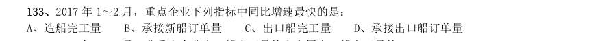

- **A.** 造船完工量
- **B.** 承接新船订单量
- **C.** 出口船完工量
- **D.** 承接出口船订单量

**答案：C**　**考点：增长率计算与比较｜增长率比较**　**难度：★☆☆☆☆**
**【2018 国考（副省级）·第 134 题】资料分析·比重计算与比较｜GK-2018-fs-X134**
> 材料：2017 年1~2 月,全国造船完工936 万载重吨,同比增长123%;承接新船订单221 万载重吨,同比增长133%。 2 月末,手持船舶订单9207 万载重吨,同比下降22.6%,比2016 年末下降7.6%。 2017 年1~2 月,全国完工出口船907 万载重吨,同比增长127%;承接出口船订单191 万载重吨,同比增长 122%。2 月末,手持出口船订单8406 万载重吨,同比下降25.9%。 2017 年1~2 月,53 家重点监测的造船企业(以下简称重点企业)造船完工912 万载重吨,同比增长133%; 承接新船订单197 万载重吨,同比增长119%。2 月末,手持船舶订单8874 万载重吨,同比下降23.1%。

134. 2017 年1~2 月,非重点企业出口船完工量约占全国出口船完工量的:

> 材料图见 images/GK-2018-fs-X126-m.jpg

- **A.** 2%
- **B.** 5%
- **C.** 95%
- **D.** 98%

**答案：A**　**考点：比重计算与比较｜现期比重**　**难度：★☆☆☆☆**
**【2018 国考（副省级）·第 135 题】资料分析·综合分析｜GK-2018-fs-X135**
> 材料：2017 年1~2 月,全国造船完工936 万载重吨,同比增长123%;承接新船订单221 万载重吨,同比增长133%。 2 月末,手持船舶订单9207 万载重吨,同比下降22.6%,比2016 年末下降7.6%。 2017 年1~2 月,全国完工出口船907 万载重吨,同比增长127%;承接出口船订单191 万载重吨,同比增长 122%。2 月末,手持出口船订单8406 万载重吨,同比下降25.9%。 2017 年1~2 月,53 家重点监测的造船企业(以下简称重点企业)造船完工912 万载重吨,同比增长133%; 承接新船订单197 万载重吨,同比增长119%。2 月末,手持船舶订单8874 万载重吨,同比下降23.1%。

135. 能够从上述资料中推出的是:

> 材料图见 images/GK-2018-fs-X126-m.jpg

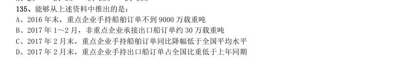

- **A.** 2016 年末,重点企业手持船舶订单不到9000 万载重吨
- **B.** 2017 年1~2 月,非重点企业承接出口船订单约30 万载重吨
- **C.** 2017 年2 月末,重点企业手持船舶订单同比降幅低于全国平均水平
- **D.** 2017 年2 月末,重点企业手持出口船订单占全国比重低于上年同期

**答案：D**　**考点：综合分析｜比重**　**难度：★★★★★**