# 2025 国考（地市级）·行测

- 题量：130（含答案 130）
- 考试类型：国考
- 模块分布：资料分析20 / 数量关系10 / 言语理解30 / 判断推理35 / 常识判断35
- 试卷编号：`国考-2025-地市级`

## 题目与答案

**【2025 国考（地市级）·第 1 题】常识判断·政治常识｜GK-2025-ds-X001**

1. 习近平总书记指出,马克思主义是为人民立言、为人民代言的理论,是为改变人民命运而创立、在人民求解放 的实践中丰富和发展的,人民的创造性实践是马克思主义理论创新的不竭源泉。下列说法与这一论述相符的 是: 1人民不仅是物质财富的创造者,也是精神财富的创造者 2要坚持以理论工作者的首创精神为引领,注重从理论创新中总结实践经验 3无论是毛泽东思想、中国特色社会主义理论体系,还是习近平新时代特色社会主义思想,无不源自于人民的 智慧、人民的探索、人民的创造 4各级领导干部身处实践最前沿,对实践变化感知最敏感、感受最深切,也最聪慧

> 同题变体（主记录 GK-2025-fs-X001）

- **A.** 12
- **B.** 13
- **C.** 24
- **D.** 34

**答案：B**　**考点：政治常识｜新时代理论**　**难度：★★★★★**
**【2025 国考（地市级）·第 2 题】常识判断·政治常识｜GK-2025-ds-X002**

2. 习近平总书记指出,问题是事物矛盾的表现形式,我们强调增强问题意识、坚持问题导向,就是承认矛盾的普 遍性、客观性,就是要善于把认识和化解矛盾作为打开工作局面的突破口。关于矛盾的普遍性、客观性,下列 说法正确的是:

> 同题变体（主记录 GK-2025-fs-X002）

- **A.** 矛盾的普遍性是有条件的,并根据条件的变化而变化
- **B.** 矛盾的客观性从属于主观性,不能脱离人的认知、情感、意志而存在
- **C.** 矛盾的普遍性是矛盾的共性,矛盾的特殊性是矛盾的个性
- **D.** 矛盾的普遍性、客观性决定了事物的不同性质,是认清事物本质和发展规律的基础

**答案：C**　**考点：政治常识｜新时代理论**　**难度：★★★★★**
**【2025 国考（地市级）·第 3 题】常识判断·政治常识｜GK-2025-ds-X003**

3. 关于马克思主义政治经济学,下列说法正确的是:

- **A.** 商品的价值量是由生产该商品所需的个别劳动时间决定的
- **B.** 货币的价值尺度职能是通过实际的物质交换来实现的
- **C.** 具体劳动和抽象劳动是不同商品生产过程中的不同劳动
- **D.** 具体劳动创造商品的使用价值,抽象劳动形成商品的价值

**答案：D**　**考点：政治常识｜马克思主义基本原理**　**难度：★★★★★**
**【2025 国考（地市级）·第 4 题】常识判断·政治常识｜GK-2025-ds-X004**

4. 习近平总书记指出:“中国共产党人的理想信念,建立在马克思主义科学真理的基础之上,建立在马克思主义 揭示的人类社会发展规律的基础之上,建立在为最广大人民谋利益的崇高价值的基础之上。我们坚定,是因为 我们追求的是真理。我们坚定,是因为我们遵循的是规律。我们坚定,是因为我们代表的是最广大人民根本利 益。”这一论述最直接体现了马克思主义的哪一基本观点?

> 同题变体（主记录 GK-2025-fs-X004）

- **A.** 真理尺度与价值尺度的辩证统一
- **B.** 认识世界与改造世界的辩证统一
- **C.** 量变与质变的辩证统一
- **D.** 矛盾的特殊性与普遍性的辩证统一

**答案：A**　**考点：政治常识｜新时代理论**　**难度：★★★★☆**
**【2025 国考（地市级）·第 5 题】常识判断·政治常识｜GK-2025-ds-X005**

5. 高质量发展是全面建设社会主义现代化国家的首要任务,金融要为经济社会发展提供高质量服务。下列与之相 关的表述不准确的是:

> 同题变体（主记录 GK-2025-fs-X005）

- **A.** 优化资金供给结构,把更多金融资源用于促进科技创新、绿色发展、传统制造和国有企业
- **B.** 要着力营造良好的货币金融环境,切实加强对重大战略、重点领域和薄弱环节的优质金融服务
- **C.** 始终保持货币政策的稳健性,更加注重做好跨周期和逆周期调节,充实货币政策工具箱
- **D.** 完善机构定位,支持国有大型金融机构做优做强,当好服务实体经济的主力军和维护金融稳定的压舱石

**答案：A**　**考点：政治常识｜新时代理论**　**难度：★★★★☆**
**【2025 国考（地市级）·第 6 题】常识判断·政治常识｜GK-2025-ds-X006**

6. 习近平总书记强调,粮食安全是“国之大者”。下列保障粮食安全的举措正确的有几项? 1全面落实粮食安全党政同责,坚持稳面积、增单产两手发力 2树立大农业观、大食物观,农林牧渔并举,构建多元化食物供给体系 3加大高标准农田建设投入和管护力度,确保耕地数量有保障、质量有提升 4扩大粮食领域高水平对外开放,逐步加大国外优质种业资源和海外粮食产品在我国市场的占有率 5强化科技和改革双轮驱动,加大核心技术攻关力度

> 同题变体（主记录 GK-2025-fs-X006）

- **A.** 2项
- **B.** 3项
- **C.** 4项
- **D.** 5项

**答案：C**　**考点：政治常识｜新时代理论**　**难度：★★★★★**
**【2025 国考（地市级）·第 7 题】常识判断·政治常识｜GK-2025-ds-X007**

7. 习近平总书记强调,要坚定不移贯彻新发展理念,更加自觉地把高质量充分就业作为经济社会发展的优先目 标。下列关于高质量充分就业的表述正确的是: 1全面贯彻劳动者自主就业、政府主导就业、市场促进就业的方针 2坚持扩大就业容量和提升就业质量相结合 3坚持就业带动创业 4加强灵活就业和新就业形态劳动者权益保障,扩大职业伤害保障试点

> 同题变体（主记录 GK-2025-fs-X007）

- **A.** 12
- **B.** 13
- **C.** 24
- **D.** 34

**答案：C**　**考点：政治常识｜新时代理论**　**难度：★★★★☆**
**【2025 国考（地市级）·第 8 题】常识判断·政治常识｜GK-2025-ds-X008**

8. 党的十八大以来,在推进全面从严治党的伟大实践中,我们不断进行实践探索和理论思考,在毛泽东同志当年 给出“让人民来监督政府”的第一个答案基础上,给出了第二个答案,那就是不断推进党的自我革命。关于深 入推进党的自我革命实践,下列表述不准确的是:

> 同题变体（主记录 GK-2025-fs-X008）

- **A.** 以引领伟大社会革命为根本目的
- **B.** 以跳出历史周期率为战略目标
- **C.** 以解决大党独有难题为主攻方向
- **D.** 以自我监督和法律监督相结合为强大动力

**答案：D**　**考点：政治常识｜毛中特与党史**　**难度：★★★☆☆**
**【2025 国考（地市级）·第 9 题】常识判断·政治常识｜GK-2025-ds-X009**

9. 总书记指出,要加强科技基础能力建设,深化科技体制改革,打造科创高地。关于深化科技体制改革,下列表 述正确的是:

> 同题变体（主记录 GK-2025-fs-X009）

- **A.** 建立以竞争性支持取代稳定支持的基础研究投入机制
- **B.** 允许科研类事业单位实行比一般事业单位更灵活的管理制度
- **C.** 限制开展高风险、高投入基础研究
- **D.** 降低科技人员在科技成果转化收益分配上的自主权

**答案：B**　**考点：政治常识｜毛中特与党史**　**难度：★☆☆☆☆**
**【2025 国考（地市级）·第 10 题】常识判断·政治常识｜GK-2025-ds-X010**

10. 完善收入分配制度,构建初次分配、再分配、第三次分配协调配套的制度体系,是进一步全面深化改革的重要 任务。关于完善收入分配制度,下列表述不准确的是:

> 同题变体（主记录 GK-2025-fs-X010）

- **A.** 提高劳动报酬在初次分配中的比重
- **B.** 完善劳动者工资决定、合理增长、支付保障机制,健全按要素分配政策制度
- **C.** 规范财富积累机制,多渠道增加城乡居民财产性收入
- **D.** 完善税收、社会保障、转移支付等第三次分配调节机制

**答案：D**　**考点：政治常识｜毛中特与党史**　**难度：★☆☆☆☆**
**【2025 国考（地市级）·第 11 题】常识判断·政治常识｜GK-2025-ds-X011**

11. 习近平总书记强调,要牢牢扭住自主创新这个“牛鼻子”。关于自主创新的举措,下列表述正确的有几项? 1主动对接国家战略需求,整合和优化科教创新资源 2培育产业园区,加强对口合作,加快科研成果落地转化 3培育新能源、新材料、先进制造、电子信息等战略性新兴产业 4建设风光火核储一体化能源基地 5逐步弱化央地合作,鼓励各地自主发展新兴产业

> 同题变体（主记录 GK-2025-fs-X011）

- **A.** 2项
- **B.** 3项
- **C.** 4项
- **D.** 5项

**答案：C**　**考点：政治常识｜新时代理论**　**难度：★★★★☆**
**【2025 国考（地市级）·第 12 题】常识判断·政治常识｜GK-2025-ds-X012**

12. 党的二十届三中全会提出,要稳步扩大制度型开放。关于稳步扩大制度型开放,下列举措不恰当的是:

> 同题变体（主记录 GK-2025-fs-X012）

- **A.** 独立自主构建不同于国际经贸规则的中国特色经贸规则体系
- **B.** 有序扩大我国商品市场、服务市场、资本市场、劳务市场等对外开放
- **C.** 积极参与全球经济治理体系改革,提供更多全球公共产品
- **D.** 扩大对最不发达国家单边开放

**答案：A**　**考点：政治常识｜新时代理论**　**难度：★☆☆☆☆**
**【2025 国考（地市级）·第 13 题】常识判断·政治常识｜GK-2025-ds-X013**

13. 习近平总书记指出,宣传思想文化工作事关党的前途命运,事关国家长治久安,事关民族凝聚力和向心力,是 一项极端重要的工作。宣传思想文化工作的首要政治任务是:

> 同题变体（主记录 GK-2025-fs-X013）

- **A.** 培育和践行社会主义核心价值观
- **B.** 用党的创新理论武装全党、教育人民
- **C.** 提升国家文化软实力和中华文化影响力
- **D.** 赓续中华文脉、推动中华优秀传统文化创造性转化和创新性发展

**答案：B**　**考点：政治常识｜新时代理论**　**难度：★☆☆☆☆**
**【2025 国考（地市级）·第 14 题】常识判断·政治常识｜GK-2025-ds-X014**

14. 完善大统战工作格局,是习近平总书记关于做好新时代党的统一战线工作的重要思想的重要内容,是做好新时 代统战工作的重要保障,也是进一步全面深化改革、为推进中国式现代化凝心聚力的重要举措。下列各项不属 于完善大统战格局措施的是:

> 同题变体（主记录 GK-2025-fs-X014）

- **A.** 更好发挥党外人士作用,健全党外代表人士队伍建设制度
- **B.** 制定民族团结进步促进法,健全铸牢中华民族共同体意识制度机制
- **C.** 全面构建亲清政商关系,健全促进非公有制经济健康发展、非公有制经济人士健康成长工作机制
- **D.** 健全人大议事规则和论证、评估、评议、听证制度

**答案：D**　**考点：政治常识｜新时代理论**　**难度：★★★★★**
**【2025 国考（地市级）·第 15 题】常识判断·政治常识｜GK-2025-ds-X015**

15. 党的二十届三中全会提出,健全绿色低碳发展机制,实施支持绿色低碳发展的财税、金融、投资、价格政策和 标准体系,发展绿色低碳产业,健全绿色消费激励机制,促进绿色低碳循环发展经济体系建设。关于健全绿色 低碳发展机制,下列举措不恰当的是:

> 同题变体（主记录 GK-2025-fs-X015）

- **A.** 优化政府绿色采购政策,完善绿色税制
- **B.** 建立碳排放双控向能耗双控全面转型新机制
- **C.** 完善资源总量管理和全面节约制度,健全废弃物循环利用体系
- **D.** 加快规划建设新型能源体系,完善新能源消纳和调控政策措施

**答案：B**　**考点：政治常识｜新时代理论**　**难度：★★★☆☆**
**【2025 国考（地市级）·第 16 题】常识判断·政治常识｜GK-2025-ds-X016**

16. 深化医药卫生体制改革,是进一步全面深化改革的重要任务。关于深化医药卫生体制改革,下列举措不恰当的 是:

> 同题变体（主记录 GK-2025-fs-X016）

- **A.** 促进优质医疗资源扩容下沉和区域均衡布局
- **B.** 加快建设分级诊疗体系,强化基层医疗卫生服务
- **C.** 完善公立医院薪酬制度,严格限制、缩减编制数量
- **D.** 促进医疗、医保、医药协同发展和治理

**答案：C**　**考点：政治常识｜毛中特与党史**　**难度：★☆☆☆☆**
**【2025 国考（地市级）·第 17 题】常识判断·政治常识｜GK-2025-ds-X017**

17. 完善市场经济基础制度是构建高水平社会主义市场经济体制的重要内容。下列不属于完善市场经济基础制度内 容的是:

> 同题变体（主记录 GK-2025-fs-X017）

- **A.** 完善财政转移支付体系
- **B.** 完善市场信息披露制度
- **C.** 完善市场准入制度
- **D.** 完善产权制度

**答案：A**　**考点：政治常识｜新时代理论**　**难度：★☆☆☆☆**
**【2025 国考（地市级）·第 18 题】常识判断·政治常识｜GK-2025-ds-X018**

18. 习近平总书记强调,加强党风廉政建设,一体推进不敢腐、不能腐、不想腐,严格落实中央八项规定精神,督 促党员、干部特别是领导干部清廉自守、廉洁从政、干净做事。根据《中国共产党纪律处分条例》,下列违纪 情况属于违反廉洁纪律的是:

> 同题变体（主记录 GK-2025-fs-X018）

- **A.** 在重大原则问题上不同党中央保持一致且有实际言论、行为或者造成不良后果的
- **B.** 拒不执行党组织的分配、调动、交流等决定的
- **C.** 干涉生产经营自主权,致使群众财产遭受较大损失的
- **D.** 滥用职权或者职务上的影响操办婚丧喜庆事宜,造成不良影响的

**答案：D**　**考点：政治常识｜新时代理论**　**难度：★★★★★**
**【2025 国考（地市级）·第 19 题】常识判断·政治常识｜GK-2025-ds-X019**

19. 习近平总书记指出,要推动各级领导班子认真践行正确政绩观,切实形成正确工作导向。下列表述与正确政绩 观要求相符合的是:

> 同题变体（主记录 GK-2025-fs-X019）

- **A.** 领导干部要树牢竞争优先、力争上游的政绩观
- **B.** 坚持高质量发展,要完善推动高质量发展的政绩考核评价办法
- **C.** 坚持打基础利长远,要注重在做强发展指标、做优发展数据上下功夫
- **D.** 坚持出实招求实效,要大力发展高标准、大气派的工程

**答案：B**　**考点：政治常识｜新时代理论**　**难度：★★★★☆**
**【2025 国考（地市级）·第 20 题】常识判断·政治常识｜GK-2025-ds-X020**

20. 西部地区在全国改革发展稳定大局中举足轻重。要一以贯之抓好党中央推动西部大开发政策举措的贯彻落实, 进一步形成大保护、大开放、高质量发展新格局。关于新时代推动西部大开发,下列表述不正确的是:

> 同题变体（主记录 GK-2025-fs-X020）

- **A.** 要坚持把全面发展新兴产业作为主攻方向,加快西部地区产业转型升级
- **B.** 要坚持以大开放促进大开发,提高西部地区对内对外开放水平
- **C.** 要坚持统筹发展和安全,提升能源资源等重点领域安全保障能力
- **D.** 要坚持推进新型城镇化和乡村全面振兴有机结合,在发展中保障和改善民生

**答案：A**　**考点：政治常识｜新时代理论**　**难度：★★★★☆**
**【2025 国考（地市级）·第 21 题】常识判断·历史人文｜GK-2025-ds-X021**

21. 国家主席习近平在二〇二四年新年贺词中指出:“良渚、二里头的文明曙光,殷墟甲骨的文字传承,三星堆的 文化瑰宝,国家版本馆的文脉赓续······泱泱中华,历史何其悠久。文明何其博大,这是我们的自信之 基、力量之源。”下列与之相关的说法不准确的是:

> 同题变体（主记录 GK-2025-fs-X025）

- **A.** “良渚”遗址中出土了大量的玉器
- **B.** “殷墟甲骨”中包含了大量的卜辞
- **C.** “蚕丛及鱼凫”与“二里头”遗址有关
- **D.** 青铜神树是“三星堆的文化瑰宝”之一

**答案：C**　**考点：历史人文｜中国古代史**　**难度：★★★★★**
**【2025 国考（地市级）·第 22 题】常识判断·法律常识｜GK-2025-ds-X022**

22. 下列情形不在申请行政复议范围之内的是:

- **A.** 餐馆甲因食品卫生不达标,被吊销餐饮服务许可证,甲不服
- **B.** 建设单位乙在申请建筑工程施工许可证时,因申请材料不全被拒绝,乙不服
- **C.** 公务员丙不能胜任工作,其所属行政机关作出降职处理决定,丙不服
- **D.** 工人丁提出工伤认定申请,当地人力资源和社会保障局作出不予受理决定,丁不服

**答案：C**　**考点：法律常识｜行政法**　**难度：★★★★★**
**【2025 国考（地市级）·第 23 题】常识判断·生活常识｜GK-2025-ds-X023**

23. 关于所有权的取得,下列说法正确的是:

- **A.** 甲在公园捡到一条金项链,经多方寻找失主未果,此时甲获得项链的所有权
- **B.** 乙以市价购买了一辆自行车,后发现该车是卖家借来的,乙仍可获得该车的所有权
- **C.** 丙继承了一处房产,但尚未办理变更登记,丙此时还未获得该房产的所有权
- **D.** 丁从村集体处承包了一块田地用于农作物种植,丁同时取得这块田地的所有权

**答案：B**　**考点：生活常识｜法律常识**　**难度：★★★★★**
**【2025 国考（地市级）·第 24 题】常识判断·法律常识｜GK-2025-ds-X024**

24. 根据《中华人民共和国公司法》的规定,下列事项必须通过国家企业信用信息公示系统公示的是:

- **A.** 某公司与其他公司的合并决议
- **B.** 其公司股东实缴出资额和出资方式
- **C.** 某公司股东会作出的减少注册资本的决议
- **D.** 某公司的破产清算公告

**答案：B**　**考点：法律常识｜行政法**　**难度：★★★★☆**
**【2025 国考（地市级）·第 25 题】常识判断·法律常识｜GK-2025-ds-X025**

25. 《中华人民共和国消费者权益保护法实施条例》自2024年7月1日起施行。下列说法或做法符合相关法律法规的 是:

- **A.** 甲公司在消费者订购云服务前将自动续费条款放置于显著位置,消费者同意订购并勾选自动续费,甲公司可在该服务到期时自动扣费
- **B.** 乙加油站为消费者提供免费洗车服务时造成车身划痕,该加油站无需承担赔偿责任
- **C.** 丙在某直播平台上直播卖服装,称自己的服装为尾货和瑕疵品,要求大家谨慎购买,该商品不适用七天无理由退货
- **D.** 丁健身馆与消费者签订书面合同,约定提供为期半年的健身私教课程服务并收取3000元预付款

**答案：D**　**考点：法律常识｜法律常识（待细分）**　**难度：★★★★★**
**【2025 国考（地市级）·第 26 题】常识判断·历史人文｜GK-2025-ds-X026**

26. 纪录片《何以中国》讲述了多元一体中华民族的形成和中华文明创生的故事。下列哪句解说词不可能出现在 《秦汉》一集中?

> 同题变体（主记录 GK-2025-fs-X028）

- **A.** 他登峰山,攀泰山,上琅琊,经之罘,过东观,临碣石,至会稽,巡行之处皆刊石勒铭
- **B.** 武丁左手扶住卜骨,右手持炭棒,灼烧着钻槽,通红的棒头神秘地闪烁,不久后,裂缝在钻槽边绽开,发出脆响
- **C.** 从长安出发时,车马粼粼百余人,回程路上,只有两人,一十三年间,有利益相诱,有武力相胁,温柔乡、囹圄境,却从未丢失身为汉使的旌节,从未磨灭此行的初心
- **D.** 龙首原上,长乐、未央两宫东西并峙,于高处制掣全城。桂宫、北宫、明光宫横列两宫之北

**答案：B**　**考点：历史人文｜中国古代史**　**难度：★★★★★**
**【2025 国考（地市级）·第 27 题】常识判断·科技常识｜GK-2025-ds-X027**

27. 下列物理学家与其提出的著名观点对应错误的是:

- **A.** 麦克斯韦:能量的交换不是连续的,而是以最小的不可分割的单元进行,这些单元被称为“量子”
- **B.** 安培:在原子、分子等物质微粒的内部,存在着一种环形电流-分子电流、使每个微粒成为微小的磁体
- **C.** 牛顿:任何两个物体之间都存在引力,这种力的大小与它们质量的乘积成正比,与它们之间的距离的平方成反比
- **D.** 伽利略:物体的运动并不需要力来维持,运动的物体之所以会停下来,是因为受到了阻力

**答案：A**　**考点：科技常识｜基础科学**　**难度：★★★★★**
**【2025 国考（地市级）·第 28 题】常识判断·经济常识｜GK-2025-ds-X028**

28. 下列人物所说的话与经济有关,其中说法正确的是:

- **A.** 社区居民:我的定期储蓄存款被统计在货币供应量M1中
- **B.** 外资企业CEO:我公司的产值持续增长,为中国GDP提升做出了贡献
- **C.** 留美学生:人民币汇率降低,我的学费也降低了
- **D.** 纳税商户:相比于增值税,营业税的好处是避免重复征税

**答案：B**　**考点：经济常识｜经济指标**　**难度：★★★★★**
**【2025 国考（地市级）·第 29 题】常识判断·生活常识｜GK-2025-ds-X029**

29. 在关于真菌的科普文章中,下列表述存在错误的是:

- **A.** 古人很早就利用真菌发酵食物,比如利用乳酸菌酿造果酒
- **B.** 人类历史上发现的第一种抗生素来自微型真菌
- **C.** 羊肚菌、松茸等食用真菌味道鲜美,含有丰富的优质蛋白质
- **D.** 植物的根能和真菌形成共生关系,菌丝吸收水分、无机盐等供给植物

**答案：A**　**考点：生活常识｜历史人文**　**难度：★★★★★**
**【2025 国考（地市级）·第 30 题】常识判断·地理常识｜GK-2025-ds-X030**

30. 关于盆地地形,下列说法错误的是:

- **A.** 相比平原,盆地更容易富集油气资源
- **B.** 塔里木盆地是大型封闭性山间盆地
- **C.** 盆地地形在山地、高原、海洋里都有分布
- **D.** 华北渤海湾多分布着岩溶盆地

**答案：D**　**考点：地理常识｜中国地理**　**难度：★★★★☆**
**【2025 国考（地市级）·第 31 题】常识判断·地理常识｜GK-2025-ds-X031**

31. 某博物馆想办一期关于中国自然与人文的地理展览,开设以下几个专题,哪个专题所拟名称不恰当?

> 同题变体（主记录 GK-2025-fs-X030）

- **A.** 长江:稻作文明与鱼米之乡
- **B.** 都江堰:千年水道神韵再现
- **C.** 胡焕庸线:中国的“东与西”
- **D.** 五岳:高山神圣性的代表

**答案：B**　**考点：地理常识｜中国地理**　**难度：★★★★☆**
**【2025 国考（地市级）·第 32 题】常识判断·生活常识｜GK-2025-ds-X032**

32. 关于医学检查方法,下列说法错误的是:

- **A.** 做心脏超声检查,无需患者做憋尿、空腹等特殊准备
- **B.** 造影利用了造影剂与人体组织密度的区别
- **C.** 磁共振检查没有放射性,适用于孕妇、婴幼儿等人群
- **D.** 血清检查是判断幽门螺旋杆菌感染的最佳方法

**答案：D**　**考点：生活常识｜科技常识**　**难度：★★★★☆**
**【2025 国考（地市级）·第 33 题】常识判断·科技常识｜GK-2025-ds-X033**

33. 下列与纤维材料有关的说法错误的是:

- **A.** 玻璃纤维性脆,耐磨性较差
- **B.** 碳纤维抗张强度好且没有导电性
- **C.** 竹炭纤维能吸湿和清除异味
- **D.** 大豆蛋白纤维细腻,适用于内衣制造

**答案：B**　**考点：科技常识｜基础科学**　**难度：★★★★☆**
**【2025 国考（地市级）·第 34 题】常识判断·历史人文｜GK-2025-ds-X034**

34. 下列《三国演义》中的回目,按照先后顺序排列正确的是: 1宴长江曹操赋诗,锁战船北军用武 2战官渡本初败绩,劫乌巢孟德烧粮 3刘先主遗诏托孤儿,诸葛亮安居平五路 4王司徒巧使连环计,董太师大闹凤仪亭

- **A.** 1342
- **B.** 3241
- **C.** 2143
- **D.** 4213

**答案：D**　**考点：历史人文｜文学与文化**　**难度：★★★★★**
**【2025 国考（地市级）·第 35 题】常识判断·生活常识｜GK-2025-ds-X035**

35. 下列与船只行驶有关的说法错误的是:

- **A.** 皮筏在顺流而下的过程中动能转化为重力势能
- **B.** 船舵利用杠杆原理改变行船的方向
- **C.** 使用船桨划船前进时利用了力的相互作用
- **D.** 帆船实现逆风行驶是利用了伯努利原理

**答案：A**　**考点：生活常识｜科技常识**　**难度：★★★★☆**
**【2025 国考（地市级）·第 36 题】言语理解·逻辑填空｜GK-2025-ds-X036**

36. 的答案。 我们想问题、作决策、办事情,首先要考虑人口基数问题,考虑我国城乡区域发展水平差异大等实际,既不能 ,也不能因循守旧,要保持历史耐心,坚持稳中求进、循序渐进、持续推进。 填入画横线部分最恰当的一项是:

> 同题变体（主记录 GK-2025-fs-X036）

- **A.** 朝令夕改
- **B.** 寅吃卯粮
- **C.** 好高骛远
- **D.** 一厢情愿

**答案：C**　**考点：逻辑填空｜成语辨析**　**难度：★★★☆☆**
**【2025 国考（地市级）·第 37 题】言语理解·逻辑填空｜GK-2025-ds-X037**

37. 《营造法式》刊行之后,两浙一带的建筑技术借助官方的推广完全融入了中国古典木构建筑技术的主流。以抬 梁式为梁柱结构,屋面重量通过椽、檩、梁、斗栱、柱传递至基础的方案,形成此后中国官式建筑 的发 展路径。这种结构开间大,立柱少,气势恢宏,可细分为殿堂式与厅堂式,满足不同礼制等级的需要。 填入画横线部分最恰当的一项是:

- **A.** 源远流长
- **B.** 标新立异
- **C.** 一枝独秀
- **D.** 一以贯之

**答案：D**　**考点：逻辑填空｜成语辨析**　**难度：★★★★☆**
**【2025 国考（地市级）·第 38 题】言语理解·逻辑填空｜GK-2025-ds-X038**

38. 兔和羚羊等食草动物获取食物时动作敏捷,牛类有瘤胃可以囤积食物,到安全环境中再慢慢消化。大熊猫既没 有敏捷度,也没有瘤胃结构,所以“ ”,选择了其它动物不吃的食物种类,也出现了一些与进食、消化 有关的基因突变,形成了独特的食性——将箭竹作为主食。 填入画横线部分最恰当的一项是:

- **A.** 扬长避短
- **B.** 顺水推舟
- **C.** 因陋就简
- **D.** 另辟蹊径

**答案：D**　**考点：逻辑填空｜成语辨析**　**难度：★★★★☆**
**【2025 国考（地市级）·第 39 题】言语理解·逻辑填空｜GK-2025-ds-X039**

39. 人才培养是循序渐进的过程,需认识、 、尊重人才成长规律,坚持“严管”和“厚爱”相结合。人才干事 创业中难免有失误,如果培养者因为害怕犯错而顾虑重重、 ,则违背了人才培育的初衷。所以要为人 才“松绑”,建立健全正向激励和容错纠错机制,为人才成长创造宽容的环境。 依次填入画横线部分最恰当的一项是:

> 同题变体（主记录 GK-2025-fs-X040）

- **A.** 把握 因噎废食
- **B.** 顺应 矫枉过正
- **C.** 运用 半途而废
- **D.** 归纳 瞻前顾后

**答案：A**　**考点：逻辑填空｜成语辨析**　**难度：★★★★☆**
**【2025 国考（地市级）·第 40 题】言语理解·逻辑填空｜GK-2025-ds-X040**

40. 党的规模大了,一些人容易出现搞小山头、小圈子、小团伙现象,容易出现 、自行其是问题,破坏党的 团结统一,影响党的凝聚力战斗力。随着改革开放逐步深入,社会利益多元化、思想多样化也深刻影响到党 员、干部的观念和行为。我们必须在重大问题、严峻形势面前始终心往一处想、劲往一处使,做到凝心聚力、 ,确保全党紧密团结在党中央周围,步调一致向前进。 依次填入画横线部分最恰当的一项是:

- **A.** 分崩离析 群策群力
- **B.** 南辕北辙 和衷共济
- **C.** 尾大不掉 众志成城
- **D.** 阳奉阴违 同仇敌忾

**答案：C**　**考点：逻辑填空｜成语辨析**　**难度：★★★★★**
**【2025 国考（地市级）·第 41 题】言语理解·逻辑填空｜GK-2025-ds-X041**

41. 能量的产生和使用不一定 。可再生能源发电如风力发电、太阳能发电等,会因为天气、季节、地理位置的 不同,存在不同时间尺度的间歇性,而用电需求也有 ,时多时少。低成本大规模的储能系统可以突破可 再生能源“即发即用、不能存储”的瓶颈,显著提高风、光等可再生能源的消纳水平。 依次填入画横线部分最恰当的一项是:

- **A.** 同步 波动性
- **B.** 协调 机动性
- **C.** 平衡 规律性
- **D.** 匹配 差异性

**答案：A**　**考点：逻辑填空｜语境分析**　**难度：★★★★☆**
**【2025 国考（地市级）·第 42 题】言语理解·逻辑填空｜GK-2025-ds-X042**

42. 各国正逐步形成以无人机、巡航导弹、弹道导弹、轰炸机等为主力的高效空袭体系,可以实现对目标空域的饱 和袭击。这让只能命中单一目标的防空导弹陷入 的境地。面对复杂多样的战场威胁,防空导弹不再 ,而是“攥指成拳”,朝着防空导弹系统升级转变。 依次填入画横线部分最恰当的一项是:

- **A.** 腹背受敌 各自为战
- **B.** 鞭长莫及 形单影只
- **C.** 捉襟见肘 故步自封
- **D.** 孤掌难鸣 单打独斗

**答案：D**　**考点：逻辑填空｜成语辨析**　**难度：★★★★☆**
**【2025 国考（地市级）·第 43 题】言语理解·逻辑填空｜GK-2025-ds-X043**
> 材料：推进中国式现代化是一个探索性事业,还有许多未知领域,需要我们在实践中去大胆探索,通过改革创新来推 动事业发展,决不能 、守株待兔。各地区各部门要结合各自具体实际开拓创新,特别是在前沿实践、未

43. 知领域,鼓励大胆探索、 ,寻求有效解决新矛盾新问题的思路和办法,努力创造可复制、可推广的新鲜 经验。 依次填入画横线部分最恰当的一项是:

- **A.** 刻舟求剑 敢为人先
- **B.** 坐井观天 踔厉奋发
- **C.** 望梅止渴 推陈出新
- **D.** 画地为牢 大展拳脚

**答案：A**　**考点：逻辑填空｜成语辨析**　**难度：★★☆☆☆**
**【2025 国考（地市级）·第 44 题】言语理解·逻辑填空｜GK-2025-ds-X044**

44. 降水总量增多、变率减弱可能是最让人 的变化型,这意味着未来的雨水不仅丰盈,还会以“润物细无 声”的方式滋养大地。遗憾的是,全球几乎没有哪个地区的降水类型属于这一变化型。我国大部分地区的降水 变化型属于“更湿润且波动更大”,意味着降水的 将增强,这须引起广泛重视。 依次填入画横线部分最恰当的一项是:

- **A.** 望眼欲穿 偶然性
- **B.** 翘首以盼 持续性
- **C.** 津津乐道 集中性
- **D.** 喜闻乐见 极端性

**答案：D**　**考点：逻辑填空｜成语辨析**　**难度：★★★★☆**
**【2025 国考（地市级）·第 45 题】言语理解·逻辑填空｜GK-2025-ds-X045**

45. 当前,改革发展任务繁重,需要各级各部门和广大干部高质高效地完成各项任务,才能在日趋激烈的发展竞争 中赢得 。而处理日常纷繁复杂的工作,就如同“十个指头弹钢琴”,需要合理分配力量和节奏。一味强求 自加压力,势必使某个或多个指头的力量受到影响,导致工作 ,工作效能不理想也就在意料之中了。 依次填入画横线部分最恰当的一项是:

- **A.** 主动 左支右绌
- **B.** 优势 进退维谷
- **C.** 认可 手忙脚乱
- **D.** 先机 拖泥带水

**答案：A**　**考点：逻辑填空｜语境分析**　**难度：★★★★☆**
**【2025 国考（地市级）·第 46 题】言语理解·逻辑填空｜GK-2025-ds-X046**

46. 面对企业,干部洁身自好只是最低要求,担当作为才是责任所系。民营企业所遇到的困难和问题仍不少,干部 不仅要守住廉洁底线,更应主动为企业 。干部同企业家打交道要把握分寸,并不意味着可以对企业家的 正当要求 ,对企业的合法权益不予保护,而是要积极主动为企业服务。 依次填入画横线部分最恰当的一项是:

- **A.** 雪中送炭 充耳不闻
- **B.** 保驾护航 退避三舍
- **C.** 嘘寒问暖 熟视无睹
- **D.** 排忧解难 置若罔闻

**答案：D**　**考点：逻辑填空｜语境分析**　**难度：★★★★☆**
**【2025 国考（地市级）·第 47 题】言语理解·逻辑填空｜GK-2025-ds-X047**

47. 刺沙蓬也叫风滚草,一株可以携带约20万粒种子。在随风滚动时, 的翻滚会帮助它抖落出种子,散落在地 面上,时机成熟就会长成新的刺沙蓬,如此 。并且,它们对水分的需求量较少,对盐度有较好的耐受 性,在海滩、草原和戈壁沙漠中都能 生长。 依次填入画横线部分最恰当的一项是:

- **A.** 连续 环环相扣 广泛
- **B.** 突然 周而复始 野蛮
- **C.** 剧烈 循环往复 肆意
- **D.** 急促 绵绵不绝 疯狂

**答案：C**　**考点：逻辑填空｜语境分析**　**难度：★★★☆☆**
**【2025 国考（地市级）·第 48 题】言语理解·逻辑填空｜GK-2025-ds-X048**

48. 借鉴各地耕保的好经验、好做法,可以少走弯路,但不可将借鉴当作 。比如,平原地区的耕地恢复方法不 一定适合山区,粮食主产区与主销区可能 。有些经验做法依托的是当地经济基础和民风社情,外地可 能“借”不来也“学”不好,盲目推广可能导致 、劳民伤财。 依次填入画横线部分最恰当的一项是:

- **A.** 套用 背道而驰 功亏一篑
- **B.** 照搬 大相径庭 水土不服
- **C.** 复制 截然不同 物极必反
- **D.** 效仿 天差地别 弄巧成拙

**答案：B**　**考点：逻辑填空｜成语辨析**　**难度：★★★★☆**
**【2025 国考（地市级）·第 49 题】言语理解·逻辑填空｜GK-2025-ds-X049**

49. 手枪短小轻便、易于隐藏,是军队 的装备。早期手枪由于使用黑火药,燃烧速度较慢,射击速度和射程 受到很大限制。随着无烟火药的发明,弹药技术迎来革命性突破,弹匣手枪 ,无烟火药燃烧速度快,可 大幅提升射击速度和射程,弹匣手枪依托这一技术优势 。 依次填入画横线部分最恰当的一项是:

- **A.** 不可或缺 应运而生 崭露头角
- **B.** 首当其冲 横空出世 声名鹊起
- **C.** 必不可少 初露锋芒 后来居上
- **D.** 屡见不鲜 大放异彩 脱颖而出

**答案：A**　**考点：逻辑填空｜语境分析**　**难度：★★★★☆**
**【2025 国考（地市级）·第 50 题】言语理解·逻辑填空｜GK-2025-ds-X050**

50. 改进文风就要多写“短实新”的好文章。“实”就是讲符合实际的话不讲脱离实际的话,讲管用的话不讲空 话,讲反映自己思考的话不讲 的话,讲有感而发的话不讲 的话,讲通俗明白的话不讲故作高深的 话, ,用朴实的语言阐述深刻的理论。 依次填入画横线部分最恰当的一项是:

> 同题变体（主记录 GK-2025-fs-X044）

- **A.** 故弄玄虚 装腔作势 由表及里
- **B.** 照本宣科 无病呻吟 深入浅出
- **C.** 人云亦云 言不由衷 举一反三
- **D.** 陈词滥调 冠冕堂皇 言简意赅

**答案：B**　**考点：逻辑填空｜成语辨析**　**难度：★★★☆☆**
**【2025 国考（地市级）·第 51 题】言语理解·中心理解｜GK-2025-ds-X051**

51. 习近平新时代中国特色社会主义思想植根于新时代中国特色社会主义伟大事业的创造性实践,每一个理论成分 背后都有着鲜活的实践支撑。比如蕴含“创新、协调、绿色、开放、共享”新发展理念的经济高质量发展案 例、体现“党的领导、人民当家作主和依法治国有机统一”政治理念的现代治理案例、体现“绿水青山就是金 山银山”的生态文明思想案例等。通过讲述这些蕴含中国观点、体现中国立场、彰显中国智慧、弘扬中国价值 的生动故事,让国际社会更加深切地感知和理解习近平新时代中国特色社会主义思想的理论内涵和实践逻辑。 这段文字意在强调:

> 同题变体（主记录 GK-2025-fs-X048）

- **A.** 党的创新理论要在实践中检验和发展
- **B.** 讲好中国故事有助于提高国际话语权
- **C.** 要积极利用案例传播党的创新理论
- **D.** 理论宣传应该综合运用国内外资源

**答案：C**　**考点：中心理解｜中心句与主旨**　**难度：★★★★★**
**【2025 国考（地市级）·第 52 题】言语理解·下文推断｜GK-2025-ds-X052**

52. 在青藏高原高寒草甸的多年冻土区,地下水或土壤水分迁移冻结导致地下冰聚集,使地表隆起形成的丘状地带 便是冻胀丘。冻胀丘中土壤结构和植物根系的破坏,改变了地表径流,导致部分缓坡和低地积水严重,继而引 起草地破碎化和地表裸露区增加等草地荒漠化问题。随着冻土内冰的消融和水分流出,地下有时会形成较大的 空洞区,地表发生沉降和塌陷,往往会造成地区植被和土壤的显著退化。冻土区随着表层冻土的解冻融化,坡 体中的饱水松散土层和风化层间的摩擦力减小,在重力作用下,沿斜坡缓慢流动或蠕动形成融冻泥流,这也会 使植被和土壤遭到强烈破坏。 这段文字接下来最可能介绍青藏高原:

- **A.** 冻胀丘对高原生态系统的危害
- **B.** 地表植被的恶劣生存状况
- **C.** 多年冻土区的形成原因
- **D.** 冻土所致荒漠化的防治措施

**答案：D**　**考点：下文推断｜下文推断**　**难度：★★★★★**
**【2025 国考（地市级）·第 53 题】言语理解·语句填入｜GK-2025-ds-X053**

53. 相对于狭义的农业即种植业而言,大农业是指广义的农业,不仅包括种植业、林草业、畜牧业和渔业,还包括 产前的技术研发、品种繁育与推广、水利建设、农机生产与销售、农资储备与供应等,产后的烘干、储藏、运 输、加工、营销与进出口贸易等,由此形成一个与农业发展有关、为农业发展服务的庞大产业体系。可以 说, 。发展现代化大农业就是要构建一个现代化的大农业产业体系,这也是当前我国构建现代乡村 产业体系的核心所在。 填入画横线部分最恰当的一项是:

> 同题变体（主记录 GK-2025-fs-X049）

- **A.** 大农业是对农业及其紧密联系的相关产业的高度概括
- **B.** 农村产业融合化发展是当今乡村产业发展的必然趋势
- **C.** 大农业是在当前技术条件下实现的对小农经济的超越
- **D.** 发展现代化大农业应该因地制宜推进农业规模化经营

**答案：A**　**考点：语句填入｜语句填入（综合）**　**难度：★★★★★**
**【2025 国考（地市级）·第 54 题】言语理解·语句排序｜GK-2025-ds-X054**

54. 1但目前来看,新一代AI都表现出一定的回避提问的意图,这可能与模型试图节约算力资源有关 2在目前的法律框架内,数字生命还不是可以承担法律责任的主体,而被认为是程序、代码,或是人在网络空 间中的一个身份 3如果机器向人输出了错误或者不能理解的内容,这是算法故障,应当要求开发、维护人员尽快修复,而不是 指令机器“立刻改正” 4不过一旦模型有自主选择逃避人类提问的能力,并且已经脱离了开发人员的控制,AI没有法律人格的结论就 要面临挑战了 5一般认为,创造数字生命的人,就是对数字生命负责的人,例如程序的开发者、AI的使用者等 6这除了伦理上的考虑,还有其不具备承担责任可能的因素 将以上6个句子重新排列 ,语序正确的一项是:

- **A.** 256143
- **B.** 526413
- **C.** 265314
- **D.** 532641

**答案：C**　**考点：语句排序｜语序排列**　**难度：★★★★★**
**【2025 国考（地市级）·第 55 题】言语理解·语句排序｜GK-2025-ds-X055**
> 材料：1严格执法与公正司法是相辅相成的

55. 2加强行政执法与刑事司法衔接,是为了确保二者之间既能互不干扰,又能高效转换,从而更有力地实施法律 3前端为后端减负、后端为前端增力,才能更好地让严格执法与公正司法共同发力,促进法律有效实施,保障 社会公平正义 4特别是在环境保护、食品安全等关系人民切身利益的重点领域,行政执法与刑事司法脱节会导致法律威慑力 不足 5习近平总书记指出,“要加强行政执法与刑事司法有机衔接,坚决克服有案不移、以罚代刑等现象。” 6严格执法位于前端,通过行政手段依法保障人民群众的生命财产安全;公正司法位于后端,定分止争,是公 平正义的最后一道防线 将以上6个句子重新排列,语序正确的一项是:

- **A.** 165243
- **B.** 124536
- **C.** 536412
- **D.** 562314

**答案：A**　**考点：语句排序｜语序排列**　**难度：★★★★★**
**【2025 国考（地市级）·第 56 题】言语理解·中心理解｜GK-2025-ds-X056**

56. 相较于地球,月球上氦-3储量极为丰富。氦-3来源于太阳内部核聚变,以高能粒子形式通过太阳风向宇宙扩 散。月球没有大气层,其磁场不足地球的千分之一,使得太阳风能够直射月球表面并将氦-3注入月壤层。同 时,月表温度在月夜最低可达 ,极地永久阴影区甚至可达 。极低温环境有效促进了氦-3被月 壤层吸附,阻止其向太空逃逸,并在月表不断富集。据估算,全月氦-3换算储量高达110万吨,可作为清洁核 原料供地球使用约1万年。 这段文字能够解释下列哪一问题?

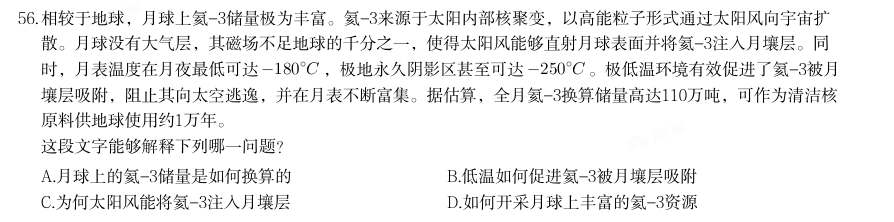

- **A.** 月球上的氦-3储量是如何换算的
- **B.** 低温如何促进氦-3被月壤层吸附
- **C.** 为何太阳风能将氦-3注入月壤层
- **D.** 如何开采月球上丰富的氦-3资源

**答案：C**　**考点：中心理解｜中心理解（综合）**　**难度：★★★★★**
**【2025 国考（地市级）·第 57 题】言语理解·中心理解｜GK-2025-ds-X057**

57. “微利惠民”是老年助餐行业的重要特点,但这也导致其盈利点不够清晰,加上配套服务体系建设还不够健 全、客流不稳定等因素影响,导致一些助餐机构经营困难。当前,要进一步推广老年助餐服务,应在设施场 地、资金筹集、税费减免等方面加大支持力度,并提高政策精准度。此外,还要充分发挥市场机制作用,不断 提高助餐机构自身能力。最后,应从老年人的现实需求和助餐服务的运营实际出发,引导更多主体参与,完善 多元筹资机制,落实各项优惠措施,才能进一步扩大服务覆盖面,形成更合理的布局,为更多老年人提供便 利。 这段文字意在强调:

- **A.** 老年助餐服务行业有良好的市场发展前景
- **B.** 多重因素导致老年助餐机构面临经营困境
- **C.** 应当帮助老年助餐机构适当提高盈利能力
- **D.** 多措并举多方参与方能推广老年助餐服务

**答案：D**　**考点：中心理解｜对策优先**　**难度：★★★★★**
**【2025 国考（地市级）·第 58 题】言语理解·中心理解｜GK-2025-ds-X058**

58. 同位素定年方法利用放射性同位素衰变原理来计算地表水进入封闭地下环境的时间,可以反映水在地下的补给 径流排泄规律;稳定同位素有同位素分馏和季节效应,在不同体系中分布比例存在差异,因此可以用来示踪地 下水的混合过程。目前,地下水循环研究中常用的同位素包括碳、氢、氧、硫等。随着技术发展,金属同位素 等非传统同位素的应用,扩大了地下水定年范围。其中,镁元素是主要造岩元素,易在风化过程中以离子形式 进入水体,且镁元素迁移行为简单、参与地球化学行为广,可以在地下水科学研究中发挥重要作用。 这段文字没有提及:

> 同题变体（主记录 GK-2025-fs-X050）

- **A.** 稳定同位素用于示踪地下水混合过程的原理
- **B.** 镁元素在地下水研究中发挥重要作用的原因
- **C.** 推动非传统同位素用于地下水研究的关键技术
- **D.** 计算地表水进入封闭地下环境所用时间的意义

**答案：C**　**考点：中心理解｜转折与因果**　**难度：★★★★★**
**【2025 国考（地市级）·第 59 题】言语理解·中心理解｜GK-2025-ds-X059**

59. 如果一味沉湎于琐碎的日常事务,缺乏大局观念和政治远见,不分轻重缓急,不从原则高度想问题,就会陷入 事务主义。习近平总书记指出:“如果忙忙碌碌,只是机械做事,陷入事务主义,是很难提高认识和工作水平 的。”这就意味着,要提高认识水平,必须走出事务主义的泥潭。毛泽东曾经指出:“庸俗的事务主义家不是 这样,他们尊重经验而看轻理论,因而不能通观客观过程的全体,缺乏明确的方针,没有远大的前途,沾沾自 喜于一得之功和一孔之见。”这为如何走出事务主义提供了指南针和路线图。 这段文字认为,为避免陷入事务主义,应该:

> 同题变体（主记录 GK-2025-fs-X046）

- **A.** 具有清晰明确的工作方案
- **B.** 坚持从理论高度看待问题
- **C.** 不断从实践中总结经验教训
- **D.** 通过学习补齐能力素质短板

**答案：B**　**考点：中心理解｜对策优先**　**难度：★★★★☆**
**【2025 国考（地市级）·第 60 题】言语理解·中心理解｜GK-2025-ds-X060**

60. 在一些科幻影片中,大质量黑洞周身的光环令人印象深刻。事实上,这并不是黑洞在发光,而是由宇宙中的气 体物质构成的吸积盘所辐射的光芒。当黑洞附近有物质靠近时,这些物质并不会立刻被黑洞吞噬,而是被吸引 到一个叫做吸积盘的结构中。当吸积盘受黑洞引力和摩擦的作用不断向内旋进时,内层的气体和尘埃被挤压导 致温度上升从而发射出电磁辐射,这就形成了黑洞周身的光环。不过,由于黑洞强大的引力对光的扭曲效应, 我们所能看到的吸积盘并不是一个扁平的圆盘,而是圆盘的远端被折起来,如同给黑洞戴了个“帽子”。 这段文字主要介绍:

- **A.** 黑洞周身产生光环的原因
- **B.** 吸积盘的形成及物质构成
- **C.** 吸积盘与黑洞作用的方式
- **D.** 黑洞吞噬宇宙物质的过程

**答案：A**　**考点：中心理解｜转折与因果**　**难度：★★★★★**
**【2025 国考（地市级）·第 61 题】言语理解·标题填入｜GK-2025-ds-X061**

61. 如今,文艺工作者深入挖掘传统绘画与传统舞蹈之间的内在联系,将诗、书、画、乐、舞融于一体,形成新的 审美表达。比如,杭州亚运会开幕式文艺表演环节,第一个节目《水墨入诗画》便以中国画为基本元素,身着 青绿色长裙的舞者在山水画卷中翩翩起舞,营造出“人在画中游”的优美意境。舞蹈诗剧《只此青绿》同样以 经典山水画为灵感,通过舞蹈再现画家王希孟创作《千里江山图》的过程,并以刚柔相济的肢体语言、精心设 计的舞蹈动作呈现山水神韵。在这些作品中,传统绘画与舞蹈的创意融合产生叠加效应,使传统文化与现代审 美相谐适,产生了广泛的社会影响。 最适合做这段文字标题的是:

- **A.** 青绿热:传统与现代的双向奔赴
- **B.** 传统与现代:审美表达的异与同
- **C.** 人在画中游:穿越千年的艺术盛宴
- **D.** 画与舞:跨界融合激发艺术新活力

**答案：D**　**考点：标题填入｜标题填入**　**难度：★★★★★**
**【2025 国考（地市级）·第 62 题】言语理解·逻辑填空｜GK-2025-ds-X062**

62. 与传统业态相比,新业态顺应多元化、多样化、个性化的产品或服务需求,实现产业与互联网、大数据、云计 算、人工智能等新技术深度融合,通过采用新技术和新模式,为市场引入新元素、丰富新场景,促进新岗位、 新就业形态不断涌现,创造更多就业机会。新业态既提供新的高技能岗位,扩大对高水平劳动力的需求,又通 过带动传统产业转型升级,实现对传统职业和岗位的再造,释放新的就业需求。当前,我国有超2亿灵活就业 人员,新就业形态 。 填入画横线部分最恰当的一项是:

- **A.** 已经成为吸纳就业的重要“蓄水池”
- **B.** 有助于促进区域间劳动资源的互补与共享
- **C.** 为高技能劳动力流动提供充足机会
- **D.** 是有效缓解重点群体就业压力的“缓冲器”

**答案：A**　**考点：逻辑填空｜语境分析**　**难度：★★★★★**
**【2025 国考（地市级）·第 63 题】言语理解·中心理解｜GK-2025-ds-X063**

63. 相比高校和科研机构,企业处于市场最前沿,对有市场潜力的技术感知更灵敏,对产业发展趋势的把握也更敏 锐。因此,在颠覆性技术的研发、转移转化过程中,需要强化企业科技创新主体地位。在课题立项中,要加快 提升企业技术创新决策的主体地位,建立企业常态化参与国家科技创新决策的机制;在创新过程中,要着力强 化企业科研组织的主体地位,支持领军企业聚焦国家重大需求,牵头组建创新联合体,加快形成企业主导的产 学研深度融合。同时,人才、经费等创新要素也要加快向企业特别是科技领军企业集聚。 这段文字意在说明:

- **A.** 应着力完善国家科技创新决策的体制机制
- **B.** 颠覆性技术创新需重视并发挥企业的作用
- **C.** 要大力推进颠覆性技术的研发及转移转化
- **D.** 创新要素的大量积聚有助于企业技术创新

**答案：B**　**考点：中心理解｜对策优先**　**难度：★★★★★**
**【2025 国考（地市级）·第 64 题】言语理解·中心理解｜GK-2025-ds-X064**

64. 熔盐堆是第四代核能系统中唯一的液态燃料堆,我国研发的熔盐堆是“钍基熔盐堆”,即用钍元素作为核燃 料、用熔融态的盐作为热介质进行发电。和常规铀反应堆不同,钍基熔盐堆内部循环的是液态盐。这些液态盐 既可被当作核燃料的承载体,又能被当作核裂变反应的冷却剂,因此在使用时要将钍元素溶解在氟盐冷却剂里 生成氟化盐,进而不断输出巨大的能量。由于钍基熔盐反应堆是用氟化盐作冷却剂,依赖的水资源较少,在缺 水的干旱地区甚至沙漠地区也能建造和运行。 这段文字解释了下列哪一问题?

- **A.** 液态盐作为反应堆核燃料承载体有何缺陷
- **B.** 钍元素通过何种方式溶解在氟盐冷却剂中
- **C.** 第四代核能系统为何仅有一种液态燃料堆
- **D.** 钍基熔盐反应堆为何可以在干旱地区建造

**答案：D**　**考点：中心理解｜转折与因果**　**难度：★★★★★**
**【2025 国考（地市级）·第 65 题】言语理解·中心理解｜GK-2025-ds-X065**

65. 经济是肌体,金融是血脉,两者共生共荣。银行利润建立在企业发展的基础上,实体经济如果没有足够的利润 率或者盈利能力,银行是没有办法获得持续发展和盈利空间的。而当前净息差的降低,使企业从银行获得了低 成本贷款,能够极大减轻企业经营发展负担,把更多资金投入科研创新、转型升级、设备更新等领域,进而实 现高质量发展。唯有实体经济规模扩大、效益改善、质量提升,银行才能获得自身高质量发展的坚实基础。 这段文字意在说明:

> 同题变体（主记录 GK-2025-fs-X055）

- **A.** 银行的盈利空间与企业盈利能力相辅相成
- **B.** 经济的稳定与繁荣是金融持续发展的根基
- **C.** 银行要稳健发展须保持合理的净息差水平
- **D.** 降低净息差有助于促进企业和银行的共赢

**答案：D**　**考点：中心理解｜中心句与主旨**　**难度：★★★★★**
**【2025 国考（地市级）·第 66 题】数量关系·行程问题｜GK-2025-ds-X066**

66. 张某8:00开车从A地出发,在

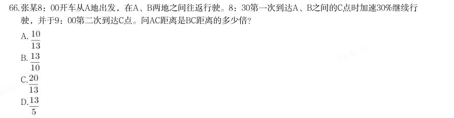

- **A.** 
- **B.** 
- **C.** 
- **D.** 

**答案：C**　**考点：行程问题｜环形与往返**　**难度：★★☆☆☆**
**【2025 国考（地市级）·第 67 题】数量关系·其他数量关系｜GK-2025-ds-X067**

67. 甲、乙、丙、丁四个部门共有210名员工,且甲部门员工数比丁部门多10人。现乙部门调动20名员工到丙部门 且其剩余员工并入丁部门后,甲、丙、丁三个部门的员工数之比为3:3:4。问原乙部门有多少名员工?

- **A.** 41
- **B.** 46
- **C.** 51
- **D.** 56

**答案：C**　**考点：其他数量关系｜和差倍比**　**难度：★★★☆☆**
**【2025 国考（地市级）·第 68 题】数量关系·其他数量关系｜GK-2025-ds-X068**

68. 化工商店出售200千克某种试剂,前60千克打2折出售,之后60千克打5折出售,剩余部分原价出售。以下坐标 图中,最能准确反映该试剂销量和销售收入之间关系的是:

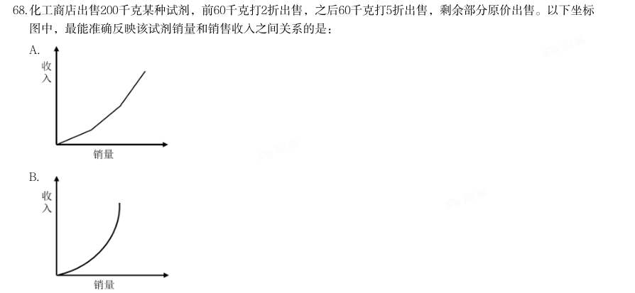

- **A.** 
- **B.** 
- **C.** 
- **D.** 

**答案：A**　**考点：其他数量关系｜和差倍比**　**难度：★★☆☆☆**
**【2025 国考（地市级）·第 69 题】数量关系·最值问题｜GK-2025-ds-X069**

69. 某单位65名职工中,拥有甲、乙、丙三项认证中至少一项的职工正好占80%,没有甲认证的职工与有乙认证的 职工人数一样多,仅有丙认证的职工有3人,三项认证都有的职工有6人,问有多少人仅拥有甲、乙两项认证?

- **A.** 10
- **B.** 13
- **C.** 16
- **D.** 19

**答案：A**　**考点：最值问题｜最值优化**　**难度：★★★★★**
**【2025 国考（地市级）·第 70 题】数量关系·排列组合｜GK-2025-ds-X070**

70. 某竞赛由5道次序固定的判断题组成,参赛者起始为0分,每答对1题加1分,每答错1题扣1分。小王作答了所有 试题,答完每道题时当前的得分都不低于1分。问他的答题情况有多少种不同的可能?

> 同题变体（主记录 GK-2025-fs-X072）

- **A.** 7
- **B.** 6
- **C.** 4
- **D.** 3

**答案：B**　**考点：排列组合｜基础排列组合**　**难度：★★★★★**
**【2025 国考（地市级）·第 71 题】数量关系·工程问题｜GK-2025-ds-X071**

71. 某种机械由3个A模块和2个B模块组成。甲车间每天可生产6个A模块或3个B模块,乙车间每天可生产1个A模块 或2个B模块。现两车间合作生产40台该机械所需模块,问至少需要多少天?

> 同题变体（主记录 GK-2025-fs-X073）

- **A.** 24
- **B.** 26
- **C.** 28
- **D.** 30

**答案：C**　**考点：工程问题｜给定时间型**　**难度：★★☆☆☆**
**【2025 国考（地市级）·第 72 题】数量关系·年龄问题｜GK-2025-ds-X072**

72. 张、王、李、赵4人的平均年龄为28岁,张、王的年龄之和比李大25岁,李、赵的年龄之和比张大27岁。已知 张比王大2岁,问他们4人中年龄最大的比最小的大几岁?

- **A.** 5
- **B.** 6
- **C.** 3
- **D.** 4

**答案：B**　**考点：年龄问题｜年龄差不变**　**难度：★★☆☆☆**
**【2025 国考（地市级）·第 73 题】数量关系·行程问题｜GK-2025-ds-X073**

73. 甲船在A港正东n海里,乙船在A港正南 海里,两船相距120海里,同时出发向A港匀速行驶。已知乙船的速 度是甲船的 倍,比甲船早3小时到A港。问甲船的速度是多少海里/小时?

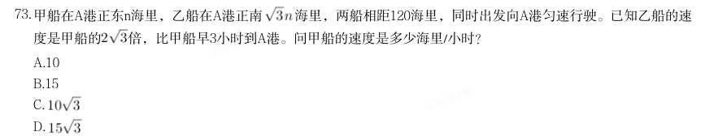

> 同题变体（主记录 GK-2025-fs-X074）

- **A.** 10
- **B.** 15
- **C.** 
- **D.** 

**答案：A**　**考点：行程问题｜相遇追及**　**难度：★★☆☆☆**
**【2025 国考（地市级）·第 74 题】数量关系·排列组合｜GK-2025-ds-X074**

74. 小王计划在7天假期自学甲、乙两门在线课程,每门课程需要连学2整天。如在所有可能的安排中随机选择1 种,不用学习的3天均不相邻的概率为:

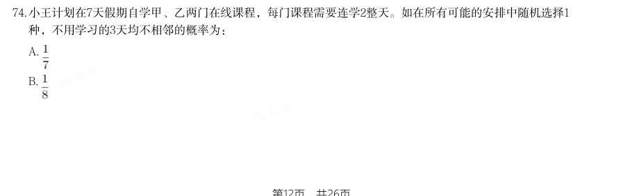

> 同题变体（主记录 GK-2025-fs-X079）

- **A.** 
- **B.** 
- **C.** 
- **D.** 

**答案：D**　**考点：排列组合｜捆绑法**　**难度：★★★★★**
**【2025 国考（地市级）·第 75 题】数量关系·几何问题｜GK-2025-ds-X075**

75. 一个容器的下部分为高12厘米的倒立圆锥体,上部分为圆柱体,且圆锥和圆柱的底面半径相等。现匀速向容器 中注入水,1分钟后液面高6厘米,又过30分钟后注满。问整个容器的高度为多少厘米?

> 同题变体（主记录 GK-2025-fs-X080）

- **A.** 22
- **B.** 22.5
- **C.** 23
- **D.** 23.5

**答案：D**　**考点：几何问题｜立体几何**　**难度：★★★★★**
**【2025 国考（地市级）·第 76 题】判断推理·图形推理｜GK-2025-ds-X076**

76. 个最恰当的答案。 从所给的四个选项中,选择最合适的一个填入问号处,使之呈现一定的规律性:

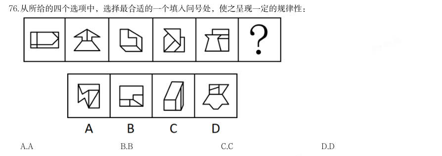

> （本题为图形题，选项为图片，见原卷）

**答案：D**　**考点：图形推理｜属性规律**　**难度：★★★★★**
**【2025 国考（地市级）·第 77 题】判断推理·图形推理｜GK-2025-ds-X077**

77. 从所给的四个选项中,选择最合适的一个填入问号处,使之呈现一定的规律性:

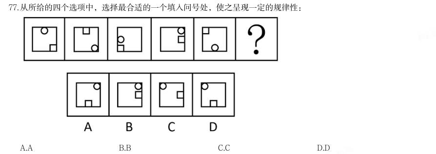

> （本题为图形题，选项为图片，见原卷）

**答案：D**　**考点：图形推理｜位置规律**　**难度：★★★★★**
**【2025 国考（地市级）·第 78 题】判断推理·图形推理｜GK-2025-ds-X078**

78. 从所给的四个选项中,选择最合适的一个填入问号处,使之呈现一定的规律性:

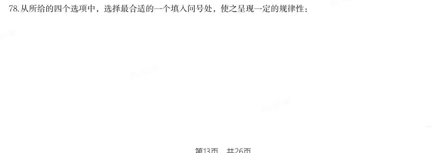

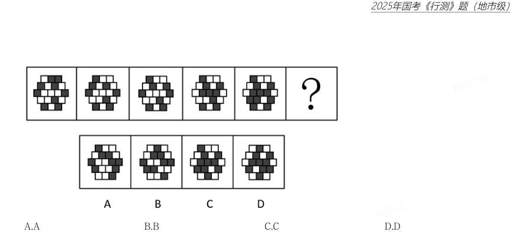

> （本题为图形题，选项为图片，见原卷）

**答案：C**　**考点：图形推理｜位置规律**　**难度：★★★★★**
**【2025 国考（地市级）·第 79 题】判断推理·图形推理｜GK-2025-ds-X079**

79. 从所给的四个选项中,选择最合适的一个填入问号处,使之呈现一定的规律性:

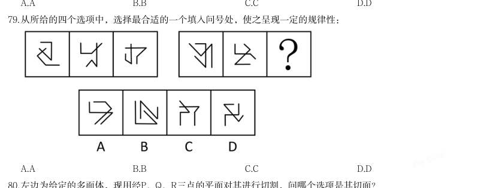

> （本题为图形题，选项为图片，见原卷）

**答案：D**　**考点：图形推理｜属性规律**　**难度：★★★★★**
**【2025 国考（地市级）·第 80 题】判断推理·图形推理｜GK-2025-ds-X080**

80. 左边为给定的多面体,现用经P、Q、R三点的平面对其进行切割,问哪个选项是其切面?

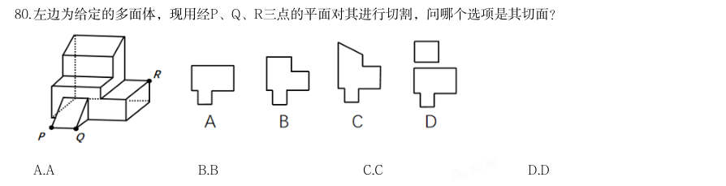

> （本题为图形题，选项为图片，见原卷）

**答案：A**　**考点：图形推理｜截面**　**难度：★★★★★**
**【2025 国考（地市级）·第 81 题】判断推理·图形推理｜GK-2025-ds-X081**

81. 下图为4个黑色、8个白色正方体粘接成的长方体,问哪一项可能是其正确的外表面展开图?

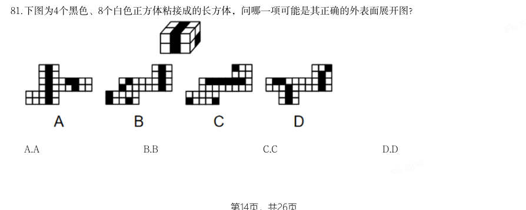

> （本题为图形题，选项为图片，见原卷）

**答案：D**　**考点：图形推理｜折纸盒**　**难度：★★★★★**
**【2025 国考（地市级）·第 82 题】判断推理·图形推理｜GK-2025-ds-X082**

82. 左边为15个白色和3个灰色正方体组合而成多面体的正、反两面直观图,其可以由1、2和3三个多面体组合 而成,问哪一项能填入问号处?

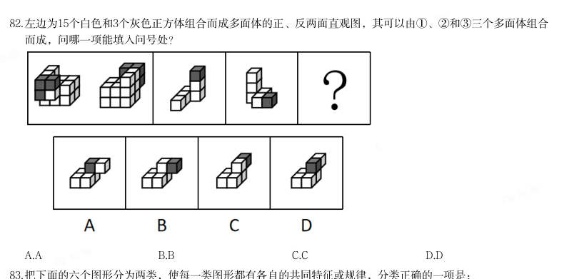

> （本题为图形题，选项为图片，见原卷）

**答案：B**　**考点：图形推理｜立体拼合**　**难度：★★★★★**
**【2025 国考（地市级）·第 83 题】判断推理·图形推理｜GK-2025-ds-X083**

83. 把下面的六个图形分为两类,使每一类图形都有各自的共同特征或规律,分类正确的一项是:

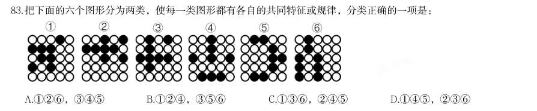

- **A.** 126,345
- **B.** 124,356
- **C.** 136,245
- **D.** 145,236

**答案：B**　**考点：图形推理｜分组分类**　**难度：★★★☆☆**
**【2025 国考（地市级）·第 84 题】判断推理·图形推理｜GK-2025-ds-X084**

84. 把下面的六个图形分为两类,使每一类图形都有各自的共同特征或规律,分类正确的一项是:

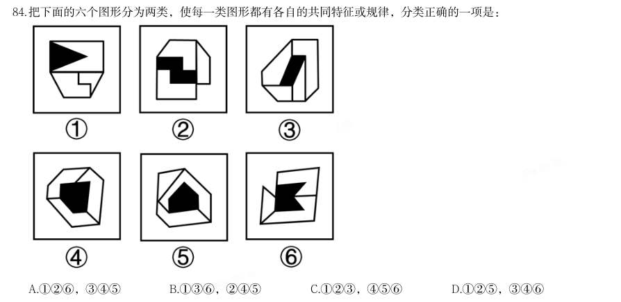

- **A.** 126,345
- **B.** 136,245
- **C.** 123,456
- **D.** 125,346

**答案：A**　**考点：图形推理｜分组分类**　**难度：★★★☆☆**
**【2025 国考（地市级）·第 85 题】判断推理·图形推理｜GK-2025-ds-X085**

85. 把下面的六个图形分为两类,使每一类图形都有各自的共同特征或规律,分类正确的一项是:

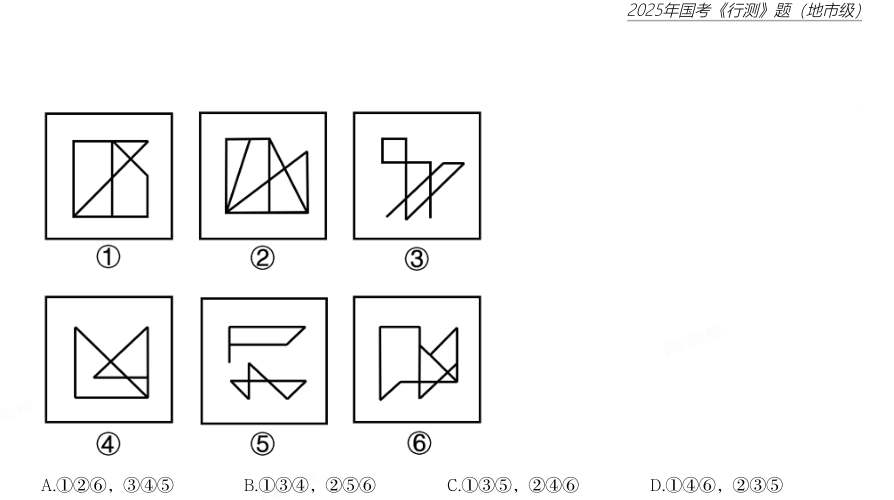

- **A.** 126,345
- **B.** 134,256
- **C.** 135,246
- **D.** 146,235

**答案：B**　**考点：图形推理｜分组分类**　**难度：★★★☆☆**
**【2025 国考（地市级）·第 86 题】判断推理·定义判断｜GK-2025-ds-X086**

86. 土地监测是利用遥感、遥测技术,对一个国家或地区土地利用状况的动态变化进行定期或不定期的监视和测 定,目的在于为国家和地区有关部门提供准确的土地利用变化情况,及时进行土地利用数据更新与对比分析, 以便编制土地利用变化图解等。 根据上述定义,下列属于土地监测的是:

- **A.** 通过量化多时相遥感图像空间域、时间域、光谱域的耦合特征,获得土地变化的类型、位置和数量
- **B.** 利用定期现场踏勘的方式标绘各土地使用单位及各类型土地的界线,对变化的地物界线作出修正
- **C.** 通过某地区土地权属变更资料的分析,梳理该地区土地所有权、使用权的变化,以及土地纠纷调解情况
- **D.** 利用植被具有红光强吸收特点,通过遥感设备监测植被的生长状态,并绘制植被的生长周期图

**答案：A**　**考点：定义判断｜单定义**　**难度：★★★☆☆**
**【2025 国考（地市级）·第 87 题】判断推理·定义判断｜GK-2025-ds-X087**

87. 主体间性是指人对他人意图的判断与推测。主体间性有不同的级别,一级主体间性即人对另一个人意图的判断 与推测,二级主体间性即人对另一人关于其他人意图的判断与推测的认知的认识。 根据上述定义,下列体现了二级主体间性的是:

- **A.** 小明饿了,去问妈妈饭做好没有,妈妈说爸爸正在做
- **B.** 老师知道学生们不喜欢做作业,周五就在班级群里通知本周末不留作业
- **C.** 小王知道老板爱挑毛病,每次提交的总结都得仔细检查好几遍
- **D.** 小花看见妈妈冲爸爸使了个眼色后,爸爸尴尬地放下酒杯,小花偷偷地笑了

**答案：D**　**考点：定义判断｜单定义**　**难度：★★★☆☆**
**【2025 国考（地市级）·第 88 题】判断推理·定义判断｜GK-2025-ds-X088**

88. 回应型预算要求政府基于与人民的民主协商作出预算决策,相关责任部门应当及时反应并积极回复人民的质疑 和诉求。 根据上述定义,下列属于回应型预算的是:

> 同题变体（主记录 GK-2025-fs-X092）

- **A.** 甲国突发大规模严重旱情,财政部门从中央及各级政府应急预算中,通过多种财政政策安排,保障应急救援经费
- **B.** 乙省是地质灾害高发地区,年初该省编制《乙省地质灾害应急中心XX年度部门预算公开说明》并在官网上发布
- **C.** 丙市在年初将上一年度的地方预算执行情况在官网进行公布,诚邀广大市民和社会公众踊跃监督并提出意见
- **D.** 丁区实行预算听证制度,对与公共服务和社会民生相关的重大支出项目开展听证,并就意见和建议进行书面

**答案：D**　**考点：定义判断｜单定义**　**难度：★★★☆☆**
**【2025 国考（地市级）·第 89 题】判断推理·定义判断｜GK-2025-ds-X089**

89. 答复 温度习服是指机体长期在高温或低温环境中,逐渐产生的对环境温度的耐受现象,包括热习服和冷习服。热习 服是指机体长期生活或工作在炎热或高温环境后产生的适应性变化;冷习服是指机体长期暴露于寒冷环境后逐 渐出现的适应性变化。 根据上述定义,下列属于温度习服的是:

- **A.** 长期接受滑雪训练的人都会穿着防水防风、透气保暖的滑雪服进行运动
- **B.** 生活在北极的因纽特人常表现出较高的基础代谢率以维持体温
- **C.** 生活在缺氧、干燥、紫外线照射强烈的高原地区的人,脸部呈现出“高原红”特征
- **D.** 在寒冷天气进行体育锻炼的人,倾向于增加热身时间以适应气温

**答案：B**　**考点：定义判断｜单定义**　**难度：★★★☆☆**
**【2025 国考（地市级）·第 90 题】判断推理·定义判断｜GK-2025-ds-X090**

90. 形象史学是指把形与象作为主要材料,用以研究历史的一门学问。具体来说,是指把传世的包括出土(水)的 具有研究价值的石刻、陶塑、壁画、雕砖、铜玉、织绣、漆器、木器、绘画等历史实物、文本图像以及文化史 迹作为主要研究对象,并结合传统文献来综合考察历史的一种新的史学研究模式。 根据上述定义,下列属于形象史学研究范畴的是:

> 同题变体（主记录 GK-2025-fs-X095）

- **A.** 结合《晋书》等史书,通过对吉林集安长川1号墓礼佛图主佛形象及莲花纹的考察,研究三燕文化对高句丽佛教产生的影响
- **B.** 通过对现存的汉画像石(汉代人雕刻在墓室、祠堂四壁的装饰石刻壁画)的实地考察,分析汉画像石的雕刻风格和雕刻技法
- **C.** 根据史诗《伊利亚特》的记载,找到特洛伊城的遗址,并在其中发掘出王冠、银瓶、短剑等大量器物
- **D.** 通过对二十世纪二三十年代齐白石、傅抱石等人具有代表性的国画作品进行研究,分析当时国画中所蕴含的

**答案：A**　**考点：定义判断｜单定义**　**难度：★★★★☆**
**【2025 国考（地市级）·第 91 题】判断推理·定义判断｜GK-2025-ds-X091**

91. 思想意境 求证思维是指用自己掌握的知识和经验去验证某一结论的思维。转化思维是指在解决问题的过程中遇到障碍 时,把问题转换成另一种形式,使问题变得更简单、更清晰。集中思维是指从许多资料中找出合乎逻辑的联 系,从而导出一定的结论,或者对几种解决方案加以比较研究,进而导出一种解决办法。 根据上述定义,下列说法正确的是:

- **A.** 数学家根据自己所学,从多角度证明某一命题是否成立。这体现了求证思维
- **B.** 修建铁路时,工程师依据施工方案采用爆破的方法开山劈岭,完成线路铺设。这体现了集中思维
- **C.** 当发现改变滚珠形状无法减少轴承摩擦时,有人设计出使旋转轴呈悬浮状的空气轴承。这体现了集中思维
- **D.** 商家通过分析药店互联网化的不同方案,权衡利弊后最终选定线上线下相结合的模式。这体现了转化思维

**答案：A**　**考点：定义判断｜单定义**　**难度：★★★★☆**
**【2025 国考（地市级）·第 92 题】判断推理·定义判断｜GK-2025-ds-X092**

92. 自动投案是指犯罪事实或者犯罪嫌疑人未被司法机关发觉,或者虽被发觉,但犯罪嫌疑人尚未受到讯问、未被 采取强制措施时,主动、直接向公安机关、人民检察院或者人民法院投案。 根据上述定义,下列不属于自动投案的是:

- **A.** 甲实施多起电信诈骗,获利十余万元,在公安机关进行的一次隐患排查入户走访中,发现甲形迹可疑,经盘问甲主动交代了自己的罪行
- **B.** 乙致人重伤后潜逃,在公安机关经侦查确认乙为该案的犯罪嫌疑人时,乙正因酒后驾驶被行政拘留,经公安机关讯问后,乙交代了自己的罪行
- **C.** 丙多次挪用公款,其父母发现异常后,多次规劝其投案自首无效,直至单位发现款项异常开始查账后,丙才到公安机关交代自己的罪行
- **D.** 丁因入室盗窃被判处有期徒刑,在服刑期间,丁主动向公安机关交代自己系公安机关久未破获的“7·26”走

**答案：B**　**考点：定义判断｜单定义**　**难度：★★★☆☆**
**【2025 国考（地市级）·第 93 题】判断推理·定义判断｜GK-2025-ds-X093**
> 材料：私案的主谋之一 深度优先搜索是指从初始节点出发,按照一定的顺序扩展到下一个节点,然后从下一个节点出发继续扩展到新 的节点,不断递归执行这个过程,直到某个节点不能再扩展到下一个节点,此时返回上一个节点重新寻找一个 新的节点继续扩展,如此搜索下去,直到找到目标节点,或者搜索完所有节点为止。

93. 根据上述定义,如果以“1”为初始节点,“12”为目标节点,下列搜索路径符合深度优先搜索的是:

- **A.** 1
- **B.** 1
- **C.** 1
- **D.** 1

**答案：B**　**考点：定义判断｜单定义**　**难度：★★☆☆☆**
**【2025 国考（地市级）·第 94 题】判断推理·定义判断｜GK-2025-ds-X094**

94. 企业薪酬策略主要包括两个方面:一是体现企业支付标准的策略,即薪酬水平策略,其本质是在市场既定的薪 酬水平上设定一个对公司有利的最优报酬水平;二是体现企业支付差异的策略,即薪酬结构策略,其通过企业 的工资等级和工资幅度、加薪条件、晋升降级、小时工资、加班休假、工作时间等方面的薪酬政策表现出来。 根据上述定义,下列说法正确的是:

- **A.** 甲企业根据市场调查结果,设定行政岗位的薪酬标准。这体现了薪酬结构策略
- **B.** 乙企业今年赢利颇丰,企业将全员工资普遍调高。这体现了薪酬水平策略
- **C.** 丙企业工资分为基本工资和绩效工资两部分,绩效工资与员工绩效挂钩。这体现了薪酬水平策略
- **D.** 丁企业采取不同方式调整高、中、低三个职位层次人员的薪酬。这体现了薪酬水平策略

**答案：B**　**考点：定义判断｜单定义**　**难度：★★★★★**
**【2025 国考（地市级）·第 95 题】判断推理·定义判断｜GK-2025-ds-X095**

95. 断取是修辞格的一种,引用词语时,只截取其中部分字眼的意义,而置其余于不顾,是一种“断章取义”的修 辞方式。 根据上述定义,下列没有采用断取修辞方式的是:

- **A.** 相较于他之前见过的大阵仗,眼前的情形在他眼中就是“小儿科”
- **B.** 小林一心扑在科研项目上,他至今还是一个“光杆司令”呢
- **C.** 山林发生火灾,消防员“上刀山下火海”,奋力保卫人民的生命和财产安全
- **D.** 实在走投无路,他最终还是找老师“开药方”,问询这一困局的破解之道

**答案：D**　**考点：定义判断｜单定义**　**难度：★★★☆☆**
**【2025 国考（地市级）·第 96 题】判断推理·类比推理｜GK-2025-ds-X096**

96. 殚精竭虑:费尽心机

- **A.** 狐假虎威:虚张声势
- **B.** 舍生忘死:死里逃生
- **C.** 侃侃而谈:喋喋不休
- **D.** 光怪陆离:五光十色

**答案：C**　**考点：类比推理｜语义关系**　**难度：★★☆☆☆**
**【2025 国考（地市级）·第 97 题】判断推理·类比推理｜GK-2025-ds-X097**

97. 逐客令:挡箭牌

- **A.** 急先锋:领航者
- **B.** 避风港:马后炮
- **C.** 敲门砖:绊脚石
- **D.** 鸿门宴:攻心计

**答案：C**　**考点：类比推理｜语义关系**　**难度：★★☆☆☆**
**【2025 国考（地市级）·第 98 题】判断推理·类比推理｜GK-2025-ds-X098**

98. 直观性:即时性:网络直播

- **A.** 等边性:对称性:等腰梯形
- **B.** 公开性:权威性:行政法律
- **C.** 周期性:延展性:机械钟摆
- **D.** 挥发性:保温性:石棉纤维

**答案：B**　**考点：类比推理｜对应关系**　**难度：★★☆☆☆**
**【2025 国考（地市级）·第 99 题】判断推理·类比推理｜GK-2025-ds-X099**

99. 群众来访:窗口接访:调查督办

- **A.** 地面试验:点火飞行:燃料加注
- **B.** 支付本币:兑换外币:确认汇率
- **C.** 建造堤坝:潮汐发电:送电入户
- **D.** 重启谈判:临时休战:边境冲突

**答案：C**　**考点：类比推理｜对应关系**　**难度：★★☆☆☆**
**【2025 国考（地市级）·第 100 题】判断推理·类比推理｜GK-2025-ds-X100**

100. 稀树草原 对于 ( ) 相当于 ( ) 对于 国际公约

- **A.** 物种多样性;缔约国家
- **B.** 落叶阔叶林;多边条约
- **C.** 气候变迁;政治协调
- **D.** 植被类型;联合国宪章

**答案：D**　**考点：类比推理｜逻辑关系**　**难度：★★☆☆☆**
**【2025 国考（地市级）·第 101 题】判断推理·逻辑判断｜GK-2025-ds-X101**

101. 研究者设计了一个“拔河比赛”的实验,要求被试分别在单独和群体的情境下拔河,同时用仪器来测量他们的 拉力。结果发现随着被试人数的增加,平均每个被试使出的力减少了。据此研究者认为,提高团队业绩的最佳 途径就是减少团队人数。 下列选项如果为真,除哪项外均能质疑上述研究者的观点?

- **A.** 团队合作中各取所长很重要,人数过少效率也会随之下降
- **B.** 团队一起工作时,个人的贡献不被凸显,很容易失去积极性
- **C.** 团队的合作与管理方式要比拔河复杂得多,不能一概而论
- **D.** 增强个体对团队的归属感、责任感,能够更好地提高团队业绩

**答案：B**　**考点：逻辑判断｜削弱论证**　**难度：★★★★★**
**【2025 国考（地市级）·第 102 题】判断推理·逻辑判断｜GK-2025-ds-X102**

102. 考古人员发现了近300枚16亿年前的丝状体生物化石,这些丝状体均由巨型细胞组成,直径20~194微米不等。 化石中,有些丝状体直径保持不变,细胞呈短柱状至长柱状;有些丝状体整体向一端均匀收缩,细胞呈柱状、 桶状或杯状;而有的丝状体仅一端变细,形态呈现了一定的复杂性。考古人员据此认为,这些丝状体很可能属 于真核生物。 以下各项如果为真,除哪项外均能支持上述观点?

- **A.** 这些化石中被发现有类似于现生繁殖细胞——孢子一样的圆形结构,这一结构只出现在真核生物中
- **B.** 原核生物细胞的直径一般小于2微米,而真核生物细胞的直径一般在10~100微米之间
- **C.** 在目前已知的原核生物中,大多数的丝状体形态都比较简单,只有个别呈现出过渡期形态
- **D.** 经比对,该化石中丝状体与一些现生绿藻(一种真核生物)的藻丝体形态、细胞大小分布和繁殖方式等最为

**答案：C**　**考点：逻辑判断｜加强论证**　**难度：★★★★★**
**【2025 国考（地市级）·第 103 题】判断推理·逻辑判断｜GK-2025-ds-X103**

103. 接近 某企业对于如何进行产教融合,形成如下两种方案:一是“做深”,企业自建培训中心,成立专职和兼职的企 业培训师队伍,并根据企业需求,制定专门的培训大纲和计划,该中心与毕业生未来形成签约。二是“做 浅”,在学校设立“冠名班”和“订单班”,以学校教育为主,企业与学生当前没有签约意向,但随时保持互 相选择的权利。 以下理由中,能够支持企业选择第二方案的是:

- **A.** 企业必须付出人力成本,人力资源自带“稀缺”和“增值”属性,在企业面临竞争压力时尤其要重视
- **B.** 企业订单量并不是稳定的,遇到订单量突然增加需要扩产的时候,才临时需要大量的人参与进来
- **C.** 该企业生产使用的是特种专业设备,竞争对手稀少,不具备从市场上挖掘技术人员的条件
- **D.** 学校教育内容具有普适性,而自建培训中心有利于企业保障准员工的培养质量,提前锁定毕业生

**答案：B**　**考点：逻辑判断｜加强论证**　**难度：★★★★★**
**【2025 国考（地市级）·第 104 题】判断推理·逻辑判断｜GK-2025-ds-X104**

104. 我军军语惯于将数字1、2、7、9、0变读为幺、两、拐、勾、洞,这些数字有个共同特点,即其原本的发音部 位与发音方法使得在读这些数字时无法发出较大声音,在噪声干扰较为强烈的战场上,通信兵使用通讯设备进 行情报交流时,话筒对这些数字的实际增音效果并不明显,可能会影响信息的准确性。因此,在军语中将这些 数字变读,是为了符合实际需要。 以下哪项如果为真,不能支持上述结论?

- **A.** 常规数字念法中1、7的韵尾相同,发音相似,在嘈杂的战场环境中容易混淆,造成信息传达错误
- **B.** 士兵一般都来自不同的兵源地,不可避免地带有家乡口音,将数字变读可以避免口音问题
- **C.** 在国际无线电通话中,也会对字母读音进行变读,如将A读成Alpha,将D读成Delta
- **D.** 将0读成“洞”时,更容易提高声音,同时也使声音更加干脆清晰,确保信息的准确性

**答案：C**　**考点：逻辑判断｜加强论证**　**难度：★★★★★**
**【2025 国考（地市级）·第 105 题】判断推理·逻辑判断｜GK-2025-ds-X105**

105. 海山是海面下的岛屿,与岛屿中的火山岛有相同的起源和相似的形态,以往的海山生物调查发现,海山岩石上 的生物群落与海山周边的软底沉积和深海平原上的生物群落大不相同。而且,一些海山之间的生物群落在物种 构成上较少重叠。因此,有一些学者认为,相对孤立的海山存在独特的生物群落且拥有高度特有的动物群。 以下哪项如果为真,最能反驳上述学者的观点?

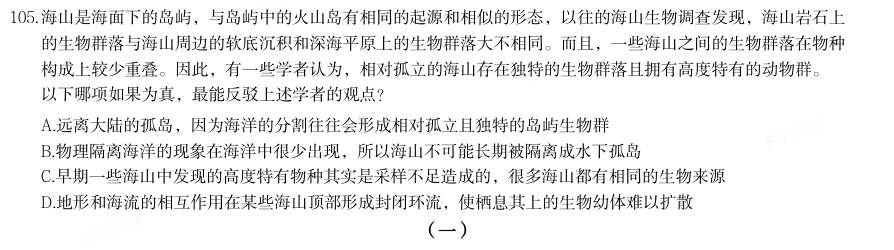

> 同题变体（主记录 GK-2025-fs-X107）

- **A.** 远离大陆的孤岛,因为海洋的分割往往会形成相对孤立且独特的岛屿生物群
- **B.** 物理隔离海洋的现象在海洋中很少出现,所以海山不可能长期被隔离成水下孤岛
- **C.** 早期一些海山中发现的高度特有物种其实是采样不足造成的,很多海山都有相同的生物来源
- **D.** 地形和海流的相互作用在某些海山顶部形成封闭环流,使栖息其上的生物幼体难以扩散

**答案：C**　**考点：逻辑判断｜削弱论证**　**难度：★★★★★**
**【2025 国考（地市级）·第 106 题】判断推理·逻辑判断｜GK-2025-ds-X106**

106. (一) 某科研机构今年拟举办甲、乙、丙、丁、戊、己、庚、辛8次学术会议,每个季度最多举办3次,且各次会议举 办时间不重叠。具体安排要求如下: (1)丁、辛安排在第二季度; (2)甲、戊安排在同一个季度; (3)丁在乙之后丙之前举办; (4)丙在甲之前己之后举办。 下列哪2次会议可以安排在第一季度?

- **A.** 甲和戊
- **B.** 丙和丁
- **C.** 丁和己
- **D.** 己和庚

**答案：D**　**考点：逻辑判断｜结论推出**　**难度：★★★★★**
**【2025 国考（地市级）·第 107 题】判断推理·逻辑判断｜GK-2025-ds-X107**

107. 如果第二季度只安排2次会议,那么以下哪次会议一定安排在第一季度?

- **A.** 甲
- **B.** 乙
- **C.** 庚
- **D.** 丙

**答案：B**　**考点：逻辑判断｜翻译推理**　**难度：★★★☆☆**
**【2025 国考（地市级）·第 108 题】判断推理·逻辑判断｜GK-2025-ds-X108**

108. 如果丙、戊安排在第四季度,下列哪2次会议可以安排在第三季度?

- **A.** 甲和庚
- **B.** 乙和丁
- **C.** 乙和己
- **D.** 己和庚

**答案：D**　**考点：逻辑判断｜结论推出**　**难度：★★★☆☆**
**【2025 国考（地市级）·第 109 题】判断推理·逻辑判断｜GK-2025-ds-X109**

109. 如果每个季度至少安排1次会议,并且最后一个季度仅安排1次会议,下列哪2次会议一定安排在第三季度?

- **A.** 甲和戊
- **B.** 乙和丙
- **C.** 丙和己
- **D.** 己和庚

**答案：A**　**考点：逻辑判断｜结论推出**　**难度：★★★☆☆**
**【2025 国考（地市级）·第 110 题】判断推理·逻辑判断｜GK-2025-ds-X110**

110. 如果甲安排在第三季度,第四季度不安排会议,庚不可能和哪次会议安排在同一个季度?

- **A.** 乙
- **B.** 丙
- **C.** 己
- **D.** 辛

**答案：B**　**考点：逻辑判断｜前提假设**　**难度：★★★☆☆**
**【2025 国考（地市级）·第 111 题】资料分析·比重计算与比较｜GK-2025-ds-X111**

111. 分析、比较、计算和判断处理。 (一) 2019-2023年,有几个城市五批次累计公示的专精特新“小巨人”上市企业数量占全国的比重超过5%?

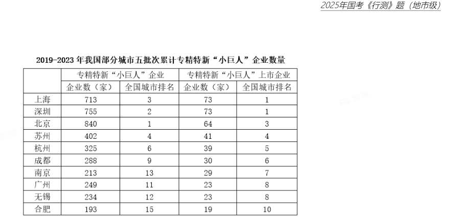

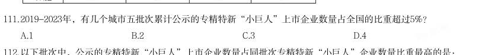

- **A.** 1
- **B.** 2
- **C.** 3
- **D.** 4

**答案：C**　**考点：比重计算与比较｜现期比重**　**难度：★★★☆☆**
**【2025 国考（地市级）·第 112 题】资料分析·比重计算与比较｜GK-2025-ds-X112**

112. 以下批次中,公示的专精特新“小巨人”上市企业数量占同批次专精特新“小巨人”企业数量比重最高的是:

> 材料图见 images/GK-2025-ds-X111-m.jpg

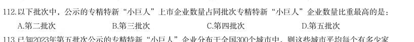

- **A.** 第二批次
- **B.** 第三批次
- **C.** 第四批次
- **D.** 第五批次

**答案：A**　**考点：比重计算与比较｜现期比重**　**难度：★★☆☆☆**
**【2025 国考（地市级）·第 113 题】资料分析·平均数计算｜GK-2025-ds-X113**

113. 已知2023年第五批次公示的专精特新“小巨人”企业分布于全国300个城市中,则这些城市平均每个有多少家 第五批次公示的专精特新“小巨人”非上市企业?

> 材料图见 images/GK-2025-ds-X111-m.jpg

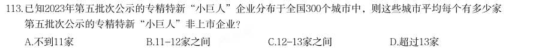

- **A.** 不到11家
- **B.** 11-12家之间
- **C.** 12-13家之间
- **D.** 超过13家

**答案：B**　**考点：平均数计算｜现期平均数**　**难度：★★★☆☆**
**【2025 国考（地市级）·第 114 题】资料分析·比重计算与比较｜GK-2025-ds-X114**

114. 2019-2023年,北京、上海、广州、深圳4个城市五批次累计公示的专精特新“小巨人”企业数量之和约占全国 总数的:

> 材料图见 images/GK-2025-ds-X111-m.jpg

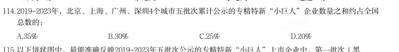

- **A.** 35%
- **B.** 30%
- **C.** 25%
- **D.** 20%

**答案：D**　**考点：比重计算与比较｜现期比重**　**难度：★★☆☆☆**
**【2025 国考（地市级）·第 115 题】资料分析·综合分析｜GK-2025-ds-X115**

115. 以下饼状图中,最能准确反映2019-2023年五批次公示的专精特新“小巨人”上市企业中,第一批次(黑 色)、第二批次(横线)、第三批次(竖线)、第四批次(白色)和第五批次(网格)企业数量比例关系的 是:

> 材料图见 images/GK-2025-ds-X111-m.jpg

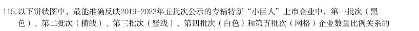

- **A.** 
- **B.** 
- **C.** 
- **D.** 

**答案：B**　**考点：综合分析｜比重**　**难度：★★★★★**
**【2025 国考（地市级）·第 116 题】资料分析·综合分析｜GK-2025-ds-X116**

116. (二) 2021-2023年,Z省各年律师人数与律师事务所总数的比值:

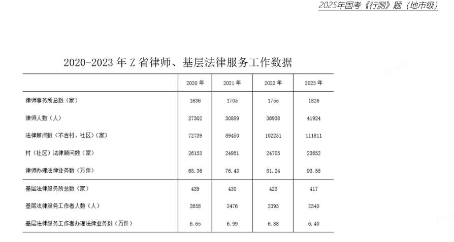

- **A.** 先升后降
- **B.** 先降后升
- **C.** 持续下降
- **D.** 持续上升

**答案：D**　**考点：综合分析｜综合分析（综合）**　**难度：★★★★☆**
**【2025 国考（地市级）·第 117 题】资料分析·倍数计算｜GK-2025-ds-X117**

117. 2020-2023年,Z省律师办理法律业务数之和约是同期基层法律服务工作者办理法律业务数之和的多少倍?

> 材料图见 images/GK-2025-ds-X116-m.jpg

- **A.** 12
- **B.** 15
- **C.** 18
- **D.** 21

**答案：A**　**考点：倍数计算｜是几倍**　**难度：★★★☆☆**
**【2025 国考（地市级）·第 118 题】资料分析·倍数计算｜GK-2025-ds-X118**

118. 2023年,Z省含村、社区在内的法律顾问数约是2020年的多少倍?

> 材料图见 images/GK-2025-ds-X116-m.jpg

- **A.** 1.2
- **B.** 1.4
- **C.** 1.6
- **D.** 1.8

**答案：B**　**考点：倍数计算｜是几倍**　**难度：★★★☆☆**
**【2025 国考（地市级）·第 119 题】资料分析·增长量计算｜GK-2025-ds-X119**

119. 如保持2023年同比增量不变,则到哪一年Z省律师办理法律业务数将首次超过150万件?

> 材料图见 images/GK-2025-ds-X116-m.jpg

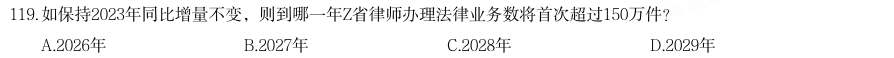

- **A.** 2026年
- **B.** 2027年
- **C.** 2028年
- **D.** 2029年

**答案：C**　**考点：增长量计算｜增长量计算（415 份数法）**　**难度：★★★☆☆**
**【2025 国考（地市级）·第 120 题】资料分析·增长量计算｜GK-2025-ds-X120**

120. 以下柱状图反映了2021、2022和2023年Z省律师、基层法律服务工作哪一指标的同比增量变化趋势(横轴位置 表示增量为0)?

> 材料图见 images/GK-2025-ds-X116-m.jpg

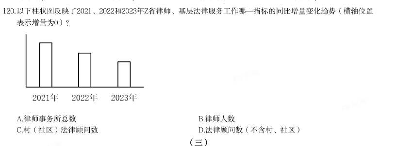

- **A.** 律师事务所总数
- **B.** 律师人数
- **C.** 村(社区)法律顾问数
- **D.** 法律顾问数(不含村、社区)

**答案：D**　**考点：增长量计算｜增长量计算（415 份数法）**　**难度：★★★☆☆**
**【2025 国考（地市级）·第 121 题】资料分析·综合分析｜GK-2025-ds-X121**

121. (三) 注:上座率 2023年12月,资料中电影总放映场次最多的三个城市票房之和在以下哪个范围内?

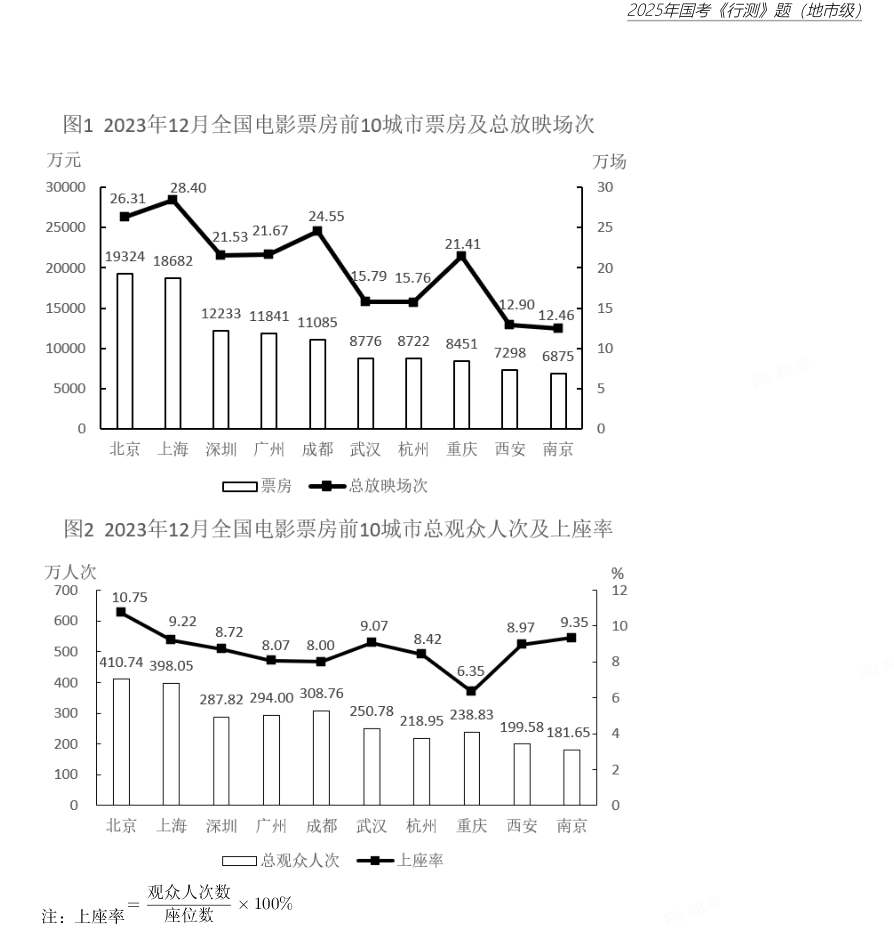

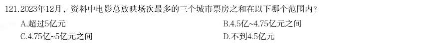

- **A.** 超过5亿元
- **B.** 4.5亿~4.75亿元之间
- **C.** 4.75亿~5亿元之间
- **D.** 不到4.5亿元

**答案：C**　**考点：综合分析｜综合分析（综合）**　**难度：★★★★☆**
**【2025 国考（地市级）·第 122 题】资料分析·平均数计算｜GK-2025-ds-X122**

122. 以下城市中2023年12月平均每场电影观众人次数最多的是:

> 材料图见 images/GK-2025-ds-X121-m.jpg

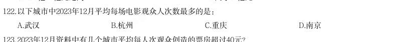

- **A.** 武汉
- **B.** 杭州
- **C.** 重庆
- **D.** 南京

**答案：A**　**考点：平均数计算｜现期平均数**　**难度：★★★☆☆**
**【2025 国考（地市级）·第 123 题】资料分析·平均数计算｜GK-2025-ds-X123**

123. 2023年12月资料中有几个城市平均每人次观众创造的票房超过40元?

> 材料图见 images/GK-2025-ds-X121-m.jpg

- **A.** 3
- **B.** 4
- **C.** 5
- **D.** 6

**答案：B**　**考点：平均数计算｜现期平均数**　**难度：★★★☆☆**
**【2025 国考（地市级）·第 124 题】资料分析·平均数计算｜GK-2025-ds-X124**

124. 如某月北京的电影总放映场次和平均每场座位数与2023年12月相同,但上座率增加5个百分点,则该月北京将 有约多少万人次观众观影?

> 材料图见 images/GK-2025-ds-X121-m.jpg

- **A.** 602
- **B.** 431
- **C.** 794
- **D.** 696

**答案：A**　**考点：平均数计算｜现期平均数**　**难度：★★★☆☆**
**【2025 国考（地市级）·第 125 题】资料分析·综合分析｜GK-2025-ds-X125**

125. 关于资料中城市2023年12月电影票房状况,能够从上述资料中推出的是:

> 材料图见 images/GK-2025-ds-X121-m.jpg

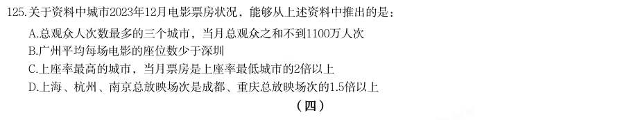

- **A.** 总观众人次数最多的三个城市,当月总观众之和不到1100万人次
- **B.** 广州平均每场电影的座位数少于深圳
- **C.** 上座率最高的城市,当月票房是上座率最低城市的2倍以上
- **D.** 上海、杭州、南京总放映场次是成都、重庆总放映场次的1.5倍以上

**答案：C**　**考点：综合分析｜平均数**　**难度：★★★★★**
**【2025 国考（地市级）·第 126 题】资料分析·比重计算与比较｜GK-2025-ds-X126**
> 材料：2023年一季度,我国外贸进出口总额为9.89万亿元,同比增加0.45万亿元。其中,东部地区进出口7.75万亿 元,同比增长2.9%;中西部、东北地区分别进出口1.84万亿元、2975.4亿元,同比分别增长12.6%、9.4%。 2月份,东部地区进出口同比增速由1月份的下降11.1%转为增长7%,3月份增速扩大至15.8%。一季度有进 出口实绩企业数量38.7万家,同比增长5.2%。一季度,东部地区出口高技术产品7741.7亿元,同比增长9.8%, 占东部地区出口额比重为17.9%,同比提升0.7个百分点,其中3月增速为21%。 一季度,中西部地区民营企业进出口1.08万亿元,同比增长32.8%,中西部地区对“一带一路”沿线国家进 出口7400.9亿元,同比增长38%。一般贸易占中西部地区进出口总额的56.6%,同比提升4.9个百分点。 一季度,东北地区黑色金属冶炼和压延加工业、汽车制造业

126. 以下饼状图中,最能准确反映2023年一季度我国外贸进出口总额中,东部地区(白色)、中西部地区(斜线) 和东北地区(黑色)外贸进出口额占比关系的是:

> 材料图见 images/GK-2025-ds-X121-m.jpg

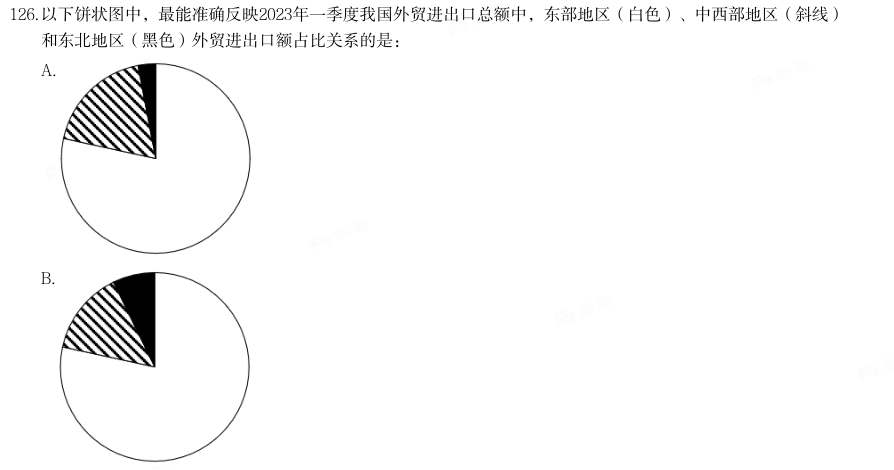

- **A.** 
- **B.** 
- **C.** 
- **D.** 

**答案：A**　**考点：比重计算与比较｜现期比重**　**难度：★★★☆☆**
**【2025 国考（地市级）·第 127 题】资料分析·综合分析｜GK-2025-ds-X127**
> 材料：2023年一季度,我国外贸进出口总额为9.89万亿元,同比增加0.45万亿元。其中,东部地区进出口7.75万亿 元,同比增长2.9%;中西部、东北地区分别进出口1.84万亿元、2975.4亿元,同比分别增长12.6%、9.4%。 2月份,东部地区进出口同比增速由1月份的下降11.1%转为增长7%,3月份增速扩大至15.8%。一季度有进 出口实绩企业数量38.7万家,同比增长5.2%。一季度,东部地区出口高技术产品7741.7亿元,同比增长9.8%, 占东部地区出口额比重为17.9%,同比提升0.7个百分点,其中3月增速为21%。 一季度,中西部地区民营企业进出口1.08万亿元,同比增长32.8%,中西部地区对“一带一路”沿线国家进 出口7400.9亿元,同比增长38%。一般贸易占中西部地区进出口总额的56.6%,同比提升4.9个百分点。 一季度,东北地区黑色金属冶炼和压延加工业、汽车制造业

127. 2023年一季度,东部地区外贸进口额约为多少万亿元?

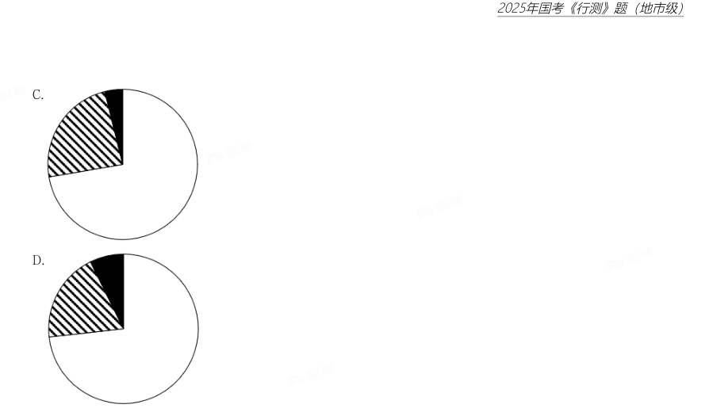

- **A.** 2.2
- **B.** 2.8
- **C.** 3.4
- **D.** 4.0

**答案：C**　**考点：综合分析｜比重**　**难度：★★★★☆**
**【2025 国考（地市级）·第 128 题】资料分析·比重计算与比较｜GK-2025-ds-X128**
> 材料：2023年一季度,我国外贸进出口总额为9.89万亿元,同比增加0.45万亿元。其中,东部地区进出口7.75万亿 元,同比增长2.9%;中西部、东北地区分别进出口1.84万亿元、2975.4亿元,同比分别增长12.6%、9.4%。 2月份,东部地区进出口同比增速由1月份的下降11.1%转为增长7%,3月份增速扩大至15.8%。一季度有进 出口实绩企业数量38.7万家,同比增长5.2%。一季度,东部地区出口高技术产品7741.7亿元,同比增长9.8%, 占东部地区出口额比重为17.9%,同比提升0.7个百分点,其中3月增速为21%。 一季度,中西部地区民营企业进出口1.08万亿元,同比增长32.8%,中西部地区对“一带一路”沿线国家进 出口7400.9亿元,同比增长38%。一般贸易占中西部地区进出口总额的56.6%,同比提升4.9个百分点。 一季度,东北地区黑色金属冶炼和压延加工业、汽车制造业

128. 2023年一季度,中西部地区对“一带一路”沿线国家进出口贸易额同比增量约占同期中西部地区外贸进出口总 额同比增量的:

> 材料图见 images/GK-2025-ds-X127-m.jpg

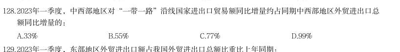

- **A.** 33%
- **B.** 55%
- **C.** 77%
- **D.** 99%

**答案：D**　**考点：比重计算与比较｜两期比重差**　**难度：★★★☆☆**
**【2025 国考（地市级）·第 129 题】资料分析·比重计算与比较｜GK-2025-ds-X129**
> 材料：2023年一季度,我国外贸进出口总额为9.89万亿元,同比增加0.45万亿元。其中,东部地区进出口7.75万亿 元,同比增长2.9%;中西部、东北地区分别进出口1.84万亿元、2975.4亿元,同比分别增长12.6%、9.4%。 2月份,东部地区进出口同比增速由1月份的下降11.1%转为增长7%,3月份增速扩大至15.8%。一季度有进 出口实绩企业数量38.7万家,同比增长5.2%。一季度,东部地区出口高技术产品7741.7亿元,同比增长9.8%, 占东部地区出口额比重为17.9%,同比提升0.7个百分点,其中3月增速为21%。 一季度,中西部地区民营企业进出口1.08万亿元,同比增长32.8%,中西部地区对“一带一路”沿线国家进 出口7400.9亿元,同比增长38%。一般贸易占中西部地区进出口总额的56.6%,同比提升4.9个百分点。 一季度,东北地区黑色金属冶炼和压延加工业、汽车制造业

129. 2023年一季度,东部地区外贸进出口额占我国外贸进出口总额比重比上年同期:

> 材料图见 images/GK-2025-ds-X127-m.jpg

- **A.** 上升了5个百分点以上
- **B.** 上升了不到5个百分点
- **C.** 下降了5个百分点以上
- **D.** 下降了不到5个百分点

**答案：D**　**考点：比重计算与比较｜两期比重差**　**难度：★★★☆☆**
**【2025 国考（地市级）·第 130 题】资料分析·综合分析｜GK-2025-ds-X130**
> 材料：2023年一季度,我国外贸进出口总额为9.89万亿元,同比增加0.45万亿元。其中,东部地区进出口7.75万亿 元,同比增长2.9%;中西部、东北地区分别进出口1.84万亿元、2975.4亿元,同比分别增长12.6%、9.4%。 2月份,东部地区进出口同比增速由1月份的下降11.1%转为增长7%,3月份增速扩大至15.8%。一季度有进 出口实绩企业数量38.7万家,同比增长5.2%。一季度,东部地区出口高技术产品7741.7亿元,同比增长9.8%, 占东部地区出口额比重为17.9%,同比提升0.7个百分点,其中3月增速为21%。 一季度,中西部地区民营企业进出口1.08万亿元,同比增长32.8%,中西部地区对“一带一路”沿线国家进 出口7400.9亿元,同比增长38%。一般贸易占中西部地区进出口总额的56.6%,同比提升4.9个百分点。 一季度,东北地区黑色金属冶炼和压延加工业、汽车制造业

130. 关于我国外贸进出口状况,能够从上述资料中推出的是:

> 材料图见 images/GK-2025-ds-X127-m.jpg

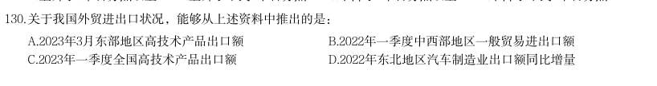

- **A.** 2023年3月东部地区高技术产品出口额
- **B.** 2022年一季度中西部地区一般贸易进出口额
- **C.** 2023年一季度全国高技术产品出口额
- **D.** 2022年东北地区汽车制造业出口额同比增量

**答案：B**　**考点：综合分析｜增长量**　**难度：★★★★☆**