# 2026 年国考行测（副省级）

- 题量：134（含答案 134）
- 模块分布：资料分析20 / 数量关系14 / 言语理解30 / 判断推理35 / 常识判断35
- 试卷编号：`国考-2026-副省级`

## 题目与答案

**【常识判断·政治常识｜GK-2026-fs-X001】**

1. 习近平总书记强调,必须坚持自信自立。中国人民和中华民族从近代以后的深重苦难走向伟大 复兴的光明前景,从来就没有教科书,更没有现成答案。关于坚持自信自立,下列表述正确的有 几项? 1走自己的路,是党的全部理论和实践立足点,更是党百年奋斗得出的历史结论 2推进中国式现代化,必须坚持把国家和民族发展放在自己力量的基点上 3中国式现代化既要物质财富极大丰富,也要精神财富极大丰富、在思想文化上自信自强 4独立自主是中华民族的优良传统,是中国共产党、中华人民共和国立党立国的重要原则

- **A.** 1 项
- **B.** 2 项
- **C.** 3 项
- **D.** 4 项

**答案：D**　**考点：政治常识**
**【常识判断·政治常识｜GK-2026-fs-X002】**

2. 习近平总书记强调,科学制定和接续实施五年规划,是我们党治国理政一条重要经验,也是中 国特色社会主义一个重要政治优势。关于五年规划编制工作,下列说法正确的是:

- **A.** 我国五年规划(计划)编制工作起始于1949 年,有力推动了经济社会发展、综合国力提升、人民生活改善
- **B.** 中长期发展规划有助于充分发挥政府在资源配置中的决定性作用,彰显了政府对经济社会发展的宏观调控能力
- **C.** 从第一个五年计划到当前的五年规划,一以贯之的主题是把我国建设成为社会主义现代化国家
- **D.** 通过互联网就“十五五”规划编制向全社会征求意见和建议,在我国五年规划编制史上是第

**答案：C**　**考点：政治常识**
**【常识判断·政治常识｜GK-2026-fs-X003】**

3. 建设文化强国,事关中国式现代化建设全局,事关中华民族复兴大业,事关提升国际竞争力, 锚定2 035 年建成社会主义文化强国的战略目标,必须始终坚持文化建设着眼于人、落脚于人。 下列有关说法正确的是: 1文化强国之“强”最终要体现在为人民提供文化服务和文化产品的能力上 2坚持以人民为中心,着眼满足人民群众多样化、多层次、多方面的精神文化需求 3文化创造核心在人,要建设一支规模宏大、结构合理、锐意创新的高水平文化人才队伍 4尊重人才成长规律,完善符合文化领域特点的人才选拔、培养、使用、激励机制,营造识才、 重才、爱才的良好政策环境

- **A.** 123
- **B.** 234
- **C.** 124
- **D.** 134

**答案：B**　**考点：政治常识**
**【常识判断·政治常识｜GK-2026-fs-X004】**

4. 中共中央、国务院印发《加快建设农业强国规划(2024-2035 年)》,提出面对新形势新要 求,必须把加快建设农业强国作为统领“三农”工作的战略总纲,摆上建设社会主义现代化强 国的重要位置,下列与加快建设农业强国有关的说法正确的是:

- **A.** 推进生态综合补偿,健全横向生态保护补偿机制,统筹推进生态环境损害赔偿
- **B.** 建立健全长江流域信息共享系统,推进长江流域农业深度节水控水
- **C.** 完善粮食产销奖补制度,中央预算内投资向粮食主销区倾斜
- **D.** 推进农业科技推广体系,从经营性向公益性转变

**答案：A**　**考点：政治常识**
**【常识判断·政治常识｜GK-2026-fs-X005】**

5. 全面推进依法治国是一个系统工程,必须坚持法治国家、法治政府、法治社会一体建设。下列 相关表述不准确的是:

- **A.** 法治社会是构筑法治国家、法治政府的基础
- **B.** 建设法治政府对建设法治社会具有重要引领和带动作用
- **C.** 法治政府、法治社会建设必须服从、服务于法治国家建设
- **D.** 法治国家是依法治国的主体,是法治社会建设的先导和示范

**答案：D**　**考点：政治常识**
**【常识判断·政治常识｜GK-2026-fs-X006】**

6. 2025 年7 月,习近平总书记在中央城市工作会议上发表重要讲话,明确做好城市工作的总体 要求、重要原则、重点任务,为做好新时代新征程的城市工作提供了根本遵循。关于城市工作, 下列说法正确的是:

- **A.** 要把握“我国城镇化正从快速增长期转向稳定发展期”的历史方位
- **B.** 城市工作重心应向更加注重建设投入转变
- **C.** 着力通过外延扩张发展组团式的现代化城市群和都市圈
- **D.** 城市政府应从城市事务管理的“掌舵人”转变为“划桨人”

**答案：A**　**考点：政治常识**
**【常识判断·政治常识｜GK-2026-fs-X007】**

7. 经济工作千头万绪,必须统筹好有效市场和有为政府的关系、总供给和总需求的关系、培育新 动能和更新旧动能的关系、做优增量和盘活存量的关系、提升质量和做大总量的关系。下列相关 说法不准确的是:

- **A.** 要加快推动作为经济增长和就业收入基本依托的传统产业改造升级
- **B.** 要加快补上内需特别是消费短板,使内需成为拉动经济增长的主动力和稳定锚
- **C.** 要坚持以量取胜、充分发挥规模效应,用好超大规模市场优势和丰富应用场景
- **D.** 要用好各类增量资源和存量资源,通过盘活存量来带动增量

**答案：C**　**考点：政治常识**
**【常识判断·政治常识｜GK-2026-fs-X008】**

8. 2025 年7 月3 0 日,中共中央政治局召开会议,对扎实做好民生保障工作作了重要部署。下 列相关表述不准确的是:

- **A.** 巩固拓展脱贫攻坚成果,确保不发生规模性返贫致贫
- **B.** 夯实“三农”基础,推动粮食和重要农产品价格保持在合理水平
- **C.** 突出就业优先政策导向,促进高校毕业生、退役军人、农民工等重点群体就业
- **D.** 始终把人民群众财产安全放在第一位,加强安全生产监管

**答案：D**　**考点：政治常识**
**【常识判断·政治常识｜GK-2026-fs-X009】**

9. 做好新时代人口工作,要完善新时代人口发展战略,认识、适应、引领人口发展新常态,以人 口高质量发展支撑中国式现代化。关于做好新时代人口工作,下列说法正确的是:

- **A.** 要树立“大人口观”,推动人口与财政、货币、就业、产业、投资、消费、生态、区域等政策形成系统集成效应
- **B.** 必须推动人口工作由稳定总量、畅通流动向调节数量、优化结构转变
- **C.** 要更加重视“引导”和“激励”的办法,由社会治理向政府治理转变
- **D.** 坚持人民主体地位,把人口高速增长同人民高品质生活紧密结合起来

**答案：A**　**考点：政治常识**
**【常识判断·政治常识｜GK-2026-fs-X010】**

10. 《中共中央关于制定国民经济和社会发展第十五个五年规划的建议》提出,推进国家安全体 系和能力现代化,建设更高水平平安中国。下列有关说法正确的是:

- **A.** 锻造实战实用的国家安全能力,把捍卫国土安全摆在首位
- **B.** 统筹推进房地产、地方政府债务、中小金融机构等风险有序化解
- **C.** 健全国家安全体系,坚持以风险防控为先导、法治保障为落脚点
- **D.** 完善公共安全体系,推动公共安全治理模式由事后处理向事中控制转型

**答案：B**　**考点：政治常识**
**【常识判断·政治常识｜GK-2026-fs-X011】**

11. 习近平总书记高度重视战略思维,多次强调党员领导干部要加强战略思维,增强战略定力。 下列体现战略思维的说法,正确的有几项? 1粮食多一点少一点是战略问题,粮食安全是战术问题 2统战工作的本质要求是大团结大联合,解决的是人心和力量问题 3要心怀“国之大者”,站在全局和战略的高度想问题、办事情,一切工作都要以贯彻落实党 中央决策部署为前提 4自觉把党的对外工作放到党和国家工作大局中来认识,放到中国与世界关系的发展变化中来把 握

- **A.** 1 项
- **B.** 2 项
- **C.** 3 项
- **D.** 4 项

**答案：C**　**考点：政治常识**
**【常识判断·政治常识｜GK-2026-fs-X012】**

12. 习近平总书记指出,我们要建成的教育强国,是中国特色社会主义教育强国,应当具有强大 的思政引领力、人才竞争力、科技支撑力、民生保障力、社会协同力、国际影响力,为以中国式 现代化全面推进强国建设、民族复兴伟业提供有力支撑。关于建设教育强国,下列说法正确的 是:

- **A.** 要坚持教育均等化原则,把教育公平作为国家基本教育政策
- **B.** 要完善人才培养与经济社会发展需要适配机制,顺应时代发展要求,适度增加学科专业数量
- **C.** 要把引进全球顶尖科学家摆到更加突出位置,着力培育拔尖创新人才,推动实现高水平科技自立自强
- **D.** 从教育大国到教育强国是一个系统性跃升和质变,必须以改革创新为动力

**答案：D**　**考点：政治常识**
**【常识判断·政治常识｜GK-2026-fs-X013】**

13. 习近平主席在二十国集团领导人第十九次峰会上指出,要完善全球贸易治理,建设开放型世 界经济。下列相关表述正确的是:

- **A.** 要适应经济问题政治化的潮流,通过强化绿色低碳要求推行贸易保护政策
- **B.** 要积极构建更具平等性、包容性和建设性的产业链供应链伙伴关系,呼吁各方加强合作
- **C.** 要把安全置于国际经贸议程中心地位,持续推动贸易和投资自由化便利化
- **D.** 要一以贯之保持世界贸易组织规则不变,提高多边贸易体制的权威性、有效性和相关性

**答案：B**　**考点：政治常识**
**【常识判断·政治常识｜GK-2026-fs-X014】**

14. 中国式现代化要靠科技现代化作支撑,实现高质量发展要靠科技创新培育新动能。关于建成 科技强国的举措,下列说法正确的是:

- **A.** 要坚持有所为有所不为,突出经济发展需求,在重要领域实施科技战略部署
- **B.** 要充分发挥人才在科技资源配置中的决定性作用,调动产学研各环节的积极性
- **C.** 要充分发挥科技领军企业龙头作用,鼓励中小企业和民营企业科技创新,支持企业牵头或参与国家重大科技项目
- **D.** 要降低基础研究组织化程度,强化自由探索,鼓励面向重大科学问题的协同攻关

**答案：C**　**考点：政治常识**
**【常识判断·政治常识｜GK-2026-fs-X015】**

15. 习近平总书记强调,选人用人要加强党性鉴别,注重考察干部的境界格局和忠诚度廉洁度。 下列与党性相关的说法正确的是:

- **A.** 树立和践行正确政绩观,起决定性作用的是党性
- **B.** 强党性,就是要自觉用马克思主义思想改造客观世界
- **C.** 党性、党风、党纪是有机整体,党性是根本,党风是保障,党纪是表现
- **D.** 作风问题本质上是党性问题,要把作风建设摆在党性修养的首位

**答案：A**　**考点：政治常识**
**【常识判断·政治常识｜GK-2026-fs-X016】**

16. 坚持问题导向是习近平新时代中国特色社会主义思想的世界观和方法论的重要内容。关于坚 持问题导向,下列说法不准确的是:

- **A.** 坚持问题导向是马克思主义的鲜明特点
- **B.** 坚持问题导向要抓住人民最关心最直接最现实的利益问题
- **C.** 坚持问题导向体现了矛盾的普遍性和客观性
- **D.** 坚持问题导向本质是变与不变、继承与发展的辩证统一

**答案：D**　**考点：政治常识**
**【常识判断·政治常识｜GK-2026-fs-X017】**

17. 恩格斯深刻指出:“马克思的整个世界观不是教义,而是方法。它提供的不是现成的教条, 而是进一步研究的出发点和供这种研究使用的方法。”下列有关马克思主义理论的说法不准确 的是:

- **A.** 马克思创立了辩证法,成为我们认识世界和改造世界的根本方法
- **B.** 科学社会主义的原则不能丢,但科学社会主义也绝不是一成不变的教条
- **C.** 当代中国的伟大社会变革不是简单套用马克思主义经典作家设想的模板
- **D.** 《共产党宣言》发表至今,人类社会发生了翻天覆地的变化,但马克思主义所阐述的一般原理

**答案：A**　**考点：政治常识**
**【常识判断·政治常识｜GK-2026-fs-X018】**

18. 以实践为基础,从整体上把握人与世界的关系,是马克思主义世界观的重要内容。关于马克 思主义实践观,下列说法正确的是:

- **A.** 正确发挥主观能动性是实践的根本途径
- **B.** 实践的过程就是对于结果的检验和评价
- **C.** 实践是人类生存和发展最基本的活动
- **D.** 实践是一种无目的的适应环境的本能活动

**答案：C**　**考点：政治常识**
**【常识判断·政治常识｜GK-2026-fs-X019】**

19. 习近平总书记在对各省区市进行深入考察调研的过程中,结合各地实际情况,对推进高质量 发展作出一系列重要部署。下列对应关系正确的是:

- **A.** 江苏——要建设国家资源型经济转型综合配套改革试验区,重点抓好能源转型、产业升级和适度多元发展
- **B.** 山东——要发挥海洋资源丰富的得天独厚优势,经略海洋、向海图强,打造世界级海洋港口群,打造现代海洋经济发展高地
- **C.** 云南——要把握好挑大梁的着力点,在推动科技创新和产业创新融合上打头阵
- **D.** 贵州——聚焦实现贸易、投资、跨境资金流动、人员进出、运输来往自由便利和数据安全有序

**答案：B**　**考点：政治常识**
**【常识判断·政治常识｜GK-2026-fs-X020】**

20. 2025 年是中国人民抗日战争暨世界反法西斯战争胜利80 周年。中国人民对战争带来的苦难 有着刻骨铭心的记忆,对和平有着孜孜不倦的追求。关于中国人民抗日战争,下列表述不准确的 是:

- **A.** 中国人民抗日战争的伟大胜利,是以爱国主义为核心的民族精神的伟大胜利
- **B.** 中国人民抗日战争的伟大胜利,第一次确立了中国在世界上的大国地位,使中国人民赢得了世界爱好和平人民的尊敬
- **C.** 中国人民抗日战争的伟大胜利,是近代以来中国抗击外敌入侵的第一次完全胜利
- **D.** 中国人民抗日战争的伟大胜利,为中华民族由近代以来陷入深重危机走向伟大复兴确立了历史

**答案：B**　**考点：政治常识**
**【常识判断·政治常识｜GK-2026-fs-X021】**

21. 根据《中华人民共和国全国人民代表大会和地方各级人民代表大会代表法》,下列说法错误 的是:

- **A.** 代表在本级人民代表大会闭会期间,原则上不得跨原选举单位进行视察、调研
- **B.** 县级以上的各级人民代表大会常务委员会设立代表工作委员会,作为常务委员会的工作机构
- **C.** 乡镇人民代表大会主席团按照就地就近的原则,定期组织和协助本乡镇代表开展联系人民群众的活动
- **D.** 代表辞职或者责令辞职被接受的,其代表资格终止

**答案：A**　**考点：政治常识**
**【常识判断·法律常识｜GK-2026-fs-X022】**

22. 根据《政务数据共享条例》,下列说法错误的是:

- **A.** 政务数据需求部门提交的申请材料不全的,政务数据提供部门不得直接予以拒绝
- **B.** 政府部门通过共享获得政务数据后不得擅自将获得的政务数据提供给第三方
- **C.** 可以提供给所有政府部门共享使用的政务数据属于无条件共享类政务数据
- **D.** 政府部门应当新建政务数据共享交换系统开展跨层级政务数据共享相关工作

**答案：D**　**考点：法律常识**
**【常识判断·经济常识｜GK-2026-fs-X023】**

23. 下列经济目标与政策工具匹配错误的是:

- **A.** 扩大基础设施投资规模——提高专项债发行额度
- **B.** 降低市场主体经营成本——延续小微企业增值税减免
- **C.** 拓宽房企的融资渠道——增加保障性住房再贷款额度
- **D.** 缓解基层“三保”支出压力——加大中央对地方转移支付

**答案：C**　**考点：经济常识**
**【常识判断·政治常识｜GK-2026-fs-X024】**

24. 我国始终高度重视荒漠化的治理工作,把防沙治沙作为荒漠化防治工作的主要任务。下列与 我国荒漠化防治有关的说法错误的是:

- **A.** 我国是全球首个实现土地退化零增长的国家
- **B.** 塔克拉玛干沙漠实现生态屏障全面“锁边合龙”
- **C.** 草方格固沙技术最早用于治理宁夏中卫的沙坡头地区
- **D.** 甘肃民勤治沙工程有效阻止了毛乌素沙漠的推进

**答案：D**　**考点：政治常识**
**【常识判断·政治常识｜GK-2026-fs-X025】**

25. 《贺新郎·读史》是毛泽东创作的咏史词,高度凝练了人类社会发展历程。下列相关说法不 恰当的是:

- **A.** 成汤创立商朝是“五帝三皇神圣事”之一
- **B.** 在“只几个石头磨过”时人类学会了用火
- **C.** 利簋是“铜铁炉中翻火焰”时代留下的器物
- **D.** “更陈王奋起挥黄钺”揭开了秦末农民起义的序幕

**答案：A**　**考点：政治常识**
**【常识判断·经济常识｜GK-2026-fs-X026】**

26. 下列与海洋经济有关的说法错误的是:

- **A.** 海水中氢离子和氢氧根离子浓度高,利用海水制氢效率高
- **B.** 现代深远海养殖平台一般设置在有较大浪流的开放性水域
- **C.** 潮汐发电的水轮机结构要适应海水落差小、流量大的特点
- **D.** 液化天然气运输船的液舱通常采用超低温环境储存天然气

**答案：A**　**考点：经济常识**
**【常识判断·历史人文｜GK-2026-fs-X027】**

27. 某学生假期参观历史古迹并写下记录。下列古迹与记录文字对应错误的是:

- **A.** 马王堆遗址——何家村窖藏的金碗银壶在射灯下流淌着暗光,鎏金舞马衔杯纹银壶上的骏马俯首献酒
- **B.** 北京故宫——气势恢宏的三层汉白玉须弥座犹如层叠的云,将金碧辉煌的太和殿高高托起,威严之外添了几分神秘与飘逸
- **C.** 西夏陵——漫步于贺兰山前的戈壁滩,星罗棋布的古冢在眼前铺展,高低错落的残垣在风中静立,仿佛正缓缓撩开岁月的面纱
- **D.** 敦煌莫高窟——朴实无华的山岗间,洞窟犹如蜂房一般,层层叠叠,保留了千年佛教艺术的灿

**答案：A**　**考点：历史人文**
**【常识判断·政治常识｜GK-2026-fs-X028】**

28. 某物流公司要优化长三角到乌鲁木齐的易腐货物运输路线,下列方案最可行的是:

- **A.** 夏季采用陇海——兰新铁路运输利用沿线低温天气自然保鲜
- **B.** 冬季选择长江——京杭大运河——黄河水运组合避开陆路交通拥堵
- **C.** 春秋季采用铁路冷藏集装箱运输平衡运输成本与时效性
- **D.** 全年优先使用连霍高速公路运输以追求最低的运输成本

**答案：C**　**考点：政治常识**
**【常识判断·政治常识｜GK-2026-fs-X029】**

29. 下列与自然界中的颜色有关的说法错误的是:

- **A.** “橙色月亮”通常发生在大气层中水汽或颗粒物质较多时
- **B.** 火烈鸟羽毛呈朱红色与摄入食物中的虾青素累积有关
- **C.** 蓝闪蝶翅膀呈蓝色是由于其表面鳞片具有特殊的微结构
- **D.** 蓝莓呈现靛蓝色是因为表面蜡质层中含高浓度花青素

**答案：D**　**考点：政治常识**
**【常识判断·地理常识｜GK-2026-fs-X030】**

30. 下列关于河流入海口的描述与河流对应错误的是:

- **A.** 浑浊的河水奔流而至,汇入清澈的渤海,形成一条清晰的分界线——黄河
- **B.** “三龙吐珠,八门入海”,生动地描绘出了它的奇特形态——淮河
- **C.** 在入海口的潮间带上,会看到一片耀眼的红色,又被称为“红海滩”——辽河
- **D.** 在其与东海海潮的相互激荡下,造就了我国第三大岛崇明岛——长江

**答案：B**　**考点：地理常识**
**【常识判断·政治常识｜GK-2026-fs-X031】**

31. 某款创意时钟要用不同的符号替代表盘上的数字,下列设计不合适的是:

- **A.** 用45 度角的正弦“sin450” 替代“ 1 ”
- **B.** . 用3 的阶乘“ 3 ! ” 替代“ 6 ”
- **C.** 用重力加速度“g”替代“10”
- **D.** 用二进制数“ (1100)2”替代“12”

**答案：A**　**考点：政治常识**
**【常识判断·科技常识｜GK-2026-fs-X032】**

32. 关于核裂变与核衰变,下列说法错误的是:

- **A.** 核衰变的过程中电荷数是守恒的
- **B.** 放射性元素衰变是自然界自发进行的
- **C.** 核裂变是一种异常剧烈的化学变化
- **D.** 核裂变释放出的中子可以引起链式反应

**答案：C**　**考点：科技常识**
**【常识判断·科技常识｜GK-2026-fs-X033】**

33. 关于化学平衡在人类活动中的应用,下列说法错误的是:

- **A.** 处理硬水时,可通过加入适量石灰乳作为软化剂调节水的硬度
- **B.** 血液中CO2 浓度增加时,血液中水电离出的氢氧根离子会增多
- **C.** 适当降低水温增大CO2 的溶解度可维持冷却水管道中的盐类平衡
- **D.** 向含有铜离子的废水中加入适量的碱可达到净化水质的环保目的

**答案：B**　**考点：科技常识**
**【常识判断·政治常识｜GK-2026-fs-X034】**

34. 关于医学治疗手段及其原理,下列说法正确的是:

- **A.** 体外冲击波碎石术利用次声波可以将肾结石击碎成小块,使其随尿液排出体外
- **B.** 免疫疗法治疗癌症,能够通过激活自身免疫系统,利用T 细胞直接吞噬癌细胞
- **C.** 血液透析依据半透膜原理,将血液中的有害物质以及多余的水分清除出体外
- **D.** 激光治疗近视,利用激光对视网膜进行切割,改变视网膜的曲率,从而矫正视力

**答案：C**　**考点：政治常识**
**【常识判断·政治常识｜GK-2026-fs-X035】**

35. 关于汽车自动驾驶技术,下列说法错误的是:

- **A.** 激光雷达通过发射激光束来探测目标的位置、速度
- **B.** 相对于毫米波雷达,超声波雷达更适合远距离探测
- **C.** 强化学习有助于实现车辆的自主学习和智能决策
- **D.** 陀螺仪和加速度计可用来测算车辆的姿态和运动信息

**答案：B**　**考点：政治常识**
**【言语理解·逻辑填空｜GK-2026-fs-X036】**
> 材料：出一个最恰当的答案。

36. 党员干部生活作风的蜕变,往往是从吃喝等看似小事的地方开始的。“堤溃蚁孔,气泄针 芒”,这句古训就是强调 的重要性。习近平同志曾在《之江新语》中写道:“小事小节是 一面镜子,能够反映人品,反映作风。”党员干部要严格对照中央八项规定精神,深刻认识小 与大的辩证关系,主动“照镜子”自查。 填入画横线部分最恰当的一项是:

- **A.** 防微杜渐
- **B.** 积微成著
- **C.** 慎小谨微
- **D.** 曲突徒薪

**答案：A**　**考点：逻辑填空**
**【言语理解·逻辑填空｜GK-2026-fs-X037】**

37. 在太空实验室开展的脑电测试实验中,航天员戴的“小红帽”叫作脑电帽,里面嵌入了众多 微小的触头,它们像一群 的小侦探,精准捕捉大脑每一个微妙的波动。这顶帽子赋予航天员 神奇的能力——无须言语,无须动作,仅仅通过思维就能给电脑下指令,操控各种设备。 填入画横线部分最恰当的一项是:

- **A.** 未卜先知
- **B.** 明察秋毫
- **C.** 洞若观火
- **D.** 随机应变

**答案：B**　**考点：逻辑填空**
**【言语理解·逻辑填空｜GK-2026-fs-X038】**

38. 正如孙子所说,备战者要“先为不可胜,以待敌之可胜。”战争指挥员要先保证决策稳妥可 靠,部署不出纰漏,不给对手以可乘之机。在 的战争态势下,这是可以掌控的事情。就像足 球比赛中的防守反击战术,先得保证自己不盲动、不冒进、不失球, 、持重待机,而后抓住机 会、一击制胜。 依次填入画横线部分最恰当的一项是:

- **A.** 瞬息万变按部就班
- **B.** 一触即发从长计议
- **C.** 变幻莫测稳扎稳打
- **D.** 波诡云谲以守为攻

**答案：C**　**考点：逻辑填空**
**【言语理解·逻辑填空｜GK-2026-fs-X039】**

39. 面对新的形势和要求,必须进一步全面深化改革,继续完善各方面制度机制,因而制度建设 的任务更为繁重艰巨,加强顶层设计更为重要。如果不能全景式俯瞰和把握制度建设全局,采取 总体构想和战略谋划,做到胸中有数, 地层层系统设计,难免顾此失彼、 ,无法取得制 度建设的成效。 依次填入画横线部分最恰当的一项是:

- **A.** 抽丝剥茧捉襟见肘
- **B.** 循序渐进进退维谷
- **C.** 由表及里得不偿失
- **D.** 自上而下左支右绌

**答案：D**　**考点：逻辑填空**
**【言语理解·逻辑填空｜GK-2026-fs-X040】**

40. 知识产权事务流程复杂,法规晦涩,让人摸不着头脑,公众常 。如今,人们可通过国家知 识产权公共服务电子平台获取各类知识产权办理入口,进行基础数据查询,这样便携的方式像 “ ”一样,节省了时间成本,更有利于在公众心中埋下知识产权保护的种子。 依次填入画横线部分最恰当的一项是:

- **A.** 不求甚解直通车
- **B.** 不知所措通行证
- **C.** 望洋兴叹快进键
- **D.** 望而却步快车道

**答案：D**　**考点：逻辑填空**
**【言语理解·逻辑填空｜GK-2026-fs-X041】**

41. 面对技术突破催生的新产品和新服务,市场响应往往具有 。在层出不穷的技术供给面前, 市场选择是审慎、挑剔的,具有一定的随机性。对于一些技术虽然先进,但应用前景不明朗、难 以迅速形成现金流的企业,市场通常会选择放弃。从这个角度看,瞪羚企业、独角兽企业都是经 受住市场的 胜出者。 依次填入画横线部分最恰当的一项是:

- **A.** 滞后性大浪淘沙
- **B.** 差异性精挑细选
- **C.** 被动性优胜劣汰
- **D.** 模糊性千锤百炼

**答案：A**　**考点：逻辑填空**
**【言语理解·逻辑填空｜GK-2026-fs-X042】**

42. 利用网络存在的安全漏洞入网窃取数据信息,这种方式相当隐蔽,往往会使数据的安全响 应 ;而且网络中流转数据的规模十分巨大,来源异常复杂,攻击者一旦掌握网络漏洞,入 侵网络后就可以在网上“ ”,窃取数据。因此,必须严密防范数据在共享过程中可能遭受的 各种攻击和泄露。 依次填入画横线部分最恰当的一项是:

- **A.** 防不胜防按图索骥
- **B.** 形同虚设守株待兔
- **C.** 名存实亡偷天换日
- **D.** 鞭长莫及瓮中捉鳖

**答案：B**　**考点：逻辑填空**
**【言语理解·逻辑填空｜GK-2026-fs-X043】**

43. 发展新质生产力不能简单理解为 传统产业,它与发展传统产业并不矛盾。一方面,传统产 业平稳发展在稳就业、稳增长等方面具有不可替代的作用;另一方面,传统产业不仅对战略性新 兴产业和未来产业发展有 的支撑作用,而且可以转化为新兴产业,通过科技赋能,成为新质 生产力的重要 。 依次填入画横线部分最恰当的一项是:

- **A.** 取代持续性依托
- **B.** 摒弃系统性抓手
- **C.** 淘汰基础性载体
- **D.** 削弱根本性源头

**答案：C**　**考点：逻辑填空**
**【言语理解·逻辑填空｜GK-2026-fs-X044】**

44. 敢于正视问题的反面是回避矛盾、 ,个别表现在:发言提纲套用、借用、翻用,发言内容 偏离主题、不及重点, 、似曾相识,剖析问题避重就轻、 ,相互批评官话、套话......凡 此种种,致使民主生活会的批评和自我批评有形式而无实质内容和效果,必须防止和纠正。 依次填入画横线部分最恰当的一项是:

- **A.** 敷衍了事老生常谈隔靴搔痒
- **B.** 虚与委蛇长篇大论大而化之
- **C.** 畏首畏尾陈词滥调浮光掠影
- **D.** 闪烁其词不痛不痒张冠李戴

**答案：A**　**考点：逻辑填空**
**【言语理解·逻辑填空｜GK-2026-fs-X045】**

45. 城镇化发展不宜 。城镇化率低且人口规模大的地区,应着重提升水平、挖掘潜力;城镇化 率较高且人口持续集聚的地区,不妨促进大中小城市和小城镇 发展。在此过程中,要坚持系 统观念,统筹城乡、双向发力。如此,才能在城乡一体、良性互动中,让城镇化成为一个顺势而 为、 的发展过程。 依次填入画横线部分最恰当的一项是:

- **A.** 一步到位共同自然而然
- **B.** 一哄而上均衡顺理成章
- **C.** 千篇一律融合大势所趋
- **D.** 整齐划一协调水到渠成

**答案：D**　**考点：逻辑填空**
**【言语理解·语句填入｜GK-2026-fs-X046】**

46. 何为担当作为?从字面上看,担当作为就是承担起应尽的责任和义务,发挥出应有的能力和 能量,创造出应然的成绩和实效;从辩证法看,担当是作为的前提和基础,作为是担当的体现和 成效,二者相辅相成。习近平总书记强调:“ 。”事业发展不可能一帆风顺,做事总有风 险,因此才需要担当。有时候越怕事越容易出事,越想绕道走矛盾就越堵着道。只有敢于担 当,豁得出去、敢闯敢干,矛盾和困难才可能得到解决。 填入画横线部分最恰当的一项是:

- **A.** 担当作为就要真抓实干、埋头苦干,决不能坐而论道、光说不练
- **B.** 党把干部放在各个岗位上是要大家担当干事,而不是做官享福
- **C.** 担当和作为是一体的,不作为就是不担当,有作为就要有担当
- **D.** 如果不担当、不作为,没有执行力、战斗力,那是要打败仗的

**答案：C**　**考点：语句填入**
**【言语理解·中心理解｜GK-2026-fs-X047】**

47. 埋藏较浅的饱水松散砂土遭受地震等强烈振动时,颗粒间的位置迅速调整,相互间失去接触 压力和摩擦力,有被振密的趋势。由于孔隙水压力急剧升高,颗粒快速聚集、挤出,随着水流不 断翻滚,由固态砂土变成液态混合物,这个过程叫作“液化”。液态混合物会向压力低的方向 运动,若地下有合适的通道或洞穴,则会涌向这些地方。当它们涌出地表,呈现喷砂冒水状态 时,就被称为“砂涌”。它们在流动过程中会破坏沿途的地貌景观和建筑,严重时还会造成人 畜伤亡。 这段文字所描述的自然现象可以概括为:

- **A.** 潜藏在地下的“暗河”
- **B.** 被摇成“液体”的砂土
- **C.** 沙漠中的“隐形”杀手
- **D.** 大地的“多米诺骨牌”效应

**答案：B**　**考点：中心理解**
**【言语理解·下文推断｜GK-2026-fs-X048】**

48. 既往研究发现,病理性a -突触核蛋白是帕金森病的关健致病蛋白。在病理条件下,正常的a - 突触核蛋白单体会发生错误折叠,并聚集在一起形成纤维,破坏神经元的正常功能并导致其死 亡。它还会像种子一样散播,入侵邻近的正常神经元,诱导更多脑区中的 -突触核蛋白聚集和 神经元死亡,致病蛋白传播到中脑黑质区域时,可导致多巴胺能神经元死亡,从而出现动作迟 缓,静止性震颤,肌强直等运动症状;传播到大脑皮层时,则会出现记忆力下降等认知障碍症 状。 这段文字接下来最可能讲的是:

- **A.** 阻断病理性-突触核蛋白传播的手段
- **B.** 帕金森病引起的典型认知障碍
- **C.** α-突触核蛋白与神经元功能的关系
- **D.** 帕金森病诱发机制的病理学研究

**答案：A**　**考点：下文推断**
**【言语理解·中心理解｜GK-2026-fs-X049】**

49. 当前国际局势急剧变化,确保战略物资供应的安全与稳定已成为捍卫国家核心利益的战略制 高点,世界多个国家立足战略物资供应链安全保障,已多轮更新《关键矿产清单》,展现了高度 的敏锐性与响应速度。我国自《全国矿产资源规划(2016-2020 年)》明确将稀土、晶质石墨等 24 种矿产纳入战略性矿产范畴以来,虽已奠定坚实基础,但在面对新兴战略物资尤其是对战略 性新兴产业构成关键制约的矿物时,清单的更新步伐尚显滞后。以氢能电池产业为例,其核心材 料如铂族金属等在全球战略价值日益凸显,却在我国当前的储备规划中未能获得应有的重视与优 先地位。 这段文字意在说明:

- **A.** 战略储备规划要与新能源发展需求相匹配
- **B.** 铂族金属应纳入国家战略性矿产资源目录
- **C.** 我国战略物资清单的更新力度亟待加强
- **D.** 新形势对我国物资储备体系提出新要求

**答案：C**　**考点：中心理解**
**【言语理解·语句排序｜GK-2026-fs-X050】**

50. 1在这种条件下点火并稳定燃烧,好比在12 级狂风中点燃一根火柴 2在高超声速飞行器穿越云霄的征途中,动力推进技术就是打开高速大门的金钥匙 3当燃烧室内气流流速超过声速时,会形成复杂的激波系,激波前后气流状态会产生突变 4目前,超燃冲压发动机是这一领域的明星,它可以在大气中有效获取氧气,并且在高超声速条 件下稳定燃烧 5想象一下,让一个重达数吨的飞行器在空气稀薄的高空中以数倍声速疾驰,需要多么强大的发 动机提供足够的推力 6此时,常规的发动机技术完全不能适用,只有超燃冲压发动机才能在极短时间内将大量燃料转 化为推力,并让飞行器加速稳定在高超声速 将以上6 个句子重新排列,语序正确的一项是:

- **A.** 263145
- **B.** 254316
- **C.** 541632
- **D.** 532461

**答案：B**　**考点：语句排序**
**【言语理解·语句排序｜GK-2026-fs-X051】**

51. 1非周期性意味着,由这种形状构成的整体图案,不能通过平移或旋转来恢复相同的图案 2在后续的研究中,数学家们逐渐缩小这一数字,直到上世纪70 年代,罗杰·彭罗斯仅使用 两种不同的菱形,就完成了非周期性铺砌 3“爱因斯坦”来源于德语,意思是“一块石头”,指的是单铺砌块 4在数学的铺砌领域,寻找“爱因斯坦”是许多数学家追求了半个多世纪的“圣杯” 5单铺砌块指的是一个可以填满无限平面,且不会自我重复的非周期性铺砌块 6早期的数学家需要多种形状来组成非周期铺砌块,比如首个可以覆盖无限平面的非周期铺砌是 由2 万多种形状组成的 将以上6 个句子重新排列,语序正确的一项是:

- **A.** 351462
- **B.** 435621
- **C.** 543216
- **D.** 612534

**答案：A**　**考点：语句排序**
**【言语理解·逻辑填空｜GK-2026-fs-X052】**

52. 行政决策要遵循科学、民主和依法的原则,但 。按照行政决策的性质及目标划分,行政决 策可分为经营性决策和管理型决策。经营性决策是政府为履行发展职能,促进经济社会发展而实 施的决策,如制定产业政策、作出招商引资决定等,涉及经济社会发展,因而需要更多遵循经济 规律,面向市场进行成本效益分析,量力而行。管理型决策则是直接涉及行政相对人的利益,如 公共福利政策制定、生态环境保护措施等,需要更多的开放性和公众参与。凡是利益相关者,都 应赋予其表达意见、参与决策的权利。 填入画横线部分最恰当的一项是:

- **A.** 要注意倾听各利益相关群体的不同声音
- **B.** 应根据现实中的具体情况进行适当调整
- **C.** 仍然需要完善相关制度以确保其规范运行
- **D.** 具体要求则因行政决策性质的不同而有差异

**答案：D**　**考点：逻辑填空**
**【言语理解·中心理解｜GK-2026-fs-X053】**

53. 在信息技术领域,晶体管和激光器是两大核心元件。晶体管的微型化推动电子芯片飞速发展, 催生摩尔定律,即每隔约18 个月,集成电路上可容纳的晶体管数量将翻一番,这一趋势推动最 先进的晶体管尺寸达到纳米级别。相比晶体管,缩小激光器的难度要大得多,因为两者所依赖 的微观粒子截然不同,前者依赖电子,后者依赖光子。在可见光和近红外波段,光子波长比晶体 管中的电子波长高出3 个数量级。受衍射极限制约,这些光子能被压缩到的最小模式体积比晶 体管中的电子要大10 亿倍。因此,构建纳米尺度激光器的核心挑战在于如何突破衍射极限, 将光子的体积“压缩”到最小。 这段文字主要介绍:

- **A.** 构建纳米尺度激光器的难点
- **B.** 信息技术领域面临的核心挑战
- **C.** 摩尔定律对于突破衍射极限的制约
- **D.** 晶体管微型化对电子芯片发展的意义

**答案：A**　**考点：中心理解**
**【言语理解·标题填入｜GK-2026-fs-X054】**

54. 民主真正落地,需基于明确、可操作的行动指南,行动指南要依托科学规范的程序文本来呈 现,在这个意义上,科学民主的程序文本是民主得以从理念转化为现实不可或缺的载体,也是维 护民主之实的基本保证。一方面,可借鉴他山之石,一定程度地吸纳其他国家较为成熟的,基 于民主、公正、法治原则所建立起的议事规则;另一方面,须扎根实际,不能将程序简单视为 政治制度的“飞来峰”,照抄照搬或简而化之,需要注重历史和现实、理论和实践、形式和内 容有机统一,找到正确的方式方法。此外,还应构建长效化的程序完善机 制,不断夯实程序之基。 最适合做这段文字标题的是:

- **A.** 以程序保障之力强化实质民主之效
- **B.** 以程序内容之基筑牢实质民主之实
- **C.** 以程序运行之效提升实质民主之质
- **D.** 以程序科学之道阐释实质民主之义

**答案：B**　**考点：标题填入**
**【言语理解·逻辑填空｜GK-2026-fs-X055】**

55. 条叶庭荠和四齿芥是沙漠中常见的两种短命植物,其新成熟种子具有生理休眠特性,传播后 的种子能在夏季高温中通过后熟作用,进入非休眠状态,随后在秋季土壤湿度适宜时萌发。未能 在秋季萌发的种子,则会在冬季重新休眠。在早春湿润的雪融期,部分种子通过低温层积作用再 次结束休眠,在早春季节萌发。这种一年两次的休眠循环机制使其能在一年内形成两个不同的萌 发幼苗群体。这种适应策略可能是植物长期适应荒漠降水和温度胁迫生境的一种“两头下注” 策略,有助于它们在极端环境下的维持和繁衍。 “ ‘ 两头下注’ 策略” 指的是:

- **A.** 一年中在不同季节发生两次休眠
- **B.** 在休眠与非休眠状态间随机切换
- **C.** 形成两个环境适应性不同的幼苗群体
- **D.** 能同时应对降水和温度两种极端环境

**答案：C**　**考点：逻辑填空**
**【言语理解·逻辑填空｜GK-2026-fs-X056】**
> 材料：阳系其他天体(如火星和土卫六“泰坦”)中也有分布。然而,这种令人瞩目的庞然大物却是 研究最少的沙丘类型。人们只知道它存在于风向多变的地区,因风与地表的强相互作用形成: 当风从相反方向吹来,沙子就会堆积于此,星状沙丘的“触手”由此诞生。 近来,英国两位地质学家前往摩洛哥的厄尔切比沙海,试图探明星状沙丘背后的奥秘,结 果发现星状沙丘正在沙漠中悄然“疾行”。1厄尔切比沙海广泛分布着各种类型的复杂沙丘, 他们选择的研究对象,是一座高100 米、宽700 米的星状沙丘,含有约550 万吨沙子,并以 每年6400 吨沙子的速度增长。2当地人称其为拉拉拉利亚,意为“最高的神圣点”。 研究人员想弄清该沙丘的形成年代,于是在其不同区域收集了19 个样本,利用光释光测 年法(OSL)测定年代——石英(沙子的主要成分)等矿物在沉积过程中因自然环境辐射电离而积 累能量,OSL 能检测这种信号积累的强度,从而判断样

56. 下面这段文字,最适合填入文中哪个位置? 研究人员通过计算发现,在过去890 年中,该沙丘总共向西迁移了近500 米,每年的移动速度 都不相同,慢时0.35 米/年,最快可达0.95 米/年,并且似乎正变得越来越快。

- **A.** 1处
- **B.** 2处
- **C.** 3处
- **D.** 4处

**答案：D**　**考点：逻辑填空**
**【言语理解·逻辑填空｜GK-2026-fs-X057】**

57. 填入画横线部分最恰当的一项是:

- **A.** 仍然可用几个简单步骤还原该过程
- **B.** 这并不影响它记录过去的气候变化
- **C.** 也能探知远比想象复杂的内部结构
- **D.** 沙丘依然呈现出对称和规律的形状

**答案：B**　**考点：逻辑填空**
**【言语理解·逻辑填空｜GK-2026-fs-X058】**

58. 文中没有提及下列哪方面信息?

- **A.** 拉拉拉利亚沙丘的大致规模
- **B.** 风力作用对星状沙丘形态的影响
- **C.** 研究人员确定沙丘年代的方法
- **D.** 星状沙丘在太阳系广泛分布的原因

**答案：D**　**考点：逻辑填空**
**【言语理解·逻辑填空｜GK-2026-fs-X059】**

59. 关于拉拉拉利亚沙丘,下列说法与文章相符的是:

- **A.** 早期位置可能在现在的西南方向
- **B.** 沙丘西侧的“触手”形成年代最晚
- **C.** 在距今三千多年的干旱期迅速发展
- **D.** 是厄尔切比沙海中形态最独特的沙丘

**答案：B**　**考点：逻辑填空**
**【言语理解·逻辑填空｜GK-2026-fs-X060】**

60. 这篇文章支持下列哪一结论?

- **A.** 湿润气候会减缓沙丘积累的速度
- **B.** 厄尔切比沙海拥有世界上最古老的沙丘
- **C.** 全球变暖会导致星状沙丘数量减少
- **D.** 新月形沙丘在新仙女木时期尚未形成

**答案：A**　**考点：逻辑填空**
**【言语理解·中心理解｜GK-2026-fs-X061】**
> 材料：井南侧1.5 千米处。悬泉置是汉帝国设立在丝绸之路上的国家驿置机关,创立于汉武帝时期, 担负传递信息、接待官员、迎送使者的重大任务,是截至目前丝绸之路长安-天山廊道路网上唯 一现存也是最古老的官方邮驿机构。 1987 年全国第二次文物普查时,悬泉置遗址被发现。从1990 年秋到1992 年冬,经国家 文物局批复后对遗址进行了清理发掘。经过历时三年的文物考古发掘,初步探明整个遗址包括主 体建筑、灰区、马厩及附属建筑,总面积22500 平方米,出土各类文物残留碎片70000 余件,仅 汉简就出土了35000 枚,其中写有字迹的有23000 余枚,已被简牍学家辨识出来的有19000 枚。虽然整个悬泉置遗址面积有22500 平方米,但考古发掘面积只有4675 平方米,真正出土文 物的区域主要集中在院落和院落西墙后边的灰堆区。悬泉汉简的时间跨度长达百余年(从汉昭帝 到王莽时期,公元前86 年至公元2

61. 关于悬泉置,文中介绍了哪些信息? 1具体位置;2主要功能;3重要价值;4遗址发掘时间;5遗址特点;6历史沿革;7文物遗 存;8名称由来;9遗址保护措施

- **A.** 123457
- **B.** 135678
- **C.** 235679
- **D.** 236789

**答案：A**　**考点：中心理解**
**【言语理解·逻辑填空｜GK-2026-fs-X062】**

62. 以下均为悬泉置遗址出土文物上的文字,哪一内容没有在这篇文章中重点介绍?

- **A.** 今欲寄钱三百、帛一匹、絮十斤,愿子方受之
- **B.** 羌人男子狼颠,持牛车一乘、羊十头,诣置易盐
- **C.** 过长罗侯军长吏一,从者四人,人一食,食三升
- **D.** 孟春,禁止伐木,毋覆巢,毋杀孩虫、胎夭飞鸟

**答案：B**　**考点：逻辑填空**
**【言语理解·逻辑填空｜GK-2026-fs-X063】**

63. 下列说法与这篇文章相符的是:

- **A.** 悬泉置是距离汉朝首都最遥远的驿站
- **B.** 悬泉置遗址出土的简牍九成以上写有文字
- **C.** 公元前一世纪悬泉置曾接待于阗使团
- **D.** 悬泉置遗址出土的纸张主要作为书写载体

**答案：C**　**考点：逻辑填空**
**【言语理解·逻辑填空｜GK-2026-fs-X064】**

64. 下列哪篇论文最不可能提到悬泉置?

- **A.** 《西北汉代医简所见戍边医学研究述评》
- **B.** 《古代纸质文物纤维组成分析方法概述》
- **C.** 《秦汉时期湘江洞庭水路邮驿的初步考察》
- **D.** 《西汉经敦煌郡与匈奴在西域地区的争夺》

**答案：C**　**考点：逻辑填空**
**【言语理解·标题填入｜GK-2026-fs-X065】**

65. 最适合做这篇文章标题的是:

- **A.** 大汉王朝的“官方招待所”
- **B.** 汉代简牍上的丝路盛况
- **C.** 驿站小人物与历史大事件
- **D.** 悬泉汉简里的丝路往事

**答案：D**　**考点：标题填入**
**【数量关系·几何问题｜GK-2026-fs-X066】**
> 材料：答案。

66. 某园区种植甲、乙、丙三种花卉共10 公顷,甲的种植面积是乙的2 倍,丙的种植面积比乙 少2 公顷。问丙的种植面积为多少公顷?

- **A.** 1
- **B.** 2
- **C.** 3
- **D.** 4

**答案：A**　**考点：几何问题**
**【数量关系·工程问题｜GK-2026-fs-X067】**

67. 甲和乙两个工厂共同生产5 天,能生产w 件产品。甲的效率是乙的m 倍,如果甲效率提升 50%,乙效率提升为原来的n 倍,则3 天就能生产w 件产品。问m 和n 的关系为:

- **A.** m=3n-5
- **B.** m=6n-10
- **C.** m=5-3n
- **D.** m=10-6n

**答案：B**　**考点：工程问题**
**【数量关系·利润问题｜GK-2026-fs-X068】**

68. 某企业2023 年开始拓展海外业务,当年海外业务亏损m 元,但2024 年海外业务实现利润 2m 元。在国内市场每年利润保持不变的前提下,2024 年总利润是2023 年的1.2 倍。问该企业 每年国内市场利润为多少元?

- **A.** 13m
- **B.** 14m
- **C.** 15m
- **D.** 16m

**答案：D**　**考点：利润问题**
**【数量关系·最值问题｜GK-2026-fs-X069】**

69. 某企业采购了A、B、C 三个品牌的电脑共54 台,其中采购A 品牌电脑的台数比B 品牌电 脑少35%。问采购的C 品牌电脑比B 品牌电脑:

- **A.** 少1 台
- **B.** 少2 台
- **C.** 多1 台
- **D.** 多2 台

**答案：C**　**考点：最值问题**
**【数量关系·行程问题｜GK-2026-fs-X071】**
> 材料：概率的2 倍。已知乙在比赛中对甲、丙均取胜的概率是0.18,问丙战胜丁的概率是: A.0.1 B.0.12 C.0.15 D.0.3

71. 甲、乙两地的中点为丙。张从甲出发在甲、乙之间往返匀速慢跑,同时王从乙出发在乙、丙 之间往返匀速慢跑。出发后王第5 次到达乙地时,张正好第4 次到达乙地。问张的速度是王的 多少倍?

- **A.** 
- **B.** 
- **C.** 
- **D.** 

**答案：B**　**考点：行程问题**
**【数量关系·几何问题｜GK-2026-fs-X072】**

72. 甲和乙两个长方体零件的体积比为3:2,且甲和乙均有2 个面为边长n 厘米的正方形。将 甲和乙粘接为一个长方体之后,表面积比原来2 个零件的表面积之和减少了20%。问乙最短棱 的长度是最长棱的:

- **A.** 
- **B.** 
- **C.** 
- **D.** 

**答案：C**　**考点：几何问题**
**【数量关系·概率问题｜GK-2026-fs-X073】**

73. 某单位从所有职工中随机选3 人参加某个会议,张立和李磊2 人中只有1 人被选中的概率 是2 人均被选中概率的30 倍。问该单位有职工多少人?

- **A.** 15
- **B.** 17
- **C.** 29
- **D.** 33

**答案：D**　**考点：概率问题**
**【数量关系·最值问题｜GK-2026-fs-X074】**

74. 某考试有30 人参加,每人得分都是0~100 之间的整数且互不相同。已知得分不低于90 的人 平均分为93.8 分,小姜得了92 分,问他的成绩排名最低可能是第几名?

- **A.** 4
- **B.** 5
- **C.** 7
- **D.** 8

**答案：A**　**考点：最值问题**
**【数量关系·几何问题｜GK-2026-fs-X075】**

75. 一块梯形场地如下图所示,已知OA=0.6OD,现在需要将这块场地拓展为一块长方形场地,问 扩展后场地面积比原来至少增加:

- **A.** 20%
- **B.** 25%
- **C.** 40%
- **D.** 50%

**答案：B**　**考点：几何问题**
**【数量关系·年龄问题｜GK-2026-fs-X076】**

76. 甲和乙办公室各有4 名职工,乙办公室职工平均年龄为32 岁。现从甲办公室调动1 人到乙 办公室,2 个办公室职工平均年龄都增加了2 岁。问调动后甲办公室职工的平均年龄为多少岁?

- **A.** 50
- **B.** 48
- **C.** 46
- **D.** 44

**答案：A**　**考点：年龄问题**
**【数量关系·工程问题｜GK-2026-fs-X077】**

77. 甲、乙两个工程队单独完成

- **A.** 18
- **B.** 17
- **C.** 16
- **D.** 15

**答案：D**　**考点：工程问题**
**【数量关系·最值问题｜GK-2026-fs-X078】**

78. 某社区干部每周一参加工作例会,每月10 日、20 日接访群众。已知8 月与9 月共有2 次 接访群众与工作例会在同一天,问当年9 月1 日是:

- **A.** 周三
- **B.** 周二
- **C.** 周六
- **D.** 周五

**答案：C**　**考点：最值问题**
**【数量关系·行程问题｜GK-2026-fs-X079】**

79. 甲、乙、丙三辆车同时从环形道路同一点出发匀速行驶,其中甲和乙顺时针行驶,丙逆时针 行驶,且甲、乙、丙的速度比为4:5:6。已知甲丙和乙丙第一次相遇的时间间隔为5 秒,问出 发后多久乙第一次追上甲?

- **A.** 不到8 分钟
- **B.** 8 分钟~9 分钟之间
- **C.** 9 分钟~10 分钟之间
- **D.** 超过10 分钟

**答案：C**　**考点：行程问题**
**【数量关系·最值问题｜GK-2026-fs-X080】**

80. 公司1 月销售额为w 元,从2 月开始每个月的销售额都比上个月高k 元。已知一季度完成 全年销售目标的18%,上半年完成全年销售目标的48%,问公司全年实际销售额将比销售目标高 多少元?

- **A.** 21k
- **B.** 28k
- **C.** 33k
- **D.** 44k

**答案：C**　**考点：最值问题**
**【判断推理·图形推理｜GK-2026-fs-X081】**

81. 从所给的四个选项中,选择最合适的一个填入问号处,使之呈现一定的规律性:

> （本题为图形题，选项为图片，见原卷）

**答案：A**　**考点：图形推理**
**【判断推理·图形推理｜GK-2026-fs-X082】**

82. 从所给的四个选项中,选择最合适的一个填入问号处,使之呈现一定的规律性:

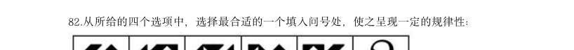

> （本题为图形题，选项为图片，见原卷）

**答案：D**　**考点：图形推理**
**【判断推理·图形推理｜GK-2026-fs-X083】**

83. 从所给四个选项中,选择最合适的一个填入问号处,使之呈现一定的规律性:

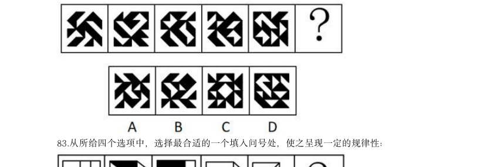

> （本题为图形题，选项为图片，见原卷）

**答案：D**　**考点：图形推理**
**【判断推理·图形推理｜GK-2026-fs-X084】**

84. 从所给的四个选项中,选择最合适的一个填入问号处,使之呈现一定的规律性:

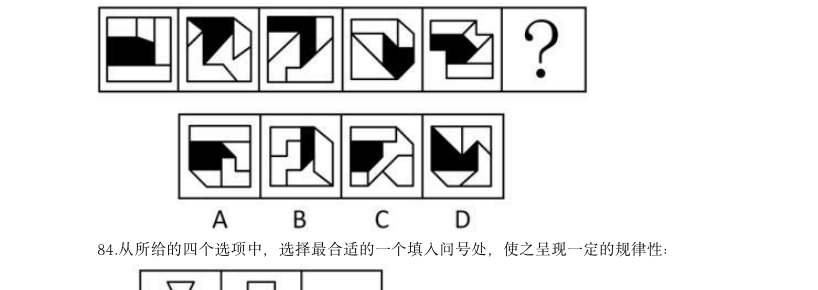

> （本题为图形题，选项为图片，见原卷）

**答案：C**　**考点：图形推理**
**【判断推理·图形推理｜GK-2026-fs-X085】**

85. 从所给的四个选项中,选择最合适的一个填入问号处,使之呈现一定的规律性:

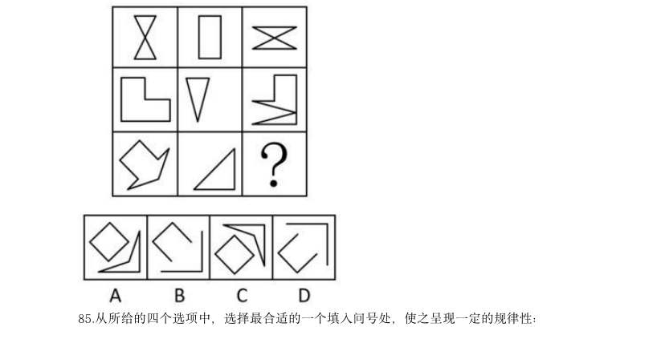

> （本题为图形题，选项为图片，见原卷）

**答案：B**　**考点：图形推理**
**【判断推理·图形推理｜GK-2026-fs-X086】**

86. 左边为由15 个白色正方体和3 个黑色正方体组合而成的多面体俯视图和左视图,其正视图 可能是:

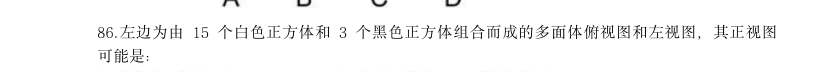

> （本题为图形题，选项为图片，见原卷）

**答案：B**　**考点：图形推理**
**【判断推理·图形推理｜GK-2026-fs-X087】**

87. 下图为由2 个正方体组合而成的长方体,问这2 个正方体的外表面展开图可能分别是:

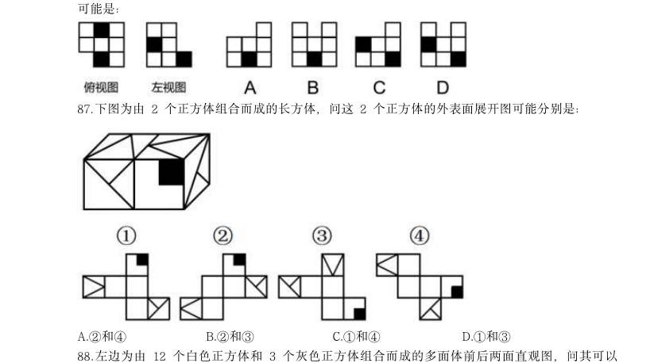

- **A.** 2和4
- **B.** 2和3
- **C.** 1和4
- **D.** 1和3

**答案：D**　**考点：图形推理**
**【判断推理·图形推理｜GK-2026-fs-X088】**

88. 左边为由12 个白色正方体和3 个灰色正方体组合而成的多面体前后两面直观图,问其可以 由除哪项外的三个多面体组合而成?

> （本题为图形题，选项为图片，见原卷）

**答案：B**　**考点：图形推理**
**【判断推理·图形推理｜GK-2026-fs-X089】**

89. 把下面的六个图形分为两类,使每一类图形都有各自的共同特征或规律,分类正确的一项是:

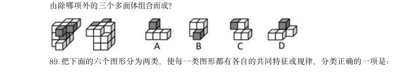

- **A.** 126,345
- **B.** 124,356
- **C.** 156,234
- **D.** 146,235

**答案：B**　**考点：图形推理**
**【判断推理·图形推理｜GK-2026-fs-X090】**

90. 把下面的六个图形分为两类,使每一类图形都有各自的共同特征或规律,分类正确的一项是:

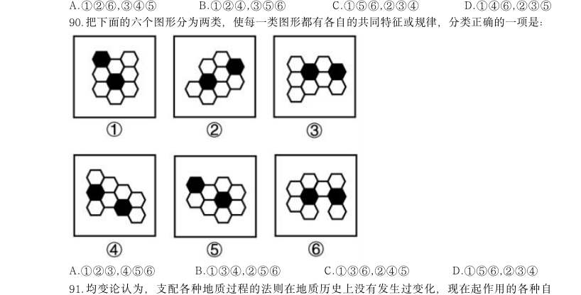

- **A.** 123,456
- **B.** 134,256
- **C.** 136,245
- **D.** 156,234

**答案：C**　**考点：图形推理**
**【判断推理·定义判断｜GK-2026-fs-X091】**

91. 均变论认为,支配各种地质过程的法则在地质历史上没有发生过变化,现在起作用的各种自 然营力在漫长的地质过程中具有普遍的均一性,即地质具有相同方式和相同的强度;地球上生物 的种与演变是一个渐变的过程,种之间有过渡关系,生物进化过程是极其漫长的。灾变论认为, 在整个地质发展的过程中,地球经常发生各种突如其来的、短暂的全球性灾难性变化,这些变化 强烈地改变了地球的面貌;地球上生物的变化是反复多次灾变的结果。 根据上述定义,下列说法最能体现灾变论观点的是:

- **A.** “我们找不到开始的痕迹,也看不到结束的迹象”
- **B.** “地质记录是一部被鲜血和火焰写成的史诗”
- **C.** “现在是通往过去的一把钥匙”
- **D.** “自然界里没有飞跃”

**答案：B**　**考点：定义判断**
**【判断推理·定义判断｜GK-2026-fs-X092】**

92. 波特五力模型是一种竞争分析工具,用于评估一个行业的竞争力和吸引力。该模型通过对同 行业竞争对手的威胁,潜在进入者的威胁、替代品的威胁、上游供应商的议价能力和下游购买者 的议价能力这五个方面的分析,帮助企业了解其所处行业的竞争环境,以制定相应的竞争策略。 根据上述定义,关于康复机器人行业,对下列问题的分析不能归入波特五力模型的是:

- **A.** 康复机器人行业准入门槛高吗?需要强大的技术能力和创新能力吗?
- **B.** 医院和康复中心患者规模如何?对于康复机器人的需求有多大?
- **C.** 与传统物理治疗等康复治疗方法相比,康复机器人有竞争力吗?
- **D.** 康复机器人企业内部各部门之间的协同合作程度高吗?

**答案：D**　**考点：定义判断**
**【判断推理·定义判断｜GK-2026-fs-X093】**

93. 选矿是指用物理、化学或者物理与化学相结合的方法,将原矿中的有用矿物与伴生的无用固 定物质(脉石)或有害矿物分开的过程。选矿可显著提高矿石的质量,减少运输费用,降低冶炼 成本,进而实现综合利用。 根据上述定义,下列没有体现选矿过程的是:

- **A.** 利用矿物颗粒电性的差别,在高压电场中挑选出白钨矿、赤铁矿等,通过电机分离除尘
- **B.** 利用水枪和洗矿槽等设备,将锡矿石中的泥土等杂质洗去,同时也可以将部分轻矿物冲走,实现锡石初步富集
- **C.** 经验丰富的老师傅通过敲击、光照、观察皮壳等方法对开采的翡翠原石进行筛选,挑选优质原石
- **D.** 将铜矿矿石破碎到一定的粒度后,混以少量的食盐和煤粉隔氧加热,矿石中的铜便以金属状态

**答案：C**　**考点：定义判断**
**【判断推理·定义判断｜GK-2026-fs-X094】**

94. 根据动词对其后所接的宾语小句(作宾语的句子)真值的不同预设能力可以把现代汉语中的 相关动词分为叙实动词、非叙实动词和反叙实动词。叙实动词的肯定式和否定式都预设其宾语小 句为真;非叙实动词的肯定式和否定式都不预设其宾语小句为真,也不预设其宾语小句为假;反 叙实动词的肯定式和否定式都预设其宾语小句为假。 根据上述定义,下列画线的动词属于非叙实动词的是:

- **A.** 我听说他来过这里
- **B.** 我庆幸听了你的建议
- **C.** 我知道你帮助过我
- **D.** 我幻想成为一只小鸟

**答案：A**　**考点：定义判断**
**【判断推理·定义判断｜GK-2026-fs-X095】**

95. 动作预期是指运动员在比赛过程中,根据已有信息,对即将发生的动作结果进行预测的过程。 在这一过程中,运动员主要依赖两类信息:运动学信息和情境先验信息。运动学信息包括对手的 动作、器材的运动轨迹或队员之间的相对位置,情境先验信息则涉及比赛情境中事件发生的概 率。 根据上述定义,下列不涉及上述任何一种信息的是:

- **A.** 篮球队员甲在双方比分紧咬的情况下,基于对手今日比赛罚篮命中率不高,在对手投篮时选择直接犯规
- **B.** 网球运动员乙知道对手在比赛前有一系列习惯性动作,包括整理球衣、球裤、头发等,暗自提醒自己不要被其干扰
- **C.** 羽毛球双打运动员丙发现对方准备接发球的球员位置稍微靠前,可能来不及转身或后退接球,便发了个后场球
- **D.** 乒乓球运动员丁发现对方发过来的球位置较低、速度较慢,极有可能擦网变线,便没有后退,

**答案：B**　**考点：定义判断**
**【判断推理·定义判断｜GK-2026-fs-X096】**

96. 设备利用率是指每年度设备实际使用时间占计划用时的百分比。设备完好率是根据各类设备 完好标准,对企业设备进行逐台检查所确定的完好台数与设备总台数之比。设备总台数是指企业 在用的、备用的、停用的以及正在检修的全部生产设备,完好台数是指设备性能良好、运转正 常,且原料、燃料,油料等消耗正常的设备台数,设备负荷率是指设备需要台数与实际选用设 备的台数之比。设备闲置率是指闲置不用的设备台数与设备总台数的比值。 根据上述定义,下列说法错误的是:

- **A.** 若年度设备实际使用时间为9 个月、设备利用率为75%,则计划用时为12 个月
- **B.** 企业正在检修的、零部件出现磨损或腐蚀的设备应当纳入设备总台数的计算中
- **C.** 设备负荷率可用来考核设备选用的合理性程度,可用于量化分析设备运行状态
- **D.** 设备闲置率可以反映出设备资产投资的回报程度,其数值一般小于设备完好率

**答案：D**　**考点：定义判断**
**【判断推理·定义判断｜GK-2026-fs-X097】**

97. 分项累进淘汰法是指在对植株进行选种时,根据性状的相对重要性顺序排列,先按第一重要 性状进行选择,然后在入选株内按第二重要性状进行选择,依此顺次累进的一种选种方法。 根据上述定义,下列对南瓜的选种方法属于分项累进淘汰法的是:

- **A.** 按株选目标性状出现的先后顺序,先淘汰蔓生植株,然后淘汰第一雌花节位高的植株,再淘汰单瓜重量低的植株
- **B.** 首先在群体内选择无病植株,再在这些无病植株内选择丰产性好的植株,再根据产量性状顺次进行选择
- **C.** 在收获时按照果实的大小、果型等性状初选,在初选瓜内再按照综合性状入选标准进行复选
- **D.** 将需要鉴定的性状,如蔓长、单瓜重、果实籽粒数、籽粒长等,分别规定一个最低的入选标

**答案：B**　**考点：定义判断**
**【判断推理·定义判断｜GK-2026-fs-X098】**

98. 组织结构可以划分为以下几种类型:(1)直线型组织结构,即每一个部门只对其直接的下属 部门下达工作指令,不能越级指挥,每一个部门也只有一个直接的上级部门;(2)职能型组织 结构,即每一个部门都可对其下属部门下达工作指令,每一个下属部门可能得到不同上级部门下 达的多个工作指令;(3)直线职能型组织结构,即在主管之下设置相应的职能部门,实行主管 统一指挥与职能部门参谋指导相结合的管理方式,各部门既受上级的管理,又受同级职能管理部 门的业务指导和监督;(4)事业部组织结构,即由相对独立的事业部组成的组织结构,通常按 照地区或项目来划分事业部,每个事业部拥有较大的自主权。 根据上述定义,下列组织结构图代表的组织结构类型属于:

- **A.** 直线型组织结构
- **B.** 职能型组织结构
- **C.** 直线职能型组织结构
- **D.** 事业部组织结构

**答案：B**　**考点：定义判断**
**【判断推理·定义判断｜GK-2026-fs-X099】**

99. 《中国共产党纪律处分条例》规定,主动交代本人应当受到党纪处分的问题,可以从轻或者 减轻处分。这里所称的主动交代主要包括两种情况:一是涉嫌违纪的党员在组织谈话函询、初步 核实前向有关组织交代自己的问题。二是在谈话函询、初步核实和立案审查期间交代组织未掌握 的问题。 假定下列人员均受该条例约束,根据上述定义,下列属于主动交代的是:

- **A.** 甲在参加违纪违法典型案例警示教育大会后,主动找到单位领导反映同事的违纪问题
- **B.** 乙在组织对其进行廉政谈话时,组织举证一项他才承认一项,对未涉及的情况闭口不谈
- **C.** 丙在纪委对其个人财产有关事项进行函询时,将其利用职权为自己和他人谋利的情况如实交代
- **D.** 丁在纪委对其立案审查期间,面对确凿的证据,交代了之前没有交代的收受大额礼金的问题

**答案：C**　**考点：定义判断**
**【判断推理·定义判断｜GK-2026-fs-X100】**

100. 心理护理是指在护理过程中,护士发现了影响患者治疗及康复的心理问题后,运用心理学的 理论作指导,通过自身的语言、态度和行为等,或通过改善环境(包括人文环境及物理环境)去 影响或调整患者的心理状态和行为,进而帮助患者康复的护理方法。 根据上述定义,下列没有体现心理护理的是:

- **A.** 护士协助医生让青少年患者进行心理量表的测试,进而评估患者心理问题的类型
- **B.** 护士发观患儿害怕用药后,在更换切口敷料时动作轻柔、耐心细致,使患儿不再抵触换药
- **C.** 护士建议家属及时安抚患者的消极情绪并多加陪伴,以增强患者战胜疾病的信心
- **D.** 针对患者手术前的紧张情绪,护士教会患者放松的技巧,帮助患者正确对待手术

**答案：A**　**考点：定义判断**
**【判断推理·类比推理｜GK-2026-fs-X101】**

101. 与“军事演习:作战能力”在逻辑关系上最相近的是:

- **A.** 正当防卫:人身危险
- **B.** 定速巡航:车辆速度
- **C.** 财政赤字:通货膨胀
- **D.** 土壤改良:作物产量

**答案：D**　**考点：类比推理**
**【判断推理·类比推理｜GK-2026-fs-X102】**

102. 与“口腔:唾液:淀粉酶”在逻辑关系上最相近的是:

- **A.** 种子:孜然:调味品
- **B.** 叶片:叶肉:叶绿体
- **C.** 松树:松脂:树脂醇
- **D.** 试剂:试纸:pH 试纸

**答案：C**　**考点：类比推理**
**【判断推理·类比推理｜GK-2026-fs-X103】**

103. 与“减数:被减数:差”在逻辑关系上最相近的是:

- **A.** 粮食产量:播种面积:粮食单产
- **B.** 溶质质量:溶液质量:溶剂质量
- **C.** 可售天数:库存总量:日均销量
- **D.** 间隔天数:结束日期:开始日期

**答案：B**　**考点：类比推理**
**【判断推理·类比推理｜GK-2026-fs-X104】**

104. 颅内疾病对于()相当于()对于岩石断裂依次填入括号中最恰当的是:

- **A.** 颅内感染;岩石熔融
- **B.** 机体疾病;地壳应力
- **C.** 核磁共振;地下采样
- **D.** 视野缺失;冰川运动

**答案：D**　**考点：类比推理**
**【判断推理·逻辑判断｜GK-2026-fs-X105】**

105. 如果用一个圆来表示词语所指称的对象的集合,那么以下哪项中画横线词语之间的关系符合 下图?

- **A.** 船舶按用途分为军用船舶(1)和民用船舶两大类,潜艇、航空母舰(3)、驱逐舰等都属于军用船舶;按推进动力分为机动船和非机动船(2)
- **B.** 水杉( 3)是我国的特有树种,属于落叶树( 1), 是一种高大的乔木(2), 是世界上珍稀的“活化石”植物
- **C.** 图书按照读者群可分为少儿读物(3)和成人读物等;按照载体可分为纸质书和电子书(2)等;按照学科可分为历史书、文学书和哲学书(1)等
- **D.** 大熊猫属于哺乳动物(1),是中国特有动物(2),被列为中国国家一级保护野生动物(3)

**答案：B**　**考点：逻辑判断**
**【判断推理·逻辑判断｜GK-2026-fs-X106】**

106. 研究发现,受人喜爱、知名度高的物种更易成为科研人员研究的对象。有观点认为,每一物 种都有研究的意义和价值,科研人员不应对研究对象差别对待,但反对者期却认为,科学研究 进行重点突破比“一视同仁”更有意义,因为把有限的科研资源用在合适的地方,才能更好地 平衡投入与回报。 以下哪项如果为真,没有支持反对者的观点?

- **A.** 关系人类基本需求的粮食作物,家禽家畜等产能的不断增长,得益于当初人们对其进行选择性的专门研究
- **B.** 对那些生长周期短,基因组简单且分布广泛的模式生物进行重点研究更易揭示生命种学的普通规律
- **C.** 由于文化、知名度等原因,对某些物种的保护性研究对唤醒人们的生态保护意识具有特殊的号召力和吸引力
- **D.** 网络上搜索到关于树袋熊的相关论文有5000 多篇,而更为濒危的昆士兰毛树袋熊的论文则不

**答案：D**　**考点：逻辑判断**
**【判断推理·逻辑判断｜GK-2026-fs-X107】**

107. 部分研究认为,白垩纪陆地生态系统的变革是由植物、昆虫、脊椎动物与地质过程等多个要 素相互作用推动的,形成了一个高度协同演化的系统结构。鉴于这一机制在当时造就了复杂而稳 定的生态格局,有学者提出,现代陆地生态系统的高度复杂性,正是这种古老协同机制延续和演 化的结果。 以下哪项如果为真,最能削弱上述学者的观点?

- **A.** 在地质记录中,白垩纪末期的生态危机主要影响海洋系统,而陆地系统显示出相对稳定的演替趋势
- **B.** 对白垩纪地层的系统分析表明,植物、昆虫、脊椎动物与地质过程的演化几乎是在同一时期进行的
- **C.** 现代陆地生态系统的复杂性主要受群落内部随机扰动、自组织演化和外源干扰的共同影响,与白垩纪显著不同
- **D.** 被子植物的全球扩张早于部分动物类群多样化,其当时对生态结构的主导作用可能被高估

**答案：C**　**考点：逻辑判断**
**【判断推理·逻辑判断｜GK-2026-fs-X108】**

108. 近年来,盲盒等“非确定性产品”的市场规模迅速扩张,有分析人士指出,非确定性产品 的热销说明有相当一部分消费者受到感受性消费动机的驱动,不同于实用性消费动机对商品实 用价值的看重,感受性消费动机更看重商品带来的主观体验。 以下哪项如果为真,不能支持上述分析人士的观点?

- **A.** 盲盒等产品通常设计精美,能够给消费者带来愉悦的审美体验
- **B.** 限量款盲盒产品吸引许多消费者以投资为目的购买并加价转手
- **C.** 许多盲盒产品设计有隐藏款,消费者开出时会感受到惊喜、满足
- **D.** 非确定性产品制造的信息缺口能够激发部分消费者强烈的好奇心

**答案：B**　**考点：逻辑判断**
**【判断推理·逻辑判断｜GK-2026-fs-X109】**

109. 在过去几十年,某大型沿海河口的河岸和沼泽边缘不断被侵蚀且侵蚀速度逐渐加快,这使得 河口的湿地退化,生态环境变得脆弱。同时,人们发现该河口中沼泽蟹的数量持续增加,这加剧 了沼泽边缘的退缩。因此,可以适度引入海獭来减缓沼泽边缘的侵蚀。 以下除哪项外,均能支持上述论证?

- **A.** 沼泽蟹会在泥沙中挖掘洞穴,这是导致沼泽边缘不断退缩的主要原因
- **B.** 该地区原有的海獭曾因人类活动而消失,重新引入不易引发生态失衡
- **C.** 近年来,受海平面上升和潮汐冲刷的影响,许多河口都出现了湿地退化
- **D.** 海獭是沼泽蟹的天敌,包括沼泽蟹在内的无脊椎动物是海獭的主要食物

**答案：C**　**考点：逻辑判断**
**【判断推理·逻辑判断｜GK-2026-fs-X110】**

110. 某学术会议共有甲、乙、丙、丁、戊、己、庚7 名代表参加,在专题讨论环节,受时间限 制,对于代表发言的安排,有如下考虑: (1)甲、丁至多安排其中一人发言; (2)如果丙、戊至少安排其一,则安排甲而不安排己发言; (3)如果乙、庚至少安排其一,则安排丁而不安排甲发言。 专题讨论最终安排了4 名代表发言,上述考虑均被满足。下列说法正确的是:

- **A.** 安排了乙、庚发言
- **B.** 安排了丙、丁发言
- **C.** 安排了己、戊发言
- **D.** 安排了甲、乙发言

**答案：A**　**考点：逻辑判断**
**【判断推理·逻辑判断｜GK-2026-fs-X111】**

111. “三医”是医疗、医保、医药的简称,只有提高卫生事业发展水平且相关部门密切合作、 同向发力,才能促进“三医”协同发展和治理。只有深化医改领导体制和工作推进机制,才 能促进“三医”协同发展和治理。深化医改领导体制和工作推进机制,必须强化区域医疗卫生 规划和医疗机构设置规划的刚性约束。只有深化医改领导体制和工作推进机制,才能满足人民对 美好生活的期待,进而提高人民群众获得感、幸福感和安全感。 由此可以推出:

- **A.** 只要提高卫生事业发展水平,就能使相关部门密切合作、同向发力
- **B.** 只有强化区域医疗卫生规划和医疗机构设置规划的刚性约束,才能提高人民群众获得感、幸福感和安全感
- **C.** 要深化医改领导体制和工作推进机制,就必须促进“三医”协同发展和治理
- **D.** 如果不能更好满足人民群众对美好生活的新期待,就不能促进“三医”协同发展和治理

**答案：B**　**考点：逻辑判断**
**【判断推理·逻辑判断｜GK-2026-fs-X112】**

112. 抓挠是对皮肤瘙痒感觉的一种反应。一般来说,抓挠会激活皮肤中表达TRPVI 的痛觉神经 元,促进其释放P 物质,激活肥大细胞,增强炎症反应,而最近的研究发现,皮肤瘙痒的小鼠 抓挠皮肤后,相比未抓挠的皮肤、抓挠处的皮肤更少受到细菌感染。因此研究人员认为,抓挠皮 肤并非毫无益处,这一行为可以增强该部位皮肤对细菌的防御能力。 以下哪项如果为真,最能支持上述研究人员的观点?

- **A.** 抓挠激活肥大细胞后,肥大细胞可在局部召集免疫细胞,进而抵抗病原菌的侵害
- **B.** 近期一项研究发现,抓挠仅增加了皮肤的损伤程度,而并未加剧皮肤的炎症反应
- **C.** 抓挠产生的痛感强度低于大脑疼痛阈值时,大脑会分泌血清素,让人产生愉悦感
- **D.** 抓挠耳廓或耳垂能够刺激外耳皮肤中的迷走神经小分支,有助于增强神经活跃度

**答案：A**　**考点：逻辑判断**
**【判断推理·逻辑判断｜GK-2026-fs-X113】**

113. 数据显示,当前我国的宠物数量已超过1.2 亿只,养宠家庭规模破亿。在整体上升的趋势 中,猫狗的数量增长并不同步,宠物猫的增速远高于宠物狗,尤其是在大城市,宠物猫的数量上 升得更快。部分人士认为,随着城市化进程的加快,城市居民的居住空间越来越有限,养狗可能 会面临空间不足的问题,而猫体型小巧,对空间的要求不高。因此居住空间受限是城市中的人们 更倾向于养宠物猫的主要原因。 以下除哪项外,均能削弱上述观点?

- **A.** 狗易吠叫且更具人身危险性,容易引发邻里矛盾,有些居民担心养狗会带来麻烦
- **B.** 猫不需每天遛,也不需花费大量时间陪伴,这对于上班族来说更具吸引力
- **C.** 人们饲养宠物猫后,增加了与其他猫主人之间的交流,拓展了社交圈
- **D.** 相比宠物狗,猫体型较小且食量也较少,食物和日常用品的开支较低

**答案：C**　**考点：逻辑判断**
**【判断推理·逻辑判断｜GK-2026-fs-X114】**

114. 一项针对中学生的研究发现:直接使用通用AI 工具可短暂提高学生数学测试成绩,但最终 削弱了学生的数学学习能力。研究持续一学期,学生被分为三组,分别在课堂练习阶段使用不同 工具:1组使用标准课本和笔记;2组使用通用AI 工具,可以直接查询答案;3组使用特别设 计的AI 工具,指导而不直接给出答案。随堂考核发现,2组和3组学生比1组学生的成绩高出 48%和127%。但期末考试时,2组比1组成绩低了17%;而3组和1组无明显差异。 以下除哪项外,均能削弱上述结论?

- **A.** 研究中未对学生做AI 工具使用培训,研究结果不能说明正确使用AI 工具的效果
- **B.** 学生的数学基础水平、学习动机、课后自主练习等变量都会影响考试成绩
- **C.** 研究仅针对数学学科,不能说明AI 工具辅助教学对其他学科的影响
- **D.** 研究持续时间不够,不足以说明长期使用AI 工具可能带来的效果

**答案：C**　**考点：逻辑判断**
**【判断推理·逻辑判断｜GK-2026-fs-X115】**

115. R 市最近出现较强降雨。因为冷空气与暖湿气流交汇时会产生强降雨,可见R 市最近出现 了冷空气与暖湿气流的交汇。 以下哪项与上述论证方式最为相似?

- **A.** 某草场今年牧草稀疏,因为牧草稀疏时绵羊无法摄入足够的营养,进而影响生长发育,所以该草场今年绵羊的生长发育会受到影响
- **B.** 某地图书馆春节期间图书借阅量减少,因为旅游人数增加不会导致图书借阅量减少,可见该地图书馆图书借阅量减少与旅游人数增加无关
- **C.** 由于地质松软会导致建设隧道时工期延长,某区域建设隧道时工期延长,所以该区域的地质松软
- **D.** 因为小质量恒星坍缩后大多会变成白矮星,科学家发现某个小质量恒星正在发生坍缩,所以这

**答案：C**　**考点：逻辑判断**
**【资料分析·基期量计算｜GK-2026-fs-X116】**

116. 信息进行分析、比较、计算和判断处理。 (一) 2025 年一季度全国期货市场成交额约为多少万亿元?

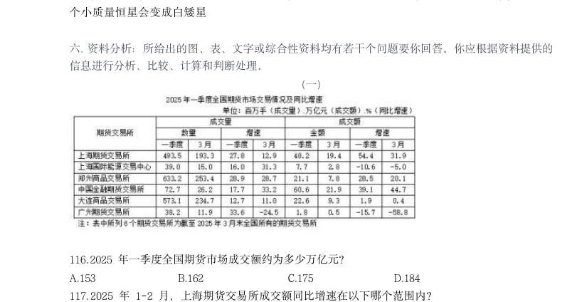

- **A.** 153
- **B.** 162
- **C.** 175
- **D.** 184

**答案：B**　**考点：基期量计算**
**【资料分析·增长率计算与比较｜GK-2026-fs-X117】**

117. 2025 年1-2 月,上海期货交易所成交额同比增速在以下哪个范围内?

- **A.** 不到45%
- **B.** 超过85%
- **C.** 45%-65%之间
- **D.** 65%-85%之间

**答案：D**　**考点：增长率计算与比较**
**【资料分析·基期量计算｜GK-2026-fs-X118】**

118. 全国2025 年3 月成交量超过一季度月均成交量的期货交易所有几个?

- **A.** 5
- **B.** 4
- **C.** 3
- **D.** 2

**答案：A**　**考点：基期量计算**
**【资料分析·基期量计算｜GK-2026-fs-X119】**

119. 2024 年一季度,郑州商品交易所成交量比大连商品交易所:

- **A.** 多不到0.5 亿手
- **B.** 少不到0.5 亿手
- **C.** 多0.5 亿手以上
- **D.** 少0.5 亿手以上

**答案：B**　**考点：基期量计算**
**【资料分析·平均数计算｜GK-2026-fs-X120】**

120. 全国期货交易所中,2025 年3 月平均每手成交额同比增幅和同比降幅最大的分别是:

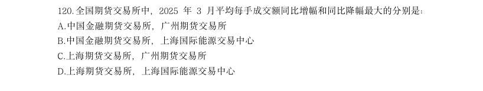

- **A.** 中国金融期货交易所,广州期货交易所
- **B.** 中国金融期货交易所,上海国际能源交易中心
- **C.** 上海期货交易所,广州期货交易所
- **D.** 上海期货交易所,上海国际能源交易中心

**答案：C**　**考点：平均数计算**
**【资料分析·基期量计算｜GK-2026-fs-X121】**

121. 2024 年,全国基本医疗保险统筹基金支出金额超过收入金额的月份有几个?

- **A.** 4
- **B.** 5
- **C.** 6
- **D.** 7

**答案：B**　**考点：基期量计算**
**【资料分析·基期量计算｜GK-2026-fs-X122】**

122. 2024 年,全国基本医疗保险统筹基金累计收入第一次超过1.5 万亿元是在几月?

- **A.** 5 月
- **B.** 6 月
- **C.** 7 月
- **D.** 8 月

**答案：C**　**考点：基期量计算**
**【资料分析·基期量计算｜GK-2026-fs-X123】**

123. 2024 年,全国城乡居民基本医疗保险统筹基金收入最高的季度是:

- **A.** 一季度
- **B.** 二季度
- **C.** 三季度
- **D.** 四季度

**答案：D**　**考点：基期量计算**
**【资料分析·比重计算与比较｜GK-2026-fs-X124】**

124. 2024 年,职工基本医疗保险统筹基金支出占全国基本医疗保险统筹基金支出比重最大的月 份,当月职工基本医疗保险支出比上月:

- **A.** 增加了5%以上
- **B.** 减少了5%以上
- **C.** 增加了不到5%
- **D.** 减少了不到5%

**答案：D**　**考点：比重计算与比较**
**【资料分析·增长量计算｜GK-2026-fs-X125】**

125. 以下柱状图反映了2024 年9~12 月,全国基本医疗保险统筹基金哪一指标的环比增量变化 情况(横轴位置表示增量为0)?

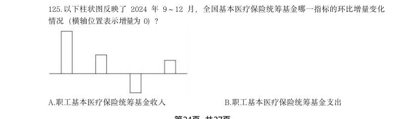

- **A.** 职工基本医疗保险统筹基金收入
- **B.** 职工基本医疗保险统筹基金支出
- **C.** 城乡居民基本医疗保险统筹基金收入
- **D.** 城乡居民基本医疗保险统筹基金支出

**答案：C**　**考点：增长量计算**
**【资料分析·倍数计算｜GK-2026-fs-X126】**
> 材料：绿证是对可再生能源绿色电力颁发的具有独特标识代码的电子证书,1 个绿证单位对应 1000 千瓦时可再生能源电量。2024 年全国核发绿证47.34 亿个,其中可交易绿证31.58 亿个。 截至2024 年12 月底全国累计核发绿证49.55 亿个,其中可交易绿证33.79 亿个。 2024 年,全国集中式项目核发绿证46.77 亿个。按项目类型划分,风电19.07 亿个,常规 水电15.78 亿个,太阳能发电8.03 亿个,生物质发电3.81 亿个,风光一体化项目755 万个, 地热能发电52 万个,海洋能发电1.1 万个。

126. 2024 年全国分布式项目核发绿证5695 万个,同比 增长27.8 倍。其中,分散式风电核发绿证3364 万个,分布式光伏核发绿证2331 万个。 2024 年,全国核发的不可交易绿证对应约多少万亿千瓦时可再生能源电量?

- **A.** 1.6
- **B.** 3.2
- **C.** 7.9
- **D.** 15.8

**答案：A**　**考点：倍数计算**
**【资料分析·倍数计算｜GK-2026-fs-X127】**

127. 2023 年,全国核发绿证数量约是2022 年的多少倍?

- **A.** 3.7
- **B.** 5.1
- **C.** 6.3
- **D.** 7.8

**答案：D**　**考点：倍数计算**
**【资料分析·比重计算与比较｜GK-2026-fs-X128】**

128. 2024 年绿证核发量最多的5 个省级行政区,绿证核发量约占全国总量的:

- **A.** 38%
- **B.** 42%
- **C.** 46%
- **D.** 50%

**答案：B**　**考点：比重计算与比较**
**【资料分析·比重计算与比较｜GK-2026-fs-X129】**

129. 2024 年,全国集中式风电项目核发绿证数量占当年集中式项目核发绿证数量的比重比太阳能 发电项目的占比高约多少个百分点?

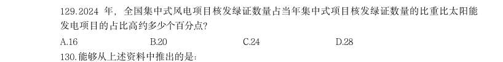

- **A.** 16
- **B.** 20
- **C.** 24
- **D.** 28

**答案：C**　**考点：比重计算与比较**
**【资料分析·综合分析｜GK-2026-fs-X130】**

130. 能够从上述资料中推出的是:

- **A.** 2019 年,全国绿证核发量多于2018 年
- **B.** 截至2023 年底,全国累计核发绿证中,可交易绿证的占比不到1%
- **C.** 2024 年,全国常规水电核发绿证不到集中式项目核发绿证总数量的三分之一
- **D.** 2024 年,湖北、湖南核发绿证之和占全国比重比广东、广西之和高1 个百分点以上

**答案：D**　**考点：综合分析**
**【资料分析·基期量计算｜GK-2026-fs-X131】**
> 材料：2024 年,我国对联合国定义的45 个最不发达国家(以下简称最不发达国家)进出口 14230.2 亿元人民币,占同期我国外贸进出口总值的3.2%。其中出口8664.6 亿元,同比(下同) 增长4.3%;进口5565.5 亿元,增长12.8%。 2024 年,我国对最不发达国家出口机电产品3942.2 亿元,增长13.5%。其中出口船舶690.8 亿元,增长65.9%,主要出口至全球第一大船旗国利比里亚。出口金额654.3 亿元,增长67%; 出口工程机械、火车分别为165.3 亿元、91.6 亿元,分别增长28.9%、39.5%;出口劳动密集型产 品2481 亿元,增长3.7%,其中纺织品1623.5 亿元,增长15.3%。 2024 年,我国自最不发达国家进口铜材、原油、金属矿砂分别为1469.6 亿元、1364.2 亿 元、1221 亿元。最不发达国家成为我国钢材、铝矿、锡矿,钨矿,

131. 12 月,我国自最不发达国家进口512.7 亿元,增长18.1%,其中自刚果民主共和国、几内亚、 老挝、赞比亚分别进口156.3 亿元,54.7 亿元,35.6 亿元,33.9 亿元,分别增长84.6%,40.3%, 25.7%、127.27%。 2024 年,我国外贸进出口总值在以下哪个范围内?

- **A.** 不到44 万亿元
- **B.** 44 万亿元~45 万亿元之间
- **C.** 45 万亿元~46 万亿元之间
- **D.** 超过46 万亿元

**答案：B**　**考点：基期量计算**
**【资料分析·增长率计算与比较｜GK-2026-fs-X132】**

132. 2024 年,我国对最不发达国家进出口总值同比增速约为:

- **A.** 9.5%
- **B.** 8.5%
- **C.** 7.5%
- **D.** 10.5%

**答案：C**　**考点：增长率计算与比较**
**【资料分析·比重计算与比较｜GK-2026-fs-X133】**

133. 下列饼状图,最能准确反映2024 年我国自最不发达国家进口值中,铜材(黑色),原油 (横线),金属矿砂(白色)和其他(竖线)进口值占比关系的是:

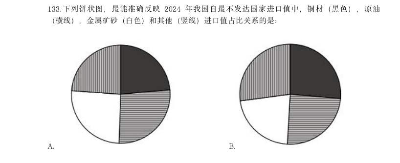

- **A.** 
- **B.** 
- **C.** 
- **D.** 

**答案：B**　**考点：比重计算与比较**
**【资料分析·基期量计算｜GK-2026-fs-X134】**

134. 2023 年1~11 月,我国对最不发达国家月均进口值约为多少亿元?

- **A.** 395
- **B.** 409
- **C.** 468
- **D.** 502

**答案：B**　**考点：基期量计算**
**【资料分析·基期量计算｜GK-2026-fs-X135】**

135. 关于2024 年我国进出口情况,能根据上述资料推出的是:

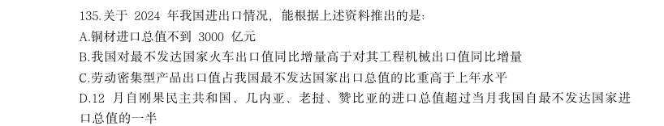

- **A.** 铜材进口总值不到3000 亿元
- **B.** 我国对最不发达国家火车出口值同比增量高于对其工程机械出口值同比增量
- **C.** 劳动密集型产品出口值占我国最不发达国家出口总值的比重高于上年水平
- **D.** 12 月自刚果民主共和国、几内亚、老挝、赞比亚的进口总值超过当月我国自最不发达国家进

**答案：D**　**考点：基期量计算**