# 2026 年国考行测（地市级）

- 题量：124（含答案 123）
- 模块分布：资料分析20 / 数量关系11 / 言语理解30 / 判断推理31 / 常识判断32
- 试卷编号：`国考-2026-地市级`

## 题目与答案

**【常识判断·政治常识｜GK-2026-ds-X001】**

1. 习近平总书记强调,必须坚持自信自立。中国人民和中华民族从近代以后的深重苦难走向伟大 复兴的光明前景,从来就没有教科书,更没有现成答案。关于坚持自信自立,下列表述正确的有 几项? 1走自己的路,是党的全部理论和实践立足点,更是党百年奋斗得出的历史结论 2推进中国式现代化,必须坚持把国家和民族发展放在自己力量的基点上 3中国式现代化既要物质财富极大丰富,也要精神财富极大丰富、在思想文化上自信自强 4独立自主是中华民族的优良传统,是中国共产党、中华人民共和国立党立国的重要原则

> 同题变体（主记录 GK-2026-fs-X001）

- **A.** 1 项
- **B.** 2 项
- **C.** 3 项
- **D.** 4 项

**答案：D**　**考点：政治常识｜新时代理论**　**难度：★★★★★**
**【常识判断·政治常识｜GK-2026-ds-X002】**

2. 习近平总书记强调,科学制定和接续实施五年规划,是我们党治国理政一条重要经验,也是中 国特色社会主义一个重要政治优势。关于五年规划编制工作,下列说法正确的是:

> 同题变体（主记录 GK-2026-fs-X002）

- **A.** 我国五年规划(计划)编制工作起始于1949 年,有力推动了经济社会发展、综合国力提升、人民生活改善
- **B.** 中长期发展规划有助于充分发挥政府在资源配置中的决定性作用,彰显了政府对经济社会发展的宏观调控能力
- **C.** 从第一个五年计划到当前的五年规划,一以贯之的主题是把我国建设成为社会主义现代化国家
- **D.** 通过互联网就“十五五”规划编制向全社会征求意见和建议,在我国五年规划编制史上是第

**答案：C**　**考点：政治常识｜新时代理论**　**难度：★★★★☆**
**【常识判断·政治常识｜GK-2026-ds-X003】**

3. 建设文化强国,事关中国式现代化建设全局,事关中华民族复兴大业,事关提升国际竞争力, 锚定2 035 年建成社会主义文化强国的战略目标,必须始终坚持文化建设着眼于人、落脚于人。 下列有关说法正确的是: 1文化强国之“强”最终要体现在为人民提供文化服务和文化产品的能力上 2坚持以人民为中心,着眼满足人民群众多样化、多层次、多方面的精神文化需求 3文化创造核心在人,要建设一支规模宏大、结构合理、锐意创新的高水平文化人才队伍 4尊重人才成长规律,完善符合文化领域特点的人才选拔、培养、使用、激励机制,营造识才、 重才、爱才的良好政策环境

> 同题变体（主记录 GK-2026-fs-X003）

- **A.** 123
- **B.** 234
- **C.** 124
- **D.** 134

**答案：B**　**考点：政治常识｜新时代理论**　**难度：★★★★★**
**【常识判断·政治常识｜GK-2026-ds-X004】**

4. 中共中央、国务院印发《加快建设农业强国规划(2024-2035 年)》,提出面对新形势新要 求,必须把加快建设农业强国作为统领“三农”工作的战略总纲,摆上建设社会主义现代化强 国的重要位置,下列与加快建设农业强国有关的说法正确的是:

> 同题变体（主记录 GK-2026-fs-X004）

- **A.** 推进生态综合补偿,健全横向生态保护补偿机制,统筹推进生态环境损害赔偿
- **B.** 建立健全长江流域信息共享系统,推进长江流域农业深度节水控水
- **C.** 完善粮食产销奖补制度,中央预算内投资向粮食主销区倾斜
- **D.** 推进农业科技推广体系,从经营性向公益性转变

**答案：A**　**考点：政治常识｜政治常识（待细分）**　**难度：★★★★★**
**【常识判断·政治常识｜GK-2026-ds-X005】**

5. 全面推进依法治国是一个系统工程,必须坚持法治国家、法治政府、法治社会一体建设。下列 相关表述不准确的是:

> 同题变体（主记录 GK-2026-fs-X005）

- **A.** 法治社会是构筑法治国家、法治政府的基础
- **B.** 建设法治政府对建设法治社会具有重要引领和带动作用
- **C.** 法治政府、法治社会建设必须服从、服务于法治国家建设
- **D.** 法治国家是依法治国的主体,是法治社会建设的先导和示范

**答案：D**　**考点：政治常识｜政治常识（待细分）**　**难度：★☆☆☆☆**
**【常识判断·政治常识｜GK-2026-ds-X006】**

6. 2025 年7 月,习近平总书记在中央城市工作会议上发表重要讲话,明确做好城市工作的总体 要求、重要原则、重点任务,为做好新时代新征程的城市工作提供了根本遵循。关于城市工作, 下列说法正确的是:

> 同题变体（主记录 GK-2026-fs-X006）

- **A.** 要把握“我国城镇化正从快速增长期转向稳定发展期”的历史方位
- **B.** 城市工作重心应向更加注重建设投入转变
- **C.** 着力通过外延扩张发展组团式的现代化城市群和都市圈
- **D.** 城市政府应从城市事务管理的“掌舵人”转变为“划桨人”

**答案：A**　**考点：政治常识｜新时代理论**　**难度：★★★★☆**
**【常识判断·政治常识｜GK-2026-ds-X007】**

7. 经济工作千头万绪,必须统筹好有效市场和有为政府的关系、总供给和总需求的关系、培育新 动能和更新旧动能的关系、做优增量和盘活存量的关系、提升质量和做大总量的关系。下列相关 说法不准确的是:

> 同题变体（主记录 GK-2026-fs-X007）

- **A.** 要加快推动作为经济增长和就业收入基本依托的传统产业改造升级
- **B.** 要加快补上内需特别是消费短板,使内需成为拉动经济增长的主动力和稳定锚
- **C.** 要坚持以量取胜、充分发挥规模效应,用好超大规模市场优势和丰富应用场景
- **D.** 要用好各类增量资源和存量资源,通过盘活存量来带动增量

**答案：C**　**考点：政治常识｜新时代理论**　**难度：★★★★☆**
**【常识判断·政治常识｜GK-2026-ds-X008】**

8. 2025 年7 月30 日,中共中央政治局召开会议,对扎实做好民生保障工作作了重要部署。下 列相关表述不准确的是()。

> 同题变体（主记录 GK-2026-fs-X008）

- **A.** 巩固拓展脱贫攻坚成果,确保不发生规模性返贫致贫
- **B.** 夯实“三农”基础,推动粮食和重要农产品价格保持在合理水平
- **C.** 突出就业优先政策导向,促进高校毕业生、退役军人、农民工等重点群体就业
- **D.** 始终把人民群众财产安全放在第一位,加强安全生产监管

**答案：D**　**考点：政治常识｜新时代理论**　**难度：★★★★☆**
**【常识判断·政治常识｜GK-2026-ds-X009】**

9. 做好新时代人口工作,要完善新时代人口发展战略,认识、适应、引领人口发展新常态,以人 口高质量发展支撑中国式现代化。关于做好新时代人口工作,下列说法正确的是:

> 同题变体（主记录 GK-2026-fs-X009）

- **A.** 要树立“大人口观”,推动人口与财政、货币、就业、产业、投资、消费、生态、区域等政策形成系统集成效应
- **B.** 必须推动人口工作由稳定总量、畅通流动向调节数量、优化结构转变
- **C.** 要更加重视“引导”和“激励”的办法,由社会治理向政府治理转变
- **D.** 坚持人民主体地位,把人口高速增长同人民高品质生活紧密结合起来

**答案：A**　**考点：政治常识｜新时代理论**　**难度：★★★★☆**
**【常识判断·政治常识｜GK-2026-ds-X010】**

10. 《中共中央关于制定国民经济和社会发展第十五个五年规划的建议》提出,推进国家安全体 系和能力现代化,建设更高水平平安中国。下列有关说法正确的是()。

> 同题变体（主记录 GK-2026-fs-X010）

- **A.** 锻造实战实用的国家安全能力,把捍卫国土安全摆在首位
- **B.** 统筹推进房地产、地方政府债务、中小金融机构等风险有序化解
- **C.** 健全国家安全体系,坚持以风险防控为先导、法治保障为落脚点
- **D.** 完善公共安全体系,推动公共安全治理模式由事后处理向事中控制转型

**答案：B**　**考点：政治常识｜政治常识（待细分）**　**难度：★★★★☆**
**【常识判断·政治常识｜GK-2026-ds-X011】**

11. 习近平总书记高度重视战略思维,多次强调党员领导干部要加强战略思维,增强战略定力。 下列体现战略思维的说法,正确的有几项? 1粮食多一点少一点是战略问题,粮食安全是战术问题 2统战工作的本质要求是大团结大联合,解决的是人心和力量问题 3要心怀“国之大者”,站在全局和战略的高度想问题、办事情,一切工作都要以贯彻落实党 中央决策部署为前提 4自觉把党的对外工作放到党和国家工作大局中来认识,放到中国与世界关系的发展变化中来把 握

> 同题变体（主记录 GK-2026-fs-X011）

- **A.** 1 项
- **B.** 2 项
- **C.** 3 项
- **D.** 4 项

**答案：C**　**考点：政治常识｜新时代理论**　**难度：★★★★★**
**【常识判断·政治常识｜GK-2026-ds-X012】**

12. 习近平总书记指出,我们要建成的教育强国,是中国特色社会主义教育强国,应当具有强大 的思政引领力、人才竞争力、科技支撑力、民生保障力、社会协同力、国际影响力,为以中国式 现代化全面推进强国建设、民族复兴伟业提供有力支撑。关于建设教育强国,下列说法正确的 是:

> 同题变体（主记录 GK-2026-fs-X012）

- **A.** 要坚持教育均等化原则,把教育公平作为国家基本教育政策
- **B.** 要完善人才培养与经济社会发展需要适配机制,顺应时代发展要求,适度增加学科专业数量
- **C.** 要把引进全球顶尖科学家摆到更加突出位置,着力培育拔尖创新人才,推动实现高水平科技自立自强
- **D.** 从教育大国到教育强国是一个系统性跃升和质变,必须以改革创新为动力

**答案：D**　**考点：政治常识｜新时代理论**　**难度：★★★★★**
**【常识判断·政治常识｜GK-2026-ds-X013】**

13. 习近平主席在二十国集团领导人第十九次峰会上指出,要完善全球贸易治理,建设开放型世 界经济。下列相关表述正确的是:

> 同题变体（主记录 GK-2026-fs-X013）

- **A.** 要适应经济问题政治化的潮流,通过强化绿色低碳要求推行贸易保护政策
- **B.** 要积极构建更具平等性、包容性和建设性的产业链供应链伙伴关系,呼吁各方加强合作
- **C.** 要把安全置于国际经贸议程中心地位,持续推动贸易和投资自由化便利化
- **D.** 要一以贯之保持世界贸易组织规则不变,提高多边贸易体制的权威性、有效性和相关性

**答案：B**　**考点：政治常识｜新时代理论**　**难度：★★★★☆**
**【常识判断·政治常识｜GK-2026-ds-X014】**

14. 中国式现代化要靠科技现代化作支撑,实现高质量发展要靠科技创新培育新动能。关于建成 科技强国的举措,下列说法正确的是:

> 同题变体（主记录 GK-2026-fs-X014）

- **A.** 要坚持有所为有所不为,突出经济发展需求,在重要领域实施科技战略部署
- **B.** 要充分发挥人才在科技资源配置中的决定性作用,调动产学研各环节的积极性
- **C.** 要充分发挥科技领军企业龙头作用,鼓励中小企业和民营企业科技创新,支持企业牵头或参与国家重大科技项目
- **D.** 要降低基础研究组织化程度,强化自由探索,鼓励面向重大科学问题的协同攻关

**答案：C**　**考点：政治常识｜新时代理论**　**难度：★★★★☆**
**【常识判断·政治常识｜GK-2026-ds-X015】**

15. 习近平总书记强调,选人用人要加强党性鉴别,注重考察干部的境界格局和忠诚度廉洁度。 下列与党性相关的说法正确的是:

> 同题变体（主记录 GK-2026-fs-X015）

- **A.** 树立和践行正确政绩观,起决定性作用的是党性
- **B.** 强党性,就是要自觉用马克思主义思想改造客观世界
- **C.** 党性、党风、党纪是有机整体,党性是根本,党风是保障,党纪是表现
- **D.** 作风问题本质上是党性问题,要把作风建设摆在党性修养的首位

**答案：A**　**考点：政治常识｜新时代理论**　**难度：★★★★☆**
**【常识判断·政治常识｜GK-2026-ds-X016】**

16. 坚持问题导向是习近平新时代中国特色社会主义思想的世界观和方法论的重要内容。关于坚 持问题导向,下列说法不准确的是:

> 同题变体（主记录 GK-2026-fs-X016）

- **A.** 坚持问题导向是马克思主义的鲜明特点
- **B.** 坚持问题导向要抓住人民最关心最直接最现实的利益问题
- **C.** 坚持问题导向体现了矛盾的普遍性和客观性
- **D.** 坚持问题导向本质是变与不变、继承与发展的辩证统一

**答案：D**　**考点：政治常识｜新时代理论**　**难度：★☆☆☆☆**
**【常识判断·政治常识｜GK-2026-ds-X017】**

17. 恩格斯深刻指出:“马克思的整个世界观不是教义,而是方法。它提供的不是现成的教条, 而是进一步研究的出发点和供这种研究使用的方法。”下列有关马克思主义理论的说法不准确 的是:

> 同题变体（主记录 GK-2026-fs-X017）

- **A.** 马克思创立了辩证法,成为我们认识世界和改造世界的根本方法
- **B.** 科学社会主义的原则不能丢,但科学社会主义也绝不是一成不变的教条
- **C.** 当代中国的伟大社会变革不是简单套用马克思主义经典作家设想的模板
- **D.** 《共产党宣言》发表至今,人类社会发生了翻天覆地的变化,但马克思主义所阐述的一般原理

**答案：A**　**考点：政治常识｜马克思主义基本原理**　**难度：★★★★☆**
**【常识判断·政治常识｜GK-2026-ds-X018】**

18. 以实践为基础,从整体上把握人与世界的关系,是马克思主义世界观的重要内容。关于马克 思主义实践观,下列说法正确的是:

> 同题变体（主记录 GK-2026-fs-X018）

> （本题为图形题，选项为图片，见原卷）

**答案：C**　**考点：政治常识｜马克思主义基本原理**　**难度：★☆☆☆☆**
**【常识判断·政治常识｜GK-2026-ds-X019】**

19. 习近平总书记在对各省区市进行深入考察调研的过程中,结合各地实际情况,对推进高质量 发展作出一系列重要部署。下列对应关系正确的是:

> 同题变体（主记录 GK-2026-fs-X019）

- **A.** 江苏——要建设国家资源型经济转型综合配套改革试验区,重点抓好能源转型、产业升级和适度多元发展
- **B.** 山东——要发挥海洋资源丰富的得天独厚优势,经略海洋、向海图强,打造世界级海洋港口群,打造现代海洋经济发展高地
- **C.** 云南——要把握好挑大梁的着力点,在推动科技创新和产业创新融合上打头阵
- **D.** 贵州——聚焦实现贸易、投资、跨境资金流动、人员进出、运输来往自由便利和数据安全有序

**答案：B**　**考点：政治常识｜新时代理论**　**难度：★★★★☆**
**【常识判断·政治常识｜GK-2026-ds-X020】**

20. 2025 年是中国人民抗日战争暨世界反法西斯战争胜利80 周年。中国人民对战争带来的苦难 有着刻骨铭心的记忆,对和平有着孜孜不倦的追求。关于中国人民抗日战争,下列表述不准确的 是:

> 同题变体（主记录 GK-2026-fs-X020）

- **A.** 中国人民抗日战争的伟大胜利,是以爱国主义为核心的民族精神的伟大胜利
- **B.** 中国人民抗日战争的伟大胜利,第一次确立了中国在世界上的大国地位,使中国人民赢得了世界爱好和平人民的尊敬
- **C.** 中国人民抗日战争的伟大胜利,是近代以来中国抗击外敌入侵的第一次完全胜利
- **D.** 中国人民抗日战争的伟大胜利,为中华民族由近代以来陷入深重危机走向伟大复兴确立了历史

**答案：B**　**考点：政治常识｜新时代理论**　**难度：★★★★☆**
**【常识判断·法律常识｜GK-2026-ds-X021】**
> 材料：B.实践的过程就是对于结果的检验和评价 D.实践是一种无目的的适应环境的本能活动 点

21. 下列情形不符合《中华人民共和国监察法》及其实施条例规定的是:

- **A.** 再派出的监察专员王某在开展监察工作过程中,受派出他的监察机构领导
- **B.** 公务员张某在怀孕期间因涉嫌严重职务违法被监察机关调查,经监察机关依法审批,对其采取责令候查措施
- **C.** 办理监察事项的监察人员黄某系监察对象刘某的丈夫,黄某应自行回避
- **D.** 监察人员李某涉嫌职务犯罪,监察机关决定对其采取15 日禁闭措施

**答案：D**　**考点：法律常识｜行政法**　**难度：★★★★★**
**【常识判断·经济常识｜GK-2026-ds-X022】**

22. 关于《中华人民共和国民营经济促进法》,下列说法错误的是:

- **A.** 是我国第一部专门关于民营经济发展的基础性法律
- **B.** 规定司法行政部门建立涉企行政执法诉求沟通机制
- **C.** 规定地方各级人民政府与民营经济组织订立的合同不得变更
- **D.** 规定向民营经济组织开放国家重大科研基础设施

**答案：C**　**考点：经济常识｜经济常识（待细分）**　**难度：★★★★☆**
**【常识判断·法律常识｜GK-2026-ds-X023】**

23. 根据《政务数据共享条例》,下列说法错误的是:

- **A.** 政务数据需求部门提交的申请材料不全的,政务数据提供部门不得直接予以拒绝
- **B.** 政府部门通过共享获得政务数据后不得擅自将获得的政务数据提供给第三方
- **C.** 可以提供给所有政府部门共享使用的政务数据属于无条件共享类政务数据
- **D.** 政府部门应当新建政务数据共享交换系统开展跨层级政务数据共享相关工作

**答案：D**　**考点：法律常识｜行政法**　**难度：★★★★★**
**【常识判断·地理常识｜GK-2026-ds-X027】**
> 材料：C.高纯石英可用于芯片制造中的光刻环节

27. 下列与海洋经济有关的说法错误的是：

- **A.** 海水中氢离子和氢氧根离子浓度高，利用海水制氢效率高
- **B.** 现代深远海养殖平台一般设置在有较大浪流的开放性水域
- **C.** 潮汐发电的水轮机结构要适应海水落差小、流量大的特点
- **D.** 液化天然气运输船的液舱通常采用超低温环境储存天然气

**答案：A**　**考点：地理常识｜世界地理**　**难度：★★★★★**
**【常识判断·历史人文｜GK-2026-ds-X028】**
> 材料：施方案》,下列有关说法正确的是: A.西北区要重点加强水平梯田改造建设 B.25 度以上坡耕地、沿海内陆滩涂是开展建设的重点区域 C.高标准农田建设标准中的“两通”是指通水通路 D.黄淮海区应该把改善田块细碎化问题作为一个工作重点 26. 2025 年自然资源部发布《新发现矿种公告》,高纯石英矿正式成为我国第174 号矿种。下列 与之相关的说法错误的是: 性 : A.海水中氢离子和氢氧根离子浓度高,利用海水制氢效率高 B.现代深远海养殖平台一般设置在有较大浪流的开放性水域 C.潮汐发电的水轮机结构要适应海水落差小、流量大的特点 D.液化天然气运输船的液舱通常采用超低温环境储存天然气

28. 关于诗句中涉及的气象现象,下列说法错误的是:

- **A.** “白雪却嫌春色晚,故穿庭树作飞花”与春季较强冷空气活动有关
- **B.** “雷车动地电火明,急雨遂作盆盎倾”多与积雨云中的电位差有关
- **C.** “檐花穿雾凇,窗纸战风棱”的景观形成过程中包含凝华现象
- **D.** “鸡声茅店月,人迹板桥霜”的“霜”包含在降水统计范围内

**答案：D**　**考点：历史人文｜文学与文化**　**难度：★★★★★**
**【常识判断·地理常识｜GK-2026-ds-X029】**

29. 下列关于河流入海口的描述与河流对应错误的是:

- **A.** 浑浊的河水奔流而至,汇入清澈的渤海,形成一条清晰的分界线——黄河
- **B.** “三龙吐珠,八门入海”,生动地描绘出了它的奇特形态——淮河
- **C.** 在入海口的潮间带上,会看到一片耀眼的红色,又被称为“红海滩”——辽河
- **D.** 在其与东海海潮的相互激荡下,造就了我国第三大岛崇明岛——长江

**答案：B**　**考点：地理常识｜中国地理**　**难度：★★★★★**
**【常识判断·生活常识｜GK-2026-ds-X030】**

30. 下列与自然界中的颜色有关的说法错误的是:

- **A.** “橙色月亮”通常发生在大气层中水汽或颗粒物质较多时
- **B.** 火烈鸟羽毛呈朱红色与摄入食物中的虾青素累积有关
- **C.** 蓝闪蝶翅膀呈蓝色是由于其表面鳞片具有特殊的微结构
- **D.** 蓝莓呈现靛蓝色是因为表面蜡质层中含高浓度花青素

**答案：D**　**考点：生活常识｜科技常识**　**难度：★★★★☆**
**【常识判断·生活常识｜GK-2026-ds-X031】**

31. 某物流公司要优化长三角到乌鲁木齐的易腐货物运输路线,下列方案最可行的是:

> 同题变体（主记录 GK-2026-fs-X028）

- **A.** 夏季采用陇海——兰新铁路运输利用沿线低温天气自然保鲜
- **B.** 冬季选择长江——京杭大运河——黄河水运组合避开陆路交通拥堵
- **C.** 春秋季采用铁路冷藏集装箱运输平衡运输成本与时效性
- **D.** 全年优先使用连霍高速公路运输以追求最低的运输成本

**答案：C**　**考点：生活常识｜经济常识**　**难度：★★★★☆**
**【常识判断·生活常识｜GK-2026-ds-X032】**

32. 某款创意时钟要用不同的符号替代表盘上的数字,下列设计不合适的是: 是这个时候,越要扛稳责任

- **A.** 用45 度角的正弦“sin45"” 替代“ 1 ”
- **B.** . 用3 的阶乘“ 3 ! ” 替代“ 6 ”
- **C.** 用重力加速度“g”替代“10”
- **D.** 用二进制数“ (1100)2”替代“12”

**答案：A**　**考点：生活常识｜科技常识**　**难度：★★★★☆**
**【常识判断·科技常识｜GK-2026-ds-X033】**

33. 关于化学平衡在人类活动中的应用,下列说法错误的是:

- **A.** 处理硬水时,可通过加入适量石灰乳作为软化剂调节水的硬度
- **B.** 血液中CO2 浓度增加时,血液中水电离出的氢氧根离子会增多
- **C.** 适当降低水温增大COZ 的溶解度可维持冷却水管道中的盐类平衡
- **D.** 向含有铜离子的废水中加入适量的碱可达到净化水质的环保目的

**答案：B**　**考点：科技常识｜基础科学**　**难度：★★★★★**
**【常识判断·科技常识｜GK-2026-ds-X034】**

34. 关于医学治疗手段及其原理,下列说法正确的是:

- **A.** 体外冲击波碎石术利用次声波可以将肾结石击碎成小块,使其随尿液排出体外
- **B.** 免疫疗法治疗癌症,能够通过激活自身免疫系统,利用T 细胞直接吞噬癌细胞
- **C.** 血液透析依据半透膜原理,将血液中的有害物质以及多余的水分清除出体外
- **D.** 激光治疗近视,利用激光对视网膜进行切割,改变视网膜的曲率,从而矫正视力

**答案：C**　**考点：科技常识｜基础科学**　**难度：★★★★★**
**【常识判断·历史人文｜GK-2026-ds-X035】**

35. 下列技术与其在考古领域的应用,对应错误的是:

- **A.** 光谱分析——揭示青铜器金属元素的含量和组成
- **B.** 中子成像技术——推断殷商青铜器铸造工艺
- **C.** 碳14 测年技术——精确判定青铜器的铸造年代
- **D.** 3D 数字建模结合X 射线断层扫描——分析青铜器内部结构

**答案：C**　**考点：历史人文｜中国古代史**　**难度：★★★★☆**
**【言语理解·逻辑填空｜GK-2026-ds-X036】**
> 材料：个最恰当的答案。

36. 2024 年,我国脱贫县农民人均可支配收入增幅高于全国平均水平,脱贫人口务工就业规模保 持稳中有增。2025 年是巩固拓展脱贫攻坚成果同乡村振兴有效衔接5 年过渡期的最后一年,越 , 填入画横线部分最恰当的一项是 ,做好监测帮扶工作。 :

- **A.** 步步为营
- **B.** 行稳致远
- **C.** 慎终如始
- **D.** 绵绵用力

**答案：C**　**考点：逻辑填空｜语境分析**　**难度：★★★☆☆**
**【言语理解·逻辑填空｜GK-2026-ds-X037】**

37. 在太空实验室开展的脑电测试实验中,航天员戴的“小红帽”叫作脑电帽,里面嵌入了众多 微小的触头,它们像一群 的小侦探,精准捕捉大脑每一个微妙的波动。这顶帽子赋予航天

> （本题为图形题，选项为图片，见原卷）

**答案：B**　**考点：逻辑填空｜语境分析**　**难度：★★☆☆☆**
**【言语理解·逻辑填空｜GK-2026-ds-X038】**

38. 党员干部生活作风的蜕变,往往是从吃喝等看似小事的地方开始的。“堤溃蚁孔,气泄针 芒”,这句古训就是强调 的重要性。习近平同志曾在《之江新语》中写道:“小事小节是 一面镜子,能够反映人品,反映作风。”党员干部要严格对照中央八项规定精神,深刻认识小 与大的辩证关系,主动“照镜子”自查。 填入画横线部分最恰当的一项是:

> 同题变体（主记录 GK-2026-fs-X036）

- **A.** 防微杜渐
- **B.** 积微成著
- **C.** 慎小谨微
- **D.** 曲突徒

**答案：A**　**考点：逻辑填空｜成语辨析**　**难度：★★★★☆**
**【言语理解·逻辑填空｜GK-2026-ds-X039】**

39. 通用人工智能对重大情报的挖掘和精确预测,确实能够提高情报准确性,有利于减少误判; 但有时也可能会使人类盲目自信,刺激其 ,通用人工智能带来的进攻优势,导致最佳防御 战略就是“ 险 ”,这会打破进攻与防御的平衡,引发新型安全困境,反而增加了战争爆发的风 。 依次填入画横线部分最恰当的一项是:

- **A.** 孤注一掷避实击虚
- **B.** 轻举妄动以攻为守
- **C.** 刚愎自用攻其不备
- **D.** 铤而走险先发制人

**答案：D**　**考点：逻辑填空｜成语辨析**　**难度：★★★★☆**
**【言语理解·逻辑填空｜GK-2026-ds-X040】**

40. 新史料被发掘,有赖于史家具有证据意识。若是史家不认为某个史料可以作为证据,该史料 可能会被 文明起源这一重大问题提供 。比如甲骨文,起初甲骨被当作龙骨入药,不被史家关注。但晚清学者王懿荣意识 到龙骨非同寻常,后经考证确认甲骨文是商代文字,之后史家以此为证据重构殷商历史,为中华 了 支点。 依次填入画横线部分最恰当的一项是:

- **A.** 视而不见稳固
- **B.** 弃如敝屣崭新
- **C.** 断章取义可靠
- **D.** 束之高阁坚实

**答案：D**　**考点：逻辑填空｜语境分析**　**难度：★★★★☆**
**【言语理解·逻辑填空｜GK-2026-ds-X041】**

41. 利用网络存在的安全漏洞入网窃取数据信息,这种方式相当隐蔽,往往会使数据的安全响 应 ;而且网络中流转数据的规模十分巨大,来源异常复杂,攻击者一旦掌握网络漏洞,入 侵网络后就可以在网上“ 各种攻击和泄露 ”,窃取数据。因此,必须严密防范数据在共享过程中可能遭受的 。 依次填入画横线部分最恰当的一项是:

> 同题变体（主记录 GK-2026-fs-X042）

- **A.** 防不胜防按图索骥
- **B.** 形同虚设守株待兔
- **C.** 名存实亡偷天换日
- **D.** 鞭长莫及瓮中捉鳖

**答案：B**　**考点：逻辑填空｜语境分析**　**难度：★★★★☆**
**【言语理解·逻辑填空｜GK-2026-ds-X042】**

42. 五彩滩是一处著名的雅丹地貌景观,位于新疆维吾尔自治区,中国唯一一条注入北冰洋的河 是 的泥岩、砂岩及砂砾组成的奇石怪 岩,这两种 的地貌遥相辉映,“一河隔两岸,胜似两重天”。 依次填入画横线部分最恰当的一项是:

- **A.** 鳞次栉比大相径庭
- **B.** 千姿百态别具一格
- **C.** 色彩斑斓截然不同
- **D.** 绚丽多姿各有千秋

**答案：C**　**考点：逻辑填空｜语境分析**　**难度：★★★☆☆**
**【言语理解·逻辑填空｜GK-2026-ds-X043】**

43. 面对新的形势和要求,必须进一步全面深化改革,继续完善各方面制度机制,因而制度建设 的任务更为繁重艰巨,加强顶层设计更为重要。如果不能全景式俯瞰和把握制度建设全局,采取 地层层系统设计,难免顾此失彼、

> （本题为图形题，选项为图片，见原卷）

**答案：D**　**考点：逻辑填空｜语境分析**　**难度：★★★☆☆**
**【言语理解·逻辑填空｜GK-2026-ds-X044】**

44. 未来特战力量可通过智能辅助,直接干扰或控制敌方指挥控制系统、造成敌方思想混乱、心 理受挫甚至出现幻觉;或者通过伴随无人平台实施网络作战,篡改指控系统指令和数据实现 “ ”,致使敌方指挥失灵、协同失效、人员失能, 地失去战斗力,从而实现不战而屈人 之兵。 依次填入画横线部分最恰当的一项是:

- **A.** 移花接木彻头彻尾
- **B.** 釜底抽薪无声无息
- **C.** 暗度陈仓潜移默化
- **D.** 反客为主浑然不觉

**答案：B**　**考点：逻辑填空｜语境分析**　**难度：★★★★☆**
**【言语理解·逻辑填空｜GK-2026-ds-X045】**

45. 对于不符合著作权法、专利法、商标法等专门法保护条件的创新成果,反不正当竞争法为其 提供了 保护。面对数字时代 的新型不正当竞争行为,反不正当竞争法通过一般条款的灵 活解释和适用,能够及时规制尚未被其他专门法 当使用。 依次填入画横线部分最恰当的一项是:

- **A.** 补充层出不穷覆的知识产权侵权行为,防止创新成果被不正盖
- **B.** 特殊屡见不鲜界定
- **C.** 升级五花八门收录
- **D.** 额外应运而生明确

**答案：A**　**考点：逻辑填空｜语境分析**　**难度：★★★☆☆**
**【言语理解·逻辑填空｜GK-2026-ds-X046】**

46. 中生代寄生蠕虫的化石数量并不稀少,但由于其地质年代相较于寒武纪、奥陶纪等更年轻, 常被认为难以 深层次的生物演化奥秘。其次,这些蠕虫往往体型微小,化石保存状况不 佳。再者,它们形态单调、特征 研究仍 ,使得分类鉴定难度极高。因此,中生代寄生蠕虫的相关 然 依次填入画横线部分最恰当的一项是:

> 同题变体（主记录 GK-2026-zf-X046）

> （本题为图形题，选项为图片，见原卷）

**答案：D**　**考点：逻辑填空｜成语辨析**　**难度：★★★★☆**
**【言语理解·逻辑填空｜GK-2026-ds-X047】**

47. 敢于正视问题的反面是回避矛盾、 偏离主题、不及重点 B.蕴含泛化停滞不前 D.揭示模糊屈指可数 ,个别表现在:发言提纲套用、借用、翻用,发言内容 , 、似曾相识,剖析问题避重就轻、 此种种,致使民主生活会的批评和自我批评有形式而无实质内容和效果,必须防止和纠正。 依次填入画横线部分最恰当的一项是 ,相互批评官话、套话......凡 :

- **A.** 敷衍了事老生常谈隔靴搔痒
- **B.** 虚与委蛇长篇大论大而化之
- **C.** 畏首畏尾陈词滥调浮光掠影
- **D.** 闪烁其词不痛不痒张冠李戴

**答案：A**　**考点：逻辑填空｜语境分析**　**难度：★★★★☆**
**【言语理解·逻辑填空｜GK-2026-ds-X048】**

48. 城镇化发展不宜 率较高且人口持续集聚的地区,不妨促进大中小城市和小城 。城镇化率低且人口规模大的地区,应着重提升水平、挖掘潜力;城镇化 镇 持系统观念,统筹城乡、双向发力。如此,才能在城乡一体、良性互动中,让城镇化成为一个 发展。在此过程中,要坚 顺 势而为、 的发展过程。 依次填入画横线部分最恰当的一项是:

- **A.** 一步到位共同自然而然
- **B.** 一哄而上均衡顺理成章
- **C.** 千篇一律融合大势所趋
- **D.** 整齐划一协调水到渠成

**答案：D**　**考点：逻辑填空｜成语辨析**　**难度：★★★★☆**
**【言语理解·逻辑填空｜GK-2026-ds-X049】**

49. 领导干部领导水平的高低,很重要的一点就在于能否预见在先、 知鹿过” ,如果没有“草摇叶响 的 加 、“窥一斑而知全豹”的预判,见事迟、反应慢,倾向性问题就可能不断叠 、 形、止损于未发。 依次填入画横线部分最恰当的一项是:

- **A.** 独具慧眼警惕延伸
- **B.** 见微知著谨慎激化
- **C.** 胸有成竹细致辐、升级,造成无法挽回的损失。因此,领导干部要做到早预警、早干预,避危于无射
- **D.** 未雨绸缪敏锐演变

**答案：D**　**考点：逻辑填空｜语境分析**　**难度：★★★☆☆**
**【言语理解·逻辑填空｜GK-2026-ds-X050】**

50. 进一步全面深化司法改革,必须聚焦改革的本质要求,严格依法依规推进改革,所有履职都 , 职能边界,不脱离法院职能,不超越法院职权,更不能 ,确保改 革不偏离正确方向。积极发挥法治对改革的引导、推动、规范、 作用,确保重大改革依法有 序、于法有据,增强改革的执行力、穿透力。依次填入画横线部分最恰当的一项是:

- **A.** 遵循各自为政监督
- **B.** 划定为所欲为震慑
- **C.** 厘清画地为牢约束
- **D.** 恪守越俎代庖保障

**答案：D**　**考点：逻辑填空｜语境分析**　**难度：★★★★☆**
**【言语理解·语句填入｜GK-2026-ds-X051】**

51. 何为担当作为?从字面上看,担当作为就是承担起应尽的责任和义务,发挥出应有的能力和 能量,创造出应然的成绩和实效;从辩证法看,担当是作为的前提和基础,作为是担当的体现和 成效,二者相辅相成。习近平总书记强调:“ 险,因此才需要担当。有时候越怕事越容易出事,越想绕道走矛盾就越堵着道。只有敢于担 当,豁得出去、敢闯敢干,矛盾和困难才可能得到解决。 填入画横线部分最恰当的一项是:

> 同题变体（主记录 GK-2026-fs-X046）

- **A.** 担当作为就要真抓实干、埋头苦干,决不能坐而论道、光说不练
- **B.** 党把干部放在各个岗位上是要大家担当干事,而不是做官享。”事业发展不可能一帆风顺,做事总有风福
- **C.** 担当和作为是一体的,不作为就是不担当,有作为就要有担当
- **D.** 如果不担当、不作为,没有执行力、战斗力,那是要打败仗的

**答案：C**　**考点：语句填入｜语句填入（综合）**　**难度：★★★★★**
**【言语理解·中心理解｜GK-2026-ds-X052】**

52. 埋藏较浅的饱水松散砂土遭受地震等强烈振动时,颗粒间的位置迅速调整,相互间失去接触 压力和摩擦力,有被振密的趋势。由于孔隙水压力急剧升高,颗粒快速聚集、挤出,随着水流不 断翻滚,由固态砂土变成液态混合物,这个过程叫作“液化”。液态混合物会向压力低的方向 运动,若地下有合适的通道或洞穴,则会涌向这些地方。当它们涌出地表,呈现喷砂冒水状态 时,就被称为“砂涌”。它们在流动过程中会破坏沿途的地貌景观和建筑,严重时还会造成人 畜伤亡。 这段文字所描述的自然现象可以概括为:

> 同题变体（主记录 GK-2026-fs-X047）

- **A.** 潜藏在地下的“暗河”
- **B.** 被摇成“液体”的砂土
- **C.** 沙漠中的“隐形”杀手
- **D.** 大地的“多米诺骨牌”效应

**答案：B**　**考点：中心理解｜转折与因果**　**难度：★★★★★**
**【言语理解·中心理解｜GK-2026-ds-X053】**
> 材料：C.我国战略物资清单的更新力度亟待加

53. 当前国际局势急剧变化,确保战略物资供应的安全与稳定已成为捍卫国家核心利益的战略制 高点,世界多个国家立足战略物资供应链安全保障,已多轮更新《关键矿产清单》,展现了高度 的敏锐性与响应速度。我国自《全国矿产资源规划(2016-2020 年)》明确将稀土、晶质石墨等 24 种矿产纳入战略性矿产范畴以来,虽已奠定坚实基础,但在面对新兴战略物资尤其是对战略 性新兴产业构成关键制约的矿物时,清单的更新步伐尚显滞后。以氢能电池产业为例,其核心材 料如铂族金属等在全球战略价值日益凸显,却在我国当前的储备规划中未能获得应有的重视与优 先地位。 这段文字意在说明: 强 B.铂族金属应纳入国家战略性矿产资源目录 D.新形势对我国物资储备体系提出新要求

> 同题变体（主记录 GK-2026-fs-X049）

> （本题为图形题，选项为图片，见原卷）

**答案：C**　**考点：中心理解｜主题词**　**难度：★★★★★**
**【言语理解·下文推断｜GK-2026-ds-X054】**

54. 随着人工智能时代的到来,“未来人”和“远方的陌生人”问题逐渐进入人类的伦理视 界。传统伦理学是“近的伦理学”,强调人与人之间的直接交往,行为双方是熟悉的、共同在 场的,道德时空是近距离的。科技深度介入使人类的道德空间和行为性质发生改变,一些新的 对象(如人工智能)逐渐进入我们为之负责和道德关切的领域。人工智能作为新科技,给人类的 伦理世界和道德空间带来了深刻变革,它以虚拟化和拟人化的方式与人类建立了新的交往关 系,伦理关系从“人与人”“人与动物”“人与自然”扩展到“人与人工智能”。 这段文字接下来最可能介绍:

- **A.** 未来人工智能技术的发展趋势
- **B.** 影响人类道德空间的技术因素
- **C.** 人工智能时代人际交往模式的新变化
- **D.** 人工智能带来的伦理挑战和道德困境

**答案：D**　**考点：下文推断｜下文推断**　**难度：★★★★★**
**【言语理解·标题填入｜GK-2026-ds-X055】**

55. 随着我国城镇化率逐步提高,城市已经成为人口集聚的主要空间,要实现智慧城市的发展目 标,必须紧跟新一代数字技术发展趋势,找准数字技术融入市域社会治理的“小切口”,促进 两者深度融合,可建设区、街、社(村)三层结构的数智化基层治理平台,覆盖社区治理全域 组织工作场景,有效破解基层治理“小马拉大车”的突出问题。通过建设数智化基层治理平 台,加快实现市域社会管理手段、管理模式、管理理念创新、推动城市治理和运行从数字化到 智能化再到智慧化的转型升级。 最适合做这段文字标题的是:

- **A.** 变“治理”为“智理”,提升城市智治水平
- **B.** 从“数字”到“数智”,打造基层治理平台
- **C.** 数字技术:提升基层治理的新手段
- **D.** 基层治理:从末梢发力向智慧升级

**答案：A**　**考点：标题填入｜标题填入**　**难度：★★★★★**
**【言语理解·中心理解｜GK-2026-ds-X056】**

56. 在信息技术领域,晶体管和激光器是两大核心元件。晶体管的微型化推动电子芯片飞速发展, 催生摩尔定律,即每隔约18 个月,集成电路上可容纳的晶体管数量将翻一番,这一趋势推动最 先进的晶体管尺寸达到纳米级别。相比晶体管,缩小激光器的难度要大得多,因为两者所依赖 的微观粒子截然不同,前者依赖电子,后者依赖光子。在可见光和近红外波段,光子波长比晶体 管中的电子波长高出3 个数量级。受衍射极限制约,这些光子能被压缩到的最小模式体积比晶 体管中的电子要大10 亿倍。因此,构建纳米尺度激光器的核心挑战在于如何突破衍射极限, 将光子的体积“压缩”到最小。 这段文字主要介绍:

> 同题变体（主记录 GK-2026-fs-X053）

- **A.** 构建纳米尺度激光器的难点
- **B.** 信息技术领域面临的核心挑战
- **C.** 摩尔定律对于突破衍射极限的制约
- **D.** 晶体管微型化对电子芯片发展的意义

**答案：A**　**考点：中心理解｜转折与因果**　**难度：★★★★★**
**【言语理解·逻辑填空｜GK-2026-ds-X057】**

57. 如何培育好独角兽企业,是一个大课题。不同类型的独角兽企业,需求完全不同。比如,有 的企业需要大量计算资源的支持,有的企业需要与高校相关科研力量加速对接,有的企业则需要 共性技术平台支持。显然,粗放式的政策供给难以满足不同类型独角兽企业的复杂需求, A.26314 , 助力企业加速成长。未来,随着机制的不断创新和完善,将能培育出更多优质的独角兽企业,为 经济的高质量发展注入强劲动力。 填入画横线部分最恰当的一项是:

- **A.** 有关部门应倾听独角兽企业的“声音”
- **B.** 唯有精准施策方可解决不同的“烦恼”
- **C.** 面向独角兽企业的“管家”应运而生
- **D.** 机制创新无疑是解决问题的“又一村”

**答案：B**　**考点：逻辑填空｜语境分析**　**难度：★★★★★**
**【言语理解·语句排序｜GK-2026-ds-X058】**

58. 1在这种条件下点火并稳定燃烧,好比在12 级狂风中点燃一根火柴 2在高超声速飞行器穿越云霄的征途中,动力推进技术就是打开高速大门的金钥匙 3当燃烧室内气流流速超过声速时,会形成复杂的激波系,激波前后气流状态会产生突变 4目前,超燃冲压发动机是这一领域的明星,它可以在大气中有效获取氧气,并且在高超声速条 件下稳定燃烧 5想象一下,让一个重达数吨的飞行器在空气稀薄的高空中以数倍声速疾驰,需要多么强大的发 动机提供足够的推力 6此时,常规的发动机技术完全不能适用,只有超燃冲压发动机才能在极短时间内将大量燃料转 化为推力,并让飞行器加速稳定在高超声速 将以上6 个句子重新排列,语序正确的一项是: 5

> 同题变体（主记录 GK-2026-fs-X050）

> （本题为图形题，选项为图片，见原卷）

**答案：B**　**考点：语句排序｜语序排列**　**难度：★★★★★**
**【言语理解·语句排序｜GK-2026-ds-X059】**

59. 1非周期性意味着,由这种形状构成的整体图案,不能通过平移或旋转来恢复相同的图案 2在后续的研究中,数学家们逐渐缩小这一数字,直到上世纪70 年代,罗杰·彭罗斯仅使用 两种不同的菱形,就完成了非周期性铺砌 3“爱因斯坦”来源于德语,意思是“一块石头”,指的是单铺砌块 4在数学的铺砌领域,寻找“爱因斯坦”是许多数学家追求了半个多世纪的“圣杯” 5单铺砌块指的是一个可以填满无限平面,且不会自我重复的非周期性铺砌块 6早期的数学家需要多种形状来组成非周期铺砌块,比如首个可以覆盖无限平面的非周期铺砌是 由2 万多种形状组成的 将以上6 个句子重新排列,语序正确的一项是: 2

> 同题变体（主记录 GK-2026-fs-X051）

> （本题为图形题，选项为图片，见原卷）

**答案：A**　**考点：语句排序｜语序排列**　**难度：★★★★★**
**【言语理解·中心理解｜GK-2026-ds-X060】**

60. 早期宇宙中,一个典型的星系会从周围的星系间介质中吸积气体,并将这些气体转化为恒 星。这一过程会增加星系的质量,从而提高气体吸积的效率,加速恒星形成。然而,星系并不是 无限增长的,天文学家将这一过程称为“熄灭”。在近域宇宙中,大约有一半被观测到的星系 已经不再形成恒星,也就是成为了息产星系,它们不再包含年轻明亮的蓝色恒星,只剩下更 老、更小的红色恒星,因此,它们的外观呈现红色。 根据这段文字,下列说法正确的是: 关

> 同题变体（主记录 GK-2026-zf-X065）

> （本题为图形题，选项为图片，见原卷）

**答案：A**　**考点：中心理解｜转折与因果**　**难度：★★★★★**
**【言语理解·标题填入｜GK-2026-ds-X061】**

61. 民主真正落地,需基于明确、可操作的行动指南,行动指南要依托科学规范的程序文本来呈 现,在这个意义上,科学民主的程序文本是民主得以从理念转化为现实不可或缺的载体,也是维 护民主之实的基本保证。一方面,可借鉴他山之石,一定程度地吸纳其他国家较为成熟的,基 于民主、公正、法治原则所建立起的议事规则;另一方面,须扎根实际,不能将程序简单视为 政治制度的“飞来峰”,照抄照搬或简而化之,需要注重历史和现实、理论和实践、形式和内 容有机统一,找到正确的方式方法。此外,还应构建长效化的程序完善机制,不断夯实程序之 基。 最适合做这段文字标题的是: 质 B.以程序内容之基筑牢实质民主之实 D.以程序科学之道阐释实质民主之义

> 同题变体（主记录 GK-2026-fs-X054）

> （本题为图形题，选项为图片，见原卷）

**答案：B**　**考点：标题填入｜标题填入**　**难度：★★★★☆**
**【言语理解·逻辑填空｜GK-2026-ds-X062】**

62. 自然界的微生物虽然能分解高盐废水中的部分污染物,但它们就像“偏科生”,每个菌种通 常只擅长处理一两种特定污染物。当面对高盐废水中油污、重金属、放射性物质等组成的“混 合垃圾”时,这些天然微生物就显得力不从心。此外,因微生物降解所涉及的基因种类和数目 较多,常规基因工程技术对菌株设计和改造的速度和深度非常有限。近年来,合成生物学技术飞 速发展为降解菌株的构建提供了可能。科学家们能够通过合成生物技术给微生物设计“智能工 具箱”,不仅 填入画横线部分最恰当的一项是:

- **A.** 能通过调控基因构建新菌株
- **C.** 能给细菌安装多种污染物分解能,还能让这些功能像积木一样精准搭配。

**答案：C**　**考点：逻辑填空｜实词辨析**　**难度：★★★★★**
**【言语理解·中心理解｜GK-2026-ds-X063】**
> 材料：B.能使微生物快速识别可分解污染物 D.能克服传统菌株“遇盐失活”的瓶颈

63. 对于县域而言,“错位”首先必须植根于自身“家底”。习近平总书记强调做好“土特 产”文章,正是点明要善于发掘和利用这种基于本土禀赋的比较优势,形成“人无我有”的独 特起点。同时,随着技术进步、市场变化,过去的优势可能减弱,新的机遇窗口不断开启。因 此,“错位发展”更需秉持发展眼光和创新思维,不仅要立足当前“有什么”,更要前瞻性 谋划“能发展什么”“应发展什么”,主动对接国家战略需求、区域发展格局、城市功能疏 解、乡村全面振兴需要和市场前沿,将潜在优势有效转化为产业竞争力与市场效益。 这段文字意在说明:

- **A.** 以产业促发展方能激活乡村振兴新动能
- **B.** 县域产业发展应主动聚焦国家战略需求
- **C.** 县域经济如何科学把握“错位发展”
- **D.** 前瞻性谋划为什么要先摸清“家底”

**答案：C**　**考点：中心理解｜对策优先**　**难度：★★★★★**
**【言语理解·中心理解｜GK-2026-ds-X064】**

64. 半规管原本是感知头部运动的器官,目前尚不清楚它是如何捕捉气压变化的。当半规管感知 气压降低,会将信息传递给前庭神经,再传递给下丘脑。下丘脑负责调整自主神经。自主神经是 维持体内状态不变、使身体适应外界变化的神经,分为交感神经和副交感神经,前者负责将身 体切换到“战斗模式”,后者负责切换到“放松模式”。当下丘脑因气压变化受到刺激时,自 主神经的功能就会紊乱,导致精神状态不佳。交感神经过度活跃时,身体会处于紧张状态,产 生焦虑感;交感神经不能正常工作时,人就会无精打采。 根据这段文字,下列说法正确的是:

- **A.** 交感神经负责使人进入放松状态
- **B.** 气压变化时人的前庭神经最先感知
- **C.** 副交感神经过度活跃使人产生焦虑感
- **D.** 气压变化通过下丘脑影响人的精神状态

**答案：D**　**考点：中心理解｜中心理解（综合）**　**难度：★★★★★**
**【言语理解·逻辑填空｜GK-2026-ds-X065】**

65. 就运行着数以千万计的小行星,它们与地球一样环绕太阳运行。当这些小行星与地球轨道发生交 会时,如果其轨道能量与地球相近,它们就可能被地球引力捕获,成为地球的“迷你月亮”。 根据科学家推断,地球周围随时都可能有“迷你月亮”在运行,只是目前人类观测能力有限, 无法定位其具体位置。 填入画横线部分最恰当的一项是 。太阳系中的小行星数不胜数,它们是太阳系形成后遗留的残余碎片,仅在地球轨道周围 :

- **A.** 小行星的轨道受多种因素扰动
- **B.** 地球的天然卫星并非只有一个见
- **C.** 小行星被地球引力捕获并不罕
- **D.** 小行星撞击地球的概率无法确知

**答案：C**　**考点：逻辑填空｜语境分析**　**难度：★★★★★**
**【数量关系·其他数量关系｜GK-2026-ds-X066】**
> 材料：A.少1 出答案。

66. 某企业采购了A、B、C 三个品牌的电脑共54 台,其中采购A 品牌电脑的台数比B 品牌电 脑少35%。问采购的C 品牌电脑比B 品牌电脑: 台 B.少2 台 C.多1 台 D.多2 台

> （本题为图形题，选项为图片，见原卷）

**答案：C**　**考点：其他数量关系｜和差倍比**　**难度：★★☆☆☆**
**【数量关系·排列组合｜GK-2026-ds-X067】**

67. 某部门7 人分两组到甲、乙两市进行调研。已知到甲市人数超过一半,老张和小王均到乙 市,问共有多少种不同的分组方式?

- **A.** 10
- **B.** 8
- **C.** 6
- **D.** 5

**答案：C**　**考点：排列组合｜基础排列组合**　**难度：★★★★★**
**【数量关系·行程问题｜GK-2026-ds-X068】**

68. 小王从甲地匀速前往乙地,到达后立刻匀速返回。已知他去程的用时比返程多3 小时,去程 的速度是返程的40%,且往返的平均速度为40 千米/小时,问甲、乙两地相距多少千米?

- **A.** 70
- **B.** 140
- **C.** 210
- **D.** 280

**答案：B**　**考点：行程问题｜环形与往返**　**难度：★★☆☆☆**
**【数量关系·利润问题｜GK-2026-ds-X069】**

69. 某种商品若按每件100 元出售,每天售出m 件;若降价10%,日销量将提高25%且单日利 润与降价前相同。问该商品成本为多少元/件?

- **A.** 50
- **B.** 60
- **C.** 70
- **D.** 80

**答案：A**　**考点：利润问题｜基础利润**　**难度：★★☆☆☆**
**【数量关系·工程问题｜GK-2026-ds-X070】**

70. 甲、乙两车间每天可加工2000 个零件。若甲、乙车间效率分别提升10%和20%,则两车间每 天可加工2260 个零件。问效率提升前甲车间每天可加工多少个零件?

- **A.** 1100
- **B.** 1200
- **C.** 1300
- **D.** 1400

**答案：D**　**考点：工程问题｜给定效率型**　**难度：★★☆☆☆**
**【数量关系·概率问题｜GK-2026-ds-X071】**

71. 某单位从所有职工中随机选3 人参加某个会议,张立和李磊2 人中只有1 人被选中的概率 是2 人均被选中概率的30 倍。问该单位有职工多少人?

> 同题变体（主记录 GK-2026-fs-X073）

- **A.** 15
- **B.** 17
- **C.** 29
- **D.** 33

**答案：D**　**考点：概率问题｜摸球与抽取**　**难度：★★★★☆**
**【数量关系·几何问题｜GK-2026-ds-X072】**

72. 一块梯形场地如下图所示,已知OA=0.6OD,现在需要将这块场地拓展为一块长方形场地,问 扩展后场地面积比原来至少增加:

> 同题变体（主记录 GK-2026-fs-X075）

- **A.** 20%
- **B.** 25%
- **C.** 40%
- **D.** 50%

**答案：B**　**考点：几何问题｜相似与比例**　**难度：★★★★☆**
**【数量关系·年龄问题｜GK-2026-ds-X073】**

73. 甲和乙办公室各有4 名职工,乙办公室职工平均年龄为32 岁。现从甲办公室调动1 人到乙 办公室,2 个办公室职工平均年龄都增加了2 岁。问调动后甲办公室职工的平均年龄为多少岁?

> 同题变体（主记录 GK-2026-fs-X076）

- **A.** 50
- **B.** 48
- **C.** 46
- **D.** 44

**答案：A**　**考点：年龄问题｜年龄和与倍数**　**难度：★★☆☆☆**
**【数量关系·其他数量关系｜GK-2026-ds-X074】**

74. 某社区干部每周一参加工作例会,每月10 日、20 日接访群众。已知8 月与9 月共有2 次 接访群众与工作例会在同一天,问当年9 月1 日是:

> 同题变体（主记录 GK-2026-fs-X078）

- **A.** 周三
- **B.** 周二
- **C.** 周六
- **D.** 周五

**答案：C**　**考点：其他数量关系｜日期与钟表**　**难度：★☆☆☆☆**
**【数量关系·排列组合｜GK-2026-ds-X075】**

75. 某新技术论坛在3 个分会场安排4 个领域的12 场报告,安排如下表。小华希望在同一天听 4 个领域的报告各1 场,问他有多少种不同的选择方式?

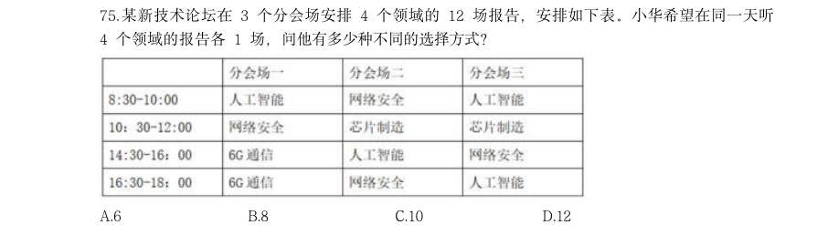

- **A.** 6
- **B.** 8
- **C.** 10
- **D.** 12

**答案：D**　**考点：排列组合｜基础排列组合**　**难度：★★★★★**
**【数量关系·其他数量关系｜GK-2026-ds-X076】**

76. 从所给的四个选项中,选择最合适的一个填入问号处,使之呈现一定的规律性 选项中选出一个最恰当的答案。 :

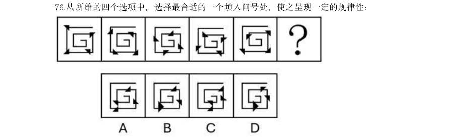

> （本题为图形题，选项为图片，见原卷）

**答案：A**　**考点：其他数量关系｜日期与钟表**　**难度：★★☆☆☆**
**【判断推理·图形推理｜GK-2026-ds-X077】**

77. 从所给的四个选项中,选择最合适的一个填入问号处,使之呈现一定的规律性:

> （本题为图形题，选项为图片，见原卷）

**答案：D**　**考点：图形推理｜属性规律**　**难度：★★★★★**
**【判断推理·图形推理｜GK-2026-ds-X078】**

78. 从所给的四个选项中,选择最合适的一个填入问号处,使之呈现一定的规律性:

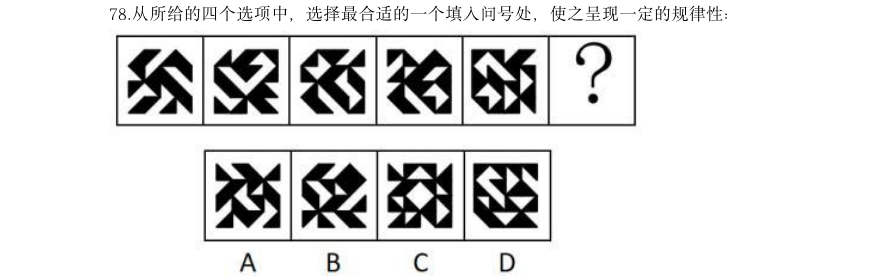

> （本题为图形题，选项为图片，见原卷）

**答案：D**　**考点：图形推理｜属性规律**　**难度：★★★★★**
**【判断推理·图形推理｜GK-2026-ds-X079】**

79. 从所给的四个选项中,选择最合适的一个填入问号处,使之呈现一定的规律性:

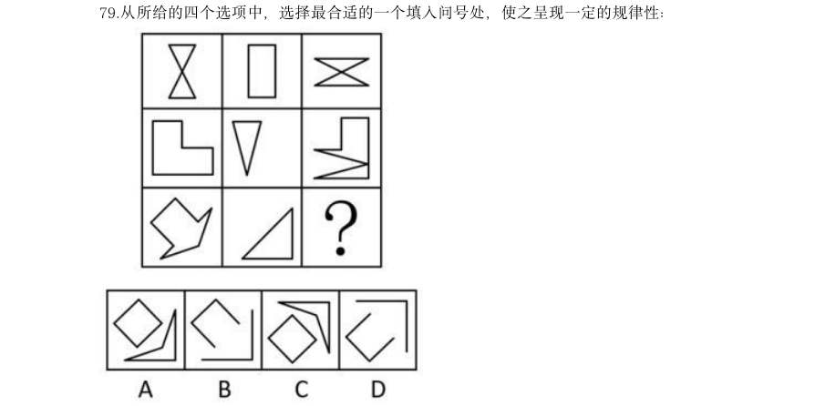

> （本题为图形题，选项为图片，见原卷）

**答案：C**　**考点：图形推理｜位置规律**　**难度：★★★★★**
**【判断推理·图形推理｜GK-2026-ds-X080】**

80. 左边为由15 个白色正方体和3 个黑色正方体组合而成的多面体俯视图和左视图,其正视图 可能是:

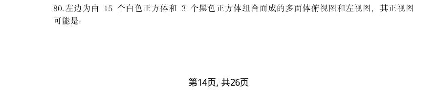

> （本题为图形题，选项为图片，见原卷）

**答案：B**　**考点：图形推理｜三视图**　**难度：★★★☆☆**
**【判断推理·图形推理｜GK-2026-ds-X081】**

81. 左边为给定的正方体纸盒的外表面展开图,由2 个该正方体纸盒组合而成的长方体可能是:

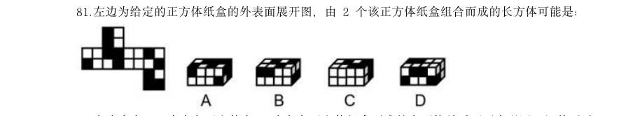

> （本题为图形题，选项为图片，见原卷）

**答案：A**　**考点：图形推理｜折纸盒**　**难度：★★★★★**
**【判断推理·图形推理｜GK-2026-ds-X082】**

82. 左边为由12 个白色正方体和3 个灰色正方体组合而成的多面体前后两面直观图,问其可以 由除哪项外的三个多面体组合而成?

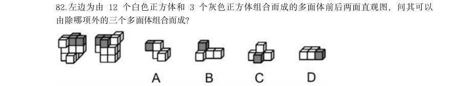

> （本题为图形题，选项为图片，见原卷）

**答案：C**　**考点：图形推理｜立体拼合**　**难度：★★★☆☆**
**【判断推理·图形推理｜GK-2026-ds-X083】**

83. 把下面的六个图形分为两类,使每一类图形都有各自的共同特征或规律,分类正确的一项是:

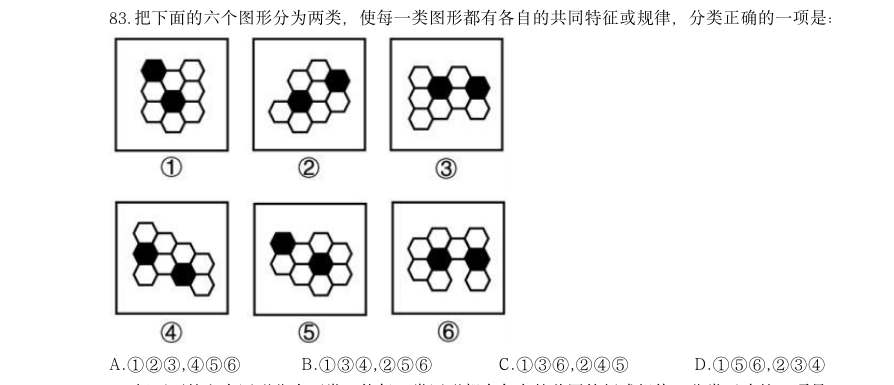

- **A.** 123,456
- **B.** 134,256
- **C.** 136,245
- **D.** 156,234

**答案：C**　**考点：图形推理｜分组分类**　**难度：★★★☆☆**
**【判断推理·图形推理｜GK-2026-ds-X084】**

84. 把下面的六个图形分为两类,使每一类图形都有各自的共同特征或规律,分类正确的一项是:

- **A.** 126,345
- **B.** 124,356
- **C.** 156,234
- **D.** 146,235

**答案：B**　**考点：图形推理｜分组分类**　**难度：★★★☆☆**
**【判断推理·图形推理｜GK-2026-ds-X085】**

85. 把下面6 个图形分为两类,使每一类图形都有各自的共同特征或规律,分类正确的一项是:

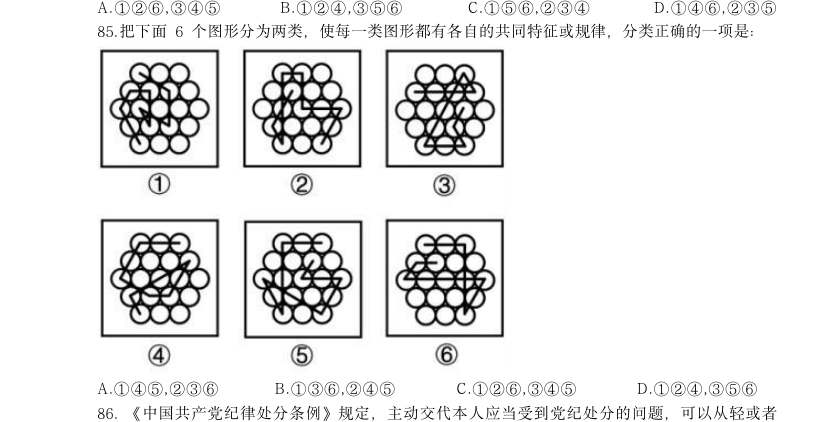

- **A.** 145,236
- **B.** 136,245
- **C.** 126,345
- **D.** 124,356

**答案：A**　**考点：图形推理｜分组分类**　**难度：★★★☆☆**
**【判断推理·定义判断｜GK-2026-ds-X086】**

86. 《中国共产党纪律处分条例》规定,主动交代本人应当受到党纪处分的问题,可以从轻或者 减轻处分。这里所称的主动交代主要包括两种情况:一是涉嫌违纪的党员在组织谈话函询、初步 核实前向有关组织交代自己的问题。二是在谈话函询、初步核实和立案审查期间交代组织未掌握 的问题。 假定下列人员均受该条例约束,根据上述定义,下列属于主动交代的是:

> 同题变体（主记录 GK-2026-fs-X099）

- **A.** 甲在参加违纪违法典型案例警示教育大会后,主动找到单位领导反映同事的违纪问题
- **B.** 乙在组织对其进行廉政谈话时,组织举证一项他才承认一项,对未涉及的情况闭口不谈
- **C.** 丙在纪委对其个人财产有关事项进行函询时,将其利用职权为自己和他人谋利的情况如实交代
- **D.** 丁在纪委对其立案审查期间,面对确凿的证据,交代了之前没有交代的收受大额礼金的问题

**答案：C**　**考点：定义判断｜单定义**　**难度：★★★★★**
**【判断推理·定义判断｜GK-2026-ds-X087】**

87. 波特五力模型是一种竞争分析工具,用于评估一个行业的竞争力和吸引力。该模型通过对同 行业竞争对手的威胁,潜在进入者的威胁、替代品的威胁、上游供应商的议价能力和下游购买者 的议价能力这五个方面的分析,帮助企业了解其所处行业的竞争环境,以制定相应的竞争策略。 根据上述定义,关于康复机器人行业,对下列问题的分析不能归入波特五力模型的是:

> 同题变体（主记录 GK-2026-fs-X092）

- **A.** 康复机器人行业准入门槛高吗?需要强大的技术能力和创新能力吗?
- **B.** 医院和康复中心患者规模如何?对于康复机器人的需求有多大?
- **C.** 与传统物理治疗等康复治疗方法相比,康复机器人有竞争力吗?
- **D.** 康复机器人企业内部各部门之间的协同合作程度高吗?

**答案：D**　**考点：定义判断｜单定义**　**难度：★★★☆☆**
**【判断推理·定义判断｜GK-2026-ds-X088】**

88. 组织结构可以划分为以下几种类型:(1)直线型组织结构,即每一个部门只对其直接的下属 部门下达工作指令,不能越级指挥,每一个部门也只有一个直接的上级部门;(2)职能型组织 结构,即每一个部门都可对其下属部门下达工作指令,每一个下属部门可能得到不同上级部门下 达的多个工作指令;(3)直线职能型组织结构,即在主管之下设置相应的职能部门,实行主管 统一指挥与职能部门参谋指导相结合的管理方式,各部门既受上级的管理,又受同级职能管理部 门的业务指导和监督;(4)事业部组织结构,即由相对独立的事业部组成的组织结构,通常按 照地区或项目来划分事业部,每个事业部拥有较大的自主权。 根据上述定义,下列组织结构图代表的组织结构类型属于:

> 同题变体（主记录 GK-2026-fs-X098）

- **A.** 直线型组织结构
- **B.** 职能型组织结构
- **C.** 直线职能型组织结构
- **D.** 事业部组织结构

**答案：B**　**考点：定义判断｜单定义**　**难度：★★★★☆**
**【判断推理·定义判断｜GK-2026-ds-X089】**

89. 均变论认为,支配各种地质过程的法则在地质历史上没有发生过变化,现在起作用的各种自 然营力在漫长的地质过程中具有普遍的均一性,即地质具有相同方式和相同的强度;地球上生物 的种与演变是一个渐变的过程,种之间有过渡关系,生物进化过程是极其漫长的。灾变论认为, 在整个地质发展的过程中,地球经常发生各种突如其来的、短暂的全球性灾难性变化,这些变化 强烈地改变了地球的面貌;地球上生物的变化是反复多次灾变的结果。 根据上述定义,下列说法最能体现灾变论观点的是:

> 同题变体（主记录 GK-2026-fs-X091）

- **A.** “我们找不到开始的痕迹,也看不到结束的迹象”
- **B.** “地质记录是一部被鲜血和火焰写成的史诗”
- **C.** “现在是通往过去的一把钥匙”
- **D.** “自然界里没有飞跃”

**答案：B**　**考点：定义判断｜单定义**　**难度：★★★☆☆**
**【判断推理·定义判断｜GK-2026-ds-X090】**

90. 商品动销率是指在售的商品品种数与库存商品总品种数的比率。商品库销比是指商品库存量与 销售额的比率。商品滞销率是指滞销的商品品种数占库存商品总品种数的比率。商品损耗率是指 在一定的保管条件下,某商品在储存保管期间,其自然损耗量与商品在库总量的比例。 根据上述定义,下列说法正确的是:

- **A.** 若商品动销率超过100%,说明商品在售品种数高于库存商品总品种数
- **B.** 商品损耗率高表明有库存积压风险,商品损耗率低表明销售态势良好
- **C.** 库存商品数一定时,商品滞销率越高,说明滞销的商品越多
- **D.** 当商品库存量越大,销售额越高时,商品库销比就会越大

**答案：A**　**考点：定义判断｜单定义**　**难度：★★★★☆**
**【判断推理·定义判断｜GK-2026-ds-X091】**

91. 根据动词对其后所接的宾语小句(作宾语的句子)真值的不同预设能力可以把现代汉语中的 相关动词分为叙实动词、非叙实动词和反叙实动词。叙实动词的肯定式和否定式都预设其宾语小 句为真;非叙实动词的肯定式和否定式都不预设其宾语小句为真,也不预设其宾语小句为假;反 叙实动词的肯定式和否定式都预设其宾语小句为假。 根据上述定义,下列画线的动词属于非叙实动词的是:

> 同题变体（主记录 GK-2026-fs-X094）

- **A.** 我听说他来过这里
- **B.** 我庆幸听了你的建议
- **C.** 我知道你帮助过我
- **D.** 我幻想成为一只小鸟

**答案：A**　**考点：定义判断｜单定义**　**难度：★★★☆☆**
**【判断推理·定义判断｜GK-2026-ds-X092】**
> 材料：自主动机是指人们出于兴趣或内在满足感而从事某种活动,外部动机是指人们为获得外部奖 励或避免惩罚而从事某种活动,这些动机背后的心理需求又分为三种:(1)自主性需求,即人 们希望自己能控制和选择自己的行为,而不是受到外部强制;(2)胜任性需求,即人们希望能 在自己做的事上获得成就感和自我效能感; A.善本:版 (3)归属感需求,即人们希望与他人建立有意义的联系,感受到归属和支持。

92. 根据上述定义,下列说法错误的是:

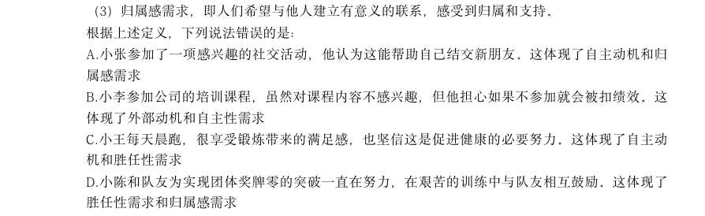

> （本题为图形题，选项为图片，见原卷）

**答案：B**　**考点：定义判断｜单定义**　**难度：★★☆☆☆**
**【判断推理·定义判断｜GK-2026-ds-X093】**

93. 动作预期是指运动员在比赛过程中,根据已有信息,对即将发生的动作结果进行预测的过程。 在这一过程中,运动员主要依赖两类信息:运动学信息和情境先验信息。运动学信息包括对手的 动作、器材的运动轨迹或队员之间的相对位置,情境先验信息则涉及比赛情境中事件发生的概 率。 根据上述定义,下列不涉及上述任何一种信息的是:

> 同题变体（主记录 GK-2026-fs-X095）

- **A.** 篮球队员甲在双方比分紧咬的情况下,基于对手今日比赛罚篮命中率不高,在对手投篮时选择直接犯规
- **B.** 网球运动员乙知道对手在比赛前有一系列习惯性动作,包括整理球衣、球裤、头发等,暗自提醒自己不要被其干扰
- **C.** 羽毛球双打运动员丙发现对方准备接发球的球员位置稍微靠前,可能来不及转身或后退接球,便发了个后场球
- **D.** 乒乓球运动员丁发现对方发过来的球位置较低、速度较慢,极有可能擦网变线,便没有后退,

**答案：B**　**考点：定义判断｜单定义**　**难度：★★★☆☆**
**【判断推理·定义判断｜GK-2026-ds-X094】**

94. 在制品控制是企业生产控制的基础工作,是企业对生产运作过程中各工序原材料、半成品等 按照位置、数量、质量及车间之间的物料转运等进行的控制。 根据上述定义,下列没有直接体现在制品控制的是:

- **A.** 服装厂梳理了运动裤制作流程并制定规范,确保衣料在不同流水线上流转有序
- **B.** 食品厂设立质检员,定时对各个工序的食材抽样进行微生物检测,剔除不良品
- **C.** 制药厂规定员工进入洁净区后,每两小时洗手一次,避免药品生产环境被污染
- **D.** 家具厂对板材进行定期盘点,并合理摆放,确保板材库存合理且满足生产需要

**答案：C**　**考点：定义判断｜单定义**　**难度：★★★☆☆**
**【判断推理·定义判断｜GK-2026-ds-X095】**

95. 预防性维修是指在机械设备没有发生故障或尚未造成损坏的前提下,通过对产品的系统性检 查,设备测试或更换以防止设备发生故障,使其保持在正常状态所进行的全部活动。 根据上述定义,下列属于预防性维修的是:

- **A.** 公路管理部门定期巡视道路两旁护栏并涂刷、除锈,发现护栏松动、断裂时进行修复
- **B.** 某车间在正式制造某种设备前,测量将要安装在该设备中的关键零部件是否符合检查标准
- **C.** 某数控车床突然发生摇动,无法研制物品,检查后发现电机出现故障,更换电机后车床可正常运行
- **D.** 雨季来临前,供电公司对辖区内变压器、配电器、电缆线路等电力设备设施隐患进行专项排查

**答案：D**　**考点：定义判断｜单定义**　**难度：★★★☆☆**
**【判断推理·图形推理｜GK-2026-ds-X096】**

96. 与“经年:积岁”在逻辑关系上最相近的是: 本 B.秘方:偏方 C.仲夏:夏季 D.黎民:百姓

> （本题为图形题，选项为图片，见原卷）

**答案：D**　**考点：图形推理｜数量规律**　**难度：★★★☆☆**
**【判断推理·类比推理｜GK-2026-ds-X097】**

97. 与“细胞凋亡:基因调控:细胞增殖”在逻辑关系上最相近的是:

- **A.** 成本降低:税率调整:成本增加
- **B.** 经济萧条:经济周期:经济复苏
- **C.** 价格尺度:货币职能:流通手段
- **D.** 人工智能:智能时代:具身智能

**答案：A**　**考点：类比推理｜逻辑关系**　**难度：★★☆☆☆**
**【判断推理·类比推理｜GK-2026-ds-X098】**

98. 与“护士人数:护患比:患者人数”在逻辑关系上最相近的是:

- **A.** 理赔总额:平均理赔金额:理赔次数
- **B.** 签收率:实际签收数量:应签收数量
- **C.** 流动资产:流动负债:流动比率
- **D.** 旅客数:入住率:客房数

**答案：A**　**考点：类比推理｜类比推理（综合）**　**难度：★★☆☆☆**
**【判断推理·类比推理｜GK-2026-ds-X099】**

99. 颅内疾病对于()相当于()对于岩石断裂依次填入括号中最恰当的是:

> 同题变体（主记录 GK-2026-fs-X104）

- **A.** 颅内感染;岩石熔融
- **B.** 机体疾病;地壳应力
- **C.** 核磁共振;地下采样
- **D.** 视野缺失;冰川运动

**答案：D**　**考点：类比推理｜逻辑关系**　**难度：★☆☆☆☆**
**【判断推理·逻辑判断｜GK-2026-ds-X100】**

100. 如果用一个圆来表示词语所指称的对象的集合,那么以下哪项中画横线词语之间的关系符合 下图?

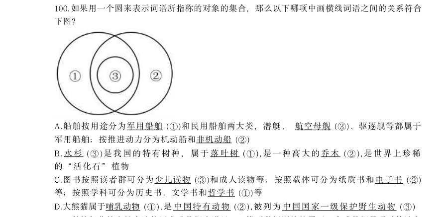

> 同题变体（主记录 GK-2026-fs-X105）

- **A.** 船舶按用途分为军用船舶(1)和民用船舶两大类,潜艇、航空母舰(3)、驱逐舰等都属于军用船舶;按推进动力分为机动船和非机动船(2)
- **B.** 水杉( 3)是我国的特有树种,属于落叶树( 1), 是一种高大的乔木(2), 是世界上珍稀的“活化石”植物
- **C.** 图书按照读者群可分为少儿读物(3)和成人读物等;按照载体可分为纸质书和电子书(2)等;按照学科可分为历史书、文学书和哲学书(1)等
- **D.** 大熊猫属于哺乳动物(1),是中国特有动物(2),被列为中国国家一级保护野生动物(3)

**答案：B**　**考点：逻辑判断｜翻译推理**　**难度：★★★☆☆**
**【判断推理·逻辑判断｜GK-2026-ds-X101】**

101. 科技行业越来越多地使用合成数据来满足AI 模型数据训练的需要。合成数据是通过算法和 统计模型人为创建的数据,在理论上可以无限供应。但合成数据存在一个关键问题:当AI 模型 过于依赖合成数据时,它们会产生更多“幻觉”,编造看似合理可信但实际上并不存在的信 息。可见,合成数据的使用会影响AI 的准确性。 以下哪项如果为真,最能支持上述结论?

- **A.** 即使经过处理,合成数据仍然可能泄露敏感信息,从而引发隐私风险
- **B.** 合成数据存在过于简单化的风险,无法完全模拟真实世界的复杂性
- **C.** 合成数据会放大源数据本身的错误或偏差,导致“失之毫厘,差之千里”
- **D.** 合成数据的多样性可能不如真实数据,限制了AI 模型的泛化能力

**答案：C**　**考点：逻辑判断｜加强论证**　**难度：★★★★★**
**【判断推理·逻辑判断｜GK-2026-ds-X102】**

102. 部分研究认为,白垩纪陆地生态系统的变革是由植物、昆虫、脊椎动物与地质过程等多个要 素相互作用推动的,形成了一个高度协同演化的系统结构。鉴于这一机制在当时造就了复杂而稳 定的生态格局,有学者提出,现代陆地生态系统的高度复杂性,正是这种古老协同机制延续和演 化的结果。 以下哪项如果为真,最能削弱上述学者的观点?

- **A.** 在地质记录中,白垩纪末期的生态危机主要影响海洋系统,而陆地系统显示出相对稳定的演替趋势
- **B.** 对白垩纪地层的系统分析表明,植物、昆虫、脊椎动物与地质过程的演化几乎是在同一时期进行的为倡导团结合作精神,某单位举办了若干项目的双打比赛。该单位后勤部由王、吴、韩和宋4人组成网球、乒乓球和羽毛球3 支双打队伍参赛,每支队伍由其中2 人组成,4 人均至少参加

**答案：暂缺**　**考点：逻辑判断｜削弱论证**　**难度：★★★★★**
**【判断推理·逻辑判断｜GK-2026-ds-X106】**
> 材料：(1)王和韩没有参加同一个项目; (2)若韩参加羽毛球项目,则宋参加网球项目; (3)若王参加乒乓球项目,则吴参加网球项目,若王不参加乒乓球项目,则吴也不参加网球项 目。

106. 对于3 支双打队伍的组成情况,以下哪项是可能的?

- **A.** 如果推进户籍制度改革,就能优化城乡公共资源配置机制
- **B.** 只要完善农业农村优先发展的投入保障机制,就能完善城乡融合发展体制机制
- **C.** 除非完善农业农村优先发展的投入保障机制,否则不能提高土地出让收入用于农业农村的比例
- **D.** 加大中央预算内投资和地方政府专项债券支持力度是破除我国城乡二元结构、拓展高质量发展

**答案：D**　**考点：逻辑判断｜结论推出**　**难度：★★★★★**
**【判断推理·逻辑判断｜GK-2026-ds-X107】**
> 材料：104.平台企业依赖金融资本投资,需要迎合金融市场的估值逻辑,通过轻资产运营、扩大市场规 模和用户数据挖掘与开发等,来提升自身在金融市场上的估值。随着平台企业金融化程度的日益 加深,平台劳动者的具体劳动和生产过程也在发生变化。研究者认为,平台企业金融化程度的加 深使得平台劳动者的劳动权益保护问题日益突出。 以下哪项如果为真,最能支持上述研究者的观点? A.为扩大市场规模、争夺消费者注意力,平台企业在资金投入和服务提升方面容易陷入无序竞争 B.为塑造轻资产企业形象、摆脱劳动密集型标签,平台企业采用弹性用工制,增加劳动者就业不 稳定性 C.越来越多的平台企业日益注重用户数据挖掘,以增加企业竞争力,为此更加注重员工培训 D.部分平台企业以缴纳保证金、押金或其他名义向劳动者收取财物,限制劳动者在多平台就业 105. 考古人员在某地发掘出一些似鸟动物化石,同位素测年显示这些动物生存于中侏罗世晚期 (

107. 若宋和韩组队网球双打,则以下哪项一定正确?

- **A.** 吴参加乒乓球项目
- **B.** 王参加羽毛球项目
- **C.** 宋参加乒乓球项目
- **D.** 吴参加羽毛球项目

**答案：B**　**考点：逻辑判断｜结论推出**　**难度：★★★☆☆**
**【判断推理·逻辑判断｜GK-2026-ds-X108】**

108. 若吴参加3 个项目,则以下哪项是可能的?

- **A.** 宋参加网球项目
- **B.** 王参加网球项目
- **C.** 宋参加乒乓球项目
- **D.** 王参加羽毛球项目

**答案：A**　**考点：逻辑判断｜结论推出**　**难度：★★★☆☆**
**【判断推理·逻辑判断｜GK-2026-ds-X109】**

109. 以下哪项中的两人可能同时组队网球和羽毛球双打?

- **A.** 王和吴
- **B.** 王和宋
- **C.** 吴和宋
- **D.** 韩和宋

**答案：B**　**考点：逻辑判断｜结论推出**　**难度：★★★☆☆**
**【判断推理·逻辑判断｜GK-2026-ds-X110】**

110. 若宋和韩组队乒乓球双打,则以下哪项是可能的?

- **A.** 吴和韩组队网球双打
- **B.** 吴和宋组队网球双打
- **C.** 宋和韩组队羽毛球双打
- **D.** 吴和宋组队羽毛球双打

**答案：D**　**考点：逻辑判断｜结论推出**　**难度：★★★☆☆**
**【资料分析·增长率计算与比较｜GK-2026-ds-X111】**

111. 2024 年上半年，中国医药保健品进出口贸易顺差（出口额-进口额）比上年同期：

- **A.** 下降了20%以上
- **B.** 下降了不到20%
- **C.** 上升了20%以上
- **D.** 上升了不到20%

**答案：C**　**考点：增长率计算与比较｜增长率计算（综合）**　**难度：★★★☆☆**
**【资料分析·比重计算与比较｜GK-2026-ds-X112】**

112. 2024 年上半年,中药提取物出口额占医药保健品出口总额的比重比上年同期:

- **A.** 上升了3 个百分点以上
- **B.** 下降了3 个百分点以上
- **C.** 上升了不到3 个百分点
- **D.** 下降了不到3 个百分点

**答案：D**　**考点：比重计算与比较｜两期比重差**　**难度：★★★☆☆**
**【资料分析·增长率计算与比较｜GK-2026-ds-X113】**

113. 表中所列医药保健品12 个小类中,2024 年上半年进出口总额同比上升的有几类?

- **A.** 7
- **B.** 6
- **C.** 5
- **D.** 4

**答案：A**　**考点：增长率计算与比较｜增长率计算（综合）**　**难度：★★★☆☆**
**【资料分析·综合分析｜GK-2026-ds-X114】**

114. 将2024 年上半年1医用敷料2一次性耗材3保健康复用品4口腔设备与材料进口额同比增 量从高到低排序正确的是:

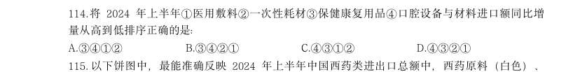

- **A.** 3412
- **B.** 3421
- **C.** 4312
- **D.** 4321

**答案：C**　**考点：综合分析｜综合分析（综合）**　**难度：★★★★☆**
**【资料分析·综合分析｜GK-2026-ds-X115】**

115. 以下饼图中,最能准确反映2024 年上半年中国西药类进出口总额中,西药原料(白色)、 西成药(横线)和生化药(黑色)占比关系的是:

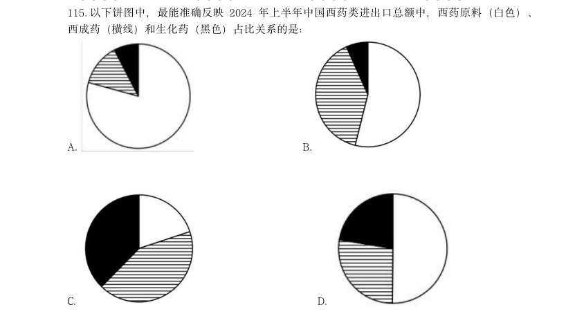

- **A.** 
- **B.** 
- **C.** 
- **D.** 

**答案：D**　**考点：综合分析｜比重**　**难度：★★★★★**
**【资料分析·综合分析｜GK-2026-ds-X116】**
> 材料：绿证是对可再生能源绿色电力颁发的具有独特标识代码的电子证书,1 个绿证单位对应 1000 千瓦时可再生能源电量。2024 年全国核发绿证47.34 亿个,其中可交易绿证31.58 亿个。 截至2024 年12 月底全国累计核发绿证49.55 亿个,其中可交易绿证33.79 亿个。 2024 年,全国集中式项目核发绿证46.77 亿个。

116. 按项目类型划分,风电19.07 亿个,常规水 电15.78 亿个,太阳能发电8.03 亿个,生物质发电3.81 亿个,风光一体化项目755 万个,地 热能发电52 万个,海洋能发电1.1 万个。2024 年全国分布式项目核发绿证5695 万个,同比增 长27.8 倍。其中,分散式风电核发绿证3364 万个,分布式光伏核发绿证2331 万个。 2024 年,全国核发的不可交易绿证对应约多少万亿千瓦时可再生能源电量?

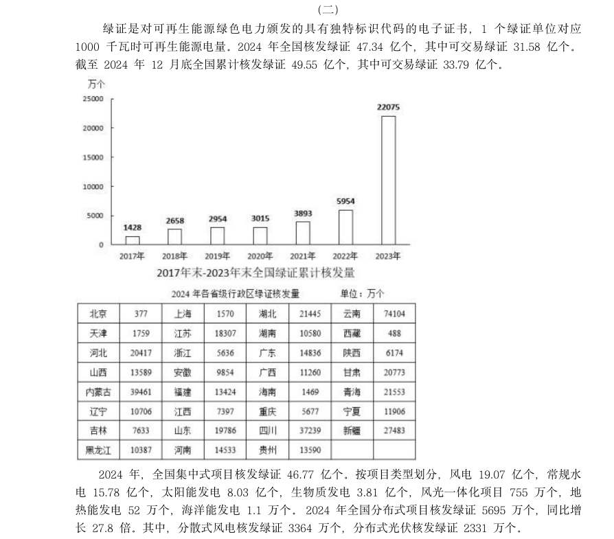

- **A.** 1.6
- **B.** 3.2
- **C.** 7.9
- **D.** 15.8

**答案：A**　**考点：综合分析｜倍数**　**难度：★★★★★**
**【资料分析·倍数计算｜GK-2026-ds-X117】**

117. 2023 年,全国核发绿证数量约是2022 年的多少倍?

> 材料图见 images/GK-2026-ds-X116-m.jpg

- **A.** 3.7
- **B.** 5.1
- **C.** 6.3
- **D.** 7.8

**答案：D**　**考点：倍数计算｜是几倍**　**难度：★★★☆☆**
**【资料分析·比重计算与比较｜GK-2026-ds-X118】**

118. 2024 年绿证核发量最多的5 个省级行政区,绿证核发量约占全国总量的:

> 材料图见 images/GK-2026-ds-X116-m.jpg

> 同题变体（主记录 GK-2026-fs-X128）

- **A.** 38%
- **B.** 42%
- **C.** 46%
- **D.** 50%

**答案：B**　**考点：比重计算与比较｜现期比重**　**难度：★★★☆☆**
**【资料分析·比重计算与比较｜GK-2026-ds-X119】**

119. 2024 年,全国集中式风电项目核发绿证数量占当年集中式项目核发绿证数量的比重比太阳能 发电项目的占比高约多少个百分点?

> 材料图见 images/GK-2026-ds-X116-m.jpg

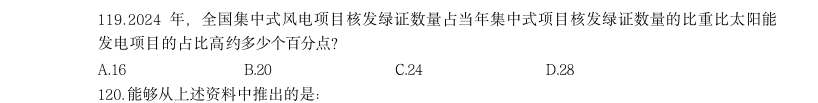

> 同题变体（主记录 GK-2026-fs-X129）

- **A.** 16
- **B.** 20
- **C.** 24
- **D.** 28

**答案：C**　**考点：比重计算与比较｜现期比重**　**难度：★★★☆☆**
**【资料分析·综合分析｜GK-2026-ds-X120】**

120. 能够从上述资料中推出的是:

> 材料图见 images/GK-2026-ds-X116-m.jpg

- **A.** 2019 年,全国绿证核发量多于2018 年
- **B.** 截至2023 年底,全国累计核发绿证中,可交易绿证的占比不到1%
- **C.** 2024 年,全国常规水电核发绿证不到集中式项目核发绿证总数量的三分之一
- **D.** 2024 年,湖北、湖南核发绿证之和占全国比重比广东、广西之和高1 个百分点以上

**答案：D**　**考点：综合分析｜比重**　**难度：★★★★★**
**【资料分析·倍数计算｜GK-2026-ds-X121】**

121. 科幻产业包括科幻阅读、科幻影视、科幻游戏、科幻衍生品、科幻文旅五大领域。2024 年,我国科幻产业总营收1089.6 亿元

> 材料图见 images/GK-2026-ds-X116-m.jpg

> （本题为图形题，选项为图片，见原卷）

**答案：B**　**考点：倍数计算｜倍数计算（综合）**　**难度：★★★☆☆**
**【资料分析·增长量计算｜GK-2026-ds-X122】**

122. 如保持2024 年同比增量不变,则2026-2030 年,我国科幻游戏产业累计营收将在以下哪个范 围内? 元 B.4500 亿~4750 亿元之间 D.4750 亿~5000 亿元之间

> 材料图见 images/GK-2026-ds-X116-m.jpg

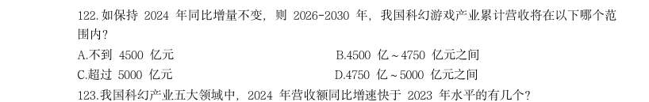

> （本题为图形题，选项为图片，见原卷）

**答案：D**　**考点：增长量计算｜增长量计算（综合）**　**难度：★★★☆☆**
**【资料分析·增长率计算与比较｜GK-2026-ds-X123】**

123. 我国科幻产业五大领域中,2024 年营收额同比增速快于2023 年水平的有几个?

> 材料图见 images/GK-2026-ds-X116-m.jpg

- **A.** 4
- **B.** 3
- **C.** 2
- **D.** 1

**答案：C**　**考点：增长率计算与比较｜增长率计算**　**难度：★★★☆☆**
**【资料分析·比重计算与比较｜GK-2026-ds-X124】**

124. 2022~2024 年,科幻文旅营收额占科幻产业营收额的比重超过20%的年份仅包括: 年 B.2023 年 C.2022 和2024 年 D.2022 年

> 材料图见 images/GK-2026-ds-X116-m.jpg

> （本题为图形题，选项为图片，见原卷）

**答案：A**　**考点：比重计算与比较｜现期比重**　**难度：★★★☆☆**
**【资料分析·增长量计算｜GK-2026-ds-X125】**

125. 以下柱状图反映了哪一时间段内,我国科幻产业营收额同比增量的变化情况(横轴位置表示增 量为0)? (四

> 材料图见 images/GK-2026-ds-X116-m.jpg

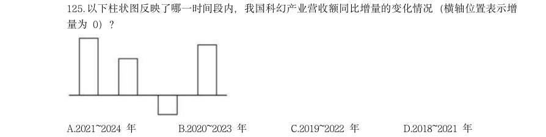

- **A.** 2021~2024 年
- **B.** 2020~2023 年
- **C.** 2019~2022 年
- **D.** 2018~2021 年

**答案：D**　**考点：增长量计算｜增长量计算（415 份数法）**　**难度：★★★☆☆**
**【资料分析·综合分析｜GK-2026-ds-X126】**
> 材料：2024 年,我国对联合国定义的45 个最不发达国家(以下简称最不发达国家)进出口 14230.2 亿元人民币,占同期我国外贸进出口总值的3.2%。其中出口8664.6 亿元,同比(下同) 增长4.3%;进口5565.5 亿元,增长12.8%。 2024 年,我国对最不发达国家出口机电产品3942.2 亿元,增长13.5%。其中出口船舶690.8 亿元,增长65.9%,主要出口至全球第一大船旗国利比里亚。出口金额654.3 亿元,增长67%; 出口工程机械、火车分别为165.3 亿元、91.6 亿元,分别增长28.9%、39.5%;出口劳动密集型产 品2481 亿元,增长3.7%,其中纺织品1623.5 亿元,增长15.3%。 2024 年12 月1 日起,我国给予所有已建交的最不发达国家100%税目产品零关税待遇。

126. 12 月,我国自最不发达国家进口512.7 亿元,增长18.1%,其中自刚果民主共和国、几内亚、 老挝、赞比亚分别进口156.3 亿元,54.7 亿元,35.6 亿元,33.9 亿元,分别增长84.6%,40.3%, 25.7%、127.27% 2024 年,我国自最不发达国家进口铜材、原油、金属矿砂分别为1469.6 亿元、1364.2 亿 元、1221 亿元。最不发达国家成为我国钢材、铝矿、锡矿,钨矿,钛矿第一大进元来源地,分 别占我国同类商品进口总值的38.2%,73.1%,65.4%,57.7%,58.1%。 。 2024 年,我国外贸进出口总值在以下哪个范围内?

> 材料图见 images/GK-2026-ds-X116-m.jpg

> 同题变体（主记录 GK-2026-fs-X131）

> （本题为图形题，选项为图片，见原卷）

**答案：B**　**考点：综合分析｜综合分析（综合）**　**难度：★★★★★**
**【资料分析·增长率计算与比较｜GK-2026-ds-X127】**

127. 2024 年,我国对最不发达国家进出口总值同比增速约为

> 材料图见 images/GK-2026-ds-X116-m.jpg

- **A.** 不到44 万亿元
- **B.** 44 万亿元~ 45 万亿元之间
- **C.** 45 万亿元~ 46 万亿元之间
- **D.** 超过46 万亿元

**答案：C**　**考点：增长率计算与比较｜增长率计算**　**难度：★★★☆☆**
**【资料分析·比重计算与比较｜GK-2026-ds-X128】**

128. A.9.5% B.8.5% C.7.5% D.10.5% 下列饼状图,最能准确反映2024 年我国自最不发达国家进口值中,铜材(黑色),原油 (横线),金属矿砂(白色)和其他(竖线)进口值占比关系的是:

> 材料图见 images/GK-2026-ds-X116-m.jpg

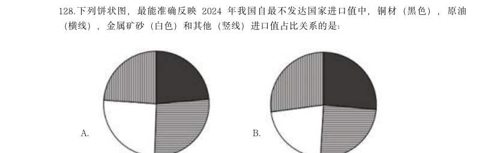

- **A.** 
- **B.** 
- **C.** 
- **D.** 

**答案：B**　**考点：比重计算与比较｜现期比重**　**难度：★★★☆☆**
**【资料分析·综合分析｜GK-2026-ds-X129】**

129. 2023 年1~11 月,我国对最不发达国家月均进口值约为多少亿元? B.409 C.468 D.502

> 材料图见 images/GK-2026-ds-X116-m.jpg

> （本题为图形题，选项为图片，见原卷）

**答案：B**　**考点：综合分析｜综合分析（综合）**　**难度：★★★★☆**
**【资料分析·综合分析｜GK-2026-ds-X130】**

130. 关于2024 年我国进出口情况,能根据上述资料推出的是:

> 材料图见 images/GK-2026-ds-X116-m.jpg

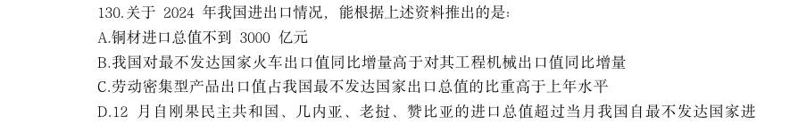

- **A.** 铜材进口总值不到3000 亿元
- **B.** 我国对最不发达国家火车出口值同比增量高于对其工程机械出口值同比增量
- **C.** 劳动密集型产品出口值占我国最不发达国家出口总值的比重高于上年水平
- **D.** 12 月自刚果民主共和国、几内亚、老挝、赞比亚的进口总值超过当月我国自最不发达国家进

**答案：D**　**考点：综合分析｜比重**　**难度：★★★★★**