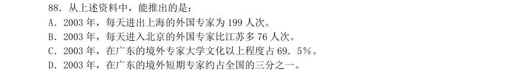
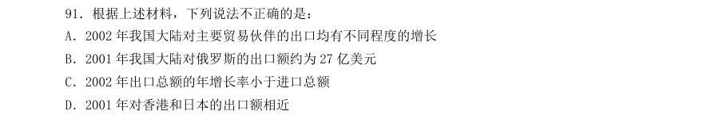
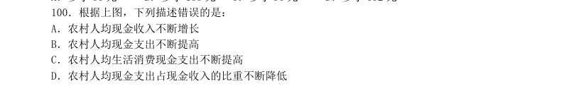

# 2004 年广东行测（统一卷）

- 题量：90（含答案 0）
- 模块分布：资料分析15 / 数量关系15 / 言语理解30 / 判断推理20 / 常识判断10
- 试卷编号：`广东-2004-统一卷`

## 题目与答案

**【数量关系·数字推理｜GD-2004-ty-X001】**
> 材料：(共15 题,参考时限15 分钟) 本部分包括两种类型的试题: 观察数列的排列规律,然后从四个供选择的选项中选出你认为最合理的一项来填补空缺项。

1. -1 0 27 ( )

- **A.** 64
- **B.** 91
- **C.** 256
- **D.** 512

**答案：暂缺**　**考点：数字推理｜数字推理（综合）**　**难度：★★★☆☆**
**【数量关系·数字推理｜GD-2004-ty-X002】**

2. 1 2 0 3 -1 ( )

- **A.** 5
- **B.** 4
- **C.** 3
- **D.** -2

**答案：暂缺**　**考点：数字推理｜数字推理（综合）**　**难度：★★★☆☆**
**【数量关系·数字推理｜GD-2004-ty-X003】**

3. 7 8 9 14 16 18 21 24 ( )

- **A.** 35
- **B.** 32
- **C.** 28
- **D.** 27

**答案：暂缺**　**考点：数字推理｜数字推理（综合）**　**难度：★★★☆☆**
**【数量关系·数字推理｜GD-2004-ty-X004】**

4. 0 0 1 4 ( ) 26

- **A.** 7
- **B.** 9
- **C.** 11
- **D.** 13

**答案：暂缺**　**考点：数字推理｜数字推理（综合）**　**难度：★★★☆☆**
**【数量关系·数字推理｜GD-2004-ty-X005】**

5. 3 -1 5 1 ( )

- **A.** 3
- **B.** 7
- **C.** 25
- **D.** 64

**答案：暂缺**　**考点：数字推理｜数字推理（综合）**　**难度：★★★☆☆**
**【数量关系·其他数量关系｜GD-2004-ty-X006】**
> 材料：时不做,待有时间再返回来解决它。

6. 计算19961997×19971996-19961996×19971997 的值是( )。

- **A.** 0
- **B.** 1
- **C.** 10 000
- **D.** 100

**答案：暂缺**　**考点：其他数量关系｜基础计算**　**难度：★☆☆☆☆**
**【数量关系·几何问题｜GD-2004-ty-X007】**

7. 在圆形跑道上正在进行长跑比赛。某位运动员发现在他前面有7 个人在跑,而在他后面也有7 个人在跑,问现在跑道上一共有多少名运动员在比赛?

- **A.** 7 人
- **B.** 8 人
- **C.** 14 人
- **D.** 15 人

**答案：暂缺**　**考点：几何问题｜平面几何**　**难度：★★★★☆**
**【数量关系·排列组合｜GD-2004-ty-X008】**

8. 一串数字按下面规律排列:1,3,5,2,4,6,3,5,7,4,6,8,5,7,9,...从第一个数 字算起,前100 个数的和是多少?

- **A.** 100
- **B.** 1 897
- **C.** 1 915
- **D.** 2 525

**答案：暂缺**　**考点：排列组合｜基础排列组合**　**难度：★★★★★**
**【数量关系·其他数量关系｜GD-2004-ty-X009】**

9. 某次考试,赵、钱、孙、李四人的成绩统计如下:赵、钱、孙的平均分为91 分,钱、孙、李 的平均分是89 分,赵、李的平均分是95 分,那么赵得了多少分?

- **A.** 85
- **B.** 94
- **C.** 97
- **D.** 98

**答案：暂缺**　**考点：其他数量关系｜和差倍比**　**难度：★☆☆☆☆**
**【数量关系·行程问题｜GD-2004-ty-X010】**

10. 甲乙两人分别从A、B 两地同时出发,相向而行,当他们第一次相遇时甲离B 地相距104 米, 然后两人继续向前走,当达到目的地后都立即返回,当第二次相遇时,乙离B 地相距40 米。问AB 两 地相距多少米?

- **A.** 124 米
- **B.** 144 米
- **C.** 168 米
- **D.** 176 米

**答案：暂缺**　**考点：行程问题｜相遇追及**　**难度：★★☆☆☆**
**【数量关系·其他数量关系｜GD-2004-ty-X011】**

11. 小刚从A 点开始向前走10 米,然后向右转60 度,他再向前走10 米,向右转60 度。他继续 这样的走法,最后回到A 点。问:小刚总共走了多少米?

- **A.** 40
- **B.** 50
- **C.** 60
- **D.** 70

**答案：暂缺**　**考点：其他数量关系｜其他数量关系（综合）**　**难度：★☆☆☆☆**
**【数量关系·最值问题｜GD-2004-ty-X012】**

12. 某羽毛球协会举办羽毛球单打公开赛,共有1 044 人报名参加。比赛采取淘汰制。首先用抽 签的方法抽出522 对进行522 场比赛,获胜的522 人,进入第2 轮比赛。第2 轮比赛也用同样的抽签 方法决定谁与谁比赛。这样比赛下去,假如没有人弃权,最少要打多少场才可决出冠军?

- **A.** 1 044
- **B.** 1 043
- **C.** 874
- **D.** 688

**答案：暂缺**　**考点：最值问题｜最值优化**　**难度：★★★★★**
**【数量关系·其他数量关系｜GD-2004-ty-X013】**

13. 有一个人对他的妻子说,如果将来他们有一个儿子,他的儿子就分得他的遗产的2/3,妻子 得1/3;如果将来生一个女儿,则他的女儿得1/3,妻子得2/3。现在他的妻子生下一个儿子一个 女儿,遗产应该怎样分配?

- **A.** 女儿得1/4
- **B.** 儿子得4/7
- **C.** 妻子得3/8
- **D.** 女儿得1/3

**答案：暂缺**　**考点：其他数量关系｜其他数量关系（综合）**　**难度：★★☆☆☆**
**【数量关系·其他数量关系｜GD-2004-ty-X014】**

14. 小刚家住的那条街的门牌号是从1 开始挨着编下去的,除小刚家外,其余各家门牌号加起来 恰好等于10000。问小刚家的门牌号是多少?

- **A.** 11
- **B.** 22
- **C.** 33
- **D.** 141

**答案：暂缺**　**考点：其他数量关系｜基础计算**　**难度：★☆☆☆☆**
**【数量关系·最值问题｜GD-2004-ty-X015】**

15. 某次考试有52 人参加,共考了5 道题,每题做错的人数统计如下: 题号 第一题 第二题 第三题 第四题 第五题 做错人数 已知:每人都至少做对一道题,做对一道题的有7 人,5 道题全做对的有6 人,做对2 道题和3 道题的人数一样多,那么做对4 道题的人数是多少人?

- **A.** 31
- **B.** 23
- **C.** 15
- **D.** 9

**答案：暂缺**　**考点：最值问题｜多集合最值**　**难度：★★★★★**
**【言语理解·逻辑填空｜GD-2004-ty-X016】**
> 材料：(共30 题,参考时限25 分钟) 本部分包括三种类型的题目: 句子的意思表达得最准确。

16. 入世几年来,我国面对的包括反倾销、技术壁垒等方面的贸易摩擦有增无减,形势( ), 影响了我国上百亿美元的出口贸易。

- **A.** 严峻
- **B.** 严厉
- **C.** 严重
- **D.** 严酷

**答案：暂缺**　**考点：逻辑填空｜逻辑填空（综合）**　**难度：★☆☆☆☆**
**【言语理解·逻辑填空｜GD-2004-ty-X017】**

17. 在法制社会中,想问题,办事情,都应该以法律为( ),不能随心所欲。

- **A.** 中心
- **B.** 准则
- **C.** 准绳
- **D.** 依据

**答案：暂缺**　**考点：逻辑填空｜逻辑填空（综合）**　**难度：★☆☆☆☆**
**【言语理解·逻辑填空｜GD-2004-ty-X018】**

18. 在工作中,我们不论做什么事情,都要有真( )。

- **A.** 才能
- **B.** 知识
- **C.** 功夫
- **D.** 智慧

**答案：暂缺**　**考点：逻辑填空｜逻辑填空（综合）**　**难度：★☆☆☆☆**
**【言语理解·逻辑填空｜GD-2004-ty-X019】**

19. 该地区认真( )落实全国农田水利基本建设会议精神,扎实有效地开展农田基本建设。

- **A.** 执行
- **B.** 贯彻
- **C.** 贯穿
- **D.** 抓紧

**答案：暂缺**　**考点：逻辑填空｜逻辑填空（综合）**　**难度：★☆☆☆☆**
**【言语理解·逻辑填空｜GD-2004-ty-X020】**

20. 厂长向车间的同志们宣布:“你们提出的改革方案已通过专家鉴定,厂领导( )你们大胆 试验,祝你们成功!”

- **A.** 赞成
- **B.** 赞扬
- **C.** 赞赏
- **D.** 赞美

**答案：暂缺**　**考点：逻辑填空｜逻辑填空（综合）**　**难度：★☆☆☆☆**
**【言语理解·逻辑填空｜GD-2004-ty-X021】**

21. 刚一上场,你看他那( )样儿,好像稳拿第一,可是连输了几个球后,( )就有些慌张 了。下半场开始,虽然( )恢复正常了,但最终还是丢了关键的一局,你看他那( ),显得十分 沮丧。

- **A.** 神气、神色、神态、神情
- **B.** 神态、神情、神色、神气
- **C.** 神气、神态、神情、神色
- **D.** 神色、神气、神态、神情

**答案：暂缺**　**考点：逻辑填空｜逻辑填空（综合）**　**难度：★☆☆☆☆**
**【言语理解·逻辑填空｜GD-2004-ty-X022】**

22. 这种见不得人的勾当,( )不是一个堂堂发号施令的高级干部所为,然而成克杰却恰恰起 劲地做了。

- **A.** 决然
- **B.** 绝然
- **C.** 诚然
- **D.** 决定

**答案：暂缺**　**考点：逻辑填空｜逻辑填空（综合）**　**难度：★☆☆☆☆**
**【言语理解·逻辑填空｜GD-2004-ty-X023】**

23. 我那很沉重的心变得轻松了,身体也似乎( )地说不出的大。

- **A.** 伸展
- **B.** 舒服
- **C.** 舒畅
- **D.** 舒展

**答案：暂缺**　**考点：逻辑填空｜逻辑填空（综合）**　**难度：★☆☆☆☆**
**【言语理解·逻辑填空｜GD-2004-ty-X024】**

24. 我在农村( )了我的童年。

- **A.** 度过
- **B.** 渡过
- **C.** 经历
- **D.** 回顾

**答案：暂缺**　**考点：逻辑填空｜逻辑填空（综合）**　**难度：★☆☆☆☆**
**【言语理解·逻辑填空｜GD-2004-ty-X025】**

25. 他( )地向职工代表大会提出,行政干部一定要倾听群众的呼声。

- **A.** 慎重
- **B.** 郑重
- **C.** 庄重
- **D.** 严重

**答案：暂缺**　**考点：逻辑填空｜逻辑填空（综合）**　**难度：★☆☆☆☆**
**【言语理解·中心理解｜GD-2004-ty-X026】**
> 材料：句做出判断。

26. 下列句子搭配恰当的一句是:

- **A.** 作为民主党自由派代表人物之一,肯尼迪对国内经济问题也提不出什么灵丹妙药。
- **B.** 大家都注意学校卫生,全校同学的健康和疾病就有了保障。
- **C.** 英雄的炮兵部队击落了许多飞机和坦克。
- **D.** 班级面貌变不变,最根本之点在于全班同学对学习的目的意义是否有正确的认识。

**答案：暂缺**　**考点：中心理解｜中心理解（综合）**　**难度：★★☆☆☆**
**【言语理解·中心理解｜GD-2004-ty-X027】**

27. 下列没有歧义的一句是:

- **A.** 她是我们车间有名的劳动模范,每个月的工作都要超过预定计划的百分之四十五到百分之五十。
- **B.** 木星绕太阳公转一次,约需十二年,比地球上的一岁大十一倍。
- **C.** 大约在西汉时期,我们祖先就开始使用仪器进行气象观测了,但那时比较简单。
- **D.** 一车间去年的产量超过年度计划的百分之九十,是全厂完成生产任务最好的一个车间。

**答案：暂缺**　**考点：中心理解｜中心理解（综合）**　**难度：★★☆☆☆**
**【言语理解·中心理解｜GD-2004-ty-X028】**

28. 下列病句不属于主语残缺的一项是:

- **A.** 李白的一生中漫游过许多地方。
- **B.** 通过参加社会实践活动,使我们亲身体验到改革大潮的冲击。
- **C.** 附中全体教工,在党委的热情关怀下,教育质量有了很大提高。
- **D.** 对于不讲政治的现象,至今没有引起有关同志的注意。

**答案：暂缺**　**考点：中心理解｜中心理解（综合）**　**难度：★☆☆☆☆**
**【言语理解·中心理解｜GD-2004-ty-X029】**

29. 下列各句,修饰语和中心语搭配正确的一项是:

- **A.** 考古工作者对两千多年前在长沙马王堆一号墓出土的文物进行了多方面的研究。
- **B.** 皎洁的月光像银纱似的照着整个校园。
- **C.** 我国的陶瓷器是具有悠久历史的工艺产品。
- **D.** 让我们在通向小康社会的航道上阔步前进吧。

**答案：暂缺**　**考点：中心理解｜中心句与主旨**　**难度：★☆☆☆☆**
**【言语理解·中心理解｜GD-2004-ty-X030】**

30. 下列没有语病的一句是:

- **A.** 《AAA 英语》是旅美华人美国休斯敦大学君亮·W 教授在九十年代为中国人学英语专著的一套内容全新的自学速成教材。
- **B.** 过去产品质量不是比沿海的低,就是成本比沿海的高。
- **C.** 这个村今年水稻获得了大丰收,不但向国家销售了六万斤大米,而且不吃国家救济粮了。
- **D.** 美国国防部7 日宣布,由于气候和技术原因,原计划打击卫星的激光武器进行的试验暂时取消。

**答案：暂缺**　**考点：中心理解｜中心理解（综合）**　**难度：★★☆☆☆**
**【言语理解·中心理解｜GD-2004-ty-X031】**

31. 下列没有语病的一句是:

- **A.** 为了做好售后服务工作,切实维护广大用户的正当权益,今天我们公布电器公司在全国范围内实行售后“三包”的规定。
- **B.** 转眼到了第二年夏天,一场不幸的厄运突然降临到他的头上。,
- **C.** 说不清经过多少天的冥思苦想,我才明白他为什么要带我回来的原因。
- **D.** 美国一位科学家发现,在农作物中喷洒甲醇可使作物的生长速度加快近一倍多,用水则减少一

**答案：暂缺**　**考点：中心理解｜中心理解（综合）**　**难度：★★☆☆☆**
**【言语理解·中心理解｜GD-2004-ty-X032】**

32. 下列没有语病的一项是:

- **A.** 为了帮助那位同学,赵老师一方面加强了家庭访问工作,一方面同学们协助教师想了许多办法。
- **B.** 医生一方面要发扬救死扶伤的革命人道主义精神,认真负责地为患者治病;另一方面,患者也要主动配合。
- **C.** 在江边、在林中,人们或者下棋、读书、跳舞。 ·
- **D.** 英文在那里并不太通行,而在大酒店、餐厅及一些商店,倒可以见到日文。

**答案：暂缺**　**考点：中心理解｜中心理解（综合）**　**难度：★★☆☆☆**
**【言语理解·中心理解｜GD-2004-ty-X033】**

33. 下列没有语病的一句是:

- **A.** 参加亚运会的中国游泳队,是由二十名集训队员中挑选出的十二名优秀选手组成的。
- **B.** 如果美国政府不履行它在中美贸易协定、多种纤维品协定和纺织品协议中所应承担的义务,那么,任何人也难以预料中美两国之间的贸易会不会出现逆转。
- **C.** 当法国队齐达内接角球,头球破门之后,巴西队似乎才对法国队引起重视,从此加快进攻速度,以求扳平比分,或反败为胜。
- **D.** 荆州市公安局破获一起价值200 余万元的特大银行抢劫团伙案。

**答案：暂缺**　**考点：中心理解｜中心理解（综合）**　**难度：★★☆☆☆**
**【言语理解·中心理解｜GD-2004-ty-X034】**

34. 下面没有语病、表达准确的句子是:

- **A.** 鲁迅先生一直认为“童年的情形,便是将来的命运”,因此他十分重视儿童文艺创作。
- **B.** 我们不妨把赋予崭新含义的“生无所息”这句格言,写在时代的旗帜上,为中华民族腾飞于世界而奋力拼搏。
- **C.** 在全球经济衰退的情况下,我国的对外贸易进出口依然保持持续增长的势头,2003 年全年进出口总额与前一年同期相比,比同期增长7.5%。
- **D.** 最近一段时间,中科院以及北大、清华等学府纷纷出台自己的学术戒律,力图在学术腐败成风

**答案：暂缺**　**考点：中心理解｜中心理解（综合）**　**难度：★★☆☆☆**
**【言语理解·中心理解｜GD-2004-ty-X035】**

35. 下面没有语病的句子是:

- **A.** 当西方学者普遍认为古希腊是现代文明之源,杜兰博士则认为欧洲大多数的发明是来自埃及和东方。
- **B.** 以损人利己手段牟取财富的,无论多少,都是肮脏的,可耻的;而损人利己的致富者应视为“社会公敌”。
- **C.** 现在,展现在我们眼前的是各式各样的沙柱,它们在旋转,在移动,在不断产生着难测的变化。
- **D.** 空中的飞鸟对飞机是个很大的威胁,因为飞鸟虽小,却能像子弹一样击穿飞机而坠落。

**答案：暂缺**　**考点：中心理解｜中心理解（综合）**　**难度：★★☆☆☆**
**【言语理解·中心理解｜GD-2004-ty-X036】**
> 材料：的陈述,要求你从四个选项中选出一项来完成这一陈述。注意:供选择的答案有时可能是对短文内容 的一个复述,有时则满足了陈述中其他方面的要求,你的选择应与所提要求最相符合。

36. 英国《太阳报》曾以“什么样的人最快乐”为题,举办了一次有奖征答活动,编辑们从应征 的八万多封来信中评出四个最佳答案:1.吹着口哨欣赏自己作品的艺术家;2.正在用沙子筑城堡的 儿童;3.为婴儿洗澡的母亲;4.手术成功挽救了危重病人的医生。 对这四个答案,理解准确的是:

- **A.** 1.工作要做得完美 2.要充满幻想 3.要有母爱 4.要帮助别人
- **B.** 1.工作要做得完美 2.要保持童心 3.要有母爱 4.要有帮助别人的本事
- **C.** 1.工作要有创造性 2.要保持童心 3.要有母爱 4.要帮助别人
- **D.** 1.工作要有创造性 2.要充满幻想 3.要有母爱 4.要有帮助别人的本事

**答案：暂缺**　**考点：中心理解｜中心理解（综合）**　**难度：★★★★☆**
**【言语理解·逻辑填空｜GD-2004-ty-X037】**

37. 所谓土地国有化前提下的全面租赁制,是指国家作为全部土地产权的所有者,通过协议将这 些土地的使用权租给各自独立的农业商品生产者进行经营,并由承租者向国家缴纳定量租金的一种土 地经营方式。据此可知,如果实行了土地国有化前提下的全面租赁制,则:

- **A.** 土地将归农业商品生产者所有
- **B.** 农民将成为各自独立的农业商品经营者
- **C.** 土地的所有权与使用权统一归国家所有
- **D.** 土地的经营方式将发生变化

**答案：暂缺**　**考点：逻辑填空｜逻辑填空（综合）**　**难度：★★☆☆☆**
**【言语理解·逻辑填空｜GD-2004-ty-X038】**
> 材料：贯穿于人类社会文明中的精神发展,千姿百态,源远流长。一个民族的精神发展,思想感情,归 根结底是一定物质生活条件的产物,历史的产物。人文精神,也是它们自身形成时所处的那个社会的 产物。[a]每个社会时代都有其相应的人文精神。同一时代的人文精神,也会因具体历史时期和条件的 不同,显出其差别性和具体的特点。 然而,在肯定人文精神源于社会实践的基础上,还必须进而联系到整个精神文化的层面,才能进 一步把握和理解。在一个民族文化的创造、变革与发展中,必然会孕育出体现崇高价值追求、激励人 们前进、支撑文化和社会向前发展的宝贵精神。 由是,我们可以大致对人文精神做出这样的认定:所谓人文精神,即是(甲)的精神。 人文精神与科学精神存在着内在的一致性。这里的科学是狭义的,是就自然科学、科学技术而言 的。[b]科学精神是迷信思想和神学观念的克星,是人类探索和追求真理的精神。显然,由人类优秀文 化孕育的人文精神,

38. 文中第一段所提到的“社会的产物”,实际指的是社会( )的产物。

- **A.** 价值取向
- **B.** 精神文化
- **C.** 一定物质生活条件
- **D.** 创造、变革与发展

**答案：暂缺**　**考点：逻辑填空｜逻辑填空（综合）**　**难度：★☆☆☆☆**
**【言语理解·中心理解｜GD-2004-ty-X039】**

39. 对这篇短文的理解与分析,不正确的一项是:

- **A.** 每个社会时代都会有与其相应的,不完全相同的人文精神
- **B.** 任何一个民族都会由于本民族优秀文化的积淀、凝聚而产生宝贵的人文精神
- **C.** 人文精神与科学精神不是截然对立的,而是相互补充、相互包容的,因此二者是一 致的
- **D.** 本文的主旨是强调在科学技术飞速发展的今天,把科学精神与人文精神很好地结合 起来是非

**答案：暂缺**　**考点：中心理解｜中心理解（综合）**　**难度：★★☆☆☆**
**【言语理解·逻辑填空｜GD-2004-ty-X040】**

40. 画线语句中,和全文不和谐的一句是:

- **A.** [a]
- **B.** [b]
- **C.** [c]
- **D.** [d]

**答案：暂缺**　**考点：逻辑填空｜逻辑填空（综合）**　**难度：★☆☆☆☆**
**【言语理解·逻辑填空｜GD-2004-ty-X041】**

41. 在第三段(甲)处应填入的内容是:

- **A.** 广大劳动人民创造
- **B.** 在一定社会和历史条件下,由各民族优秀文化孕育而成
- **C.** 对于人类的生存发展意义重大
- **D.** 体现崇高价值追求、激励人们前进、支撑文化和社会向前发展

**答案：暂缺**　**考点：逻辑填空｜一空**　**难度：★☆☆☆☆**
**【言语理解·中心理解｜GD-2004-ty-X042】**
> 材料：美国科学家通过对老鼠的实验发现:当脑干细胞移植到体内其他部位时,脑干细胞不会产生免疫 应答。这项发现将有助于克服免疫排斥性的临床研究,这种免疫排斥性是人们在脊髓损伤和帕金森病 等中枢神经系统病症治疗中最大的障碍。 人体某些部位具有免疫豁免功能,比如:眼睛、大脑和生殖系统,防止自身免疫反应引发这些部 位炎症反应,影响其生理功能。作为一项脑干细胞免疫功能的测试,研究小组将脑干细胞移植到老鼠 体内其他部位。肾组织具有很强的抗性,其他的细胞组织不易移植,通常使用免疫抑制剂进行细胞组 织移植。然而,具有特殊“免疫豁免权”的脑干细胞能够植入肾组织,并能形成神经组织。 负责此项研究的美国斯格本斯眼科研究所麦可·杨(Mkhael,Young)与研究小组同事表示,脑子细 胞具有特殊的“免疫豁免权”,甚至可以移植到动物体内正常中枢神经系统以外的部位。这些干细胞 不仅存活,而且能形成成熟的组织结构。麦可·杨说,

42. 下列对“大脑细胞具有的免疫豁免权”理解准确的一项是:

- **A.** 脑干细胞具有特殊的“免疫豁免权”的发现,使对脊髓损伤和帕金森病等中枢神经系统病症的治疗难题迎刃而解。
- **B.** 具有特殊“免疫豁免权”的脑干细胞能够植入肾组织,并能形成神经组织,但通常也要使用免疫抑制剂。
- **C.** 研究小组将脑干细胞移植到老鼠体内其他部位进行实验研究,是因为肾组织具有很强的抗性,其他的细胞组织不易移植。
- **D.** 脑干细胞犹如眼睛、大脑和生殖系统一样能引发这些部位炎症,影响其生理功能的自身免疫反

**答案：暂缺**　**考点：中心理解｜中心理解（综合）**　**难度：★★☆☆☆**
**【言语理解·中心理解｜GD-2004-ty-X043】**

43. 对发现脑干细胞具有特殊“免疫豁免权”重大意义的表述不正确的一项是:

- **A.** 人们在脊髓损伤和帕金森病等中枢神经系统病症治疗中最大的障碍将得到解决。
- **B.** 使用免疫抑制剂进行细胞组织移植已成为历史。
- **C.** 利用干细胞胚胎发育方法治疗骨髓损伤也可能有了更好的移植细胞组织。
- **D.** 脑干细胞不仅能在动物体内正常中枢神经系统以外的部位得以存活,而且能形成成 熟的组织

**答案：暂缺**　**考点：中心理解｜中心理解（综合）**　**难度：★★☆☆☆**
**【言语理解·细节判断｜GD-2004-ty-X044】**
> 材料：太阳在亿万年的历史长河中忠于职守,为地球提供着能量,它的能源是什么?这是一个催人探索的问题。 在相对论出现之前,人们解释说太阳内部物质燃烧而释放出能量。相对论诞生后,则解释为原子核的聚变和 裂变产生巨大的能量。这两种解释使人类面临的抉择将是痛苦的。 然而统一论发现,太阳是宇宙中大规模的统一场场级变化,使得在某一空间区域内所产生的巨大能量辐 射现象。这可以用太阳灶来打比方,聚光镜把太阳能聚焦在某一点上,于是该焦点便产生了一个能量聚焦点。 太阳便是宇宙中一个巨大的能量聚焦点。这个能量点是来源于宇宙统一场场能的不断变化使得太阳所在区域 内不断发生能级跃迁,从而产生的巨大的能量辐射现象。其微观辐射模型,正是核外电子能级跃迁的现象, 一个电子从一个能级跃迁到另一个能级,对能量的吸收与释放是从整个原子系统上表现出来的。太阳能源的 统一论观点使得在这一领域的宏观理论和微观理论也得到了完善的统一。 由此可

44. 对“这两种解释使人类面临的抉择将是痛苦的”一句理解正确的一项是:

- **A.** 同时采用这两种解释,其结果将会使人类面临痛苦。
- **B.** 在这两种解释中游移不定,其结果将会使人类面临痛苦。
- **C.** 太阳能源变化规律符合这两种理论中任何一种,人类面临的结局都是痛苦的。
- **D.** 太阳按照这两种理论发展的结果,都会使人类面临的结局是痛苦的。

**答案：暂缺**　**考点：细节判断｜细节判断**　**难度：★★☆☆☆**
**【言语理解·中心理解｜GD-2004-ty-X045】**
> 材料：A.可能引发移植部位炎症反应,影响其生理功能。 B.不可以移植到神经组织。 C.通常要使用免疫抑制剂。 D.只能移植到六种组织。

45. 根据原文提供的信息,以下推断不正确的一项是:

- **A.** 美国奥西里斯治疗技术公司通过研究发现的骨髓间充质干细胞(MSCs)的细胞组织,与大脑干细胞具有相同的“免疫豁免权”以及临床研究价值。
- **B.** 当脑干细胞移植到体内其他部位时不会产生免疫应答这一论断,是通过对老鼠的测试研究得出的。
- **C.** 把干细胞移植到肾组织的实验是为证明脑干细胞具有特殊的“免疫豁免权”,甚至可以移植到动物体内正常中枢神经系统以外的部位。
- **D.** 负责此项研究的麦可·杨对这项发现激动不已,原因是脑干细胞移植到体内其他部位时不仅不

**答案：暂缺**　**考点：中心理解｜中心理解（综合）**　**难度：★★☆☆☆**
**【判断推理·事件排序｜GD-2004-ty-X046】**
> 材料：本部分包括四种类型的题目: 件间的逻辑关系的理解做些补充或合理的假设,以填补缺欠的信息。 每道题给出五个事件,每个事件是以简短语句表述的,接着给出四种假定发生顺序的四个数字序 列,请你选择其中最合乎逻辑的一种事件顺序。注意要以最少的假设来联系和安排这五个事件的发生 顺序。

46. 1会议已经开始 2遇到熟人 3接到通知 4去参加会议 5谈了自己的看法

- **A.** 3—4—2—1—5
- **B.** 4—2—1—3—5
- **C.** 2—3—4—1—5
- **D.** 4—2—3—1—5

**答案：暂缺**　**考点：事件排序｜事件排序**　**难度：★☆☆☆☆**
**【判断推理·事件排序｜GD-2004-ty-X047】**

47. 1科学家开始对大猩猩的智力感兴趣 2人们发现大猩猩是与人类最接近的动物 3心理学家发现大猩猩也能掌握某种“语言” 4达尔文发表了《物种起源》 5人们将大猩猩捉到动物园观赏

> （本题为图形题，选项为图片，见原卷）

**答案：暂缺**　**考点：事件排序｜事件排序**　**难度：★★☆☆☆**
**【判断推理·事件排序｜GD-2004-ty-X048】**

48. 1发现问题2拿出备选方案3调查研究4确定方案 5付诸实施

- **A.** 1—2—4—3—5
- **B.** 1—3—2—4—5
- **C.** 1—4—5—3—2
- **D.** 1—2—3—4—5

**答案：暂缺**　**考点：事件排序｜事件排序**　**难度：★☆☆☆☆**
**【判断推理·事件排序｜GD-2004-ty-X049】**

49. 1发明了指南针 2发现磁石可以吸起铁钉 3发现悬挂着的棍形磁铁总是朝向一个方向 4发明了电动机 5发现通电铁丝的周围可以产生磁场

- **A.** 1—3—2—5—4
- **B.** 2—3—1—5—4
- **C.** 4—1—3—2—5
- **D.** 2—3—5—1—4

**答案：暂缺**　**考点：事件排序｜事件排序**　**难度：★☆☆☆☆**
**【判断推理·事件排序｜GD-2004-ty-X050】**

50. 1生物遗体沉积海底 2细菌将有机体分解 3高温高压形成石油 4泥沙覆盖生物有机体 5海洋生物大量繁殖

- **A.** 1—4—3—2—5
- **B.** 5—1—2—4—3
- **C.** 5—1—4—2—3
- **D.** 2—1—5—3—4

**答案：暂缺**　**考点：事件排序｜事件排序**　**难度：★☆☆☆☆**
**【判断推理·事件排序｜GD-2004-ty-X051】**

51. 1呼出二氧化碳 2吸入氧气 3在组织中将氧气释放 4二氧化碳在肺部与血红蛋白分离 5血液从肺部流向心脏

- **A.** 2—5—3—4—1
- **B.** 2—4—3—5—1
- **C.** 2—4—5—3—1
- **D.** 4—1—5—3—2

**答案：暂缺**　**考点：事件排序｜事件排序**　**难度：★☆☆☆☆**
**【判断推理·事件排序｜GD-2004-ty-X052】**

52. 1邻居送来一份报纸 2刚进家门门铃响了 3昨日邮递员没来 4邮递员每日按时送报 5上街买了份报纸

- **A.** 3—4—5—2—1
- **B.** 3—1—2—5—4
- **C.** 4—3—5—2—1
- **D.** 4—3—1—2—5

**答案：暂缺**　**考点：事件排序｜事件排序**　**难度：★☆☆☆☆**
**【判断推理·事件排序｜GD-2004-ty-X053】**

53. 1前往某地的旅客未能按时登机 2飞往某地的当日航班被取消 3旅客纷纷到问讯处询问开航时间 4等候在机场的旅客被送往民航招待所过夜 5气象部门通 知浓雾将持续6 个小时

- **A.** 2—1—3—5—4
- **B.** 1—2—3—5—4
- **C.** 1—3—5—2—4
- **D.** 1—3—2—5—4

**答案：暂缺**　**考点：事件排序｜事件排序**　**难度：★★☆☆☆**
**【判断推理·事件排序｜GD-2004-ty-X054】**

54. 1责令停业整顿 2记者前往采访 3向有关部门反映 4工地出现严重事故 5单位推卸责 任

- **A.** 4—2—3—5 一I
- **B.** 2—4—3—5—1
- **C.** 4—2—3—1—5
- **D.** 2—3—4—1—5

**答案：暂缺**　**考点：事件排序｜事件排序**　**难度：★☆☆☆☆**
**【判断推理·事件排序｜GD-2004-ty-X055】**

55. 1树上两只鸟在欢鸣 2羚羊受惊逃窜 3猎豹潜伏在河畔的灌木丛中 4羚羊向河岸走来 5猎豹跃起惊飞了两只小鸟

- **A.** 1—2—4—5—3
- **B.** 3—1—4—5—2
- **C.** 4—3—1—5—2
- **D.** 3—4—1—5—2

**答案：暂缺**　**考点：事件排序｜事件排序**　**难度：★☆☆☆☆**
**【常识判断·科技常识｜GD-2004-ty-X056】**
> 材料：乎合理的答案可能有多种,但你应选择最为合理的一个。

56. 酶是生物体内的一种特殊的:

- **A.** 核酸
- **B.** 蛋白质
- **C.** 酶分子
- **D.** DNA

**答案：暂缺**　**考点：科技常识｜基础科学**　**难度：★☆☆☆☆**
**【常识判断·政治常识｜GD-2004-ty-X057】**

57. 与针式和喷墨打印机相比,不属于激光打印机特点的是:

- **A.** 价格低
- **B.** 噪声小
- **C.** 速度快
- **D.** 打印分辨率高

**答案：暂缺**　**考点：政治常识｜政治常识（综合）**　**难度：★☆☆☆☆**
**【常识判断·政治常识｜GD-2004-ty-X058】**

58. 下列重量最大的是:

- **A.** 4.5 磅
- **B.** 2 千克
- **C.** 70 盎司
- **D.** 3.8 斤

**答案：暂缺**　**考点：政治常识｜政治常识（综合）**　**难度：★☆☆☆☆**
**【常识判断·政治常识｜GD-2004-ty-X059】**

59. 鸭绿江的最后入海口在哪个海?

- **A.** 渤海
- **B.** 黄海
- **C.** 北海
- **D.** 日本海

**答案：暂缺**　**考点：政治常识｜政治常识（综合）**　**难度：★☆☆☆☆**
**【常识判断·政治常识｜GD-2004-ty-X060】**

60. 阳历闰年比其他年份多一天,主要原因是:

- **A.** 因为月亮绕地球一周的运行时间很接近29 天
- **B.** 为了使历法与地球的自转周期更接近
- **C.** 为了使历法与地球的公转周期相吻合
- **D.** 平年二月只有28 天,与其他月份的天数相差太大

**答案：暂缺**　**考点：政治常识｜政治常识（综合）**　**难度：★☆☆☆☆**
**【常识判断·政治常识｜GD-2004-ty-X061】**

61. 我们平时常用“度”来衡量用电量,一度电可供一只50 瓦的灯泡照明几小时?

- **A.** 5
- **B.** 10
- **C.** 20
- **D.** 36

**答案：暂缺**　**考点：政治常识｜政治常识（综合）**　**难度：★☆☆☆☆**
**【常识判断·政治常识｜GD-2004-ty-X062】**

62. 下列不属于“五谷丰登”中的“五谷”的是:

- **A.** 水稻
- **B.** 大豆
- **C.** 高梁
- **D.** 小麦

**答案：暂缺**　**考点：政治常识｜政治常识（综合）**　**难度：★☆☆☆☆**
**【常识判断·历史人文｜GD-2004-ty-X063】**

63. 天文学上常用“天文单位”来表示距离,一个天文单位指的是:

- **A.** 地球到月球的平均距离
- **B.** 地球到太阳的平均距离
- **C.** 木星到太阳的平均距离
- **D.** 一光年

**答案：暂缺**　**考点：历史人文｜文学与文化**　**难度：★☆☆☆☆**
**【常识判断·政治常识｜GD-2004-ty-X064】**

64. 以下不属于医学著作的是:

- **A.** 《梦溪笔谈》
- **B.** 《神农本草经》
- **C.** 《本草纲目》
- **D.** 《黄帝内经》

**答案：暂缺**　**考点：政治常识｜政治常识（综合）**　**难度：★☆☆☆☆**
**【常识判断·政治常识｜GD-2004-ty-X065】**

65. 我们平常都用微波炉加热食物,以下对微波炉加热食物的描述准确的是:

- **A.** 微波炉产生的微波具有极强的热能,从而使食物变热
- **B.** 微波炉产生的微波使食物内部的分子产生剧烈运动而使食物本身发热
- **C.** 微波炉产生的微波使热量从食物外部传递到内部来完成烹调
- **D.** 微波炉利用产生的微波“涡流”直接使食物加热

**答案：暂缺**　**考点：政治常识｜政治常识（综合）**　**难度：★★★★☆**
**【判断推理·逻辑判断｜GD-2004-ty-X076】**
> 材料：这两套图形具有某种相似性,也存在某种差异;有的题目前面的图形呈现一定的规律性,根据这种规 律,要求你从四个选项中选择你认为最适合取代问号的一个。正确的答案应体现前面图形的规律性。 四、演绎推理:共10 题,每题1.3 分,共13 分。每题给出一段陈述被假设是正确的,不容置疑 的。要求你根据这段陈述,选择一个答案。注意,正确的答案应与所给的陈述相符合,不需要任何附 加说明即可以从陈述中直接推出。

76. 县领导参加全县的计划生育工作会,临时被邀请上台讲话。由于事先没有做调查研究,也不 熟悉县里计划生育的具体情况,只能说些模棱两可、无关痛痒的话。他讲道:“在我们县14 个乡中, 有的乡完成了计划生育指标;有的乡没有完成计划生育指标;李家集乡就没有完成嘛。”在领导讲话 时,县计划生育委员会主任手里捏了一把汗,因为领导讲的三句话中有两句不符合实际。 以下哪项正确表示了该县计划生育工作的实际情况?

- **A.** 在14 个乡中至少有一个乡没有完成计划生育指标 .
- **B.** 在14 个乡中除李家集乡外还有别的乡没有完成计划生育指标
- **C.** 在14 个乡中所有的乡都完成了计划生育指标
- **D.** 在14 个乡中只有一个乡没有完成计划生育指标

**答案：暂缺**　**考点：逻辑判断｜逻辑判断（综合）**　**难度：★★★★★**
**【判断推理·逻辑判断｜GD-2004-ty-X077】**

77. 甲、乙、丙三人共做一道逻辑题,核对答案后,甲说:“我做错了。”乙说:“甲做的对。 ”丙说:“我做的不对。”由于都没有把握,于是去请教逻辑老师。老师看完他们的答案,又听了三 人的话,对他们说:“你们三人的话与答案都只有一人的对。”可见:

- **A.** 甲的话对,丙的答案对
- **B.** 甲的话对,乙的答案对
- **C.** 乙的话对,甲的答案对
- **D.** 丙的话对,乙的答案对

**答案：暂缺**　**考点：逻辑判断｜逻辑判断（综合）**　**难度：★★★★☆**
**【判断推理·逻辑判断｜GD-2004-ty-X078】**

78. 表面上看来,美国1982 年和1964 年的大学毕业生很像:相当保守,穿着入时,对传统有兴 趣,并且尊重父母。但二者却存在着一个根本的不同点:1982 年的学生有一大半的人在他们上大一接 受调查时表示,有好的收入是他们决定上大学的一个重要因素。 上文最有效的支持了以下哪一个结论?

- **A.** 与担心经济的1982 年大学毕业生相比,1964 年的大学毕业生更加注重学习本身
- **B.** 不到半数的1964 年毕业生在大一接受调查时表示他们入学的重要原因是将来能挣得更多
- **C.** 事实上,1982 年的大学毕业生比1964 年的大学毕业生更实际
- **D.** 与1982 年相比,1964 年的教育背景并没有构成决定收入的重要因素

**答案：暂缺**　**考点：逻辑判断｜加强**　**难度：★★★★★**
**【判断推理·逻辑判断｜GD-2004-ty-X079】**

79. 以下是一份统计材料中的两个统计数据: 第一个数据:到1999 年底为止,“希望之星工程”所收到捐款总额的82%,来自国内200 家年 盈利一亿元以上的大中型企业; 第二个数据:到1999 年底为止,“希望之星工程”所收到捐款总额的25%来自民营业,这些民 营企业中,五分之四从事服装或餐饮业。 如果上述统计数据是准确的,则以下哪项一定是真的?

- **A.** 上述统计中,“希望之星工程”所收到捐款总额不包括来自民间的私人捐款。
- **B.** 上述200 家年盈利一亿元以上的大中型企业中,不少于一家从事服装或餐饮业。
- **C.** 在捐助“希望之星工程”的企业中,非民营企业的数量要大于民营企业。
- **D.** 向“希望之星工程”捐款的民营企业的年纯盈利有的在一亿元以上。

**答案：暂缺**　**考点：逻辑判断｜逻辑判断（综合）**　**难度：★★★★★**
**【判断推理·逻辑判断｜GD-2004-ty-X080】**

80. 一个足球教练这样教导他的队员:“足球比赛从来是以结果论英雄。在足球比赛中,你不是 赢家就是输家;在球迷的眼里,你要么是勇敢者,要么是懦弱者。由于所有的赢家在球迷眼里都是勇 敢者,所以每个输家在球迷眼里都是懦弱者。” 为使上述足球教练的论证成立,以下哪项是必须假设的?

- **A.** 在球迷们看来,球场上勇敢者必胜。
- **B.** 在足球比赛中,赢家一定是勇敢者。
- **C.** 球迷眼中的勇敢者,不一定是真正的勇敢者。D.球迷具有区分勇敢和懦弱的准确判断力。

**答案：暂缺**　**考点：逻辑判断｜前提假设**　**难度：★★★★☆**
**【判断推理·逻辑判断｜GD-2004-ty-X081】**

81. 在汉语和英语中,“塔”的发音是一样的,这是英语借用了汉语;“幽默”的发音也是一样 的,这是汉语借用了英语。而在英语和姆巴拉拉语中,“狗”的发音也是一样的,但可以肯定,使用 这两种语言的人交往只是近两个世纪的事,而姆巴拉拉语(包括“狗”的发音)的 历史,几乎和英语一样古老。另外,这两种语言,属于完全不同的语系,没有任何亲缘关系。因 此,这说明,不同的语言中出现意义和发音相同的词,并不一定是由于语言的相互借用,或是由于语 言的亲缘关系所致。 以上论述必须假设以下哪项?

- **A.** 汉语和英语中,意义和发音相同的词都是相互借用的结果。
- **B.** 除了英语和姆巴拉拉语以外,还有多种语言对“狗”有相同的发音。
- **C.** 使用不同语言的人相互接触,一定会导致语言的相互借用。
- **D.** 如果两种不同语系的语言中有的词发音相同,则使用这两种语言的人一定在某个时期彼此接触

**答案：暂缺**　**考点：逻辑判断｜前提假设**　**难度：★★★★★**
**【判断推理·逻辑判断｜GD-2004-ty-X082】**

82. 上个世纪60 年代初以来,新加坡的人均预期寿命不断上升,到本世纪已超过日本,成为世界 之最。与此同时,和一切发达国家一样,由于饮食中的高脂肪含量,新加坡人的心血管疾病发病率也 逐年上升。 从上述判定,最可能推出以下哪项结论?

- **A.** 目前新加坡人心血管疾病的发病率低于日本。
- **B.** 目前新加坡对于心血管疾病的治疗水平是全世界最高的。
- **C.** 新加坡人的心血管疾病的发病率虽逐年上升,但这种疾病不是造成目前新加坡人死亡的主要杀手。
- **D.** 上个世纪60 年代造成新加坡人死亡的那些主要疾病,到本世纪,如果在该国的发病率没有实

**答案：暂缺**　**考点：逻辑判断｜归纳推导**　**难度：★★★★★**
**【判断推理·逻辑判断｜GD-2004-ty-X083】**

83. 最近台湾航空公司客机坠落事故急剧增加的主要原因是飞行员缺乏经验。台湾航空部门必须 采取措施淘汰不合格的飞行员,聘用有经验的飞行员。毫无疑问,这样的飞行员是存在的。但问题在 于,确定和评估飞行员的经验是不可行的。例如,一个在气候良好的澳大利亚飞行1 000 小时的教官, 和一个在充满暴风雪的加拿大东北部飞行1 000 小时的夜班货机飞行员是无法相比的。 上述议论最能推出以下哪项结论?(假设台湾航空公司继续维持原有的经营规模)

- **A.** 台湾航空公司应当解聘所有现职飞行员。
- **B.** 对台湾航空公司来说,从根本上扭转台湾航空公司客机坠落事故急剧增加的趋势,存在很大的困难。
- **C.** 台湾航空公司应当聘用加拿大飞行员,而不宜聘用澳大利亚飞行员。
- **D.** 飞行时间不应成为评估飞行员飞行经验的标准。

**答案：暂缺**　**考点：逻辑判断｜前提假设**　**难度：★★★★★**
**【判断推理·逻辑判断｜GD-2004-ty-X084】**

84. 有五个乘车上班的人M、N、O、P、Q,每天早晨都到同一个火车站上车。这列火车从这个车 站出发,一路上停六个车站,车站以1 至6 编号,火车先在1 号车站停车,然后按车站顺序停车,最 后在6 号车站停车。已知: 1M 不是在1 号车站就是在2 号车站下车; 2O 总是在Q 下车的前一站或后一站下车; 3P 总是在3 号车站下车; 4Q 总是在4 号或5 号或6 号车站下车; 5没有人下车后又重新上车。 一天早晨,1 号车站没人下车。这五个乘车上班的人分别在其余五个车站下了车。 以下各个判断除了一个判断外,其余判断均有可能成立,请指出那个不可能成立的判断。

- **A.** N 在Q 下车的前一站下车
- **B.** P 在O 下车的前一站下车
- **C.** N 在5 号车站下车
- **D.** Q 在6 号车站下车

**答案：暂缺**　**考点：逻辑判断｜朴素逻辑（排序/匹配）**　**难度：★★★★★**
**【判断推理·科学推理｜GD-2004-ty-X085】**

85. 有M、N、O、P 四个朋友,他们分别是音乐家、科学家、天文学家和逻辑学家。在少年时代, 他们曾经在一起对未来做过?,当时,M?说:N 无论如何也成不了科学家。N?说:O 将来要做逻辑学家。 O?说:P 不会成为音乐家。P?说:N 成不了天文学家。事实上,只有逻辑学家一个人?对了。那么,这 四位朋友都是什么“家”呢?

- **A.** M 是逻辑学家,N 是天文学家,O 是科学家,P 是音乐家
- **B.** N 是逻辑学家,P 是天文学家, M 是科学家,O 是音乐家
- **C.** O 是逻辑学家,M 是天文学家,P 是科学家,N 是音乐家
- **D.** P 是逻辑学家,O 是天文学家,N 是科学家,M 是音乐家

**答案：暂缺**　**考点：科学推理｜科学推理（综合）**　**难度：★★★★☆**
**【资料分析·综合分析｜GD-2004-ty-X086】**
> 材料：(共15 题,参考时限20 分钟) 一个图、表或一段文字均有几个问题要你回答。你应根据资料提供的信息进行分析、比 较、计算、 处理。共15 题,每题1 分,共15 分。 [例题]根据下表,回答1~2题 博物馆四个入口处自动计数器的读数 自动计数器在不 时间的读数(人数) 入口(时间) 7:00 8:00 9:00 10:00 11:00 1从早上7:00 到11:00 通过入口1 进入博物馆的参观人数是( )。 A.580 B.94 C.1374 D.1594 2在早上7:00 至8:00 之间,通过人数最多的入口是( )。 A.1 B.2 C.3 D.4 根据下面资料回答86-90 题: 国家统计局小康研究课题组对城镇居民生活小康标准5 个方面12 项指标进行监测显示:1999 年 我国城镇居民生活水平小康实现程度达到94.3%。在12 项小康指标中有10 项达到或者基本达到小 康初始水

86. 根据上述材料,下列表述不正确的是:

- **A.** 截至1999 年我国城镇居民生活水平小康实现程度达到94.3%。
- **B.** 城市小康各项指标的发展水平不均衡,但均已达到小康标准。
- **C.** 我国小康实现程度存在地区差异。
- **D.** 我国小康实现程度存在指标差异。

**答案：暂缺**　**考点：综合分析｜选错误项**　**难度：★★★★★**
**【资料分析·综合分析｜GD-2004-ty-X087】**

87. 从上述资料中,不能推出的是:

- **A.** 1996 至1998 年间,中、西部地区小康实现程度的增幅高于东部。
- **B.** 1996 至1998 年间,中、西部经济的发展速度快于东部。
- **C.** 1996 至1998 年间,东部地区小康实现程度略有下降。
- **D.** 1996 至1998 年间,西部地区小康实现程度增幅高于中部。

**答案：暂缺**　**考点：综合分析｜选错误项**　**难度：★★★★★**
**【资料分析·基期量计算｜GD-2004-ty-X088】**

88. 从上述资料中,能推出的是:

> （本题为图形题，选项为图片，见原卷）

**答案：暂缺**　**考点：基期量计算｜基期量计算（综合）**　**难度：★☆☆☆☆**
**【资料分析·基期量计算｜GD-2004-ty-X089】**

89. 城镇居民生活小康标准的五个方面不包括:

- **A.** 社会保障水平
- **B.** 物质生活
- **C.** 文教娱乐
- **D.** 人口素质

**答案：暂缺**　**考点：基期量计算｜基期量计算（综合）**　**难度：★☆☆☆☆**
**【资料分析·增长率计算与比较｜GD-2004-ty-X090】**

90. 1996 至1998 年,中部地区与西部地区小康实现程度的增幅相差多少?

- **A.** 0.26 个百分点
- **B.** 4.57 个百分点
- **C.** 7.65 个百分点
- **D.** 12.22 个百分点

**答案：暂缺**　**考点：增长率计算与比较｜增长率计算**　**难度：★☆☆☆☆**
**【资料分析·综合分析｜GD-2004-ty-X091】**

91. 根据上述材料,下列说法不正确的是:

- **A.** 2002 年我国大陆对主要贸易伙伴的出口均有不同程度的增长
- **B.** 2001 年我国大陆对俄罗斯的出口额约为27 亿美元
- **C.** 2002 年出口总额的年增长率小于进口总额
- **D.** 2001 年对香港和日本的出口额相近

**答案：暂缺**　**考点：综合分析｜选错误项**　**难度：★★★★★**
**【资料分析·基期量计算｜GD-2004-ty-X092】**

92. 我国出口额和进口额增长最快的年份分别是:

- **A.** 1999 年和2000 年
- **B.** 都是2000 年
- **C.** 1999 年和2001 年
- **D.** 2001 年和2002 年

**答案：暂缺**　**考点：基期量计算｜基期量计算（综合）**　**难度：★☆☆☆☆**
**【资料分析·增长率计算与比较｜GD-2004-ty-X093】**

93. 2002 年我国大陆对哪个国家出口额的年增长率最接近出口总额的年增长率?

- **A.** 美国
- **B.** 日本
- **C.** 韩国
- **D.** 俄罗斯

**答案：暂缺**　**考点：增长率计算与比较｜增长率计算**　**难度：★☆☆☆☆**
**【资料分析·基期量计算｜GD-2004-ty-X094】**

94. 下列哪一年我国大陆的贸易顺差最大?

- **A.** 1998 年
- **B.** 1999 年 C2000 年
- **D.** 2001 年

**答案：暂缺**　**考点：基期量计算｜基期量比较**　**难度：★☆☆☆☆**
**【资料分析·基期量计算｜GD-2004-ty-X095】**

95. 如果2003 年的进口总额和出口总额都稳定增长,?进出口总额最接近下列哪一项?

- **A.** 4000 和4500 亿美
- **B.** 3200 和3500 亿美元
- **C.** 3000 和3700 亿美元
- **D.** 3500 和4000 亿美元

**答案：暂缺**　**考点：基期量计算｜基期量计算（综合）**　**难度：★☆☆☆☆**
**【资料分析·增长率计算与比较｜GD-2004-ty-X096】**

96. 图中各项,同比涨幅最大的一项是:

- **A.** GDP
- **B.** 工业产值
- **C.** 实际利用外资额
- **D.** 出口额

**答案：暂缺**　**考点：增长率计算与比较｜增长率比较**　**难度：★☆☆☆☆**
**【资料分析·基期量计算｜GD-2004-ty-X097】**

97. 2002 年该地区的GDP 为:

- **A.** 33.23 亿元
- **B.** 32.15 亿元
- **C.** 45.94 亿元
- **D.** 7.05 亿元

**答案：暂缺**　**考点：基期量计算｜基期量计算（综合）**　**难度：★☆☆☆☆**
**【资料分析·增长量计算｜GD-2004-ty-X098】**

98. 该地区2003 年的三产收入与2002 年相比,增加值为:

- **A.** 7.05 亿元
- **B.** 10.08 亿元
- **C.** 11.9 亿元
- **D.** 29.32 亿元

**答案：暂缺**　**考点：增长量计算｜增长量计算（综合）**　**难度：★☆☆☆☆**
**【资料分析·基期量计算｜GD-2004-ty-X099】**

99. 2002 年该地区出口额和实际利用外资之间的差额约为:

- **A.** 6.09 亿美元
- **B.** 5 亿美元
- **C.** 2.14 亿美元
- **D.** 0.35 亿美元

**答案：暂缺**　**考点：基期量计算｜基期量计算（综合）**　**难度：★☆☆☆☆**
**【资料分析·基期量计算｜GD-2004-ty-X100】**

100. 下列陈述中表达错误的一项是:

- **A.** 该地区出口保持了旺盛的势头
- **B.** 该地区固定资产投资开始逐渐回落
- **C.** 图中所示各项生产产值均呈现了上涨趋势
- **D.** 该地区各项收入均呈现了上涨趋势

**答案：暂缺**　**考点：基期量计算｜基期量计算（综合）**　**难度：★☆☆☆☆**