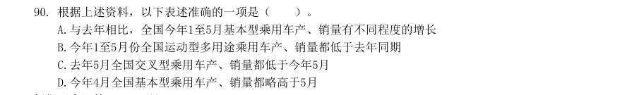
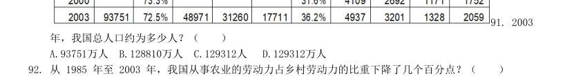
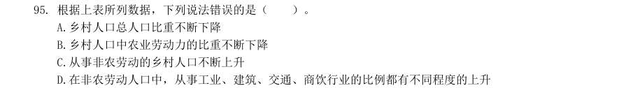
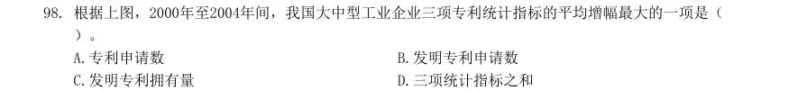
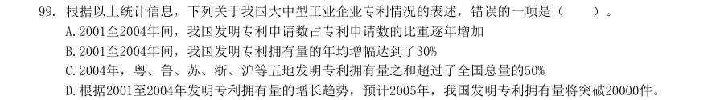
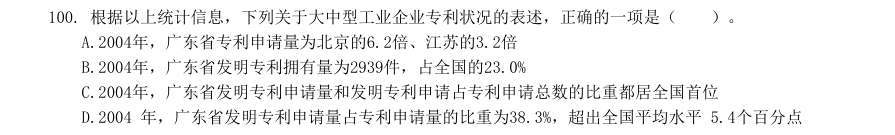

# 2006 年广东行测（统一卷）

- 题量：90（含答案 0）
- 模块分布：资料分析15 / 数量关系15 / 言语理解30 / 判断推理20 / 常识判断10
- 试卷编号：`广东-2006-统一卷`

## 题目与答案

**【数量关系·数字推理｜GD-2006-ty-X001】**
> 材料：(共15题,参考时间15分钟) 本部分包括两种类型的题目

1. 3/15,1/3,3/7,1/2,( )。

- **A.** 5/8
- **B.** 4/9
- **C.** 15/27
- **D.** -3

**答案：暂缺**　**考点：数字推理｜分数与组合数列**
**【数量关系·数字推理｜GD-2006-ty-X002】**

2. -8,15,39,65,94,128,170,( )。

- **A.** 180
- **B.** 210
- **C.** 225
- **D.** 256

**答案：暂缺**　**考点：数字推理｜数字推理（综合）**
**【数量关系·数字推理｜GD-2006-ty-X003】**

3. 1269,999,900,330,( ) 。

- **A.** 190
- **B.** 270
- **C.** 299
- **D.** 1900

**答案：暂缺**　**考点：数字推理｜数字推理（综合）**
**【数量关系·数字推理｜GD-2006-ty-X004】**

4. 1,32,81,64,25,( )。

- **A.** 6
- **B.** 10
- **C.** 16
- **D.** 21

**答案：暂缺**　**考点：数字推理｜数字推理（综合）**
**【数量关系·数字推理｜GD-2006-ty-X005】**

5. 1,2,2,3,4,5 ,( )。

- **A.** 4
- **B.** 5
- **C.** 6
- **D.** 7

**答案：暂缺**　**考点：数字推理｜数字推理（综合）**
**【数量关系·数字推理｜GD-2006-ty-X006】**
> 材料：找问题的途径。

6. 1992是24个连续偶数的和,问这24个连续偶数中最大的一个是几? ( )

- **A.** 84
- **B.** 106
- **C.** 108
- **D.** 130

**答案：暂缺**　**考点：数字推理｜数字推理（综合）**
**【数量关系·利润问题｜GD-2006-ty-X007】**

7. 某商品按定价的80%(八折)出售,仍能获得20%的利润,问定价时期望的利润率是多少?( )

- **A.** 50%
- **B.** 40%
- **C.** 30%
- **D.** 20%

**答案：暂缺**　**考点：利润问题｜基础利润**
**【数量关系·最值问题｜GD-2006-ty-X008】**

8. 已知甲的13%为14,乙的14%为15,丙的15%为16,丁的16%为17,则甲、乙、丙、丁四个数中最大的数是( )。

- **A.** 甲
- **B.** 乙
- **C.** 丙
- **D.** 丁

**答案：暂缺**　**考点：最值问题｜最值优化**
**【数量关系·行程问题｜GD-2006-ty-X009】**

9. 甲、乙、丙三人,甲每分钟走50米,乙每分钟走40米,丙每分钟走35米,甲、乙从A地,丙从B地同时出 发,相向而行,丙遇到甲2分钟后遇到乙,那么,AB两地相距多少米?( )

- **A.** 250米
- **B.** 500米
- **C.** 750米
- **D.** 1275米

**答案：暂缺**　**考点：行程问题｜相遇追及**
**【数量关系·利润问题｜GD-2006-ty-X010】**

10. 一批商品,按期望获得50%的利润来定价,结果只销售掉70%的商品,为尽早销售掉剩下的商品,商店决 定按定价打折出售,这样所获得的全部利润,是原来所期望利润的80%, 问打了多少折扣?( )

- **A.** 4折
- **B.** 6折
- **C.** 7折
- **D.** 8折

**答案：暂缺**　**考点：利润问题｜折扣与促销**
**【数量关系·容斥问题｜GD-2006-ty-X011】**

11. 一个俱乐部,会下象棋的有69人,会下围棋的有58人,两种棋都不会下的有12人,两种棋都会下的有30 人,问这个俱乐部一共有多少人?( )

- **A.** 109人
- **B.** 115人
- **C.** 127人
- **D.** 139人

**答案：暂缺**　**考点：容斥问题｜两集合**
**【数量关系·几何问题｜GD-2006-ty-X012】**

12. 园林工人要在周长300米的圆形花坛边等距离栽树。他们先沿着花坛的边每隔3米挖一 个坑,当挖完30 个坑时,突然接到通知:改为每隔5米栽一棵树。这样,他们还要挖多少个坑才能完成任务?( )

- **A.** 43个
- **B.** 53个
- **C.** 54个
- **D.** 60个

**答案：暂缺**　**考点：几何问题｜平面几何**
**【数量关系·最值问题｜GD-2006-ty-X013】**

13. 某市居民生活用电每月标准用电量的基本价格为每度0.60元,若每日用电量超过标准用电量,超出部分 按基本价格的80%收费,某户九月份用电100度,共交电费57.6元,则该市每月标准用电量为( )。

- **A.** 60度
- **B.** 70度
- **C.** 80度
- **D.** 90度

**答案：暂缺**　**考点：最值问题｜最值问题（综合）**
**【数量关系·牛吃草问题｜GD-2006-ty-X014】**

14. 有一个灌溉用的中转水池,一直开着进水管往里灌水,一段时间后,用2台抽水机排水, 则用40分钟能 排完;如果用4台同样的抽水机排水,则用16分钟排完。问如果计划用10 分钟将水排完,需要多少台抽 水机?( )

- **A.** 5台
- **B.** 6台
- **C.** 7台
- **D.** 8台

**答案：暂缺**　**考点：牛吃草问题｜牛吃草**
**【数量关系·溶液问题｜GD-2006-ty-X015】**

15. 一个容器内有若干克盐水,往容器内加入一些水,溶液的浓度变为3%,再加入同样多的水,溶液的浓度 为2%,问第三次再加入同样多的水后,溶液的浓度是多少? ( )

- **A.** 1.8%
- **B.** 1.5%
- **C.** 1%
- **D.** 0.5%

**答案：暂缺**　**考点：溶液问题｜混合与十字交叉**
**【言语理解·逻辑填空｜GD-2006-ty-X016】**
> 材料：(共30题,参考时限25分钟) 本部分包括三种类型的题目:

16. 要进一步采取有力措施,有效( )投资过快的增长势头,保持经济平稳发展。

- **A.** 平衡
- **B.** 保持
- **C.** 遏制
- **D.** 阻止

**答案：暂缺**　**考点：逻辑填空｜逻辑填空（综合）**
**【言语理解·中心理解｜GD-2006-ty-X017】**

17. 我国的人民代表大会制度,是实现人民当家做主和保障公民政治( )的主要形式。

- **A.** 权力
- **B.** 兴趣
- **C.** 义务
- **D.** 权利

**答案：暂缺**　**考点：中心理解｜中心句与主旨**
**【言语理解·逻辑填空｜GD-2006-ty-X018】**

18. 知识( )不能离开能力,同样能力也不能脱离知识。

- **A.** 既然
- **B.** 虽然
- **C.** 即使
- **D.** 固然

**答案：暂缺**　**考点：逻辑填空｜逻辑填空（综合）**
**【言语理解·逻辑填空｜GD-2006-ty-X019】**

19. 现在职场上流传着这样一句话:( )最多只管两年,其后关键在于能力。

- **A.** 学历
- **B.** 学力
- **C.** 学识
- **D.** 学问

**答案：暂缺**　**考点：逻辑填空｜逻辑填空（综合）**
**【言语理解·逻辑填空｜GD-2006-ty-X020】**

20. 中国致力于建设创新型国家,制定了中长期科学和技术发展( ),提出了未来 15 年科技发展的目 标和任务。

- **A.** 规划
- **B.** 计划
- **C.** 设想
- **D.** 方案

**答案：暂缺**　**考点：逻辑填空｜逻辑填空（综合）**
**【言语理解·逻辑填空｜GD-2006-ty-X021】**

21. 这些反映20世纪二三十年代广州风貌的老照片,是他用了近十年的时间千辛万苦才( )到的。

- **A.** 收集
- **B.** 搜集
- **C.** 搜查
- **D.** 搜索

**答案：暂缺**　**考点：逻辑填空｜逻辑填空（综合）**
**【言语理解·逻辑填空｜GD-2006-ty-X022】**

22. 领导干部应该深入群众,和群众打一片,真正( )民情。

- **A.** 体察
- **B.** 体恤
- **C.** 体贴
- **D.** 体验

**答案：暂缺**　**考点：逻辑填空｜逻辑填空（综合）**
**【言语理解·逻辑填空｜GD-2006-ty-X023】**

23. 由于身体的原因,他不得不( )了这家公司的宴请,虽然他很想去。

- **A.** 推脱
- **B.** 推卸
- **C.** 推托
- **D.** 答应

**答案：暂缺**　**考点：逻辑填空｜逻辑填空（综合）**
**【言语理解·逻辑填空｜GD-2006-ty-X024】**

24. 一个人应该从多方面加强自己的道德修养,但首先要做到的是( )端正。

- **A.** 品行
- **B.** 品性
- **C.** 态度
- **D.** 品格

**答案：暂缺**　**考点：逻辑填空｜逻辑填空（综合）**
**【言语理解·逻辑填空｜GD-2006-ty-X025】**

25. 回顾几十年的改革( ),他感慨良多。

- **A.** 里程
- **B.** 过程
- **C.** 路程
- **D.** 历程

**答案：暂缺**　**考点：逻辑填空｜逻辑填空（综合）**
**【言语理解·中心理解｜GD-2006-ty-X026】**
> 材料：判断。

26. 下列没有语病的一项是( )。

- **A.** 考试时要避免的:一是精神不可高度紧张:二是不可粗心大意
- **B.** 为防止这类交通事故不再发生,我们加强了交通安全的教育和管理
- **C.** 谁也不会认为优异的学习成绩不是靠勤奋学习得来的
- **D.** 让老百姓共享经济社会发展的成果,难到我们能否认这不是我们所追求的目标吗

**答案：暂缺**　**考点：中心理解｜中心理解（综合）**
**【言语理解·中心理解｜GD-2006-ty-X027】**

27. 下列没有语病的一项是( )。

- **A.** 将军从头到脚凝视着刚从前线回来的儿子,激动得一句话也说不出来
- **B.** 制止和规范权力消费行为已成为反腐败斗争中迫在眉睫的课题
- **C.** 现在,仍有一些不良商家不择手段地造伪劣产品
- **D.** 在这次事故中死了许多人,他是幸免遇难的一个

**答案：暂缺**　**考点：中心理解｜中心理解（综合）**
**【言语理解·中心理解｜GD-2006-ty-X028】**

28. 下列没有语病的一项是( )。

- **A.** 老主任再三解释,才使他怒气逐渐平息
- **B.** 市政府严肃处理了这些不良加油站擅自提价
- **C.** 对于这种盲目投资、低水平重复建设的行动,迄今在有些地方未得到制止
- **D.** 学习了胡锦涛总书记关于“八荣八耻”的论述,使我们树立了社会主义荣辱观

**答案：暂缺**　**考点：中心理解｜中心理解（综合）**
**【言语理解·中心理解｜GD-2006-ty-X029】**

29. 下列没有语病的一项是( )。

- **A.** 接到群众举报后,他们马上召集有关人员进行研究,统一安排了这次执法活动应注意的问题
- **B.** 劳动部门对一些恶意拖欠农民工工资的现象,及时进行了批评教育和严肃处理
- **C.** 近年来,我国加快了高等教育事业发展的速度和规模,高校将进一步扩大招生,并重点建设一批高水平的大学和学科
- **D.** 有识之士指出,全面提高教育质量,是教育界面临的重要任务

**答案：暂缺**　**考点：中心理解｜中心理解（综合）**
**【言语理解·中心理解｜GD-2006-ty-X030】**

30. 下列没有语病的一项是( )。

- **A.** 有没有坚定的意志,是一个人在事业上能够取得成功的关键
- **B.** 我们的很多部门,特别是部门的负责同志,是否把消防安全放在应有的重要位置,决定着他们在安全工作中的态度和做法
- **C.** 当前,除了要协调城乡发展,加强农村基础设施建设之外,提高农村劳动力素质,也是能否建设好社会主义新农村的一条重要途径
- **D.** 电子工业能否迅速发展,并广泛渗透到各行各业中,关键在于造就一批专业技术人才

**答案：暂缺**　**考点：中心理解｜中心理解（综合）**
**【言语理解·中心理解｜GD-2006-ty-X031】**

31. 下列没有语病的一项是( )。

- **A.** 有些网站可以申请免费的个人主页,你只要将自己的信息放在指定位置,全世界的人都 可以看到你的情况
- **B.** 无论干部还是群众,毫无例外,都必须遵守社会主义法制
- **C.** 近些年来,国外教育机构不仅在寻求与我国的一些民办高校合作,而且许多人也开始将注意力投向民办教育,并以此作为创业的新起点
- **D.** 我不信任他,而且以前反对过他的人现在也信任他了

**答案：暂缺**　**考点：中心理解｜中心理解（综合）**
**【言语理解·中心理解｜GD-2006-ty-X032】**

32. 下列没有语病的一项是( )。

- **A.** 历史学家和考古学家对两千年前的在长沙马王堆汉墓出土的文物进行了研究
- **B.** 文件对经济领域的一些问题,从理论上和政策上作了详细的规定和深刻的说明
- **C.** 我们要正确贯彻和深刻理解胡锦涛总书记关于构建和谐社会的讲话精神
- **D.** 这家公司上午正式开通电子商务网站,成为国内第一家开展网上电子商务服务的旅游企业

**答案：暂缺**　**考点：中心理解｜中心理解（综合）**
**【言语理解·中心理解｜GD-2006-ty-X033】**

33. 下列各句表意明确的一项是( )。

- **A.** 据统计,全省个人捐资办学万元以上的已将近400余人
- **B.** 据统计,我市15岁以上居民有153万人,约占全市人口的70%左右
- **C.** 根据我国林业新世纪跨越式发展的战略目标,到2050年,我国森林覆盖率将达到并稳定在20%以上
- **D.** 据科学统计,蜜蜂每酿一斤蜜,大约要采集50万朵的花粉

**答案：暂缺**　**考点：中心理解｜中心理解（综合）**
**【言语理解·逻辑填空｜GD-2006-ty-X034】**

34. 下列没有歧义的一句是( )。

- **A.** 请你告诉小王,我们要学习文件
- **B.** 时间过得真快呀,记得我第一次见你的时候才六岁
- **C.** 躺在床上那么久,他终于想起来了
- **D.** 环保部门责令工厂立即采取隔音措施,将噪音污染降至合格标准

**答案：暂缺**　**考点：逻辑填空｜逻辑填空（综合）**
**【言语理解·中心理解｜GD-2006-ty-X035】**

35. 下列没有语病的一项是( )。

- **A.** 当前,我们的当务之急是利用各种办法提高农民的收入
- **B.** 听说你顺利通过了考试,我们从内心向你表示由衷的祝贺
- **C.** 为尽快将我所技术推广使用,现在我所开展“免费赠送技术”活动
- **D.** 据一项最新调查,我国约65%的青年认为“诚实守信”、“助人为乐”是优秀的传统美德,是做人的

**答案：暂缺**　**考点：中心理解｜中心理解（综合）**
**【言语理解·细节判断｜GD-2006-ty-X036】**
> 材料：陈述,要求从四个选项中选出一项来完成这一陈述。注意:供选择的答案有时可能是 对短文辨证内容的一 个复述,有时则满足了陈述中其他方面的要求,你的选择应与所提要求 最相符合。

36. 传统认为,哺乳动物冬眠的奥秘在于心脏。无论冬眠动物,还是非冬眠动物,甚至人类, 其心脏工作 原理是相同的。当钙离子流进心脏的细胞时,就引起自脏收缩;当钙离子随即排出细胞时,心脏又开始 舒张。但是随着温度的降低,非冬眠动物的心脏细胞排除钙离子的能力明显降低,从而使心脏的舒张越 来越困难,最后导致死亡;而此时冬眠动物的心脏细胞则完全与此相反。因此心脏细胞调节钙离子浓度 的机制,是冬眠时心脏正常活动的关键所在。 对冬眠动物心脏工作原理的解说,符合文意的是(

> （本题为图形题，选项为图片，见原卷）

**答案：暂缺**　**考点：细节判断｜细节判断**
**【言语理解·中心理解｜GD-2006-ty-X037】**

37. 一篇议论文有了正确而鲜明的观点,还必须有确切而充分的材料来证明。证明论点的理由和材料就是论 据。论据分为两类:一类是用有代表性的事例,可靠的事实和确凿的统计数字来充当,叫事实论据。另 一类是人们公认的道理、格言、谚语等,叫道理论据。一篇文章,运用事实论据来证明观点,这种论证 方法我们称它为“摆事实”。运用道理论据来证明观点 则称为“讲道理”。 以上文字所讲述的主要内容是( )。

- **A.** 议论文既要有论点,也要有证明论点的论据
- **B.** 议论文要有充分的证明材料
- **C.** 议论文中两类不同的论据
- **D.** 议论文中“摆事实”和“讲道理”都必不可少

**答案：暂缺**　**考点：中心理解｜对策优先**
**【言语理解·中心理解｜GD-2006-ty-X038】**

38. 听莫扎特的音乐能够提高智商,这被称为“莫扎特效应”。无论“莫扎特效应”有无这 样的神奇效果,音乐在陶冶情操、抚慰心灵上的作用正在逐步显现出来。人类离不开音乐也是显而易见 的事实。 通过这段话,可以知道的是( )。

- **A.** 作者认同“莫扎特效应”
- **B.** 作者认为音乐能提高智商
- **C.** 看不出作者是否认同“莫扎特效应”
- **D.** 音乐在大脑的开发方面起关键作用

**答案：暂缺**　**考点：中心理解｜中心理解（综合）**
**【言语理解·中心理解｜GD-2006-ty-X039】**

39. 读书作为一种生活习惯,绝不是随便什么人都可以享有的。它是无条件的,完全是自我 选择的结果。曾国藩有言:“苟能发奋读书,则家塾可读书,旷野之地、热闹之地亦可读书;负薪牧豚, 均无不可读书。苟不能发愤自立,则家塾不能读书,即清净之乡、神仙之境皆不能读书。何必择地?何 必择时?” 这段话告诉我们( )。

- **A.** 发愤读书时不择时选地
- **B.** 发愤读书时需要选择好的书籍
- **C.** 发愤读书需要养成良好的习惯
- **D.** 家塾、旷野之地、热闹之地均是读书的好地方

**答案：暂缺**　**考点：中心理解｜中心理解（综合）**
**【言语理解·中心理解｜GD-2006-ty-X040】**
> 材料：这个“五一”黄金周,最引人关注的新闻不是哪个旅游景区游客爆满,而是户外探险旅游频频出现意外。 4月30日至5月3日,55名京津地区的游客因没有向导带路、不熟悉沙漠环境被困库布其沙漠深处,其中一名 女队员因对沙漠探险旅游危险性缺乏足够认识,所背物品较重,体力不支而遇难。 从5月1日起,来自库尔勒的43人穿越天山车师古道,途中遭遇天气变化导致队伍走散。到5月5日,只有 12人顺利穿越。失踪的31人5月6日被找到,均安然无恙。 全国假日办发布“五一”黄金周8号旅游信息通报显示,本次黄金周间全国发生涉旅安全事故11起,其 中10起是“散客自助旅游或离团自行活动过程中发生的”。 如此频繁的意外,让人们不禁对这一新兴的旅游方式产生的种种疑问,甚至有人提出叫停这一项目。

40. 根据以上文字,下列说法错误的是( )。

- **A.** 沙漠自助探险旅游存在着一定的危险性
- **B.** 这次黄金周期间发生的涉旅安全事故超过了10起
- **C.** 旅游队伍在天山车师古道穿越时导致走散的主要原因是天气的突变
- **D.** 自助探险旅游这一新兴的旅游方式已经被禁止。

**答案：暂缺**　**考点：中心理解｜中心理解（综合）**
**【言语理解·逻辑填空｜GD-2006-ty-X041】**

41. 文中画线部分“新兴的旅游方式”指的是( )。

- **A.** “五一”黄金周
- **B.** 户外探险旅游
- **C.** 沙漠旅游
- **D.** 离团自行活动游

**答案：暂缺**　**考点：逻辑填空｜逻辑填空（综合）**
**【言语理解·中心理解｜GD-2006-ty-X042】**
> 材料：目前,医生们已经发现更多证据表明 H5N1 型禽流感病毒迅速变异,使抗禽流感药物“达菲”失效。 2005年1月,当一名13岁的越南小女孩因轻微肺炎被送到医院时,人们还庆幸她及时得到了“达菲”的 治疗。用药初期症状确有缓解,但6天后她还是离开了人世。这只是牛津大学临床研究中心专家诺·德容报 告中的一例病毒进化证据。这一报告指出,尽管服用了“达 菲”,越南医院8名感染H5N1病毒的患者中仍有 4人死亡。调查显示,在两名病人的体内,病毒已对“达菲”产性耐药性。 世卫组织认为,照此进化速度,H5N1型病毒在人际传播只是早晚问题。 世界卫生组织统计,目前在4个国家中已有139人感染H5N1型病毒,71人死亡。由于目前流感疫苗对禽流 感无效,而针对H5N1型病毒的疫苗正在研制中,因此治疗禽流感主要依靠4种药物。其中两种旧药“金刚烷 胺”和“金刚乙胺”对病毒效力已经较小,两种新药则是瑞士罗氏制药公司生产

42. 原文认为,“达菲”对抗击H5N1型禽流感病毒正在失去效力。下列不能作为这一结论 依据的一项是( )。

- **A.** 一名13岁的越南女孩接受“达菲”治疗,6天后她还是离开了人世
- **B.** 尽管服用了“达菲”,越南医院8名感染 H5N1 病毒的患者中仍有4人死亡
- **C.** 调查显示,在两名病人的体内,病毒已对“达菲”产生耐药性
- **D.** 世界卫生组织统计,目前在4个国家中已有139人感染H5N1型病毒,71人死亡

**答案：暂缺**　**考点：中心理解｜中心理解（综合）**
**【言语理解·中心理解｜GD-2006-ty-X043】**

43. 下列理解与表述,不符合原文意思的一项是( )。

- **A.** 越来越多的证据表明,抗禽流感药物“达菲”之所以失去效力,是因为H5N1型禽流感病毒能够迅速变异
- **B.** 由于禽流感病毒的进化速度越来越快,世卫组织担心,照此下去,H5N1型病毒在人际 传播只是早晚问题
- **C.** 安妮·莫斯科纳和其他专家都认为,德荣报告说明“达菲”需要谨慎保存、妥善使用,但瑞士罗氏制药公司不同意这一观点
- **D.** 现在治疗禽流感主要依靠“达菲”、“乐感清”等4种药物,但它们在治疗禽流感方 面都存在着一定

**答案：暂缺**　**考点：中心理解｜中心理解（综合）**
**【言语理解·中心理解｜GD-2006-ty-X044】**

44. 根据原文提供的信息,下列推断正确的一项是( )。

- **A.** 研究“达菲”对抗禽流感药物正在失去效力的原因,有助于人类尽快寻找取代“达 菲”用以对付禽流感的新药
- **B.** 人类正遭受禽流感的威胁,加快研制出针对 H5N1 型病毒的疫苗是整个科学界的当 务之急
- **C.** 如果葛兰素一史克公司正在研制的注射式“乐感清”获得成功,那么人类就再也不 用担心如何对付禽流感了
- **D.** 事实证明,“帕拉米韦”新药能有效地抑制神经氨酸苷酶,它一旦投放市场,就能为人类对付禽流感

**答案：暂缺**　**考点：中心理解｜中心理解（综合）**
**【言语理解·中心理解｜GD-2006-ty-X045】**

45. 对文中划线部分“鸡尾酒”疗法的理解,正确的一项是( )。

- **A.** 对抗禽流感需要象“鸡尾酒一样,应通过多种药物联合使用治疗才有效
- **B.** 对抗禽流感不仅需要用各种药物,用“鸡尾酒”治疗也是一种不错的选择
- **C.** “鸡尾酒”疗法的典型代表药物是利巴韦林抗病毒药
- **D.** 由于禽流感病毒变异速度极快,为避免产生耐药性,用“鸡尾酒”疗法是在各种药物中选择一种最新

**答案：暂缺**　**考点：中心理解｜中心理解（综合）**
**【判断推理·类比推理｜GD-2006-ty-X046】**
> 材料：(共40题,参考时限35分钟) 本部分包括四种类型的题目: 贴近或相似的一项。

46. 眉笔:化妆

- **A.** 山路:崎岖
- **B.** 风浪:痴狂
- **C.** 水杯:盛水
- **D.** 年月:质量

**答案：暂缺**　**考点：类比推理｜类比推理（综合）**
**【判断推理·类比推理｜GD-2006-ty-X047】**

47. 衣服:御寒

- **A.** 纸张:运输
- **B.** 毛笔:书写
- **C.** 电话:电波
- **D.** 故事:陈述

**答案：暂缺**　**考点：类比推理｜类比推理（综合）**
**【判断推理·类比推理｜GD-2006-ty-X048】**

48. 白天:黑夜

- **A.** 男人:女人
- **B.** 高山:大海
- **C.** 白色:黑色
- **D.** 老人:小孩

**答案：暂缺**　**考点：类比推理｜类比推理（综合）**
**【判断推理·类比推理｜GD-2006-ty-X049】**

49. 军装:士兵

- **A.** 套装:女人
- **B.** 警报:警察
- **C.** 服装:场合
- **D.** 制服:邮递员

**答案：暂缺**　**考点：类比推理｜类比推理（综合）**
**【判断推理·类比推理｜GD-2006-ty-X050】**

50. 蔬菜:西红柿

- **A.** 苹果:香蕉
- **B.** 树:树根
- **C.** 草原:羊群
- **D.** 山:高山

**答案：暂缺**　**考点：类比推理｜类比推理（综合）**
**【判断推理·类比推理｜GD-2006-ty-X051】**

51. 商场:顾客

- **A.** 发布会:记者
- **B.** 书店:书
- **C.** 火车:列车员
- **D.** 考试:大纲

**答案：暂缺**　**考点：类比推理｜类比推理（综合）**
**【判断推理·类比推理｜GD-2006-ty-X052】**

52. 山路:索道

- **A.** 客轮:渔船
- **B.** 汽车:卡车
- **C.** 楼梯:电梯
- **D.** 碗:盘子

**答案：暂缺**　**考点：类比推理｜类比推理（综合）**
**【判断推理·类比推理｜GD-2006-ty-X053】**

53. 除草机:草

- **A.** 电脑:数据
- **B.** 称:重量C.酒精灯:加热
- **D.** 天平:砝码

**答案：暂缺**　**考点：类比推理｜类比推理（综合）**
**【判断推理·类比推理｜GD-2006-ty-X054】**

54. 温度计:水银

- **A.** 发动机:汽油
- **B.** 热水器:水
- **C.** 衣服:扣子D.蓄电池:硫酸

**答案：暂缺**　**考点：类比推理｜类比推理（综合）**
**【判断推理·类比推理｜GD-2006-ty-X055】**

55. 灯光:黑暗

- **A.** 财富:贫困
- **B.** 墨镜:光明
- **C.** 太阳:月亮
- **D.** 小草:绿化

**答案：暂缺**　**考点：类比推理｜类比推理（综合）**
**【常识判断·政治常识｜GD-2006-ty-X056】**
> 材料：要求的一项

56. 人身上运动幅度最大的关节是( )。

- **A.** 肘关节
- **B.** 腕关节
- **C.** 膝关节
- **D.** 肩关节

**答案：暂缺**　**考点：政治常识｜政治常识（综合）**
**【常识判断·政治常识｜GD-2006-ty-X057】**

57. 在京剧中,性格比较活泼、爽朗,举止也较轻盈伶俐的青年妇女角色是( )。

- **A.** 青衣
- **B.** 花旦
- **C.** 武旦
- **D.** 彩旦

**答案：暂缺**　**考点：政治常识｜政治常识（综合）**
**【常识判断·政治常识｜GD-2006-ty-X058】**

58. 中国人自称为“炎黄子孙”其中“黄”是指( )。

- **A.** 黄河
- **B.** 黄土
- **C.** 黄道
- **D.** 黄帝

**答案：暂缺**　**考点：政治常识｜政治常识（综合）**
**【常识判断·政治常识｜GD-2006-ty-X059】**

59. 复印机在使用过程中会排放出对人体有害的气体,主要是( )。

- **A.** 一氧化碳
- **B.** 二氧化碳
- **C.** 粉尘
- **D.** 臭氧

**答案：暂缺**　**考点：政治常识｜政治常识（综合）**
**【常识判断·政治常识｜GD-2006-ty-X060】**

60. 下列关于“露”的说法,最准确的是( )。

- **A.** 露水像雨水一样,是从“天上”掉下来的
- **B.** 露水是在空气清新的早上形成的
- **C.** 露水是由于草木等温度下降,使大气低层的水蒸气凝结而成
- **D.** 水蒸气凝结在空气中的尘埃上形成雾,雾因重力下降到草木上而形成露

**答案：暂缺**　**考点：政治常识｜政治常识（综合）**
**【常识判断·政治常识｜GD-2006-ty-X061】**

61. 蘑菇是人们喜欢爱吃的食物,它属于( )。

- **A.** 动物
- **B.** 植物
- **C.** 微生物
- **D.** 藻类

**答案：暂缺**　**考点：政治常识｜政治常识（综合）**
**【常识判断·政治常识｜GD-2006-ty-X062】**

62. 公务员在涉外活动中,要特别注意国际礼仪。以下不符合国际礼仪的是( )。

> 同题变体（主记录 GK-2006-ty-X111）

- **A.** 一起乘坐电梯及上车时,请女士现行
- **B.** 闲谈时询问美国客人前一段得了什么病
- **C.** 接待来访的外国客人时,请客人坐右边的座位
- **D.** 在德国,提前抵达访问地点后等到了约定时间再敲门

**答案：暂缺**　**考点：政治常识｜政治常识（综合）**
**【常识判断·政治常识｜GD-2006-ty-X063】**

63. 在等量条件下,以下食物中含碘最多的是( )。

- **A.** 紫菜
- **B.** 海带
- **C.** 海参
- **D.** 芹菜

**答案：暂缺**　**考点：政治常识｜政治常识（综合）**
**【常识判断·地理常识｜GD-2006-ty-X064】**

64. 亚洲是世界上第一大洲,它的面积约占全球陆地面积的( )。

- **A.** 20%
- **B.** 30%
- **C.** 40%
- **D.** 50%

**答案：暂缺**　**考点：地理常识｜世界地理**
**【常识判断·地理常识｜GD-2006-ty-X065】**

65. 奥林匹克的旗帜由五种不同颜色的环圈组成,分别化友五大洲,其中黄色代表的是( )。

- **A.** 亚洲
- **B.** 欧洲
- **C.** 美洲
- **D.** 非洲

**答案：暂缺**　**考点：地理常识｜世界地理**
**【判断推理·逻辑判断｜GD-2006-ty-X076】**
> 材料：题图形具有一定的规律,也存在某种差异。要求你从四个选项中选择你认为最适合取代问 号的一个。你要 从中找出其变化的规律,并把这种规律正确地运用到解题过程中,或者依据 图形变化的规律进行选择。 四、演绎推理。共10题,每题1分,共12分。每题给出一段陈述,这段陈述被假设是正确的,不容置疑 的。要求你根据这段陈述,选出一个答案。注意,正确的答案应与所给的陈述相符合,不需要任何附加 说明即可以从陈述中直接推出。

76. 群众对领导干部的不满,不仅产生于领导的作为和业绩,而且很大程度上是由于对领导 的期望值与实 际表现之间的差距。因此,如果竞选任何一个单位或部门的领导,竞选者在竞选过程中一味向群众许愿、 夸海口是一种不明智的做法 从以上议论可以推出以下哪项结论?( )

- **A.** 只要群众对领导的期望值足够低,即使这个领导在职期间无所作为,群众也不会产生 不满情绪
- **B.** 只要领导的作为和业绩出色,群众就不会产生不满情绪
- **C.** 由于群众的期望值高,尽管领导的工作成绩优秀,群众的不满情绪仍可能存在
- **D.** 聪明的领导竞选者在竞选时不应向群众承诺什么

**答案：暂缺**　**考点：逻辑判断｜翻译推理**
**【判断推理·逻辑判断｜GD-2006-ty-X077】**

77. 某宿舍有甲、乙、丙三人,一个出生在北京市,一个出生在上海市,一个出生在广州市, 他们所学的专业,一个是金融、一个是管理,一个是外语。已知: 1乙不是学外语的2乙不出生在广州市3丙不出生在北京市 4学习金融的不出生在上海市5学习外语的出生在北京市 根据上述条件,可推出甲所学的专业是( )。

- **A.** 金融
- **B.** 管理
- **C.** 外语
- **D.** 推不出

**答案：暂缺**　**考点：逻辑判断｜翻译推理**
**【判断推理·逻辑判断｜GD-2006-ty-X078】**

78. 某工厂进行结构重组,计划减员2%,撤销三个生产车间,这三个生产车间的人数正好占 工厂总人数的 25%。计划实施后,上述三个生产车间被撤销,整个工厂实际减员15%。此过程中,工厂内部人员有所调 整,但整个工厂只有减员,没有增员。 如果上判断定为真,以下哪项一定为真?( ) I.上述计划实施后,有的生产车间调入新成员 II.上述计划实施后,没有一个生产车间调入的新成员的总数超出工厂原来总人数的10% III.上述计划实施后,被撤销的生产车间中的留任人员,不超过工厂原来总人数的 10%

- **A.** 只有I
- **B.** 只有I和III
- **C.** 只有II和III
- **D.** I、II、和III

**答案：暂缺**　**考点：逻辑判断｜逻辑判断（综合）**
**【判断推理·逻辑判断｜GD-2006-ty-X079】**

79. 有一位老教师认为,他在过去的监考经历中练就了一种特殊的技能,即能够地判定应考 者是否携带考 试作弊资料。他的根据是,在监考时,看几眼应考者的眼神是否可疑;而在他认为可疑的考生身上,无 一例外地都查出了考试作弊资料。 以下哪项如果为真,能削弱上述老师的结论?( ) I.在他认为不可疑而未经检查的应考者中,有人是无意携带了考试作弊资料 II.在他认为不可疑而未经检查的应考者中,有人有意地携带了考试作弊资料 III.在他认为可疑并检查出考试作弊资料的考生中,有人是无意携带了考试作弊资料

- **A.** 只有I
- **B.** 只有I和II
- **C.** 只有II和III
- **D.** I、II、III

**答案：暂缺**　**考点：逻辑判断｜削弱**
**【判断推理·逻辑判断｜GD-2006-ty-X080】**

80. 1980年,年龄在18到24之间,与父母生活在一起的人占该年龄段人口的比例为48%,而到1986年,这一 比例升至 53%。可以说,在1986年,这一年龄段的人更加难于负担独立 生活。 上文得出的结论是基于下列哪个假设?( )

- **A.** 这一年龄段中不能自立的人更愿意和同龄人生活在一起,而不是父母
- **B.** 这一年龄段中有些人,只要他们能独立生活,就会选择独立,而不是和父母生活在一起。
- **C.** 这一年龄段中与父母生活在一起的人,不分担房费支出
- **D.** 与1986年相比,1980年具有更适合年轻人独立创业的社会环境

**答案：暂缺**　**考点：逻辑判断｜前提假设**
**【判断推理·逻辑判断｜GD-2006-ty-X081】**

81. 一则关于许多苹果含有一种致癌剂的报道,对消费者产生的影响极小。几乎没有消费者 打算改变他们 购买苹果的习惯。尽管如此,在报道一个月后的三月份,食品杂货店的苹果销量大大下降了。 下列哪项如果为真,能最好地解释上述明显的差异?( )

- **A.** 在三月份,许多食品杂货商为了显示他们对消费者健康的关心,移走了货架上的苹果
- **B.** 由于大量的食物安全警告,到了三月份,消费者已对这类警告漠不关心
- **C.** 尽管这种防腐剂也用在别的水果上,但这则报道并没有提及
- **D.** 除了报纸以外,电视上也出现了这个报道

**答案：暂缺**　**考点：逻辑判断｜解释评价**
**【判断推理·逻辑判断｜GD-2006-ty-X082】**

82. 近年来,轿车是否可以进入中国普通百姓家庭的讨论一直没有停止。有人认为,放松对 私人轿车的管 制,可以推动中国汽车工业的发展,但同时又会使原本紧张的交通状况更加恶化,从而影响经济和社会 生活秩序。因此,中国的私人轿车在近五年内不应该有大的发展。 以下哪项,如果为真,则最能支持上述观点?( )

- **A.** 交通事业将伴随着轿车工业的发展而发展
- **B.** 总是先发展汽车工业,后发展交通事业
- **C.** 近期内中国的道路状况不可能有根本改善
- **D.** 应该大力发展公共交通事业

**答案：暂缺**　**考点：逻辑判断｜加强**
**【判断推理·逻辑判断｜GD-2006-ty-X083】**

83. 在毕业考试结束后,班长想从老师那里打听成绩。班长说:“老师,这次考试不太难,估计我们班同学 的成绩都在70分以上吧。”老师说:“你的前半句话不错,后半句不对。” 根据老师的意思,下列哪项必为事实?( )

- **A.** 少数同学的成绩在70分以上,多数同学的成绩在70分以下
- **B.** 多数同学的成绩在70分以上,少数同学的成绩在70分以下
- **C.** 有的同学的成绩在70分以上,有的同学的成绩在70分以下
- **D.** 如果以70分为及格,肯定有的同学的成绩不及格

**答案：暂缺**　**考点：逻辑判断｜逻辑判断（综合）**
**【判断推理·逻辑判断｜GD-2006-ty-X084】**

84. 要想精神健康,人必须自尊。人们要保持自尊必须通过不断赢得他们尊重的其他人的尊重,他们要赢得 这种尊重只有通过道德地对待这些人。 下列哪个结论可以从上文推出?( )

- **A.** 精神健康的人将被别人道德地对待
- **B.** 精神健康的人将道德地对待他们尊重的人
- **C.** 精神健康的人为了被别人道德地对待必须有自尊
- **D.** 自尊的人很少道德地对待那些他们尊重的人

**答案：暂缺**　**考点：逻辑判断｜翻译推理**
**【判断推理·逻辑判断｜GD-2006-ty-X085】**

85. 体育课的目标是促使受教育者保持健康的体魄体质、精神状态和生活方式。但许多学校 往往只重视音 质运动,这使得大多数在这方面缺少竞争性的学生疏远了体育。他们觉得自己又不想当运动员,因此, 很少注意通过足够的锻炼来促进。 根据上述判断最可能得出以下哪项结论?( )

- **A.** 体育课应当包括非竞技运动
- **B.** 体育课的竞技性使得大多数学生疏远了体育
- **C.** 见长于竞技运动的学生能进行足够的锻炼
- **D.** 保持健康的精神状态和保持健康的体魄体质同等重要

**答案：暂缺**　**考点：逻辑判断｜归纳推导**
**【资料分析·基期量计算｜GD-2006-ty-X086】**
> 材料：(共15题,参考时限15分钟) 针对下例文字、表或图回答问题。你应根据资料提供的信息进行分析、比较、计算、处理。 共15题, 每题1分,共15分。 根据下列文字资料,回答86~90 题。 据统计,今年5月份全国基本型乘用车产销21.19万辆和22.13万辆,比去年同期分别增长1.86%和 26.0%;运动型多用途乘用车产销1.43万辆和1.52万辆,降幅不大;交叉型乘用车本月产销6.60万辆和6.85 万辆,分别比上月下降14.2%和2.8%;多功能乘用车产销降幅最大,本月产销1.23万辆1.24万辆。

86. 1至 5月,基本型乘用车累计产销99.10万辆和96.93万辆,产量同比下降 2.73%,销量同比增长1.07%; 多功能乘用车累计产销6.11万辆和5.71万辆,同比增长31.20%和 31.54%;运动型多用途乘用车累计产销 6.46万辆和6.54万辆,同比下降16.00%和10.25%;交叉型乘用车累计产销36.77万辆和37.41万辆,同比增长 6.02%和 10.29%。 去年 5月份全国乘用车销量最大的车型的销量是( )。

- **A.** 21.19万辆
- **B.** 20.80万辆
- **C.** 17.56万辆
- **D.** 101.80万辆

**答案：暂缺**　**考点：基期量计算｜已知现期与增长率求基期**
**【资料分析·基期量计算｜GD-2006-ty-X087】**

87. 今年5月份全国乘用车销量最大的车型是( )

- **A.** 基本型乘用车
- **B.** 交叉型乘用车
- **C.** 多功能乘用车D.运动型多用途乘用车

**答案：暂缺**　**考点：基期量计算｜基期量比较**
**【资料分析·比重计算与比较｜GD-2006-ty-X088】**

88. 今年5月份全国多功能乘用车的产量占1至5月份总产量的( )。

- **A.** 20.13%
- **B.** 22.14%
- **C.** 17.95%
- **D.** 21.38%

**答案：暂缺**　**考点：比重计算与比较｜现期比重**
**【资料分析·增长率计算与比较｜GD-2006-ty-X089】**

89. 与去年同期比较,今年前5个月销量增幅度最大的车型是( )。

- **A.** 基本型乘用车
- **B.** 交叉型乘用车
- **C.** 多功能乘用车
- **D.** 运动型多用途乘用车

**答案：暂缺**　**考点：增长率计算与比较｜增长率比较**
**【资料分析·基期量计算｜GD-2006-ty-X090】**

90. 根据上述资料,以下表述准确的一项是( )。

- **A.** 与去年相比,全国今年1至5月基本型乘用车产、销量有不同程度的增长
- **B.** 今年1至5月份全国运动型多用途乘用车产、销量都低于去年同期
- **C.** 去年5月全国交叉型乘用车产、销量都低于今年5月
- **D.** 今年4月全国基本型乘用车产、销量都略高于5月

**答案：暂缺**　**考点：基期量计算｜基期量计算（综合）**
**【资料分析·基期量计算｜GD-2006-ty-X091】**

91. 我国农村劳动力情况表 单位:万人 2003 年,我国总人口约为多少人?( )

- **A.** 93751万人
- **B.** 128810万人
- **C.** 129312人
- **D.** 129312万人

**答案：暂缺**　**考点：基期量计算｜基期量计算（综合）**
**【资料分析·比重计算与比较｜GD-2006-ty-X092】**

92. 从 1985 年至 2003 年,我国从事农业的劳动力占乡村劳动力的比重下降了几个百分点?( )

- **A.** 7.3
- **B.** 10.2
- **C.** 18.1
- **D.** 36.2

**答案：暂缺**　**考点：比重计算与比较｜比重升降判断**
**【资料分析·基期量计算｜GD-2006-ty-X093】**

93. 根据上表,从 1985 年至 2003 年,从事非农劳动的比例上升最快的行业是( )。

- **A.** 工业
- **B.** 建筑业
- **C.** 交通业
- **D.** 商饮业

**答案：暂缺**　**考点：基期量计算｜基期量计算（综合）**
**【资料分析·比重计算与比较｜GD-2006-ty-X094】**

94. 从上表数据可以看出,在非农劳动力中,2000 年从事商饮行业的比重约是 1990 年的多少倍?( )

- **A.** 2.53倍
- **B.** 1.75倍
- **C.** 1.45倍
- **D.** 0.97倍

**答案：暂缺**　**考点：比重计算与比较｜现期比重**
**【资料分析·综合分析｜GD-2006-ty-X095】**

95. 根据上表所列数据,下列说法错误的是( )。

- **A.** 乡村人口总人口比重不断下降
- **B.** 乡村人口中农业劳动力的比重不断下降
- **C.** 从事非农劳动的乡村人口不断上升
- **D.** 在非农劳动人口中,从事工业、建筑、交通、商饮行业的比例都有不同程度的上升

**答案：暂缺**　**考点：综合分析｜选错误项**
**【资料分析·基期量计算｜GD-2006-ty-X096】**

96. 2000—2004 年我国大中型企业专利申请及拥有量统计图(单位:件) 2004 年我国部分省、市大中型工业企业专利申请及拥有量统计表 单位:件 地区 专利申请量(件) 发明专利申请量(件) 发明专利拥有量(件) 北京 天津 上海 浙江 江苏 黑龙江 山东 广东 四川 陕西 青海 2000年至 2004年,我国大中型工业企业发明专利申请数占专利申请数比重最大的年份是( )。

- **A.** 2001年
- **B.** 2002年
- **C.** 2003年
- **D.** 2004年

**答案：暂缺**　**考点：基期量计算｜基期量比较**
**【资料分析·比重计算与比较｜GD-2006-ty-X097】**

97. 根据上表,2004年我国大中型工业企业发明专利申请量占专利申请量比重最高的地区是( )。

- **A.** 北京
- **B.** 天津
- **C.** 上海
- **D.** 广东

**答案：暂缺**　**考点：比重计算与比较｜现期比重**
**【资料分析·平均数计算｜GD-2006-ty-X098】**

98. 根据上图,2000年至2004年间,我国大中型工业企业三项专利统计指标的平均增幅最大的一项是( )。

- **A.** 专利申请数
- **B.** 发明专利申请数
- **C.** 发明专利拥有量
- **D.** 三项统计指标之和

**答案：暂缺**　**考点：平均数计算｜现期平均数**
**【资料分析·基期量计算｜GD-2006-ty-X099】**

99. 根据以上统计信息,下列关于我国大中型工业企业专利情况的表述,错误的一项是( )。

- **A.** 2001至2004年间,我国发明专利申请数占专利申请数的比重逐年增加
- **B.** 2001至2004年间,我国发明专利拥有量的年均增幅达到了30%
- **C.** 2004年,粤、鲁、苏、浙、沪等五地发明专利拥有量之和超过了全国总量的50%
- **D.** 根据2001至2004年发明专利拥有量的增长趋势,预计2005年,我国发明专利拥有量将突破20000件。

**答案：暂缺**　**考点：基期量计算｜基期量计算（综合）**
**【资料分析·倍数计算｜GD-2006-ty-X100】**

100. 根据以上统计信息,下列关于大中型工业企业专利状况的表述,正确的一项是( )。

- **A.** 2004年,广东省专利申请量为北京的6.2倍、江苏的3.2倍
- **B.** 2004年,广东省发明专利拥有量为2939件,占全国的23.0%
- **C.** 2004年,广东省发明专利申请量和发明专利申请占专利申请总数的比重都居全国首位
- **D.** 2004 年,广东省发明专利申请量占专利申请量的比重为38.3%,超出全国平均水平 5.4个百分点

**答案：暂缺**　**考点：倍数计算｜倍数计算（综合）**