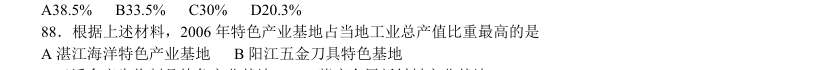
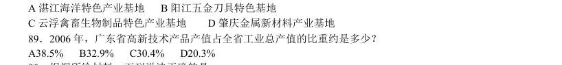
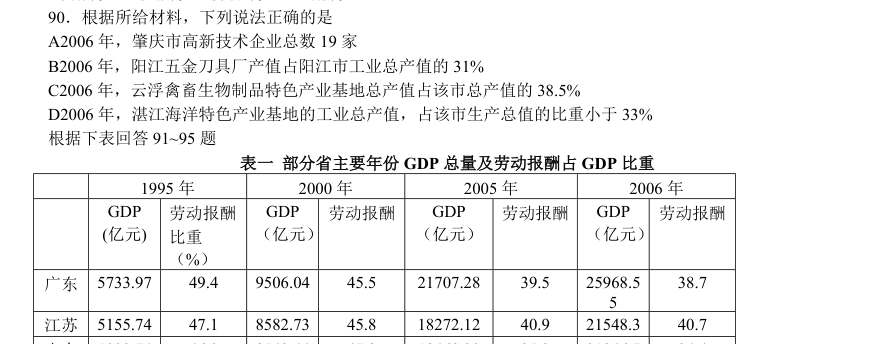
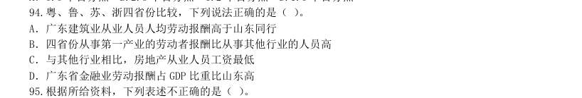
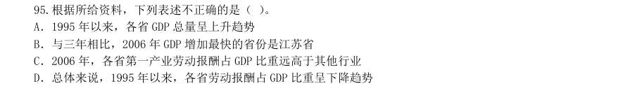
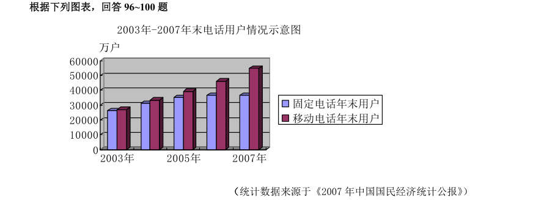
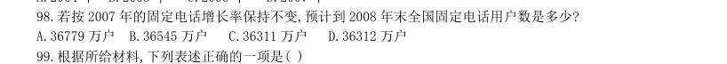
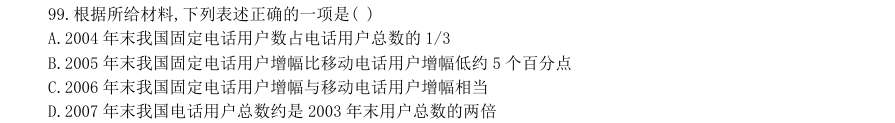

# 2008 广东省考·行测

- 题量：28（含答案 0）
- 考试类型：广东省考
- 模块分布：资料分析12 / 数量关系15 / 言语理解1
- 试卷编号：`广东-2008-统一卷`

## 题目与答案

**【2008 广东省考·第 1 题】数量关系·数字推理｜GD-2008-ty-X001**
> 材料：(共15 题,参考时限15 分钟) 本部分包括两种类型的试题: 排列规律,然后从四个供选择的选项中选出你认为最合理的一项,来填补空缺项。

1. 1,2,6,16,44,( )

- **A.** 66
- **B.** 84
- **C.** 88
- **D.** 120

**答案：该题答案缺失，见原卷**　**考点：数字推理｜数字推理（待细分）**　**难度：★★★☆☆**
**【2008 广东省考·第 2 题】数量关系·数字推理｜GD-2008-ty-X002**

2. 2,3,6,8,8,4,( )

- **A.** 2
- **B.** 3
- **C.** 4
- **D.** 5

**答案：该题答案缺失，见原卷**　**考点：数字推理｜递推数列**　**难度：★★★☆☆**
**【2008 广东省考·第 3 题】数量关系·数字推理｜GD-2008-ty-X003**

3. 2,1,5,7,17,( )

- **A.** 26
- **B.** 31
- **C.** 32
- **D.** 37

**答案：该题答案缺失，见原卷**　**考点：数字推理｜幂次数列**　**难度：★★★☆☆**
**【2008 广东省考·第 4 题】数量关系·数字推理｜GD-2008-ty-X004**

4. 1/36, 1/5, 1,3,4,( )

- **A.** 1
- **B.** 5
- **C.** 6
- **D.** 8

**答案：该题答案缺失，见原卷**　**考点：数字推理｜分数数列**　**难度：★★★☆☆**
**【2008 广东省考·第 5 题】数量关系·数字推理｜GD-2008-ty-X005**

5. ( )

- **A.** 5
- **B.** 17
- **C.** 19
- **D.** 47

**答案：该题答案缺失，见原卷**　**考点：数字推理｜数字推理（待细分）**　**难度：★★★☆☆**
**【2008 广东省考·第 6 题】数量关系·行程问题｜GD-2008-ty-X006**
> 材料：利用所给条件,寻找解决问题的捷径。

6. 甲、乙两人同时从A 地去B 地,甲每分钟行60 米,乙每分钟行90 米,乙到达B 地后立即返回,并与甲相遇,相遇 时,甲还需行3 分钟才能到达B 地,问A,B 两地相距多少米?

- **A.** 1350 米
- **B.** 1080 米
- **C.** 900 米
- **D.** 720 米

**答案：该题答案缺失，见原卷**　**考点：行程问题｜相遇追及**　**难度：★★☆☆☆**
**【2008 广东省考·第 7 题】数量关系·其他数量关系｜GD-2008-ty-X007**

7. 某人工作一年的报酬是18000 元和一台全自动洗衣机,他干了7 个月,得到9500 和一台全自动洗衣机,问这台 洗衣机值多少元?

- **A.** 8500 元
- **B.** 2400 元
- **C.** 2000 元
- **D.** 1700 元

**答案：该题答案缺失，见原卷**　**考点：其他数量关系｜和差倍比**　**难度：★☆☆☆☆**
**【2008 广东省考·第 8 题】数量关系·其他数量关系｜GD-2008-ty-X008**

8. 22008+32008 的个位数是几?

- **A.** 3
- **B.** 5
- **C.** 7
- **D.** 9

**答案：该题答案缺失，见原卷**　**考点：其他数量关系｜基础计算**　**难度：★☆☆☆☆**
**【2008 广东省考·第 9 题】数量关系·年龄问题｜GD-2008-ty-X009**

9. 两年前甲的年龄是乙的两倍,五年前乙的年龄是丙的三分之一,丙今年11 岁,问今年甲多少岁?

- **A.** 12
- **B.** 10
- **C.** 7
- **D.** 5

**答案：该题答案缺失，见原卷**　**考点：年龄问题｜年龄和与倍数**　**难度：★☆☆☆☆**
**【2008 广东省考·第 10 题】数量关系·其他数量关系｜GD-2008-ty-X010**

10. 要折叠一批纸飞机.若甲单独折叠要半个小时完成,乙单独折叠需要45 分钟完成,若两人一起折叠,需要多少 分钟完成?

- **A.** 10
- **B.** 15
- **C.** 16
- **D.** 18

**答案：该题答案缺失，见原卷**　**考点：其他数量关系｜其他数量关系（综合）**　**难度：★☆☆☆☆**
**【2008 广东省考·第 11 题】数量关系·几何问题｜GD-2008-ty-X011**

11. 若一个边长为20 厘米的正方体表面上挖一个边长为10 厘米的正方体洞,问大正方体的面积增加了多少?

> （本题为图形题，选项为图片，见原卷）

**答案：该题答案缺失，见原卷**　**考点：几何问题｜立体几何**　**难度：★★★★☆**
**【2008 广东省考·第 12 题】数量关系·溶液问题｜GD-2008-ty-X012**

12. 一杯糖水,第一次加入一定量的水后,糖水的含糖百分比为15%;第二次又加入同样多的水,糖水的含糖量百分 比为12%第三次再加入同样多的水,糖水的含糖量百分比为12%;第三次加入同样多的水,糖水的含糖量百分比 将变为多少?

- **A.** 8%
- **B.** 9%
- **C.** 10%
- **D.** 11%

**答案：该题答案缺失，见原卷**　**考点：溶液问题｜混合与十字交叉**　**难度：★★☆☆☆**
**【2008 广东省考·第 13 题】数量关系·排列组合｜GD-2008-ty-X013**

13. 有3 个企业共订阅300 份《经济周刊》杂志,每个企业至少订99 份,最多订101 份,问一共有多少种不同的订 法?

- **A.** 6
- **B.** 7
- **C.** 8
- **D.** 9

**答案：该题答案缺失，见原卷**　**考点：排列组合｜基础排列组合**　**难度：★★★★★**
**【2008 广东省考·第 14 题】数量关系·其他数量关系｜GD-2008-ty-X014**

14. 某单位有60 名运动员参加运动会开幕式,他们着装白色或黑色上衣,黑色或蓝色裤子。其中有12 人穿白上 衣蓝裤子,有34 人穿黑裤子,29 人穿黑上衣,那么穿黑上衣黑裤子的有多少人?

- **A.** 12
- **B.** 14
- **C.** 15
- **D.** 19

**答案：该题答案缺失，见原卷**　**考点：其他数量关系｜其他数量关系（综合）**　**难度：★★☆☆☆**
**【2008 广东省考·第 15 题】数量关系·其他数量关系｜GD-2008-ty-X015**

15. 某年级有4 个班,不算甲班其余三个班的总人数有131 人,不算丁班其余三个班的总人数是134 人;乙、 丙两班的总人数比甲、丁两班的总人数少1 人,问这四个班共有多少人?

- **A.** 177
- **B.** 176
- **C.** 266
- **D.** 265

**答案：该题答案缺失，见原卷**　**考点：其他数量关系｜和差倍比**　**难度：★☆☆☆☆**
**【2008 广东省考·第 45 题】言语理解·中心理解｜GD-2008-ty-X045**
> 材料：(共30 题,参考时限25 分钟) 本部分包括二种类型的题目: 意思表达得最准确。 16 俄罗斯今年来数次切断对邻国的天然气供应,在欧盟国家引起不小的( ),认为欧盟的能源安全随时可能 要受到威胁。 A 震惊 B 震动 C 恐惧 D 麻烦 17 面对人大代表的依法( ),有些部门的负责人虽然还不能圆满答复,但都表现出虚心接受,认真反思的态 度。 A 质疑 B 质问 C 质对 D 质询 18 会后,代表委员们纷纷就政府工作报告发表看法,一致认为报告充分体现了解放思想和科学发展观,听了 以后十分令人( ) A 兴奋 B 高兴 C 激动 D 振奋 19 毋庸( ),中华民族优秀的民族文化是人类历史上的一笔宝贵财富。 A 置疑 B 怀疑 C 激动 D 质疑 20 他的父亲是一名指挥家,或许因为( ),孩提时的小刘便对音乐演奏显现出很高的天赋。 A 耳闻目睹 B 耳提面命 C 耳熟能详 D 耳濡目染

45. 近年来,各种搞笑、轻浮的网络语言大规模地侵入了传统汉语的领地,影像馆大有不断壮大之势。对待 网络语言,虽然学界和社会上还有很多不同的声音,但可以肯定的是,如果缺乏及时合理的鉴别和引导,任 其自流,无疑将会消解传统汉语的诗意和韵味,割裂汉语的文化传承脉络,同时也将使国家语言文字的严肃 性和规范性受到挑战,使其陷入游戏和随意改写的危险中。 这段文字旨在说明

- **A.** 应该对网络语言进行及时合理的鉴别和引导
- **B.** 传统汉语的地位岌岌可危
- **C.** 网络语言的诗意和韵味远不如传统语言
- **D.** 网络语言对传统汉语形成了一定的冲击

**答案：该题答案缺失，见原卷**　**考点：中心理解｜中心句与主旨**　**难度：★★★☆☆**
**【2008 广东省考·第 86 题】资料分析·综合分析｜GD-2008-ty-X086**
> 材料：“十五”以来,广东省的产业集群发展迅速,特色产业已成为广东省经济持续高速增长的新亮点。据统计,2006 年广东省特色产业基地工业产值达4930 亿元,约占全省工业总产值的10%;基地的高新技术产品产值1650 亿元,占全省高新技术产品产值的11%。全省特色产业基地的经济增长幅度,明显高于当地经济增长的平均幅度。2006 年,广东省特色产业基地的工业总产值,比2005 年增长20.3%。与此同时,各特色产业基地占地经济总量的比重逐步加大,有些基地已占到当地工业总产值的30%以上。如湛江海洋特色产业基地的工业总产值,2006 年已占湛江市工业总产值的33%;阳江五金刀具特色产业基地2006 年工业总产值占了全市工业总产值的31%;云浮禽畜生物制品特色产业基地2006 年工业总产值占当地工业总产值的38.5%;国家级肇庆金属新材料产业基地,有高新技术企业19 家,占全市高新企业的总数17.7%,

86. 2005 年广东省特色产业基地的工业总产值是多少? A4930 亿元 B4098 亿元 C3929 亿元 D2145 亿元

> （本题为图形题，选项为图片，见原卷）

**答案：该题答案缺失，见原卷**　**考点：综合分析｜综合分析（综合）**　**难度：★★★★☆**
**【2008 广东省考·第 87 题】资料分析·比重计算与比较｜GD-2008-ty-X087**
> 材料：“十五”以来,广东省的产业集群发展迅速,特色产业已成为广东省经济持续高速增长的新亮点。据统计,2006 年广东省特色产业基地工业产值达4930 亿元,约占全省工业总产值的10%;基地的高新技术产品产值1650 亿元,占全省高新技术产品产值的11%。全省特色产业基地的经济增长幅度,明显高于当地经济增长的平均幅度。2006 年,广东省特色产业基地的工业总产值,比2005 年增长20.3%。与此同时,各特色产业基地占地经济总量的比重逐步加大,有些基地已占到当地工业总产值的30%以上。如湛江海洋特色产业基地的工业总产值,2006 年已占湛江市工业总产值的33%;阳江五金刀具特色产业基地2006 年工业总产值占了全市工业总产值的31%;云浮禽畜生物制品特色产业基地2006 年工业总产值占当地工业总产值的38.5%;国家级肇庆金属新材料产业基地,有高新技术企业19 家,占全市高新企业的总数17.7%,

87. 2006 年广东省特色产业基地的高新技术产品产值约占特色产业基地工业总产值的比重是多少? A38.5% B33.5% C30% D20.3%

> （本题为图形题，选项为图片，见原卷）

**答案：该题答案缺失，见原卷**　**考点：比重计算与比较｜现期比重**　**难度：★★☆☆☆**
**【2008 广东省考·第 88 题】资料分析·比重计算与比较｜GD-2008-ty-X088**
> 材料：“十五”以来,广东省的产业集群发展迅速,特色产业已成为广东省经济持续高速增长的新亮点。据统计,2006 年广东省特色产业基地工业产值达4930 亿元,约占全省工业总产值的10%;基地的高新技术产品产值1650 亿元,占全省高新技术产品产值的11%。全省特色产业基地的经济增长幅度,明显高于当地经济增长的平均幅度。2006 年,广东省特色产业基地的工业总产值,比2005 年增长20.3%。与此同时,各特色产业基地占地经济总量的比重逐步加大,有些基地已占到当地工业总产值的30%以上。如湛江海洋特色产业基地的工业总产值,2006 年已占湛江市工业总产值的33%;阳江五金刀具特色产业基地2006 年工业总产值占了全市工业总产值的31%;云浮禽畜生物制品特色产业基地2006 年工业总产值占当地工业总产值的38.5%;国家级肇庆金属新材料产业基地,有高新技术企业19 家,占全市高新企业的总数17.7%,

88. 根据上述材料,2006 年特色产业基地占当地工业总产值比重最高的是

- **A.** 湛江海洋特色产业基地
- **B.** 阳江五金刀具特色基地
- **C.** 云浮禽畜生物制品特色产业基地
- **D.** 肇庆金属新材料产业基地

**答案：该题答案缺失，见原卷**　**考点：比重计算与比较｜现期比重**　**难度：★☆☆☆☆**
**【2008 广东省考·第 89 题】资料分析·比重计算与比较｜GD-2008-ty-X089**
> 材料：“十五”以来,广东省的产业集群发展迅速,特色产业已成为广东省经济持续高速增长的新亮点。据统计,2006 年广东省特色产业基地工业产值达4930 亿元,约占全省工业总产值的10%;基地的高新技术产品产值1650 亿元,占全省高新技术产品产值的11%。全省特色产业基地的经济增长幅度,明显高于当地经济增长的平均幅度。2006 年,广东省特色产业基地的工业总产值,比2005 年增长20.3%。与此同时,各特色产业基地占地经济总量的比重逐步加大,有些基地已占到当地工业总产值的30%以上。如湛江海洋特色产业基地的工业总产值,2006 年已占湛江市工业总产值的33%;阳江五金刀具特色产业基地2006 年工业总产值占了全市工业总产值的31%;云浮禽畜生物制品特色产业基地2006 年工业总产值占当地工业总产值的38.5%;国家级肇庆金属新材料产业基地,有高新技术企业19 家,占全市高新企业的总数17.7%,

89. 2006 年,广东省高新技术产品产值占全省工业总产值的比重约是多少? A38.5% B32.9% C30.4% D20.3%

> （本题为图形题，选项为图片，见原卷）

**答案：该题答案缺失，见原卷**　**考点：比重计算与比较｜现期比重**　**难度：★★☆☆☆**
**【2008 广东省考·第 90 题】资料分析·比重计算与比较｜GD-2008-ty-X090**
> 材料：“十五”以来,广东省的产业集群发展迅速,特色产业已成为广东省经济持续高速增长的新亮点。据统计,2006 年广东省特色产业基地工业产值达4930 亿元,约占全省工业总产值的10%;基地的高新技术产品产值1650 亿元,占全省高新技术产品产值的11%。全省特色产业基地的经济增长幅度,明显高于当地经济增长的平均幅度。2006 年,广东省特色产业基地的工业总产值,比2005 年增长20.3%。与此同时,各特色产业基地占地经济总量的比重逐步加大,有些基地已占到当地工业总产值的30%以上。如湛江海洋特色产业基地的工业总产值,2006 年已占湛江市工业总产值的33%;阳江五金刀具特色产业基地2006 年工业总产值占了全市工业总产值的31%;云浮禽畜生物制品特色产业基地2006 年工业总产值占当地工业总产值的38.5%;国家级肇庆金属新材料产业基地,有高新技术企业19 家,占全市高新企业的总数17.7%,

90. 根据所给材料,下列说法正确的是 A2006 年,肇庆市高新技术企业总数19 家 B2006 年,阳江五金刀具厂产值占阳江市工业总产值的31% C2006 年,云浮禽畜生物制品特色产业基地总产值占该市总产值的38.5% D2006 年,湛江海洋特色产业基地的工业总产值,占该市生产总值的比重小于33% 根据下表回答91~95 题 表一 部分省主要年份GDP 总量及劳动报酬占GDP 比重 1995 年 2000 年 2005 年 2006 年 GDP (亿元) 劳动报酬 比重 (%) GDP (亿元) 劳动报酬 GDP (亿元) 劳动报酬 GDP (亿元) 劳动报酬 广东 5733.97 49.4 9506.04 45.5 21707.28 39.5 25968.5 38.7 江苏 5155.74 47.1 8582.73 45.8 18272.12 40.9 21548.3 40.7 山东 5002.74 46.0 8542.44 47.9 18468.30 35.3 21846.7 34.4 浙江 3524.79 42.9 6036.34 43.1 13365.00 39.7 15649.0 40.3 表二 广东省与部分省2006 年分行业劳动报酬占GDP 比重(单位:%) 广东 江苏 山东 浙江 GDP 38.7 40.7 34.4 40.3 第一产业 99.3 88.1 95.9

> （本题为图形题，选项为图片，见原卷）

**答案：该题答案缺失，见原卷**　**考点：比重计算与比较｜现期比重**　**难度：★★★☆☆**
**【2008 广东省考·第 94 题】资料分析·综合分析｜GD-2008-ty-X094**
> 材料：“十五”以来,广东省的产业集群发展迅速,特色产业已成为广东省经济持续高速增长的新亮点。据统计,2006 年广东省特色产业基地工业产值达4930 亿元,约占全省工业总产值的10%;基地的高新技术产品产值1650 亿元,占全省高新技术产品产值的11%。全省特色产业基地的经济增长幅度,明显高于当地经济增长的平均幅度。2006 年,广东省特色产业基地的工业总产值,比2005 年增长20.3%。与此同时,各特色产业基地占地经济总量的比重逐步加大,有些基地已占到当地工业总产值的30%以上。如湛江海洋特色产业基地的工业总产值,2006 年已占湛江市工业总产值的33%;阳江五金刀具特色产业基地2006 年工业总产值占了全市工业总产值的31%;云浮禽畜生物制品特色产业基地2006 年工业总产值占当地工业总产值的38.5%;国家级肇庆金属新材料产业基地,有高新技术企业19 家,占全市高新企业的总数17.7%,

94. 粤、鲁、苏、浙四省份比较，下列说法正确的是（ ）。

- **A.** 广东建筑业从业人员人均劳动报酬高于山东同行
- **B.** 四省份从事第一产业的劳动者报酬比从事其他行业的人员高
- **C.** 与其他行业相比，房地产从业人员工资最低
- **D.** 广东省金融业劳动报酬占GDP 比重比山东高

**答案：该题答案缺失，见原卷**　**考点：综合分析｜比重**　**难度：★★★☆☆**
**【2008 广东省考·第 95 题】资料分析·综合分析｜GD-2008-ty-X095**
> 材料：A 广东 B 江苏 C 山东 D 浙江 93.2006 年广东省第三产业劳动报酬占GDP 比重比江苏省少多少?( ) A.6.8 个百分点 B.2.3 个百分点 C.2 个百分点 D.1.6 个百分点 94.粤、鲁、苏、浙四省份比较,下列说法正确的是( )。

95. A.广东建筑业从业人员人均劳动报酬高于山东同行 B.四省份从事第一产业的劳动者报酬比从事其他行业的人员高 C.与其他行业相比,房地产从业人员工资最低 D.广东省金融业劳动报酬占GDP 比重比山东高 根据所给资料,下列表述不正确的是( )。

- **A.** 1995 年以来,各省GDP 总量呈上升趋势
- **B.** 与三年相比,2006 年GDP 增加最快的省份是江苏省
- **C.** 2006 年,各省第一产业劳动报酬占GDP 比重远高于其他行业
- **D.** 总体来说,1995 年以来,各省劳动报酬占GDP 比重呈下降趋势

**答案：该题答案缺失，见原卷**　**考点：综合分析｜比重**　**难度：★★★★★**
**【2008 广东省考·第 96 题】资料分析·综合分析｜GD-2008-ty-X096**
> 材料：万户2003年2005年2007年2003年-2007年末电话用户情况示意图固定电话年末用户移动电话年末用户(统计数据来源于《2007 年中国国民经济统计公报》)

96. 10000 20000 30000 40000 50000 60000 万户 2003年 2005年 2007年 2003年-2007年末电话用户情况示意图 固定电话年末用户 移动电话年末用户 (统计数据来源于《2007 年中国国民经济统计公报》) 2003 年至2007 年间,我国固定电话用户与移动电话用户数量最接近的年份是( )。

- **A.** 2003 年
- **B.** 2004 年
- **C.** 2005 年
- **D.** 2006 年

**答案：该题答案缺失，见原卷**　**考点：综合分析｜综合分析（综合）**　**难度：★★★★★**
**【2008 广东省考·第 97 题】资料分析·增长率计算与比较｜GD-2008-ty-X097**
> 材料：万户2003年2005年2007年2003年-2007年末电话用户情况示意图固定电话年末用户移动电话年末用户(统计数据来源于《2007 年中国国民经济统计公报》)

97. 根据上图,年末移动电话用户数增幅最大的年份是那一年?( )

> 材料图见 images/GD-2008-ty-X096-m.jpg

- **A.** 2004 年
- **B.** 2005 年
- **C.** 2006 年
- **D.** 2007 年

**答案：该题答案缺失，见原卷**　**考点：增长率计算与比较｜增长率比较**　**难度：★☆☆☆☆**
**【2008 广东省考·第 98 题】资料分析·增长率计算与比较｜GD-2008-ty-X098**
> 材料：万户2003年2005年2007年2003年-2007年末电话用户情况示意图固定电话年末用户移动电话年末用户(统计数据来源于《2007 年中国国民经济统计公报》)

98. 若按2007 年的固定电话增长率保持不变,预计到2008 年末全国固定电话用户数是多少?

> 材料图见 images/GD-2008-ty-X096-m.jpg

- **A.** 36779 万户
- **B.** 36545 万户
- **C.** 36311 万户
- **D.** 36312 万户

**答案：该题答案缺失，见原卷**　**考点：增长率计算与比较｜增长率计算**　**难度：★☆☆☆☆**
**【2008 广东省考·第 99 题】资料分析·倍数计算｜GD-2008-ty-X099**
> 材料：万户2003年2005年2007年2003年-2007年末电话用户情况示意图固定电话年末用户移动电话年末用户(统计数据来源于《2007 年中国国民经济统计公报》)

99. 根据所给材料,下列表述正确的一项是( )

> 材料图见 images/GD-2008-ty-X096-m.jpg

- **A.** 2004 年末我国固定电话用户数占电话用户总数的1/3
- **B.** 2005 年末我国固定电话用户增幅比移动电话用户增幅低约5 个百分点
- **C.** 2006 年末我国固定电话用户增幅与移动电话用户增幅相当
- **D.** 2007 年末我国电话用户总数约是2003 年末用户总数的两倍

**答案：该题答案缺失，见原卷**　**考点：倍数计算｜倍数计算（综合）**　**难度：★★★☆☆**
**【2008 广东省考·第 100 题】资料分析·综合分析｜GD-2008-ty-X100**
> 材料：万户2003年2005年2007年2003年-2007年末电话用户情况示意图固定电话年末用户移动电话年末用户(统计数据来源于《2007 年中国国民经济统计公报》)

100. 根据所给材料,下列推断不正确的一项是( )

> 材料图见 images/GD-2008-ty-X096-m.jpg

- **A.** 2004 年以来,我国移动电话用户年新增量均高于固定电话用户年新增量
- **B.** 预计到2010 年,移动电话用户数将大大高于固定电话用户量
- **C.** 2003 年以来,我国固定电话用户数呈逐年减少的趋势
- **D.** 2006 年,我国固定电话用户数达历史最高水平

**答案：该题答案缺失，见原卷**　**考点：综合分析｜增长量**　**难度：★★★★★**