# 2013 年广东行测（一卷）

- 题量：100（含答案 0）
- 模块分布：资料分析15 / 数量关系30 / 言语理解15 / 判断推理40
- 试卷编号：`广东-2013-一卷`

## 题目与答案

**【数量关系·数字推理｜GD-2013-1-X001】**

1. 160,80,40,20,( )

- **A.** 4
- **B.** 6
- **C.** 8
- **D.** 10

**答案：暂缺**　**考点：数字推理｜数字推理（综合）**　**难度：★★★☆☆**
**【数量关系·数字推理｜GD-2013-1-X002】**

2. 6,14,22,( ),38,46

- **A.** 30
- **B.** 32
- **C.** 34
- **D.** 36

**答案：暂缺**　**考点：数字推理｜数字推理（综合）**　**难度：★★★☆☆**
**【数量关系·数字推理｜GD-2013-1-X003】**

3. 1.8,3.6,7.2,14.4,( ),57.6

- **A.** 18.4
- **B.** 22.6
- **C.** 28.8
- **D.** 34.4

**答案：暂缺**　**考点：数字推理｜数字推理（综合）**　**难度：★★★☆☆**
**【数量关系·数字推理｜GD-2013-1-X004】**

4. 300,290,281,273,( ),260

- **A.** 270
- **B.** 266
- **C.** 264
- **D.** 262

**答案：暂缺**　**考点：数字推理｜数字推理（综合）**　**难度：★★★☆☆**
**【数量关系·数字推理｜GD-2013-1-X005】**

5. 2,3,7,10,19,26,45,60,( )

- **A.** 99
- **B.** 105
- **C.** 113
- **D.** 127

**答案：暂缺**　**考点：数字推理｜数字推理（综合）**　**难度：★★★☆☆**
**【数量关系·数字推理｜GD-2013-1-X006】**

6. 一款手机打七折后价格为1050 元,则该手机原价为( )元。

- **A.** 1100
- **B.** 1400
- **C.** 1500
- **D.** 2100

**答案：暂缺**　**考点：数字推理｜数字推理（综合）**　**难度：★★★☆☆**
**【数量关系·最值问题｜GD-2013-1-X007】**

7. 某企业组织80 名员工一起去划船,每条船乘客定员12 人,则该企业最少需要租船多少条:

- **A.** 7
- **B.** 8
- **C.** 9
- **D.** 10

**答案：暂缺**　**考点：最值问题｜最值优化**　**难度：★★★☆☆**
**【数量关系·其他数量关系｜GD-2013-1-X008】**

8. 师傅每小时加工25 个零件,徒弟每小时加工20 个零件,按每天工作8 小时计算,师傅一天加工的零件比 徒弟多几个:

- **A.** 10
- **B.** 20
- **C.** 40
- **D.** 80

**答案：暂缺**　**考点：其他数量关系｜和差倍比**　**难度：★☆☆☆☆**
**【数量关系·其他数量关系｜GD-2013-1-X009】**

9. 某企业有员工500 人,其中60%的员工是男性,则该企业男员工比女员工多多少人:

- **A.** 100
- **B.** 200
- **C.** 300
- **D.** 400

**答案：暂缺**　**考点：其他数量关系｜和差倍比**　**难度：★☆☆☆☆**
**【数量关系·利润问题｜GD-2013-1-X010】**

10. 某服装店三月份男装和女装的总销售额为8000 元,已知三月份女装销售了50 件,每件售价100 元,则三 月份男装销售额为多少元:

- **A.** 1000
- **B.** 2000
- **C.** 3000
- **D.** 4000

**答案：暂缺**　**考点：利润问题｜基础利润**　**难度：★☆☆☆☆**
**【数量关系·其他数量关系｜GD-2013-1-X011】**

11. 某烟农晾晒一批重量为500 斤的烟叶,晾晒期间有3 天阴天,其余时间天气晴好,最后收获干烟叶约187 斤。已知晴天时烟叶每天较前一天减重20%,阴天时每天较前一天减重10%。 则这批烟叶一共晾晒了多少天:

- **A.** 5
- **B.** 6
- **C.** 7
- **D.** 8

**答案：暂缺**　**考点：其他数量关系｜其他数量关系（综合）**　**难度：★★☆☆☆**
**【数量关系·其他数量关系｜GD-2013-1-X012】**

12. 有两堆材料需要搬运。工人先搬了第一堆材料的一半,然后分出3/5 的人手去搬第二堆材料,其余工人继 续搬第一堆。当第二堆材料刚好搬完时,第一堆材料还剩下10%没搬。 则第二堆材料的数量比第一堆少多少:

- **A.** 40%
- **B.** 50%
- **C.** 55%
- **D.** 60%

**答案：暂缺**　**考点：其他数量关系｜和差倍比**　**难度：★★☆☆☆**
**【数量关系·其他数量关系｜GD-2013-1-X013】**

13. .某村村民经过集体投票民主选举村干部,5 位村干部候选人中得票最高者将当选。经统计,本次选举有效 选票一共395 票,且当选者的得票数比其他4 位候选人的平均得票数要多60 票,则这名当选者一共获得多少 票:

- **A.** 62
- **B.** 67
- **C.** 122
- **D.** 127

**答案：暂缺**　**考点：其他数量关系｜和差倍比**　**难度：★★☆☆☆**
**【数量关系·排列组合｜GD-2013-1-X014】**

14. 某单位购买了10 台新电脑,计划分配给甲、乙、丙3 个部门使用。已知每个部门都需要新电脑,且每个 部门最多得到5 台,那么电脑分配方法共有多少种:

- **A.** 9
- **B.** 12
- **C.** 18
- **D.** 27

**答案：暂缺**　**考点：排列组合｜基础排列组合**　**难度：★★★★★**
**【数量关系·利润问题｜GD-2013-1-X015】**

15. 某单位举办活动,需要制作8 米长的横幅20 条。用来制作横幅的原料有两种,一种每卷10 米,售价10 元;另一种每卷25 米,售价23 元。如果每卷原料截断后无法拼接,则该单位购买横幅原料最少需要花费多少 元:

- **A.** 146
- **B.** 158
- **C.** 161
- **D.** 200、二、言语理解,共30 题,参考时限30 分钟,本部分包

**答案：暂缺**　**考点：利润问题｜基础利润**　**难度：★★☆☆☆**
**【数量关系·数字推理｜GD-2013-1-X016】**

16. 要加快新型产业布局,就需要进一步结合广东资源和经济发展的现状,以科技创新去( )产业新优势。

- **A.** 构造
- **B.** 构建
- **C.** 建筑
- **D.** 建造

**答案：暂缺**　**考点：数字推理｜数字推理（综合）**　**难度：★★★☆☆**
**【数量关系·数字推理｜GD-2013-1-X017】**

17. 随着时间的推移,新一代农民开始( )自己的打工生涯,并希望能融入城市,走出农民工这个身份模糊 的地带。

- **A.** 计划
- **B.** 谋划
- **C.** 策划
- **D.** 规划

**答案：暂缺**　**考点：数字推理｜数字推理（综合）**　**难度：★★★☆☆**
**【数量关系·数字推理｜GD-2013-1-X018】**

18. 进一步( )地域特色,进行特色打造和品位提升是名镇名村创建工作的目的之一。

- **A.** 挖掘
- **B.** 探索
- **C.** 发掘
- **D.** 摸索

**答案：暂缺**　**考点：数字推理｜数字推理（综合）**　**难度：★★★☆☆**
**【数量关系·数字推理｜GD-2013-1-X019】**

19. 随着社会老龄化进入了第一高峰期,广大老年人精神文化生活方面的需求也进一步( )出来。

- **A.** 体现
- **B.** 呈现
- **C.** 表现
- **D.** 凸显

**答案：暂缺**　**考点：数字推理｜数字推理（综合）**　**难度：★★★☆☆**
**【数量关系·数字推理｜GD-2013-1-X020】**

20. 从成长经历来看,新生代农民工没有经历过父辈那样从农村到城市的变化过程,与城市同龄人更为( )。

- **A.** 趋同
- **B.** 相同
- **C.** 雷同
- **D.** 同步

**答案：暂缺**　**考点：数字推理｜数字推理（综合）**　**难度：★★★☆☆**
**【数量关系·数字推理｜GD-2013-1-X021】**

21. 保障粮食安全,确保主要农产品基本供给,是保持国民经济健康持续稳定( )的战略需要。

- **A.** 运转
- **B.** 运作
- **C.** 运营
- **D.** 运行

**答案：暂缺**　**考点：数字推理｜数字推理（综合）**　**难度：★★★☆☆**
**【数量关系·数字推理｜GD-2013-1-X022】**

22. 幸福村居是以村民主观幸福感为建设指向,以( )村民对村居生活满意度为目标,根据目前农村生产力 发展水平,统筹规划,整合资源,全面建设“宜居、宜业、生态、文明、和谐、平安”的社会主义新农村。

- **A.** 解决
- **B.** 提高
- **C.** 缓解
- **D.** 促进

**答案：暂缺**　**考点：数字推理｜数字推理（综合）**　**难度：★★★★☆**
**【数量关系·数字推理｜GD-2013-1-X023】**

23. 农民工就业难题的破解是一个长期过程,不可能( ),需要政府、企业、社会组织以及农民工自己协同 作战。

- **A.** 轻而易举
- **B.** 易如反掌
- **C.** 一蹴而就
- **D.** 唾手可得

**答案：暂缺**　**考点：数字推理｜数字推理（综合）**　**难度：★★★☆☆**
**【数量关系·数字推理｜GD-2013-1-X024】**

24. 对于身在大学校园的学子特别是来自农村的学子,他们( )城乡之间的巨大差异、区域之间不同乡村的 鲜明对比,能深刻感受家乡亟须改变和发展的紧迫性。

- **A.** 耳闻目睹
- **B.** 耳濡目染
- **C.** 潜移默化
- **D.** 言之凿凿

**答案：暂缺**　**考点：数字推理｜数字推理（综合）**　**难度：★★★★☆**
**【数量关系·数字推理｜GD-2013-1-X025】**

25. 一线农技人员是“三农”战线上( )的群体,或从事农业技术推广,或参与作物、畜禽的疫病防治,或指 导农民种菜养鸡......他们长期( )基层,工作艰辛而琐碎。

- **A.** 不可或缺 扎根
- **B.** 举足轻重 留守
- **C.** 无足轻重 驻守
- **D.** 不可多得 扎堆

**答案：暂缺**　**考点：数字推理｜数字推理（综合）**　**难度：★★★★☆**
**【言语理解·中心理解｜GD-2013-1-X026】**

26. 农村新型金融机构不能仅仅着眼于自身的经济效益,还应遵循国际银行业共同遵守的金融机构社会责任基 准,以推动和谐农村建设为己任,正确履行资源配置功能,对社会发挥正的外部效应,实现自身利益和社会效 益的双赢。 这段文字旨在说明:

- **A.** 实现双赢是农村新型金融机构的目标
- **B.** 农村新型金融机构应担负起社会责任
- **C.** 和谐农村的建设依赖于农村新型金融机构
- **D.** 国际银行也都在追寻自身的社会效益

**答案：暂缺**　**考点：中心理解｜中心句与主旨**　**难度：★★☆☆☆**
**【数量关系·容斥问题｜GD-2013-1-X027】**

27. 在灾难面前,生命是脆弱的。因此,对任何一个安全漏洞,我们都不能掉以轻心。城市管理者和建设者要 定期检查、排除隐患,将安全置于城建规划最重要的位置,尽量将城市建设的每个环节都做到无懈可击。否则, 安全“旧账”总有一天会加倍偿还。 对于文中的“旧账”理解最准确的是:

- **A.** 城市建设的每个环节
- **B.** 漏洞百出的市政设计
- **C.** 光鲜亮丽的都市外表
- **D.** 存在隐患的城建细节

**答案：暂缺**　**考点：容斥问题｜容斥问题（综合）**　**难度：★★★☆☆**
**【言语理解·中心理解｜GD-2013-1-X028】**

28. 抗生素是指用于治疗各种细菌感染或抑制致病微生物感染的药物。但是,滥用抗生素会造成致病菌的耐药 性,因此要严格控制抗生素的使用。公众对抗生素的治疗作用有一定了解,但对其毒副作用了解比较少。大部 分公众相信自己使用抗生素不会发生危险,并对抗生素产生依赖性。 上述文字主要说明了:

- **A.** 大部分公众感冒后会选择使用抗生素
- **B.** 公众对抗生素仍知之甚少,依赖性强
- **C.** 抗生素能有效治疗各种细菌感染
- **D.** 滥用抗生素会降低抗生素的疗效

**答案：暂缺**　**考点：中心理解｜转折与因果**　**难度：★★☆☆☆**
**【言语理解·中心理解｜GD-2013-1-X029】**

29. 国家实施“农村义务教育学生营养改善计划”的目标,是有效改善农村少儿的营养状况和健康素质。由于各 地的地理环境、食物资源、饮食习惯、传统民俗不同,要实现这一目标,就需要在对各地农村少儿健康和营养 状况的实证研究基础上,因地制宜地提出合理的食物结构和改善计划。 这段文字主要说明了:

- **A.** 农村少儿的营养需科学改善
- **B.** 各地的营养改善方式存在差异
- **C.** 营养改善目标是通过研究来确定的
- **D.** 地域不同,营养改善的目标就不同

**答案：暂缺**　**考点：中心理解｜对策优先**　**难度：★★★☆☆**
**【言语理解·中心理解｜GD-2013-1-X030】**

30. 在一些基层单位,总会发生群众同干部“顶嘴”的现象,有的还因此造成了干群情绪对立。究其原因,主要 是一些基层干部忽视了群众的“辩白心理”。心理学家认为,人们在受到他人的批评时,大都会本能地产生一种辩 解意识,也就是“辩白心理”。即便是做了明显的、无可推卸的错事,有的人也会讲几条客观原因来为自己辩解, 冲淡自己的过失所造成的不良影响。一般来讲,“辩白心理”主要有以下两种表现:一种是通过辩白说明问题,另 一种是为了逃避责任。 根据上述文字,以下说法正确的是:

- **A.** 群众之所以为自己“辩白”是想让干部弄清真实情况
- **B.** 基层干部对待群众的“辩白”,要区分不同情况,正确处理
- **C.** 做错事却心存侥幸以求逃避责任的人容易产生“辩白心理”
- **D.** 基层干部与群众发生纠纷是因为忽视群众的“辩白心理”

**答案：暂缺**　**考点：中心理解｜转折与因果**　**难度：★★★★★**
**【数量关系·其他数量关系｜GD-2013-1-X031】**

31. 自来水从水源地流入千家万户,要经过源水、净水、输水、用水4 个环节。目前我国城镇供水总体安全, 但仍面临不同程度的安全隐患。相关数据显示,中国城市供水管网老旧、漏损率超标严重,年漏损水达60 亿立 方米,同时造成水质在输送过程中下降。以屋顶水箱和地下水池为主的城市二次供水设施管理不到位,部分设 施不能及时清洗消毒,导致水质合格率降低。有的质量较差的自来水管材,使用寿命不超过3 年,如果施工质 量再不达标,无疑是雪上加霜。 这段文字意在说明:

- **A.** 城镇自来水供给存在安全隐患
- **B.** 管网老化是影响水质的主要原因
- **C.** 自来水供给缺乏有力的监管
- **D.** 必须从4 个环节上遏制水污染

**答案：暂缺**　**考点：其他数量关系｜和差倍比**　**难度：★★★★★**
**【言语理解·中心理解｜GD-2013-1-X032】**

32. 近年来,随着城市化进程的加快,生活在一些大中城市的城中村及近郊的农民,因拆迁一次性拿到高额补 偿款而一夜骤富,但新的问题也随之而来,一些人要么大肆挥霍,要么坐吃山空,几年下来,重返贫困,甚至 比拆迁之前更为窘迫。毋庸置疑,暴富返贫与理财意识不强、管理能力不足有关。同时也提醒我们,在推进城 市化过程中,如何让征地拆迁后的农民获得稳定的保障,制度设计需要更加细致、更科学。 作者通过这段文字意在强调:

- **A.** 暴富返贫主要源于拆迁户们缺乏理财意识
- **B.** 应提高拆迁户管理补偿款的能力以保值增值
- **C.** 政府对于暴富返贫的现象需进行政策干预
- **D.** 征地拆迁后的农民应获得稳定的保障

**答案：暂缺**　**考点：中心理解｜对策优先**　**难度：★★★★☆**
**【言语理解·中心理解｜GD-2013-1-X033】**

33. 中华文化在数千年的历史演变中之所以始终保持强劲的生命力,就在于中华文化既具有鲜明的民族特征, 同时,善于吸收不同民族、不同国家、不同地区的相关文化因子,作为改善自身文化机制,培养文化能力的有 机元素。这就是为什么古巴比伦文化、古印度文化相继消亡,而中华文化却历数千年经久不衰并不断开创新继 而创造新的文明奇迹的奥秘所在。 这段文字主要说明了:

- **A.** 只有不断改善自身文化机制才能经久不衰
- **B.** 中华文化始终保持强劲生命力的关键
- **C.** 古巴比伦文化的消失源于缺乏鲜明的民族特征
- **D.** 中华民族要善于吸收不同民族、国家和地区的相关文化

**答案：暂缺**　**考点：中心理解｜转折与因果**　**难度：★★★☆☆**
**【言语理解·中心理解｜GD-2013-1-X034】**

34. “幸福不幸福,关键看收入,收入多少直接决定着员工的满意度和幸福度。”在采访中,大多数员工认为薪 酬最能体现自身的职业价值,并认为工资待遇是激发员工积极性最重要的因素。 作者通过这段文字意在强调:

- **A.** 提高工资待遇就可以激发员工的积极性
- **B.** 企业应该重视薪酬的激励作用
- **C.** 工资收入越高,员工的幸福感就越强
- **D.** 工资待遇比个人发展前景更具激励作用

**答案：暂缺**　**考点：中心理解｜中心句与主旨**　**难度：★☆☆☆☆**
**【数量关系·其他数量关系｜GD-2013-1-X035】**

35. 在北京工作且与用人单位建立劳动关系的150 多万农民工,将享受与北京市城镇职工相同的医保待遇。这 意味着,北京市将打破参保人员的身份、地域界限,把农民工纳入北京城镇职工基本医疗保险制度体系。根据 这一政策,这部分农民工将按照城镇职工缴费标准收费,和城镇职工享受相同医疗待遇,实现缴费办法、建立 个人账户、医保待遇、持卡就医等方面的“四个统一”。 这段文字旨在说明:

- **A.** 在北京工作的农民工有机会享受与城镇职工相同的医疗待遇
- **B.** 在北京参加医保的农民工个人所缴纳的费用可能比以前更多
- **C.** 在北京工作的农民工可按照城镇职工缴费标准缴纳医保费用
- **D.** 北京已经很好的解决了农民工的社会保障问题

**答案：暂缺**　**考点：其他数量关系｜和差倍比**　**难度：★★★★★**
**【言语理解·逻辑填空｜GD-2013-1-X036】**

36. 对文化遗产的保护,充足的资金保障是必不可少的条件。在世界各国文化遗产保护先进国家和地区中,资 金来源大致可以分为三个渠道:一是政府直接投入,二是政府通过发行专项彩券而进行的间接投入,三是来自 社会团体或个人的投入。 对上述文字理解不正确的是:

- **A.** 个人可以为保护文化遗产进行捐赠
- **B.** 个人力量对文化遗产保护无足轻重
- **C.** 政府可以为文化遗产保护发行专项彩券
- **D.** 对文化遗产的保护需要充足的资金

**答案：暂缺**　**考点：逻辑填空｜逻辑填空（综合）**　**难度：★★☆☆☆**
**【数量关系·最值问题｜GD-2013-1-X037】**

37. 能源同时也是一个关乎妇女切身利益的问题。不可持续能源会对人类健康造成伤害,而其中最大部分受害 者是妇女。每年全球有将近200 万人因暴露在危险的煮食、取暖和照明环境下吸入有害烟尘而死亡,而其中85%是 死于相关癌症、呼吸道感染和肺病的妇孺,另有几百万人因此罹患相关疾病。 对这段文字理解最准确的是:

- **A.** 能源会对人类健康尤其是妇女的健康造成伤害
- **B.** 不可持续能源对人类的危害主要体现在妇女群体
- **C.** 基于不可持续能源对人类的伤害,发展可持续能源很必要
- **D.** 全球85%的妇孺死于癌症、呼吸道感染和肺病

**答案：暂缺**　**考点：最值问题｜最值优化**　**难度：★★★★★**
**【言语理解·中心理解｜GD-2013-1-X038】**

38. 一直以来,医改的议题之重就是降价。无论是由政府购买医疗服务的医保覆盖、统一招标采购减少中间环 节的加价,还是对公立医院各项收费的行政调节,无一不是以减少个人看病负担为目标。然而,如果上游的费 用控制难以实现,即便是再精良的制度设计,也会显得乏力。 根据上述文字,可以看出作者的观点是:

- **A.** 应加大政府对医疗服务的购买力
- **B.** 应加强政府对医院各项收费的调节作用
- **C.** 政府应该减少医院在招标采购中的环节
- **D.** 政府应想办法从源头上降低成本

**答案：暂缺**　**考点：中心理解｜转折与因果**　**难度：★★★☆☆**
**【言语理解·中心理解｜GD-2013-1-X039】**

39. 中国经过五胡乱华和南北朝的时期,民族大混合和国家的离散,直到隋唐时代中国才重新统一,将分裂的 南北重新组成一个统一的国家。这段时期,在民族的成分和文化因素方面,都是由多元重新整合成新局面,经 济方面也有很大的改变。 根据这段文字,下列说法正确的是:

- **A.** 中国是在隋唐时期才开始统一的
- **B.** 隋唐时期中国经济开始逐渐好转
- **C.** 隋唐时期的经济、文化均出现了多元融合
- **D.** 隋唐是中国文化和经济最鼎盛时期

**答案：暂缺**　**考点：中心理解｜中心理解（综合）**　**难度：★★☆☆☆**
**【言语理解·中心理解｜GD-2013-1-X040】**

40. 目前国内关于个人信息保护的法规分散,既缺乏对个人信息的界定,也缺乏可操作的标准,执法主体缺位, 执法力度不足。对于个人信息保护的难题,业内讨论认为主要有三方面:保护程度界定,难以区别正当或非法 使用个人信息;信息泄露取证,难以确定个人信息是在哪个环节发生泄露;执法力度统一,难以确保多个监管 主体执法的宽严尺度一致。 因此,个人信息保护的关键在于:

- **A.** 保障信息充分流通的同时避免滥用个人信息
- **B.** 行业自律与政府部门监管相结合
- **C.** 要形成一定程度的执法威慑
- **D.** 要出台专门的法律法规保护个人信息

**答案：暂缺**　**考点：中心理解｜转折与因果**　**难度：★★★☆☆**
**【言语理解·中心理解｜GD-2013-1-X041】**

41. 近年来,社会热点事件频频占据了我们的视线,从毒奶粉事件到染色馒头事件,无疑给广大民众带来了巨 大的心理负担和精神困惑;曾经轰动全国的抢盐事件,更是对社会正常秩序的一种冲击。很明显,这些社会热 点事件,给人们的社会生活带来了破坏性甚至是毁灭性的影响。但是最为严重的影响,莫过于这些社会热点事 件所产生的负面效应的不断扩散,并由此引发的公众的困惑和不安。 根据这段文字,可以看出作者的意图是:

- **A.** 呼吁对社会热点事件负面效应的扩散进行有效抑制
- **B.** 批判社会热点事件的负面效应混淆了公众的视听
- **C.** 揭示社会热点事件的负面效应不断扩散的实质
- **D.** 提醒人们在复杂多变的环境中提高甄别社会热点事件的能力

**答案：暂缺**　**考点：中心理解｜转折与因果**　**难度：★★★★☆**
**【言语理解·中心理解｜GD-2013-1-X042】**

42. 说起社会公正,最多人的答案是要机会平等。说起机会平等,人们脑海浮现的,往往是竞技场上的起跑线。 只要大家站在同一起跑线,竞争就是公平的,因此最后跑出来的结果无论是什么,那也是公正的。问题是:到 底要满足什么条件,我们才能站在相同的起跑线?更进一步,当我们用起跑线这一比喻来思考正义问题时,背 后有着怎样的道德想象? 这段文字的主要观点是:

- **A.** 只有站在相同的起跑线上才能实现机会平等
- **B.** 机会平等的概念,不能只停留在同一起跑线上
- **C.** 机会平等是努力确保起点公平,容许竞争者自由发挥
- **D.** 所谓起点公平是要抹平竞争者的所有差别

**答案：暂缺**　**考点：中心理解｜转折与因果**　**难度：★★★☆☆**
**【言语理解·中心理解｜GD-2013-1-X043】**

43. 在公众印象中,每一次加大尾矿治理力度,总是在发生严重的尾矿溃坝事故之后。而突击式的尾矿治理方 式不太可能持久奏效。数量巨大的尾矿伴随着矿山的开采不断增加,随着矿山枯竭,经年累月贮存起来的尾矿 被堆放于江岸的山坡,因在技术层面缺乏有效的处理方法,只能以非安全的暴露方式,继续留存在自然界中。 这段文字主要想传递的信息是:

- **A.** 尾矿如不能得到有效治理将会产生各种隐患和威胁
- **B.** 我们总是在事故发生之后突击式的治理尾矿
- **C.** 遗留的历史包袱和新增的隐患令尾矿治理压力剧增
- **D.** 中国的尾矿治理将以何种模式继续进行才能有效

**答案：暂缺**　**考点：中心理解｜中心句与主旨**　**难度：★★★☆☆**
**【言语理解·逻辑填空｜GD-2013-1-X044】**

44. “村官”不仅是当代大学毕业生的一种新的就业方向,更为重要的是农村由此成为广大有理想的大学生施展 抱负的广阔天地,很多大学毕业生在“村官”的岗位上做出了突出成绩。 由上述论述得知:

- **A.** 大学生“村官”在农村没有得到应有的重视
- **B.** 越来越多的大学毕业生选择去农村就业
- **C.** 大学生“村官”对农村的发展发挥了关键作用
- **D.** 农村是大学毕业生实现个人价值的重要平台

**答案：暂缺**　**考点：逻辑填空｜逻辑填空（综合）**　**难度：★☆☆☆☆**
**【数量关系·其他数量关系｜GD-2013-1-X045】**

45. 中国的科技进步举世瞩目。2010 年中国科技人力资源总量居世界第一位,国际科技论文数量居世界第二位, 发明专利授权量居世界第三位......但调查显示,我国人才资本对经济增长的贡献率远远低于西方国家,而关键 技术的对外依存度明显高于西方国家。 这段文字主要想传递的信息是:

- **A.** 缺乏关键核心技术的支持已成为科技发展的瓶颈
- **B.** 中国科技发展的自主创新能力不强,研究基础薄弱
- **C.** 中国的科技实力发展迅猛,取得了许多重大成果
- **D.** 中国已成为科技大国,但仍与发达国家存在较大差距

**答案：暂缺**　**考点：其他数量关系｜其他数量关系（综合）**　**难度：★★★☆☆**
**【判断推理·类比推理｜GD-2013-1-X046】**
> 材料：判断。

46. 观:看

- **A.** 火:暖
- **B.** 水:船
- **C.** 近:远
- **D.** 叫:喊

**答案：暂缺**　**考点：类比推理｜类比推理（综合）**　**难度：★☆☆☆☆**
**【判断推理·类比推理｜GD-2013-1-X047】**

47. 蔬菜:白菜

- **A.** 工厂:员工
- **B.** 森林:松树
- **C.** 住宿:宾馆
- **D.** 水果:香蕉

**答案：暂缺**　**考点：类比推理｜类比推理（综合）**　**难度：★☆☆☆☆**
**【判断推理·类比推理｜GD-2013-1-X048】**

48. 母亲:女儿

- **A.** 叔叔:阿姨
- **B.** 外婆:女婿
- **C.** 姨妈:外孙
- **D.** 父亲:儿子

**答案：暂缺**　**考点：类比推理｜类比推理（综合）**　**难度：★☆☆☆☆**
**【判断推理·类比推理｜GD-2013-1-X049】**

49. 轮船:海洋

- **A.** 彩笔:绘画
- **B.** 音色:音乐
- **C.** 火车:交通
- **D.** 飞机:天空

**答案：暂缺**　**考点：类比推理｜类比推理（综合）**　**难度：★☆☆☆☆**
**【判断推理·类比推理｜GD-2013-1-X050】**

50. 木材:桌子

- **A.** 窗帘:窗户
- **B.** 电线:台灯
- **C.** 皮革:皮鞋
- **D.** 钢铁:电脑

**答案：暂缺**　**考点：类比推理｜类比推理（综合）**　**难度：★☆☆☆☆**
**【判断推理·类比推理｜GD-2013-1-X051】**

51. 操作:手册

- **A.** 指挥:乐谱
- **B.** 老师:黑板
- **C.** 诗人:诗歌
- **D.** 作家:书稿

**答案：暂缺**　**考点：类比推理｜类比推理（综合）**　**难度：★☆☆☆☆**
**【判断推理·类比推理｜GD-2013-1-X052】**

52. 尊重:崇敬

- **A.** 承受:忍受
- **B.** 了解:知晓
- **C.** 疲倦:困乏
- **D.** 动摇:松动

**答案：暂缺**　**考点：类比推理｜类比推理（综合）**　**难度：★☆☆☆☆**
**【判断推理·类比推理｜GD-2013-1-X053】**

53. 业务:业绩

- **A.** 工作:收入
- **B.** 现实:幻想
- **C.** 手术:疗效
- **D.** 投入:产出

**答案：暂缺**　**考点：类比推理｜类比推理（综合）**　**难度：★☆☆☆☆**
**【判断推理·类比推理｜GD-2013-1-X054】**

54. 铅笔:写字

- **A.** 氧气:呼吸
- **B.** 汽车:比赛
- **C.** 货币:购物
- **D.** 电脑:上网

**答案：暂缺**　**考点：类比推理｜类比推理（综合）**　**难度：★☆☆☆☆**
**【判断推理·类比推理｜GD-2013-1-X055】**

55. 愚公移山:郑人买履

- **A.** 弄巧成拙:囫囵吞枣
- **B.** 杞人忧天:庖丁解牛
- **C.** 邯郸学步:东施效颦
- **D.** 凿壁偷光:田忌赛马

**答案：暂缺**　**考点：类比推理｜类比推理（综合）**　**难度：★☆☆☆☆**
**【判断推理·逻辑判断｜GD-2013-1-X056】**

56. “一切为了群众,一切依靠群众,从群众中来,到群众中去”是中国共产党的:

- **A.** 政治路线
- **B.** 群众路线
- **C.** 经济路线
- **D.** 文化路线

**答案：暂缺**　**考点：逻辑判断｜逻辑判断（综合）**　**难度：★★☆☆☆**
**【判断推理·类比推理｜GD-2013-1-X057】**

57. 乡、民族乡、镇的人民政府对村民委员会的工作:

- **A.** 进行领导和决策
- **B.** 进行监督检查
- **C.** 进行管理和服务
- **D.** 给予指导、支持和帮助

**答案：暂缺**　**考点：类比推理｜类比推理（综合）**　**难度：★☆☆☆☆**
**【判断推理·逻辑判断｜GD-2013-1-X058】**

58. 党中央、国务院把“三农”问题作为全国工作的重中之重,明确提出了城乡统筹发展的基本方略,制定了“工 业反哺农业、城市支持乡村”和( )的基本方针。

- **A.** “多予、少取、放活”
- **B.** “改革、创新、搞活”
- **C.** “互惠互利、相互促进、协调发展”
- **D.** “先富带后富,最终实现共同富裕”

**答案：暂缺**　**考点：逻辑判断｜加强**　**难度：★★★☆☆**
**【判断推理·逻辑判断｜GD-2013-1-X059】**

59. 近年来,我国通过“三下乡”活动,把发展经济、建设小康和扶贫攻坚结合起来,为农村中心工作服务。“三 下乡”是指文化、科技、( )三下乡。

- **A.** 卫生
- **B.** 教育
- **C.** 人才
- **D.** 金融

**答案：暂缺**　**考点：逻辑判断｜逻辑判断（综合）**　**难度：★★★☆☆**
**【判断推理·逻辑判断｜GD-2013-1-X060】**

60. 党在社会主义初级阶段的基本路线是坚持“一个中心,两个基本点”,其中“一个中心”是指以( )为中心。

- **A.** 经济建设
- **B.** 政治建设
- **C.** 文化建设
- **D.** 党风建设

**答案：暂缺**　**考点：逻辑判断｜逻辑判断（综合）**　**难度：★★☆☆☆**
**【判断推理·类比推理｜GD-2013-1-X061】**

61. 我们党和政府的宗旨是:

- **A.** 加强和改进党的领导
- **B.** 全心全意为人民服务
- **C.** 全面建成小康社会
- **D.** 建设中国特色社会主义

**答案：暂缺**　**考点：类比推理｜类比推理（综合）**　**难度：★☆☆☆☆**
**【判断推理·逻辑判断｜GD-2013-1-X062】**

62. “青红皂白”现在常用来比喻事情的是非曲直,其原意是指各种深浅不同的颜色。其中“皂”指的是:

- **A.** 黑色
- **B.** 灰色
- **C.** 黄色
- **D.** 绿色

**答案：暂缺**　**考点：逻辑判断｜逻辑判断（综合）**　**难度：★★☆☆☆**
**【判断推理·类比推理｜GD-2013-1-X063】**

63. “阳关大道”原是指通往( )的道路。

- **A.** 东海
- **B.** 西域
- **C.** 南国
- **D.** 中原

**答案：暂缺**　**考点：类比推理｜类比推理（综合）**　**难度：★☆☆☆☆**
**【判断推理·类比推理｜GD-2013-1-X064】**

64. 任人唯贤的“贤”是指:

- **A.** 思想品德好
- **B.** 工作作风好
- **C.** 德才兼备
- **D.** 文武双全

**答案：暂缺**　**考点：类比推理｜类比推理（综合）**　**难度：★☆☆☆☆**
**【判断推理·类比推理｜GD-2013-1-X065】**

65. 以下属于我国传统节日的是:

- **A.** 植树节
- **B.** 感恩节
- **C.** 父亲节
- **D.** 中秋节

**答案：暂缺**　**考点：类比推理｜类比推理（综合）**　**难度：★☆☆☆☆**
**【判断推理·图形推理｜GD-2013-1-X066】**

66. A、A B B C C D D

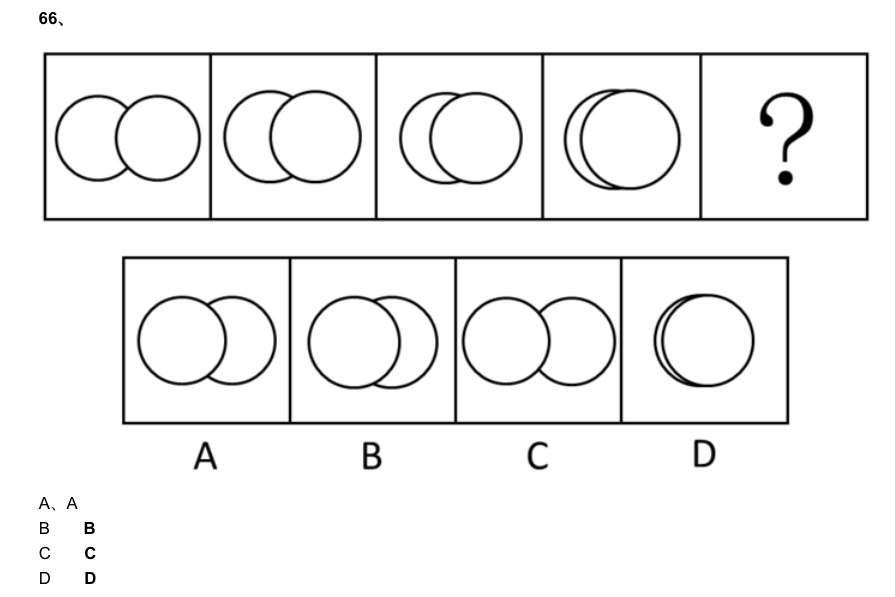

> （本题为图形题，选项为图片，见原卷）

**答案：暂缺**　**考点：图形推理｜图形推理（综合）**　**难度：★★☆☆☆**
**【判断推理·图形推理｜GD-2013-1-X067】**

67. A、A B B C C D D

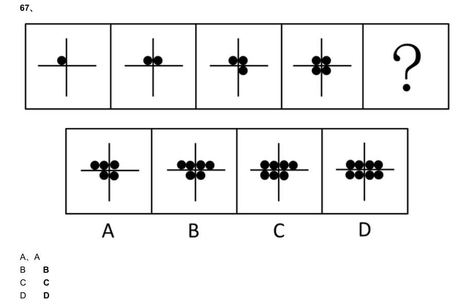

> （本题为图形题，选项为图片，见原卷）

**答案：暂缺**　**考点：图形推理｜图形推理（综合）**　**难度：★★☆☆☆**
**【判断推理·图形推理｜GD-2013-1-X068】**

68. A、A B B C C D D

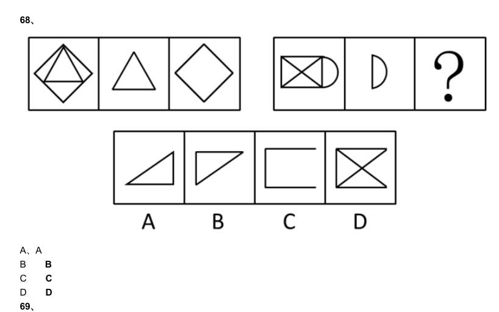

> （本题为图形题，选项为图片，见原卷）

**答案：暂缺**　**考点：图形推理｜图形推理（综合）**　**难度：★★☆☆☆**
**【判断推理·图形推理｜GD-2013-1-X069】**

69. A、A B B C C D D

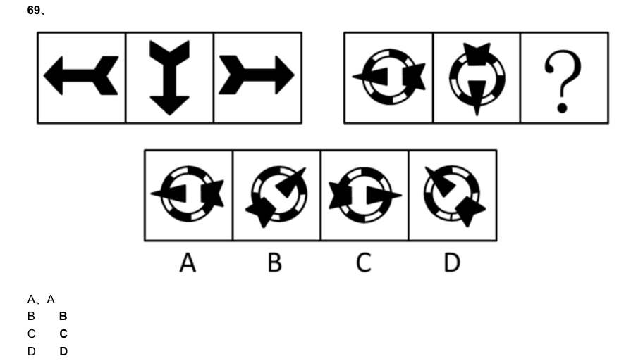

> （本题为图形题，选项为图片，见原卷）

**答案：暂缺**　**考点：图形推理｜图形推理（综合）**　**难度：★★☆☆☆**
**【判断推理·图形推理｜GD-2013-1-X070】**

70. A、A B B C C D D

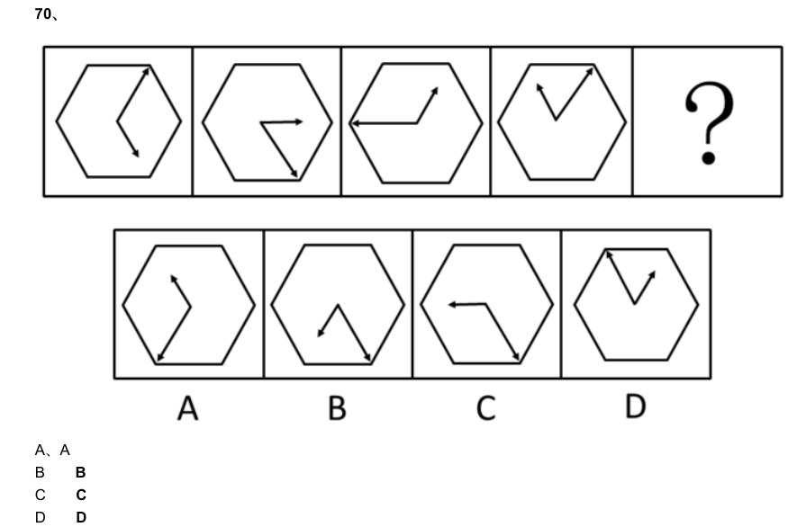

> （本题为图形题，选项为图片，见原卷）

**答案：暂缺**　**考点：图形推理｜图形推理（综合）**　**难度：★★☆☆☆**
**【判断推理·图形推理｜GD-2013-1-X071】**

71. 请从所给的四个选项中,选择最合适的一项填在问号处,使之呈现一定的规律性。 A、A B B C C D D

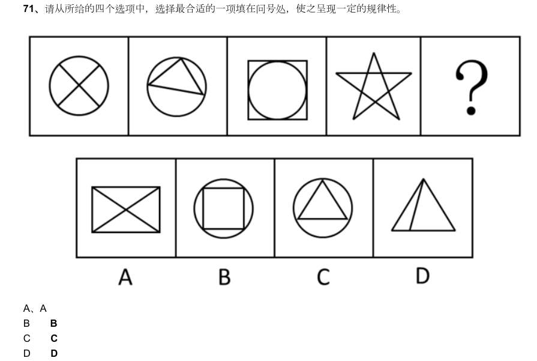

> （本题为图形题，选项为图片，见原卷）

**答案：暂缺**　**考点：图形推理｜图形推理（综合）**　**难度：★★☆☆☆**
**【判断推理·图形推理｜GD-2013-1-X072】**

72. A、A B B C C D D

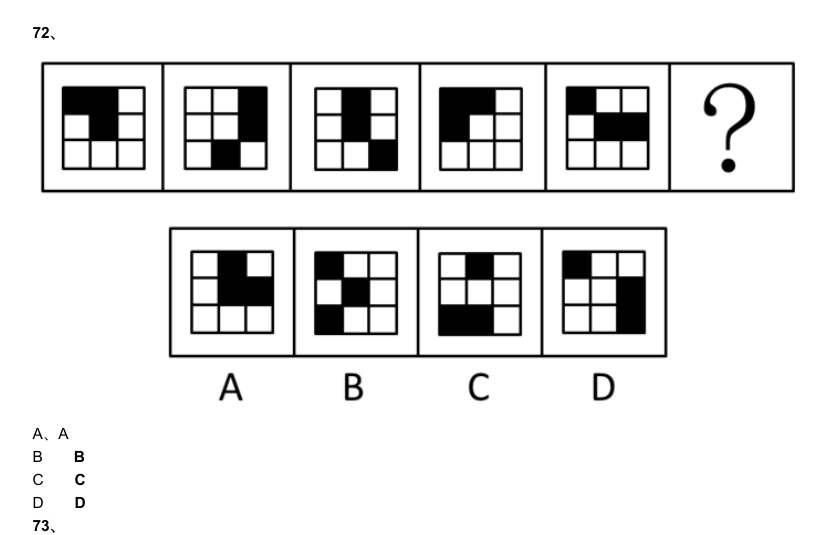

> （本题为图形题，选项为图片，见原卷）

**答案：暂缺**　**考点：图形推理｜图形推理（综合）**　**难度：★★☆☆☆**
**【判断推理·图形推理｜GD-2013-1-X073】**

73. A、A B B C C D D

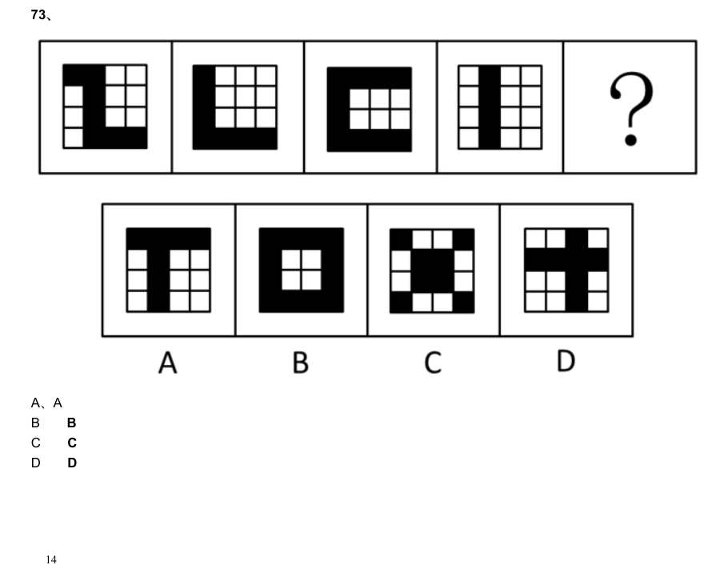

> （本题为图形题，选项为图片，见原卷）

**答案：暂缺**　**考点：图形推理｜图形推理（综合）**　**难度：★★☆☆☆**
**【判断推理·图形推理｜GD-2013-1-X074】**

74. A、A B B C C D D

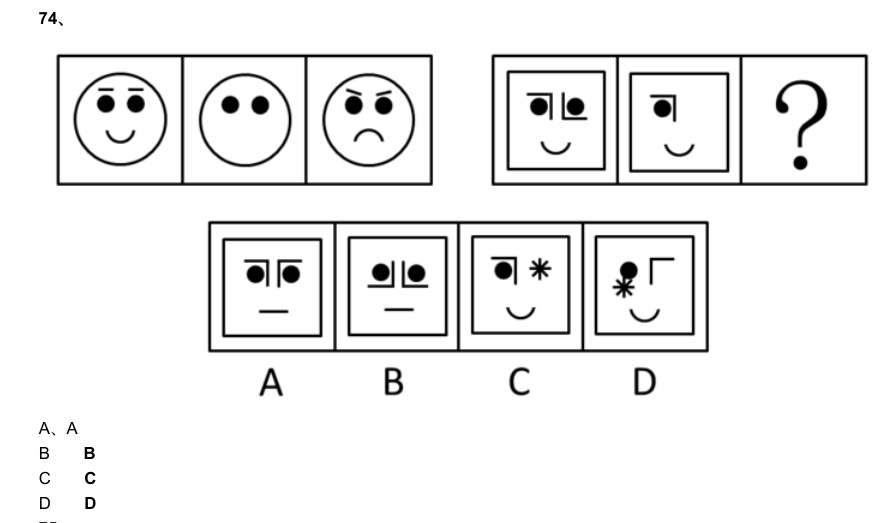

> （本题为图形题，选项为图片，见原卷）

**答案：暂缺**　**考点：图形推理｜图形推理（综合）**　**难度：★★☆☆☆**
**【判断推理·图形推理｜GD-2013-1-X075】**

75. A、A B B C C D D

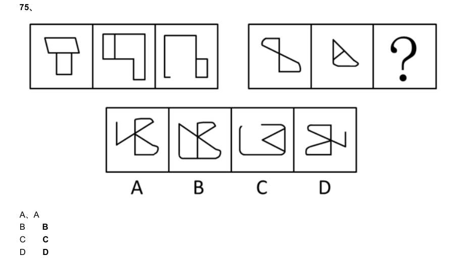

> （本题为图形题，选项为图片，见原卷）

**答案：暂缺**　**考点：图形推理｜图形推理（综合）**　**难度：★★☆☆☆**
**【判断推理·逻辑判断｜GD-2013-1-X076】**

76. 小周、小吴、小郑三人中,一人是工人,一人是农民,一人是知识分子。已知:小郑的年龄比知识分子大; 小周的年龄和农民不同;农民的年龄比小吴小。 根据以上情况,判断正确的是:

- **A.** 小周是工人、小吴是知识分子、小郑是农民
- **B.** 小周是知识分子、小吴是农民、小郑是工人
- **C.** 小周是工人、小吴是农民、小郑是知识分子
- **D.** 小周是知识分子、小吴是工人、小郑是农民

**答案：暂缺**　**考点：逻辑判断｜逻辑判断（综合）**　**难度：★★★☆☆**
**【判断推理·逻辑判断｜GD-2013-1-X077】**

77. 所有关心员工个人发展的企业老板,都被证明是管理得法的企业老板;而切实关心员工个人发展的企业老 板,都首先把注意力放在员工的职业生涯发展上。因此,那些不首先把注意力放在关心员工职业生涯发展上的 企业老板,都不是管理得法的企业老板。 为使上述论证成立,必须为真的一项是:

- **A.** 员工的职业生涯发展,是员工个人发展中最突出的问题
- **B.** 所有管理得法的企业老板,都是关心员工个人发展的企业老板
- **C.** 近年来,员工普遍比较关心自己的个人发展
- **D.** 员工个人发展同企业发展密切相关

**答案：暂缺**　**考点：逻辑判断｜解释评价**　**难度：★★★★☆**
**【判断推理·逻辑判断｜GD-2013-1-X078】**

78. 某村有老赵、老钱、老孙、老李四个养鸡专业户,已知老赵、老钱两户养鸡的总数量与老孙、老李两户养 鸡的总数量相等,老赵、老李两户养鸡的总数量比老钱、老孙两户养鸡的总数量多,而老钱养鸡的数量比老赵、 老孙两户养鸡的总数量还要多。 由此可知,四个养鸡专业户养鸡数量由多到少的顺序是:

- **A.** 老赵、老钱、老孙、老李
- **B.** 老孙、老钱、老赵、老李
- **C.** 老李、老钱、老赵、老孙
- **D.** 老钱、老李、老赵、老孙

**答案：暂缺**　**考点：逻辑判断｜朴素逻辑（排序/匹配）**　**难度：★★★★☆**
**【判断推理·逻辑判断｜GD-2013-1-X079】**

79. 某村村民反映,作为村主要农作物的甘蓝出现了根肿病,产量严重下降,村民收入锐减。对此,村里引进 了多个蔬菜品种,并组织村民进行了蔬菜种植技术培训,可以预见,村民的收入将因此而有较大提高。 要上述推断成立,必备的前提条件不包括:

- **A.** 村民经培训后开始种植其他品种的蔬菜
- **B.** 村民掌握了种植其他品种蔬菜的技术
- **C.** 村官有销售其他蔬菜品种的渠道
- **D.** 其他蔬菜品种的产量比甘蓝要高

**答案：暂缺**　**考点：逻辑判断｜前提假设**　**难度：★★★★☆**
**【判断推理·逻辑判断｜GD-2013-1-X080】**

80. 某地一企业今年招聘时,平均每个职位的应聘人数比去年减少了30%。因此,该公司对求职者的吸引力有 所下降。 以下最能削弱上述推论的一项是:

- **A.** 今年全国应届毕业生人数比去年有所增加
- **B.** 今年到该地求职的总人数有所减少
- **C.** 该企业今年招聘的部分职位应聘人数多于去年
- **D.** 该企业今年招聘的职位有八成提高了用人标准

**答案：暂缺**　**考点：逻辑判断｜削弱**　**难度：★★★☆☆**
**【判断推理·逻辑判断｜GD-2013-1-X081】**

81. 过年放鞭炮,上元吃汤圆,端午赛龙舟,随着社会的发展,许多传统文化中的节日习俗离我们渐行渐远。 90 年代出生的人开始相信圣诞老人,开始在西餐厅里过生日。文化发展是个“取其精华,去其糟粕”的过程,因 此,有人认为,西方文化优于中国传统文化。 以下各项最有助于反驳上述观点的是:

- **A.** 我国传统文化中的许多内容在西方国家受到热捧
- **B.** 现代社会的一些不文明行为源于西方社会
- **C.** 国家的经济优势有利于本国文化的对外传播
- **D.** 能够不断吸收和借鉴正是我国文化的优势

**答案：暂缺**　**考点：逻辑判断｜削弱**　**难度：★★★★☆**
**【判断推理·逻辑判断｜GD-2013-1-X082】**

82. 据国家权威科研机构研究证实,当前市场上热销的某品牌保健食品并不含有提高人类身体机能、增强个体 免疫力的成分。但调查结果表明,不少身体虚弱的人在购买服用了该品牌的保健食品一段时间后,身体素质明 显提高。 以下最有助于解释上述矛盾的一项是:

- **A.** 保健食品作用的发挥具有一定的时间滞后性
- **B.** 许多身体健康的人在服用保健食品后体质也增强了
- **C.** 购买该品牌保健品的人大多经济条件较好
- **D.** 服用保健品的人在生活其他方面也开始注重健康

**答案：暂缺**　**考点：逻辑判断｜解释评价**　**难度：★★★★☆**
**【判断推理·逻辑判断｜GD-2013-1-X083】**

83. 某公司研发了一种空调管理系统,通过对人流量的检测系统自动启动。关闭空调,这个系统的应用,将使 得办公场所的空调用电量大大节省。但这个系统推出几年来,购买的单位并不多,销售不理想。 以下最能够合理解释上述现象的是:

- **A.** 该空调管理系统受到许多城市家庭用户的欢迎
- **B.** 该空调管理系统操作复杂,需配备专业人员才能运作
- **C.** 市场上节能空调占主流,空调能耗较以往已大大降低
- **D.** 许多单位的职工环保意识强,养成了出门关空调的习惯

**答案：暂缺**　**考点：逻辑判断｜解释评价**　**难度：★★★★☆**
**【判断推理·逻辑判断｜GD-2013-1-X084】**

84. 相比于化工“污染地”、重金属“污染地”,化肥、农药、农膜带来的农地污染并没有那么触目惊心,但却具有 量大、面广、隐蔽性强、持续时间长等特点。一些受污染严重的土地,已经不能进行正常的农业生产。农地的 “批量污染”治理已经到了刻不容缓的地步。以农膜为例,由于塑料残余物在自然条件下可在土壤中残存数十年甚 至上百年而不降解,这些废膜的存在会影响土壤的通透性,阻碍土壤水分的补给和养分转移。 根据以上表述,可以得出的结论是: 1化工和重金属的污染往往量不大、面不广、易发现、持续时间不长 2农膜残留通过阻碍土壤的水分补给和养分转移对农地产生影响 3农膜残留是当前农地“批量污染”中最为突出和严重的 4农地污染不能因其隐蔽性强等特点而在治理土地污染中被人们忽视 5化工和金属对土地的污染比农地污染更为严重

- **A.** 12
- **B.** 134
- **C.** 24
- **D.** 235

**答案：暂缺**　**考点：逻辑判断｜归纳推导**　**难度：★★★★★**
**【判断推理·逻辑判断｜GD-2013-1-X085】**

85. “没有经济的快速发展,就不会有社会事业的进步。现在经济发展速度很快,所以社会事业的建设也会取得 显著的成绩。” 与上述文字推理形式相同的是:

- **A.** 社会主义民主和法制相辅相成,缺一不可,民主是法制的前提,法制是民主的体现。现在法制体系不断健全,因此民主得以保障
- **B.** 效益与公平是矛盾统一体,没有公平很难取得更大的效益。某企业的效益提高了,因此,该企业也实现了分配公平
- **C.** 社会化程度越高,社会分工越细。现在社会化程度提高了,因此现在的社会分工也更细了
- **D.** 清正廉洁是对领导干部的基本要求。一名作风正派、严于律己的领导干部就是合格的领导干部

**答案：暂缺**　**考点：逻辑判断｜逻辑判断（综合）**　**难度：★★★★☆**
**【资料分析·增长率计算与比较｜GD-2013-1-X086】**
> 材料：请你根据资料所提供的信息进行分析、比较、计算和判断处理。 (一) 2012 年,某地区农作物播种总面积达到1625.55 万亩,同比增长4.6%。其中,粮食和蔬菜播种面积大幅增长, 分别为459.40 万亩、109.06 万亩,同比增长32.7%和30.5%;棉花、油料和甜菜播种面积下降,分别为 698.52 万亩、103.42 万亩、30.45 万亩,同比下降17.3%、5.7%和18.2%。粮食作物中,小麦295.61 万亩, 同比增长67.7%;玉米93.77 万亩,同比增长3.1%;大豆21.51 万亩,同比增长76.6%;水稻32.66 万亩,同 比下降7.7%。

86. 蔬菜播种面积中,番茄65.48 万亩,同比增长60.7%;辣椒21.27 万亩,同比下降0.7%。 (注:与上一年同一时期相比称为“同比”。) 2012 年,下列农作物播种面积同比增幅最大的一种是:

- **A.** 棉花
- **B.** 小麦
- **C.** 玉米
- **D.** 番茄

**答案：暂缺**　**考点：增长率计算与比较｜增长率比较**　**难度：★★★☆☆**
**【资料分析·综合分析｜GD-2013-1-X087】**

87. 根据上述资料,2011 年油料播种面积约为多少万亩:

- **A.** 90
- **B.** 100
- **C.** 110
- **D.** 120

**答案：暂缺**　**考点：综合分析｜综合分析（综合）**　**难度：★★★☆☆**
**【资料分析·综合分析｜GD-2013-1-X088】**

88. 2012 年粮食和蔬菜播种总面积:

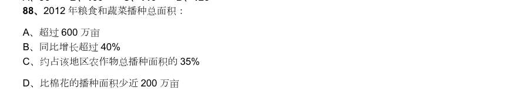

- **A.** 超过600 万亩
- **B.** 同比增长超过40%
- **C.** 约占该地区农作物总播种面积的35%
- **D.** 比棉花的播种面积少近200 万亩

**答案：暂缺**　**考点：综合分析｜综合分析（综合）**　**难度：★★★☆☆**
**【资料分析·综合分析｜GD-2013-1-X089】**

89. 2012 年水稻播种面积比2011 年大约少多少万亩:

- **A.** 2.21
- **B.** 2.33
- **C.** 2.72
- **D.** 2.88

**答案：暂缺**　**考点：综合分析｜综合分析（综合）**　**难度：★★★☆☆**
**【资料分析·综合分析｜GD-2013-1-X090】**

90. 根据上述资料,以下说法正确的一项是:

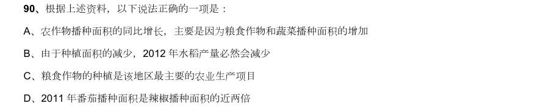

- **A.** 农作物播种面积的同比增长,主要是因为粮食作物和蔬菜播种面积的增加
- **B.** 由于种植面积的减少,2012 年水稻产量必然会减少
- **C.** 粮食作物的种植是该地区最主要的农业生产项目
- **D.** 2011 年番茄播种面积是辣椒播种面积的近两倍

**答案：暂缺**　**考点：综合分析｜选正确项**　**难度：★★★★★**
**【资料分析·综合分析｜GD-2013-1-X091】**

91. 2012 年某市居民人均日常时间利用情况如下表所示,根据图表回答下列问题: 该市居民各项活动占用时间最多的是:

- **A.** 工作时间
- **B.** 个人生活必需时间
- **C.** 家务劳动时间
- **D.** 可以自由支配的时间

**答案：暂缺**　**考点：综合分析｜排序与图示判断**　**难度：★★★☆☆**
**【资料分析·综合分析｜GD-2013-1-X092】**

92. 在下列时间的分配上,城镇居民和农村居民差异最大的一项是:

- **A.** 工作活动
- **B.** 家庭经营活动
- **C.** 交通活动
- **D.** 个人生活必需时间

**答案：暂缺**　**考点：综合分析｜综合分析（综合）**　**难度：★★★☆☆**
**【资料分析·综合分析｜GD-2013-1-X093】**

93. 在个人生活必需时间的分配上,城镇居民比农村居民耗用时间多的活动项目共多少项:

- **A.** 1
- **B.** 2
- **C.** 3
- **D.** 4

**答案：暂缺**　**考点：综合分析｜综合分析（综合）**　**难度：★★★☆☆**
**【资料分析·综合分析｜GD-2013-1-X094】**

94. 根据上表,可以推断该市城镇居民与农村居民的人数比是:

- **A.** 2:1
- **B.** 3:2
- **C.** 4:3
- **D.** 无法推断

**答案：暂缺**　**考点：综合分析｜综合分析（综合）**　**难度：★★★☆☆**
**【资料分析·综合分析｜GD-2013-1-X095】**

95. 根据上表,以下说法正确的一项是:

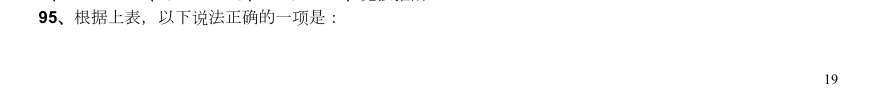

- **A.** 人们平均每天约40%的时间用于工作
- **B.** 农村居民人均每天比城镇居民节约交通时间21 分钟
- **C.** 农村居民家庭经营活动平均耗时约占工作时间的1/5
- **D.** 农村居民人均每天比城镇居民睡眠多一个小时

**答案：暂缺**　**考点：综合分析｜选正确项**　**难度：★★★☆☆**
**【资料分析·综合分析｜GD-2013-1-X096】**

96. .根据上图,2008 年至2012 年间,下列说法正确的是:

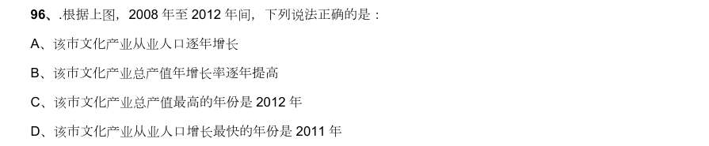

- **A.** 该市文化产业从业人口逐年增长
- **B.** 该市文化产业总产值年增长率逐年提高
- **C.** 该市文化产业总产值最高的年份是2012 年
- **D.** 该市文化产业从业人口增长最快的年份是2011 年

**答案：暂缺**　**考点：综合分析｜选正确项**　**难度：★★★☆☆**
**【资料分析·综合分析｜GD-2013-1-X097】**

97. 2012 年该市文化产业总产值比2008 年大约提高了多少个百分点:

- **A.** 7
- **B.** 6
- **C.** 5
- **D.** 4

**答案：暂缺**　**考点：综合分析｜综合分析（综合）**　**难度：★★★☆☆**
**【资料分析·综合分析｜GD-2013-1-X098】**

98. 2008 年至2012 年间,该市文化产业总产值增长最快的年份是:

- **A.** 2008 年
- **B.** 2009 年
- **C.** 2011 年
- **D.** 2012 年

**答案：暂缺**　**考点：综合分析｜综合分析（综合）**　**难度：★★★☆☆**
**【资料分析·平均数计算｜GD-2013-1-X099】**

99. 2012 年该市文化产业从业人员人均生产总值比上一年约减少了:

- **A.** 3.5%
- **B.** 7.5%
- **C.** 1.5 万元
- **D.** 2 万元

**答案：暂缺**　**考点：平均数计算｜现期平均数**　**难度：★☆☆☆☆**
**【资料分析·综合分析｜GD-2013-1-X100】**

100. 根据上图,下列说法正确的是:

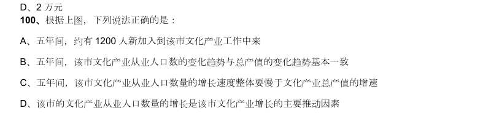

- **A.** 五年间,约有1200 人新加入到该市文化产业工作中来
- **B.** 五年间,该市文化产业从业人口数的变化趋势与总产值的变化趋势基本一致
- **C.** 五年间,该市文化产业从业人口数量的增长速度整体要慢于文化产业总产值的增速
- **D.** 该市的文化产业从业人口数量的增长是该市文化产业增长的主要推动因素

**答案：暂缺**　**考点：综合分析｜选正确项**　**难度：★★★★★**