# 2014 年广东行测（县级）

- 题量：100（含答案 0）
- 模块分布：资料分析15 / 数量关系15 / 言语理解30 / 判断推理30 / 常识判断10
- 试卷编号：`广东-2014-县级`

## 题目与答案

**【常识判断·地理常识｜GD-2014-xj-X001】**

1. 春节,我们有贴春联的民俗。春联具有很强的时代性,新中国成立以来,一个家庭几代人贴过的春联有: (1)联产承包显威力,国富民强示繁荣 (2)新中国百废待兴,共和国前程似锦 (3)已把复兴编入梦,正将崛起织成春 (4)骏马奔腾迎奥运,五洲健儿谱新篇 按照这些春联出现的时间先后顺序排列正确的是:

- **A.** (2)(1)(3)(4)
- **B.** (1)(2)(4)(3)
- **C.** (1)(2)(3)(4)
- **D.** (2)(1)(4)(3)

**答案：暂缺**　**考点：地理常识｜中国地理**　**难度：★★★★★**
**【常识判断·法律常识｜GD-2014-xj-X002】**

2. 如何提高老年人生活质量与幸福满意度已经逐渐成为国家立法所关注的热点话题,以下行为不违反《老年 人权益保障法》的是:

- **A.** 子女与生活不能自理的老年人分开居住
- **B.** 子女阻止老年人再婚
- **C.** 子女长时间不回家探望老人
- **D.** 子女干涉老年人处置个人财产

**答案：暂缺**　**考点：法律常识｜法律常识（综合）**　**难度：★☆☆☆☆**
**【常识判断·政治常识｜GD-2014-xj-X003】**

3. 上个世纪,我国提出了“实现工业、农业、科学技术和国防四个现代化”。当前,我国的“新四化”是指:

- **A.** 工业化、信息化、城镇化、农业现代化
- **B.** 工业化、信息化、城镇化、国际化
- **C.** 工业化、信息化、市场化、农业现代化
- **D.** 工业现代化、农业现代化、交通运输业现代化、国防现代化

**答案：暂缺**　**考点：政治常识｜政治常识（综合）**　**难度：★☆☆☆☆**
**【常识判断·历史人文｜GD-2014-xj-X004】**

4. 在我国古代,人们把一夜分为五更,即一更、二更、三更、四更、五更,按更报时。“三更”相当于现在 的时间为:

- **A.** 17 时—19 时
- **B.** 19 时—21 时
- **C.** 21 时—23 时
- **D.** 23 时—1 时

**答案：暂缺**　**考点：历史人文｜中国古代史**　**难度：★☆☆☆☆**
**【常识判断·政治常识｜GD-2014-xj-X005】**

5. 火车轨道由两道钢轨组成。一般来说,转弯处的火车轨道,内外两侧钢轨的高低关系为:

- **A.** 内侧比外侧高
- **B.** 外侧比内侧高
- **C.** 两侧一样高
- **D.** 有时内侧高,有时外侧高

**答案：暂缺**　**考点：政治常识｜政治常识（综合）**　**难度：★☆☆☆☆**
**【常识判断·政治常识｜GD-2014-xj-X006】**

6. “斗柄东指,天下皆春”的意思是指,北斗七星斗柄指向东方的时候,春天就来了。那么,在冬季,北斗 七星的斗柄指向:

- **A.** 北方
- **B.** 南方
- **C.** 西方
- **D.** 东方

**答案：暂缺**　**考点：政治常识｜政治常识（综合）**　**难度：★☆☆☆☆**
**【常识判断·政治常识｜GD-2014-xj-X007】**

7. 以下路况,一般来说,驾驶员最容易出现视觉疲劳的是:

- **A.** 高速公路
- **B.** 盘山水泥公路
- **C.** 平原砂石公路
- **D.** 城市街道

**答案：暂缺**　**考点：政治常识｜政治常识（综合）**　**难度：★☆☆☆☆**
**【常识判断·政治常识｜GD-2014-xj-X008】**

8. 《清明上河图》是北宋作品,描述了八百多个人物,七十多匹牲畜,二十多辆车、桥,二十九艘大小船只, 以及各具特色的房屋、桥梁、城楼等。这幅画主要表现的是:

- **A.** 祭祀风光
- **B.** 山水景色
- **C.** 田园风光
- **D.** 社会风俗

**答案：暂缺**　**考点：政治常识｜政治常识（综合）**　**难度：★★★☆☆**
**【常识判断·政治常识｜GD-2014-xj-X009】**

9. 当海面上空气各层的密度有较大差异时,远处的光线通过密度不同的空气层发生折射或全反射,海面上会 出现远处物体的影像,这一现象被称为海市蜃楼。海市蜃楼最有可能发生的季节是:

- **A.** 春季
- **B.** 夏季
- **C.** 秋季
- **D.** 冬季

**答案：暂缺**　**考点：政治常识｜政治常识（综合）**　**难度：★★★☆☆**
**【常识判断·政治常识｜GD-2014-xj-X010】**

10. 今年,农历闰九月。下列说法正确的是:

- **A.** 农历九月有31 天
- **B.** 农历全年有390 天
- **C.** 闰九月有28 天
- **D.** 农历全年有13 个月

**答案：暂缺**　**考点：政治常识｜政治常识（综合）**　**难度：★☆☆☆☆**
**【言语理解·逻辑填空｜GD-2014-xj-X011】**

11. 我们要坚持稳中求进的工作总基调,把改革创新________于发展的各个领域、各个环节。 填入划横线处最恰当的一项是:

- **A.** 穿插
- **B.** 落实
- **C.** 贯穿
- **D.** 贯彻

**答案：暂缺**　**考点：逻辑填空｜一空**　**难度：★☆☆☆☆**
**【言语理解·逻辑填空｜GD-2014-xj-X012】**

12. 中国梦是全国各族人民的共同理想,也是青年一代应该牢固树立的远大理想。只有每个人都为美好梦想而 奋斗,才能________起实现中国梦的________力量,才能实现中华民族的伟大复兴。 填入划横线处最恰当的一项是:

- **A.** 积聚 磅礴
- **B.** 汇聚 庞大
- **C.** 积聚 庞大
- **D.** 汇聚 磅礴

**答案：暂缺**　**考点：逻辑填空｜一空**　**难度：★★☆☆☆**
**【言语理解·逻辑填空｜GD-2014-xj-X013】**

13. 广东地处改革开放前沿,面临复杂环境,只有时刻绷紧作风建设这根弦,坚持团结和依靠人民群众,才能 ________团结奋斗的思想基础和群众基础。 填入划横线处最恰当的一项是:

- **A.** 稳定
- **B.** 筑牢
- **C.** 修建
- **D.** 强化

**答案：暂缺**　**考点：逻辑填空｜一空**　**难度：★☆☆☆☆**
**【言语理解·逻辑填空｜GD-2014-xj-X014】**

14. 广东人大首次________用立法手段对行政审批进行管理监督,有望从源头上________地方政府增加行政审 批的冲动,避免落入行政审批“越减越多”的怪圈。 填入划横线处最恰当的一项是:

- **A.** 尝试 遏止
- **B.** 尝试 遏制
- **C.** 试图 遏止
- **D.** 试图 遏制

**答案：暂缺**　**考点：逻辑填空｜一空**　**难度：★☆☆☆☆**
**【言语理解·逻辑填空｜GD-2014-xj-X015】**

15. 我们要坚决依法严厉打击各种暴力恐怖犯罪活动,坚决维护法律的________和________,坚决保障人民群 众生命财产安全。 填入划横线处最恰当的一项是:

- **A.** 尊严 权威
- **B.** 庄严 威望
- **C.** 尊严 威望
- **D.** 庄严 权威

**答案：暂缺**　**考点：逻辑填空｜一空**　**难度：★☆☆☆☆**
**【言语理解·逻辑填空｜GD-2014-xj-X016】**

16. 必须更加注重改革的系统性、整体性、协同性,让一切劳动、知识、技术、管理、资本的活力竞相 ________,让一切创造社会财富的源泉充分________,让发展成果更多更公平惠及全体人民。 填入划横线处最恰当的一项是:

- **A.** 迸发 涌动
- **B.** 散发 涌流
- **C.** 迸发 涌流
- **D.** 散发 涌动

**答案：暂缺**　**考点：逻辑填空｜一空**　**难度：★★☆☆☆**
**【言语理解·逻辑填空｜GD-2014-xj-X017】**

17. 以节俭清正________奢靡之风,________勤俭节约传统美德和“八项规定”,保持质朴和勤俭的本色,刹 住公款吃喝,规范接待标准,精简活动规模,杜绝浪费陋习,狠刹挥霍享乐和骄奢淫逸的不良风气。 填入划横线处最恰当的一项是:

- **A.** 克制 恪守
- **B.** 克服 遵守
- **C.** 克制 遵守
- **D.** 克服 恪守

**答案：暂缺**　**考点：逻辑填空｜一空**　**难度：★★☆☆☆**
**【言语理解·逻辑填空｜GD-2014-xj-X018】**

18. 当代大学生应当志存高远、脚踏实地,转变择业观念,坚持从实际出发,________到基层一线和艰苦地方 去,把人生的路一步步走稳走实,________在平凡的岗位上创造不平凡的业绩。 填入划横线处最恰当的一项是:

- **A.** 乐于 善于
- **B.** 勇于 善于
- **C.** 乐于 易于
- **D.** 勇于 易于

**答案：暂缺**　**考点：逻辑填空｜一空**　**难度：★★☆☆☆**
**【言语理解·逻辑填空｜GD-2014-xj-X019】**

19. 政府的行为对社会行为有着重要的________和示范作用,所以,政务诚信建设必须________,并且要抓实 抓好。 填入划横线处最恰当的一项是:

- **A.** 引领 快马加鞭
- **B.** 指导 快马加鞭
- **C.** 指导 一马当先
- **D.** 引领 一马当先

**答案：暂缺**　**考点：逻辑填空｜一空**　**难度：★☆☆☆☆**
**【言语理解·逻辑填空｜GD-2014-xj-X020】**

20. “四风”问题的形成是一个长期的过程,具有反复性和顽固性,其背后是________的陈旧观念、________ 的“潜规则”、________的利益纠结。 填入划横线处最恰当的一项是:

- **A.** 根深蒂固 习以为常 错综复杂
- **B.** 盘根错节 习以为常 扑朔迷离
- **C.** 盘根错节 司空见惯 扑朔迷离
- **D.** 根深蒂固 司空见惯 错综复杂

**答案：暂缺**　**考点：逻辑填空｜一空**　**难度：★☆☆☆☆**
**【言语理解·中心理解｜GD-2014-xj-X021】**

21. “不谋全局者不足谋一域,不谋万世者不足谋一时。”大局是相对局部而言的,是全局中最重要的部分。 唯物辩证法认为,整体处于统帅的决定地位,部分服从和服务于整体。部分是整体中的部分,部分离不开整体, 离开了整体,部分也就不成其为部分。因此,大局的走向决定局部的命运。正因为大局在事物发展中起着主导 的决定作用,找准全局性、大局性的问题,也就抓住了工作的重点和中心;掌握了大局,也就掌握了工作成败 的关键。 与这段文字意思相符的一项是:

> （本题为图形题，选项为图片，见原卷）

**答案：暂缺**　**考点：中心理解｜转折与因果**　**难度：★★★★☆**
**【言语理解·中心理解｜GD-2014-xj-X022】**

22. 大数据给人类呈现的是一幅既美好又可怕的未来图景:美好之处在于,它将给我们带来更大的视野和更新 的发现,进而改变我们的工作和生活方式;可怕之处在于,它给我们带来更多的风险和更大的挑战,除了数据 本身的安全之外,它更多地关乎人们的隐私。与此同时,在研究和制定大数据发展的政策中,需要打破思想上 的束缚,做到与时俱进,与网俱进;需要有一个强有力的集中统一指挥与协调机制;需要处理好发展与安全的 辩证关系;需要主动平衡全球治理的责任权利。 这段文字旨在说明:

- **A.** 大数据的政策选择要考虑发展与安全
- **B.** 安全问题将成为大数据应用的瓶颈
- **C.** 大数据应用对人们生活的影响利大于弊
- **D.** 大数据的安全风险应该引起足够的重视

**答案：暂缺**　**考点：中心理解｜对策优先**　**难度：★★★★☆**
**【言语理解·逻辑填空｜GD-2014-xj-X023】**

23. 政府职能转变,关键在于处理好与市场和社会的关系,确保政府在与市场、社会的关系上不“越位”,在 保障民生等基本公共服务、监管违法行为等方面不“缺位”。这就需要政府厘清与市场和社会之间的边界,明 确政府该做什么,不该做什么。一方面,进一步简政放权,使市场在资源配置中起决定性作用;另一方面,政 府可通过购买服务的方式,激发社会活力,增加民生福祉。 通过上述文字可以得知:

- **A.** 区分市场与社会的差异就能明确政府职能
- **B.** 简政放权有助于政府更好地监管违法行为
- **C.** 保障民生就是处理好市场和社会的关系
- **D.** 购买服务是政府职能转变的重要方式

**答案：暂缺**　**考点：逻辑填空｜逻辑填空（综合）**　**难度：★★★★☆**
**【言语理解·中心理解｜GD-2014-xj-X024】**

24. 航天技术脱胎于二战时发展起来的弹道导弹技术,靠人力计算弹道十分困难,由此促成世界上第一台计算 机的诞生,使人类进入信息时代;美国为了扩大空间优势,适应空间飞行的需要,促使集成电路的诞生和发展; 如今,超市中货物编码随处可见,这项技术脱胎于阿波罗登月时用条形码对航天器进行管理.......据统计,我 国近年来开发使用的1100 多种新材料,80%是在航天技术的牵引下完成的。目前已有近2000 项空间技术成果 运用于通信、纺织、石油、交通运输、医疗等行业。 作者通过这段文字主要想传递的信息是:

- **A.** 航天技术发展的历程
- **B.** 航天技术发展的未来走向
- **C.** 航天技术发展带来的间接影响
- **D.** 航天技术发展所面临的突破

**答案：暂缺**　**考点：中心理解｜对策优先**　**难度：★★★★☆**
**【言语理解·中心理解｜GD-2014-xj-X025】**

25. 城市不仅是一个国家或者地区的政治、经济、文化、科技和教育中心,而且已经成为经济增长的强大引擎。 美国的纽约、芝加哥和洛杉矶三个城市群,日本的东京、阪神和名古屋三大城市群,以及中国的长三角、珠三 角和环渤海三大城市群等等对本国经济的贡献率都在一半以上。 承接上述文字最恰当的一句是:

- **A.** 可以说,一个国家的经济发展主要依赖于城市群的经济发展
- **B.** 可以说,任何国家或者地区都应该重点关注大城市的发展
- **C.** 可以说,城市的兴衰关乎国家的兴衰,城市的发展关乎国家的发展
- **D.** 可以说,城市的发展离不开国家的支持,国家的发展离不开城市的支撑

**答案：暂缺**　**考点：中心理解｜中心句与主旨**　**难度：★★★★☆**
**【言语理解·中心理解｜GD-2014-xj-X026】**

26. 当今,自然科学和社会科学之间的界限和分离局面已经被打破。多学科相互交叉、相互渗透,这是高度分 化、高度综合的科学、技术、经济、社会一体化的结果。因此,知识结构的合理和多元化是科学、技术发展对 科技从业人员新的和更高的要求。 作者通过这段文字主要想表达的是:

- **A.** 自然科学和社会科学之间已经出现了深度的融合
- **B.** 科技从业人员将面临自然科学和社会科学一体化所带来的严峻挑战
- **C.** 科技从业人员需要具备多方面知识的综合运用能力
- **D.** 科技从业人员不仅要有扎实的专业知识,还要有广博的知识面

**答案：暂缺**　**考点：中心理解｜转折与因果**　**难度：★★★★☆**
**【言语理解·中心理解｜GD-2014-xj-X027】**

27. 金鱼实际上是一类人工驯养的鲫鱼。大约2000 年以前,中国的古人就开始养殖银鲫,作为食物和观赏鱼。 随着时间的推移,基因突变和人工选择使银鲫身上出现了橙、红、黄等颜色,改变了其沉闷乏味的形象,也造 就了我们今天看到的多姿多彩的金鱼。17 世纪的时候,金鱼传到欧洲,并于19 世纪50 年代传到美国。 这段话主要介绍了:

- **A.** 金鱼的演进
- **B.** 金鱼的特点
- **C.** 金鱼的用途
- **D.** 金鱼的养殖

**答案：暂缺**　**考点：中心理解｜中心句与主旨**　**难度：★★★☆☆**
**【言语理解·中心理解｜GD-2014-xj-X028】**

28. 一项调查研究结果显示:如果一个家庭非常整洁、一尘不染,这个家庭的幸福指数一定比较低。理由是, 这个家里一定有一个非常挑剔的人。你只要把东西放歪一点,她心里就不舒服了。有孩子的家庭,玩具不轻易 拿出来玩,总是整整齐齐地放在那里,待在这个家庭里面很受罪,更别说幸福指数了。 这段文字的主要观点是:

- **A.** 非常整洁、一尘不染的家庭幸福指数低
- **B.** 在整洁的家庭中,孩子一般不轻易玩玩具
- **C.** 家庭中有成员比较挑剔,这个家庭会非常整洁
- **D.** 家庭幸福指数高低取决于家庭是否有挑剔的成员

**答案：暂缺**　**考点：中心理解｜中心句与主旨**　**难度：★★★☆☆**
**【言语理解·中心理解｜GD-2014-xj-X029】**

29. 上世纪80 年代有一句口号叫“从我做起,从现在做起”,现在提倡“少说空话,多干实事”。具体在解 决交通堵塞这个问题上,如果大家都能够“从我做起,从现在做起”,少发一点牢骚,在行车时多观察一下周 围在采取适当的行动,交通堵塞的现象肯定会大大缓和,也就是驾驶员如果能自觉一点,不需要现在那么多的 交警也能够有很好的交通秩序。 这段文字的主要观点是:

- **A.** 营造良好的交通秩序需要大家的自觉性
- **B.** “只说空话,不干实事”会加剧交通堵塞
- **C.** 解决交通堵塞的根本在于提高人们的素质
- **D.** 增加交警的数量无助于缓解交通堵塞

**答案：暂缺**　**考点：中心理解｜对策优先**　**难度：★★★☆☆**
**【言语理解·中心理解｜GD-2014-xj-X030】**

30. 动物和人的差异很多,按照演化生物学家道金斯等人的观点,最大的差异可能在于动物缺乏“文化”。野 生动物个体在环境中的绝大部分行为,都可以追溯到它的基因;个体间的文化传承即便存在,影响通常也微乎 其微。如果两群狼面对同一场景做出了不同的反应,那是因为它们的遗传特征不同,而不是因为它们各自经历 了不同的狼群历史、有不同的狼群文化。就算有动物因为和人相处而从人类这里习得了复杂的行为,但当它回 归野外时,也几乎不可能把自己学会的人类技巧教给其他动物,不能改变其种族的原有行为。 根据这段文字,对“文化”理解最准确的一项是:

- **A.** 种族成员共有的行为习惯
- **B.** 改造自我及其种族的能力
- **C.** 可以模仿和传承的行为模式
- **D.** 与遗传基因无关的行为模式

**答案：暂缺**　**考点：中心理解｜中心句与主旨**　**难度：★★★★☆**
**【言语理解·中心理解｜GD-2014-xj-X031】**

31. 这个时代有两个看似彼此矛盾的趋向:一方面,随着人们受教育水平的提高及获得信息渠道的多元化,人 们能对各种传言作出更清醒的理性判断;但另一方面,信息的爆炸性增长和技术进步也使谣言传播的速度大大 加快,人们往往来不及一一分辨各种信息的真假。虽然人们总是假定,只要不断提升人类的理性水平,并使信 息透明化,就能消弭谣言产生的土壤,但迄今为止这一直只是个理想。没有哪个社会的人所传播的信息是完全 正确的,在很多情况下,人们为了尽快获知自己所关心的真相,常常都在不知不觉中传播着谣言。 根据这段文字,下列说法正确的是:

- **A.** 人类的理性水平达到一定的程度就能阻止谣言的产生
- **B.** 谣言的传播往往反映了人们迫切想了解真相的需要
- **C.** 人们的理性判断与信息技术的进步是彼此矛盾的趋向
- **D.** 信息的增长和技术进步是谣言产生的主要根源

**答案：暂缺**　**考点：中心理解｜中心理解（综合）**　**难度：★★★★☆**
**【言语理解·中心理解｜GD-2014-xj-X032】**

32. 科学家通过一系列的实验认为,金钱能激起人们的排他心理,这很可能是人的本能反应,就像爱情具有排 他性一样。当相互合作存在金钱利益关系的时候,人们就会本能地保护自己的利益,于是会以反感的态度回应 对方,并产生一定程度的厌恶心理。由此便有了金钱毁灭爱情、污染亲情和斩断友情的种种现象,显示出人情 味真的难敌铜臭味。不过,实验还证实,人们在金钱面前产生排他心里的同时,独立性和创造性也明显增强了。 而且金钱作为人类文明的一个重要产物还要一直存在下去,回避它显然是不现实的。 通过这段文字,可以判断作者的观点是:

- **A.** 金钱是把双刃剑
- **B.** 应该正视金钱的作用
- **C.** 金钱会影响人际关系
- **D.** 要处理好金钱与情感的关系

**答案：暂缺**　**考点：中心理解｜中心句与主旨**　**难度：★★★★☆**
**【言语理解·中心理解｜GD-2014-xj-X033】**

33. 很多孩子只能听赞美之词,听不得半点反对意见;有的孩子外表高傲,内心脆弱,敏感多疑。他们遇到一 些不顺心的事情,就会有极端的举动,这就是所谓的“蛋壳心理”。过分骄纵、百般溺爱是导致这种心理的最 直接原因。建议父母在孩子顺心的成长道路上制造一点挫折,让孩子会在逆境中保持自信,学会在挫折面前保 持乐观,培养孩子的韧性和抗挫折能力。另外,父母要学会对孩子说“不”,要让孩子知道并不是所有的要求 都能够得到满足,使他们学会接受拒绝。 最能概括这段文字的一项是:

> （本题为图形题，选项为图片，见原卷）

**答案：暂缺**　**考点：中心理解｜对策优先**　**难度：★★★★☆**
**【言语理解·中心理解｜GD-2014-xj-X034】**

34. 天边曾经很遥远,现在忽然近了,正所谓咫尺天涯。天边发生的事情,诸如哪里又罢工了,哪里又骚乱了, 哪里又政变了,只要上个网,转眼之间,我们就能了如指掌。人们义愤填膺,群情激奋,忧心如焚,比自己吃 了苍蝇还窝心,恨不得插上翅膀,去帮忙开飞机、驾驶轮船。而身边发生的事情,诸如哪天是母亲的生日,亲 戚家的孩子叫什么名字,妻子的发型是么时候换了,我们一概浑然不知。甚至身边的老人在路边倒地不起,从 他身边走过的人匆匆瞥一眼,就加快脚步赶紧逃离,没有一个人愿意或敢于将跌到的老人搀扶起来。 通过这段文字,可以看出作者的意图是:

- **A.** 说明人们通过网络开拓了视野
- **B.** 批评人们过多关注“天边”的事
- **C.** 倡导人们要胸怀天下、志向远大
- **D.** 提醒人们要多关心身边的人和事

**答案：暂缺**　**考点：中心理解｜中心理解（综合）**　**难度：★★★★☆**
**【言语理解·中心理解｜GD-2014-xj-X035】**

35. 高薪贫困症是都市白领群体的焦虑症之一。从社会学角度来说,它可以理解为白领薪水高,但因为各种过 高的债务和生活成本,常有收入不抵支出的“相对贫困”及由此带来的紧张焦虑感。从个人职业生涯发展的角 度来说,可以理解为部分职场人拥有较高的收入,但职业价值感不足,职业规划不清晰,内心诉求未得到满足, 因而产生了职业心理焦虑。 根据这段文字,下列表述正确的是:

- **A.** 大多数都市白领群体都患有高薪贫困症
- **B.** 高薪贫困症源于多种因素所带来的心理焦虑
- **C.** 白领的职业价值感不足导致产生高薪贫困症
- **D.** 入不敷出和职业规划不清晰必然产生高薪贫困症

**答案：暂缺**　**考点：中心理解｜中心理解（综合）**　**难度：★★★☆☆**
**【言语理解·中心理解｜GD-2014-xj-X036】**

36. 工业革命开始以后,化石燃料(煤炭、石油、天然气)的燃烧量越来越大,使大气中二氧化碳的浓度不断 增加。同时,雷击、虫害、砍伐造成的森林火灾、草地衰退和森林破坏也使能够吸收二氧化碳的绿色植物遭到 破坏。所以,要控制全球变暖,必须改变能源结构,大力植树造林。有科学家指出,只有以核燃料代替化石燃 料,才能从根本上防止温室效应的加剧。 这段文字意在:

- **A.** 探讨全球气候变暖现象出现的主要原因
- **B.** 强调核能在防止温室效应加剧中的关键作用
- **C.** 阐明大气层中二氧化碳含量上升的巨大危害
- **D.** 呼吁人们改变能源结构并大力植树造林

**答案：暂缺**　**考点：中心理解｜对策优先**　**难度：★★★☆☆**
**【言语理解·下文推断｜GD-2014-xj-X037】**

37. 当下,“文化”成为最热的词之一。如何继承发扬传统文化、形成中国人自己的文化,增强我们的文化软 实力,已成为热门话题。但这种共识其实是相当模糊的,很多争议因此而生。学繁体字、穿唐装、开国学 班......围绕“传统文化”生出的热闹一场接一场,但讨论的背后都离不开对“文化”概念的深层次辨析。 如果这是一篇文章的开头,接下来的内容最有可能是:

- **A.** 对“什么是文化”展开讨论
- **B.** 探讨如何继承和发扬传统文化
- **C.** 对当前“复古风”进行解读和反思
- **D.** 分析“文化”缘何成为当下最热词之一

**答案：暂缺**　**考点：下文推断｜下文推断**　**难度：★★★☆☆**
**【言语理解·中心理解｜GD-2014-xj-X038】**

38. 在英国的教育中,要求孩子尊重的对象不仅局限于家人和朋友,还包括对所有生命都怀有爱心和责任感。 喜爱小动物是孩子的天性,把珍惜和爱护小动物作为切入口,教导孩子珍爱生命是英国幼儿园、小学普遍采取 的方式。此外,英国一些野生动物园组织或者救护中心也跟中小学有合作,经常组织学生参观他们收容救治的 受伤动物和遭到遗弃的宠物。在这种教育背景下,家长也会刻意教育孩子理解生命的意义,把理性和温情代代 相传。 这段文字主要讨论的是:

- **A.** 尊重生命可以传递理性和温情
- **B.** 关爱生命可以从爱护小动物开始
- **C.** 生命教育依赖于家庭和社会的配合
- **D.** 生命教育的方式方法

**答案：暂缺**　**考点：中心理解｜中心句与主旨**　**难度：★★★★☆**
**【言语理解·中心理解｜GD-2014-xj-X039】**

39. 在全球“智慧风潮”和相关政策的激促下,我国很多地方纷纷提出创建“智慧城市”的口号,将建设“智 慧城市”作为培育竞争力、应对金融危机、扩大市民就业、抢占未来科技制高点的重要战略。但是,应当看到, 目前的“智慧城市”实践多处于概念构建期,人们对“智慧城市”的理解还仅仅局限于物联网、互联网、云计 算等智能城市或数字城市层面,各大媒体出现的“智慧城市”也让人难以区别哪些是城市营销的手段,哪些是 城市建设的实况。 这段文字意在说明:

- **A.** 建设“智慧城市”是未来城市发展的重要战略
- **B.** 建设“智慧城市”还有很长的路要走
- **C.** 目前对于“智慧城市”概念的界定尚不明确
- **D.** 媒体中的“智慧城市”很可能只是一种城市营销手段

**答案：暂缺**　**考点：中心理解｜转折与因果**　**难度：★★★★☆**
**【言语理解·中心理解｜GD-2014-xj-X040】**

40. 中国传统医药学由汉、藏、蒙等多个民族的传统医药学共同组成。它有着东方传统医药学的神秘之处,往 往含有神话、传说的成分。它的许多原理至今也无法用现代医学理论进行科学的解释。但这种“神秘”的医药 学,却常常有着神奇的功效。比如藏医,很长一个时期,它用青藏高原所独有的植物、动物、矿物和食物对患 者进行治疗,对包括癌症、中风在内的多种令现代医学棘手的疾病有着较好的疗效。 这段文字主要说明了:

- **A.** 中国传统医药学的构成及特征
- **B.** 中国传统医药学的治疗原理
- **C.** 中国传统医药学具有神奇的功效
- **D.** 中国传统医药学与现代医学的区别

**答案：暂缺**　**考点：中心理解｜中心句与主旨**　**难度：★★★★☆**
**【数量关系·数字推理｜GD-2014-xj-X041】**

41. 2187,729,243,81,27,( )

- **A.** 3
- **B.** 6
- **C.** 9
- **D.** 12

**答案：暂缺**　**考点：数字推理｜数字推理（综合）**　**难度：★★★☆☆**
**【数量关系·数字推理｜GD-2014-xj-X042】**

42. 4,6,10,18,34,66,( )

- **A.** 82
- **B.** 98
- **C.** 114
- **D.** 130

**答案：暂缺**　**考点：数字推理｜数字推理（综合）**　**难度：★★★☆☆**
**【数量关系·数字推理｜GD-2014-xj-X043】**

43. 768,199,827,69,904,( )

- **A.** 92
- **B.** 77
- **C.** 53
- **D.** 39

**答案：暂缺**　**考点：数字推理｜数字推理（综合）**　**难度：★★★☆☆**
**【数量关系·数字推理｜GD-2014-xj-X044】**

44. 1, ,2.6, ,( )

- **A.** 
- **B.** 
- **C.** 5.2
- **D.** 6.2

**答案：暂缺**　**考点：数字推理｜数字推理（综合）**　**难度：★★★☆☆**
**【数量关系·数字推理｜GD-2014-xj-X045】**

45. 8,3,17,5,24,9,26,18,30,( )

- **A.** 22
- **B.** 25
- **C.** 33
- **D.** 36

**答案：暂缺**　**考点：数字推理｜数字推理（综合）**　**难度：★★★☆☆**
**【数量关系·其他数量关系｜GD-2014-xj-X046】**

46. 办公室工作人员使用红、蓝两种颜色的文件袋装29 份相同的文件。每个红色文件袋可以装7 份文件,每 个蓝色文件袋可以装4 份文件。要使每个文件袋都恰好装满,需要红色、蓝色文件袋的数量分别为( )个。

- **A.** 1、6
- **B.** 2、4
- **C.** 3、2
- **D.** 4、1

**答案：暂缺**　**考点：其他数量关系｜其他数量关系（综合）**　**难度：★★☆☆☆**
**【数量关系·其他数量关系｜GD-2014-xj-X047】**

47. 一些员工在某工厂车间工作,如果有4 名女员工离开车间,在剩余的员工中,女员工人数占九分之五,如 果有4 名男员工离开车间,在剩余的员工中,男员工人数占三分之一。原来在车间工作的员工共有( )名。

- **A.** 36
- **B.** 40
- **C.** 48
- **D.** 72

**答案：暂缺**　**考点：其他数量关系｜其他数量关系（综合）**　**难度：★★☆☆☆**
**【数量关系·行程问题｜GD-2014-xj-X048】**

48. 一辆客车与一辆货车从东、西两个车站同时出发匀速相向而行,客车和货车的行驶速度之比为4..3。两 车相遇后,客车的行驶速度减少10%,货车的行驶速度增加20%,当客车到达西车站时,货车距离东车站还有 17 公里。东、西两个车站的距离是( )公里。

- **A.** 59.5
- **B.** 77
- **C.** 119
- **D.** 154

**答案：暂缺**　**考点：行程问题｜相遇追及**　**难度：★★★☆☆**
**【数量关系·其他数量关系｜GD-2014-xj-X049】**

49. 为丰富职工业余文化生活,某单位组织了合唱、象棋、羽毛球三项活动。在该单位的所有职工中,参加合 唱活动有189 人,参加象棋活动有152 人,参加羽毛球活动有135 人,参加两种活动的有130 人,参加三种活 动的有69 人,不参加任何一种活动的有44 人。该单位的职工人数为:

- **A.** 233
- **B.** 252
- **C.** 321
- **D.** 520

**答案：暂缺**　**考点：其他数量关系｜其他数量关系（综合）**　**难度：★★★☆☆**
**【数量关系·其他数量关系｜GD-2014-xj-X050】**

50. 在环保知识竞赛中,男选手的平均得分为80 分,女选手的平均得分为65 分,全部选手的平均得分为72 分。已知全部选手人数在35 到50 之间,则全部选手人数为:

- **A.** 48
- **B.** 45
- **C.** 43
- **D.** 40

**答案：暂缺**　**考点：其他数量关系｜其他数量关系（综合）**　**难度：★☆☆☆☆**
**【数量关系·排列组合｜GD-2014-xj-X051】**

51. 在一条新修的道路两侧各安装了33 座路灯,每侧相邻路灯之间的距离相同。为提高照明亮度,有关部门 决定在该道路两侧共加装16 座路灯,要使加路灯后相邻路灯之间的距离也相同,最多有( )座原来的路 灯不需要挪动。

- **A.** 9
- **B.** 10
- **C.** 18
- **D.** 20

**答案：暂缺**　**考点：排列组合｜捆绑法**　**难度：★★★★★**
**【数量关系·其他数量关系｜GD-2014-xj-X052】**

52. 一名顾客购买两件均低于100 元的商品,售货员在收款时错将其中一件商品标价的个位数和十位数弄反了, 该顾客因此少付了27 元。被弄错价格的这件商品的标价不可能是( )元。

- **A.** 42
- **B.** 63
- **C.** 85
- **D.** 96

**答案：暂缺**　**考点：其他数量关系｜和差倍比**　**难度：★☆☆☆☆**
**【数量关系·其他数量关系｜GD-2014-xj-X053】**

53. 某地民政部门对当地民间组织进行摸底调查,发现40%的民间组织有25 人以上规模,20 个民间组织有50 人以上规模,80%的民间组织不足50 人,人员规模在25 人以上但不足50 人的民间组织数量有( )个。

- **A.** 20
- **B.** 40
- **C.** 60
- **D.** 80

**答案：暂缺**　**考点：其他数量关系｜其他数量关系（综合）**　**难度：★★☆☆☆**
**【数量关系·其他数量关系｜GD-2014-xj-X054】**

54. 在某公司年终晚会上,所有员工分组表演节目。如果按7 男5 女搭配分组,则只剩下8 名男员工;如果按 9 男5 女搭配分组,只剩下40 名女员工。该公司员工总数为:

- **A.** 446
- **B.** 488
- **C.** 508
- **D.** 576

**答案：暂缺**　**考点：其他数量关系｜其他数量关系（综合）**　**难度：★☆☆☆☆**
**【数量关系·最值问题｜GD-2014-xj-X055】**

55. 小王和小刘手工制作一种工艺品,每件工艺品由一个甲部件和一个乙部件组成,小王每天可以制作150 个 甲部件,或者制作75 个乙部件;小刘每天可以制作60 个甲部件,或者制作24 个乙部件。现两人一起制作工 艺品,10 天时间最多可以制作该工艺品( )件。

- **A.** 660
- **B.** 675
- **C.** 700
- **D.** 900

**答案：暂缺**　**考点：最值问题｜最值优化**　**难度：★★★★★**
**【判断推理·图形推理｜GD-2014-xj-X056】**

56. 从所给四个选项中,选择最合适的一个填入问号处,使之呈现一定规律性:

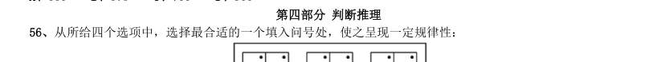

> （本题为图形题，选项为图片，见原卷）

**答案：暂缺**　**考点：图形推理｜图形推理（综合）**　**难度：★★☆☆☆**
**【判断推理·图形推理｜GD-2014-xj-X057】**

57. 从所给四个选项中,选择最合适的一个填入问号处,使之呈现一定规律性:

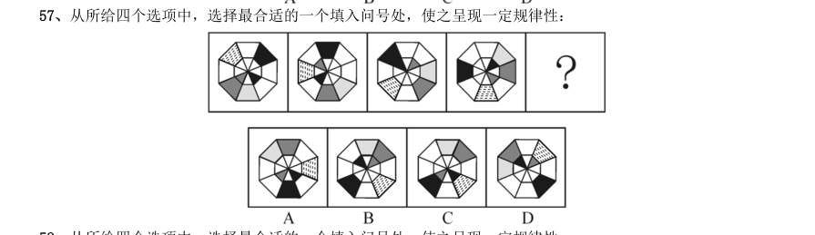

> （本题为图形题，选项为图片，见原卷）

**答案：暂缺**　**考点：图形推理｜图形推理（综合）**　**难度：★★☆☆☆**
**【判断推理·图形推理｜GD-2014-xj-X058】**

58. 从所给四个选项中,选择最合适的一个填入问号处,使之呈现一定规律性:

> （本题为图形题，选项为图片，见原卷）

**答案：暂缺**　**考点：图形推理｜图形推理（综合）**　**难度：★★☆☆☆**
**【判断推理·图形推理｜GD-2014-xj-X059】**

59. 从所给四个选项中,选择最合适的一个填入问号处,使之呈现一定规律性:

> （本题为图形题，选项为图片，见原卷）

**答案：暂缺**　**考点：图形推理｜图形推理（综合）**　**难度：★★☆☆☆**
**【判断推理·图形推理｜GD-2014-xj-X060】**

60. 从所给四个选项中,选择最合适的一个填入问号处,使之呈现一定规律性:

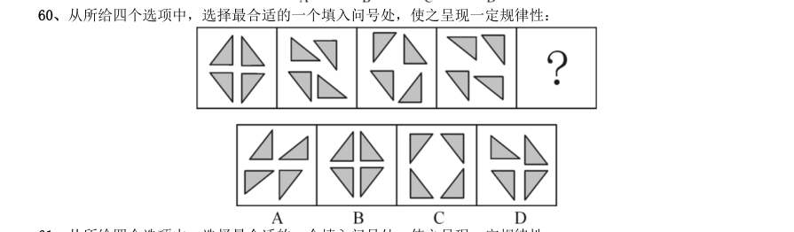

> （本题为图形题，选项为图片，见原卷）

**答案：暂缺**　**考点：图形推理｜图形推理（综合）**　**难度：★★☆☆☆**
**【判断推理·图形推理｜GD-2014-xj-X061】**

61. 从所给四个选项中,选择最合适的一个填入问号处,使之呈现一定规律性:

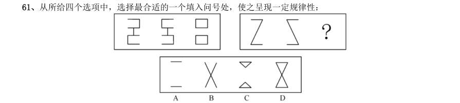

> （本题为图形题，选项为图片，见原卷）

**答案：暂缺**　**考点：图形推理｜图形推理（综合）**　**难度：★★☆☆☆**
**【判断推理·图形推理｜GD-2014-xj-X062】**

62. 从所给四个选项中,选择最合适的一个填入问号处,使之呈现一定规律性:

> （本题为图形题，选项为图片，见原卷）

**答案：暂缺**　**考点：图形推理｜图形推理（综合）**　**难度：★★☆☆☆**
**【判断推理·图形推理｜GD-2014-xj-X063】**

63. 把给定图形中的元素重组可以得到的是:

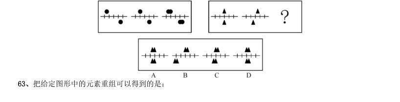

> （本题为图形题，选项为图片，见原卷）

**答案：暂缺**　**考点：图形推理｜图形推理（综合）**　**难度：★★☆☆☆**
**【判断推理·图形推理｜GD-2014-xj-X064】**

64. 从所给四个选项中,选择最合适的一个填入问号处,使之呈现一定规律性:

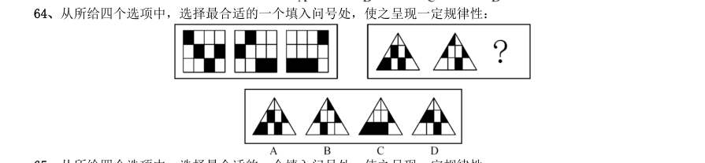

> （本题为图形题，选项为图片，见原卷）

**答案：暂缺**　**考点：图形推理｜图形推理（综合）**　**难度：★★☆☆☆**
**【判断推理·图形推理｜GD-2014-xj-X065】**

65. 从所给四个选项中,选择最合适的一个填入问号处,使之呈现一定规律性:

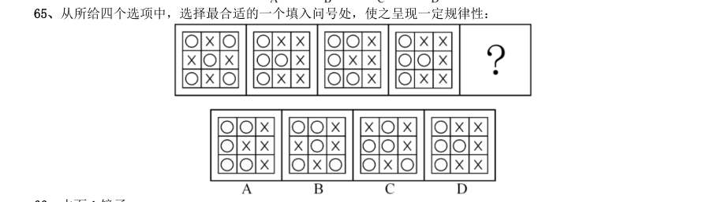

> （本题为图形题，选项为图片，见原卷）

**答案：暂缺**　**考点：图形推理｜图形推理（综合）**　**难度：★★☆☆☆**
**【判断推理·类比推理｜GD-2014-xj-X066】**

66. 水面∶镜子

- **A.** 毛笔∶钢笔
- **B.** 藤条∶绳子
- **C.** 图画∶照片
- **D.** 火把∶电灯

**答案：暂缺**　**考点：类比推理｜类比推理（综合）**　**难度：★☆☆☆☆**
**【判断推理·逻辑判断｜GD-2014-xj-X067】**

67. 解释∶理解

- **A.** 分析∶结论
- **B.** 奉献∶赞许
- **C.** 拼搏∶成功
- **D.** 分享∶满足

**答案：暂缺**　**考点：逻辑判断｜解释评价**　**难度：★★☆☆☆**
**【判断推理·类比推理｜GD-2014-xj-X068】**

68. 兵马∶粮草

- **A.** 工人∶工资
- **B.** 植物∶雨水
- **C.** 电视∶遥控器
- **D.** 发动机∶燃油

**答案：暂缺**　**考点：类比推理｜类比推理（综合）**　**难度：★☆☆☆☆**
**【判断推理·类比推理｜GD-2014-xj-X069】**

69. 上升∶下降

- **A.** 乡道∶公路
- **B.** 鸭梨∶雪梨
- **C.** 欢喜∶悲哀
- **D.** 平年∶闰年

**答案：暂缺**　**考点：类比推理｜类比推理（综合）**　**难度：★☆☆☆☆**
**【判断推理·类比推理｜GD-2014-xj-X070】**

70. 春夏∶秋冬

- **A.** 生老∶病死
- **B.** 昨天∶今天
- **C.** 日出∶日落
- **D.** 雷鸣∶暴雨

**答案：暂缺**　**考点：类比推理｜类比推理（综合）**　**难度：★☆☆☆☆**
**【判断推理·类比推理｜GD-2014-xj-X071】**

71. 泥土∶煅烧∶陶瓷

- **A.** 泥炭∶燃烧∶热能
- **B.** 玉石∶雕刻∶饰品
- **C.** 学生∶学习∶人才
- **D.** 粮食∶发酵∶白酒

**答案：暂缺**　**考点：类比推理｜类比推理（综合）**　**难度：★☆☆☆☆**
**【判断推理·类比推理｜GD-2014-xj-X072】**

72. 流芳百世∶遗臭万年

- **A.** 佳偶天成∶夫唱妇随
- **B.** 近朱者赤∶近墨者黑
- **C.** 富商大贾∶小商小贩
- **D.** 卧虎藏龙∶藏污纳垢

**答案：暂缺**　**考点：类比推理｜类比推理（综合）**　**难度：★☆☆☆☆**
**【判断推理·类比推理｜GD-2014-xj-X073】**

73. 技能∶技术∶技艺

- **A.** 昏沉∶昏迷∶昏睡
- **B.** 习惯∶规矩∶法律
- **C.** 认可∶鼓励∶奖励
- **D.** 经常∶往往∶一直

**答案：暂缺**　**考点：类比推理｜类比推理（综合）**　**难度：★☆☆☆☆**
**【判断推理·类比推理｜GD-2014-xj-X074】**

74. 电波∶基站∶信息

- **A.** 屏幕∶观众∶感动
- **B.** 天线∶卫星∶影像
- **C.** 音乐∶民族∶文化
- **D.** 货轮∶港口∶物资

**答案：暂缺**　**考点：类比推理｜类比推理（综合）**　**难度：★☆☆☆☆**
**【判断推理·类比推理｜GD-2014-xj-X075】**

75. 电脑∶程序∶功能

- **A.** 组织∶机制∶作用
- **B.** 汽车∶汽油∶路程
- **C.** 环境∶意识∶保护
- **D.** 纸张∶印刷∶书本

**答案：暂缺**　**考点：类比推理｜对应关系**　**难度：★☆☆☆☆**
**【判断推理·逻辑判断｜GD-2014-xj-X076】**

76. 甲、乙两份报纸的编辑部,都有专门校对文稿的工作人员。去年,甲报纸出现了一些文字错误,而乙报纸 没有文字错误。因此,在去年的校对工作中,乙报纸的校稿员比甲报纸的校稿员的工作更有成效。 以上结论基于的假设是:

- **A.** 乙报纸校稿员的工作时间比甲报纸校稿员长
- **B.** 甲报纸收到的稿件存在文字错误的数量不比乙报纸少
- **C.** 甲报纸每期的版面数量比乙报纸少
- **D.** 文字错误出现的数量是评价校稿员工作成效的标准

**答案：暂缺**　**考点：逻辑判断｜前提假设**　**难度：★★★★☆**
**【判断推理·逻辑判断｜GD-2014-xj-X077】**

77. 据统计,与文科专业的大学毕业生相比,理工科大学毕业生刚入职时的收入更高。因此,高中毕业生要想 将来毕业后获得较高收入,应该报考理工科专业。 最能削弱上述结论的一项是:

- **A.** 文科生最终获得高收入的比例高于理工科学生
- **B.** 理工科专业由于知识难度大而不容易毕业
- **C.** 如今不少年轻人更愿意按自己的兴趣选择专业
- **D.** 有些没有读过大学的人最后成了著名的企业家

**答案：暂缺**　**考点：逻辑判断｜削弱**　**难度：★★★☆☆**
**【判断推理·逻辑判断｜GD-2014-xj-X078】**

78. 公众人物需要担当更多的道德责任,因为权力和责任是相等的,既然拥有常人不具备的优势地位,那么就 应该比一般人承担更高的道德要求。因此,承受更多的舆论批评甚至人身攻击,哪怕是一定程度的失真,也是 不得不付出的必要代价。 最能质疑上述观点的一项是:

- **A.** 普通人和公众人物应该具有同等的道德责任
- **B.** 失真评价会影响公众人物对道德义务的履行
- **C.** 更多的道德责任并不意味着一定要承受舆论批评
- **D.** 公众人物正是因为没有尽到道德责任才会受到舆论批评

**答案：暂缺**　**考点：逻辑判断｜削弱**　**难度：★★★★☆**
**【判断推理·逻辑判断｜GD-2014-xj-X079】**

79. 某市环保部门的监测结果显示:今年上半年,该市的空气质量整体处于优良水平,严重污染天数不足15 天,污染天数比去年同期少了4 天。由此可知,今年的空气质量好于去年。 最能质疑上述结论的一项是:

- **A.** 该市去年关停了几家重污染企业
- **B.** 该市今年开展了植树造林活动
- **C.** 该市的严重污染时段一般在下半年
- **D.** 该市环保部门今年更新了空气检测设备

**答案：暂缺**　**考点：逻辑判断｜削弱**　**难度：★★★★☆**
**【判断推理·逻辑判断｜GD-2014-xj-X080】**

80. 某市人口普查结果显示,35 岁以上单身男性人数是35 岁以上单身女性的1.5 倍。显而易见,除非这些男 性中的一些人娶外地女性为妻,否则这些单身男性中的一部分将被迫一直保持单身状态。 以上结论基于的假设是:

- **A.** 这些单身男性持有“先立业再成家”的观念
- **B.** 本市单身女性中外出务工的较多
- **C.** 这些单身男性不愿娶比他们年龄大的女性为妻
- **D.** 这些单身男性倾向于娶与他们同龄的女性为妻

**答案：暂缺**　**考点：逻辑判断｜前提假设**　**难度：★★★★☆**
**【判断推理·逻辑判断｜GD-2014-xj-X081】**

81. 由于销量过少难以回收药品的研发和生产成本,因此,制药厂生产治疗罕见疾病的药物,就会遭受经济损 失。 最能削弱上述结论的一项是:

- **A.** 一些治疗罕见疾病的药物对其他疾病也有良好的疗效
- **B.** 治疗罕见疾病的药物的研发会推动医学的进步
- **C.** 相对经济效益,有些制药厂更注重社会效益
- **D.** 药物生产数量越大,每个单位的药物平均成本越小

**答案：暂缺**　**考点：逻辑判断｜削弱**　**难度：★★★☆☆**
**【判断推理·逻辑判断｜GD-2014-xj-X082】**

82. 赵先生、钱先生、孙先生、李先生四人参加一项技能比赛,获得了比赛的前四名。据了解,他们之间有以 下关系: 1孙先生和李先生经常相约一起打篮球; 2第一名和第三名在这次比赛中刚认识; 3第二名不会骑自行车,也不打篮球; 4赵先生的名次比钱先生的名次靠前; 5钱先生和李先生每天一起骑自行车上班。 根据以上条件,可以判断此次比赛的第一、二、三、四名次的获得者是:

- **A.** 孙先生、赵先生、钱先生、李先生
- **B.** 李先生、赵先生、孙先生、钱先生
- **C.** 李先生、孙先生、赵先生、钱先生
- **D.** 孙先生、李先生、赵先生、钱先生

**答案：暂缺**　**考点：逻辑判断｜逻辑判断（综合）**　**难度：★★★★★**
**【判断推理·逻辑判断｜GD-2014-xj-X083】**

83. 在过去五年中,某地所有家庭所购买衣服的平均价格增长了50%,但在平均家庭消费支出中,购买衣服支 出所占比例没发生变化,因此,所有家庭的平均消费支出在这五年中也增长了50%。 以上结论基于的假设是:

- **A.** 在这五年中,所有家庭在购买衣服上的平均花费没有变化
- **B.** 在这五年中,所有家庭所购衣服的平均数量没有变化
- **C.** 在这五年中,该地的家庭数量增加了50%
- **D.** 在这五年中,该地所有家庭用于购买衣服的支出总和增长了50%

**答案：暂缺**　**考点：逻辑判断｜前提假设**　**难度：★★★★☆**
**【判断推理·逻辑判断｜GD-2014-xj-X084】**

84. 甲、乙、丙、丁四名青少年拥有手机、电脑、相机三种电子产品的情况如下: 1只有一个同时拥有手机、电脑、相机; 2有三个人拥有手机,有两个人拥有电脑,只有一个人拥有相机; 3每个人至少拥有三种电子产品中的一种; 4甲和乙是否拥有电脑的情况相同(要么两人都有,要么两人都没有); 5乙和丙是否拥有手机情况相同; 6丙和丁是否拥有手机的情况不同。 拥有相机的是:

- **A.** 甲
- **B.** 乙
- **C.** 丙
- **D.** 丁

**答案：暂缺**　**考点：逻辑判断｜真假推理**　**难度：★★★★★**
**【判断推理·逻辑判断｜GD-2014-xj-X085】**

85. 随着技术的进步,科学家可以通过对木料的检测来确定树木被砍伐的年份。因此,通过古建筑中幸存的木 料,就可以确定古建筑的建造年份。 上述论述基于的假设是:

- **A.** 古建筑中的木料在使用前没有闲置很长时间
- **B.** 古建筑大量使用木料作为建筑材料
- **C.** 一栋古建筑的建造通常只使用一种木料
- **D.** 保存完好的古建筑是使用最耐久的木料建造的

**答案：暂缺**　**考点：逻辑判断｜前提假设**　**难度：★★★☆☆**
**【资料分析·综合分析｜GD-2014-xj-X086】**
> 材料：(材料1) 改革开放三十多年以来,广东经济发展连上新台阶,综合实力不断实现大跨越。1979~2012 年,世界经济 年均增长速度为2.8%,中国增速为9.8%,广东增速则达13.3%。持续较快的经济增速,推动广东经济总量不 断跃上新台阶。自1989 年开始,广东GDP 总量(国内生产总值)在全国一直保持首位,到2012 年已连续24 年居全国第一,占全国经济总量比重在1/10 至1/8 之间。 2012 年,民营经济达29319.97 亿元,占GDP 比重为51.4%;民营经济上缴税金6467.82 亿元,占全省税 收总额的49.1%;民间投资10177.28 亿元,占全部固定资产投资的52.7%,民营经济已成为支撑广东经济内生 增长的主力。 2012 年,广东铁路营业里程达到2577 公里,比1978 年增长1.6 倍;公路通车里程19.5 万公里,增长 2.7 倍;民用航线里程185.

86. 1979~2012 年,广东经济年均增速约为世界经济增速的( )倍。

- **A.** 1.4
- **B.** 3.5
- **C.** 4.8
- **D.** 10.5

**答案：暂缺**　**考点：综合分析｜综合分析（综合）**　**难度：★★★★☆**
**【资料分析·综合分析｜GD-2014-xj-X087】**

87. 2012 年,广东税收总额约为( )亿元。

- **A.** 12273
- **B.** 13173
- **C.** 19312
- **D.** 57043

**答案：暂缺**　**考点：综合分析｜综合分析（综合）**　**难度：★★★☆☆**
**【资料分析·增长率计算与比较｜GD-2014-xj-X088】**

88. 广东高速公路在2012 年实现通车里程比2011 年增长约:

- **A.** 9.4%
- **B.** 109.4%
- **C.** 270%
- **D.** 370%

**答案：暂缺**　**考点：增长率计算与比较｜增长率计算（综合）**　**难度：★☆☆☆☆**
**【资料分析·综合分析｜GD-2014-xj-X089】**

89. 1978 年,广东的下列四项数据由小到大排列正确的是:

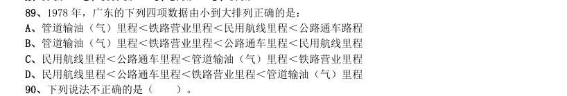

- **A.** 管道输油(气)里程<铁路营业里程<民用航线里程<公路通车路程
- **B.** 管道输油(气)里程<铁路营业里程<公路通车里程<民用航线里程
- **C.** 民用航线里程<公路通车里程<管道输油(气)里程<铁路营业里程
- **D.** 民用航线里程<公路通车里程<铁路营业里程<管道输油(气)里程

**答案：暂缺**　**考点：综合分析｜选正确项**　**难度：★★★★★**
**【资料分析·综合分析｜GD-2014-xj-X090】**

90. 下列说法不正确的是( )。

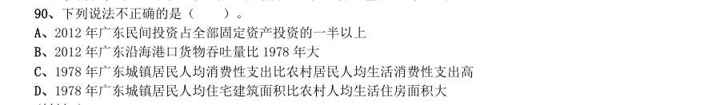

- **A.** 2012 年广东民间投资占全部固定资产投资的一半以上
- **B.** 2012 年广东沿海港口货物吞吐量比1978 年大
- **C.** 1978 年广东城镇居民人均消费性支出比农村居民人均生活消费性支出高
- **D.** 1978 年广东城镇居民人均住宅建筑面积比农村人均生活住房面积大

**答案：暂缺**　**考点：综合分析｜选错误项**　**难度：★★★★★**
**【资料分析·综合分析｜GD-2014-xj-X091】**
> 材料：2013 年,我国研究生招生61.1 万人。在校研究生179.4 万人,毕业生51.4 万人。普通本专科在校生 2468.1 万人,毕业生638.7 万人。

91. 2013 年,招生人数和毕业生人数相差最小的教育层次是:

- **A.** 研究生
- **B.** 普通本专科
- **C.** 中等职业教育
- **D.** 普通高中

**答案：暂缺**　**考点：综合分析｜综合分析（综合）**　**难度：★★★★☆**
**【资料分析·增长率计算与比较｜GD-2014-xj-X092】**

92. 2013 年我国中等职业教育招生人数比2012 年大约:

- **A.** 减少7.4%
- **B.** 减少8.4%
- **C.** 增加7.4%
- **D.** 增加8.4%

**答案：暂缺**　**考点：增长率计算与比较｜增长率计算（综合）**　**难度：★☆☆☆☆**
**【资料分析·综合分析｜GD-2014-xj-X093】**

93. 我国普通本专科、中等职业教育及普通高中招生人数总和最多的年份是( )年。

- **A.** 2009
- **B.** 2010
- **C.** 2011
- **D.** 2012

**答案：暂缺**　**考点：综合分析｜综合分析（综合）**　**难度：★★★☆☆**
**【资料分析·综合分析｜GD-2014-xj-X094】**

94. 下列说法正确的是:

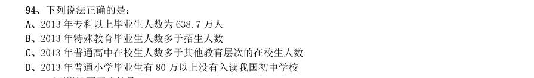

- **A.** 2013 年专科以上毕业生人数为638.7 万人
- **B.** 2013 年特殊教育毕业生人数多于招生人数
- **C.** 2013 年普通高中在校生人数多于其他教育层次的在校生人数
- **D.** 2013 年普通小学毕业生有80 万以上没有入读我国初中学校

**答案：暂缺**　**考点：综合分析｜选正确项**　**难度：★★★★★**
**【资料分析·综合分析｜GD-2014-xj-X095】**

95. 下列说法不正确的是:

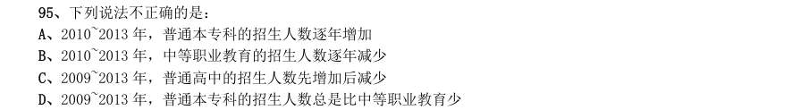

- **A.** 2010~2013 年,普通本专科的招生人数逐年增加
- **B.** 2010~2013 年,中等职业教育的招生人数逐年减少
- **C.** 2009~2013 年,普通高中的招生人数先增加后减少
- **D.** 2009~2013 年,普通本专科的招生人数总是比中等职业教育少

**答案：暂缺**　**考点：综合分析｜选错误项**　**难度：★★★★★**
**【资料分析·倍数计算｜GD-2014-xj-X096】**

96. 2013 年,广东固定资产投资总量迈上新台阶,共完成22858.53 亿元,增长18.3%,比2012 年加快2.8 个 百分点。其中,城镇投资18907.34 亿元,增长18.6%;农村投资3951.19 亿元,增长17.0%。 2013 年,广东城镇投资约为农村投资的多少倍?

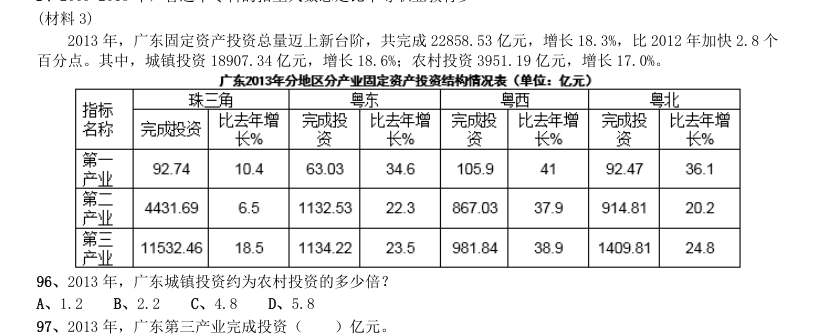

- **A.** 1.2
- **B.** 2.2
- **C.** 4.8
- **D.** 5.8

**答案：暂缺**　**考点：倍数计算｜是几倍**　**难度：★★★☆☆**
**【资料分析·综合分析｜GD-2014-xj-X097】**

97. 2013 年,广东第三产业完成投资( )亿元。

- **A.** 354.14
- **B.** 7446.06
- **C.** 15058.33
- **D.** 22858.53

**答案：暂缺**　**考点：综合分析｜综合分析（综合）**　**难度：★★★☆☆**
**【资料分析·增长率计算与比较｜GD-2014-xj-X098】**

98. 2013 年,珠三角完成投资比上年增长约:

- **A.** 6.4%
- **B.** 14.9%
- **C.** 23.2%
- **D.** 30.5%

**答案：暂缺**　**考点：增长率计算与比较｜增长率计算（综合）**　**难度：★☆☆☆☆**
**【资料分析·综合分析｜GD-2014-xj-X099】**

99. 2013 年完成投资由大到小排列正确的是:

- **A.** 珠三角>粤东>粤西>粤北
- **B.** 珠三角>粤北>粤东>粤西
- **C.** 粤东>珠三角>粤西>粤北
- **D.** 粤东>珠三角>粤北>粤西

**答案：暂缺**　**考点：综合分析｜选正确项**　**难度：★★★☆☆**
**【资料分析·综合分析｜GD-2014-xj-X100】**

100. 下列说法不正确的是:

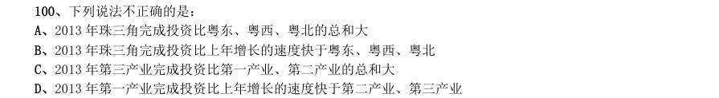

- **A.** 2013 年珠三角完成投资比粤东、粤西、粤北的总和大
- **B.** 2013 年珠三角完成投资比上年增长的速度快于粤东、粤西、粤北
- **C.** 2013 年第三产业完成投资比第一产业、第二产业的总和大
- **D.** 2013 年第一产业完成投资比上年增长的速度快于第二产业、第三产业

**答案：暂缺**　**考点：综合分析｜选错误项**　**难度：★★★★★**