# 2016 广东省考（乡镇）·行测

- 题量：100（含答案 0）
- 考试类型：广东省考
- 模块分布：资料分析15 / 数量关系15 / 言语理解15 / 判断推理40 / 常识判断15
- 试卷编号：`广东-2016-乡镇`

## 题目与答案

**【2016 广东省考（乡镇）·第 1 题】言语理解·逻辑填空｜GD-2016-xz-X001**
> 材料：要求,在四个选项中选出一个最恰当的答案。

1. 干部走进基层,在实践中增长( ),是锻炼干部、培养人才的重要途径。 填入空格处最恰当的一项是:

- **A.** 才学
- **B.** 才华
- **C.** 才干
- **D.** 才智

**答案：暂缺**　**考点：逻辑填空｜逻辑填空（待细分）**　**难度：★☆☆☆☆**
**【2016 广东省考（乡镇）·第 2 题】言语理解·逻辑填空｜GD-2016-xz-X002**

2. 农村电网( )升级,事关广大农村地区的长远发展。 填入空格处最恰当的一项是:

- **A.** 改造
- **B.** 改线
- **C.** 改变
- **D.** 改良

**答案：暂缺**　**考点：逻辑填空｜逻辑填空（待细分）**　**难度：★☆☆☆☆**
**【2016 广东省考（乡镇）·第 3 题】言语理解·逻辑填空｜GD-2016-xz-X003**

3. 个人成长进步靠什么?有人说靠组织培养,有人说靠自身努力。实际上,二者并不( )。 在现实生活中,绝大多数人的成长进步既离不开组织培养,也离不开自身努力。 填入空格处最恰当的一项是:

- **A.** 相关
- **B.** 统一
- **C.** 重复
- **D.** 矛盾

**答案：暂缺**　**考点：逻辑填空｜逻辑填空（待细分）**　**难度：★☆☆☆☆**
**【2016 广东省考（乡镇）·第 4 题】言语理解·逻辑填空｜GD-2016-xz-X004**

4. 如果仅仅将农村示范点建设当成供人参观、应对检查的门面工程来打造,则与示范点建设的初 衷( )。 填入空格处最恰当的一项是:

- **A.** 大相径庭
- **B.** 不谋而合
- **C.** 南辕北辙
- **D.** 不约而同

**答案：暂缺**　**考点：逻辑填空｜逻辑填空（待细分）**　**难度：★☆☆☆☆**
**【2016 广东省考（乡镇）·第 5 题】言语理解·逻辑填空｜GD-2016-xz-X005**

5. 随着国际反腐合作深化,外逃腐败分子难逃( )的命运。 填入空格处最恰当的一项是:

- **A.** 害群之马
- **B.** 瓮中之鳖
- **C.** 井底之蛙
- **D.** 涸辙之鲋

**答案：暂缺**　**考点：逻辑填空｜逻辑填空（待细分）**　**难度：★☆☆☆☆**
**【2016 广东省考（乡镇）·第 6 题】言语理解·逻辑填空｜GD-2016-xz-X006**

6. 政府部门应该在社区治理中鼓励社区自治。假如政府部门在这过程中( ),没有处理好社 区自治和政府管理的关系,那么,最终所作出的决策就很可能会引发社会矛盾。 填入空格处最恰当的一项是:

- **A.** 李代桃僵
- **B.** 萧规曹随
- **C.** 越俎代庖
- **D.** 广纳良言

**答案：暂缺**　**考点：逻辑填空｜逻辑填空（待细分）**　**难度：★☆☆☆☆**
**【2016 广东省考（乡镇）·第 7 题】言语理解·逻辑填空｜GD-2016-xz-X007**

7. 乡镇政府作为国家最基层的一级政府,( )的工作十分繁杂,( )的压力十分巨大。 依次填入空格处最恰当的一项是:

- **A.** 承担 承载
- **B.** 承担 承受
- **C.** 承接 承受
- **D.** 承接 承载

**答案：暂缺**　**考点：逻辑填空｜逻辑填空（待细分）**　**难度：★☆☆☆☆**
**【2016 广东省考（乡镇）·第 8 题】言语理解·逻辑填空｜GD-2016-xz-X008**

8. 创新的目的不是发论文,培育新的经济增长点才能( )科技的真功夫。让创新更紧密地面 向经济社会发展,把创新实实在在地( )为新产品、新项目、新产业,是创新的要义所在。 依次填入空格处最恰当的一项是:

- **A.** 发挥 转变
- **B.** 凸显 催化
- **C.** 反映 转换
- **D.** 彰显 转化

**答案：暂缺**　**考点：逻辑填空｜逻辑填空（待细分）**　**难度：★☆☆☆☆**
**【2016 广东省考（乡镇）·第 9 题】言语理解·逻辑填空｜GD-2016-xz-X009**

9. 在经济社会不断发展的今天,我们应将明礼知耻( )于社会主义核心价值观的实践中。同 时,应( )古今中外礼仪礼教之精华,把明礼提升到一个新高度、新水平。 依次填入空格处最恰当的一项是:

- **A.** 贯彻 融合
- **B.** 落实 吸取
- **C.** 贯穿 融汇
- **D.** 实行 继承

**答案：暂缺**　**考点：逻辑填空｜逻辑填空（待细分）**　**难度：★☆☆☆☆**
**【2016 广东省考（乡镇）·第 10 题】言语理解·逻辑填空｜GD-2016-xz-X010**

10. ( )农业教育、( )新型职业农民、( )农技推广服务等一系列举措,将促进 农民科学素质的提高、农村科技队伍的壮大。 依次填入空格处最恰当的一项是:

- **A.** 发展 培育 强化
- **B.** 加强 培训 建立
- **C.** 创立 培养 加强
- **D.** 发展 培训 加强

**答案：暂缺**　**考点：逻辑填空｜逻辑填空（待细分）**　**难度：★☆☆☆☆**
**【2016 广东省考（乡镇）·第 11 题】言语理解·逻辑填空｜GD-2016-xz-X011**

11. 扶贫工作组下村了解扶贫工作时,某贫困户感慨道:“扶贫,光给钱不行,关键是得给条致 富的路。” 以下不符合该贫困户的原意的是( )。

- **A.** 扶贫工作不能只给钱
- **B.** 扶贫工作要为贫困户指明致富道路
- **C.** 扶贫工作“授人以鱼不如授人以渔”
- **D.** 扶贫工作不用给钱但要给致富办法

**答案：暂缺**　**考点：逻辑填空｜逻辑填空（待细分）**　**难度：★☆☆☆☆**
**【2016 广东省考（乡镇）·第 12 题】言语理解·中心理解｜GD-2016-xz-X012**

12. 生态文明建设是对一个地区党委政府整体工作水平的综合衡量,经济发达而环境污染不是生 态文明,山清水秀而贫穷落后也不是生态文明。 对这段文字理解有误的是( )。

- **A.** 经济发达地区有可能是生态文明地区
- **B.** 山清水秀地区有可能是生态文明地区
- **C.** 贫穷落后地区有可能是生态文明地区
- **D.** 生态文明建设能衡量地方党委政府工作水平

**答案：暂缺**　**考点：中心理解｜中心理解（综合）**　**难度：★☆☆☆☆**
**【2016 广东省考（乡镇）·第 13 题】言语理解·中心理解｜GD-2016-xz-X013**

13. 从2006 年开展农村社区建设以来的10 年间,农村经历了经济和社会发展的巨变,农村社区 建设也从最初的实验阶段逐渐过渡到深入试点阶段,取得了很大的成效,积累了丰富的经验。 对这段文字理解有误的是( )。

- **A.** 农村社区建设即将取得全面成功
- **B.** 农村社区建设已经取得了很大成效
- **C.** 农村社区建设已经积累了丰富的经验
- **D.** 农村在过去的10 年间发生了巨大变化

**答案：暂缺**　**考点：中心理解｜中心理解（综合）**　**难度：★☆☆☆☆**
**【2016 广东省考（乡镇）·第 14 题】言语理解·中心理解｜GD-2016-xz-X014**

14. 人才是创新的根基,创新驱动实质上是人才驱动。深化改革、推动创新,一方面离不开激发 民智,汇聚民力,另一方面要发挥高端人才的关键作用。只有大力实施人才强国战略,“择天下英才 而用之,聚集一批站在行业科技前沿、具有国际视野和能力的领军人才”,努力抢占经济科技制高点, 才能为推动“中国制造”向“中国智造”转变夯实人才基础,为提升综合国力注入强大推力。 这段文字意在说明( )

- **A.** 人才是创新的一部分
- **B.** 人才是创新的特点
- **C.** 人才是创新的关键
- **D.** 人才是创新的原因

**答案：暂缺**　**考点：中心理解｜对策优先**　**难度：★★★★☆**
**【2016 广东省考（乡镇）·第 15 题】言语理解·中心理解｜GD-2016-xz-X015**

15. 中国经济发展进入新常态,最重要的是两个转变,一是经济增速从高速增长转向中高速增长, 二是经济发展方式从规模速度型粗放增长转向质量效率型集约增长。第一个转变已接近完成,但第二 个转变明显滞后,质量效率型集约增长模式尚未完全形成。我国发展过程中出现的不平衡不协调不可 持续问题,与两个转变不同步有很大关系。延续中国经济发展奇迹,必须加快经济发展方式转变,推 动经济从高速增长转向高效增长、实现由大到强的质的飞跃。 对这段文字理解有误的是( )。

- **A.** 我国不少地方仍存在经济规模速度型粗放增长现象
- **B.** 两个转变同步进行可减少我国经济发展的一些问题
- **C.** 新常态推动我国经济发展实现由大到强的质的飞跃
- **D.** 我国经济增速已经完成从高速增长转向中高速增长

**答案：暂缺**　**考点：中心理解｜对策优先**　**难度：★★★★☆**
**【2016 广东省考（乡镇）·第 16 题】数量关系·数字推理｜GD-2016-xz-X016**

16. -1 3 -3 5 -5 7 ( )

- **A.** 7
- **B.** 8
- **C.** -7
- **D.** -8

**答案：暂缺**　**考点：数字推理｜递推数列**　**难度：★★★☆☆**
**【2016 广东省考（乡镇）·第 17 题】数量关系·数字推理｜GD-2016-xz-X017**

17. 13 26 39 52 ( )

- **A.** 55
- **B.** 65
- **C.** 75
- **D.** 85

**答案：暂缺**　**考点：数字推理｜多级数列**　**难度：★★★☆☆**
**【2016 广东省考（乡镇）·第 18 题】数量关系·数字推理｜GD-2016-xz-X018**

18. 1 2 3 10 39 ( )

- **A.** 157
- **B.** 257
- **C.** 390
- **D.** 490

**答案：暂缺**　**考点：数字推理｜递推数列**　**难度：★★★☆☆**
**【2016 广东省考（乡镇）·第 19 题】数量关系·数字推理｜GD-2016-xz-X019**

19. 12.7 20.9 31.1 43.3 ( )

- **A.** 55.5
- **B.** 57.5
- **C.** 57.7
- **D.** 59.7

**答案：暂缺**　**考点：数字推理｜多级数列**　**难度：★★★☆☆**
**【2016 广东省考（乡镇）·第 20 题】数量关系·其他数量关系｜GD-2016-xz-X020**

20. （本题题干为图形/公式，文字层无题干，图见原卷）

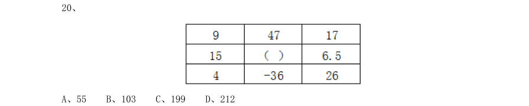

- **A.** 55
- **B.** 103
- **C.** 199
- **D.** 212

**答案：暂缺**　**考点：其他数量关系｜其他数量关系（综合）**　**难度：★★☆☆☆**
**【2016 广东省考（乡镇）·第 21 题】数量关系·数字推理｜GD-2016-xz-X021**

21. 甲乙丙三人参加一项测试,三人的平均分为80,甲乙两人的平均分为75,乙丙两人的平均分 为80,那么甲丙两人的平均分为( )。

- **A.** 70
- **B.** 75
- **C.** 80
- **D.** 85

**答案：暂缺**　**考点：数字推理｜数字推理（待细分）**　**难度：★★★☆☆**
**【2016 广东省考（乡镇）·第 22 题】数量关系·数字推理｜GD-2016-xz-X022**

22. 一批零件若交由赵师傅单独加工,需要10 天完成;若交由孙师傅单独加工,需要15 天完成。 两位师傅一起加工这批零件,需要( ) 天完成。

- **A.** 5
- **B.** 6
- **C.** 7
- **D.** 8

**答案：暂缺**　**考点：数字推理｜数字推理（待细分）**　**难度：★★★★☆**
**【2016 广东省考（乡镇）·第 23 题】数量关系·数字推理｜GD-2016-xz-X023**

23. 两辆汽车同时从两地相向开出,甲车每小时行驶60 千米,乙车每小时行驶48 千米,两车在 离两地中点48 千米处相遇。则两地相距( )千米。

- **A.** 192
- **B.** 224
- **C.** 416
- **D.** 864

**答案：暂缺**　**考点：数字推理｜数字推理（待细分）**　**难度：★★★★☆**
**【2016 广东省考（乡镇）·第 24 题】数量关系·数字推理｜GD-2016-xz-X024**

24. 修建一条铁路,如果每4 米铺设5 根枕木,共需5000 根;如果每5 米铺设6 根枕木,一共要 用( )根。

- **A.** 3600
- **B.** 4200
- **C.** 4800
- **D.** 7500

**答案：暂缺**　**考点：数字推理｜数字推理（待细分）**　**难度：★★★☆☆**
**【2016 广东省考（乡镇）·第 25 题】数量关系·数字推理｜GD-2016-xz-X025**

25. 某单位2014 年年终评比中,良好等级的人数占总人数3/5。2015 年年终评比又多了60 人被 评为良好等级,此时该等级的人数占总人数9/11。如果在这两年间该单位的人员没有变化,则该单位 共有( )人。

- **A.** 120
- **B.** 275
- **C.** 330
- **D.** 800

**答案：暂缺**　**考点：数字推理｜分数数列**　**难度：★★★★☆**
**【2016 广东省考（乡镇）·第 26 题】数量关系·数字推理｜GD-2016-xz-X026**

26. 某服装店有一批衬衣共76 件,分别卖给了33 位顾客,每位顾客最多买了3 件。衬衣定价为 100 元,买1 件按原价,买2 件总价打九折,买3 件总价打八折。最后卖完这批衬衣共收入6460 元, 则买了3 件的顾客有( )位。

- **A.** 4
- **B.** 8
- **C.** 14
- **D.** 15

**答案：暂缺**　**考点：数字推理｜递推数列**　**难度：★★★★★**
**【2016 广东省考（乡镇）·第 27 题】数量关系·最值问题｜GD-2016-xz-X027**

27. 园林工人用一辆汽车将20 棵行道树运往1 公里的地方开始种植。在1 公里处种第一棵,以后 往更远处每隔50 米种一棵,该辆汽车每次最多能运三棵树。当园林工人完成任务时,这辆汽车行程最 短是( )米。

- **A.** 20800
- **B.** 20900
- **C.** 21000
- **D.** 21100

**答案：暂缺**　**考点：最值问题｜最值优化**　**难度：★★★★☆**
**【2016 广东省考（乡镇）·第 28 题】数量关系·数字推理｜GD-2016-xz-X028**

28. 小王早上看到挂钟显示8 点多,急忙赶往公司上班。但是到了公司却发现时间和自己出门看 到的挂钟时间一样,才明白是自己出门前误把挂钟的时针看成分针、分针看成时针。已知小王平时上 班路程不超过1.5 小时,今天上班他花费了( )。

- **A.** 48 分钟
- **B.** 55 分钟
- **C.** 1 小时
- **D.** 1 小时3 分钟

**答案：暂缺**　**考点：数字推理｜数字推理（待细分）**　**难度：★★★★★**
**【2016 广东省考（乡镇）·第 29 题】数量关系·数字推理｜GD-2016-xz-X029**

29. 某羽毛球赛共有23 支队伍报名参赛,赛事安排23 支队伍抽签两两争夺下一轮的出线权,没 有抽到对手的队伍轮空,直接进入下一轮。那么,本次羽毛球赛一共会出现( )次轮空的情况。

- **A.** 2
- **B.** 3
- **C.** 4
- **D.** 5

**答案：暂缺**　**考点：数字推理｜数字推理（待细分）**　**难度：★★★★☆**
**【2016 广东省考（乡镇）·第 30 题】数量关系·数字推理｜GD-2016-xz-X030**

30. 甲乙两人需托运行李。托运收费标准为10kg 以下6 元/kg,超出10kg 部分每公斤收费标准略 低一些。已知甲乙两人托运费分别为109.5 元、78 元,甲的行李比乙重了50%。那么,超出10kg 部分 每公斤收费标准比10kg 以内的低了( )元。

- **A.** 1.5
- **B.** 2.5
- **C.** 3.5
- **D.** 4.5

**答案：暂缺**　**考点：数字推理｜分数数列**　**难度：★★★★★**
**【2016 广东省考（乡镇）·第 31 题】判断推理·图形推理｜GD-2016-xz-X031**

31. 判断。

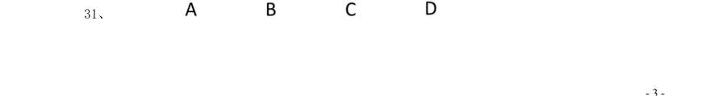

> （本题为图形题，选项为图片，见原卷）

**答案：暂缺**　**考点：图形推理｜图形推理（待细分）**　**难度：★★★★☆**
**【2016 广东省考（乡镇）·第 32 题】判断推理·图形推理｜GD-2016-xz-X032**

32. （本题题干为图形/公式，文字层无题干，图见原卷）

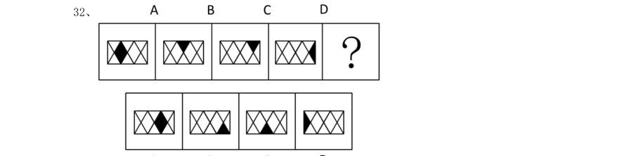

> （本题为图形题，选项为图片，见原卷）

**答案：暂缺**　**考点：图形推理｜图形推理（待细分）**　**难度：★★★★☆**
**【2016 广东省考（乡镇）·第 33 题】判断推理·图形推理｜GD-2016-xz-X033**

33. （本题题干为图形/公式，文字层无题干，图见原卷）

> （本题为图形题，选项为图片，见原卷）

**答案：暂缺**　**考点：图形推理｜图形推理（待细分）**　**难度：★★★★☆**
**【2016 广东省考（乡镇）·第 34 题】判断推理·图形推理｜GD-2016-xz-X034**

34. （本题题干为图形/公式，文字层无题干，图见原卷）

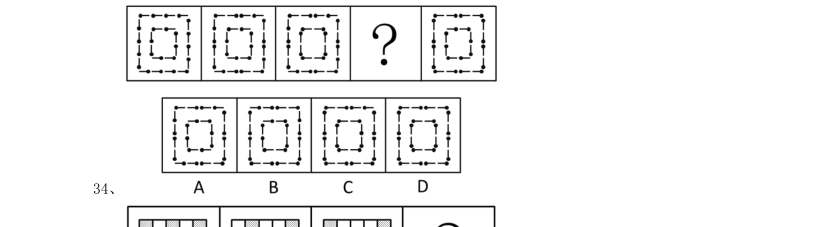

> （本题为图形题，选项为图片，见原卷）

**答案：暂缺**　**考点：图形推理｜图形推理（待细分）**　**难度：★★★★☆**
**【2016 广东省考（乡镇）·第 35 题】判断推理·图形推理｜GD-2016-xz-X035**

35. （本题题干为图形/公式，文字层无题干，图见原卷）

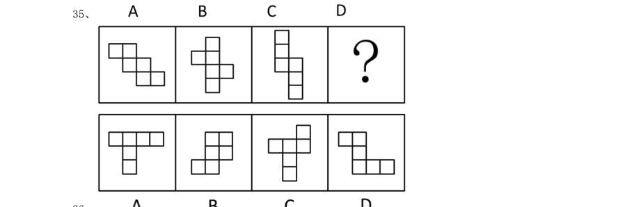

> （本题为图形题，选项为图片，见原卷）

**答案：暂缺**　**考点：图形推理｜图形推理（待细分）**　**难度：★★★★☆**
**【2016 广东省考（乡镇）·第 36 题】判断推理·图形推理｜GD-2016-xz-X036**

36. （本题题干为图形/公式，文字层无题干，图见原卷）

> （本题为图形题，选项为图片，见原卷）

**答案：暂缺**　**考点：图形推理｜图形推理（待细分）**　**难度：★★★★☆**
**【2016 广东省考（乡镇）·第 37 题】判断推理·图形推理｜GD-2016-xz-X037**

37. （本题题干为图形/公式，文字层无题干，图见原卷）

> （本题为图形题，选项为图片，见原卷）

**答案：暂缺**　**考点：图形推理｜图形推理（待细分）**　**难度：★★★★☆**
**【2016 广东省考（乡镇）·第 38 题】判断推理·图形推理｜GD-2016-xz-X038**

38. （本题题干为图形/公式，文字层无题干，图见原卷）

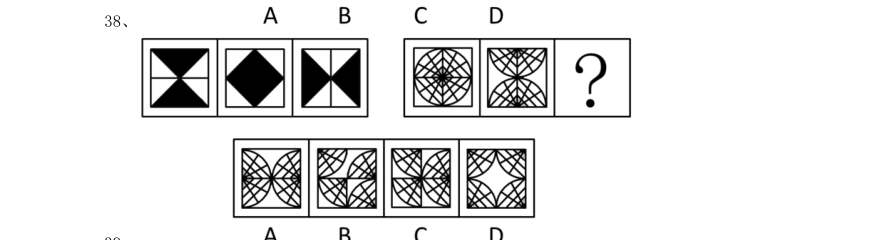

> （本题为图形题，选项为图片，见原卷）

**答案：暂缺**　**考点：图形推理｜图形推理（待细分）**　**难度：★★★★☆**
**【2016 广东省考（乡镇）·第 39 题】判断推理·图形推理｜GD-2016-xz-X039**

39. （本题题干为图形/公式，文字层无题干，图见原卷）

> （本题为图形题，选项为图片，见原卷）

**答案：暂缺**　**考点：图形推理｜图形推理（待细分）**　**难度：★★★★☆**
**【2016 广东省考（乡镇）·第 40 题】判断推理·图形推理｜GD-2016-xz-X040**

40. （本题题干为图形/公式，文字层无题干，图见原卷）

> （本题为图形题，选项为图片，见原卷）

**答案：暂缺**　**考点：图形推理｜图形推理（待细分）**　**难度：★★★★☆**
**【2016 广东省考（乡镇）·第 41 题】判断推理·类比推理｜GD-2016-xz-X041**

41. 天空:蔚蓝 ( )

- **A.** 气氛:融洽
- **B.** 土地:耕种
- **C.** 茶叶:保健
- **D.** 河流:灌溉

**答案：暂缺**　**考点：类比推理｜类比推理（综合）**　**难度：★☆☆☆☆**
**【2016 广东省考（乡镇）·第 42 题】判断推理·类比推理｜GD-2016-xz-X042**

42. 蜡烛:电灯 ( )

- **A.** 椅子:写字台
- **B.** 茶杯:饮水机
- **C.** 拖把:吸尘器
- **D.** 电视:计算机

**答案：暂缺**　**考点：类比推理｜类比推理（综合）**　**难度：★☆☆☆☆**
**【2016 广东省考（乡镇）·第 43 题】判断推理·类比推理｜GD-2016-xz-X043**

43. 富裕:扶贫()

- **A.** 干燥:抽湿
- **B.** 蒙昧:教育
- **C.** 落后:推进
- **D.** 健康:保卫

**答案：暂缺**　**考点：类比推理｜类比推理（综合）**　**难度：★☆☆☆☆**
**【2016 广东省考（乡镇）·第 44 题】判断推理·类比推理｜GD-2016-xz-X044**

44. 干旱:沙漠()

- **A.** 笔直:树干
- **B.** 坚硬:水泥
- **C.** 寒冷:南极
- **D.** 多雨:赤道

**答案：暂缺**　**考点：类比推理｜类比推理（综合）**　**难度：★☆☆☆☆**
**【2016 广东省考（乡镇）·第 45 题】判断推理·类比推理｜GD-2016-xz-X045**

45. 菜刀:食物()

- **A.** 子弹:枪支
- **B.** 毛巾:身体
- **C.** 铅笔:书籍
- **D.** 窗帘:窗户

**答案：暂缺**　**考点：类比推理｜类比推理（综合）**　**难度：★☆☆☆☆**
**【2016 广东省考（乡镇）·第 46 题】判断推理·类比推理｜GD-2016-xz-X046**

46. 玉石:雕琢:玉器()

- **A.** 蚕丝:织造:丝绸
- **B.** 粮食:酿造:美酒
- **C.** 生铁:冶炼:钢材
- **D.** 蚊香:点燃:烟雾

**答案：暂缺**　**考点：类比推理｜类比推理（综合）**　**难度：★☆☆☆☆**
**【2016 广东省考（乡镇）·第 47 题】判断推理·类比推理｜GD-2016-xz-X047**

47. 站台:码头:停机坪()

- **A.** 现金:支票:银行卡
- **B.** 软件:硬件:互联网
- **C.** 外套:婚纱:羽绒服
- **D.** 演员:群众:主持人

**答案：暂缺**　**考点：类比推理｜类比推理（综合）**　**难度：★☆☆☆☆**
**【2016 广东省考（乡镇）·第 48 题】判断推理·类比推理｜GD-2016-xz-X048**

48. 沙龙:志趣相投()

- **A.** 论坛:千言万语
- **B.** 擂台:针锋相对
- **C.** 网站:集思广益
- **D.** 枢纽:承上启下

**答案：暂缺**　**考点：类比推理｜类比推理（综合）**　**难度：★☆☆☆☆**
**【2016 广东省考（乡镇）·第 49 题】判断推理·类比推理｜GD-2016-xz-X049**

49. 陈词滥调:老生常谈 ( )

- **A.** 按部就班:循序渐进
- **B.** 博闻强识:见多识广
- **C.** 见义勇为:助人为乐
- **D.** 八面玲珑:面面俱到

**答案：暂缺**　**考点：类比推理｜类比推理（综合）**　**难度：★☆☆☆☆**
**【2016 广东省考（乡镇）·第 50 题】判断推理·类比推理｜GD-2016-xz-X050**

50. 吹毛求疵:鸡蛋里面挑骨头 ( )

- **A.** 赶鸭子上架:牛不喝水强按头
- **B.** 敬酒不吃吃罚酒:不识抬举
- **C.** 舍本逐末:捡了芝麻丢了西瓜
- **D.** 福无双至:屋漏偏逢连夜雨

**答案：暂缺**　**考点：类比推理｜类比推理（综合）**　**难度：★☆☆☆☆**
**【2016 广东省考（乡镇）·第 51 题】判断推理·逻辑判断｜GD-2016-xz-X051**

51. 某县计划引进一种生长快、肉质好的良种牛,在本县推广养殖,以提高农民养牛的经济收益。 以下最能对该计划可行性提出质疑的是( )。

- **A.** 该良种牛不适应当地气候
- **B.** 当地农民养牛的积极性不高
- **C.** 该良种牛的养殖成本较高
- **D.** 当地农民没有饲养过该良种牛

**答案：暂缺**　**考点：逻辑判断｜削弱论证**　**难度：★★★☆☆**
**【2016 广东省考（乡镇）·第 52 题】判断推理·逻辑判断｜GD-2016-xz-X052**

52. 老张为了试验某品牌化肥的效果,把自家的稻田分成东边、西边两块,在东边地块施肥,西 边地块不施肥。水稻收割后,东边地块亩产700 公斤,西边地块亩产400 公斤。因此,该品牌化肥能 有效增产。 以下最能反驳上述论证的是( )。

- **A.** 东边地块的土壤肥力原本就比西边地块高
- **B.** 东西两块地种植的是同一种品种的水稻
- **C.** 东边地块的水稻遭受过病虫害
- **D.** 老张收割西边地块的水稻先于东边地块

**答案：暂缺**　**考点：逻辑判断｜削弱论证**　**难度：★★★☆☆**
**【2016 广东省考（乡镇）·第 53 题】判断推理·逻辑判断｜GD-2016-xz-X053**

53. 全球气候变暖给人类带来诸多影响的同时也影响着地球上的其他生物,降水的增加可以改善 植被,从而有利于鼠类的增长。研究表明,降水的增加使原本干旱的内蒙古地区植物更加丰富,也增 加了鼠类的食物,长爪沙鼠数量随之增加。 以下最能削弱上述论断的一项是( )。

- **A.** 据统计,一些地区的植被覆盖率并没有增加
- **B.** 据测算,全球沙漠化面积近年有所增加
- **C.** 内蒙古地区植被的增加和近年的生态保护有很大关系
- **D.** 植被的增加使各种动物包括鼠类的天敌都增加了

**答案：暂缺**　**考点：逻辑判断｜削弱论证**　**难度：★★★☆☆**
**【2016 广东省考（乡镇）·第 54 题】判断推理·逻辑判断｜GD-2016-xz-X054**

54. 根据人事部门的数据,某单位的女性员工多于男性员工。中共党员员工多于政治面貌为群众 的员工。(该单位员工政治面貌只有中共党员和群众两种情况) 下列判断一定正确的是( )。

- **A.** 政治面貌为群众的女性员工多于政治面貌为群众的男性员工
- **B.** 政治面貌为中共党员的男性员工多于政治面貌为中共党员的女性员工
- **C.** 政治面貌为中共党员的女性员工多于政治面貌为群众的男性员工
- **D.** 政治面貌为群众的男性员工多于政治面貌为中共党员的男性员工

**答案：暂缺**　**考点：逻辑判断｜逻辑判断（待细分）**　**难度：★★★★★**
**【2016 广东省考（乡镇）·第 55 题】判断推理·逻辑判断｜GD-2016-xz-X055**

55. 随着网络的普及,电子版图书也越来越多,其中包括电子版的文学名著,而且价格很低。人 们只要打开电脑,在网上几乎可以浏览到任何一本名著。电子版文学名著的问世,会改变大众的阅读 品味,有利于造就高素质读者群体。 以下最能削弱上述结论的一项是( )。

- **A.** 对文学没有兴趣的人不会因为文学名著的价钱高低或者是否方便而阅读文学名著
- **B.** 文学名著的普及率一直不如娱乐杂志、时事报刊等大众读物
- **C.** 许多读者认为阅读电子书籍的感觉不如阅读印刷书籍的那么好,宁愿选择印刷版读物
- **D.** 在互联网上阅读文学名著仍然需要收费

**答案：暂缺**　**考点：逻辑判断｜削弱论证**　**难度：★★★★★**
**【2016 广东省考（乡镇）·第 56 题】判断推理·逻辑判断｜GD-2016-xz-X056**

56. 有研究表明,运动,特别是大量运动,会提高人体内血清基的水平。在某种程度上,人的心 情由体内血清基的水平决定。抗抑郁药物可以通过提高体内血清基的水平来起作用。 下列论断一定正确的是( )。 I.提高体内血清基水平,要么大量运动,要么吃抗抑郁药物。 II.人的心情,可能由运动量决定,也可能受抗抑郁药物影响。 III.大量运动会影响人的心情,或影响抗抑郁药物的疗效。

- **A.** I
- **B.** II
- **C.** I 和II
- **D.** II 和III

**答案：暂缺**　**考点：逻辑判断｜逻辑判断（待细分）**　**难度：★★★★★**
**【2016 广东省考（乡镇）·第 57 题】判断推理·逻辑判断｜GD-2016-xz-X057**

57. 气候与经济发展具有密切关系。在欧洲,北部气候较冷的国家总体上比南部国家发达;在美 洲,加拿大和美国比南部的墨西哥发达;在亚洲,韩国的GDP 是东南亚所有国家的总和。之所以有这 种差别,是因为寒冷地区的人们为了生存,大脑会进一步地复杂化,而热带的人们,由于食物充足, 大脑失去了进一步进化的动力。 以下最能削弱上述论断的一项是( )

- **A.** 人类共有的惰性使任何地区的人都类似
- **B.** 寒冷地区的人并不比热带的人智商高
- **C.** 经济的发达与文化的繁荣没有必然联系
- **D.** 获取食物并不是人类主要的脑力活动

**答案：暂缺**　**考点：逻辑判断｜削弱论证**　**难度：★★★★★**
**【2016 广东省考（乡镇）·第 58 题】判断推理·逻辑判断｜GD-2016-xz-X058**

58. 我国以占世界7%的耕地养活了占世界22%的人口,其中年平均生产大豆1200 万吨左右。同时, 还利用国外的耕地、国外的农民,继续开放市场,降低关税或免除关税,年平均进口大豆5800 万吨左 右。更多利用国外的资源来让我国人民生活得更好。 以上论断基于下列假设,除了( )。

- **A.** 大量进口粮食不会带来粮食安全问题
- **B.** 政府相关部门对进口粮食严把质量关
- **C.** 进口粮食的价格能被国内群众所接受
- **D.** 大量进口粮食损害了国内生产者的利益

**答案：暂缺**　**考点：逻辑判断｜前提假设**　**难度：★★★★☆**
**【2016 广东省考（乡镇）·第 59 题】判断推理·逻辑判断｜GD-2016-xz-X059**

59. 一项研究发现:经常喝咖啡的成年人患上心脏病的概率是不常喝咖啡成年人患心脏病概率的2.5 倍。由此可以判定,咖啡中的某种物质能够导致人患上心脏疾病。 以下最能削弱上述结论的一项是( )。

- **A.** 咖啡含有提高心脏活力的成分
- **B.** 用餐时喝咖啡有降低血脂的作用
- **C.** 心脏病高危人群更容易爱上喝咖啡
- **D.** 爱喝咖啡的人大都性格开朗,喜欢运动

**答案：暂缺**　**考点：逻辑判断｜削弱论证**　**难度：★★★☆☆**
**【2016 广东省考（乡镇）·第 60 题】判断推理·逻辑判断｜GD-2016-xz-X060**

60. 液体都能够流动。水能够流动,所以水是液体。 以下与上述推理在结构上最为相似的一项是( )。

- **A.** 哲学家都爱思考。李教授是哲学家,所以他爱思考
- **B.** 哺乳类动物都是恒温动物。蛇不是哺乳类动物,所以蛇不是恒温动物
- **C.** 平板电脑都有触摸屏。手机有触摸屏,所以手机是平板电脑
- **D.** 工作态度端正就能取得好的业绩。小刘取得好业绩,所以他工作态度端正

**答案：暂缺**　**考点：逻辑判断｜逻辑判断（待细分）**　**难度：★★★★☆**
**【2016 广东省考（乡镇）·第 61 题】判断推理·逻辑判断｜GD-2016-xz-X061**

61. 如图所示,一个装有水的杯子中悬浮着一个小球,杯子放在斜面上,该小球受到的浮力方向 是( )。

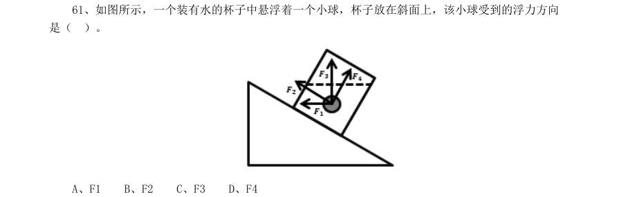

- **A.** F1
- **B.** F2
- **C.** F3
- **D.** F4

**答案：暂缺**　**考点：逻辑判断｜逻辑判断（待细分）**　**难度：★★☆☆☆**
**【2016 广东省考（乡镇）·第 62 题】判断推理·逻辑判断｜GD-2016-xz-X062**

62. 如图所示,物体沿斜面匀速滑下时,它的( )。

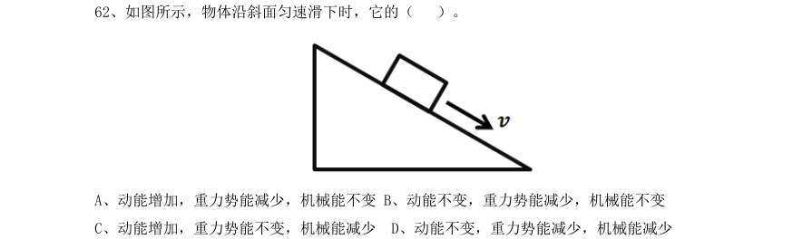

- **A.** 动能增加,重力势能减少,机械能不变
- **B.** 动能不变,重力势能减少,机械能不变
- **C.** 动能增加,重力势能不变,机械能减少
- **D.** 动能不变,重力势能减少,机械能减少

**答案：暂缺**　**考点：逻辑判断｜逻辑判断（待细分）**　**难度：★★☆☆☆**
**【2016 广东省考（乡镇）·第 63 题】判断推理·逻辑判断｜GD-2016-xz-X063**

63. 如图所示,实心蜡球漂浮在杯中的水面上,当向杯中不断慢慢加入酒精时, 以下不可能出现 的情况是( )。(己知:水的密度>蜡球的密度>酒精的密度)

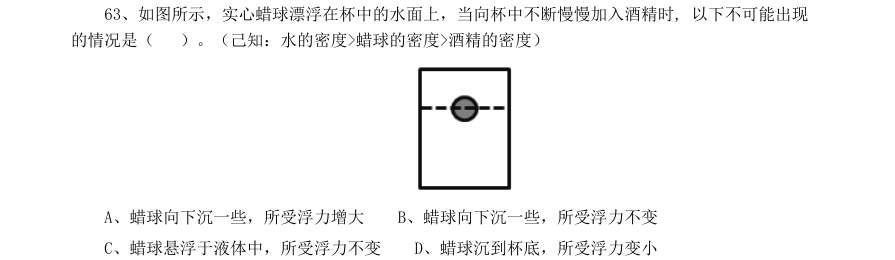

- **A.** 蜡球向下沉一些,所受浮力增大
- **B.** 蜡球向下沉一些,所受浮力不变
- **C.** 蜡球悬浮于液体中,所受浮力不变
- **D.** 蜡球沉到杯底,所受浮力变小

**答案：暂缺**　**考点：逻辑判断｜逻辑判断（待细分）**　**难度：★★★☆☆**
**【2016 广东省考（乡镇）·第 64 题】判断推理·科学推理｜GD-2016-xz-X064**

64. 用一个开关控制办公室里的两盏灯,最合理的电路图是( )。

> （本题为图形题，选项为图片，见原卷）

**答案：暂缺**　**考点：科学推理｜物理**　**难度：★★☆☆☆**
**【2016 广东省考（乡镇）·第 65 题】判断推理·逻辑判断｜GD-2016-xz-X065**

65. 下图表示了在温度变化时,加酶洗衣粉和普通洗衣粉去污力的变化情况。曲线A 表示加酶洗 衣粉的变化情况,曲线B 表示普通洗衣粉的变化情况。则下列说法正确的是( )。

- **A.** 加酶洗衣粉的去污力与温度成正比关系
- **B.** 加酶洗衣粉对温度的敏感性比普通洗衣粉小
- **C.** 在较高温度时加酶洗衣粉的去污力低于普通洗衣粉
- **D.** 在较低温度时加酶洗衣粉中酶的活性受到抑制

**答案：暂缺**　**考点：逻辑判断｜逻辑判断（待细分）**　**难度：★★★☆☆**
**【2016 广东省考（乡镇）·第 66 题】判断推理·逻辑判断｜GD-2016-xz-X066**

66. 如图所示,四个外形相同的铅球、铁球、铝球、木球静止在水中,其中能判断是实心还是空 心的是( )。

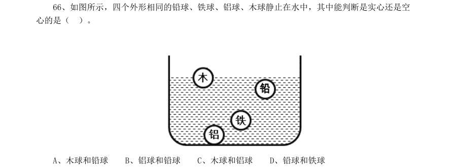

- **A.** 木球和铅球
- **B.** 铝球和铅球
- **C.** 木球和铝球
- **D.** 铅球和铁球

**答案：暂缺**　**考点：逻辑判断｜逻辑判断（待细分）**　**难度：★★☆☆☆**
**【2016 广东省考（乡镇）·第 67 题】判断推理·类比推理｜GD-2016-xz-X067**

67. 如图所示,当S1,S2 闭合时,以下说法正确的是( )。

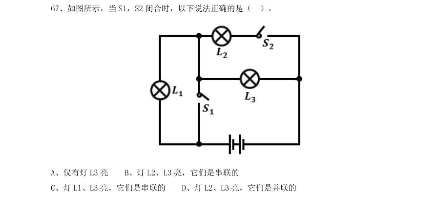

- **A.** 仅有灯L3 亮
- **B.** 灯L2、L3 亮,它们是串联的
- **C.** 灯L1、L3 亮,它们是串联的
- **D.** 灯L2、L3 亮,它们是并联的

**答案：暂缺**　**考点：类比推理｜类比推理（综合）**　**难度：★☆☆☆☆**
**【2016 广东省考（乡镇）·第 68 题】判断推理·逻辑判断｜GD-2016-xz-X068**

68. 如图所示,将弹簧测力计一端固定,另一端钩住长方体木块A,木块下面是一长木板,实验时 拉着长木板沿水平地面向左运动,读出弹簧测力计示数即可测出木块A 所受摩擦力大小,在木板运动 的过程中,以下说法正确的是( )。

- **A.** 木块A 受到的是静摩擦力
- **B.** 木块A 会相对地面匀速运动
- **C.** 木块A 所受摩擦力的方向向左
- **D.** 拉动速度变大时,弹簧测力计示数变大

**答案：暂缺**　**考点：逻辑判断｜逻辑判断（待细分）**　**难度：★★★☆☆**
**【2016 广东省考（乡镇）·第 69 题】判断推理·逻辑判断｜GD-2016-xz-X069**

69. 如图所示,在一个装着水的杯子里放进一块冰,则在冰块融化的过程中,杯子水面高度的变 化情况应当是()。

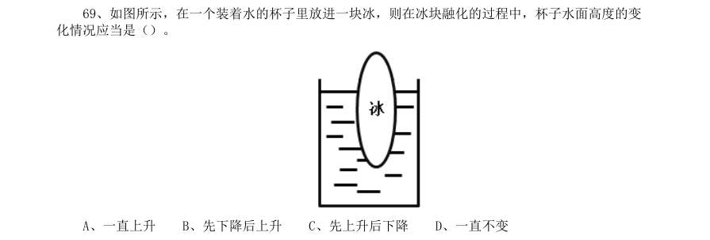

- **A.** 一直上升
- **B.** 先下降后上升
- **C.** 先上升后下降
- **D.** 一直不变

**答案：暂缺**　**考点：逻辑判断｜逻辑判断（待细分）**　**难度：★★☆☆☆**
**【2016 广东省考（乡镇）·第 70 题】判断推理·逻辑判断｜GD-2016-xz-X070**

70. 如图所示,地面上有一架天平,天平左端系有一个50g 的物体,右端通过绳子连接一组滑轮。 滑轮组合中,O、Q 为定滑轮,P 为动滑轮,下端系有一个100g 的物体。要使天平两端平衡,需要的操 作是( )。

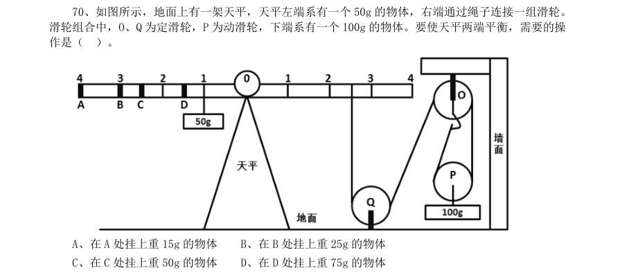

- **A.** 在A 处挂上重15g 的物体
- **B.** 在B 处挂上重25g 的物体
- **C.** 在C 处挂上重50g 的物体
- **D.** 在D 处挂上重75g 的物体

**答案：暂缺**　**考点：逻辑判断｜逻辑判断（待细分）**　**难度：★★★☆☆**
**【2016 广东省考（乡镇）·第 71 题】常识判断·经济常识｜GD-2016-xz-X071**
> 材料：案。

71. 粮食生产是国民经济的基础,耕地是粮食生产的基础。立足国内耕地资源、保障国家粮食安 全是关系我国经济社会发展全局的重大问题。 以下有关表述有误的是( )。

- **A.** 人多地少是我国基本国情,人均耕地少于世界上许多国家
- **B.** “坚守18 亿亩红线”是指确保我国耕地面积不能低于18 亿亩
- **C.** 除保障性安居工程外,任何住房用地均不得占用基本农田
- **D.** 目前,卫星遥感监测技术已被应用于我国耕地保护工作

**答案：暂缺**　**考点：经济常识｜经济常识（待细分）**　**难度：★★★★★**
**【2016 广东省考（乡镇）·第 72 题】常识判断·生活常识｜GD-2016-xz-X072**

72. 以下适合于建设防火林带的树种是( )。

- **A.** 木荷
- **B.** 松树
- **C.** 樟树
- **D.** 杉木

**答案：暂缺**　**考点：生活常识｜常识（待细分）**　**难度：★☆☆☆☆**
**【2016 广东省考（乡镇）·第 73 题】常识判断·科技常识｜GD-2016-xz-X073**

73. 春耕前,农民向田里施用草木灰主要是为了给农作物补充( )元素。

- **A.** 钾
- **B.** 氮
- **C.** 磷
- **D.** 碳

**答案：暂缺**　**考点：科技常识｜基础科学**　**难度：★☆☆☆☆**
**【2016 广东省考（乡镇）·第 74 题】常识判断·历史人文｜GD-2016-xz-X074**

74. 梯田是在山坡上开辟的农田,样子像楼梯,每一级边缘均筑有田埂。一些历史悠久的梯田已 成为受国家保护的文化遗产。修建梯田的主要目的是( )。

- **A.** 保护环境
- **B.** 传承文化
- **C.** 保持水土
- **D.** 节约人力

**答案：暂缺**　**考点：历史人文｜中国古代史**　**难度：★★★☆☆**
**【2016 广东省考（乡镇）·第 75 题】常识判断·地理常识｜GD-2016-xz-X075**

75. 现代化工业社会过多燃烧煤炭、石油和天然气等化石资源,使自然界更多(更强)地产生灾 害性天气(气候)现象,包括有( )。 1雾霾 2极光 3温室效应 4龙卷风 5酸雨 6冰雹

- **A.** 234
- **B.** 146
- **C.** 145
- **D.** 135

**答案：暂缺**　**考点：地理常识｜中国地理**　**难度：★★★☆☆**
**【2016 广东省考（乡镇）·第 76 题】常识判断·生活常识｜GD-2016-xz-X076**

76. 在众多色彩中,人们往往对红色“情有独钟”,常采用红灯做指示,比如指挥交通的红灯, 汽车尾部的红灯,公共场所安全门的红灯。这是因为,红色光在可见光中( )。

- **A.** 波长最长,且不容易被散射
- **B.** 波长最短,且不容易被散射
- **C.** 波长最长,且容易被散射
- **D.** 波长最短,且容易被散射

**答案：暂缺**　**考点：生活常识｜生活常识**　**难度：★★★☆☆**
**【2016 广东省考（乡镇）·第 77 题】常识判断·经济常识｜GD-2016-xz-X077**

77. 人口红利是指一个国家的劳动年龄人口占总人口比重较大,抚养率比较低,为经济发展创造 了有利的人口条件。目前,我国正处于人口红利的( )阶段。

- **A.** 成熟
- **B.** 发展
- **C.** 停滞
- **D.** 下降

**答案：暂缺**　**考点：经济常识｜经济常识（待细分）**　**难度：★★★☆☆**
**【2016 广东省考（乡镇）·第 78 题】常识判断·经济常识｜GD-2016-xz-X078**

78. 当一种商品价格升高而导致另一种商品需求的增加,那么这两种商品之间存在替代关系,互 为替代品。下列各项中的两种商品互为替代品的是( )。

- **A.** 羊肉、牛肉
- **B.** 大米、糖果
- **C.** 手表、时钟
- **D.** 电脑、手机

**答案：暂缺**　**考点：经济常识｜微观与市场**　**难度：★★★☆☆**
**【2016 广东省考（乡镇）·第 79 题】常识判断·生活常识｜GD-2016-xz-X079**

79. 人们在厨房做菜时,如果不小心把水滴进热油锅中,常常会发生溅油的现象。这是因为 ( )。

- **A.** 水与油一起加热产生了化学反应,释放出热量
- **B.** 水密度比油大而沸点比油低,会在油面下迅速汽化
- **C.** 油在加热情况下与水相溶,更容易蒸发而产生气泡
- **D.** 水在加热时对流速度加快,与油发生摩擦而产生了热量

**答案：暂缺**　**考点：生活常识｜科技常识**　**难度：★☆☆☆☆**
**【2016 广东省考（乡镇）·第 80 题】常识判断·科技常识｜GD-2016-xz-X080**

80. 以下选项中的工具或应用所依据的科学原理与其他三项不同的是( )。

- **A.** 温度计
- **B.** 热气球
- **C.** 热继电器
- **D.** 潮汐发电

**答案：暂缺**　**考点：科技常识｜基础科学**　**难度：★☆☆☆☆**
**【2016 广东省考（乡镇）·第 81 题】常识判断·科技常识｜GD-2016-xz-X081**

81. 物质在发生能量转化时通常都存在一系列的物理或化学反应,下列能量转化的过程存在化学 反应的是( )。

- **A.** 风力发电
- **B.** 烧煤取暖
- **C.** 冰雪融化
- **D.** 酒精挥发

**答案：暂缺**　**考点：科技常识｜基础科学**　**难度：★☆☆☆☆**
**【2016 广东省考（乡镇）·第 82 题】常识判断·生活常识｜GD-2016-xz-X082**

82. 声音可以在固态、液态和气态的介质中传播,传播的速度与介质分子间距有关,分子间距越 小,声音的传播速度越快。下列介质中声音传播速度最快的是( )。

- **A.** 铁棒
- **B.** 竹竿
- **C.** 盐水
- **D.** 液态汞

**答案：暂缺**　**考点：生活常识｜科技常识**　**难度：★★★☆☆**
**【2016 广东省考（乡镇）·第 83 题】常识判断·生活常识｜GD-2016-xz-X083**

83. 吸烟严重威胁人体健康。针对香烟产生的各种有害物质的描述,下列说法错误的是( )。

- **A.** 尼古丁可让吸烟者成瘾,并有较强的毒性
- **B.** 烟焦油易沉积于肺等器官,可诱发癌变
- **C.** 香烟燃烧时物质分解放出的射线可以致癌
- **D.** 一氧化碳易溶于水,从而与血红蛋白结合

**答案：暂缺**　**考点：生活常识｜生活常识**　**难度：★☆☆☆☆**
**【2016 广东省考（乡镇）·第 84 题】常识判断·科技常识｜GD-2016-xz-X084**

84. 自然界中,我们看到大部分植物的叶片都呈现绿色,对此解释正确的是( )。

- **A.** 叶片进行光合作用吸收了绿光
- **B.** 叶片进行光合作用释放出绿光
- **C.** 叶片反射了太阳光中的绿光
- **D.** 叶片表皮覆盖着一层绿色物质

**答案：暂缺**　**考点：科技常识｜科技常识（待细分）**　**难度：★☆☆☆☆**
**【2016 广东省考（乡镇）·第 85 题】常识判断·生活常识｜GD-2016-xz-X085**

85. 通常情况下,冰雹会出现在( )天气。

- **A.** 春日的阴雨
- **B.** 夏日的雷暴
- **C.** 秋日的晴朗
- **D.** 冬日的寒冷

**答案：暂缺**　**考点：生活常识｜生活常识**　**难度：★☆☆☆☆**
**【2016 广东省考（乡镇）·第 86 题】资料分析·增长率计算与比较｜GD-2016-xz-X086**
> 材料：从2014 年起,我省在粤东西北地区以县(市、区)为单位遴选首批14 个省级新农村连片示范建 设工程,三年将建成42 个省级新农村示范片(不含珠三角地区)。根据工作进度安排,示范片建设一 年初见成效,两年基本实现目标。与此同时,珠三角地区每年选取6 个片区开展示范片建设,为期三 年。 截至2015 年年底,全省第一、二批40 个示范片(含珠三角6 市)启动建设项目2693 个(粤东西 北1539 个,珠三角1154 个),竣工项目1711 个(粤东西北821 个,珠三角890 个),累计投入各类 资金40 亿元(粤东西北16.6 亿元,珠三角23.4 亿元)。 示范片村庄规划编制:首批示范片的64 个行政村和375 个自然村,已100%完成村庄规划编制。第 二批示范片的59 个行政村和386 个自然村中,已完成村庄规划编制的行政村55 个,自然村307 个, 分别占93.2%和79.5%。

86. 第二批391 个自然村 中,有67.0%的自然村实现通自来水。 村巷道硬底化建设:首批示范片中完成村巷道硬底化建设的自然村有256 个,占68.3%。第二批中 有59.8%的自然村完成村巷道硬底化建设。 群众参与共谋共建情况:首批示范片375 个自然村中,成立村民理事会的占99.7%。第二批391 个 自然村中,成立村民理事会的占98.2%。 在第一、二批40 个示范片(含珠三角6 市)已竣工的项目中,粤东西北地区约占了( )。

- **A.** 47%
- **B.** 48%
- **C.** 49%
- **D.** 50%

**答案：暂缺**　**考点：增长率计算与比较｜增长率计算（综合）**　**难度：★★★☆☆**
**【2016 广东省考（乡镇）·第 87 题】资料分析·综合分析｜GD-2016-xz-X087**
> 材料：从2014 年起,我省在粤东西北地区以县(市、区)为单位遴选首批14 个省级新农村连片示范建 设工程,三年将建成42 个省级新农村示范片(不含珠三角地区)。根据工作进度安排,示范片建设一 年初见成效,两年基本实现目标。与此同时,珠三角地区每年选取6 个片区开展示范片建设,为期三 年。 截至2015 年年底,全省第一、二批40 个示范片(含珠三角6 市)启动建设项目2693 个(粤东西 北1539 个,珠三角1154 个),竣工项目1711 个(粤东西北821 个,珠三角890 个),累计投入各类 资金40 亿元(粤东西北16.6 亿元,珠三角23.4 亿元)。 示范片村庄规划编制:首批示范片的64 个行政村和375 个自然村,已100%完成村庄规划编制。第 二批示范片的59 个行政村和386 个自然村中,已完成村庄规划编制的行政村55 个,自然村307 个, 分别占93.2%和79.5%。

87. 第二批示范片的自然村中,实现通自来水的约有( )个。

- **A.** 256
- **B.** 262
- **C.** 267
- **D.** 273

**答案：暂缺**　**考点：综合分析｜综合分析（综合）**　**难度：★★★☆☆**
**【2016 广东省考（乡镇）·第 88 题】资料分析·综合分析｜GD-2016-xz-X088**
> 材料：从2014 年起,我省在粤东西北地区以县(市、区)为单位遴选首批14 个省级新农村连片示范建 设工程,三年将建成42 个省级新农村示范片(不含珠三角地区)。根据工作进度安排,示范片建设一 年初见成效,两年基本实现目标。与此同时,珠三角地区每年选取6 个片区开展示范片建设,为期三 年。 截至2015 年年底,全省第一、二批40 个示范片(含珠三角6 市)启动建设项目2693 个(粤东西 北1539 个,珠三角1154 个),竣工项目1711 个(粤东西北821 个,珠三角890 个),累计投入各类 资金40 亿元(粤东西北16.6 亿元,珠三角23.4 亿元)。 示范片村庄规划编制:首批示范片的64 个行政村和375 个自然村,已100%完成村庄规划编制。第 二批示范片的59 个行政村和386 个自然村中,已完成村庄规划编制的行政村55 个,自然村307 个, 分别占93.2%和79.5%。

88. 首批示范片的自然村中,完成率最高的是( )。

- **A.** 村庄环境卫生
- **B.** 自来水建设
- **C.** 村巷道硬底化建设
- **D.** 群众参与共谋共建情况

**答案：暂缺**　**考点：综合分析｜综合分析（综合）**　**难度：★★★☆☆**
**【2016 广东省考（乡镇）·第 89 题】资料分析·综合分析｜GD-2016-xz-X089**
> 材料：从2014 年起,我省在粤东西北地区以县(市、区)为单位遴选首批14 个省级新农村连片示范建 设工程,三年将建成42 个省级新农村示范片(不含珠三角地区)。根据工作进度安排,示范片建设一 年初见成效,两年基本实现目标。与此同时,珠三角地区每年选取6 个片区开展示范片建设,为期三 年。 截至2015 年年底,全省第一、二批40 个示范片(含珠三角6 市)启动建设项目2693 个(粤东西 北1539 个,珠三角1154 个),竣工项目1711 个(粤东西北821 个,珠三角890 个),累计投入各类 资金40 亿元(粤东西北16.6 亿元,珠三角23.4 亿元)。 示范片村庄规划编制:首批示范片的64 个行政村和375 个自然村,已100%完成村庄规划编制。第 二批示范片的59 个行政村和386 个自然村中,已完成村庄规划编制的行政村55 个,自然村307 个, 分别占93.2%和79.5%。

89. 第一、二批示范片的自然村中,完成率差距最大的是( )。

- **A.** 村庄规划编制
- **B.** 村庄环境卫生
- **C.** 自来水建设
- **D.** 群众参与共谋共建情况

**答案：暂缺**　**考点：综合分析｜综合分析（综合）**　**难度：★★★☆☆**
**【2016 广东省考（乡镇）·第 90 题】资料分析·综合分析｜GD-2016-xz-X090**
> 材料：从2014 年起,我省在粤东西北地区以县(市、区)为单位遴选首批14 个省级新农村连片示范建 设工程,三年将建成42 个省级新农村示范片(不含珠三角地区)。根据工作进度安排,示范片建设一 年初见成效,两年基本实现目标。与此同时,珠三角地区每年选取6 个片区开展示范片建设,为期三 年。 截至2015 年年底,全省第一、二批40 个示范片(含珠三角6 市)启动建设项目2693 个(粤东西 北1539 个,珠三角1154 个),竣工项目1711 个(粤东西北821 个,珠三角890 个),累计投入各类 资金40 亿元(粤东西北16.6 亿元,珠三角23.4 亿元)。 示范片村庄规划编制:首批示范片的64 个行政村和375 个自然村,已100%完成村庄规划编制。第 二批示范片的59 个行政村和386 个自然村中,已完成村庄规划编制的行政村55 个,自然村307 个, 分别占93.2%和79.5%。

90. 下列说法有误的是( )。

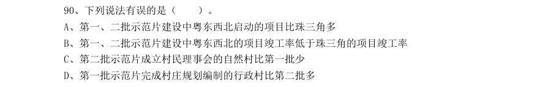

- **A.** 第一、二批示范片建设中粤东西北启动的项目比珠三角多
- **B.** 第一、二批示范片建设中粤东西北的项目竣工率低于珠三角的项目竣工率
- **C.** 第二批示范片成立村民理事会的自然村比第一批少
- **D.** 第一批示范片完成村庄规划编制的行政村比第二批多

**答案：暂缺**　**考点：综合分析｜综合分析（综合）**　**难度：★★★★★**
**【2016 广东省考（乡镇）·第 91 题】资料分析·综合分析｜GD-2016-xz-X091**

91. 根据下列资料,回答91~95 题: 2011—2014 年,新型农村合作医疗基金支出同比增长幅度最高的是( )年。

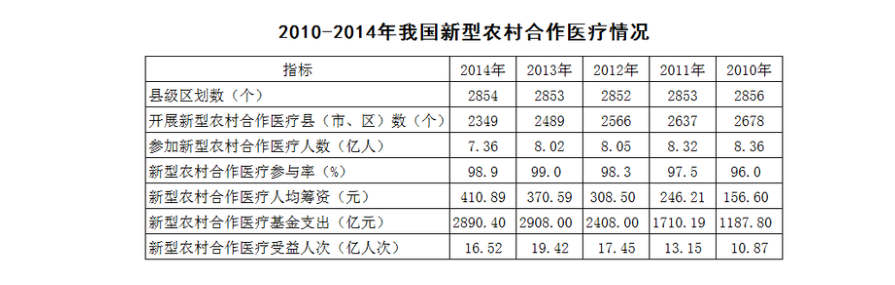

- **A.** 2011
- **B.** 2012
- **C.** 2013
- **D.** 2014

**答案：暂缺**　**考点：综合分析｜综合分析（综合）**　**难度：★★★☆☆**
**【2016 广东省考（乡镇）·第 92 题】资料分析·比重计算与比较｜GD-2016-xz-X092**

92. 2010—2014 年,开展新型农村合作医疗的县(市、区)数量占县级区划数90%以上的年份有 ( )个。

> 材料图见 images/GD-2016-xz-X091-m.jpg

- **A.** 1
- **B.** 2
- **C.** 3
- **D.** 4

**答案：暂缺**　**考点：比重计算与比较｜现期比重**　**难度：★☆☆☆☆**
**【2016 广东省考（乡镇）·第 93 题】资料分析·增长率计算与比较｜GD-2016-xz-X093**

93. 2011—2014 年,新型农村合作医疗受益人次增长率最高的是( )年。

> 材料图见 images/GD-2016-xz-X091-m.jpg

- **A.** 2011
- **B.** 2012
- **C.** 2013
- **D.** 2014

**答案：暂缺**　**考点：增长率计算与比较｜增长率计算**　**难度：★☆☆☆☆**
**【2016 广东省考（乡镇）·第 94 题】资料分析·综合分析｜GD-2016-xz-X094**

94. 2010—2014 年,参加新型农村合作医疗人数最多的一年比人数最少的一年多了( )亿。

> 材料图见 images/GD-2016-xz-X091-m.jpg

- **A.** 0.31
- **B.** 0.34
- **C.** 0.65
- **D.** 1

**答案：暂缺**　**考点：综合分析｜综合分析（综合）**　**难度：★★★☆☆**
**【2016 广东省考（乡镇）·第 95 题】资料分析·综合分析｜GD-2016-xz-X095**

95. 下列说法有误的是( )。

> 材料图见 images/GD-2016-xz-X091-m.jpg

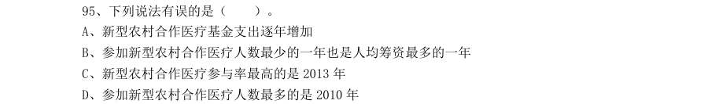

- **A.** 新型农村合作医疗基金支出逐年增加
- **B.** 参加新型农村合作医疗人数最少的一年也是人均筹资最多的一年
- **C.** 新型农村合作医疗参与率最高的是2013 年
- **D.** 参加新型农村合作医疗人数最多的是2010 年

**答案：暂缺**　**考点：综合分析｜平均数**　**难度：★★★☆☆**
**【2016 广东省考（乡镇）·第 96 题】资料分析·年均增长率｜GD-2016-xz-X096**

96. 2006 年至2011 年期间,平均每年增加的人数为( )万人。

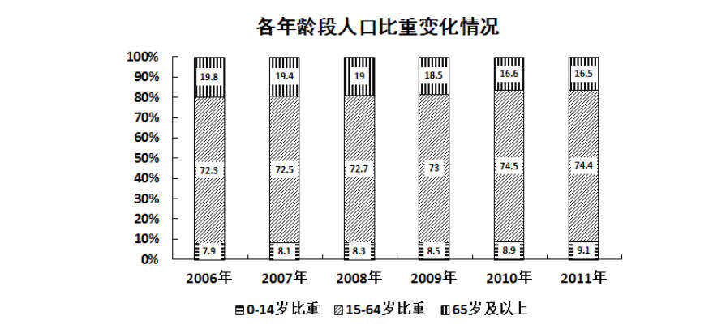

- **A.** 531.3
- **B.** 657.4
- **C.** 752.4
- **D.** 839.2

**答案：暂缺**　**考点：年均增长率｜年均增长率计算**　**难度：★☆☆☆☆**
**【2016 广东省考（乡镇）·第 97 题】资料分析·增长率计算与比较｜GD-2016-xz-X097**

97. 按2011 年的人口自然增长率计算,预计2012 年的人口约为( )万人。

> 材料图见 images/GD-2016-xz-X096-m.jpg

- **A.** 135382
- **B.** 135409
- **C.** 141129
- **D.** 141202

**答案：暂缺**　**考点：增长率计算与比较｜增长率计算**　**难度：★☆☆☆☆**
**【2016 广东省考（乡镇）·第 98 题】资料分析·综合分析｜GD-2016-xz-X098**

98. 2011 年的总人口中,“65 岁及以上”的人口比“0-14 岁”的人口大约多( )万人。

> 材料图见 images/GD-2016-xz-X096-m.jpg

- **A.** 7910
- **B.** 8850
- **C.** 9320
- **D.** 9970

**答案：暂缺**　**考点：综合分析｜综合分析（综合）**　**难度：★★★☆☆**
**【2016 广东省考（乡镇）·第 99 题】资料分析·综合分析｜GD-2016-xz-X099**

99. 以下说法错误的是( )。

> 材料图见 images/GD-2016-xz-X096-m.jpg

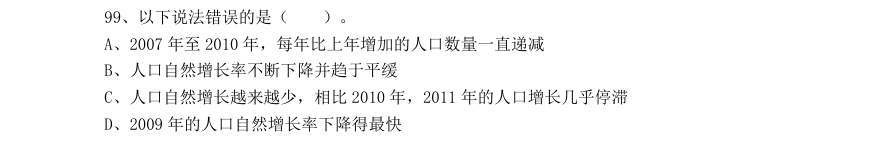

- **A.** 2007 年至2010 年,每年比上年增加的人口数量一直递减
- **B.** 人口自然增长率不断下降并趋于平缓
- **C.** 人口自然增长越来越少,相比2010 年,2011 年的人口增长几乎停滞
- **D.** 2009 年的人口自然增长率下降得最快

**答案：暂缺**　**考点：综合分析｜增长率**　**难度：★★★★★**
**【2016 广东省考（乡镇）·第 100 题】资料分析·综合分析｜GD-2016-xz-X100**

100. 根据资料,我们可以得知( )。

> 材料图见 images/GD-2016-xz-X096-m.jpg

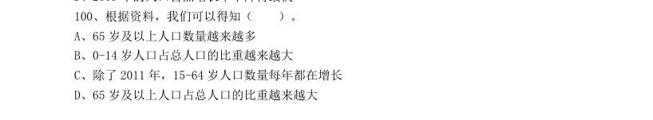

- **A.** 65 岁及以上人口数量越来越多
- **B.** 0-14 岁人口占总人口的比重越来越大
- **C.** 除了2011 年,15-64 岁人口数量每年都在增长
- **D.** 65 岁及以上人口占总人口的比重越来越大

**答案：暂缺**　**考点：综合分析｜比重**　**难度：★★★☆☆**