# 2019 广东省考（乡镇）·行测

- 题量：100（含答案 0）
- 考试类型：广东省考
- 模块分布：资料分析20 / 数量关系15 / 言语理解10 / 判断推理35 / 常识判断20
- 试卷编号：`广东-2019-乡镇`

## 题目与答案

**【2019 广东省考（乡镇）·第 1 题】言语理解·逻辑填空｜GD-2019-xz-X001**
> 材料：个选项中选出一个最恰当的答案。

1. 多元的发展机会和自由的成长空间,是时代给予每个追梦人的馈赠;( )每个追梦人在前进道路上迈出的 每一步,( )都在推动时代的进步。

- **A.** 而 也
- **B.** 但 却
- **C.** 如果 就
- **D.** 只有 才

**答案：暂缺**　**考点：逻辑填空｜逻辑填空（待细分）**　**难度：★☆☆☆☆**
**【2019 广东省考（乡镇）·第 2 题】言语理解·逻辑填空｜GD-2019-xz-X002**

2. 只要我们迈出的步伐足够坚实,前进的意志足够( ),奋斗路上的困难终将被克服,前进路上的沟壑终将 被跨越。

- **A.** 强硬
- **B.** 奋勇
- **C.** 坚定
- **D.** 坚硬

**答案：暂缺**　**考点：逻辑填空｜逻辑填空（待细分）**　**难度：★☆☆☆☆**
**【2019 广东省考（乡镇）·第 3 题】言语理解·逻辑填空｜GD-2019-xz-X003**

3. 近年来,各地纷纷大刀阔斧地开展( ),向不担当不作为亮剑。

- **A.** 整理
- **B.** 整治
- **C.** 修理
- **D.** 梳理

**答案：暂缺**　**考点：逻辑填空｜逻辑填空（待细分）**　**难度：★☆☆☆☆**
**【2019 广东省考（乡镇）·第 4 题】言语理解·逻辑填空｜GD-2019-xz-X004**

4. 在落实乡村振兴战略的过程中,一定要科学规划,( ),才能最终实现目标,任何希望( )的想法都 是不切实际的。

- **A.** 循序渐进 一蹴而就
- **B.** 寻根究底 一鼓作气
- **C.** 蔚然成风 一劳永逸
- **D.** 未雨绸缪 一马当先

**答案：暂缺**　**考点：逻辑填空｜逻辑填空（待细分）**　**难度：★☆☆☆☆**
**【2019 广东省考（乡镇）·第 5 题】言语理解·逻辑填空｜GD-2019-xz-X005**

5. 持续深入的人才发展体制机制改革,为( )、( )、( )、( )打牢了坚实基础,有力推进 了新时代中国特色社会主义伟大事业不断夺取新的伟大胜利。

- **A.** 引才 聚才 用才 育才
- **B.** 聚才 用才 育才 引才
- **C.** 用才 育才 引才 聚才
- **D.** 育才 引才 聚才 用才

**答案：暂缺**　**考点：逻辑填空｜逻辑填空（待细分）**　**难度：★☆☆☆☆**
**【2019 广东省考（乡镇）·第 6 题】言语理解·中心理解｜GD-2019-xz-X006**

6. 回顾40 年,改革开放旗帜之所以始终高高飘扬,关键得益于基层求新求变的强大意愿以及敢闯敢试的探索精神, 改革再扬帆,也必须尊重基层干部群众在改革进程中的主体性作用。 对这段文字理解准确的是( )。

- **A.** 实践是改革开放最关键的一环
- **B.** 基层的探索精神完全决定于改革的效果
- **C.** 改革必须发挥基层干部群众的主观能动性
- **D.** 改革开放促使基层创新求变

**答案：暂缺**　**考点：中心理解｜对策优先**　**难度：★☆☆☆☆**
**【2019 广东省考（乡镇）·第 7 题】言语理解·中心理解｜GD-2019-xz-X007**

7. 尽管从农业社会走向现代社会,是经济社会发展的必然,但这样不是促使农业农村的“消亡”,做好“三农” 工作,建设好农村,发展好农业,使广大农民获得感、安全感不断提升,依然是社会主义建设的主要内容。 这段文字主要说明了( )。

- **A.** 我国目前仍然处于农业社会
- **B.** “三农”工作的重要性
- **C.** 农业农村会随着经济社会的发展“消亡”
- **D.** 广大农民的获得感、幸福感、安全感有待提升

**答案：暂缺**　**考点：中心理解｜中心句与主旨**　**难度：★★☆☆☆**
**【2019 广东省考（乡镇）·第 8 题】言语理解·中心理解｜GD-2019-xz-X008**

8. 扶贫干部自掏腰包到基层扶贫,是真扶贫、扶真贫的体现。但若一味宣扬扶贫干部自掏腰包扶贫,不仅会加重 扶贫干部的经济负担,还会在一定程度上让贫困群众产生依赖心理。 对这段文字理解准确的是( )。

- **A.** 一味宣扬扶贫干部自掏腰包扶贫具有一定的副作用
- **B.** 应该大力提倡扶贫干部自掏腰包支持贫困户
- **C.** 当前存在大量扶贫干部自掏腰包扶贫的情况
- **D.** 扶贫干部自掏腰包扶贫是不得已而为之的

**答案：暂缺**　**考点：中心理解｜中心理解（综合）**　**难度：★☆☆☆☆**
**【2019 广东省考（乡镇）·第 9 题】言语理解·中心理解｜GD-2019-xz-X009**

9. 完善村民自治,应推动乡村治理重心下移,尽可能把资源、服务、管理下放到基层,培育打造服务性、公益性、 互动性农村社会组织,开展农村社会工作和志愿服务,发挥新乡贤作用。 对这段文字理解准确的是( )。

- **A.** 完善村民自治需要大量引进志愿者
- **B.** 完善村民自治需要让乡贤发挥主要作用
- **C.** 完善村民自治需要把所有资源下放到基层
- **D.** 完善村民自治需要发展农村社会组织

**答案：暂缺**　**考点：中心理解｜中心理解（综合）**　**难度：★☆☆☆☆**
**【2019 广东省考（乡镇）·第 10 题】言语理解·中心理解｜GD-2019-xz-X010**

10. 推动媒体融合发展,事关推进国家治理体系和治理能力现代化。在全媒体时代,媒体不仅是信息的提供者和传 播者,而且在国家治理中也发挥着重要作用。因此,媒体融合不仅仅是一个传播命题,还是一个治理命题。 这段文字的主旨是( )。

- **A.** 国家治理现代化需要促进媒体融合
- **B.** 媒体融合发展有利于促进信息传播
- **C.** 媒体融合发展是信息技术发展的需要
- **D.** 媒体在国家治理中应承担主要责任

**答案：暂缺**　**考点：中心理解｜转折与因果**　**难度：★★☆☆☆**
**【2019 广东省考（乡镇）·第 11 题】数量关系·数字推理｜GD-2019-xz-X011**
> 材料：要求你迅速、准确地计算出答案。

11. 4 7 10 13 ( )

- **A.** 15
- **B.** 16
- **C.** 17
- **D.** 18

**答案：暂缺**　**考点：数字推理｜多级数列**　**难度：★★★☆☆**
**【2019 广东省考（乡镇）·第 12 题】数量关系·数字推理｜GD-2019-xz-X012**

12. 5 9 17 33 ( )

- **A.** 35
- **B.** 45
- **C.** 65
- **D.** 85

**答案：暂缺**　**考点：数字推理｜数字推理（待细分）**　**难度：★★★☆☆**
**【2019 广东省考（乡镇）·第 13 题】数量关系·数字推理｜GD-2019-xz-X013**

13. 5 15 45 135 ( )

- **A.** 185
- **B.** 225
- **C.** 355
- **D.** 405

**答案：暂缺**　**考点：数字推理｜数字推理（待细分）**　**难度：★★★☆☆**
**【2019 广东省考（乡镇）·第 14 题】数量关系·数字推理｜GD-2019-xz-X014**

14. 64 32 16 8 ( )

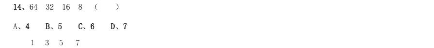

- **A.** 4
- **B.** 5
- **C.** 6
- **D.** 7

**答案：暂缺**　**考点：数字推理｜数字推理（待细分）**　**难度：★★★☆☆**
**【2019 广东省考（乡镇）·第 15 题】数量关系·数字推理｜GD-2019-xz-X015**

15. ( )

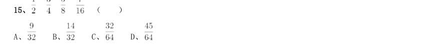

> （本题为图形题，选项为图片，见原卷）

**答案：暂缺**　**考点：数字推理｜数字推理（待细分）**　**难度：★★★★★**
**【2019 广东省考（乡镇）·第 16 题】数量关系·数字推理｜GD-2019-xz-X016**

16. 乡镇干部小李今天有3 项不同的工作要完成,则他今天完成工作的顺序共有( )种。

- **A.** 3
- **B.** 4
- **C.** 5
- **D.** 6

**答案：暂缺**　**考点：数字推理｜数字推理（待细分）**　**难度：★★★☆☆**
**【2019 广东省考（乡镇）·第 17 题】数量关系·数字推理｜GD-2019-xz-X017**

17. 某机构计划在一块边长为18 米的正方形空地开展活动,需要在空地四边每隔2 米插上一面彩旗,若该空地的 四个角都需要插上彩旗,那么一共需要( )面彩旗。

- **A.** 32
- **B.** 36
- **C.** 44
- **D.** 48

**答案：暂缺**　**考点：数字推理｜数字推理（待细分）**　**难度：★★★★☆**
**【2019 广东省考（乡镇）·第 18 题】数量关系·数字推理｜GD-2019-xz-X018**

18. 在一次知识竞赛中,甲、乙两单位平均分为85 分,甲单位得分比乙单位高10 分,则乙单位得分为( )分。

- **A.** 88
- **B.** 85
- **C.** 80
- **D.** 75

**答案：暂缺**　**考点：数字推理｜数字推理（待细分）**　**难度：★★★☆☆**
**【2019 广东省考（乡镇）·第 19 题】数量关系·数字推理｜GD-2019-xz-X019**

19. 某文印室有30 袋A4 纸和20 袋B3 纸。由于工作需要,该文印室每天都会用掉6 袋A4 纸和2 袋B3 纸,则三天 后文印室的B3 纸比A4 纸多( )袋。

- **A.** 1
- **B.** 2
- **C.** 3
- **D.** 4

**答案：暂缺**　**考点：数字推理｜递推数列**　**难度：★★★★☆**
**【2019 广东省考（乡镇）·第 20 题】数量关系·数字推理｜GD-2019-xz-X020**

20. 某单位男女干部人数相等,男干部中 有基层工作经历,女干部中 有基层工作经历。则在该单位全体干 部中,有基层工作经历的占( )。

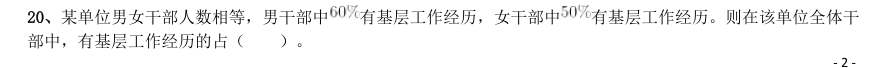

- **A.** 
- **B.** 
- **C.** 
- **D.** 

**答案：暂缺**　**考点：数字推理｜数字推理（待细分）**　**难度：★★★★☆**
**【2019 广东省考（乡镇）·第 21 题】数量关系·数字推理｜GD-2019-xz-X021**

21. 某商场为了提高销量,以七五折销售笔记本电脑,打折后销售3600 元。则该笔记本原价为每台( )元。

- **A.** 4200
- **B.** 4500
- **C.** 4800
- **D.** 5100

**答案：暂缺**　**考点：数字推理｜数字推理（待细分）**　**难度：★★★☆☆**
**【2019 广东省考（乡镇）·第 22 题】数量关系·其他数量关系｜GD-2019-xz-X022**

22. 某办公室有大、中、小三种型号的文件袋共200 个,已知大号文件袋数量是中号文件袋的2 倍,小号文件袋的 数量为50 个,那么大号文件袋有( )个。

- **A.** 50
- **B.** 60
- **C.** 80
- **D.** 100

**答案：暂缺**　**考点：其他数量关系｜和差倍比**　**难度：★☆☆☆☆**
**【2019 广东省考（乡镇）·第 23 题】数量关系·数字推理｜GD-2019-xz-X023**

23. 甲乙两人绕着周长为600 米的环形跑道跑步,他们从相同的起点同时同向起跑。已知甲的速度为每秒4 米,乙 的速度为每秒3 米,则当甲第一次回到起点时,乙距离起点还有( )米。

- **A.** 100
- **B.** 150
- **C.** 200
- **D.** 250

**答案：暂缺**　**考点：数字推理｜数字推理（待细分）**　**难度：★★★★☆**
**【2019 广东省考（乡镇）·第 24 题】数量关系·数字推理｜GD-2019-xz-X024**

24. 小王距离单位1.2 公里,每天步行上班。速度为每分钟100 米,则他上班需要花( )分钟。

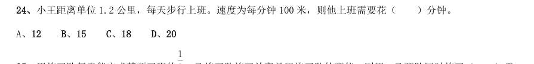

- **A.** 12
- **B.** 15
- **C.** 18
- **D.** 20

**答案：暂缺**　**考点：数字推理｜数字推理（待细分）**　**难度：★★★☆☆**
**【2019 广东省考（乡镇）·第 25 题】数量关系·工程问题｜GD-2019-xz-X025**

25. 甲施工队每天能完成某项工程的 ,乙施工队施工效率是甲施工队的两倍,则甲、乙两队同时施工( )天 就能完成该工程。

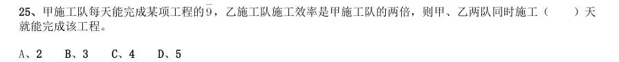

- **A.** 2
- **B.** 3
- **C.** 4
- **D.** 5

**答案：暂缺**　**考点：工程问题｜给定效率型**　**难度：★☆☆☆☆**
**【2019 广东省考（乡镇）·第 26 题】判断推理·图形推理｜GD-2019-xz-X026**
> 材料：选出一个最恰当的答案。

26. 下列选项中最符合所给图形规律的是( )。

> （本题为图形题，选项为图片，见原卷）

**答案：暂缺**　**考点：图形推理｜图形推理（待细分）**　**难度：★★★★☆**
**【2019 广东省考（乡镇）·第 27 题】判断推理·图形推理｜GD-2019-xz-X027**

27. 下列选项中最符合所给图形规律的是( )。

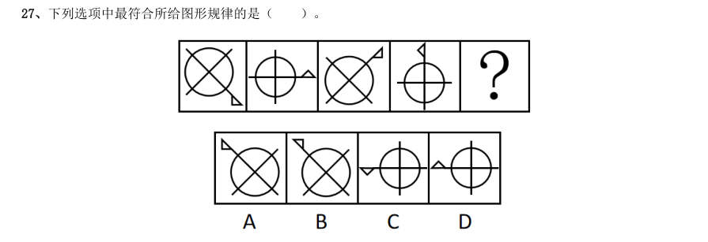

> （本题为图形题，选项为图片，见原卷）

**答案：暂缺**　**考点：图形推理｜图形推理（待细分）**　**难度：★★★★☆**
**【2019 广东省考（乡镇）·第 28 题】判断推理·图形推理｜GD-2019-xz-X028**

28. 下列选项中最符合所给图形规律的是( )。

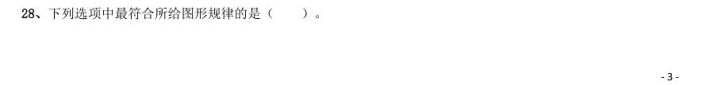

> （本题为图形题，选项为图片，见原卷）

**答案：暂缺**　**考点：图形推理｜图形推理（待细分）**　**难度：★★★★☆**
**【2019 广东省考（乡镇）·第 29 题】判断推理·图形推理｜GD-2019-xz-X029**

29. 如图所示,这三个小图形可以组成的图形是( )。

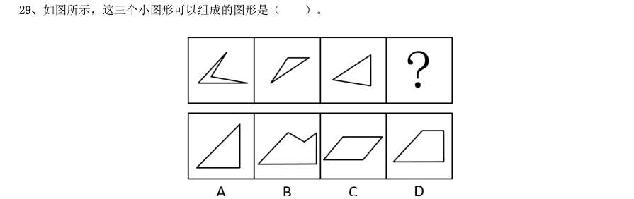

> （本题为图形题，选项为图片，见原卷）

**答案：暂缺**　**考点：图形推理｜图形推理（待细分）**　**难度：★★★★☆**
**【2019 广东省考（乡镇）·第 30 题】判断推理·图形推理｜GD-2019-xz-X030**

30. 如图所示,四个相同的等腰直角三角形,不可能组成的图形是( )。

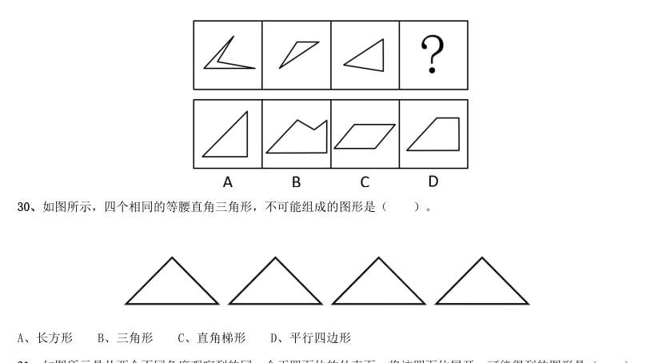

- **A.** 长方形
- **B.** 三角形
- **C.** 直角梯形
- **D.** 平行四边形

**答案：暂缺**　**考点：图形推理｜数量规律**　**难度：★★☆☆☆**
**【2019 广东省考（乡镇）·第 31 题】判断推理·图形推理｜GD-2019-xz-X031**

31. 如图所示是从两个不同角度观察到的同一个正四面体的外表面,将该四面体展开,可能得到的图形是( )。

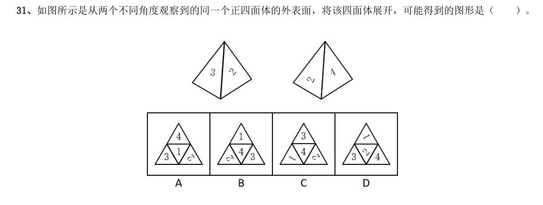

> （本题为图形题，选项为图片，见原卷）

**答案：暂缺**　**考点：图形推理｜折纸盒**　**难度：★★★★☆**
**【2019 广东省考（乡镇）·第 32 题】判断推理·图形推理｜GD-2019-xz-X032**

32. 下列选项,与所给立体图形不同的是( )。

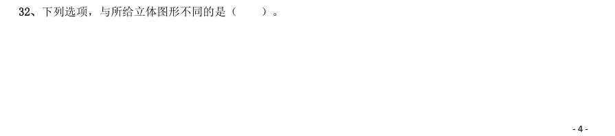

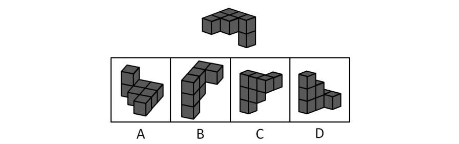

> （本题为图形题，选项为图片，见原卷）

**答案：暂缺**　**考点：图形推理｜立体图形**　**难度：★★★★☆**
**【2019 广东省考（乡镇）·第 33 题】判断推理·图形推理｜GD-2019-xz-X033**

33. 下列选项中,不可能是所给立方体展开图的是( )。

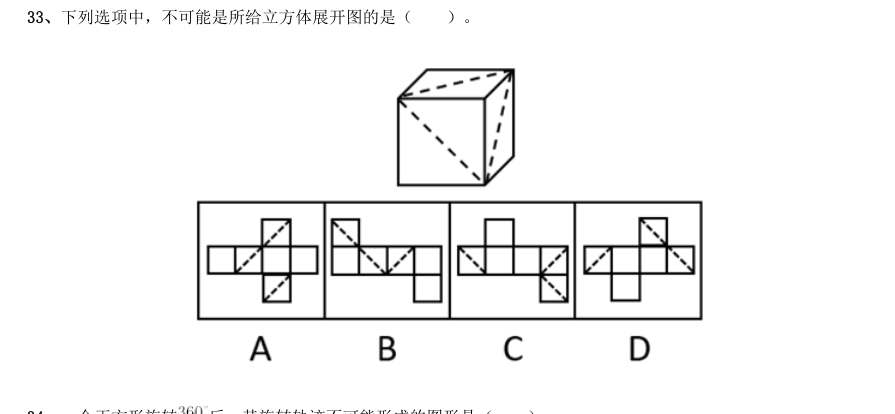

> （本题为图形题，选项为图片，见原卷）

**答案：暂缺**　**考点：图形推理｜折纸盒**　**难度：★★★★☆**
**【2019 广东省考（乡镇）·第 34 题】判断推理·图形推理｜GD-2019-xz-X034**

34. 一个正方形旋转 后,其旋转轨迹不可能形成的图形是( )。

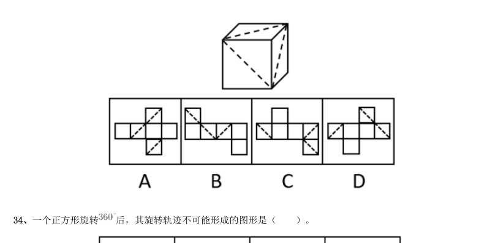

> （本题为图形题，选项为图片，见原卷）

**答案：暂缺**　**考点：图形推理｜位置规律**　**难度：★★★★☆**
**【2019 广东省考（乡镇）·第 35 题】判断推理·图形推理｜GD-2019-xz-X035**

35. 如图所示,所给物体的俯视图不可能是( )。

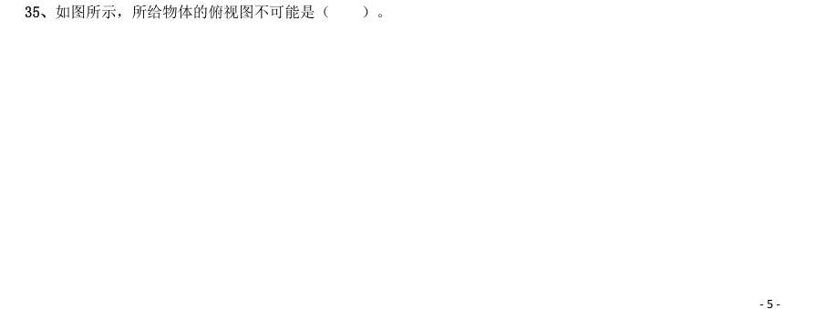

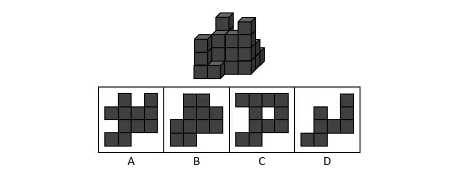

> （本题为图形题，选项为图片，见原卷）

**答案：暂缺**　**考点：图形推理｜三视图**　**难度：★★☆☆☆**
**【2019 广东省考（乡镇）·第 36 题】判断推理·类比推理｜GD-2019-xz-X036**

36. 民风:淳朴( )

- **A.** 阳光:灿烂
- **B.** 书本:文化
- **C.** 树木:开花
- **D.** 喜悦:笑容

**答案：暂缺**　**考点：类比推理｜类比推理（综合）**　**难度：★☆☆☆☆**
**【2019 广东省考（乡镇）·第 37 题】判断推理·类比推理｜GD-2019-xz-X037**

37. 纺织:布匹( )

- **A.** 矿石:金属
- **B.** 努力:收获
- **C.** 工作:奉献
- **D.** 耕种:粮食

**答案：暂缺**　**考点：类比推理｜类比推理（综合）**　**难度：★☆☆☆☆**
**【2019 广东省考（乡镇）·第 38 题】判断推理·类比推理｜GD-2019-xz-X038**

38. 水稻:植物( )

- **A.** 木耳:银耳
- **B.** 香蕉:水果
- **C.** 动物:田鼠
- **D.** 米饭:面条

**答案：暂缺**　**考点：类比推理｜类比推理（综合）**　**难度：★☆☆☆☆**
**【2019 广东省考（乡镇）·第 39 题】判断推理·类比推理｜GD-2019-xz-X039**

39. 丰富:贫乏( )

- **A.** 体贴:粗犷
- **B.** 精致:丑恶
- **C.** 拘束:随意
- **D.** 振奋:高兴

**答案：暂缺**　**考点：类比推理｜类比推理（综合）**　**难度：★☆☆☆☆**
**【2019 广东省考（乡镇）·第 40 题】判断推理·类比推理｜GD-2019-xz-X040**

40. 贫困:扶贫:脱贫( )

- **A.** 垃圾:清扫:整洁
- **B.** 拥堵:交警:畅通
- **C.** 噪音:抑制:平静
- **D.** 羸弱:锻炼:健壮

**答案：暂缺**　**考点：类比推理｜类比推理（综合）**　**难度：★☆☆☆☆**
**【2019 广东省考（乡镇）·第 41 题】判断推理·逻辑判断｜GD-2019-xz-X041**

41. 一座城市要想发展好会展产业,就需要“筑巢引凤”——先具备软硬件基础,再吸引会展活动。拥有完备的会 展设施和理想的交通条件,只是说明一座城市具备了发展会展产业的硬件基础,要想吸引足够数量的高质量会展活 动,还需要提高公共服务水平、构建良好的营商环境,从而加强软实力的建设。 如果上述表述为真,则以下情况中不可能发生的是( )。

- **A.** 甲市具备了发展会展产业的硬件基础,却发展不好会展产业
- **B.** 乙市大力提升公共服务水平,吸引了足够数量的高质量会展活动
- **C.** 丙市的会展产业非常发达,但市政设施老化的问题日渐突出
- **D.** 丁市会展设施完备、交通条件理想,但未具备发展会展产业的硬件基础

**答案：暂缺**　**考点：逻辑判断｜加强论证**　**难度：★★★★★**
**【2019 广东省考（乡镇）·第 42 题】判断推理·逻辑判断｜GD-2019-xz-X042**

42. G 市经济发达、教育资源丰富,许多在G 市就读的大学生毕业后都选择留在G 市工作生活。但在今年,G 市周 边的几个城市都出台了一系列针对大学生落户的优惠政策,许多G 市大学生因此选择将户口迁往周边城市。由此可 以预测,今年留在G 市的大学生将会更容易找到工作。 以下最能反驳上述论证的是( )。

- **A.** G 市周边的几个城市中,大学生同样不容易找到心仪的工作
- **B.** 与去年相比,今年G 市的几个大型工厂招收工人数量有所减少
- **C.** 绝大多数将户口迁往周边城市的G 市大学生仍然选择在G 市工作
- **D.** 有调查指出,过去几年在G 市的大学生并没有面临很大的就业压力

**答案：暂缺**　**考点：逻辑判断｜削弱论证**　**难度：★★★★★**
**【2019 广东省考（乡镇）·第 43 题】判断推理·逻辑判断｜GD-2019-xz-X043**

43. 在发达国家的产业结构中,服务业占了很高的比重。根据他们的经验,提高服务业占比就可以促进就业。但是, 服务业具有较高的进入壁垒,这也是我国服务业发展相对滞后的一个重要原因。因此,我国可以通过打破服务业的 行业壁垒进一步促进就业。 以下最可能是上述论证潜在假设的是( )。

- **A.** 服务业促进就业的规律适用于我国
- **B.** 我国创造就业的能力弱于发达国家
- **C.** 发达国家的服务业也存在行业壁垒
- **D.** 其他行业对促进就业没有显著作用

**答案：暂缺**　**考点：逻辑判断｜前提假设**　**难度：★★★☆☆**
**【2019 广东省考（乡镇）·第 44 题】判断推理·逻辑判断｜GD-2019-xz-X044**

44. 近年来随着大型野生动物园的兴起,有人提出,传统城市动物园已经没有存在的必要性。但传统城市动物园具 有票价低、交通便利等优点,中小学组织参观十分方便,因而具有很强的教育功能,所以传统城市动物园不可或缺。 以下不属于上述论证缺陷的是( )。

- **A.** 忽视了野生动物园和传统城市动物园具有并存的可能性
- **B.** 默认了具有很强教育功能的传统城市动物园就应该保留
- **C.** 忽视了票价低、交通便利不等同于方便中小学组织参观
- **D.** 默认了方便中小学组织参观的动物园都具有很强的教育功能

**答案：暂缺**　**考点：逻辑判断｜解释评价**　**难度：★★★★★**
**【2019 广东省考（乡镇）·第 45 题】判断推理·逻辑判断｜GD-2019-xz-X045**

45. 历史经验告诉我们,世界经济危机往往伴随着巨大的世界变革:1857 年世界经济危机后的电气革命,推动人 类社会从蒸汽时代进入电气时代;1929 年世界经济危机引发了第二次世界大战,客观上推动了科学技术的发展。 由此可知,是经济危机造成了巨大的世界变革。 以下和该论证过程的逻辑最为类似的是( )。

- **A.** 不正确的坐姿会加重颈部负担,因而是腰酸背痛的主要诱因
- **B.** 海底地震是海啸的主要成因,因为海啸发生前往往能观测到海底地震
- **C.** 宇航员的预期寿命明显高于一般人,因此太空旅行中的辐射暴露并不会危害人体
- **D.** 许多体弱多病的人都不喜欢吃蔬菜,所以想保持身体健康就必须从蔬菜中摄入足量的膳食纤维

**答案：暂缺**　**考点：逻辑判断｜结论推出**　**难度：★★★★★**
**【2019 广东省考（乡镇）·第 46 题】判断推理·逻辑判断｜GD-2019-xz-X046**
> 材料：判断,从4 个备选项中选出最合理的1 项。

46. 风能是一种清洁的可再生能源,很早就被人们所利用。下列关于利用风能发电的说法不正确的是( )。

- **A.** 风力发电场可以建在海上
- **B.** 风力发电是将风的动能转换为电能
- **C.** 风力发电的能量最终来源于太阳能
- **D.** 风力发电的过程中不会有能量的损失

**答案：暂缺**　**考点：逻辑判断｜逻辑判断（待细分）**　**难度：★★☆☆☆**
**【2019 广东省考（乡镇）·第 47 题】判断推理·逻辑判断｜GD-2019-xz-X047**

47. 人在短时间内从低海拔处上升至高海拔处时,环境气压变化大,但鼓膜内的气压不变,鼓膜会感觉不适。这时, 可通过做咀嚼运动或大口呼吸缓解,其原理是( )。

- **A.** 通过转移人的注意力,减少不适感
- **B.** 吸入更多的氧气,使机体的新陈代谢加快
- **C.** 疏通咽鼓管,使外耳道与鼓室之间的气压平衡
- **D.** 提高鼓膜的震动频率,缓解不适症状

**答案：暂缺**　**考点：逻辑判断｜逻辑判断（待细分）**　**难度：★★★☆☆**
**【2019 广东省考（乡镇）·第 48 题】判断推理·科学推理｜GD-2019-xz-X048**

48. 下图是具有起钉功能的锤子,要使锤子起钉时更省力,最科学的做法是( )。

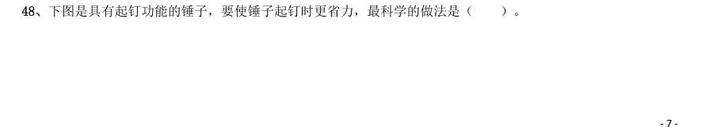

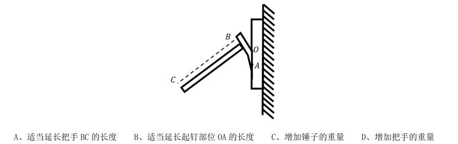

- **A.** 适当延长把手BC 的长度
- **B.** 适当延长起钉部位OA 的长度
- **C.** 增加锤子的重量
- **D.** 增加把手的重量

**答案：暂缺**　**考点：科学推理｜物理**　**难度：★☆☆☆☆**
**【2019 广东省考（乡镇）·第 49 题】判断推理·逻辑判断｜GD-2019-xz-X049**

49. 将瘪了的乒乓球放在热水里一段时间后,乒乓球便会恢复原来的圆形状态。其原理是( )。

- **A.** 乒乓球内部气体溢出,内部气体减少
- **B.** 乒乓球受热后球壁变软,恢复原来形状
- **C.** 乒乓球内部气体受热膨胀,挤压乒乓球内壁
- **D.** 水蒸气流入乒乓球内部,乒乓球内部压强增大

**答案：暂缺**　**考点：逻辑判断｜逻辑判断（待细分）**　**难度：★★☆☆☆**
**【2019 广东省考（乡镇）·第 50 题】判断推理·逻辑判断｜GD-2019-xz-X050**

50. 如图所示,货车停在某处卸货时货物从倾斜的货箱滑下。那么,下列关于货车车轮所受的摩擦力说法正确的是 ( )。

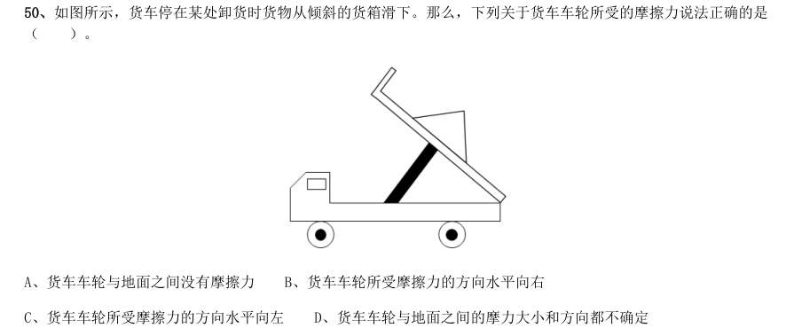

- **A.** 货车车轮与地面之间没有摩擦力
- **B.** 货车车轮所受摩擦力的方向水平向右
- **C.** 货车车轮所受摩擦力的方向水平向左
- **D.** 货车车轮与地面之间的摩力大小和方向都不确定

**答案：暂缺**　**考点：逻辑判断｜逻辑判断（待细分）**　**难度：★★☆☆☆**
**【2019 广东省考（乡镇）·第 51 题】判断推理·逻辑判断｜GD-2019-xz-X051**

51. 如图所示,将一只充了气的密封小气球放在针筒壁内,封闭针筒孔后向外抽拉针筒推杆,忽略摩擦力的影响, 则在这一过程中( )。

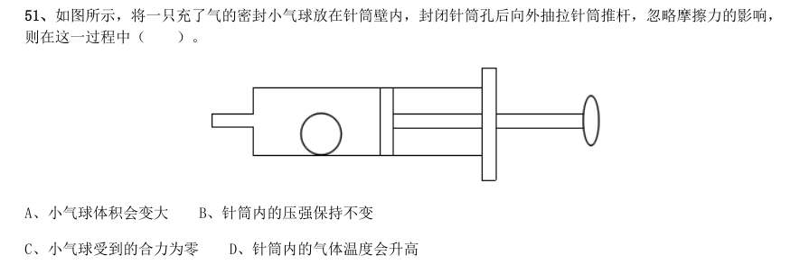

- **A.** 小气球体积会变大
- **B.** 针筒内的压强保持不变
- **C.** 小气球受到的合力为零
- **D.** 针筒内的气体温度会升高

**答案：暂缺**　**考点：逻辑判断｜逻辑判断（待细分）**　**难度：★★☆☆☆**
**【2019 广东省考（乡镇）·第 52 题】判断推理·逻辑判断｜GD-2019-xz-X052**

52. 物质的用途与性质密切相关。下列说法正确的是( )。

- **A.** 木炭能作为炼钢的原料,是利用了木炭的可燃性
- **B.** 钨常用作灯丝,是因为钨在高温下化学性质稳定
- **C.** 活性炭可以去除水中杂质,是因为其具有很强的吸附能力
- **D.** 铝制品的表面可以不做防锈处理,是因为铝的金属活动性不强

**答案：暂缺**　**考点：逻辑判断｜逻辑判断（待细分）**　**难度：★★☆☆☆**
**【2019 广东省考（乡镇）·第 53 题】判断推理·逻辑判断｜GD-2019-xz-X053**

53. 办公室里的四盏灯型号相同,电路如下图所示。如果逐一打开这四盏灯,在电源的输出电压不变的情况下,下 列说法正确的是( )。

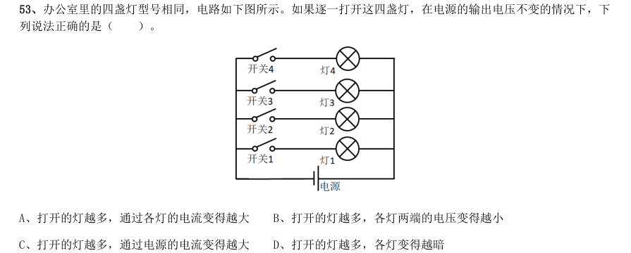

- **A.** 打开的灯越多,通过各灯的电流变得越大
- **B.** 打开的灯越多,各灯两端的电压变得越小
- **C.** 打开的灯越多,通过电源的电流变得越大
- **D.** 打开的灯越多,各灯变得越暗

**答案：暂缺**　**考点：逻辑判断｜逻辑判断（待细分）**　**难度：★★☆☆☆**
**【2019 广东省考（乡镇）·第 54 题】判断推理·逻辑判断｜GD-2019-xz-X054**

54. 冬天气温很低的时候往玻璃杯里倒开水,杯壁较厚的玻璃杯更容易发生炸裂,这是因为( )。

- **A.** 内壁和外壁受热不均
- **B.** 开水遇到玻璃后温度迅速降低
- **C.** 空气对杯壁的压力超过杯壁的承受范围
- **D.** 倒水时水的冲击力将玻璃杯击破

**答案：暂缺**　**考点：逻辑判断｜逻辑判断（待细分）**　**难度：★★☆☆☆**
**【2019 广东省考（乡镇）·第 55 题】判断推理·逻辑判断｜GD-2019-xz-X055**

55. 如图所示,甲、乙两个大小相同的实心金属球放置在光滑水平面上,甲球以水平向右的速度碰撞静止的乙球。 已知甲球质量大于乙球,则有关碰撞后的情形,下列说法正确的是( )。

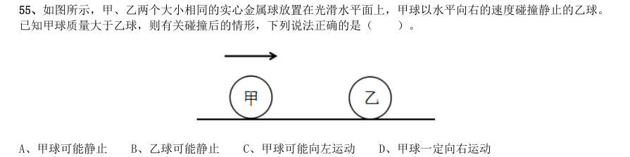

- **A.** 甲球可能静止
- **B.** 乙球可能静止
- **C.** 甲球可能向左运动
- **D.** 甲球一定向右运动

**答案：暂缺**　**考点：逻辑判断｜逻辑判断（待细分）**　**难度：★★★☆☆**
**【2019 广东省考（乡镇）·第 56 题】判断推理·科学推理｜GD-2019-xz-X056**

56. 细胞膜能够防止细胞外物质自由进入细胞,保证细胞内环境的相对稳定。这是因为( )。

- **A.** 细胞膜具有流动性
- **B.** 细胞膜具有选择透过性
- **C.** 细胞膜主要由氨基酸构成
- **D.** 细胞膜具有维持细胞形状的功能

**答案：暂缺**　**考点：科学推理｜生物**　**难度：★☆☆☆☆**
**【2019 广东省考（乡镇）·第 57 题】判断推理·逻辑判断｜GD-2019-xz-X057**

57. 人们在乘坐小船时,应尽量坐下,站立会降低小船的稳定性,其根本原因是( )。

- **A.** 人和船的整体重量增加
- **B.** 人和船的整体重心变高
- **C.** 船的行驶速度增加
- **D.** 水流波动幅度变大

**答案：暂缺**　**考点：逻辑判断｜解释评价**　**难度：★★☆☆☆**
**【2019 广东省考（乡镇）·第 58 题】判断推理·定义判断｜GD-2019-xz-X058**

58. “后驱”是指发动机的动力通过传动轴传递给后轮,从而推动车辆前进的一种驱动形式。当后驱车在水平公路 上匀速前进时,下列说法正确的是( )。

- **A.** 前轮和后轮受到的摩擦力均向前
- **B.** 前轮和后轮受到的摩擦力均向后
- **C.** 前轮受到的摩擦力向前,后轮受到的摩擦力向后
- **D.** 前轮受到的摩擦力向后,后轮受到的摩擦力向前

**答案：暂缺**　**考点：定义判断｜定义判断（综合）**　**难度：★☆☆☆☆**
**【2019 广东省考（乡镇）·第 59 题】判断推理·逻辑判断｜GD-2019-xz-X059**

59. 如图所示,将所点燃的一高一矮两只蜡烛放入圆筒,圆筒顶端不封闭,并从圆筒侧壁缓慢注入二氧化碳气体。 则最可能发生的情况是( )。

- **A.** 高蜡烛先熄灭
- **B.** 矮蜡烛先熄灭
- **C.** 两只蜡烛的火苗没有变化
- **D.** 两只蜡烛的火苗都变矮并逐渐熄灭

**答案：暂缺**　**考点：逻辑判断｜逻辑判断（待细分）**　**难度：★★★☆☆**
**【2019 广东省考（乡镇）·第 60 题】判断推理·逻辑判断｜GD-2019-xz-X060**

60. 为了整治超速,交警采用了一套系统。在某一路段,系统会自动记录车辆进入和离开的时间,从而判断该车辆 是否超速。这种方法是计算车辆的( )。

- **A.** 平均速率
- **B.** 瞬时速率
- **C.** 加速度
- **D.** 位移

**答案：暂缺**　**考点：逻辑判断｜逻辑判断（待细分）**　**难度：★★★☆☆**
**【2019 广东省考（乡镇）·第 61 题】常识判断·政治常识｜GD-2019-xz-X061**

61. 习近平总书记在庆祝改革开放40 周年大会上的重要讲话指出:( )是五四运动以来我国发生的三大历史 性事件,是近代以来实现中华民族伟大复兴的三大里程碑。 1建立中国共产党 2成立中华人民共和国 3全面建成小康社会 4推进改革开放和中国特色社会主义事业

- **A.** 123
- **B.** 124
- **C.** 134
- **D.** 24

**答案：暂缺**　**考点：政治常识｜新时代理论**　**难度：★★★★☆**
**【2019 广东省考（乡镇）·第 62 题】常识判断·政治常识｜GD-2019-xz-X062**

62. 2019 年3 月,习近平总书记对欧洲三国进行了国事访问,推动共建“一带一路”在亚欧大陆开辟新的空间。 这三国分别是( )。

- **A.** 以色列 乌克兰 英国
- **B.** 墨西哥 奥地利 瑞典
- **C.** 意大利 摩纳哥 法国
- **D.** 新西兰 葡萄牙 德国

**答案：暂缺**　**考点：政治常识｜新时代理论**　**难度：★☆☆☆☆**
**【2019 广东省考（乡镇）·第 63 题】常识判断·时事政治｜GD-2019-xz-X063**

63. 2019 年3 月12 日,十三届全国人大二次会议举行第三次全体会议,听取审议最高人民法院工作报告和最高人 民检察院工作报告。这体现了人民代表大会的( )。

- **A.** 立法权
- **B.** 决定权
- **C.** 任免权
- **D.** 监督权

**答案：暂缺**　**考点：时事政治｜重要会议**　**难度：★★★☆☆**
**【2019 广东省考（乡镇）·第 64 题】常识判断·政治常识｜GD-2019-xz-X064**

64. 人才是实施乡村振兴战略的关键因素。以下举措不属于推动乡村人才振兴的是( )。

- **A.** 大力支持乡村休闲旅游
- **B.** 实施新乡贤返乡工程
- **C.** 扩大“三支一扶”计划人员招募规模
- **D.** 完善农村劳动力技能培训补贴机制

**答案：暂缺**　**考点：政治常识｜政治常识（待细分）**　**难度：★☆☆☆☆**
**【2019 广东省考（乡镇）·第 65 题】常识判断·经济常识｜GD-2019-xz-X065**

65. 近几年,我国政府出台了一系列减税降费的举措。减税降费有利于( )。 1减轻企业负担、稳定就业 2优化经济和收入分配结构 3畅通小微企业融资渠道

- **A.** 12
- **B.** 13
- **C.** 23
- **D.** 123

**答案：暂缺**　**考点：经济常识｜经济常识（待细分）**　**难度：★★★☆☆**
**【2019 广东省考（乡镇）·第 66 题】常识判断·地理常识｜GD-2019-xz-X066**

66. 2018 年8 月,国家提出衡量贫困人口是否脱贫的标准是“两不愁、三保障”,其中“两不愁”是指不愁吃、 不愁穿。以下不属于“三保障”的是( )。

- **A.** 基本医疗
- **B.** 义务教育
- **C.** 住房安全
- **D.** 环境优美

**答案：暂缺**　**考点：地理常识｜世界地理**　**难度：★★★☆☆**
**【2019 广东省考（乡镇）·第 67 题】常识判断·经济常识｜GD-2019-xz-X067**

67. 粤港澳大湾区包括香港特别行政区、澳门特别行政区和珠三角九市,是我国经济活力最强的区域之一,在国家 发展大局中具有重要战略地位。以下关于粤港澳大湾区发展基础的说法,错误的是( )。

- **A.** 经济实力雄厚
- **B.** 创新要素集聚
- **C.** 内部发展差距小
- **D.** 国际化水平领先

**答案：暂缺**　**考点：经济常识｜经济常识（待细分）**　**难度：★★★☆☆**
**【2019 广东省考（乡镇）·第 68 题】常识判断·历史人文｜GD-2019-xz-X068**

68. 只要把握住历史发展大势,抓住历史变革时机,奋发有为,锐意进取,人类社会就能更好前进。这句话体现的 哲学原理是( )。

- **A.** 物质和意识的辩证关系
- **B.** 规律是可以认识和利用的
- **C.** 事物发展是前进性和曲折性的统一
- **D.** 实践是检验认识正确与否的唯一标准

**答案：暂缺**　**考点：历史人文｜中国古代史**　**难度：★☆☆☆☆**
**【2019 广东省考（乡镇）·第 69 题】常识判断·政治常识｜GD-2019-xz-X069**

69. 2018 年10 月,习近平总书记在广东考察时提出“要加快形成区域协调发展新格局”,把粤东、粤西的 ( )作为重要发展极,打造现代化沿海经济带。

- **A.** 珠海、肇庆
- **B.** 深圳、清远
- **C.** 广州、韶关
- **D.** 汕头、湛江

**答案：暂缺**　**考点：政治常识｜新时代理论**　**难度：★★★☆☆**
**【2019 广东省考（乡镇）·第 70 题】常识判断·生活常识｜GD-2019-xz-X070**

70. 扶贫先扶智,治贫先治愚。以下扶贫举措中不属于“扶智”的是( )。

- **A.** 在贫困村建设图书室
- **B.** 开展农业实用技能培训
- **C.** 组织大学生到贫困地区支教
- **D.** 向贫困户发放现代化农业机具

**答案：暂缺**　**考点：生活常识｜常识（待细分）**　**难度：★☆☆☆☆**
**【2019 广东省考（乡镇）·第 71 题】常识判断·历史人文｜GD-2019-xz-X071**

71. 自2018 年起,我国将每年农历( )定为“中国农民丰收节”,作为亿万农民庆祝丰收、享受丰收的节日。

- **A.** 立春
- **B.** 芒种
- **C.** 秋分
- **D.** 冬至

**答案：暂缺**　**考点：历史人文｜文学与文化**　**难度：★☆☆☆☆**
**【2019 广东省考（乡镇）·第 72 题】常识判断·政治常识｜GD-2019-xz-X072**

72. 消除贫困、改善民生、逐步实现( ),是社会主义的本质要求,是我们党的重要使命。

- **A.** 共同富裕
- **B.** 同步富裕
- **C.** 同时富裕
- **D.** 全体富裕

**答案：暂缺**　**考点：政治常识｜政治常识（待细分）**　**难度：★☆☆☆☆**
**【2019 广东省考（乡镇）·第 73 题】常识判断·政治常识｜GD-2019-xz-X073**

73. 习近平总书记提出“绿水青山就是金山银山”的发展理念。以下最能体现这一理念的是( )。

- **A.** 精准扶贫
- **B.** 共建“一带一路”
- **C.** 实行“河长制”
- **D.** 加强知识产权保护

**答案：暂缺**　**考点：政治常识｜新时代理论**　**难度：★☆☆☆☆**
**【2019 广东省考（乡镇）·第 74 题】常识判断·历史人文｜GD-2019-xz-X074**

74. 广东属于岭南地区,具有深厚的岭南文化。以下诗句中描写岭南风物的是( )。

- **A.** 此地空余黄鹤楼
- **B.** 罗浮山下四时春
- **C.** 风吹草低见牛羊
- **D.** 不识庐山真面目

**答案：暂缺**　**考点：历史人文｜文学与文化**　**难度：★☆☆☆☆**
**【2019 广东省考（乡镇）·第 75 题】常识判断·生活常识｜GD-2019-xz-X075**

75. 港珠澳大桥跨越( ),东接香港,西接广东珠海和澳门,总长约55 公里,是粤港澳三地首次合作共建的 超大型跨海交通工程。

- **A.** 渤海
- **B.** 东海
- **C.** 北部湾
- **D.** 伶仃洋

**答案：暂缺**　**考点：生活常识｜生活常识**　**难度：★☆☆☆☆**
**【2019 广东省考（乡镇）·第 76 题】常识判断·科技常识｜GD-2019-xz-X076**

76. “山上多植物,胜似修水库,有雨它能吞,无雨它能吐”。这一谚语形象地说明了森林具有( )的功能。

- **A.** 净化空气
- **B.** 过滤尘埃
- **C.** 减小噪音
- **D.** 涵养水源

**答案：暂缺**　**考点：科技常识｜科技常识（待细分）**　**难度：★☆☆☆☆**
**【2019 广东省考（乡镇）·第 77 题】常识判断·地理常识｜GD-2019-xz-X077**

77. 全面建成小康社会,最艰巨最繁重的任务在( ),特别是在贫困地区。

- **A.** 城市
- **B.** 城镇
- **C.** 社区
- **D.** 农村

**答案：暂缺**　**考点：地理常识｜地理常识（待细分）**　**难度：★☆☆☆☆**
**【2019 广东省考（乡镇）·第 78 题】常识判断·历史人文｜GD-2019-xz-X078**

78. 俗话说:正月十五闹元宵。“闹”元宵的习俗包括张灯、观灯、舞龙、舞狮等。以下诗句与元宵节有关的是 ( )。

- **A.** 火树银花合
- **B.** 千里共婵娟
- **C.** 遍插茱萸少一人
- **D.** 爆竹声中一岁除

**答案：暂缺**　**考点：历史人文｜中国古代史**　**难度：★☆☆☆☆**
**【2019 广东省考（乡镇）·第 79 题】常识判断·科技常识｜GD-2019-xz-X079**

79. 2018 年12 月,中国发射的( )成为人类第一个着陆月球背面的探测器。

- **A.** 神舟七号
- **B.** 长征三号
- **C.** 嫦娥四号
- **D.** 天宫一号

**答案：暂缺**　**考点：科技常识｜科技常识（待细分）**　**难度：★☆☆☆☆**
**【2019 广东省考（乡镇）·第 80 题】常识判断·地理常识｜GD-2019-xz-X080**

80. 地球内部具有巨大的热量,并通过不同途径由内向外散发地热能。以下现象与地热能有关的是( )。

- **A.** 台风生成
- **B.** 火山喷发
- **C.** 山洪暴发
- **D.** 岩石风化

**答案：暂缺**　**考点：地理常识｜地理常识（待细分）**　**难度：★☆☆☆☆**
**【2019 广东省考（乡镇）·第 81 题】资料分析·综合分析｜GD-2019-xz-X081**
> 材料：过去5 年,我国统筹开展交通扶贫和“四好农村路工作”,农村基础设施更加完善,服务乡村振兴成效显著。

81. 料提供的信息进行分析、比较、计算和判断处理。 (一) 过去5 年,我国统筹开展交通扶贫和“四好农村路工作”,农村基础设施更加完善,服务乡村振兴成效显著。 2014~2018 年,全国新改建农村公路里程共计( )万公里。

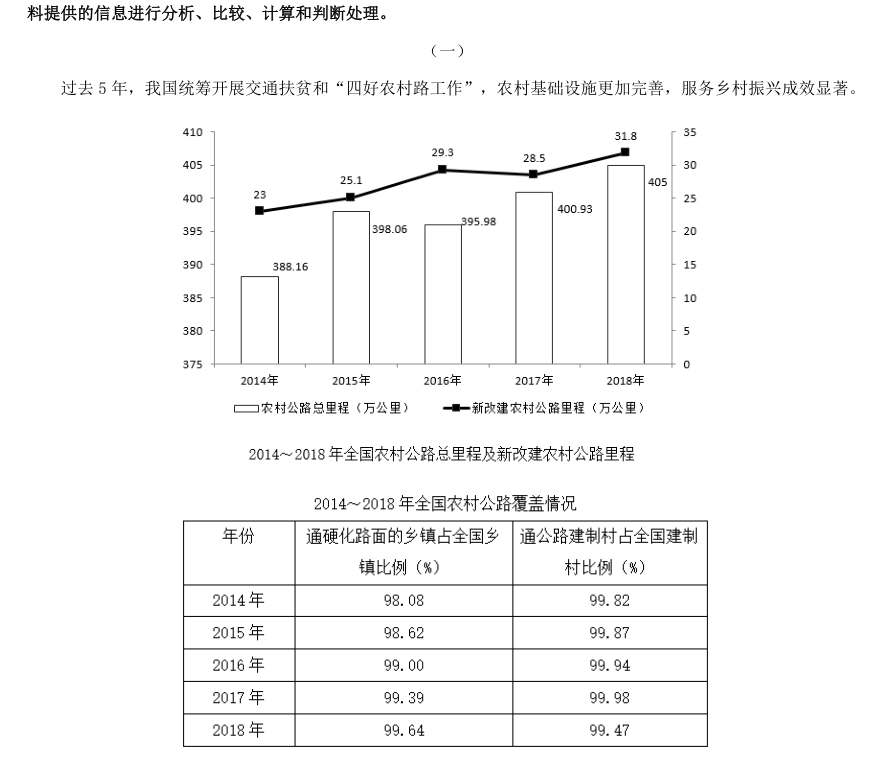

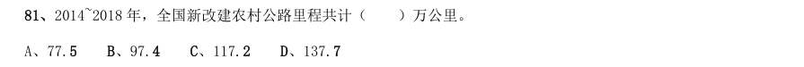

- **A.** 77.5
- **B.** 97.4
- **C.** 117.2
- **D.** 137.7

**答案：暂缺**　**考点：综合分析｜综合分析（综合）**　**难度：★★★★★**
**【2019 广东省考（乡镇）·第 82 题】资料分析·基期量计算｜GD-2019-xz-X082**
> 材料：过去5 年,我国统筹开展交通扶贫和“四好农村路工作”,农村基础设施更加完善,服务乡村振兴成效显著。

82. 2015~2018 年,全国新改建农村公路里程较上年增加最多的一年是( )。

> 材料图见 images/GD-2019-xz-X081-m.jpg

- **A.** 2015
- **B.** 2016
- **C.** 2017
- **D.** 2018

**答案：暂缺**　**考点：基期量计算｜已知现期与增长量求基期**　**难度：★☆☆☆☆**
**【2019 广东省考（乡镇）·第 83 题】资料分析·增长量计算｜GD-2019-xz-X083**
> 材料：过去5 年,我国统筹开展交通扶贫和“四好农村路工作”,农村基础设施更加完善,服务乡村振兴成效显著。

83. 与2014 年相比,我国农村公路总里程增加了( )万公里。

> 材料图见 images/GD-2019-xz-X081-m.jpg

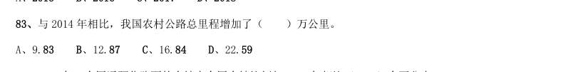

- **A.** 9.83
- **B.** 12.87
- **C.** 16.84
- **D.** 22.59

**答案：暂缺**　**考点：增长量计算｜增长量计算（综合）**　**难度：★☆☆☆☆**
**【2019 广东省考（乡镇）·第 84 题】资料分析·比重计算与比较｜GD-2019-xz-X084**
> 材料：过去5 年,我国统筹开展交通扶贫和“四好农村路工作”,农村基础设施更加完善,服务乡村振兴成效显著。

84. 2018 年,全国通硬化路面的乡镇占全国乡镇比例与2014 年相比( )个百分点。

> 材料图见 images/GD-2019-xz-X081-m.jpg

- **A.** 增加1.56
- **B.** 增加0.25
- **C.** 减少1.56
- **D.** 减少0.25

**答案：暂缺**　**考点：比重计算与比较｜现期比重**　**难度：★☆☆☆☆**
**【2019 广东省考（乡镇）·第 85 题】资料分析·综合分析｜GD-2019-xz-X085**
> 材料：过去5 年,我国统筹开展交通扶贫和“四好农村路工作”,农村基础设施更加完善,服务乡村振兴成效显著。

85. 下列说法正确的是:

> 材料图见 images/GD-2019-xz-X081-m.jpg

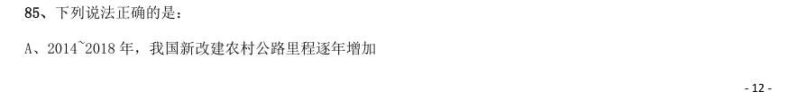

- **A.** 2014~2018 年,我国新改建农村公路里程逐年增加
- **B.** 2014~2018 年,我国农村公路总里程逐年增加
- **C.** 2014~2018 年,通硬化路面的乡镇占全国乡镇的比例逐年提高
- **D.** 2014~2018 年,通公路的建制村占全国建制村的比例逐年提高

**答案：暂缺**　**考点：综合分析｜综合分析（综合）**　**难度：★★★★★**
**【2019 广东省考（乡镇）·第 86 题】资料分析·综合分析｜GD-2019-xz-X086**
> 材料：党的十八大以来,脱贫工作取得巨大成效,全国农村贫困人口大幅减少。截至2018 年末,全国农村贫困人 口从2012 年末的9899 万人减少至1660 万人;农村贫困发生率从2012 年的 下降至 ,累计下降8.5 个百 分点。

86. 2012—2018 年全国农村贫困人口和贫困发生率 2018 年,贫困地区农村居民人均可支配收入10371 元,扣除价格因素,实际增长 ,实际增速高出全国农 村居民人均可支配收入实际增速1.7 个百分点,圆满完成增长幅度高于全国增速的年度目标任务。 从2012 年末到2018 年末,全国农村贫困人口数减少了( )万人。

> 材料图见 images/GD-2019-xz-X081-m.jpg

- **A.** 6239
- **B.** 7239
- **C.** 8239
- **D.** 9230

**答案：暂缺**　**考点：综合分析｜平均数**　**难度：★★★★★**
**【2019 广东省考（乡镇）·第 87 题】资料分析·基期量计算｜GD-2019-xz-X087**
> 材料：党的十八大以来,脱贫工作取得巨大成效,全国农村贫困人口大幅减少。截至2018 年末,全国农村贫困人 口从2012 年末的9899 万人减少至1660 万人;农村贫困发生率从2012 年的 下降至 ,累计下降8.5 个百 分点。

87. 2013—2018 年,全国农村贫困发生率较上年下降最多的是( )年。

> 材料图见 images/GD-2019-xz-X081-m.jpg

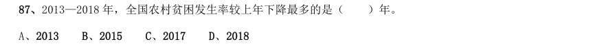

- **A.** 2013
- **B.** 2015
- **C.** 2017
- **D.** 2018

**答案：暂缺**　**考点：基期量计算｜基期量计算（综合）**　**难度：★☆☆☆☆**
**【2019 广东省考（乡镇）·第 88 题】资料分析·比重计算与比较｜GD-2019-xz-X088**
> 材料：党的十八大以来,脱贫工作取得巨大成效,全国农村贫困人口大幅减少。截至2018 年末,全国农村贫困人 口从2012 年末的9899 万人减少至1660 万人;农村贫困发生率从2012 年的 下降至 ,累计下降8.5 个百 分点。

88. 2018 年,我国贫困地区农村居民人均工资性收入约占人均可支配收入的( )。

> 材料图见 images/GD-2019-xz-X081-m.jpg

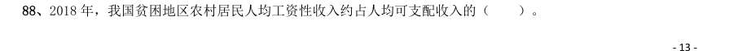

- **A.** 
- **B.** 
- **C.** 
- **D.** 

**答案：暂缺**　**考点：比重计算与比较｜现期比重**　**难度：★☆☆☆☆**
**【2019 广东省考（乡镇）·第 89 题】资料分析·综合分析｜GD-2019-xz-X089**
> 材料：党的十八大以来,脱贫工作取得巨大成效,全国农村贫困人口大幅减少。截至2018 年末,全国农村贫困人 口从2012 年末的9899 万人减少至1660 万人;农村贫困发生率从2012 年的 下降至 ,累计下降8.5 个百 分点。

89. 2018 年,我国贫困地区农村居民收入来源中,最高的是( )。

> 材料图见 images/GD-2019-xz-X081-m.jpg

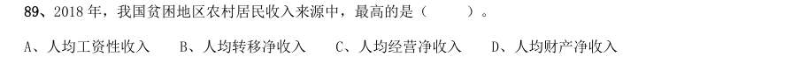

- **A.** 人均工资性收入
- **B.** 人均转移净收入
- **C.** 人均经营净收入
- **D.** 人均财产净收入

**答案：暂缺**　**考点：综合分析｜平均数**　**难度：★★★☆☆**
**【2019 广东省考（乡镇）·第 90 题】资料分析·综合分析｜GD-2019-xz-X090**
> 材料：党的十八大以来,脱贫工作取得巨大成效,全国农村贫困人口大幅减少。截至2018 年末,全国农村贫困人 口从2012 年末的9899 万人减少至1660 万人;农村贫困发生率从2012 年的 下降至 ,累计下降8.5 个百 分点。

90. 下列说法不正确的是( )。

> 材料图见 images/GD-2019-xz-X081-m.jpg

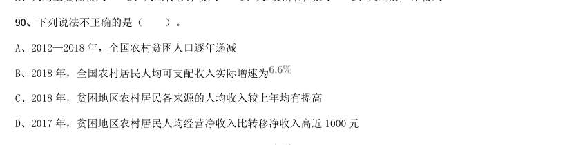

- **A.** 2012—2018 年,全国农村贫困人口逐年递减
- **B.** 2018 年,全国农村居民人均可支配收入实际增速为
- **C.** 2018 年,贫困地区农村居民各来源的人均收入较上年均有提高
- **D.** 2017 年,贫困地区农村居民人均经营净收入比转移净收入高近1000 元

**答案：暂缺**　**考点：综合分析｜年均增长率**　**难度：★★★★★**
**【2019 广东省考（乡镇）·第 91 题】资料分析·增长量计算｜GD-2019-xz-X091**
> 材料：近年来,B 省营商环境不断优化,市场活力不断增强,新登记市场主体都保持较快增长势头。2018 年,全省 新登记市场主体229.74 万户,日均新登记市场主体6294 户,同比增长 。 全省产业结构也进一步调整优化,新登记市场主体主要集中在第三产业。2018 年,全省三大产业新登记市场 主体分别为第一产业2.02 万户,第二产业24.01 万户,第三产业203.71 万户。截止2018 年12 月末,全省三大产 业的实有各类市场主体户数分别为9.83 万户,157.38 万户,978.92 万户。

91. 2018 年,全省新登记企业最集中的三个行业分别是批发和零售业、租赁和商务服务业、制造业,新登记企业 数分别为36.14 万户、15.19 万户、9.25 万户,分别同比增长 、增长 、下降 。 2015-2018 年,B 省实有各类市场主体数增长了约( )万户。

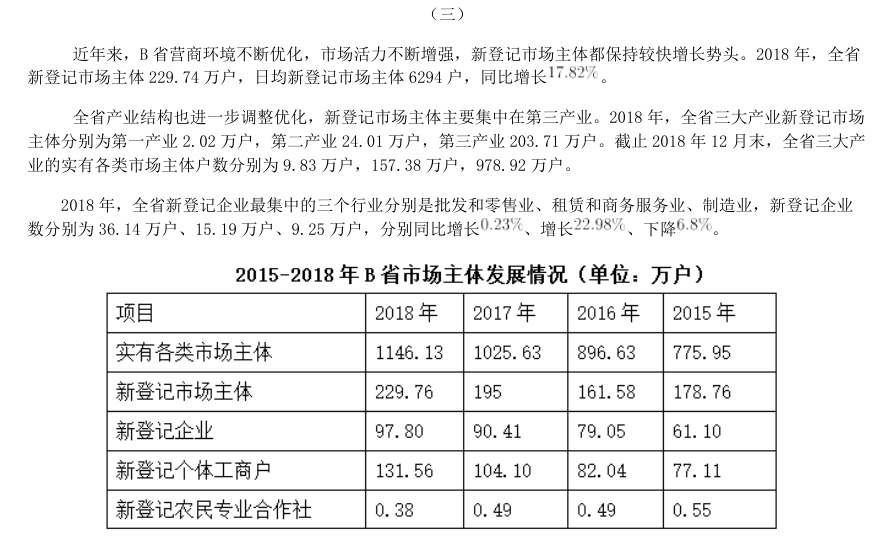

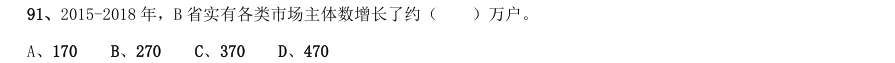

- **A.** 170
- **B.** 270
- **C.** 370
- **D.** 470

**答案：暂缺**　**考点：增长量计算｜增长量计算（综合）**　**难度：★★★☆☆**
**【2019 广东省考（乡镇）·第 92 题】资料分析·比重计算与比较｜GD-2019-xz-X092**
> 材料：近年来,B 省营商环境不断优化,市场活力不断增强,新登记市场主体都保持较快增长势头。2018 年,全省 新登记市场主体229.74 万户,日均新登记市场主体6294 户,同比增长 。 全省产业结构也进一步调整优化,新登记市场主体主要集中在第三产业。2018 年,全省三大产业新登记市场 主体分别为第一产业2.02 万户,第二产业24.01 万户,第三产业203.71 万户。截止2018 年12 月末,全省三大产 业的实有各类市场主体户数分别为9.83 万户,157.38 万户,978.92 万户。

92. 2018 年,B 省第三产业新登记市场主体约占全省实有各类市场主体的( )。

> 材料图见 images/GD-2019-xz-X091-m.jpg

- **A.** 
- **B.** 
- **C.** 
- **D.** 

**答案：暂缺**　**考点：比重计算与比较｜现期比重**　**难度：★☆☆☆☆**
**【2019 广东省考（乡镇）·第 93 题】资料分析·综合分析｜GD-2019-xz-X093**
> 材料：近年来,B 省营商环境不断优化,市场活力不断增强,新登记市场主体都保持较快增长势头。2018 年,全省 新登记市场主体229.74 万户,日均新登记市场主体6294 户,同比增长 。 全省产业结构也进一步调整优化,新登记市场主体主要集中在第三产业。2018 年,全省三大产业新登记市场 主体分别为第一产业2.02 万户,第二产业24.01 万户,第三产业203.71 万户。截止2018 年12 月末,全省三大产 业的实有各类市场主体户数分别为9.83 万户,157.38 万户,978.92 万户。

93. 2015-2018 年,B 省新登记个体工商户最多的是( )年。

> 材料图见 images/GD-2019-xz-X091-m.jpg

- **A.** 2015
- **B.** 2016
- **C.** 2017
- **D.** 2018

**答案：暂缺**　**考点：综合分析｜综合分析（综合）**　**难度：★★★☆☆**
**【2019 广东省考（乡镇）·第 94 题】资料分析·基期量计算｜GD-2019-xz-X094**
> 材料：近年来,B 省营商环境不断优化,市场活力不断增强,新登记市场主体都保持较快增长势头。2018 年,全省 新登记市场主体229.74 万户,日均新登记市场主体6294 户,同比增长 。 全省产业结构也进一步调整优化,新登记市场主体主要集中在第三产业。2018 年,全省三大产业新登记市场 主体分别为第一产业2.02 万户,第二产业24.01 万户,第三产业203.71 万户。截止2018 年12 月末,全省三大产 业的实有各类市场主体户数分别为9.83 万户,157.38 万户,978.92 万户。

94. 2018 年,B 省租赁和商务服务业新登记企业数较上年增加约( )万户。

> 材料图见 images/GD-2019-xz-X091-m.jpg

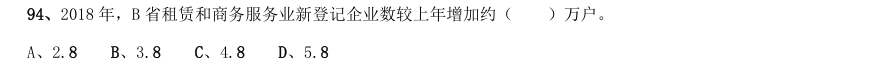

- **A.** 2.8
- **B.** 3.8
- **C.** 4.8
- **D.** 5.8

**答案：暂缺**　**考点：基期量计算｜已知现期与增长量求基期**　**难度：★☆☆☆☆**
**【2019 广东省考（乡镇）·第 95 题】资料分析·综合分析｜GD-2019-xz-X095**
> 材料：近年来,B 省营商环境不断优化,市场活力不断增强,新登记市场主体都保持较快增长势头。2018 年,全省 新登记市场主体229.74 万户,日均新登记市场主体6294 户,同比增长 。 全省产业结构也进一步调整优化,新登记市场主体主要集中在第三产业。2018 年,全省三大产业新登记市场 主体分别为第一产业2.02 万户,第二产业24.01 万户,第三产业203.71 万户。截止2018 年12 月末,全省三大产 业的实有各类市场主体户数分别为9.83 万户,157.38 万户,978.92 万户。

95. 下列说法正确的是( )。

> 材料图见 images/GD-2019-xz-X091-m.jpg

- **A.** 2015-2018 年,B 省新登记农民专业合作社数量逐年增加
- **B.** 2015-2018 年,B 省新登记个体工商户均多于新登记企业数
- **C.** 选项缺失
- **D.** 选项缺失

**答案：暂缺**　**考点：综合分析｜综合分析（综合）**　**难度：★★★☆☆**
**【2019 广东省考（乡镇）·第 96 题】资料分析·综合分析｜GD-2019-xz-X096**
> 材料：近年来,A 省大力发展绿色无公害农业。2017 年,A 省农药使用总量580 万吨,与2016 年相比减少 ;单 位耕地面积农药使用量为1.47 千克/亩。

96. 全省新增申报无公害农产品产地认定221 个,产品362 个,新增绿色食品33 个,认证有机食品60 个。全省 “三品一标”总数达2570 个,其中:无公害农产品1710 个,绿色食品745 个,有机农产品87 个,农产品地理标 志28 个,无公害农产品种植面积总计达1050 万亩,生产总量970 多万吨。 2014-2017 年A 省无公害农产品生产情况 2017 年,A 省“三品一标”总数较上年增加了( )个。

> 材料图见 images/GD-2019-xz-X091-m.jpg

- **A.** 8
- **B.** 9
- **C.** 10
- **D.** 11

**答案：暂缺**　**考点：综合分析｜基期量**　**难度：★★★★★**
**【2019 广东省考（乡镇）·第 97 题】资料分析·增长量计算｜GD-2019-xz-X097**
> 材料：近年来,A 省大力发展绿色无公害农业。2017 年,A 省农药使用总量580 万吨,与2016 年相比减少 ;单 位耕地面积农药使用量为1.47 千克/亩。

97. 2017 年,A 省农药使用总量比2016 年减少了( )万吨。

> 材料图见 images/GD-2019-xz-X091-m.jpg

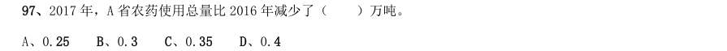

- **A.** 0.25
- **B.** 0.3
- **C.** 0.35
- **D.** 0.4

**答案：暂缺**　**考点：增长量计算｜增长量计算（综合）**　**难度：★☆☆☆☆**
**【2019 广东省考（乡镇）·第 98 题】资料分析·综合分析｜GD-2019-xz-X098**
> 材料：近年来,A 省大力发展绿色无公害农业。2017 年,A 省农药使用总量580 万吨,与2016 年相比减少 ;单 位耕地面积农药使用量为1.47 千克/亩。

98. 2017 年,A 省单位耕地面积农药使用量比2015 年约( )。

> 材料图见 images/GD-2019-xz-X091-m.jpg

- **A.** 增加
- **B.** 下降
- **C.** 增加
- **D.** 下降

**答案：暂缺**　**考点：综合分析｜综合分析（综合）**　**难度：★★★☆☆**
**【2019 广东省考（乡镇）·第 99 题】资料分析·年均增长率｜GD-2019-xz-X099**
> 材料：近年来,A 省大力发展绿色无公害农业。2017 年,A 省农药使用总量580 万吨,与2016 年相比减少 ;单 位耕地面积农药使用量为1.47 千克/亩。

99. 2014-2017 年,A 省平均每年新增申报无公害农产品产地认定( )个。

> 材料图见 images/GD-2019-xz-X091-m.jpg

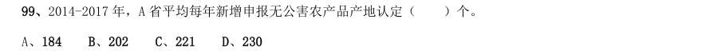

- **A.** 184
- **B.** 202
- **C.** 221
- **D.** 230

**答案：暂缺**　**考点：年均增长率｜年均增长率计算**　**难度：★☆☆☆☆**
**【2019 广东省考（乡镇）·第 100 题】资料分析·综合分析｜GD-2019-xz-X100**
> 材料：近年来,A 省大力发展绿色无公害农业。2017 年,A 省农药使用总量580 万吨,与2016 年相比减少 ;单 位耕地面积农药使用量为1.47 千克/亩。

100. 下列说法不正确的是( )。

> 材料图见 images/GD-2019-xz-X091-m.jpg

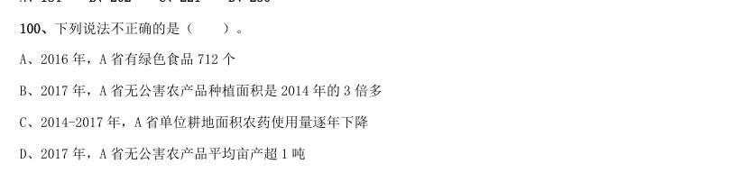

- **A.** 2016 年,A 省有绿色食品712 个
- **B.** 2017 年,A 省无公害农产品种植面积是2014 年的3 倍多
- **C.** 2014-2017 年,A 省单位耕地面积农药使用量逐年下降
- **D.** 2017 年,A 省无公害农产品平均亩产超1 吨

**答案：暂缺**　**考点：综合分析｜平均数**　**难度：★★★★★**