# 2020 年广东行测（乡镇）

- 题量：100（含答案 0）
- 模块分布：资料分析15 / 数量关系14 / 言语理解11 / 判断推理40 / 常识判断20
- 试卷编号：`广东-2020-乡镇`

## 题目与答案

**【言语理解·逻辑填空｜GD-2020-xz-X001】**

1. 真正打赢脱贫攻坚战,还需要大力发展优势特色扶贫产业,通过统一规划、连片开发,建设一批特色鲜明、 带动能力强的扶贫产业, ________发展休闲农业、设施农业等农村二三产业。 填入横线部分最恰当的一项是:

- **A.** 因势利导
- **B.** 因地制宜
- **C.** 因时制宜
- **D.** 因材施教

**答案：暂缺**　**考点：逻辑填空｜一空**　**难度：★☆☆☆☆**
**【言语理解·逻辑填空｜GD-2020-xz-X002】**

2. 以理想信念引领乡村治理现代化,________要从组织和制度层面发力,________要在活动阵地建设层面发力, 为党组织宣传理想信念、贯彻落实政策提供制度保障和阵地依托。 填入横线部分最恰当的一项是:

- **A.** 不仅 更
- **B.** 尽管 还
- **C.** 如果 就
- **D.** 即使 也

**答案：暂缺**　**考点：逻辑填空｜一空**　**难度：★☆☆☆☆**
**【言语理解·逻辑填空｜GD-2020-xz-X003】**

3. 良好乡风具有浸润人心,________向善,规范行为,________力量的积极作用,要以实施乡风文明培育行动 为抓手,加强乡村德治,培育稳脱贫,促振兴的文化软环境。 填入横线部分最恰当的一项是:

- **A.** 带动 集中
- **B.** 带领 凝结
- **C.** 引导 集聚
- **D.** 引领 凝聚

**答案：暂缺**　**考点：逻辑填空｜一空**　**难度：★☆☆☆☆**
**【言语理解·逻辑填空｜GD-2020-xz-X004】**

4. 在广袤的大地上,通过“三支一扶”计划成长起来的年轻人,在不同领域和岗位上担当作为,无私奉献, ________了青春的价值,________出一曲曲奋斗赞歌。 填入横线部分最恰当的一项是:

- **A.** 诠释 谱写
- **B.** 书写 传唱
- **C.** 证明 吟诵
- **D.** 展现 描绘

**答案：暂缺**　**考点：逻辑填空｜一空**　**难度：★☆☆☆☆**
**【言语理解·逻辑填空｜GD-2020-xz-X005】**

5. 近几年,脱贫攻坚取得决定性成就的一个重要原因,就是通过派驻工作组、第一书记等驻村帮扶力量,为贫 困农村带去了________的领导、________的思路,________的资源保障,破解了农村发展的人才之困。 填入横线部分最恰当的一项是:

- **A.** 强劲 开明 充分
- **B.** 强硬 明晰 丰富
- **C.** 坚强 开阔 有力
- **D.** 坚毅 明确 充沛

**答案：暂缺**　**考点：逻辑填空｜一空**　**难度：★★☆☆☆**
**【言语理解·中心理解｜GD-2020-xz-X006】**

6. 在基层工作中,长期直面各种矛盾和诱惑,不断经受大事急事难事烦事的考验,可以在挑重担、啃硬骨头、 接烫手山芋的磨砺中壮筋骨、长才干,练就忠诚、干净、担当的政治品格,培养坚忍不拔、百折不挠的性格, 成长为处理各种矛盾问题的高手,发展成治理社会、发展经济的能人。 上述文段主要说明了:

- **A.** 基层锻炼是干部培养的必要条件
- **B.** 基层工作面临巨大挑战
- **C.** 基层需要能力强的干部
- **D.** 基层工作有助于干部成长

**答案：暂缺**　**考点：中心理解｜中心句与主旨**　**难度：★★★☆☆**
**【言语理解·标题填入｜GD-2020-xz-X007】**

7. 应对疫情给企业经营带来的不利影响,广东省政府近期出台支持企业复工复产的20 项政策措施,实打实解 决企业面临的用工成本、经营负担、疫情防控、现金流压力等方面问题。广东各地各部门也打出“减负”“暖 企”政策组合拳,力求精准解决企业难题。除此之外,有关部门还梳理出102 家制造业重点企业名单,建立复 工复产“一对一”跟踪服务机制,准确摸排问题,提出解决方案。 下列选项最适合作为这段文字标题的是:

- **A.** 应对疫情,“暖”字当头
- **B.** 广东:打通复工复产堵点
- **C.** 广东经济:挑战与机遇并存
- **D.** “减负暖企”,实现经济腾飞

**答案：暂缺**　**考点：标题填入｜标题填入**　**难度：★★★★☆**
**【言语理解·中心理解｜GD-2020-xz-X008】**

8. 农村公共文化服务好不好,要以村民满不满意为评价标准。因此,文化建设从一开始。就要以“人”为中心, 站在村民的角度考虑问题,认真对待他们的精神文化需求,才能击中痛点,“对症下药”,才能实现文化建设 的“精准化”,才能避免“一刀切”以及由此产生的资源浪费。 这段文字主要讲了:

- **A.** 农村文化建设要以“人”为本
- **B.** 农村文化建设要追求“精准化”
- **C.** 农村公共文化建设服务的标准
- **D.** 建设农村公共文化服务的意义

**答案：暂缺**　**考点：中心理解｜转折与因果**　**难度：★★☆☆☆**
**【言语理解·中心理解｜GD-2020-xz-X009】**

9. 政务公开的目标,既要保障公众的知情权和监督权,又要畅通政府与公众之间的交流互动,以公开推动理念 转变与流程再造,建设人民满意的服务型政府。没有交流互动,政务公开就成了“为公开而公开”;没有监督 权和知情权的配合,政务公开就成了“稻草人”和“花架子”。在政务公开中,公众本身不仅是被动的接受者, 更是主动的参与者。只有公众持续不断地广泛参与,政务公开才有不断深入的动力。 对这段文字理解不准确的是:

- **A.** 政务公开需要公众的主动参与
- **B.** 公众参与越广泛,政务公开才能越深入
- **C.** 政务公开源于公众对政府工作的知情意愿
- **D.** 政府与公众的交流互动有利于建设服务型政府

**答案：暂缺**　**考点：中心理解｜对策优先**　**难度：★★★★☆**
**【言语理解·逻辑填空｜GD-2020-xz-X010】**

10. 今年是全面打赢脱贫攻坚战的收官之年,脱贫攻坚的最后堡垒必须攻克。然而,在这最后冲刺阶段,我们 却不得不面对新冠肺炎疫情带来的严峻挑战,面对疫情风险,那些刚刚脱贫或者尚未脱贫的群众具有明显的脆 弱性。如果不能处理好战“疫”与战“贫”的关系,就有可能让我们来之不易的脱贫攻坚成果出现波折和变数。 上述文字旨在说明:

- **A.** 战“疫”与战“贫”都应被重视
- **B.** 战“疫”与战“贫”绝非易事
- **C.** 战“疫”之后必须严防返贫
- **D.** 战“疫”胜利有利于脱贫攻坚

**答案：暂缺**　**考点：逻辑填空｜逻辑填空（综合）**　**难度：★★★☆☆**
**【常识判断·时事政治｜GD-2020-xz-X011】**

11. 针对我国疫情防控工作,习近平总书记指出“要变压力为动力,善于化危为机”。以下典故与“善于化危 为机”所蕴含的哲学原理一致的是:

- **A.** 塞翁失马,焉知非福
- **B.** 绳锯木断,水滴石穿
- **C.** 千里之堤,溃于蚁穴
- **D.** 南橘北枳,便分两等

**答案：暂缺**　**考点：时事政治｜时事政治（综合）**　**难度：★★★☆☆**
**【常识判断·法律常识｜GD-2020-xz-X012】**

12. 我国民法典规定,未设立村集体经济组织的,( )可以依法代行村集体经济组织职能。

- **A.** 村长
- **B.** 村民委员会
- **C.** 村党支部
- **D.** 村民小组

**答案：暂缺**　**考点：法律常识｜民法典**　**难度：★☆☆☆☆**
**【常识判断·时事政治｜GD-2020-xz-X013】**

13. 习近平总书记指出“不平衡是普遍的,要在发展中促进相对平衡”,这句话体现了( )发展理念。

- **A.** 开放
- **B.** 协调
- **C.** 创新
- **D.** 共享

**答案：暂缺**　**考点：时事政治｜时事政治（综合）**　**难度：★☆☆☆☆**
**【常识判断·经济常识｜GD-2020-xz-X014】**

14. 为有效应对新冠疫情对我国经济的影响,相关部门出台了一系列举措帮助企业复工复产。以下属于金融政 策举措的是:

- **A.** 降低政府定价的货物港务费和港口设施保安费收费标准,显著降低物流运输成本
- **B.** 对中小微企业生产经营场所的用电、用水、用气实施阶段性缓缴费用,缓缴期“欠费不停供”
- **C.** 免征中小微企业三项社保的单位缴费,降低企业负担
- **D.** 引导银行加大对民营和小微企业支持的力度,保持贷款额合理增加

**答案：暂缺**　**考点：经济常识｜经济常识（综合）**　**难度：★★★★☆**
**【常识判断·政治常识｜GD-2020-xz-X015】**

15. 中国特色社会主义制度是一个严密完整的科学制度体系,起四梁八柱作用的是根本制度、基本制度、重要 制度,其中具有统领地位的是:

- **A.** 党的领导制度
- **B.** 协商民主制度
- **C.** 国家监察制度
- **D.** 人民代表大会制度

**答案：暂缺**　**考点：政治常识｜政治常识（综合）**　**难度：★☆☆☆☆**
**【常识判断·科技常识｜GD-2020-xz-X016】**

16. 打赢脱贫攻坚战、实施乡村振兴战略,需要强化科技支撑作用。以下措施属于强化科技支撑作用的是: 1完善村规民约 2支持丘陵山区农田宜机化改造 3推进相对贫困户危房改造 4建设农业科技成果转化交易平台 5推动复合型农业机械研发

- **A.** 124
- **B.** 245
- **C.** 1245
- **D.** 12345

**答案：暂缺**　**考点：科技常识｜科技常识（综合）**　**难度：★★★★☆**
**【常识判断·政治常识｜GD-2020-xz-X017】**

17. 党的十九届四中全会首次提出要“重视发挥第三次分配作用,发展慈善等社会公益事业”。以下属于第三 次分配的是:

- **A.** 企业员工获取加班劳动报酬
- **B.** 政府向困难家庭发放低保
- **C.** 银行为家庭困难学生办理助学贷款
- **D.** 中国红十字会出资救助患病儿童

**答案：暂缺**　**考点：政治常识｜政治常识（综合）**　**难度：★☆☆☆☆**
**【常识判断·经济常识｜GD-2020-xz-X018】**

18. 产业增收是脱贫攻坚的主要途径和长久之策。以下举措不属于产业扶贫的是:

- **A.** 种植特色水果
- **B.** 开展乡村旅游
- **C.** 兴建乡村卫生站
- **D.** 成立农产品产业园

**答案：暂缺**　**考点：经济常识｜经济常识（综合）**　**难度：★☆☆☆☆**
**【常识判断·政治常识｜GD-2020-xz-X019】**

19. 新冠肺炎疫情发生以来,中国始终同国际社会开展交流合作,并提出( )的新理念:倡导团结合作共同 抗疫。

- **A.** 构建人类命运共同体
- **B.** 建立疫苗协作开发机制
- **C.** 构建人类卫生健康共同体
- **D.** 建立全球治理体系

**答案：暂缺**　**考点：政治常识｜政治常识（综合）**　**难度：★☆☆☆☆**
**【常识判断·政治常识｜GD-2020-xz-X020】**

20. 2020 年4 月,经国务院批准,海南省三沙市设立南沙区,南沙区人民政府驻永暑礁。以下对永暑礁的描述 有误的是:

- **A.** 永暑礁位于海南省东南部
- **B.** 永暑礁位于西沙群岛
- **C.** 永暑礁的气候为热带季风气候
- **D.** 永暑礁拥有丰富的渔业和矿产资源

**答案：暂缺**　**考点：政治常识｜政治常识（综合）**　**难度：★☆☆☆☆**
**【常识判断·法律常识｜GD-2020-xz-X021】**

21. 2020 年6 月30 日颁布的《中华人共和国香港特别行政区维护国家安全法》是保持香港特别行政区繁荣和 稳定的重要法律。以下属于该法规定处罚的罪行有: 1分裂国家罪 2颠覆国家政权罪 3恐怖活动罪 4勾结外国或者境外势力危害国家安全罪

- **A.** 14
- **B.** 123
- **C.** 234
- **D.** 1234

**答案：暂缺**　**考点：法律常识｜行政法**　**难度：★★★★☆**
**【常识判断·政治常识｜GD-2020-xz-X022】**

22. 2020 年7 月23 日,“天问一号”深空探测器在海南文昌发射成功,大约9 个月后,“天问一号”将在 ( )表面着陆,标志着我国正式开启行星探测时代。

- **A.** 月球
- **B.** 火星
- **C.** 金星
- **D.** 木星

**答案：暂缺**　**考点：政治常识｜政治常识（综合）**　**难度：★★★☆☆**
**【常识判断·历史人文｜GD-2020-xz-X023】**

23. 乡村文化繁荣兴盛重大工程包括“农耕文化保护传承”,以下诗句最能体现农耕文化保护传承的是:

- **A.** 谁知盘中餐,粒粒皆辛苦
- **B.** 离离原上草,一岁一枯荣
- **C.** 尧有欲谏之鼓,舜有诽谤之木
- **D.** 山重水复疑无路,柳暗花明又一村

**答案：暂缺**　**考点：历史人文｜文学与文化**　**难度：★☆☆☆☆**
**【常识判断·历史人文｜GD-2020-xz-X024】**

24. 在中国史、亚洲史上,( )有着深远的意义和影响,它大大地拓宽了古人的地理视野,改变了汉朝的地 域观念,有历史学家甚至将它与哥伦布“发现”美洲相提并论。

- **A.** 昭君出塞
- **B.** 蒙古西征
- **C.** 张骞凿空
- **D.** 鉴真东渡

**答案：暂缺**　**考点：历史人文｜中国古代史**　**难度：★★★☆☆**
**【常识判断·政治常识｜GD-2020-xz-X025】**

25. 岭南地区盛产甜美可口的荔枝,自古就有“日啖荔枝三百颗,不辞长作岭南人”的美誉。以下最有可能为 岭南地区适合荔枝生长主要原因的是:

- **A.** 日照时间长,光合作用充分
- **B.** 昼夜温差小,易于糖分聚集
- **C.** 土壤粘,强碱性,利于中和果酸
- **D.** 气温高,降水多,适宜果实生长

**答案：暂缺**　**考点：政治常识｜政治常识（综合）**　**难度：★★★☆☆**
**【常识判断·生活常识｜GD-2020-xz-X026】**

26. 在日常生活中,下列说法符合科学原理的是:

- **A.** 使用碳酸饮料可以有效溶解水壶内的水垢
- **B.** 成年人体内的水分大约能占到体重的40%—50%
- **C.** 烧开的水放置一个晚上后,亚硝酸盐含量会显著增加
- **D.** 剧烈运动后,人们应当避免摄入电解质,以免增加肾脏负担

**答案：暂缺**　**考点：生活常识｜生活常识**　**难度：★☆☆☆☆**
**【常识判断·政治常识｜GD-2020-xz-X027】**

27. (单选题)煤燃烧后的产物主要是CO2,也含有一定量的SO2,还可能含有CO。某市环保部门监测发现, 该市郊区的火力发电厂(以煤为燃料)周围的树木枯萎情况比上一年严重。造成树木枯萎的最主要原因可能是:

- **A.** CO 的超标排放
- **B.** CO2 的超标排放
- **C.** 排放SO2 导致的酸雨
- **D.** 排放CO2 导致的酸雨

**答案：暂缺**　**考点：政治常识｜政治常识（综合）**　**难度：★★★☆☆**
**【常识判断·法律常识｜GD-2020-xz-X028】**

28. 消费者权利是消费者在购买、使用商品或者接受服务中所享有的权利。下列消费者权利与侵犯该权利的事 件对应正确的是:

- **A.** 知情权——某线上服装店为快速清仓,推出低价“福袋”商品,并注明“福袋”内服装的款式、颜色等随机搭配
- **B.** 自主选择权——某餐厅推出外卖8 折活动,但是消费者点外卖时只有选择套餐才享受折扣,自由搭配时无法享受8 折优惠
- **C.** 安全保障权——王某的轿车已达到报废标准,但是他依旧照常使用,在一次高速行驶中刹车失灵造成事故
- **D.** 公平交易权——李某在车行订购汽车后,车行要求李某购买“车辆维护套餐”,否则汽车不予交付

**答案：暂缺**　**考点：法律常识｜法律常识（综合）**　**难度：★★★★☆**
**【常识判断·法律常识｜GD-2020-xz-X029】**

29. 某公司与陈某在签订劳动合同时,在该合同约定“本人自愿放弃缴纳社保,公司每月给予200 元补贴作为 补偿,与每月工资一同发放”, 陈某工作一年后辞职。辞职后,他在当地申请劳动仲裁,要求该分司补缴社会 保险金。关于以上案例,以下说法错误的是:

- **A.** 案例中合同所约定的不缴纳社保的条款属于无效条款
- **B.** 该公司应为陈某补缴社会保险
- **C.** 陈某应当返还由该公司每月发放的200 元补贴
- **D.** 为确保放弃缴纳社保声明合法生效,应另起协议

**答案：暂缺**　**考点：法律常识｜民法典**　**难度：★★★★☆**
**【常识判断·经济常识｜GD-2020-xz-X030】**

30. “逆经济风向调节”是指当经济萎缩时要采取扩张的经济政策,当经济过热时要采用紧缩的经济政策。据 此,当一个国家经济过热时,应当采取的政策措施是:

- **A.** 减少政府支出,提高利率
- **B.** 减少政府支出,降低利率
- **C.** 增加政府支出,提高利率
- **D.** 增加政府支出,降红利率

**答案：暂缺**　**考点：经济常识｜经济常识（综合）**　**难度：★★★☆☆**
**【数量关系·数字推理｜GD-2020-xz-X031】**

31. 5 13 25 41 ( )

- **A.** 52
- **B.** 55
- **C.** 58
- **D.** 61

**答案：暂缺**　**考点：数字推理｜数字推理（综合）**　**难度：★★★★☆**
**【数量关系·数字推理｜GD-2020-xz-X032】**

32. 23 34 58 93 152 ( )

- **A.** 176
- **B.** 206
- **C.** 246
- **D.** 296

**答案：暂缺**　**考点：数字推理｜数字推理（综合）**　**难度：★★★★☆**
**【数量关系·数字推理｜GD-2020-xz-X033】**

33. 9.19 4.27 5.35 2.43 ( )

- **A.** 3.51
- **B.** 5.51
- **C.** 5.60
- **D.** 8.60

**答案：暂缺**　**考点：数字推理｜数字推理（综合）**　**难度：★★★★☆**
**【数量关系·数字推理｜GD-2020-xz-X034】**

34. 0 6 24 60 120 ( )

- **A.** 200
- **B.** 210
- **C.** 220
- **D.** 230

**答案：暂缺**　**考点：数字推理｜数字推理（综合）**　**难度：★★★★☆**
**【数量关系·其他数量关系｜GD-2020-xz-X035】**

35. （本题题干为图形/公式，文字层无题干，图见原卷）

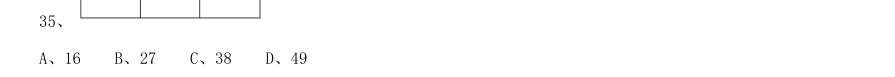

- **A.** 16
- **B.** 27
- **C.** 38
- **D.** 49

**答案：暂缺**　**考点：其他数量关系｜其他数量关系（综合）**　**难度：★★☆☆☆**
**【数量关系·最值问题｜GD-2020-xz-X036】**

36. 甲、乙两地稻谷同时成熟,分别需要15 台和13 台大型收割机进行收割,计划从丙、丁两地分别调配20 台 和8 台收割机进行支援。若从丙地调配一台收割机到甲、乙两地分别需要油费40 元、50 元;从丁地到甲、乙 两地分别需要50 元、30 元,则完成所有的收割机调配至少需要油费( )元。

- **A.** 1000
- **B.** 1090
- **C.** 1180
- **D.** 1270

**答案：暂缺**　**考点：最值问题｜最值问题（综合）**　**难度：★★★★★**
**【数量关系·排列组合｜GD-2020-xz-X037】**

37. 为加强治安防控,现计划在一段L 形的围墙(如下图)上安装治安摄像头,其中A 点到B 点长度为750 米, B 点到C 点长度为1350 米。按要求ABC 三个位置必须安装一个摄像头,且相邻两个摄像头之间的距离要保持一 致,则整段围墙至少需要安装( )个摄像头。

- **A.** 14
- **B.** 15
- **C.** 16
- **D.** 17

**答案：暂缺**　**考点：排列组合｜捆绑法**　**难度：★★★★★**
**【数量关系·溶液问题｜GD-2020-xz-X038】**

38. 现有浓度为4%的食盐水250 克,若向该食盐水添加10 克食盐,再蒸发掉160 克水,则新获得的食盐水的 浓度为:

- **A.** 10%
- **B.** 15%
- **C.** 20%
- **D.** 25%

**答案：暂缺**　**考点：溶液问题｜稀释与浓缩**　**难度：★☆☆☆☆**
**【数量关系·其他数量关系｜GD-2020-xz-X039】**

39. 某单位的两个部门计划订阅报纸。每个部门需要在指定的5 种报纸中选择其中的3 种,且这两个部门在选 择时应做好沟通,做到5 种报纸都有部门订阅,则订阅报纸的方案共有( )种。

- **A.** 20
- **B.** 30
- **C.** 60
- **D.** 100

**答案：暂缺**　**考点：其他数量关系｜其他数量关系（综合）**　**难度：★☆☆☆☆**
**【数量关系·概率问题｜GD-2020-xz-X040】**

40. 一个纸箱里装有大小及材质完全相同的10 个小球,其中3 个黑色,2 个白色,1 个红色,2 个黄色,1 个绿 色,1 个紫色。如果不放回地依次随机取出3 个小球,则取出的小球依次是黑色,红色,白色的概率为:

- **A.** 
- **B.** 
- **C.** 
- **D.** 

**答案：暂缺**　**考点：概率问题｜摸球与抽取**　**难度：★★★★★**
**【数量关系·其他数量关系｜GD-2020-xz-X041】**

41. 某企业四月的营业额比三月的营业额多三分之一,五月的营业额比四月多三分之一,则三月的营业额比五 月的营业额少:

- **A.** 
- **B.** 
- **C.** 
- **D.** 

**答案：暂缺**　**考点：其他数量关系｜和差倍比**　**难度：★☆☆☆☆**
**【数量关系·其他数量关系｜GD-2020-xz-X042】**

42. 三个书架共放有60 本书,如果从第一个书架取出10 本书放入第二个书架,再从第二个书架取出5 本书放 入第三个书架,则此时三个书架的书就会一样多。那么第二个书架最初存放了( )本书。

- **A.** 15
- **B.** 20
- **C.** 25
- **D.** 30

**答案：暂缺**　**考点：其他数量关系｜其他数量关系（综合）**　**难度：★★☆☆☆**
**【数量关系·利润问题｜GD-2020-xz-X043】**

43. 办公室按零售价花费360 元购买了一批笔记本。如果按批发价购买,则每个笔记本能便宜3 元,且恰好能 多购买20 个。则该笔记本零售价为( )元。

- **A.** 3
- **B.** 4
- **C.** 6
- **D.** 9

**答案：暂缺**　**考点：利润问题｜基础利润**　**难度：★☆☆☆☆**
**【数量关系·其他数量关系｜GD-2020-xz-X044】**

44. 某部门正在准备会议材料,共有153 份相同的文件,需要装到大小两种文件袋里送至会场,大的每个能装 24 份文件,小的每个能装15 份文件。如果要使每个文件袋都正好装满,则需要大文件袋( )个。

- **A.** 2
- **B.** 3
- **C.** 5
- **D.** 7

**答案：暂缺**　**考点：其他数量关系｜其他数量关系（综合）**　**难度：★★☆☆☆**
**【言语理解·中心理解｜GD-2020-xz-X045】**

45. （本题题干为图形/公式，文字层无题干，图见原卷）

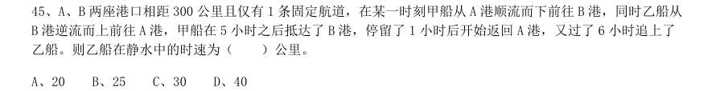

- **A.** B 两座港口相距300 公里且仅有1 条固定航道,在某一时刻甲船从A 港顺流而下前往B 港,同时乙船从
- **B.** 港逆流而上前往A 港,甲船在5 小时之后抵达了B 港,停留了1 小时后开始返回A 港,又过了6 小时追上了

**答案：暂缺**　**考点：中心理解｜中心理解（综合）**　**难度：★★★★☆**
**【判断推理·图形推理｜GD-2020-xz-X046】**
> 材料：A、20 B、25 C、30 D、40

46. 下列选项中最符合所给图形规律的是( )。

> （本题为图形题，选项为图片，见原卷）

**答案：暂缺**　**考点：图形推理｜图形推理（综合）**　**难度：★★☆☆☆**
**【判断推理·图形推理｜GD-2020-xz-X047】**

47. 下列选项中最符合所给图形规律的是( )。

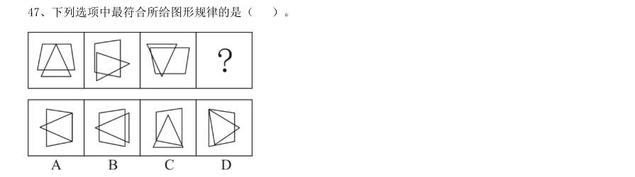

> （本题为图形题，选项为图片，见原卷）

**答案：暂缺**　**考点：图形推理｜图形推理（综合）**　**难度：★★☆☆☆**
**【判断推理·图形推理｜GD-2020-xz-X048】**

48. 下列选项中最符合所给图形规律的是( )。

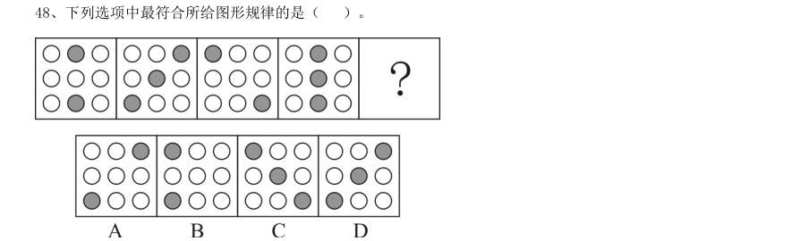

> （本题为图形题，选项为图片，见原卷）

**答案：暂缺**　**考点：图形推理｜图形推理（综合）**　**难度：★★☆☆☆**
**【判断推理·图形推理｜GD-2020-xz-X049】**

49. 下列选项中最符合所给图形规律的是( )。

> （本题为图形题，选项为图片，见原卷）

**答案：暂缺**　**考点：图形推理｜图形推理（综合）**　**难度：★★☆☆☆**
**【判断推理·图形推理｜GD-2020-xz-X050】**

50. 下列选项中最符合所给图形规律的是( )。

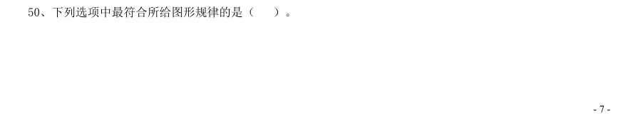

> （本题为图形题，选项为图片，见原卷）

**答案：暂缺**　**考点：图形推理｜图形推理（综合）**　**难度：★★☆☆☆**
**【判断推理·类比推理｜GD-2020-xz-X051】**

51. 如图所示的物体至少由( )个小正方体堆积而成。

- **A.** 14
- **B.** 15
- **C.** 16
- **D.** 17

**答案：暂缺**　**考点：类比推理｜类比推理（综合）**　**难度：★☆☆☆☆**
**【判断推理·图形推理｜GD-2020-xz-X052】**

52. 下列选项中,不能在裁剪或覆盖后折成如图所示立方体的是( )。

> （本题为图形题，选项为图片，见原卷）

**答案：暂缺**　**考点：图形推理｜立体图形**　**难度：★★☆☆☆**
**【判断推理·图形推理｜GD-2020-xz-X053】**

53. 下列选项中,能与所给图形组合成立方体的是( )。

> （本题为图形题，选项为图片，见原卷）

**答案：暂缺**　**考点：图形推理｜立体图形**　**难度：★★☆☆☆**
**【判断推理·图形推理｜GD-2020-xz-X054】**

54. 使用所给的四个图形能够组合成( )。

- **A.** 矩形
- **B.** 三角形
- **C.** 等腰梯形
- **D.** 直角梯形

**答案：暂缺**　**考点：图形推理｜图形推理（综合）**　**难度：★★☆☆☆**
**【判断推理·图形推理｜GD-2020-xz-X055】**

55. 下列4 张纸条,沿折痕能够折出如图所示图形的是( )。

- **A.** 如上图所示
- **B.** 如上图所示
- **C.** 如上图所示
- **D.** 如上图所示

**答案：暂缺**　**考点：图形推理｜图形推理（综合）**　**难度：★★☆☆☆**
**【判断推理·类比推理｜GD-2020-xz-X056】**

56. 精准∶扶贫( )

- **A.** 保护∶环境
- **B.** 热心∶助人
- **C.** 进退∶自如
- **D.** 粗犷∶生产

**答案：暂缺**　**考点：类比推理｜类比推理（综合）**　**难度：★☆☆☆☆**
**【判断推理·类比推理｜GD-2020-xz-X057】**

57. 端午∶中秋( )

- **A.** 红色∶绿色
- **B.** 生存∶死亡
- **C.** 物质∶精神
- **D.** 线路∶电路

**答案：暂缺**　**考点：类比推理｜类比推理（综合）**　**难度：★☆☆☆☆**
**【判断推理·类比推理｜GD-2020-xz-X058】**

58. 海螺∶号角( )

- **A.** 树枝∶剪刀
- **B.** 羽毛∶衣服
- **C.** 葫芦∶水瓢
- **D.** 孔雀∶折扇

**答案：暂缺**　**考点：类比推理｜类比推理（综合）**　**难度：★☆☆☆☆**
**【判断推理·类比推理｜GD-2020-xz-X059】**

59. 耳朵∶助听器( )

- **A.** 眼睛∶望远镜
- **B.** 手指∶手套
- **C.** 嘴唇∶口罩
- **D.** 腿脚∶拐杖

**答案：暂缺**　**考点：类比推理｜类比推理（综合）**　**难度：★☆☆☆☆**
**【判断推理·类比推理｜GD-2020-xz-X060】**

60. 瓜熟蒂落∶水到渠成 ( )

- **A.** 朝三暮四∶朝秦暮楚
- **B.** 翻云覆雨∶翻天覆地
- **C.** 耳濡目染∶耳熟能详
- **D.** 大功告成∶功败垂成

**答案：暂缺**　**考点：类比推理｜类比推理（综合）**　**难度：★☆☆☆☆**
**【判断推理·逻辑判断｜GD-2020-xz-X061】**

61. 某工作组计划开展实地调研,初步确定只选择粤东、粤西或粤北中的一个地区。对此,工作组中的甲、乙、 丙三人提出了以下意见: 甲:在此次调研中粤东更具有代表性,应该前往粤东地区。 乙:上一轮调研已经去过粤北了,这一次应该选择其他地区。 丙:我认为选择粤西或粤北地区开展实地调研更合适。 最终工作组只采纳了其中一个人的意见,则下列陈述一定正确的是( )。

- **A.** 工作组前往了粤东地区
- **B.** 工作组前往了粤西地区
- **C.** 工作组采纳了乙的意见
- **D.** 工作组采纳了丙的意见

**答案：暂缺**　**考点：逻辑判断｜逻辑判断（综合）**　**难度：★★★★★**
**【判断推理·逻辑判断｜GD-2020-xz-X062】**

62. 有人认为,十二生肖起源于动物崇拜。这是因为在原始社会中,人类的生产カ水平很低,猪、牛、羊等牲 畜与农事活动关系密切,动物崇拜也就随之而生。除此之外,虎、蛇等动物可能威胁到人类的自身安全,往往 被视为强大的象征,人们也会因为感到恐惧而形成动物崇拜。 以下选项如果为真,最能反驳上述判断的是( )。

- **A.** 十二生肖中只有龙不是现实中存在的动物
- **B.** “过街老鼠人人喊打”,但它是十二生肖之首
- **C.** 鸡、鸭、鹅与农事活动关系密切,但只有鸡属于十二生肖
- **D.** 牛和猪都与农事相关,但他们在十二生肖中的位置相距很远

**答案：暂缺**　**考点：逻辑判断｜削弱**　**难度：★★★★☆**
**【判断推理·逻辑判断｜GD-2020-xz-X063】**

63. 某扶贫产业基地计划种植紫薯、红薯、南瓜以及玉米四种农作物。四种农作物的种植面积大小不一,且需 要满足以下条件: 1要么紫薯种植面积最大,要么南瓜种植面积最大; 2如果紫薯的种植面积最大,红薯的种植面积便最小; 如果红薯的种植面积大于玉米,可以推出的是( )。

- **A.** 南瓜种植面积大于玉米种植面积
- **B.** 紫薯种植面积大于玉米种植面积
- **C.** 紫薯种植面积小于红薯种植面积
- **D.** 玉米种植面积大于南瓜种植面积

**答案：暂缺**　**考点：逻辑判断｜归纳推导**　**难度：★★★★☆**
**【判断推理·逻辑判断｜GD-2020-xz-X064】**

64. 国内有研究发现,在小学阶段,春季出生的孩子比冬季出生的孩子学习成绩更好,在学业上获得成功的概 率也更高。有人据此推测,这是由于春季出生的孩子年纪更大一些,而年纪大的孩于往往更成熟,更容易获得 老师的关注。 以下选项如果为真,最能反驳上述判断的是( )。

- **A.** 得到老师更多关注并不意味着一定有更多在学业上取得成就的机会
- **B.** 教育部门规定,小学生必须在当年9 月1 日前年满6 周岁才能入学
- **C.** 老师也会倾向于关注成绩不理想的学生
- **D.** 其他研究发现,成绩好的孩子普遍善于独立思考

**答案：暂缺**　**考点：逻辑判断｜削弱**　**难度：★★★★★**
**【判断推理·逻辑判断｜GD-2020-xz-X065】**

65. 某市实现高质量发展的关键在于,通过推动当地制造业的发展,建立健全现代化产业体系。该市产业园区 的建设发展对建立健全现代化产业体系至关重要,因此也是推动实现高质量发展的关键。 下列选项中,与上述推论过程结构最为类似的是( )。

- **A.** 打好三大攻坚战是全面建成小康社会的前提条件,也是实现高质量发展的必备基础。所以,打好三大攻坚战才能实现经济社会的全面发展
- **B.** 所有战略性新兴领域的产品均为高尖端产品。某公司的产品广泛应用于新型材料等战略性新兴领域。因此,该公司是一家高尖端制造企业
- **C.** 公路网络不发达会导致交通落后,而交通落后已经成为制约乡镇加快发展的最大瓶颈。因此,乡镇要加快发展,必须加强路网建设
- **D.** 与传统育苗方式相比,组织育苗是一种更为高效的组织快繁方式。因此,引进组织育苗技术很有意义

**答案：暂缺**　**考点：逻辑判断｜逻辑判断（综合）**　**难度：★★★★★**
**【判断推理·逻辑判断｜GD-2020-xz-X066】**

66. 农技站为了贮存种子,拟采用以下做法,其中最可行的是

- **A.** 将种子浸泡在含水的容器中
- **B.** 将种子置放在含氧量低于1%的干燥地窖中
- **C.** 将种子置于15 摄氏度左右的低温环境中
- **D.** 将种子封闭在完全避光的黑暗环境中

**答案：暂缺**　**考点：逻辑判断｜逻辑判断（综合）**　**难度：★★☆☆☆**
**【判断推理·逻辑判断｜GD-2020-xz-X067】**

67. 援藏干部小吴发现,夏天在藏区的高山上能看到一条横在半山腰的线,这条线之上冰雪璀璨闪耀,线下则 只有裸露岩坡或草丛树林。当地人告诉他,这就是“雪线”。如果气候稳定,雪线每年大致在同一个高度上, 如果气候或降雪量发生变化,雪线就会发生变化。则小吴最不可能观察到的现象是

- **A.** 气候变暖,降雪量增加,雪线上移
- **B.** 气候变暖,降雪量减少,雪线上移
- **C.** 气候变冷,降雪量减少,雪线下移
- **D.** 气候变冷,降雪量增加,雪线上移

**答案：暂缺**　**考点：逻辑判断｜逻辑判断（综合）**　**难度：★★★★☆**
**【判断推理·逻辑判断｜GD-2020-xz-X068】**

68. 一般来说,海水会从密度大的地方向密度小的地方流动,而海水的密度主要受到温度和盐度的影响。则以 下判断正确的是()。

- **A.** 越热越咸的海水,密度越大
- **B.** 越冷越咸的海水,密度越大
- **C.** 越冷越淡的海水,密度越大
- **D.** 越热越淡的海水,密度越大

**答案：暂缺**　**考点：逻辑判断｜逻辑判断（综合）**　**难度：★★☆☆☆**
**【判断推理·逻辑判断｜GD-2020-xz-X069】**

69. 在生活中,我们可以用紫色的蝴蝶兰花溶液作为酸碱指示剂,其遇酸性溶液显红色,遇碱性溶液则显黄色。 下列说法正确的是()。

- **A.** 在盐水中滴入蝴蝶兰花溶液,溶液呈红色
- **B.** 在纯净水中滴入蝴蝶兰花溶液,溶液呈无色
- **C.** 在苏打水中滴入蝴蝶兰花溶液,溶液呈黄色
- **D.** 在酸或碱性溶液滴入蝴蝶兰花溶液后,变色的过程属于物理变化

**答案：暂缺**　**考点：逻辑判断｜逻辑判断（综合）**　**难度：★★☆☆☆**
**【判断推理·逻辑判断｜GD-2020-xz-X070】**

70. 下列物质与其用途搭配正确的是( )。 1臭氧——用作氧化剂 2二氧化碳——用作干燥剂 3氦气——用作燃料 4液氮——用作制冷剂

- **A.** 14
- **B.** 23
- **C.** 12
- **D.** 34

**答案：暂缺**　**考点：逻辑判断｜逻辑判断（综合）**　**难度：★★★☆☆**
**【判断推理·逻辑判断｜GD-2020-xz-X071】**

71. 甲、乙两人在森林中走散了。为了找到对方,两人都打开了定位器。甲所看到的定位信息显示,乙目前在 甲位置的东偏北37 度方向。如果定位信息无误,则乙看到甲的位置信息应是甲在乙位置的( )。

- **A.** 西偏南37 度
- **B.** 西偏南53 度
- **C.** 西偏北37 度
- **D.** 西偏北53 度

**答案：暂缺**　**考点：逻辑判断｜逻辑判断（综合）**　**难度：★★★☆☆**
**【判断推理·逻辑判断｜GD-2020-xz-X072】**

72. 有甲、乙、丙三个轻质小球,已知甲与乙相互吸引,甲与丙相互排斥,则以下说法正确的是()。

- **A.** 若乙带正电,丙可能带正电
- **B.** 若乙带正电,丙可能不带电
- **C.** 若丙带负电,乙可能带负电
- **D.** 若丙带负电,乙可能不带电

**答案：暂缺**　**考点：逻辑判断｜逻辑判断（综合）**　**难度：★★☆☆☆**
**【判断推理·逻辑判断｜GD-2020-xz-X073】**

73. 如图所示,肖大伯家有两口水缸摆在一起(1和3、2和4是同一口水缸)。在同一天内,12表示水缸 在日光直射下,34表示水缸在月光直射下。如果忽略其他因素影响,则下列说法不正确的是( )。

- **A.** 34水分蒸发的速度相同
- **B.** 13水分蒸发的速度不同
- **C.** 2水分蒸发的速度最快
- **D.** 3水分蒸发的速度最慢

**答案：暂缺**　**考点：逻辑判断｜逻辑判断（综合）**　**难度：★★★☆☆**
**【判断推理·逻辑判断｜GD-2020-xz-X074】**

74. 下列关于生活现象的说法,正确的是( )。

- **A.** 不锈钢容器比铁容器更持久耐用是因为所用合金材料永远不会生锈
- **B.** 氮气常用作食品防腐剂是因为其不与食品反应,无毒且容易获得
- **C.** 小苏打可使面团蓬松多孔是因为其在面团发酵过程中会汽化
- **D.** 洗洁精能除去油污是因为洗洁精与油污发生了化学反应,使油粒分解

**答案：暂缺**　**考点：逻辑判断｜逻辑判断（综合）**　**难度：★★★★☆**
**【判断推理·图形推理｜GD-2020-xz-X075】**

75. 一般而言,在北半球地转偏向力会使风向右偏离其原始的路线。图中显示的是位于北半球的甲地的等压线 分布情况,则甲地的风向最可能是( )。

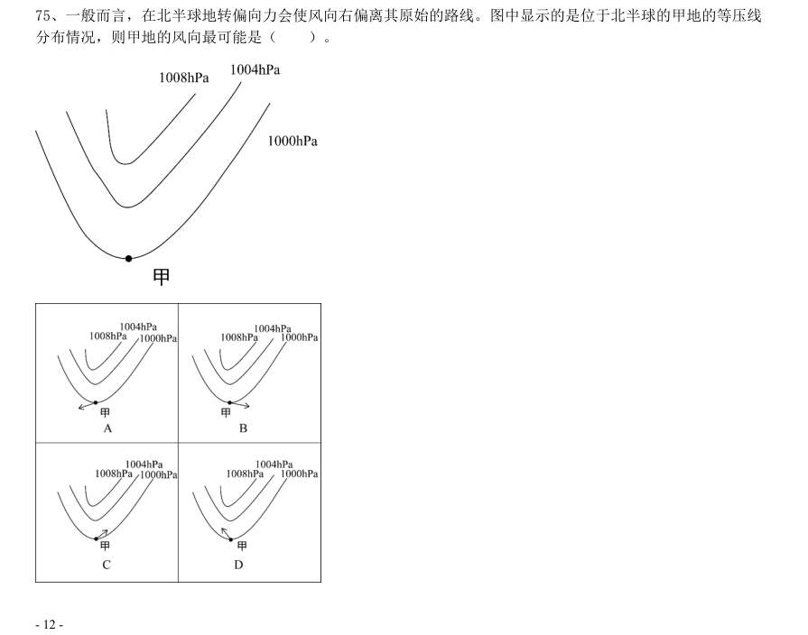

> （本题为图形题，选项为图片，见原卷）

**答案：暂缺**　**考点：图形推理｜图形推理（综合）**　**难度：★★★☆☆**
**【判断推理·图形推理｜GD-2020-xz-X076】**

76. 夏季,从冰箱内拿出一个装有冰块的杯子,则在杯内物体变为常温的过程中,杯壁温度随着时间变化的图 像最有可能接近( )。

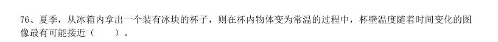

> （本题为图形题，选项为图片，见原卷）

**答案：暂缺**　**考点：图形推理｜图形推理（综合）**　**难度：★★☆☆☆**
**【判断推理·逻辑判断｜GD-2020-xz-X077】**

77. 实验员小张计划配制浓度为8%的氯化钠溶液,在配制过程中,他使用托盘天平称量氯化钠的质量,使用量 筒称量水的体积。但由于操作失误,最终配制的溶液浓度偏小,则以下可能导致这一结果的是( )。

- **A.** 称量前未调平衡,天平指针偏右
- **B.** 称量时,使用了已生锈的砝码
- **C.** 用量筒取水时,仰视读数
- **D.** 将水倒入烧杯时,一部分洒在外面

**答案：暂缺**　**考点：逻辑判断｜逻辑判断（综合）**　**难度：★★★☆☆**
**【判断推理·图形推理｜GD-2020-xz-X078】**

78. 如果将等量的氧气和氮气混合,注入一个密闭容器,则静置较长一段时间后,容器内氧元素(用O 代表) 和氮元素(用N 代表)的分布最可能接近( )。

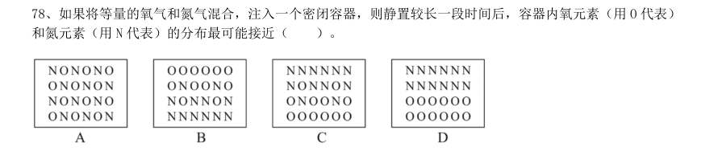

> （本题为图形题，选项为图片，见原卷）

**答案：暂缺**　**考点：图形推理｜图形推理（综合）**　**难度：★★★☆☆**
**【判断推理·科学推理｜GD-2020-xz-X079】**

79. 如图所示是某仓库报警器的电路示意图,热传感器R1 安装在仓库内部,监控机A 和报警电铃安装在监控室 内。热传感器R1 的阻值会随着温度的升高而减小,当仓库发生火情时,下列说正确的是( )

- **A.** 监控机A 两端的电流增大
- **B.** 报警电铃两端的电压减小
- **C.** 电阻器R2 两端的电压不变
- **D.** 电源的电压降低

**答案：暂缺**　**考点：科学推理｜物理**　**难度：★★☆☆☆**
**【判断推理·逻辑判断｜GD-2020-xz-X080】**

80. 小张乘坐的小船在平静的湖面上匀速行驶,他在甲板上竖直跳起后下落,则下落点( )

- **A.** 在起跳点
- **B.** 在起跳点前
- **C.** 在起跳点后
- **D.** 位置不确定

**答案：暂缺**　**考点：逻辑判断｜逻辑判断（综合）**　**难度：★★☆☆☆**
**【判断推理·逻辑判断｜GD-2020-xz-X081】**

81. 如图所示,乙、丙两个正方体漂浮在装有溶液的容器内保持静止状态,且上表面与液面持平,正方体甲下 表面与乙物体的上表面密切接触,球体丁与丙之间用细绳牵连,则下列说法正确的是( )。

- **A.** 液体对物体甲有浮力作用
- **B.** 丙受到的浮力大于丁受到的浮力
- **C.** 乙受到的浮力大于甲乙两物体的重力之和
- **D.** 细绳的牵引力等于丙受到的浮力减去丁的重力

**答案：暂缺**　**考点：逻辑判断｜逻辑判断（综合）**　**难度：★★★☆☆**
**【判断推理·逻辑判断｜GD-2020-xz-X082】**

82. 某可燃物的着火点为t,如图所示,则该物质燃烧火势从大到小的点依次是( )。

- **A.** 123
- **B.** 245
- **C.** 345
- **D.** 542

**答案：暂缺**　**考点：逻辑判断｜朴素逻辑（排序/匹配）**　**难度：★★☆☆☆**
**【判断推理·逻辑判断｜GD-2020-xz-X083】**

83. 如图所示,仓库工人计划用小车运送三箱货物,第一次先用大小为F 的力将一箱货物从A 仓库推到B 仓库, 第二次用同样大小的力将两箱货物从A 仓库拉到B 仓库。则在货物的移动过程中,关于两次做功的情况下列说 法正确的是( )。

- **A.** 工人第一次做的功比第二次多
- **B.** 工人第一次做的功比第二次少
- **C.** 工人第一次做的功与第二次一样多
- **D.** 无法确定

**答案：暂缺**　**考点：逻辑判断｜逻辑判断（综合）**　**难度：★★★★☆**
**【判断推理·逻辑判断｜GD-2020-xz-X084】**

84. 如图所示,小球用橡皮筋固定在天花板上。如果让小球从A 点落下,B 点是橡皮筋的自然长度,C 点是小球 达到的最低点。则下列说法正确的是( )。

- **A.** 在B 点时,小球的重力等于橡皮筋的张力
- **B.** 小球在C 点受到2 个力的作用
- **C.** 小球在C 点受力平衡
- **D.** 小球在A 点的重力势能等于动能

**答案：暂缺**　**考点：逻辑判断｜逻辑判断（综合）**　**难度：★★★☆☆**
**【判断推理·逻辑判断｜GD-2020-xz-X085】**

85. 李先生驾车外出,用导航计算得知出发地到目的地的直线距离是20km,路途中经过测速点时,他看到车内 记速表显示为60km/h,半小时后到达目的地,导航显示路程是33km。由此可以判断( )。 1李先生驾车的位移是20km 2李先生驾车的位移是33km 3整个路途中,李先生驾车的平均速度为60km/h 4经过测速点时的瞬时速度是60km/h

- **A.** 13
- **B.** 23
- **C.** 24
- **D.** 14

**答案：暂缺**　**考点：逻辑判断｜逻辑判断（综合）**　**难度：★★★★★**
**【资料分析·比重计算与比较｜GD-2020-xz-X086】**
> 材料：(材料1) 近年来,我国大力推动农村互联网建设,目前已初步建成融合、泛在、安全、绿色的宽带网络环境,基本 实现“城市光纤到楼到户,农村宽带进乡入村”。2019 年,我国已建成全球最大规模光纤和移动通信网络,行 政村通光纤和4G 比例均超过98%。

86. 调查显示,截至2020 年3 月,我国网民规模为9.04 亿人,其中农村网民规 模为2.55 亿人,较2018 年12 月增长14.9%,城镇网民规模为6.49 亿人,占网民整体的71.8%,较2018 年12 月增长4200 万。 我国农村地区互联网普及率为46.2%,较2018 年12 月提升7.8 个百分点,其余年份详情如下: 2020 年3 月,农村网民规模约占我国网民整体的:

- **A.** 20.2%
- **B.** 22.4%
- **C.** 28.2%
- **D.** 38.3%

**答案：暂缺**　**考点：比重计算与比较｜现期比重**　**难度：★★★★★**
**【资料分析·增长量计算｜GD-2020-xz-X087】**

87. 如果按照2018 年12 月到2020 年3 月的城镇网民规模月均增长量估算,2020 年12 月,城镇网民规模约为 ( )亿人。

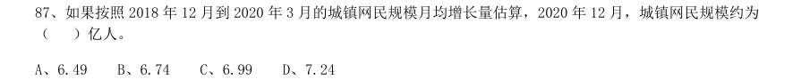

- **A.** 6.49
- **B.** 6.74
- **C.** 6.99
- **D.** 7.24

**答案：暂缺**　**考点：增长量计算｜增长量计算（415 份数法）**　**难度：★★★☆☆**
**【资料分析·增长量计算｜GD-2020-xz-X088】**

88. 与2011 年12 月相比,2020 年3 月农村网民规模增长了约:

- **A.** 40.5%
- **B.** 52.8%
- **C.** 87.3%
- **D.** 101.2%

**答案：暂缺**　**考点：增长量计算｜增长量计算（综合）**　**难度：★☆☆☆☆**
**【资料分析·基期量计算｜GD-2020-xz-X089】**

89. 下列选项中,城镇地区互联网普及率与农村相差最大的是:

- **A.** 2015 年
- **B.** 2016 年
- **C.** 2017 年
- **D.** 2018 年

**答案：暂缺**　**考点：基期量计算｜基期量比较**　**难度：★☆☆☆☆**
**【资料分析·综合分析｜GD-2020-xz-X090】**

90. 根据以上资料,下列说法正确的是:

- **A.** 截至2020 年3 月,农村人口约为7 亿
- **B.** 2019 年农村网民规模同比增长率约为13.3%
- **C.** 2013—2018 年,我国城镇地区互联网普及率的增幅逐年提升
- **D.** 2013—2018 年,我国农村网民规模每年均较上一年有所增长

**答案：暂缺**　**考点：综合分析｜选正确项**　**难度：★★★★★**
**【资料分析·增长量计算｜GD-2020-xz-X091】**
> 材料：2019 年我国农民工规模继续扩大,总量达到29077 万人,同比增长0.8%。其中,本地农民工11652 万人, 比上年增加82 万人;外出农民工17425 万人,比上年增加159 万人。外出农民工中,在省内就业的农民工 9917 万人,比上年增加245 万人;跨省流动农民工7508 万人,比上年减少86 万人。 从收入看,农民工集中就业的六大行业月均收入均稳定增长。2019 年农民工月均收入约4000 元,其中外 出农民工月均收入4427 元,比上年增加320 元;本地农民工月均收入3500 元,比上年增加160 元。

91. 2014—2019 年,我国农民工规模增加了约:

- **A.** 3.2%
- **B.** 4.8%
- **C.** 6.2%
- **D.** 7.8%

**答案：暂缺**　**考点：增长量计算｜增长量计算（综合）**　**难度：★★★☆☆**
**【资料分析·比重计算与比较｜GD-2020-xz-X092】**

92. 2018 年,省内就业农民工的数量约占外出农民工的:

- **A.** 36%
- **B.** 46%
- **C.** 56%
- **D.** 66%

**答案：暂缺**　**考点：比重计算与比较｜现期比重**　**难度：★☆☆☆☆**
**【资料分析·增长率计算与比较｜GD-2020-xz-X093】**

93. 2019 年,下列行业中农民工月均收入同比增加最多的是:

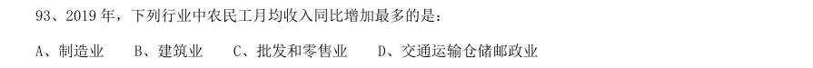

- **A.** 制造业
- **B.** 建筑业
- **C.** 批发和零售业
- **D.** 交通运输仓储邮政业

**答案：暂缺**　**考点：增长率计算与比较｜增长率计算（综合）**　**难度：★☆☆☆☆**
**【资料分析·综合分析｜GD-2020-xz-X094】**

94. 2018 年,我国农民工在各区域的月均收入从高到低是:

- **A.** 西部地区>中部地区>东北地区>东部地区
- **B.** 中部地区>东部地区>东北地区>西部地区
- **C.** 东部地区>西部地区>东北地区>中部地区
- **D.** 东部地区>中部地区>西部地区>东北地区

**答案：暂缺**　**考点：综合分析｜综合分析（综合）**　**难度：★★★★★**
**【资料分析·综合分析｜GD-2020-xz-X095】**

95. 根据以上资料,下面说法不正确的是:

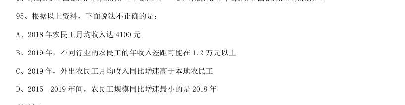

- **A.** 2018 年农民工月均收入达4100 元
- **B.** 2019 年,不同行业的农民工的年收入差距可能在1.2 万元以上
- **C.** 2019 年,外出农民工月均收入同比增速高于本地农民工
- **D.** 2015—2019 年间,农民工规模同比增速最小的是2018 年

**答案：暂缺**　**考点：综合分析｜选错误项**　**难度：★★★★★**
**【资料分析·基期量计算｜GD-2020-xz-X096】**
> 材料：2019 年全国农村网络零售额从2014 年的1800 亿元增加至逾1.7 万亿元,占全国网络零售总额的16.1%, 较上年略有提升;同比增长19.1%,高于全国网络零售总额增长率2.6 个百分点。 分地区看,东、中、西部和东北地区农村网络零售额分别占全国农村网络零售额的76.6%、12.0%,9.4%和 2.0%,同比增长分别为19.8%,17.1%,17.6%和10.2%。 2019 年,电子商务进农村综合示范工作聚焦脱贫攻坚和乡村振兴,取得了阶段性成果。

96. 2014—2019 年间,全国农村网络零售额平均每年增长约( )亿元。

- **A.** 2183.3
- **B.** 2547.1
- **C.** 3056.6
- **D.** 3820.7

**答案：暂缺**　**考点：基期量计算｜基期量计算（综合）**　**难度：★★★☆☆**
**【资料分析·比重计算与比较｜GD-2020-xz-X097】**

97. 2018 年,东、中、西部和东北地区农村网络零售额占全国农村网络零售额的比重分别为:

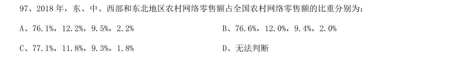

- **A.** 76.1%,12.2%,9.5%,2.2%
- **B.** 76.6%,12.0%,9.4%,2.0%
- **C.** 77.1%,11.8%,9.3%,1.8%
- **D.** 无法判断

**答案：暂缺**　**考点：比重计算与比较｜现期比重**　**难度：★☆☆☆☆**
**【资料分析·增长率计算与比较｜GD-2020-xz-X098】**

98. 2019 年,全国农产品网络零售额同比增长率较全国网络零售总额同比增长率高约( )个百分点。

- **A.** 7.9
- **B.** 10.5
- **C.** 11.9
- **D.** 13.5

**答案：暂缺**　**考点：增长率计算与比较｜增长率计算**　**难度：★☆☆☆☆**
**【资料分析·基期量计算｜GD-2020-xz-X099】**

99. 2019 年全国各类农产品中,网络零售额排名前三的农产品零售额合计约为( )亿元。

- **A.** 277.1
- **B.** 739.4
- **C.** 1073.3
- **D.** 1935.8

**答案：暂缺**　**考点：基期量计算｜基期量计算（综合）**　**难度：★☆☆☆☆**
**【资料分析·综合分析｜GD-2020-xz-X100】**

100. 根据以上资料,下列说法正确的是:

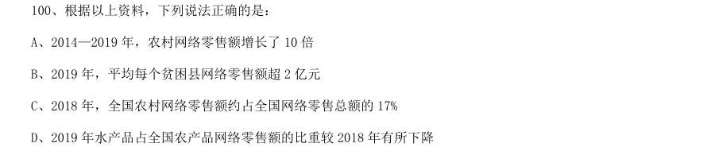

- **A.** 2014—2019 年,农村网络零售额增长了10 倍
- **B.** 2019 年,平均每个贫困县网络零售额超2 亿元
- **C.** 2018 年,全国农村网络零售额约占全国网络零售总额的17%
- **D.** 2019 年水产品占全国农产品网络零售额的比重较2018 年有所下降

**答案：暂缺**　**考点：综合分析｜选正确项**　**难度：★★★★★**