# 2021 年广东行测（乡镇）

- 题量：100（含答案 0）
- 模块分布：资料分析15 / 数量关系15 / 言语理解10 / 判断推理40 / 常识判断20
- 试卷编号：`广东-2021-乡镇`

## 题目与答案

**【言语理解·逻辑填空｜GD-2021-xz-X001】**

1. 建设“红色村”,既要注重源于“红”、体现“红”,更要注重传承“红”、弘扬“红”,用红色文化烘托 红色精神,以红色精神________红色基因。 填入横线处最恰当的词语是:

- **A.** 发现
- **B.** 激活
- **C.** 激荡
- **D.** 发掘

**答案：暂缺**　**考点：逻辑填空｜一空**　**难度：★☆☆☆☆**
**【言语理解·逻辑填空｜GD-2021-xz-X002】**

2. 产业振兴________是实现脱贫攻坚与乡村振兴的重要标志,________是实现二者有效衔接的必然要求。 填入横线部分最恰当的一项是:

- **A.** 或者或者
- **B.** 因为所以
- **C.** 尽管还
- **D.** 不仅

**答案：暂缺**　**考点：逻辑填空｜一空**　**难度：★☆☆☆☆**
**【言语理解·逻辑填空｜GD-2021-xz-X003】**

3. 正是广大基层干部群众以无比巨大的热情投入改革,以只争朝夕的劲头________改革,以一往无前的勇气探 路改革,才令改革开放的大潮澎湃不息,蔚为壮观,________出令世界惊叹的成就。 填入横线处的词语最恰当的一项是:

- **A.** 推动创建
- **B.** 参与创造
- **C.** 推进构建
- **D.** 参加

**答案：暂缺**　**考点：逻辑填空｜一空**　**难度：★★☆☆☆**
**【言语理解·逻辑填空｜GD-2021-xz-X004】**

4. 乡村振兴,必须在人才队伍建设上尽快破题,研究出台乡村振兴引才专项政策,打通农业人才服务基层的 ________,________基层农业人才的发展空间等。一些地方的农校、政府已经在通过鼓励学生“下地”、农民“上 学”等方式,为基层农技岗位输送人才。 填入横线处的词语最恰当的一项是:

- **A.** 禁锢扩张
- **B.** 渠道增长
- **C.** 脉络扩展
- **D.** 桎梏

**答案：暂缺**　**考点：逻辑填空｜一空**　**难度：★★★☆☆**
**【言语理解·逻辑填空｜GD-2021-xz-X005】**

5. 伟大抗疫精神同中华民族长期形成的特质禀赋和文化基因________,是爱国主义、集体主义、社会主义精神 的传承和发展,是中国精神的生动________。 填入横线处最恰当的一项是:

- **A.** 一脉相承诠释
- **B.** 一衣带水展示
- **C.** 相辅相成展现
- **D.** 相得益彰

**答案：暂缺**　**考点：逻辑填空｜一空**　**难度：★☆☆☆☆**
**【言语理解·中心理解｜GD-2021-xz-X006】**

6. 依托红色资源打造的旅游点,如何让游客真正“留下来”“再回来”?必须强化党组织的政治功能和服务功 能,提升农村基层党组织的组织力。在党组织的领导下,让绿色产业和特色农家乐融合,增强游客体验感、参与 感,走出一条“红色基因+绿色产业+特色旅游”的振兴之路。在此基础上,充分挖掘保护利用红色资源,推动形 成基层党建、红色资源、新农村建设融合发展的新格局。 这段文字主要分析了:

- **A.** 发展红色旅游的路径
- **B.** 发展红色旅游的意义
- **C.** 基层党建新格局的内涵
- **D.** 新农村建设融合发展的目标

**答案：暂缺**　**考点：中心理解｜对策优先**　**难度：★★★★☆**
**【言语理解·中心理解｜GD-2021-xz-X007】**

7. 通过主体再造实现人的发展,这是实现脱贫的根本途径。借助“改变环境—发展产业—教育培训—参与公共 生活”模式,引导贫困人群进入新的社会行动结构之中,在参与社会行动中实现自我觉醒、自我教育,在自我改 造中实现自我发展,由此形成脱贫的内生动力,这种脱贫更能引导人走上自我解放的道路,因而也具有更深刻的 意义。 对这段文字理解准确的是:

- **A.** 只有改变环境,才能实现脱贫致富
- **B.** 摆脱贫困是实现人的解放的最终目标
- **C.** 教育培训在实现脱贫中具有决定性作用
- **D.** 实现脱贫意味着主体的再造和人的发展

**答案：暂缺**　**考点：中心理解｜中心理解（综合）**　**难度：★★★☆☆**
**【言语理解·中心理解｜GD-2021-xz-X008】**

8. 县域是一个相对独立的社会,不只是属于整体社会的一部分。每个县域有自己的社会结构、社会关系、社会 行为规范以及独特的生活方式、文化和语言传统,因此是一个亚社会。而且县域社会是一个复杂的社会体系,由 各种村落、乡镇和城镇等子体系构成,各个子体系之间以不同方式和机制形成关系,从而构筑成县域社会。 这段文字主要讲了:

- **A.** 县域的现实意义
- **B.** 县域的相对独立性
- **C.** 县域的社会学概念
- **D.** 县域的子体系构成

**答案：暂缺**　**考点：中心理解｜转折与因果**　**难度：★★★☆☆**
**【言语理解·逻辑填空｜GD-2021-xz-X009】**

9. 要深深地扎根于人民群众之中,不断从人民群众及其参与的各项实践中汲取营养和力量。正所谓, “________________”。当前,密切联系群众最直接的要求就是推动广大党员干部走近群众,扑下身子搞好调研, 真正了解群众所思所想所盼。从群众关注的烦心事、紧要事和身边事等细微之处入手,及时发现问题、精准研判 问题、有效解决问题。 下列句子填入划横线处,最恰当的是:

- **A.** 天地之大,黎元为先
- **B.** 凡治国之道,必先富民
- **C.** 得众则得国,失众则失国
- **D.** 知屋漏者在宇下,知政失者在草野

**答案：暂缺**　**考点：逻辑填空｜一空**　**难度：★★★★☆**
**【言语理解·中心理解｜GD-2021-xz-X010】**

10. 随着时代的发展,年轻人的婚恋观也在不断变化,从家长的“要少了会遭笑话”,到年轻人“多要了会被笑 话”,再到最后“彩礼多少无所谓,不要都行”,看似是对彩礼的探讨,但实质上是摒弃了不健康的面子观和陈 规陋习,展现的是时代的进步。这既需要相关部门引导,也需要家庭成员提升认知,更新观念,那些更广泛的陈 规陋习在农村的生存空间才会越来越小。 上述文段意在说明:

- **A.** 要彩礼这一风俗最终会被人们摒弃
- **B.** 破除陈规陋习需要全社会共同努力
- **C.** 新时代的年轻人要接纳新的思想观念
- **D.** 陈规陋习在农村的生存空间越来越小

**答案：暂缺**　**考点：中心理解｜对策优先**　**难度：★★★☆☆**
**【常识判断·历史人文｜GD-2021-xz-X011】**

11. 2021 年是中国共产党成立一百周年,关于党的历史,下列选项有误的是:

- **A.** 中共二大第一次明确提出了彻底的反帝反封建的革命纲领
- **B.** 中国共产党在中国革命中战胜敌人的三个法宝是解放思想、实事求是、武装斗争
- **C.** 确立毛泽东思想为党的指导思想并写入党章,是中共七大的历史性贡献
- **D.** 1954 年一届全国人大一次会议通过并公布了中华人民共和国的第一部宪法

**答案：暂缺**　**考点：历史人文｜中国古代史**　**难度：★★★★☆**
**【常识判断·地理常识｜GD-2021-xz-X012】**

12. 党的十九届五中全会提出,坚持( )在我国现代化建设全局中的核心地位,把科技自立自强作为国家 发展的战略支撑。

- **A.** 创新
- **B.** 改革
- **C.** 开放
- **D.** 发展

**答案：暂缺**　**考点：地理常识｜世界地理**　**难度：★☆☆☆☆**
**【常识判断·历史人文｜GD-2021-xz-X013】**

13. 嘉兴南湖革命纪念馆的题诗“革命声传画舫中,诞生共党庆工农”纪念的历史事件是:

- **A.** 中共一大的召开
- **B.** 第一次国共合作
- **C.** 中共工农红军的组建
- **D.** 第一次全国劳动大会的召开

**答案：暂缺**　**考点：历史人文｜中国古代史**　**难度：★☆☆☆☆**
**【常识判断·经济常识｜GD-2021-xz-X014】**

14. 《中共中央关于制定国民经济和社会发展第十四个五年规划和二〇三五年远景目标的建议》对新发展阶段优 先发展农业农村、全面推进乡村振兴作出总体部署。以下不属于新发展阶段全面推进乡村振兴措施的是( )。

- **A.** 实施农村人居环境整治
- **B.** 加快县域内城乡融合发展
- **C.** 加强党的农村基层组织建设
- **D.** 保障农村贫困人口基本医疗和住房安全

**答案：暂缺**　**考点：经济常识｜经济常识（综合）**　**难度：★★★☆☆**
**【常识判断·政治常识｜GD-2021-xz-X015】**

15. 党的新闻舆论工作必须“坚持正确舆论导向,坚持正面宣传为主,唱响主旋律,弘扬正能量,做大做强主流 思想舆论”。下列选项最能体现这一理念的是:

- **A.** 独阴不成,独阳不生
- **B.** 事必有法,然后可成
- **C.** 事不凝滞,理贵变通
- **D.** 先立乎其大者,则其小者不能夺也

**答案：暂缺**　**考点：政治常识｜政治常识（综合）**　**难度：★★★☆☆**
**【常识判断·历史人文｜GD-2021-xz-X016】**

16. 以下机构按照成立时间的先后顺序排列,正确的是: 1国家乡村振兴局 2中华人民共和国教育部 3中华人民共和国文化和旅游部 4中央人民政府驻香港特别行政区维护国家安全公署

- **A.** 1243
- **B.** 2341
- **C.** 3214
- **D.** 3421

**答案：暂缺**　**考点：历史人文｜历史人文（综合）**　**难度：★★★☆☆**
**【常识判断·政治常识｜GD-2021-xz-X017】**

17. 青少年是祖国的未来,民族的希望。青少年教育最重要的是教给他们正确的思想。引导他们走正路。其中, ( )是落实立德树人根本任务的关键课程。

- **A.** 思政课
- **B.** 劳动课
- **C.** 通识课
- **D.** 美育课

**答案：暂缺**　**考点：政治常识｜政治常识（综合）**　**难度：★★★☆☆**
**【常识判断·政治常识｜GD-2021-xz-X018】**

18. 以下人物被党中央、国务院授予“全国脱贫攻坚先进个人”荣誉称号的有: 1李保国 2张桂梅 3钟南山 4焦裕禄 5黄文秀

- **A.** 125
- **B.** 234
- **C.** 124
- **D.** 1235

**答案：暂缺**　**考点：政治常识｜政治常识（综合）**　**难度：★☆☆☆☆**
**【常识判断·政治常识｜GD-2021-xz-X019】**

19. 2020 年是中国人民志愿军抗美援朝出国作战70 周年。以下战役发生在抗美援朝战争期间的是:

- **A.** 辽沈战役
- **B.** 百团大战
- **C.** 上甘岭战役
- **D.** 仁川登陆战

**答案：暂缺**　**考点：政治常识｜政治常识（综合）**　**难度：★☆☆☆☆**
**【常识判断·经济常识｜GD-2021-xz-X020】**

20. 增强消费对经济发展的基础性作用,顺应消费升级趋势,提升传统消费,培育新型消费,适当增加公共消费。 下列措施中,有助于增强消费对经济发展的基础性作用的有: 1提高服务消费领域市场准入门槛,减少产品供给 2推动汽车等消费品由购买管理向使用管理转变 3完善节假日制度,落实带薪休假制度 4改善消费环境,强化消费者权益保护

- **A.** 14
- **B.** 13
- **C.** 24
- **D.** 234

**答案：暂缺**　**考点：经济常识｜微观与市场**　**难度：★★★★★**
**【常识判断·时事政治｜GD-2021-xz-X021】**

21. 习近平总书记指出,体育强国的基础在于( ),要通过举办北京冬奥会、冬残奥会,把我国冰雪运动特 别是雪上运动搞上去,在3 亿人中更好推广冰雪运动。

- **A.** 群众体育
- **B.** 竞技体育
- **C.** 体育文化
- **D.** 体育产业

**答案：暂缺**　**考点：时事政治｜时事政治（综合）**　**难度：★★★☆☆**
**【常识判断·政治常识｜GD-2021-xz-X022】**

22. 构建新的发展格局,是根据我国发展阶段、环境、条件变化作出的战略决策。关于构建新发展格局,以下表 述有误的是()。

- **A.** 以国际大循环为主体
- **B.** 关键在于经济循环的畅通无阻
- **C.** 坚持深化供给侧结构性改革这条主线
- **D.** 最本质的特征是实现高水平的自立自强

**答案：暂缺**　**考点：政治常识｜政治常识（综合）**　**难度：★☆☆☆☆**
**【常识判断·历史人文｜GD-2021-xz-X023】**

23. 广东在中国共产党创建史上具有重要历史地位。关于广东的红色历史,下列选项有误的是( )。

- **A.** 广东是全国最早建立中共地方组织的地区之一
- **B.** 省港大罢工是反抗帝国主义屠杀中国人民的政治大罢工
- **C.** 中国共产党领导的土地革命最早在广东海陆丰根据地开展起来
- **D.** 中国共产党在广州举行的第三次全国代表大会,决定实行第二次国共合作

**答案：暂缺**　**考点：历史人文｜中国古代史**　**难度：★★★★☆**
**【常识判断·政治常识｜GD-2021-xz-X024】**

24. 2021 年2 月25 日召开的全国脱贫攻坚总结表彰大会宣告,我国脱贫攻坚战取得了全面胜利。关于脱贫攻坚, 以下表述准确的有( )。 1完成了消除相对贫困的艰巨任务 22018 年底拉开了新时代脱贫攻坚的序幕 3我国提前10 年实现《联合国2030 年可持续发展议程》减贫目标 4精准扶贫是打赢脱贫攻坚战的制胜法宝 5开发式扶贫方针是中国特色减贫道路的鲜明特征

- **A.** 135
- **B.** 345
- **C.** 1245
- **D.** 2345

**答案：暂缺**　**考点：政治常识｜新时代理论**　**难度：★★★★★**
**【常识判断·地理常识｜GD-2021-xz-X025】**

25. 中华人民共和国全国人民代表大会是最高国家权力机关。全国人民代表大会行使的职权不包括:

- **A.** 选举国家监察委员会主任以及最高人民法院院长
- **B.** 撤销全国人民代表大会常务委员会不适当的决定
- **C.** 编制和执行国民经济和社会发展计划和国家预算
- **D.** 制定和修改刑事、民事、国家机构的和其他的基本法律

**答案：暂缺**　**考点：地理常识｜世界地理**　**难度：★☆☆☆☆**
**【常识判断·法律常识｜GD-2021-xz-X026】**

26. 民法典与人们生活息息相关,被誉为“社会生活的百科全书”。以下内容中,民法典未涉及的是:

- **A.** 监管保险业务
- **B.** 禁止高空抛物
- **C.** 见义勇为补偿
- **D.** 保护个人信息

**答案：暂缺**　**考点：法律常识｜民法典**　**难度：★☆☆☆☆**
**【常识判断·地理常识｜GD-2021-xz-X027】**

27. 《中华人民共和国环境保护法》所称环境包括: 1海洋 2森林 3草原 4湿地

- **A.** 34
- **B.** 12
- **C.** 134
- **D.** 1234

**答案：暂缺**　**考点：地理常识｜世界地理**　**难度：★☆☆☆☆**
**【常识判断·生活常识｜GD-2021-xz-X028】**

28. 下列关于生活常识的说法,正确的是:

- **A.** 发现煤气中毒病人后,施救者应立即进行人工呼吸
- **B.** 商场中绿色的消防安全标志用于指示安全和疏散通道
- **C.** 暴雨黄色预警信号生效时,所在区域的中小学校应当自动停课
- **D.** 隔夜茶指放置时间超过6 小时的茶,其致癌物的含量会显著增加

**答案：暂缺**　**考点：生活常识｜生活常识**　**难度：★★★★☆**
**【常识判断·政治常识｜GD-2021-xz-X029】**

29. 春季,我国民间有许多民俗活动。下列关于这些民俗活动的表述正确的是( )。

- **A.** 在迎春仪式上,鞭打春牛——打春
- **B.** 立春清晨,到郊外、田野踏青——插春
- **C.** 将采集到的植物枝条插在家里——采春
- **D.** 采集冬青树、松柏、竹枝、青菜等绿色植物——探春

**答案：暂缺**　**考点：政治常识｜政治常识（综合）**　**难度：★☆☆☆☆**
**【常识判断·经济常识｜GD-2021-xz-X030】**

30. 2020 年是“十三五”收官之年,广东经济社会发展取得重大成果。下列有关说法正确的是: 1第一届全国职业技能大赛在广东举行 2全省地区生产总值超过11 万亿元,连续32 年位居全国第一 3区域创新综合能力跃居全国第一,有效发明专利量保持全国首位

- **A.** 2
- **B.** 12
- **C.** 13
- **D.** 123

**答案：暂缺**　**考点：经济常识｜经济常识（综合）**　**难度：★★★★☆**
**【数量关系·数字推理｜GD-2021-xz-X031】**

31. 23,24,22,25,21,26,( ),( )

- **A.** 19
- **B.** 20
- **C.** 26
- **D.** 32

**答案：暂缺**　**考点：数字推理｜数字推理（综合）**　**难度：★★★★☆**
**【数量关系·数字推理｜GD-2021-xz-X032】**

32. 3,9,18,30,45,( )

- **A.** 69
- **B.** 66
- **C.** 63
- **D.** 60

**答案：暂缺**　**考点：数字推理｜数字推理（综合）**　**难度：★★★★☆**
**【数量关系·数字推理｜GD-2021-xz-X033】**

33. 11,44,99,176,( )

- **A.** 275
- **B.** 265
- **C.** 260
- **D.** 255

**答案：暂缺**　**考点：数字推理｜数字推理（综合）**　**难度：★★★★☆**
**【数量关系·数字推理｜GD-2021-xz-X034】**

34. 389,569,479,587,299,( )

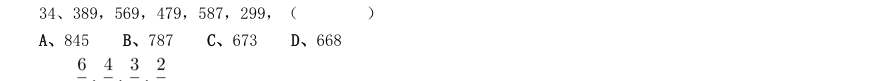

- **A.** 845
- **B.** 787
- **C.** 673
- **D.** 668

**答案：暂缺**　**考点：数字推理｜数字推理（综合）**　**难度：★★★★☆**
**【数量关系·数字推理｜GD-2021-xz-X035】**

35. ,( )

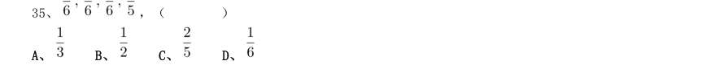

- **A.** 
- **B.** 
- **C.** 
- **D.** 

**答案：暂缺**　**考点：数字推理｜数字推理（综合）**　**难度：★★★★☆**
**【数量关系·工程问题｜GD-2021-xz-X036】**

36. 在某大型医院的建设过程中,施工单位调配了吊机、挖掘机和推土机共120 台工程设备进场施工。其中,推 土机数量是吊机的3 倍,挖掘机数量是吊机的4 倍,则吊机有( )台。

- **A.** 18
- **B.** 15
- **C.** 12
- **D.** 10

**答案：暂缺**　**考点：工程问题｜工程问题（综合）**　**难度：★☆☆☆☆**
**【数量关系·最值问题｜GD-2021-xz-X037】**

37. 某茶园需要在一定时间内完成采摘。前4 天安排了20 名采茶工,完成了五分之一的工作量。如果再用10 天 完成全部采摘,至少还需要增加( )名采茶工。

- **A.** 12
- **B.** 11
- **C.** 10
- **D.** 9

**答案：暂缺**　**考点：最值问题｜最值问题（综合）**　**难度：★★★★☆**
**【数量关系·利润问题｜GD-2021-xz-X038】**

38. 某帮扶项目以每公斤9 元的价格从农民手中收购了一批苹果,并以每公斤12 元(包邮)的价格在网上销售。 售出总量的80%后,价格下调为每公斤10 元(包邮)。运费成本为每公斤0.1 元。全部售完后,扣除收购成本 和运费的总收益为2.5 万元,则这批苹果为( )吨。

- **A.** 5
- **B.** 10
- **C.** 15
- **D.** 20

**答案：暂缺**　**考点：利润问题｜基础利润**　**难度：★★★☆☆**
**【数量关系·其他数量关系｜GD-2021-xz-X039】**

39. 上午7 点,A、B 市干部同时乘车前往省城参观学习,汽车时速均为每小时80 公里。但由于突发状况,B 市 干部在路上停留了2 个小时。最终,A 市干部于当天上午9 点到达省城;B 市干部于当天下午3 点到达。则如果 从A 市出发,途经省城到达B 市,总路程为( )公里。

- **A.** 720
- **B.** 640
- **C.** 320
- **D.** 280

**答案：暂缺**　**考点：其他数量关系｜其他数量关系（综合）**　**难度：★★★☆☆**
**【数量关系·其他数量关系｜GD-2021-xz-X040】**

40. 一条长20 厘米的纸带,先从左端开始涂上4 厘米红色,之后每间隔4 厘米再涂4 厘米红色;再从右端开始 涂上5 厘米绿色,之后每间隔5 厘米再涂5 厘米绿色,则红绿色重叠的部分共有( )段。

- **A.** 4
- **B.** 3
- **C.** 2
- **D.** 1

**答案：暂缺**　**考点：其他数量关系｜其他数量关系（综合）**　**难度：★★☆☆☆**
**【数量关系·其他数量关系｜GD-2021-xz-X041】**

41. 某货运公司承运一批工艺品,每件运费20 元。如果运输途中出现破损,那么每件破损的工艺品不仅收不到 运费,还要赔偿30 元。运输完成后发现,工艺品的破损率为6.4%,最终货运公司收到了16800 元运费,则运输 途中破损的工艺品有( )件。

- **A.** 64
- **B.** 96
- **C.** 128
- **D.** 156

**答案：暂缺**　**考点：其他数量关系｜其他数量关系（综合）**　**难度：★★★☆☆**
**【数量关系·其他数量关系｜GD-2021-xz-X042】**

42. 某学校组织学生外出学农。如果每间宿舍住6 名学生,就会缺7 张床位,如果每间宿舍住8 名学生,就会空 出3 张床位,则这批学生一共有( )人。

- **A.** 50
- **B.** 45
- **C.** 43
- **D.** 37

**答案：暂缺**　**考点：其他数量关系｜其他数量关系（综合）**　**难度：★☆☆☆☆**
**【数量关系·其他数量关系｜GD-2021-xz-X043】**

43. 县公安局计划举办篮球比赛,6 支报名参赛的队伍将平均分为上午组和下午组进行小组赛。其中甲队与乙队 来自同部门,不能分在同一组,则分组情况共有( )种可能。

- **A.** 6
- **B.** 8
- **C.** 10
- **D.** 12

**答案：暂缺**　**考点：其他数量关系｜和差倍比**　**难度：★☆☆☆☆**
**【数量关系·其他数量关系｜GD-2021-xz-X044】**

44. 某县政府组织干部职工开展党建知识竞赛,其中甲、乙两镇参赛人数之比为4∶3,甲镇有8 人、乙镇有24 人没有参加竞赛。已知甲、乙两镇干部职工人数之比为5∶6,则乙镇的干部职工比甲镇多( )人。

- **A.** 8
- **B.** 7
- **C.** 6
- **D.** 5

**答案：暂缺**　**考点：其他数量关系｜和差倍比**　**难度：★★☆☆☆**
**【数量关系·几何问题｜GD-2021-xz-X045】**

45. 如图所示,周长为24 米的平行四边形绿化地被划分为三块区域,两边为三角形的花坛,中间为矩形的草地。 已知a、b、c 长度之比为4∶2∶ ,则矩形草地的面积为( )平方米。

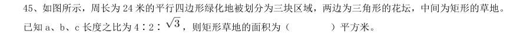

- **A.** 6
- **B.** 6
- **C.** 12
- **D.** 12

**答案：暂缺**　**考点：几何问题｜平面几何**　**难度：★★★★★**
**【判断推理·图形推理｜GD-2021-xz-X046】**

46. 下列选项中最符合所给图形规律的是:

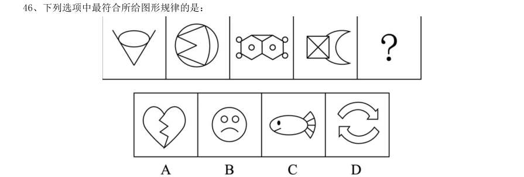

> （本题为图形题，选项为图片，见原卷）

**答案：暂缺**　**考点：图形推理｜图形推理（综合）**　**难度：★★☆☆☆**
**【判断推理·图形推理｜GD-2021-xz-X047】**

47. 下列选项中最符合所给图形图形规律的是:

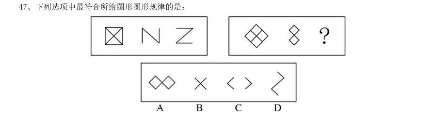

> （本题为图形题，选项为图片，见原卷）

**答案：暂缺**　**考点：图形推理｜图形推理（综合）**　**难度：★★☆☆☆**
**【判断推理·图形推理｜GD-2021-xz-X048】**

48. 下列选项中最符合所给图形规律的是:

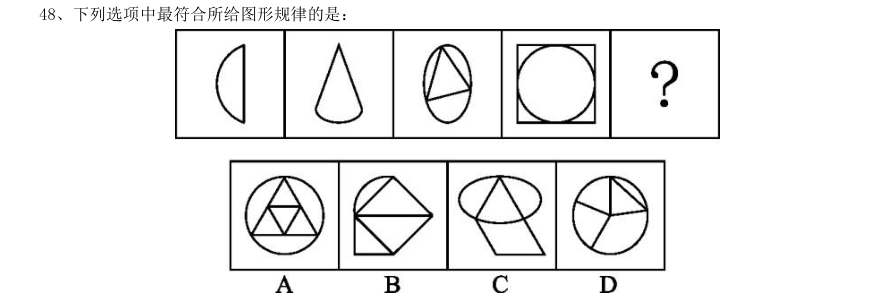

> （本题为图形题，选项为图片，见原卷）

**答案：暂缺**　**考点：图形推理｜图形推理（综合）**　**难度：★★☆☆☆**
**【判断推理·图形推理｜GD-2021-xz-X049】**

49. 下列选项中最符合所给图形规律的是:

> （本题为图形题，选项为图片，见原卷）

**答案：暂缺**　**考点：图形推理｜图形推理（综合）**　**难度：★★☆☆☆**
**【判断推理·图形推理｜GD-2021-xz-X050】**

50. 下列选项中最符合所给图形规律的是:

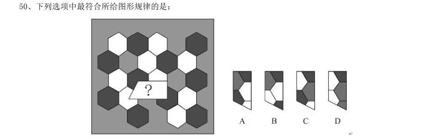

> （本题为图形题，选项为图片，见原卷）

**答案：暂缺**　**考点：图形推理｜图形推理（综合）**　**难度：★★☆☆☆**
**【判断推理·图形推理｜GD-2021-xz-X051】**

51. 如图所示是一个圆台,则下列选项不可能属于该圆台视图的是:

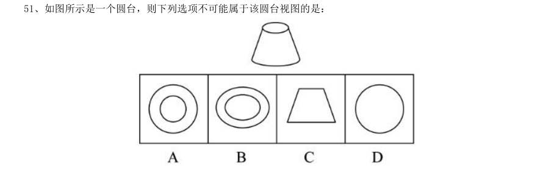

> （本题为图形题，选项为图片，见原卷）

**答案：暂缺**　**考点：图形推理｜图形推理（综合）**　**难度：★★☆☆☆**
**【判断推理·类比推理｜GD-2021-xz-X052】**

52. 不经过旋转,下列选项能组成所给梯形的是:

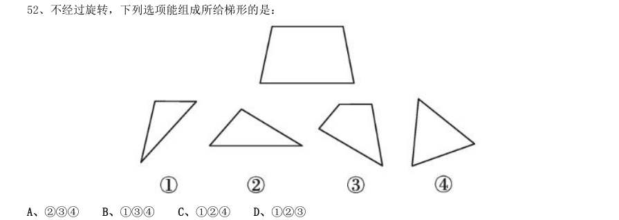

- **A.** 234
- **B.** 134
- **C.** 124
- **D.** 123

**答案：暂缺**　**考点：类比推理｜逻辑关系**　**难度：★☆☆☆☆**
**【判断推理·图形推理｜GD-2021-xz-X053】**

53. 下列选项中,能够折成如图所示立方体的是( )。

> （本题为图形题，选项为图片，见原卷）

**答案：暂缺**　**考点：图形推理｜立体图形**　**难度：★★☆☆☆**
**【判断推理·图形推理｜GD-2021-xz-X054】**

54. 下列选项中,与所给的立体图形不可能是同一图形的是:

> （本题为图形题，选项为图片，见原卷）

**答案：暂缺**　**考点：图形推理｜立体图形**　**难度：★★☆☆☆**
**【判断推理·图形推理｜GD-2021-xz-X055】**

55. 下方分别是一个由长方体堆积而成的立体图形和该立体图形的左视图、后视图,那么该立体图形的俯视图是 ( )。

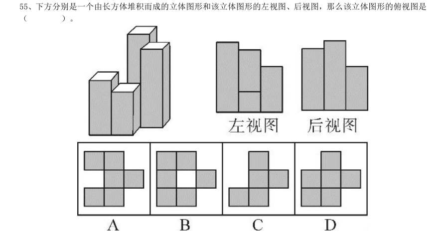

> （本题为图形题，选项为图片，见原卷）

**答案：暂缺**　**考点：图形推理｜立体图形**　**难度：★★☆☆☆**
**【判断推理·类比推理｜GD-2021-xz-X056】**

56. 开∶关

- **A.** 听∶闻
- **B.** 念∶想
- **C.** 推∶拉
- **D.** 聚∶合

**答案：暂缺**　**考点：类比推理｜类比推理（综合）**　**难度：★☆☆☆☆**
**【判断推理·类比推理｜GD-2021-xz-X057】**

57. 学习∶进步

- **A.** 改革∶发展
- **B.** 开花∶收获
- **C.** 心平∶气和
- **D.** 跑步∶健身

**答案：暂缺**　**考点：类比推理｜类比推理（综合）**　**难度：★☆☆☆☆**
**【判断推理·类比推理｜GD-2021-xz-X058】**

58. 恳求∶要求

- **A.** 复杂∶嘈杂
- **B.** 恪守∶遵守
- **C.** 动机∶动力
- **D.** 妥协∶协调

**答案：暂缺**　**考点：类比推理｜类比推理（综合）**　**难度：★☆☆☆☆**
**【判断推理·类比推理｜GD-2021-xz-X059】**

59. 东奔∶西走

- **A.** 跋山∶涉水
- **B.** 完整∶无缺
- **C.** 顾此∶失彼
- **D.** 大街∶小巷

**答案：暂缺**　**考点：类比推理｜类比推理（综合）**　**难度：★☆☆☆☆**
**【判断推理·类比推理｜GD-2021-xz-X060】**

60. 老师∶学生∶知识

- **A.** 父母∶子女∶家庭
- **B.** 青蛙∶害虫∶庄稼
- **C.** 园丁∶农田∶花朵
- **D.** 医生∶病人∶疾病

**答案：暂缺**　**考点：类比推理｜类比推理（综合）**　**难度：★☆☆☆☆**
**【判断推理·逻辑判断｜GD-2021-xz-X061】**

61. 调查研究显示,相较传统的农业生产方式,有机农业生产出的农作物产量会有一定程度的下降。但现在仍然 有越来越多的农民从传统农业转向有机农业,甚至花费资金,添置用于有机农业耕作的农用设备。 以下选项如果为真,最能解释上述现象的是:

- **A.** 有机农业耕作方式更有助于保护生态环境
- **B.** 许多科技节目都在推广有机农业耕作方式
- **C.** 有机农业生产出的农作物市场售价远高于传统农业
- **D.** 对于少部分农作物而言,有机农业耕作并不会降低其产量

**答案：暂缺**　**考点：逻辑判断｜解释评价**　**难度：★★★★☆**
**【判断推理·逻辑判断｜GD-2021-xz-X062】**

62. 今年持续暴雨,各地花椒严重减产。由此可以预见,今年的花椒价格将会显著上涨。 要使上述推理成立,需要补充的前提条件是:

- **A.** 花椒价格仅受到产量的影响
- **B.** 全国花椒需求量与往年持平
- **C.** 花椒的价格不会影响群众的购买意愿
- **D.** 历年花椒价格的波动都与其产量密切相关

**答案：暂缺**　**考点：逻辑判断｜前提假设**　**难度：★★☆☆☆**
**【判断推理·逻辑判断｜GD-2021-xz-X063】**

63. 某镇计划安排小蒋、小陈、小刘3 名干部到甲、乙、丙3 个村子驻点,每 村只安排1 人。3 人中有一人是农学专业,一人是法学专业,一人是工学专业。已知:小陈没有前往甲村,农学 专业的没有前往甲村,工学专业的去了丙村,小陈不是农学专业。 根据以上表述,以下推论必然正确的是( )。

- **A.** 小刘去了甲村
- **B.** 小蒋去了乙村
- **C.** 小刘是工学专业的
- **D.** 小陈是工学专业的

**答案：暂缺**　**考点：逻辑判断｜逻辑判断（综合）**　**难度：★★★★☆**
**【判断推理·逻辑判断｜GD-2021-xz-X064】**

64. 农科院在一档农业电视节目中介绍了一种经济价值高的养殖动物——肉兔,强调肉兔有易于养殖、繁殖速度 快等优点,节目播出后受到了大家的关注。但是,某村在养殖肉兔之后,发现肉兔在当地市场销路并不理想。 以下选项如果为真,最能解释这一现象的是( )。

- **A.** 电视节目播出后,当地许多大型养殖企业都开始养殖肉兔
- **B.** 该村的其他养殖企业同期推出了市场价格更高的黑毛乌骨鸡
- **C.** 虽然当地有食用兔肉的习俗,但在全国范围内兔肉并不被广泛接受
- **D.** 由于养殖技术成熟,肉兔养殖已成为最具经济效益的养殖产业之一

**答案：暂缺**　**考点：逻辑判断｜解释评价**　**难度：★★★★★**
**【判断推理·逻辑判断｜GD-2021-xz-X065】**

65. 希望过上好日子的村民都愿意接受就业辅导。村民小王愿意接受就业辅导,因此,他希望过上好日子。 以下选项存在与题干最为相似的逻辑错误的是( )。

- **A.** 该店所有出售的水果都通过了农药残留检测,苹果通过了农药残留检测,因此该店正在出售苹果
- **B.** 张家苗圃在使用了这批肥料后花木长势很好,李家苗圃长势不好,因此李家苗圃没有使用这批肥料
- **C.** 许多坚持运动的儿童身体都比较健康,许多成年人也会坚持运动,因此坚持运动的成年人身体都比较健康
- **D.** 只有经过III期临床试验的新药才可能被批准上市,该新药没有经过III期临床试验,所以它没有被批准上市

**答案：暂缺**　**考点：逻辑判断｜逻辑判断（综合）**　**难度：★★★★☆**
**【判断推理·科学推理｜GD-2021-xz-X066】**

66. 下列词语所描述的场景中,涉及化学变化的是( )

- **A.** 聚沙成塔
- **B.** 百炼成钢
- **C.** 香气四溢
- **D.** 冰冻三尺

**答案：暂缺**　**考点：科学推理｜化学**　**难度：★☆☆☆☆**
**【判断推理·逻辑判断｜GD-2021-xz-X067】**

67. 小郭在甲、乙两个相同的玻璃杯中装入等量的水,甲杯的水比乙杯的温度高,将这两个玻璃杯同时放进温度 更低的冰箱内,则( )。

- **A.** 乙玻璃杯温度下降得更快
- **B.** 甲玻璃杯温度下降得更快
- **C.** 甲、乙两个玻璃杯温度变化一样快
- **D.** 不能确定两个玻璃杯的温度变化情况

**答案：暂缺**　**考点：逻辑判断｜逻辑判断（综合）**　**难度：★★☆☆☆**
**【判断推理·逻辑判断｜GD-2021-xz-X068】**

68. 右图为地球示意图,则每年夏至,白昼时间最长的是( )点。

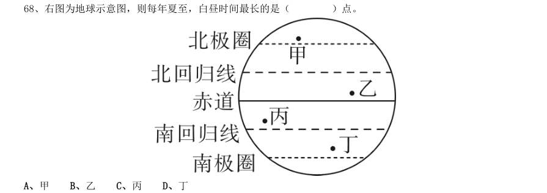

- **A.** 甲
- **B.** 乙
- **C.** 丙
- **D.** 丁

**答案：暂缺**　**考点：逻辑判断｜逻辑判断（综合）**　**难度：★★☆☆☆**
**【判断推理·逻辑判断｜GD-2021-xz-X069】**

69. 下面3 个图分别表示两种生物种群随时间(t)推移而发生的数量(a)变化情况,则甲、乙、丙三图表示的 关系最有可能依次是( )。

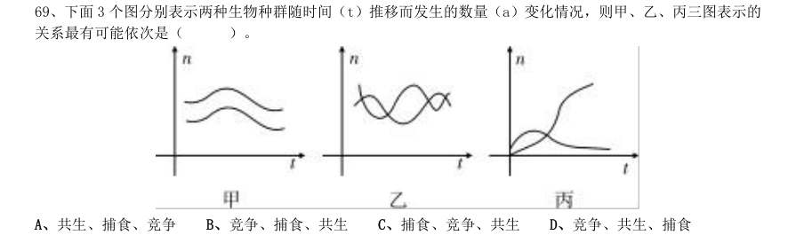

- **A.** 共生、捕食、竞争
- **B.** 竞争、捕食、共生
- **C.** 捕食、竞争、共生
- **D.** 竞争、共生、捕食

**答案：暂缺**　**考点：逻辑判断｜逻辑判断（综合）**　**难度：★★★☆☆**
**【判断推理·逻辑判断｜GD-2021-xz-X070】**

70. 如图所示,物体M 在大小相同的力F1 和F2 作用下移动了相同的距离S。下列关于F1、F2 所做的功说法正 确的是( )。

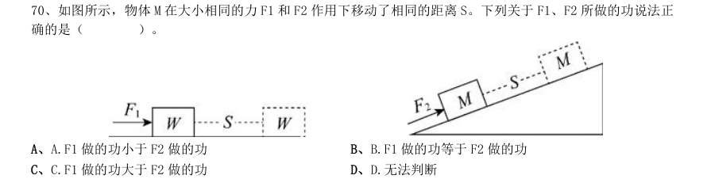

- **A.** A.F1 做的功小于F2 做的功
- **B.** B.F1 做的功等于F2 做的功
- **C.** C.F1 做的功大于F2 做的功
- **D.** D.无法判断

**答案：暂缺**　**考点：逻辑判断｜逻辑判断（综合）**　**难度：★★☆☆☆**
**【判断推理·逻辑判断｜GD-2021-xz-X071】**

71. 下列现象主要是由于分子在不停做无规则运动导致的是( )。

- **A.** 将墨水滴入水中,过会儿整杯水变黑了
- **B.** 用打气筒给篮球充气,感觉越打越吃力
- **C.** 下雪时,雪花漫天飞舞
- **D.** 冰块融化后,体积变小了

**答案：暂缺**　**考点：逻辑判断｜逻辑判断（综合）**　**难度：★★☆☆☆**
**【判断推理·逻辑判断｜GD-2021-xz-X072】**

72. 将同一鸡蛋分别浸入两杯密度不同的液体中。鸡蛋在甲杯沉底,在乙杯中悬浮。则( )。

- **A.** 乙杯中的液体的密度更大,鸡蛋在乙杯中受到的浮力更大
- **B.** 甲杯中的液体的密度更大,鸡蛋在甲杯中受到的浮力更大
- **C.** 乙杯中的液体的密度更大,鸡蛋在两个杯中受到的浮力大小相等
- **D.** 甲杯中的液体的密度更大,鸡蛋在两个杯中受到的浮力大小相等

**答案：暂缺**　**考点：逻辑判断｜逻辑判断（综合）**　**难度：★★★★☆**
**【判断推理·逻辑判断｜GD-2021-xz-X073】**

73. 某生物体细胞中含有18 条染色体。则在由一个体细胞正常分裂成两个体细胞的过程中,单个细胞体内染色 体数目变化情况是( )。

- **A.** 36 条→18 条→18 条
- **B.** 18 条→18 条→18 条
- **C.** 18 条→36 条→18 条
- **D.** 18 条→36 条→36 条

**答案：暂缺**　**考点：逻辑判断｜逻辑判断（综合）**　**难度：★★☆☆☆**
**【判断推理·图形推理｜GD-2021-xz-X074】**

74. 如图所示,高尔夫在力的作用下从水平地面的M 点飞到N 点。忽略高尔夫在飞行过程中的空气阻力,下列选 项能正确表示高尔夫从M 点到达N 点前的动能关系的是( )

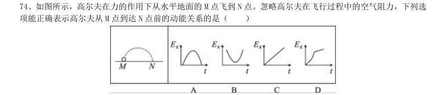

> （本题为图形题，选项为图片，见原卷）

**答案：暂缺**　**考点：图形推理｜图形推理（综合）**　**难度：★★★☆☆**
**【判断推理·逻辑判断｜GD-2021-xz-X075】**

75. 如图所示,3 只相同的杯子中分别装入了质量相等的水、煤油和盐水,则下列判断正确的是( )。

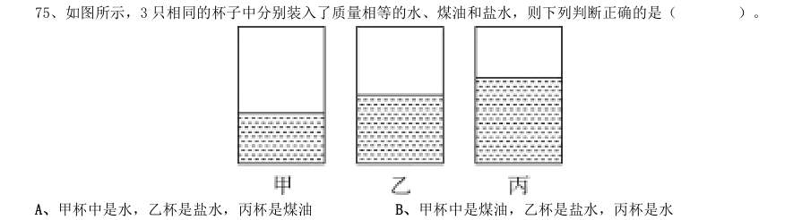

- **A.** 甲杯中是水,乙杯是盐水,丙杯是煤油
- **B.** 甲杯中是煤油,乙杯是盐水,丙杯是水
- **C.** 甲杯中是煤油,乙杯是水,丙杯是盐水
- **D.** 甲杯中是盐水,乙杯是水,丙杯是煤油

**答案：暂缺**　**考点：逻辑判断｜逻辑判断（综合）**　**难度：★★☆☆☆**
**【判断推理·科学推理｜GD-2021-xz-X076】**

76. 下列现象与科学原理搭配正确的是( )。 1白醋能除去水垢——水垢在白醋中溶解度较高 2用稀硫酸除铜锈——铜锈与稀硫酸发生氧化还原反应 3含氟牙膏能预防龋齿——氟化物作用于牙齿表面增强耐酸蚀能力

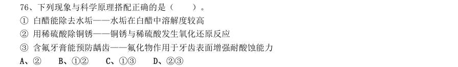

- **A.** 2
- **B.** 12
- **C.** 13
- **D.** 23

**答案：暂缺**　**考点：科学推理｜物理**　**难度：★★☆☆☆**
**【判断推理·逻辑判断｜GD-2021-xz-X077】**

77. 在赛车比赛中,赛车在水平直道转入弯道时,常常在弯道上冲出跑道。下列分析正确的是( )。

- **A.** 赛车的速度越快,赛车的惯性越大
- **B.** 赛车的速度越快,转弯所需的向心力越大
- **C.** 赛车的转角越大,发动机对抗的离心力越大
- **D.** 赛车的转角越大,轮胎与地面之间的摩擦系数越小

**答案：暂缺**　**考点：逻辑判断｜逻辑判断（综合）**　**难度：★★☆☆☆**
**【判断推理·逻辑判断｜GD-2021-xz-X078】**

78. 在匀速直线运动的京广高铁车厢内,竖直向上抛出一个小球。下列说法正确的是( )。 1小球在最高点时,垂直于地面方向的速度为零 2小球在最高点时,垂直于地面方向对地速度最大 3小球的落点位置会比时速慢的列车落点位置更近 4小球从抛出到落地的时间与列车运行速度无关

- **A.** 13
- **B.** 34
- **C.** 23
- **D.** 14

**答案：暂缺**　**考点：逻辑判断｜逻辑判断（综合）**　**难度：★★★★☆**
**【判断推理·逻辑判断｜GD-2021-xz-X079】**

79. 根据板块构造论,地球分为亚欧板块、美洲板块、非洲板块、印度洋板块、太平洋板块和南极洲板块,除太 平洋板块几乎全为海洋外,其余板块既包括大陆又包括海洋。以下关于板块交界处位置关系对应正确的是 ( )。

- **A.** 亚欧板块和美洲板块一一冰岛
- **B.** 非洲板块和印度洋板块一一蒙古
- **C.** 亚欧板块和太平洋板块一一英国北部
- **D.** 美洲板块和太平洋板块一一美国东海岸

**答案：暂缺**　**考点：逻辑判断｜逻辑判断（综合）**　**难度：★★★★☆**
**【判断推理·逻辑判断｜GD-2021-xz-X080】**

80. 下图是一辆汽车行驶在道路上速度(V)随时间(T)变化的关系图,则下列说法正确的是( )。

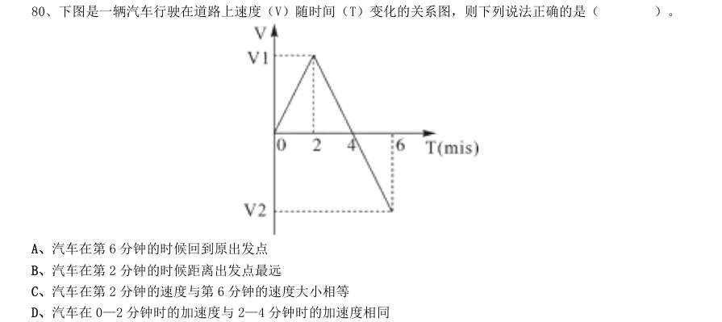

- **A.** 汽车在第6 分钟的时候回到原出发点
- **B.** 汽车在第2 分钟的时候距离出发点最远
- **C.** 汽车在第2 分钟的速度与第6 分钟的速度大小相等
- **D.** 汽车在0—2 分钟时的加速度与2—4 分钟时的加速度相同

**答案：暂缺**　**考点：逻辑判断｜逻辑判断（综合）**　**难度：★★☆☆☆**
**【判断推理·类比推理｜GD-2021-xz-X081】**

81. 如图所示,丝绸摩擦过的玻璃棒带正电,下列说法正确的是( )

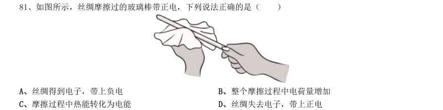

- **A.** 丝绸得到电子,带上负电
- **B.** 整个摩擦过程中电荷量增加
- **C.** 摩擦过程中热能转化为电能
- **D.** 丝绸失去电子,带上正电

**答案：暂缺**　**考点：类比推理｜类比推理（综合）**　**难度：★☆☆☆☆**
**【判断推理·图形推理｜GD-2021-xz-X082】**

82. X 染色体显性遗传病是由于位于X 染色体上的显性致病基因引起的疾病,则以下遗传图谱中,最有可能显示 X 染色体显性遗传病的是( )

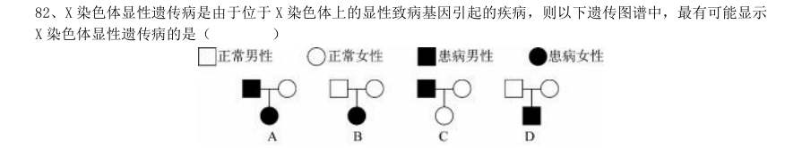

> （本题为图形题，选项为图片，见原卷）

**答案：暂缺**　**考点：图形推理｜图形推理（综合）**　**难度：★★★☆☆**
**【判断推理·科学推理｜GD-2021-xz-X083】**

83. 常见的泡沫灭火器内有两个容器,外壳内装碳酸氢钠与泡沫灭火剂的混合溶液。另有一玻璃瓶内胆,装有硫 酸铝水溶液。如图所示,正常情况(图I)下。两种溶液互不接触。当需要使用泡沫灭火器时把灭火器倒立(图 II),两种溶液发生化学反应 ,打开灭火器 开关时,泡沫从灭火器中喷出,覆盖在燃烧物品上。则下列说法正确的是( )。

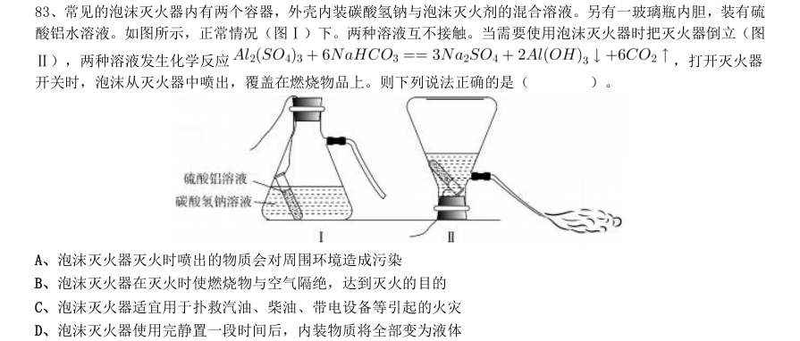

- **A.** 泡沫灭火器灭火时喷出的物质会对周围环境造成污染
- **B.** 泡沫灭火器在灭火时使燃烧物与空气隔绝,达到灭火的目的
- **C.** 泡沫灭火器适宜用于扑救汽油、柴油、带电设备等引起的火灾
- **D.** 泡沫灭火器使用完静置一段时间后,内装物质将全部变为液体

**答案：暂缺**　**考点：科学推理｜化学**　**难度：★★★★☆**
**【判断推理·图形推理｜GD-2021-xz-X084】**

84. 如图所示的电路中,当电路中的开关闭合时,电路中的小灯泡都能正常发光的是( )。

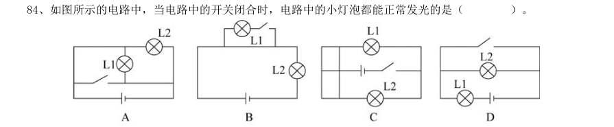

> （本题为图形题，选项为图片，见原卷）

**答案：暂缺**　**考点：图形推理｜图形推理（综合）**　**难度：★★☆☆☆**
**【判断推理·逻辑判断｜GD-2021-xz-X085】**

85. 如图所示,物体A 在F 的作用下静止在物体B 的斜面上,物体B 始终静止在水平面上,如果物体B 的斜面完 全光滑,则下列说法正确的是( )。

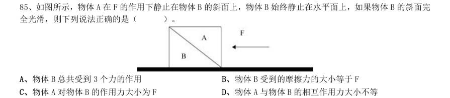

- **A.** 物体B 总共受到3 个力的作用
- **B.** 物体B 受到的摩擦力的大小等于F
- **C.** 物体A 对物体B 的作用力大小为F
- **D.** 物体A 与物体B 的相互作用力大小不等

**答案：暂缺**　**考点：逻辑判断｜逻辑判断（综合）**　**难度：★★★☆☆**
**【资料分析·综合分析｜GD-2021-xz-X086】**

86. 2019 年G 省平均每个农业科研和科技开发机构的高级职称人数最接近( )。

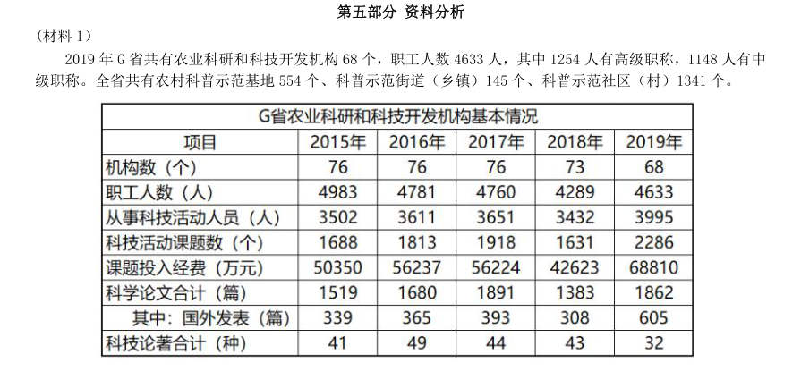

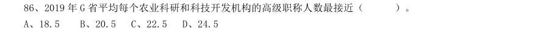

- **A.** 18.5
- **B.** 20.5
- **C.** 22.5
- **D.** 24.5

**答案：暂缺**　**考点：综合分析｜综合分析（综合）**　**难度：★★★☆☆**
**【资料分析·比重计算与比较｜GD-2021-xz-X087】**

87. 2018 年,G 省农业科研和科技开发机构从事科技活动人员数占职工人数比重约为( )。

> 材料图见 images/GD-2021-xz-X086-m.jpg

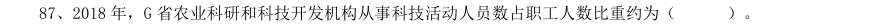

- **A.** 60%
- **B.** 70%
- **C.** 80%
- **D.** 90%

**答案：暂缺**　**考点：比重计算与比较｜现期比重**　**难度：★☆☆☆☆**
**【资料分析·年均增长率｜GD-2021-xz-X088】**

88. 2015-2019 年,G 省农业科研和科技开发机构课题投入经费平均每年增加( )万元。

> 材料图见 images/GD-2021-xz-X086-m.jpg

- **A.** 3152
- **B.** 4615
- **C.** 5517
- **D.** 7890

**答案：暂缺**　**考点：年均增长率｜年均增长率计算**　**难度：★☆☆☆☆**
**【资料分析·综合分析｜GD-2021-xz-X089】**

89. 2015-2019 年,G 省农业科研和科技开发机构发表科学论文篇数最多的一年是( )。

> 材料图见 images/GD-2021-xz-X086-m.jpg

- **A.** 2015 年
- **B.** 2016 年
- **C.** 2017 年
- **D.** 2019 年

**答案：暂缺**　**考点：综合分析｜综合分析（综合）**　**难度：★★★☆☆**
**【资料分析·综合分析｜GD-2021-xz-X090】**

90. 根据资料,下列关于G 省的说法正确的是( )。

> 材料图见 images/GD-2021-xz-X086-m.jpg

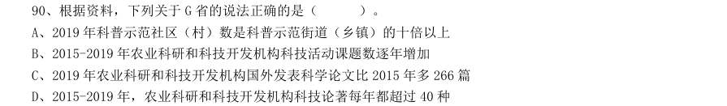

- **A.** 2019 年科普示范社区(村)数是科普示范街道(乡镇)的十倍以上
- **B.** 2015-2019 年农业科研和科技开发机构科技活动课题数逐年增加
- **C.** 2019 年农业科研和科技开发机构国外发表科学论文比2015 年多266 篇
- **D.** 2015-2019 年,农业科研和科技开发机构科技论著每年都超过40 种

**答案：暂缺**　**考点：综合分析｜选正确项**　**难度：★★★★★**
**【资料分析·综合分析｜GD-2021-xz-X091】**
> 材料：公考整理。真实性有待核实。 智能机器人产业是G 省战略性新兴产业之一。2020 年前三季度,G 省智能机器人产业纳入规模以上工业统计 的法人单位共140 家,完成总产值306.90 亿元,占全部规模以上工业产值的0.3%,同比增长29.8%,增速高于 全部规模以上工业产值32.8 个百分点;前三季度平均用工人数3.12 万人,同比增长8.6%。 2020 年前三季度,G 省智能机器人产业实现营业收入326.62 亿元,同比增长超40%,四大行业营业收入均 实现正增长,经济效益好于全部规模以上工业企业。

91. 2020 年前三季度,G 省智能机器人产业中,四大行业总产值的同比增量排序正确的是( )。 1工业机器人制造业 2特殊作业工业机器人制造业 3智能无人飞行器制造业 4服务消费机器人制造业

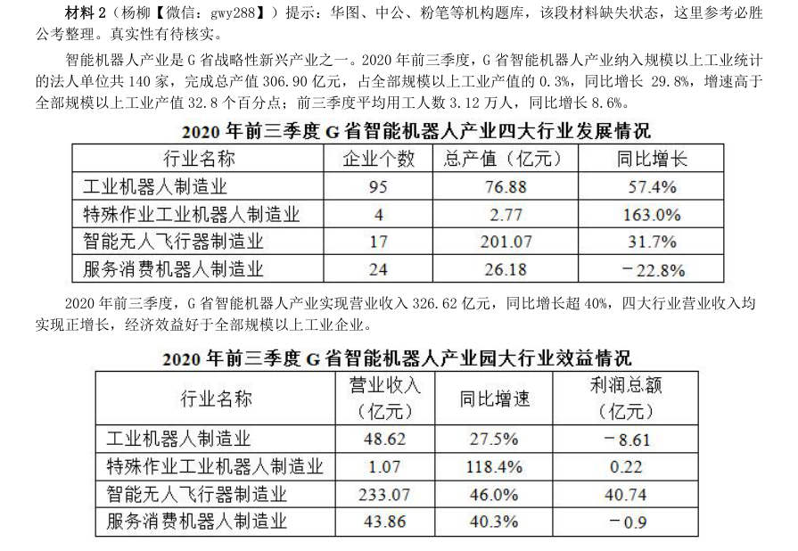

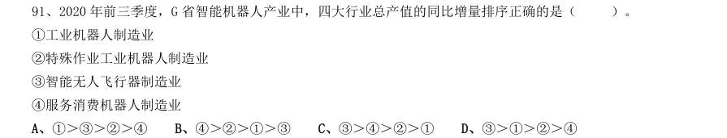

- **A.** 1>3>2>4
- **B.** 4>2>1>3
- **C.** 3>4>2>1
- **D.** 3>1>2>4

**答案：暂缺**　**考点：综合分析｜排序与图示判断**　**难度：★★★★★**
**【资料分析·平均数计算｜GD-2021-xz-X092】**

92. 2020 年前三季度,G 省下列行业中,平均每个企业产值最高的是( )。

> 材料图见 images/GD-2021-xz-X091-m.jpg

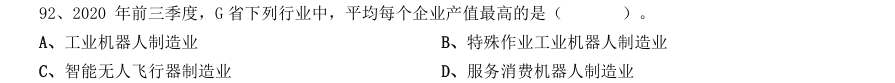

- **A.** 工业机器人制造业
- **B.** 特殊作业工业机器人制造业
- **C.** 智能无人飞行器制造业
- **D.** 服务消费机器人制造业

**答案：暂缺**　**考点：平均数计算｜现期平均数**　**难度：★☆☆☆☆**
**【资料分析·增长率计算与比较｜GD-2021-xz-X093】**

93. 2020 年前三季度,G 省智能机器人产业的总体利润率(利润率=利润总额/营业收入)约为( )。

> 材料图见 images/GD-2021-xz-X091-m.jpg

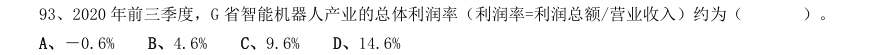

- **A.** -0.6%
- **B.** 4.6%
- **C.** 9.6%
- **D.** 14.6%

**答案：暂缺**　**考点：增长率计算与比较｜增长率计算（综合）**　**难度：★☆☆☆☆**
**【资料分析·增长率计算与比较｜GD-2021-xz-X094】**

94. 2020 年前三季度,G 省工业机器人制造业营业收入同比增长约( )亿元。

> 材料图见 images/GD-2021-xz-X091-m.jpg

- **A.** 5
- **B.** 10
- **C.** 15
- **D.** 20

**答案：暂缺**　**考点：增长率计算与比较｜增长率计算（综合）**　**难度：★☆☆☆☆**
**【资料分析·综合分析｜GD-2021-xz-X095】**

95. 根据所给资料,下列说法不正确的是( )。

> 材料图见 images/GD-2021-xz-X091-m.jpg

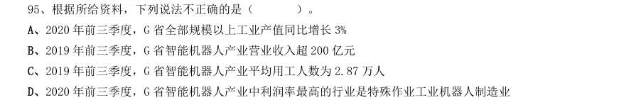

- **A.** 2020 年前三季度,G 省全部规模以上工业产值同比增长3%
- **B.** 2019 年前三季度,G 省智能机器人产业营业收入超200 亿元
- **C.** 2019 年前三季度,G 省智能机器人产业平均用工人数为2.87 万人
- **D.** 2020 年前三季度,G 省智能机器人产业中利润率最高的行业是特殊作业工业机器人制造业

**答案：暂缺**　**考点：综合分析｜选错误项**　**难度：★★★★★**
**【资料分析·比重计算与比较｜GD-2021-xz-X096】**
> 材料：2020 年上半年,我国农产品进出口总额达1159.0 亿美元。农产品进口额为807.5 亿美元,同比增长13.2%。 受新冠肺炎疫情影响,我国农产品出口额同比下降3.8%,为351.5 亿元。 在我国的农产品进口中,除大洋洲农产品进口额同比下降1.9 个百分点外,其余各大洲的农产品进口额均有 所增加;欧洲国家或地区农产品进口额增幅最大,达28.4%。农产品出口中,对亚洲国家或地区的出口额最高, 达229.7 亿美元,较2019 年同期下降了3.7 个百分点。 随着我国居民饮食结构的调整,居民对肉类食品的需求量逐年增加。

96. 2020 年上半年畜类产品进口额同比增 长43.2%,对农产品进口额的增长贡献超7 成。我国农产品出口最多的两大类别分别是食用蔬菜和水、海产品, 合计出口额达93.6 亿美元,占农产品出口总额的26.6%。 2020 年上半年,我国农产品进出口额同比增长约:

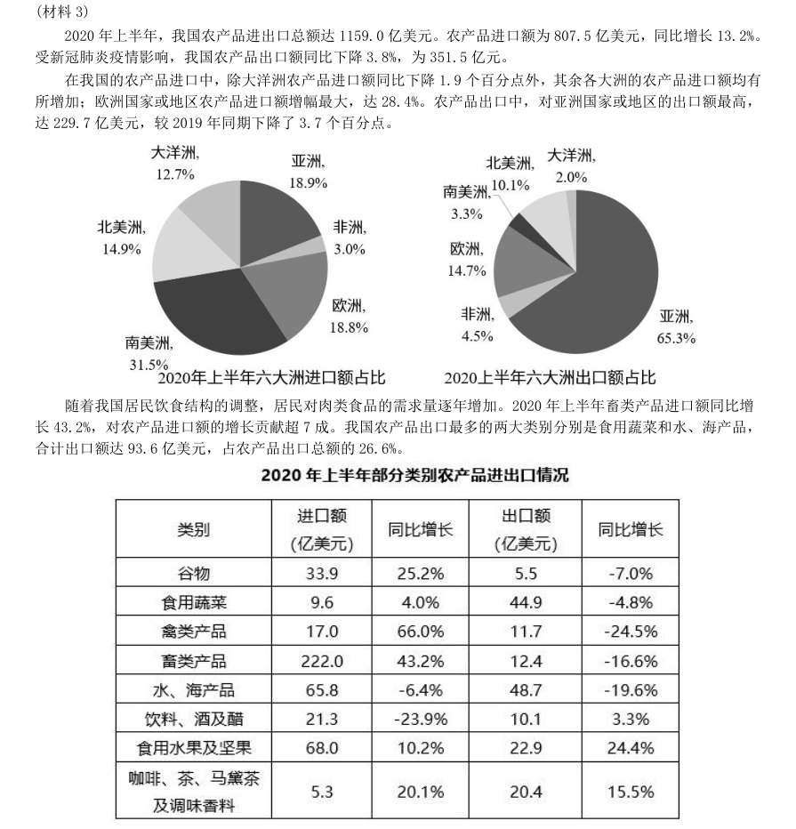

- **A.** 2.5%
- **B.** 5.0%
- **C.** 7.5%
- **D.** 10.0%

**答案：暂缺**　**考点：比重计算与比较｜现期比重**　**难度：★★★☆☆**
**【资料分析·增长率计算与比较｜GD-2021-xz-X097】**

97. 2020 年上半年,我国水、海产品出口额同比减少约( )亿美元。

> 材料图见 images/GD-2021-xz-X096-m.jpg

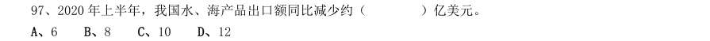

- **A.** 6
- **B.** 8
- **C.** 10
- **D.** 12

**答案：暂缺**　**考点：增长率计算与比较｜增长率计算（综合）**　**难度：★☆☆☆☆**
**【资料分析·综合分析｜GD-2021-xz-X098】**

98. 以下农产品类别中,2019 年上半年我国进出口总额最高的是:

> 材料图见 images/GD-2021-xz-X096-m.jpg

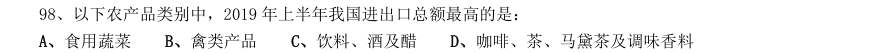

- **A.** 食用蔬菜
- **B.** 禽类产品
- **C.** 饮料、酒及醋
- **D.** 咖啡、茶、马黛茶及调味香料

**答案：暂缺**　**考点：综合分析｜综合分析（综合）**　**难度：★★★☆☆**
**【资料分析·比重计算与比较｜GD-2021-xz-X099】**

99. 2019 年上半年,我国农产品进口额中欧洲国家或地区约占:

> 材料图见 images/GD-2021-xz-X096-m.jpg

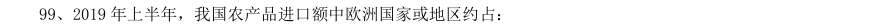

- **A.** 13.3%
- **B.** 16.6%
- **C.** 18.8%
- **D.** 21.1%

**答案：暂缺**　**考点：比重计算与比较｜现期比重**　**难度：★☆☆☆☆**
**【资料分析·综合分析｜GD-2021-xz-X100】**

100. 根据以上材料,关于我国2020 年上半年农产品进出口情况,下列说法错误的是:

> 材料图见 images/GD-2021-xz-X096-m.jpg

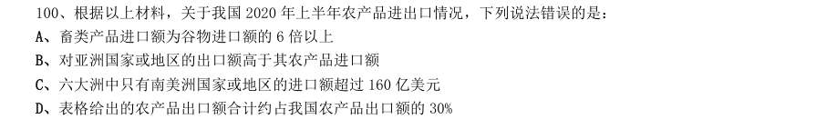

- **A.** 畜类产品进口额为谷物进口额的6 倍以上
- **B.** 对亚洲国家或地区的出口额高于其农产品进口额
- **C.** 六大洲中只有南美洲国家或地区的进口额超过160 亿美元
- **D.** 表格给出的农产品出口额合计约占我国农产品出口额的30%

**答案：暂缺**　**考点：综合分析｜选错误项**　**难度：★★★☆☆**