# 2009 年湖北行测（统一卷）

- 题量：119（含答案 94）
- 模块分布：资料分析20 / 数量关系15 / 言语理解29 / 判断推理35 / 常识判断20
- 试卷编号：`湖北-2009-统一卷`

## 题目与答案

**【常识判断·历史人文｜HB-2009-ty-X001】**

1. 古代“子时”指的是:

- **A.** 晚上9 点~晚上11 点
- **B.** 晚上10 点~晚上12 点
- **C.** 晚上11 点~凌晨1 点
- **D.** 晚上12 点~凌晨2 点

**答案：暂缺**　**考点：历史人文｜中国古代史**
**【常识判断·政治常识｜HB-2009-ty-X002】**

2. 在汉字的形体演变过程中,位于小篆和楷书之间的字体是:

- **A.** 金文
- **B.** 大篆
- **C.** 隶书
- **D.** 草书

**答案：暂缺**　**考点：政治常识｜政治常识（综合）**
**【常识判断·政治常识｜HB-2009-ty-X003】**

3. 第29 届奥运会与历届奥运会相比,下列说法错误的是:

- **A.** 设置的比赛大项最多
- **B.** 打破的世界纪录最多
- **C.** 金牌和奖牌分布最广
- **D.** 参加国家和地区最多

**答案：暂缺**　**考点：政治常识｜政治常识（综合）**
**【常识判断·政治常识｜HB-2009-ty-X004】**

4. 剧烈运动后,人们常常满脸通红、大汗淋漓,这主要是因为皮肤的什么功能:

- **A.** 保护和排泄
- **B.** 排泄和调节体温
- **C.** 排泄和感受外界刺激
- **D.** 保护和感受外界刺激

**答案：暂缺**　**考点：政治常识｜政治常识（综合）**
**【常识判断·历史人文｜HB-2009-ty-X005】**

5. 春秋战国时期的成语故事与故事中的主人公对应有误的一项是:

- **A.** 立木取信——商鞅
- **B.** 卧薪尝胆——勾践
- **C.** 围魏救赵——孙武
- **D.** 图穷匕见——荆轲

**答案：暂缺**　**考点：历史人文｜文学与文化**
**【常识判断·政治常识｜HB-2009-ty-X006】**

6. 下列说法中,所含光学知识原理达两种以上的是:

- **A.** 镜中花,水中月
- **B.** 凸透镜
- **C.** 海市蜃楼
- **D.** 潭清疑水浅

**答案：暂缺**　**考点：政治常识｜政治常识（综合）**
**【常识判断·历史人文｜HB-2009-ty-X007】**

7. 对于古代称谓说法错误的是:

- **A.** 阁下是对长辈的尊称
- **B.** 足下是下级对上级或同辈之间相互尊敬的称呼
- **C.** 内子用于丈夫对别人称自己的妻子
- **D.** “舍”用以谦称自己的家或自己的卑幼亲属

**答案：暂缺**　**考点：历史人文｜中国古代史**
**【常识判断·历史人文｜HB-2009-ty-X008】**

8. 下列关于我国传统节日的描述,与古代的说法或传说不相符的是:

- **A.** 元宵节挂灯最早跟佛教仪式有关联
- **B.** 清明节吃寒食最早是为了纪念一位先皇
- **C.** 中秋节吃月饼曾与反抗元朝的统治有关
- **D.** 古代的春节叫元旦,意为一年的第一天

**答案：暂缺**　**考点：历史人文｜中国古代史**
**【常识判断·政治常识｜HB-2009-ty-X009】**

9. 下列说法错误的是:

- **A.** 大兴安岭在我国黑龙江省境内,是全国面积最大的林区
- **B.** 内蒙古是中国发现岩画最丰富的地区
- **C.** 松辽平原是我国重要的粮食生产基地,是世界著名的玉米带
- **D.** 辽宁省在中华民国时期被称为奉天省

**答案：暂缺**　**考点：政治常识｜政治常识（综合）**
**【常识判断·历史人文｜HB-2009-ty-X010】**

10. 以下不可能成为非物质文化遗产的是:

- **A.** 针灸
- **B.** 济公的传说
- **C.** 绍兴黄酒的酿制
- **D.** 青岛“啤酒节”

**答案：暂缺**　**考点：历史人文｜历史人文（综合）**
**【常识判断·地理常识｜HB-2009-ty-X011】**

11. 下列选项中,英语是其国家或地区的官方语言之一的是:

- **A.** 印度、新加坡、南非
- **B.** 澳大利亚、香港、芬兰
- **C.** 美国、丹麦、津巴布韦
- **D.** 新西兰、瑞士、菲律宾

**答案：暂缺**　**考点：地理常识｜世界地理**
**【常识判断·法律常识｜HB-2009-ty-X012】**

12. 某县为朝鲜族自治县,依照宪法,关于该县人大常委会主任或副主任说法正确的是:

- **A.** 由朝鲜族公民担任主任
- **B.** 由朝鲜族公民担任副主任
- **C.** 主任或副主任中有朝鲜族公民即可
- **D.** 主任必须由朝鲜族公民担任,副主任可由其他民族的公民担任

**答案：C**　**考点：法律常识｜宪法**
**【常识判断·历史人文｜HB-2009-ty-X013】**

13. 下列历史事件的时间顺序排序正确的一组是:

- **A.** 戊戌变法—马关条约—五四运动
- **B.** 郑和下西洋—戚继光抗击倭寇—郑成功收复台湾
- **C.** 张衡发明地动仪—诸葛亮写《出师表》—张骞出使西域
- **D.** 虎门销烟—中日甲午战争—第一次鸦片战争

**答案：A**　**考点：历史人文｜中国古代史**
**【常识判断·法律常识｜HB-2009-ty-X014】**

14. 根据《立法法》的规定,我国的法律解释权属于:

- **A.** 全国人民代表大会
- **B.** 全国人民代表大会常务委员会
- **C.** 全国人民代表大会法律委员会
- **D.** 国务院

**答案：B**　**考点：法律常识｜宪法**
**【常识判断·法律常识｜HB-2009-ty-X015】**

15. 根据我国现行宪法和有关法律的规定,下列选项中构成违宪行为的是:

- **A.** 国家主席代表中华人民共和国接见外国使节
- **B.** 国务院根据全国人民代表大会常务委员会的授权决定,对储蓄存款利息所得减征个人所得税
- **C.** 国务院某部发布《关于认真学习贯彻<行政机关公务员处分条例>的通知》
- **D.** 某自治区人民代表大会常务委员会制定本自治区的《自治条例》

**答案：D**　**考点：法律常识｜宪法**
**【常识判断·地理常识｜HB-2009-ty-X016】**

16. 国家对超标准排放污水的单位收取排污费,属于:

- **A.** 行政征购
- **B.** 行政处罚
- **C.** 行政征用
- **D.** 行政征收

**答案：D**　**考点：地理常识｜世界地理**
**【常识判断·政治常识｜HB-2009-ty-X017】**

17. 政府机构和工作人员把制订的计划方案付诸实施的活动过程,是政府的:

- **A.** 计划职能
- **B.** 领导职能
- **C.** 组织职能
- **D.** 控制职能

**答案：C**　**考点：政治常识｜政治常识（综合）**
**【常识判断·法律常识｜HB-2009-ty-X018】**

18. 《行政许可法》规定,对于有数量限制的行政许可,两个以上申请人申请均符合法定要求的,行政机关应 当:

- **A.** 根据发出申请的先后顺序作出许可决定
- **B.** 根据受理申请的先后顺序作出许可决定
- **C.** 均不给予行政许可
- **D.** 抽签决定许可决定

**答案：B**　**考点：法律常识｜行政法**
**【常识判断·政治常识｜HB-2009-ty-X019】**

19. 孙某丈夫外出做买卖五年未归,也没有任何音讯,孙某欲改嫁,下面说法正确的是:

- **A.** 孙某丈夫视为死亡,孙某可以直接改嫁
- **B.** 孙某丈夫不论是生还是死,孙某均可以改嫁
- **C.** 孙某丈夫经人民法院宣告失踪后,孙某可以改嫁
- **D.** 孙某丈夫经人民法院宣告死亡后,孙某可以改嫁

**答案：D**　**考点：政治常识｜政治常识（综合）**
**【常识判断·政治常识｜HB-2009-ty-X020】**

20. 下列关于死刑的说法中,错误的是:

- **A.** 死刑只适用于罪行极其严重的犯罪分子
- **B.** 犯罪时不满18 周岁的人和审判时怀孕的妇女不适用死刑
- **C.** 判决死刑立即执行的,由最高人民法院和最高人民法院授权的部分高级人民法院核准
- **D.** 判处死刑缓期执行的,在死刑缓期执行期间,如果没有故意犯罪,两年期满后减为无期徒刑

**答案：A**　**考点：政治常识｜政治常识（综合）**
**【言语理解·逻辑填空｜HB-2009-ty-X021】**

21. 人生是一个容器,可这个容器的容量实在是非常 。愁苦和畏惧多了,欢乐与 就少了。 填入划横线部分最恰当的一项是:

- **A.** 庞大胆量
- **B.** 可观轻松
- **C.** 有限勇气
- **D.** 莫测勇敢

**答案：C**　**考点：逻辑填空｜一空**
**【言语理解·逻辑填空｜HB-2009-ty-X022】**

22. 煤炭与石油、天然气相比价格低廉,以同等发热量计算,目前石油价格是煤炭的5 倍,天然气价格是煤炭 的3 倍,所以,在石油价格居高不下的背景下,煤炭价格必然 。 填入划横线部分最恰当的一项是:

- **A.** 水涨船高
- **B.** 相形见绌
- **C.** 如影随形
- **D.** 随波逐流

**答案：A**　**考点：逻辑填空｜成语辨析**
**【言语理解·逻辑填空｜HB-2009-ty-X023】**

23. “笼屉”作为寻常百姓家必备的炊具,从来没有登上过大雅之堂。据说最 的待遇是在旧社会 曾用笼屉作为饭店门口的幌子,食客们只要一看到门口悬挂的笼屉层数,就知道饭店的档次。 填入划横线部分最恰当的一项是:

- **A.** 优厚
- **B.** 体面
- **C.** 优惠
- **D.** 特殊

**答案：B**　**考点：逻辑填空｜一空**
**【言语理解·逻辑填空｜HB-2009-ty-X024】**

24. 循环经济实质上是一种自觉的经济形态,需要公共部门、经济主体和金融界的三方转变观念,共 同 ,在全社会形成发展循环经济的良好 。 填入划横线部分最恰当的一项是:

- **A.** 营建环境
- **B.** 努力氛围
- **C.** 营造局面
- **D.** 建造局势

**答案：C**　**考点：逻辑填空｜一空**
**【言语理解·逻辑填空｜HB-2009-ty-X025】**

25. 体操是一个结合了杂技和舞蹈的体育运动。它的魅力,在于那种刀锋上的平衡与美感,在于每一秒都让 人 。运动员在空中翻腾的时候,即使不在现场的观众,也会不由自主地屏住呼吸,直到运动员稳稳 落地。 填人划横线部分最恰当的一项是:

- **A.** 心旷神怡
- **B.** 赏心悦目
- **C.** 战战兢兢
- **D.** 如痴如醉

**答案：C**　**考点：逻辑填空｜成语辨析**
**【言语理解·逻辑填空｜HB-2009-ty-X026】**

26. 好莱坞商业大片宣传的是一种普世价值,它往往故事简单, 的道理也很浅显,这一点常常为西方 的知识分子所 。但不可否认的是,正是这种浅显的东西,往往才可能被普遍的大众接受。 填入划横线部分最恰当的一项是:

- **A.** 蕴含不屑
- **B.** 包含轻视
- **C.** 渗透鄙夷
- **D.** 传达唾弃

**答案：A**　**考点：逻辑填空｜一空**
**【言语理解·逻辑填空｜HB-2009-ty-X027】**

27. 对于如何维持在孩子面前的权威性有很多不同观点,这使得父母有点儿 。 填入划横线部分最恰当的一项是:

- **A.** 独断专行
- **B.** 不知所措
- **C.** 无所适从
- **D.** 顾此失彼

**答案：C**　**考点：逻辑填空｜成语辨析**
**【言语理解·逻辑填空｜HB-2009-ty-X028】**

28. 究竟国家与个人对个人的医疗健康应分别承担多大比例,是一个 选择问题,而不是政府可以任 意决定的事项。要让民众有机会参与这一重大财政决策。透过人大的审议机制,将自己的意愿 到 长期的财政安排中。 填入划横线部分最恰当的一项是:

- **A.** 公共体现
- **B.** 公众融合
- **C.** 大众反映
- **D.** 集体表达

**答案：A**　**考点：逻辑填空｜一空**
**【言语理解·逻辑填空｜HB-2009-ty-X029】**

29. 构成中华文明的各支源流各有其成长、壮大、迁徙、融合的历史。把各支主要源流的历史给予相对充分的 阐发,更能表现中华民族万流入海的历史 。 填入划横线部分最恰当的一项是:

- **A.** 事实
- **B.** 潮流
- **C.** 趋势
- **D.** 进程

**答案：C**　**考点：逻辑填空｜一空**
**【言语理解·逻辑填空｜HB-2009-ty-X030】**

30. 《权谋书》成书于汉成帝鸿嘉四年,是刘向在校书的过程中 而成的。他编辑此书的目的也是有感于 当时社会风俗的奢靡荒淫,礼教零落,用历史上古圣先贤的事迹和流传下来的格言警句来引起皇帝的 。 填入划横线部分最恰当的一项是:

- **A.** 整理兴趣
- **B.** 总结反思
- **C.** 编写警戒
- **D.** 分析警惕

**答案：C**　**考点：逻辑填空｜一空**
**【言语理解·中心理解｜HB-2009-ty-X031】**

31. 物质文化、技术文化的传播,其意义不仅仅局限于物质的和技术的领域,它们还可能影响人们的精神世界 和生活方式,甚至产生意料之外的效果。因为这些物质产品和技术发明,还体现了创造者、发明者的精神理念、 审美情趣和价值追求,体现了他们作为某一文化共同体成员所接受的文化传统的濡染和教育,而物质文化和技 术文化的输出,间接地传达了这种物质产品所包含的精神内容和文化内涵,因而也就使其成为文化整体的代表 而传播并发生影响。 这段文字的主旨是:

- **A.** 物质产品的文化内涵来自于文化传统
- **B.** 物质文化与技术文化也能影响人们的精神文化
- **C.** 不同文化中共有的文化传统促进了物质文化的传播
- **D.** 物质文化与技术文化是在与不同文化的碰撞中发展的

**答案：B**　**考点：中心理解｜对策优先**
**【言语理解·中心理解｜HB-2009-ty-X032】**

32. 随着社会老龄化的日益加剧,许多社区空巢老人越来越多,他们生活小事不能自理,需要社会特殊照顾。 目前,社会对一些独居老人的关照仍显欠缺。逢年过节,虽然有关部门上门送粮油、衣物、金钱等进行慰问, 但对于空巢老人来说,关心还不到位,措施还不得力。在这种情况下,需要成立一些传统的养老院、敬老院、 社区互助会等更加适合空巢老人欢度晚年的场所,既可以满足老年人的生活需要,还解除子女的后顾之忧,同 时也加强了社区群众之间的交流与互助,使越来越多的老人晚年生活得丰富多彩。 这段文字主要说明了:

- **A.** 空巢老人的出现并非仅来自于老龄化
- **B.** 社区是解决空巢老人现象的最佳途径
- **C.** 在解决空巢问题时子女应发挥更大作用
- **D.** 空巢老人需要生活与精神上的多方帮助

**答案：D**　**考点：中心理解｜对策优先**
**【言语理解·中心理解｜HB-2009-ty-X033】**

33. 从本质上说,人类文明的进程就是不断脱离动物界的过程,这一过程主要包括人类体质的进化和心性的进 化两个方面。从猿到人的体质进化,人类用了上百万年的时间才完成,而人类心性的进化则还要缓慢。当人类 跨越石器时代、青铜时代进入铁器时代之后,动物性依然顽强地在人类身上闪现着。如何管理好人类的情感, 使带有动物性的人变成理性的人,是儒家最为关注的重要课题。如果把儒家的答卷归结为一个字,那就是“礼”。 对这段文字的主旨概括最准确的是:

- **A.** 描述人类文明发展进化的大致过程
- **B.** 对比人类体质与心性两方面的进化
- **C.** 阐述儒家强调礼仪作用的社会原因
- **D.** 说明儒家思想的产生根源与现实意义

**答案：C**　**考点：中心理解｜中心句与主旨**
**【言语理解·中心理解｜HB-2009-ty-X034】**

34. 随着通讯技术的进步,当今社会,政府执政的舆论环境已发生了明显的变化,各种舆论可以借助网络、短 信等现代传播工具,跨越时空迅速传递,使意见空间加大,意见力度增强,而决策透明度的增加和公民民主参 与意识的增强,又加大了政府的舆论压力。在这样的背景下,政府对“舆情危机”的处理.需要改变以往被动 方式,针对新出现的情况,及时采用新的方式来应对。 对这段文字概括最准确的是:

- **A.** 说明政府在新舆论环境下有必要转变应对方式
- **B.** 对比不同时期政府舆论宣传的客观环境与方式
- **C.** 剖析政府执政的舆论压力不断增大的外在原因
- **D.** 分析通讯技术发展与舆论环境变化之间的关系

**答案：A**　**考点：中心理解｜对策优先**
**【言语理解·中心理解｜HB-2009-ty-X035】**

35. 联合国教科文组织将2008 年定为“马铃薯年”,俗名“土豆”的马铃薯被联合国的专家们称为“隐藏的 宝贝”。联合国用一种农作物命名一个年份,在历史上只出现过一次,就是2003 年——国际水稻年。今年的 主角为什么不是“玉米”、“苹果”,偏偏是土豆这个深埋地下、不起眼儿的小东西呢?因为解决全球粮食安 全问题需要土豆。 对这段文字概括最准确的是:

- **A.** 土豆和水稻都是重要的农作物
- **B.** 全球粮食安全问题应引起重视
- **C.** 土豆被提到粮食安全的战略高度
- **D.** 土豆潜在的巨大价值有待进一步开发

**答案：C**　**考点：中心理解｜对策优先**
**【言语理解·中心理解｜HB-2009-ty-X036】**

36. 古人写诗“二句三年得,一吟双泪流”;写小说动辄“闭门谢客,披阅十载”。现在许多作家每年出好几 部长篇,几十万字,个把月就写成了。没有对生活的日积月累,没有对人生的深思熟虑,没有对写作的精心布 局,没有对文字的字斟句酌,反复修改,怎么会有精品?又怎能抵抗时间的淘汰?“创作”如果说不同于别的工 作,就在于一个“创”字;如果说有难度,也在于一个“创”字,既不同于前人,又不同于自己。 这段文字主要表明:

- **A.** 生活是创作的源泉
- **B.** 时间是艺术作品的试金石
- **C.** 今人的创作态度不如古人严肃
- **D.** 长期潜心创作,才会出高质量的作品

**答案：D**　**考点：中心理解｜对策优先**
**【言语理解·中心理解｜HB-2009-ty-X037】**

37. 地球上的岩石可以分为火成岩、沉积岩、变质岩。由硅酸盐溶浆凝结而成的火成岩构成了地壳的主体,按 体积和重量计算都最多。但地面最常见到的则是沉积岩,它是早先形成的岩石破坏后,又经过物理或化学作用 在地球表面的低凹部位沉积,经过压实、胶结再次硬化。形成具有层状结构特征的岩石。在地壳中,在大大高 于地表的温度和压力作用下,岩石的结构、构造或化学成分发生变化,形成不同于火成岩和沉积岩的变质岩。 这段文字主要介绍了地球上各类岩石的:

- **A.** 形成条件
- **B.** 结构特征
- **C.** 地址分布
- **D.** 化学成分

**答案：A**　**考点：中心理解｜对策优先**
**【言语理解·中心理解｜HB-2009-ty-X038】**

38. 真实的历史事实及其史料依据,是历史叙事的基本要素。历史学的任务不仅是考证历史事实,还应该完整 地还原出历史人物、历史事件和历史过程的面貌。为此,历史研究者需要把各种历史事实加以联结和组合。而 主张后现代主义史学理论的学者认为,历史研究者可以在不违反学科规范的前提下,对历史事实进行不同的联 结和组合。而这些不同的联结和组合,会形成不同的人物、事件或者过程的历史面貌。 依据后现代主义史学理论的学者观点,历史描写:

- **A.** 并不等同于事实
- **B.** 可以有虚构成分
- **C.** 可以有不同的版本
- **D.** 其中的事实是不确定的

**答案：C**　**考点：中心理解｜对策优先**
**【言语理解·中心理解｜HB-2009-ty-X039】**

39. 文物价值观具有相对的稳定性和持久性.但也会随着社会环境、个人人生观、世界观的改变而发生变化。 由于社会地位、文化差异、利益关系等原因,使得人们的文物价值观在不同的时间、地点、场合都会表现出很 大的不同。政府的文物价值观可能取决于决策人员.文物工作者的文物价值观,通常会表现出相对的先进性、 积极性和稳定性,一般民众的文物价值观则依赖于国家政策、社会舆论导向、个人文化素质等因素。 这段文字主要谈论的是:

- **A.** 文物价值观变迁的原因
- **B.** 不同文物价值观的优缺点
- **C.** 文物价值观差异性的表现形式
- **D.** 文物价值观存在差异的原因

**答案：D**　**考点：中心理解｜对策优先**
**【言语理解·逻辑填空｜HB-2009-ty-X040】**

40. 经济学家曾打过一个有趣的比方:股市就像一杯啤酒,如果没有一点泡沫,说明它不新鲜(没有活力);可 如果泡沫太多,啤酒就少了。事实也是如此,一个繁荣的市场自然交易活跃,当然也就不可避免地会存在一些 投机现象,但是如果投机盛行,成为市场的“规律”,那么这个市场一定要出问题。因为说到底, 。 填入划线部分最恰当的一项是:

- **A.** 啤酒的总量是有限的
- **B.** 理性抑制了泡沫的产生
- **C.** 泡沫是由执著的投机者造成的
- **D.** 支撑市场的是“啤酒”而非“泡沫”

**答案：D**　**考点：逻辑填空｜一空**
**【言语理解·中心理解｜HB-2009-ty-X041】**

41. 每100 克巧克力中含40~500 毫克可可碱。可可碱能刺激平滑肌,还能加速神经传导。但和咖啡因不同的 是,可可碱对中枢神经系统几乎没有任何影响。每100 克巧克力中含70 毫克咖啡因。咖啡因的作用在于提高 警觉性,促使人超常发挥,提升观察力,抵抗疲劳,提高脑力活动的效率。巧克力中还含苯丙胺。也具有提神 醒脑的作用,能刺激下丘脑中的去甲肾上腺素分泌。 这段文字主要说明了:

- **A.** 巧克力具有促进神经兴奋的作用
- **B.** 巧克力和咖啡对人体的影响不同
- **C.** 可可碱比咖啡因对人体更加有益
- **D.** 咖啡因会对人体的中枢神经系统产生影响

**答案：A**　**考点：中心理解｜对策优先**
**【言语理解·逻辑填空｜HB-2009-ty-X042】**

42. 外资银行进入新兴市场国家,新兴市场国家银行业的各主体为了维持自身的生存,会尽可能争取较大的市 场份额,充分拓展自身竞争优势,努力向客户提供质优价廉的金融产品和金融服务,这个过程必然带动银行业 微观效率的提升。 “这个过程”指的是:

- **A.** 外资银行进入新兴市场国家的过程
- **B.** 新兴市场国家银行业发展的过程
- **C.** 外资银行提供优质服务的过程
- **D.** 新兴市场国家银行业扩大市场份额的过程

**答案：A**　**考点：逻辑填空｜逻辑填空（综合）**
**【言语理解·中心理解｜HB-2009-ty-X043】**

43. 在不同的国家,不同的时期,科技管理制度可以不同,可以创新,但有一项制度特别重要并具有普适性: 那就是创新主体的泛化,或曰创新战略的全民化或人民性。换言之,让每个人都有求变创新之心,让每一个发 明不论大小都有展示的机会,应当是构建自主创新大制度、大环境的基本出发点。 这段文字意在强调:

- **A.** 科技管理制度的重要性
- **B.** 创新需要良好的环境作支撑
- **C.** 创新需要制度支持
- **D.** 科技管理制度应保证创新的全民性

**答案：D**　**考点：中心理解｜对策优先**
**【言语理解·下文推断｜HB-2009-ty-X044】**

44. “点击此处设为首页”,这句提示在2000 年的时候遍布各个网站。不论中文网站还是英文网站,都会习 惯性地在右上角添加上这么一条,生怕电脑白丁们不知道如何设置首页。可2005 年之后,这种“善意”的提 示仿佛一夜之间消失了,就如同一份报纸省略掉了自己的征订热线一样,大网站们不再过分热情地推荐首页设 置。 这段文字接下来最可能谈论的是:

- **A.** 网页形式变迁的原因
- **B.** 首页设置的提醒并非善意
- **C.** 如何避免网络陷阱
- **D.** 网络行为更具跟风的特点

**答案：A**　**考点：下文推断｜下文推断**
**【言语理解·中心理解｜HB-2009-ty-X046】**
> 材料：百万贫困人口的生活。但是7 年过去了,市场上还看不到转基因稻米的踪影。欧洲人一直对转基因食品持怀疑 态度,超市里标明他们出售的商品是“非转基因”的。欧盟规定任何转基因成分超过0.9%的产品都要在包装 上注明。西方人错置的道德观正夺去数百万穷国人口的生命。 这段文字意在表明: A、转基因食品事实上是安全的 B、市场呼吁转基因食品早日亮相 C、转基因稻米的发明具有重大意义 D、欧洲人对转基因食品的歧视造成的影响很大

46. 音乐是真正的世界语,是感情的语言。当两个国家愿意通过音乐交流,其中或许就含有某种政治善意,即 双方想以彼此都能了解、都可接受的音乐语言进行对话,而且“乐与情通”。音乐往往可以给人带来精神愉悦, 从而为人际交往创造良好的气氛。 这段文字强调音乐是:

- **A.** 化解文化冲突的有效方法
- **B.** 各国普遍采用的一种外交手段
- **C.** 人际交往的一种手段
- **D.** 国家之间进行政治沟通与交流的一种工具

**答案：D**　**考点：中心理解｜对策优先**
**【言语理解·中心理解｜HB-2009-ty-X047】**

47. 孔子尝曰:“未知生,焉知死?”生与死自孔子时起便是中国人始终关注的问题,并得到各种回答。尤其 在汉代,人们以空前的热情讨论这两个问题,不仅是出于学者的学术乐趣,亦出于普通民众生存的需要。然而, 正如孔子所说,在中国思想史上,对生的问题的关注似乎远胜于对死的问题的追问。有时候人们确实觉得后者 更重要,但这并非由于死本身,而是因为人们最终分析认为,死是生的延续。 这段文字的核心观点是:

- **A.** 孔子关于生死的看法对中国人产生深远影响
- **B.** 生与死是中国思想史上长期受到关注的问题
- **C.** 中国人对生与死的问题的讨论实际以生为旨归
- **D.** 对生死问题的不同答案源自讨论者的不同观念

**答案：C**　**考点：中心理解｜对策优先**
**【言语理解·中心理解｜HB-2009-ty-X048】**

48. 我国农业发展到今天,其中的任何一项工作都很难单项突进,现在结构调整引起了高度重视,但不能忽视 其他方面的配套改革,尤其是必须加快市场化改革,建立全国的统一大市场,促进农村要素和产品自由流动。 如果市场机制得不到应有的发育,那么以市场为导向的结构调整就失去了最重要的基础,区域化布局和比较优 势的发挥也就无从谈起。 这段文字主要讨论的是:

- **A.** 市场是农村结构调整的导向
- **B.** 市场机制的优势未充分发挥
- **C.** 农业市场化改革需要加快进行
- **D.** 农业结构调整不可能一蹴而就

**答案：C**　**考点：中心理解｜对策优先**
**【言语理解·中心理解｜HB-2009-ty-X049】**

49. 与相声在传媒中的冷清相比,周末相声俱乐部的火暴与人气,颇耐人寻味。在民众中诞生和成长的艺术, 只有回到群众、回归生活,才能获得新的生命力。这种回归,如果没有与观众面对面的交流与切磋,失去了舞 台的实践和锤炼,没有观众心领神会的捧腹大笑和心心相印的理解沟通,是不会达到的。 对这段文字概括最准确的是:

- **A.** 生活实践是相声创作的源泉
- **B.** 传统的相声表演形式亟须改变
- **C.** 回归观众是相声俱乐部火暴的原因
- **D.** 相声只有重返民间舞台才能重获新生

**答案：D**　**考点：中心理解｜对策优先**
**【言语理解·中心理解｜HB-2009-ty-X050】**

50. 地震短期、临震预报仍是世界性难题。目前,精确预测地震的震级和时间还无法做到。国外地震学家普遍 认为,地壳下层的塑性岩石或蛇纹岩被挤进地壳上层的裂缝中时,就会引发地震。这些容易滑动的蛇纹岩是由 富含铁、镁的矿物与水作用而生成的,在此过程中会产生氢气。一旦该层发生断裂,氢气就经由断层的裂隙冒 出,致使正常空气中的氢气浓度剧增。 这段文字的主旨是:

- **A.** 说明地震并非不可预测
- **B.** 描述地震发生的大致过程
- **C.** 介绍一种地震预测的方法
- **D.** 揭示地震与地层断裂的关系

**答案：C**　**考点：中心理解｜对策优先**
**【判断推理·图形推理｜HB-2009-ty-X051】**

51. 从所给的四个选项中,选择最合适的一个填入问号处,使之呈现一定的规律性:

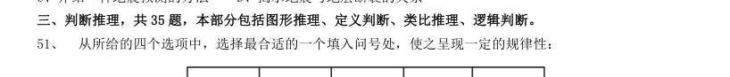

> （本题为图形题，选项为图片，见原卷）

**答案：D**　**考点：图形推理｜数量规律**
**【判断推理·图形推理｜HB-2009-ty-X052】**

52. 从所给的四个选项中,选择最合适的一个填入问号处,使之呈现一定的规律性:

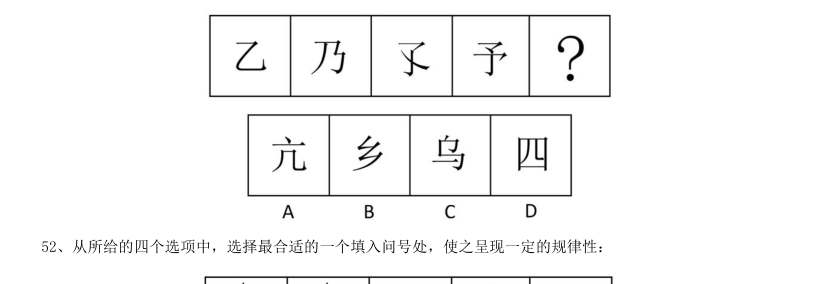

> （本题为图形题，选项为图片，见原卷）

**答案：A**　**考点：图形推理｜样式规律**
**【判断推理·图形推理｜HB-2009-ty-X053】**

53. 从所给的四个选项中,选择最合适的一个填入问号处,使之呈现一定的规律性:

> （本题为图形题，选项为图片，见原卷）

**答案：D**　**考点：图形推理｜数量规律**
**【判断推理·图形推理｜HB-2009-ty-X054】**

54. 从所给的四个选项中,选择最合适的一个填入问号处,使之呈现一定的规律性:

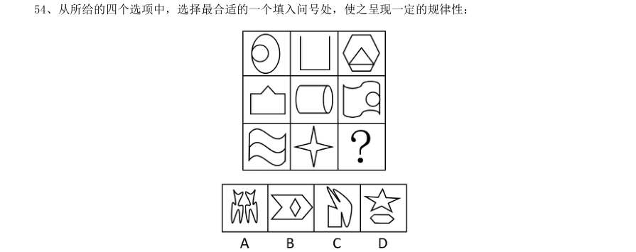

> （本题为图形题，选项为图片，见原卷）

**答案：C**　**考点：图形推理｜数量规律**
**【判断推理·图形推理｜HB-2009-ty-X055】**

55. 从所给的四个选项中,选择最合适的一个填入问号处,使之呈现一定的规律性:

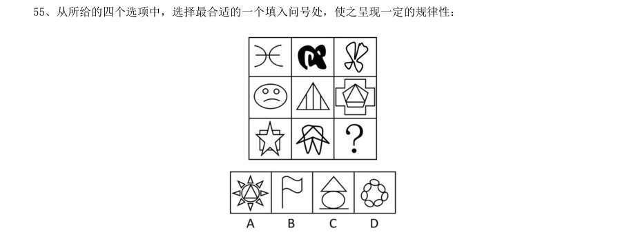

> （本题为图形题，选项为图片，见原卷）

**答案：D**　**考点：图形推理｜数量规律**
**【判断推理·定义判断｜HB-2009-ty-X056】**

56. 核心技术能力是企业通过特有的技术要素和技能或各种要素和技能的独特的组合来创造具有自身特性的技 术,以产生稀缺的、不可模仿的技术资源(包括技术和知识等)的企业能力。 根据上述定义。下列不属于企业核心技术能力的是:

- **A.** Google 公司掌握网络搜索的关键技术
- **B.** 微软公司掌握操作系统的开发技术
- **C.** 原IBM 公司掌握大型超级计算机的制造技术
- **D.** 联想公司掌握个人计算机的制造技术

**答案：D**　**考点：定义判断｜单定义**
**【判断推理·逻辑判断｜HB-2009-ty-X057】**

57. 外部不经济性是指经济活动主体在生产和消费过程中,给他人带来的损失或额外费用,而他人并未因此得 到补偿。 下列属于外部不经济性的是:

- **A.** 某项新技术发明被他人使用,没有得到使用费
- **B.** 桃树花开时,行人都可以享受到花香,但并未向种桃树的人交钱
- **C.** 上游居民大量植树,自己收获了木材又改善了下游居民的水源质量,却未收取费用
- **D.** 农民使用农药过量造成污染,却并没有赔偿受害者

**答案：D**　**考点：逻辑判断｜逻辑判断（综合）**
**【判断推理·图形推理｜HB-2009-ty-X058】**

58. 脑科学的研究表明,在人脑的发育中存在“关键期”,即人在发展过程中,某一方面在某一阶段发展得最 快,比如,3 岁以前是动作发展的“关键期”,1—3 岁是语言发展的“关键期”,4 岁左右是感知图形的“关 键期”。在这一时期,脑在结构和功能上都具有很强的适应和重组的能力,易于受到环境的影响,关键期内适 宜的刺激和经验是运动、感觉、语言及其他脑功能正常发展的重要前提。 下列利用了“关键期”理论的是:

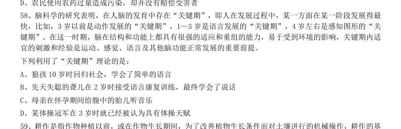

- **A.** 狼孩10 岁时回归社会,学会了简单的语言
- **B.** 先天失聪的聋儿在2 岁时接受语言康复训练,最终学会了说话
- **C.** 母亲在怀孕期间给腹中的胎儿听音乐
- **D.** 某体操冠军在3 岁时就已经被认为具有体操天赋

**答案：B**　**考点：图形推理｜图形推理（综合）**
**【判断推理·定义判断｜HB-2009-ty-X059】**

59. 耕作是指作物种植以前,或在作物生长期间,为了改善植物生长条件而对土壤进行的机械操作,耕作的基 本目的有三个:1、改良土壤结构;2、把作物残茬和有机肥料掩埋并掺和到土壤中去;3、清除杂草或其他不 需要的植株。 根据上述定义,以下属于耕作的是:

- **A.** 在果园里挖排水沟
- **B.** 喷洒除草剂以清除杂草
- **C.** 将雨后板结的表土破碎
- **D.** 冬季在农田里种植绿肥作物

**答案：C**　**考点：定义判断｜单定义**
**【判断推理·逻辑判断｜HB-2009-ty-X060】**

60. 战略决策是指在企业内贯彻的一种决策活动。通常包括组织目标、方针的确定,组织机构的调整,企业产 品的更新换代、技术改造等,这些决策牵涉组织的方方面面,具有长期性和方向性。 下列属于战略决策的是:

- **A.** 我国的神舟七号载人航天计划
- **B.** 某公司决定开发新技术,在十年内推出神经网络电脑
- **C.** 某大公司经理决定招聘一位有多年工作经验并能熟练讲英语的主管
- **D.** 某公司用蓝皮书规定全国分公司经理行为

**答案：B**　**考点：逻辑判断｜逻辑判断（综合）**
**【判断推理·逻辑判断｜HB-2009-ty-X061】**

61. 生产销售伪劣产品罪是指生产者或销售者故意在产品中掺杂、掺假、以次充好、以假充真或者以不合格产 品冒充合格产品,销售金额5 万以上的行为。 下列属于生产销售伪劣产品罪的是:

- **A.** 赖某、宣某经商量用化工原料二氧化硒掺过硫酸氨后当作纯二氧化硒出售,以每公斤430 元的合同价格售出425 公斤
- **B.** 陈某以假金项链冒充纯金项链出售,每条金项链24 克,价值人民币4600 元,共售出三条
- **C.** 某建筑公司承建价值300 万元的住宅楼,为了降低成本,使用了不合格的建筑材料,导致住宅楼还没有验收就有了裂缝
- **D.** 孟某以二手车冒充新车,与肖某以30 万元的价格签订汽车销售合同,但孟某在车款到手后携款逃匿

**答案：A**　**考点：逻辑判断｜逻辑判断（综合）**
**【判断推理·定义判断｜HB-2009-ty-X062】**

62. 风险转移是指通过合同或非合同的方式将风险转嫁给另一个人或单位的一种风险处理式。风险转移是对风 险造成的损失的承担的转移。 根据上述定义,以下属于风险转移的是:

- **A.** 医院在给垂危病人施行手术之前,要求病人家属签字同意
- **B.** 某人看到近期股票大跌,于是将本要投资股市的钱存入银行
- **C.** 为避免泄密可能带来的损失,甲单位要求相关人员签订保密协议
- **D.** 某企业产品出现了质量问题,声称是因原料供应商所供原料不合格

**答案：A**　**考点：定义判断｜单定义**
**【判断推理·逻辑判断｜HB-2009-ty-X063】**

63. 关键个案抽样指的是选择那些可以对事情产生决定性影响的个案进行的研究。目的是将这些个案中获得的 结果逻辑地推论至其他个案。 下列属于关键个案抽样的是:

- **A.** 对所有购买产品的顾客进行电子邮件调查以了解产品可以从哪些方面进行改进
- **B.** 对若干6 岁儿童进行访问以剔除专门为6 岁儿童开发但不受欢迎的糖果口味
- **C.** 制定严格的电话抽样方案,要求调查员电话访问顾客搜集对产品包装的反馈
- **D.** 在居民区中随机寻找符合产品香味调查的对象,邀请测试完成一份调查问卷

**答案：B**　**考点：逻辑判断｜逻辑判断（综合）**
**【判断推理·定义判断｜HB-2009-ty-X064】**

64. 选择性注意是指在外界诸多刺激中,人们仅仅注意到某些刺激或刺激的某些方面,而忽略了其他刺激。 根据上述定义,下列属于选择性注意的一项是:

- **A.** 志愿者小张在奥运会期间,每天忙于奥运赛场的服务,无暇观看奥运比赛
- **B.** 奥运结束后,一些学生仍对奥运精彩纷呈的赛事感到意犹未尽,无法投入到新学期的学习生活中
- **C.** 意大利小伙子马克观看完北京奥运会开幕式后,对中国文化产生了浓厚兴趣,于是留在北京学习汉语
- **D.** 北京奥运会期间,原本闹离婚的夫妻俩。由于一起收看奥运会节目,交流增多,关系缓和,不再闹离婚了

**答案：D**　**考点：定义判断｜单定义**
**【判断推理·逻辑判断｜HB-2009-ty-X065】**

65. 转继承是指继承人在继承开始后遗产分割前死亡的,其继承的遗产转由其法定继承人(包括配偶、子女、 父母、兄弟姐妹、祖父母和外祖父母)继承的制度。 下列属于转继承的是:

- **A.** 老王与其妻子生有两个儿子,二儿子早年去世,留有一女,未满十八岁。老王去世后,在未立有遗嘱的情况下,该女孩要求继承老王的部分遗产
- **B.** 老李有价值50 万元的房产一处。老李去世的当天,儿子小李在赶往医院办理后事的途中不幸遭遇车祸死亡,小李的儿子当即表示要继承老李的房产
- **C.** 孤寡老人老刘一直由邻居老张照顾,老刘在生前立下遗嘱,将其全部财产留给老张。老刘去世后不久,老张心脏病发去世,老张的妻子要求继承老张应继承的部分份额
- **D.** 老黄生前一直由其外甥小赵照顾,老黄立下遗嘱,将全部财产留给小赵。老黄去世后,老黄的子女向法院

**答案：B**　**考点：逻辑判断｜逻辑判断（综合）**
**【判断推理·类比推理｜HB-2009-ty-X066】**

66. 竹简:书籍

- **A.** 竖笛:排笛
- **B.** 沙漏:钟表
- **C.** 毛笔:电笔
- **D.** 缶:鼓

**答案：B**　**考点：类比推理｜逻辑关系**
**【判断推理·类比推理｜HB-2009-ty-X067】**

67. 石头:钻石

- **A.** 汽车:劳斯莱斯轿车
- **B.** 舞蹈:国标
- **C.** 水:眼泪
- **D.** 音乐:钢琴曲

**答案：A**　**考点：类比推理｜对应关系**
**【判断推理·类比推理｜HB-2009-ty-X068】**

68. 愤怒:驳斥

- **A.** 微笑:高兴
- **B.** 可爱:纯真
- **C.** 详尽:陈述
- **D.** 善良:魅力

**答案：C**　**考点：类比推理｜语义关系**
**【判断推理·类比推理｜HB-2009-ty-X069】**

69. 水:冰

- **A.** 米:饭
- **B.** 铁:锈
- **C.** 云:雨
- **D.** 树:木

**答案：C**　**考点：类比推理｜对应关系**
**【判断推理·类比推理｜HB-2009-ty-X070】**

70. 伞:雨衣

- **A.** 现金:支票
- **B.** 空调:暖气
- **C.** 钢笔:铅笔
- **D.** 蚊香:蚊帐

**答案：B**　**考点：类比推理｜逻辑关系**
**【判断推理·类比推理｜HB-2009-ty-X071】**

71. 青蛙:庄稼

- **A.** 律师:被告
- **B.** 树木:城市
- **C.** 合同:买方
- **D.** 空气:健康

**答案：B**　**考点：类比推理｜逻辑关系**
**【判断推理·类比推理｜HB-2009-ty-X072】**

72. 班门弄斧 对于( ) 相当于 ( ) 对于 五谷丰登

- **A.** 贻笑大方风调雨顺
- **B.** 无妄之灾国富民强
- **C.** 无奇不有国泰民安
- **D.** 东施效颦天从人愿

**答案：A**　**考点：类比推理｜语义关系**
**【判断推理·类比推理｜HB-2009-ty-X073】**

73. 鼓舞 对于 ( ) 相当于 ( ) 对于 捏造

- **A.** 士气谎言
- **B.** 打击欺骗
- **C.** 煽动创作
- **D.** 语言文书

**答案：C**　**考点：类比推理｜语义关系**
**【判断推理·类比推理｜HB-2009-ty-X074】**

74. 机动 对于 ( ) 相当于 ( ) 对于 清澈

- **A.** 固定浑浊
- **B.** 有机透明
- **C.** 活泼洁净
- **D.** 灵活明亮

**答案：A**　**考点：类比推理｜语义关系**
**【判断推理·类比推理｜HB-2009-ty-X075】**

75. ( ) 对于 血液循环 相当于 引擎 对于 ( )

- **A.** 血管汽车
- **B.** 血管车速
- **C.** 心脏汽车
- **D.** 心脏车速

**答案：C**　**考点：类比推理｜类比推理（综合）**
**【判断推理·逻辑判断｜HB-2009-ty-X076】**

76. 动物的冬眠,完全是一项对付不利环境的保护性行动,引起动物冬眠的主要因素,一是环境温度的降低, 二是食物的缺乏。科学家们通过实验证明:动物冬眠会引起甲状腺素和肾上腺功能的降低,与此同时,生殖腺 却发育正常,冬眠后的动物抗菌抗病能力反而比平时有所增加,显然冬眠对它们是有益的,使它们到翌年春天 苏醒以后动作更加灵敏,食欲更加旺盛,而身体内的一切器官更会显出返老还童现象,由此可见,动物在冬眠 时期神经系统的肌肉仍然保持充分的活力,而新陈代谢却降到最低限度。 以下如果为真,最能削弱上述结论的是:

- **A.** 很多昆虫,不是以“成虫”或“幼虫”,而是以“蛹”或“卵”的形式进行冬眠
- **B.** 刺猬,一次冬眠能睡上200 多天,醒来后要经过很长时间才能恢复到原来的精神和体力
- **C.** 在加拿大有些山鼠冬眠长达半年,冬眠期间脉搏变得极为微弱,体温更直线下降到5°
- **D.** 雌熊仔冬眠中,让雪覆盖着身体,一旦醒来,它身旁就会躺着一两只小熊,这是冬眠时生产的仔

**答案：B**　**考点：逻辑判断｜削弱**
**【判断推理·逻辑判断｜HB-2009-ty-X077】**

77. 文学院有学生为优秀奖学金获得者,除非各学院有学生为优秀奖学金获得者,否则任何学院都不能从学校 领取奖学金,计算机学院可以从学校领取奖学金。 由此可以推出:

- **A.** 文学院可以从学校领取奖学金
- **B.** 文学院有的学生不是优秀奖学金获得者
- **C.** 计算机学院有的学生是优秀奖学金获得者
- **D.** 计算机学院有的学生不是优秀奖学金获得者

**答案：C**　**考点：逻辑判断｜真假推理**
**【判断推理·逻辑判断｜HB-2009-ty-X078】**

78. 财政专家指出,公共风险不仅产生于因政府政策不当导致的国有资产流失,而且由于政府直接积极参与经 济生活,如政府直接参与国有企业、调控金融机构,这些重要经济领域一旦发生大面积损失,将会直接酿成公 共风险,从而造成财政赤字、债务偿还压力。因此,如果要想实施稳健的财政和货币政策,仅仅调整财政政策 是不够的。 从这段文字可以推出:

- **A.** 只要政府保证国有资产不流失,即使决策失误,也不会产生公共风险
- **B.** 只要政府不直接产于经济生活,或者国有企业、金融机构这些重要的经济领域不发生大面积损失,就不会产生公共风险
- **C.** 如果能够防范公共风险的产生,就可以实施稳健的财政和货币政策
- **D.** 由于重要经济领域发生大面积损失,所以即使政策决策正确,仍有可能产生公共风险

**答案：D**　**考点：逻辑判断｜翻译推理**
**【判断推理·逻辑判断｜HB-2009-ty-X079】**

79. 越来越多的人处于亚健康状态,究其原因是睡得不好,睡眠时间太少,会引发种种不适,甚至导致疾病, 研究指出∶每晚睡眠不足四小时的成年人,其死亡率比每晚能睡七八个小时的人要高180%。但是美国加利福 尼亚大学的研究人员在对100 多万人观察后得出结论:那些每天睡八小时以上的人,他们的死亡率比每晚睡六 至七个小时的人高120%。 如果这段文字表述的内容是正确的,以下断定最不可能正确的是:

- **A.** 每晚睡眠时间太多或太少,都会使人的寿命缩短
- **B.** 每晚睡眠时间少于四小时的人的死亡率比每晚睡眠时间多于八小时的人要高
- **C.** 有时睡眠时间少于四小时,有时睡眠时间多于八小时的人的死亡率比每晚睡眠时间为七小时的人高150%
- **D.** 每晚睡眠八小时以上的人如果改为每晚睡眠不足四小时,所受的危害要加大

**答案：C**　**考点：逻辑判断｜归纳推导**
**【判断推理·科学推理｜HB-2009-ty-X080】**

80. 美国科学家发现,雄性非洲慈鲷鱼能通过观察其他雄性成员在抢占地盘争斗的表现而评估对手的实力,在 加入战斗时总是挑战那些最弱的对手。这是科学家首次发现鱼类具有这种推理能力。 由此可以推知:

- **A.** 雄性非洲慈鲷鱼逻辑能力比雌性强
- **B.** 雄性非洲慈鲷鱼具有人类的某些理性认识特点
- **C.** 逻辑推理能力较强的鱼能够占有较大的地盘D、人类是逻辑推理能力最强的高等动物

**答案：B**　**考点：科学推理｜物理**
**【判断推理·逻辑判断｜HB-2009-ty-X081】**

81. 某国最大的方便面生产企业计划于4 月份把方便面价格提高一至两成。这将是该国方便面价格自2006 年 度以来又一次大幅上涨,逼近历史最高价。该企业表示,之所以要提高方便面价格,主要是为了应对粮食等原 材料价格的上涨。 最能支持上述论断的一项是:

- **A.** 面对国际市场粮食等原材料价格上涨的趋势,甲国政府出台政策,禁止国内粮食加工企业提高粮食产品价格,以防止甲国人民生活成本增加,负担加重
- **B.** 乙国国内粮食等原料供应充足,但由于劳动力价格上涨,导致粮食加工企业生产成本增加,因而造成方便面等粮食产品价格上涨
- **C.** 丙国国内粮食等原料供应一直非常充足,近来又大规模提高农业生产技术,提高粮食产量,该国的方便面等粮食产品价格平稳
- **D.** 丁国粮食加工企业工人举行大罢工,导致该国粮食加工企业瘫痪,国内方便面等粮食产品供应不足,丁国

**答案：A**　**考点：逻辑判断｜削弱**
**【判断推理·逻辑判断｜HB-2009-ty-X082】**

82. 气候变暖后,一般中高纬度地区粮食产量增加,而热带和亚热带只能以一些耐高温作物为主,产量下降, 尤其是非洲和拉丁美洲。全球最贫穷的地区饥荒危机将增加,饥饿和营养不良引起机体免疫力下降,增加人们 对疾病的易感性。 由此能推出:

- **A.** 中高纬度并非是全球最贫困的地区
- **B.** 非洲和拉丁美洲存在全球最贫困地区
- **C.** 全球变暖对中高纬度气候的影响小于对热带和亚热带气候的影响
- **D.** 全球变暖对非洲和拉丁美洲粮食产量的影响高于世界平均水平

**答案：A**　**考点：逻辑判断｜归纳推导**
**【判断推理·逻辑判断｜HB-2009-ty-X083】**

83. 某联邦议院规定,只有在联邦议院中占有至少5%议席的政党才能组成议会党团。只有议员人数不足5%的 政党,在征得绝大多数议员同意后,可以组成议会集团。议会集团只享有部分议会党团被赋予的权利。 根据这段文字可推知,在该联邦议院:

- **A.** 能组成议会党团的政党不能组成议会集团
- **B.** 能否组成党团或集团最终需由联邦议会进行裁决
- **C.** 少于联邦议院议席5%的政党不可能组成议会集团
- **D.** 该制度避免了议员们过于集中于某一议会党团或集团

**答案：A**　**考点：逻辑判断｜翻译推理**
**【判断推理·逻辑判断｜HB-2009-ty-X084】**

84. 莱姆病,像许多其它的人兽共患病一样,是由通过吸食脊椎动物类宿主血液从而携带病原体的昆虫进行传 播的。长久以来,科学家们认为白脚鹿的种群密度是莱姆病发病率最好的预报因素。然而,在纽约东南部一个 莱姆病高发区,一项历时13 年的对莱姆病生态学中的决定因素进行的研究中,推翻了这一观点,因为在莱姆 病发病率高的年份中,白脚鹿的种群数量一般比莱姆病发病率低的年份低。 上述论述基于以下哪一种假设:

- **A.** 从未爆发过莱姆病的地区通常白脚鹿的种群数量比较低
- **B.** 莱姆病爆发之前白脚鹿的种群数量不会显著降低
- **C.** 其他物种的种群数量也可作为莱姆病发病的预报因素
- **D.** 白脚病的种群数量提高是其他疾病爆发的先兆

**答案：B**　**考点：逻辑判断｜削弱**
**【判断推理·逻辑判断｜HB-2009-ty-X085】**

85. 阿尔迪、里德尔等德国超市折扣连锁店在全球食品涨价潮中逆市走俏。德国模式的折扣连锁店经营方式不 同于普通超市、家庭店铺或法国特色的农民市场。它的店面一般仅有两三百平方米,过道狭窄,商品包装简单, 80%以上的商品都是食品和饮料,其价格一般要比普通超市低30%到50%。分析人士认为,德国折扣连锁模式在 食品涨价潮中逆市走俏的原因是多方面的。除了其“低价”优势外。折扣店品种少、规模大的采购模式使新开 店成本很低。 以下哪项对上述分析人士的解释有所削弱:

- **A.** 德国折扣连锁商店在法国零售业的市场份额已经从一年前的10.5%上升到11.2%,与此同时家乐福等大型超市的市场份额却在下降
- **B.** 低成本战略和低价战略是所有超市都在尽可能使用的经营战略,即力求在“价格优势”上压倒竞争对手
- **C.** 里德尔折扣连锁店在挪威被当地一家超市连锁店收购,挪威本土的这家连锁店,恰恰是德国折扣连锁模式的翻版
- **D.** 家乐福等大型超市多年来有自己的经营模式、经营理念并且形成了其特有的企业文化

**答案：B**　**考点：逻辑判断｜削弱**
**【数量关系·数字推理｜HB-2009-ty-X086】**

86. 5,12,21,34,53,80,( )

- **A.** 115
- **B.** 117
- **C.** 119
- **D.** 121

**答案：B**　**考点：数字推理｜数字推理（综合）**
**【数量关系·数字推理｜HB-2009-ty-X087】**

87. 1,4,11,30,85,( )

- **A.** 248
- **B.** 250
- **C.** 256
- **D.** 260

**答案：A**　**考点：数字推理｜幂次数列**
**【数量关系·数字推理｜HB-2009-ty-X088】**

88. 187,259,448,583,754,( )

- **A.** 847
- **B.** 862
- **C.** 915
- **D.** 944

**答案：B**　**考点：数字推理｜数字推理（综合）**
**【数量关系·数字推理｜HB-2009-ty-X089】**

89. 2,2,0,7,9,9,( )

- **A.** 13
- **B.** 15
- **C.** 18
- **D.** 20

**答案：C**　**考点：数字推理｜幂次数列**
**【数量关系·数字推理｜HB-2009-ty-X090】**

90. 1,2,8,28,100,( )

- **A.** 196
- **B.** 248
- **C.** 324
- **D.** 356

**答案：D**　**考点：数字推理｜数字推理（综合）**
**【数量关系·其他数量关系｜HB-2009-ty-X091】**

91. 计算

- **A.** 
- **B.** 
- **C.** 
- **D.** 

**答案：C**　**考点：其他数量关系｜基础计算**
**【数量关系·其他数量关系｜HB-2009-ty-X092】**

92. 任意取一个大于50 的自然数,如果它是偶数,就除以2;如果它是奇数,就将它乘3 之后再加1。这样反 复运算,最终结果是多少:

- **A.** 0
- **B.** 1
- **C.** 2
- **D.** 3

**答案：B**　**考点：其他数量关系｜基础计算**
**【数量关系·年龄问题｜HB-2009-ty-X093】**

93. 赵先生34 岁,钱女士30 岁,一天,他们碰上了赵先生的三个邻居,钱女士问起了他们的年龄,赵先生说: 他们三人的年龄各不相同,三人的年龄之积是2450,三人的年龄之和是我俩年龄之和。问三个邻居中年龄最 大的是多少岁:

- **A.** 42
- **B.** 45
- **C.** 49
- **D.** 50

**答案：C**　**考点：年龄问题｜年龄差不变**
**【数量关系·行程问题｜HB-2009-ty-X094】**

94. 甲乙两人从相距1 350 米的地方,以相同的速度相对行走,两人在出发点分别放下1 个标志物。再前进 10 米后放下3 个标志物。前进10 米放下5 个标志物,再前进10 米放下7 个标志物,以此类推。当两个相遇 时,一共放下了几个标志物:

- **A.** 4 489
- **B.** 4 624
- **C.** 8 978
- **D.** 9 248

**答案：D**　**考点：行程问题｜相遇追及**
**【数量关系·最值问题｜HB-2009-ty-X095】**

95. 有4 支队伍进行4 项比赛,每项比赛的第一、第二、第三、第四名分别得到5、3、2、1 分。每队的4 项 比赛得分之和算作总分,如果已知各队的总分不相同,并且A 队获得了三项比赛的第一名,问总分最少的队伍 最多得多少分:

- **A.** 7
- **B.** 8
- **C.** 9
- **D.** 10

**答案：B**　**考点：最值问题｜最值优化**
**【数量关系·利润问题｜HB-2009-ty-X096】**

96. 一个人到书店购买了一本书和一本杂志,在付钱时,他把书的定价中的个位上的数字和十位上的看反了, 准备付21 元取货。售货员说:“您应该付39 元才对。” 请问书比杂志贵多少钱:

- **A.** 20
- **B.** 21
- **C.** 23
- **D.** 24

**答案：C**　**考点：利润问题｜利润问题（综合）**
**【数量关系·其他数量关系｜HB-2009-ty-X097】**

97. 甲乙两个工厂的平均技术人员比例为45%,其中甲厂的人数比乙厂多12.5%,技术人员的人数比乙厂的多 25%,非技术人员人数比乙厂多6 人。甲乙两厂共有多少人:

- **A.** 680
- **B.** 840
- **C.** 960
- **D.** 1020

**答案：A**　**考点：其他数量关系｜和差倍比**
**【数量关系·最值问题｜HB-2009-ty-X098】**

98. 一本100 多页的书,被人撕掉了4 张,剩下的页码总和为8037,则该书最多有多少页:

- **A.** 134
- **B.** 136
- **C.** 138
- **D.** 140

**答案：A**　**考点：最值问题｜最值优化**
**【数量关系·溶液问题｜HB-2009-ty-X099】**

99. 用1 个70 毫升和1 个30 毫升的容器盛取20 毫升的水到水池A 中,并盛取80 毫升的酒精到水池B 中,倒 进或倒出某个容器都算一次操作,则最少需要经过几次操作:

- **A.** 15
- **B.** 16
- **C.** 17
- **D.** 18

**答案：A**　**考点：溶液问题｜混合与十字交叉**
**【数量关系·几何问题｜HB-2009-ty-X100】**

100. 在下图中,大圆的半径是8。求阴影部分的面积是多少:

- **A.** 120
- **B.** 128
- **C.** 136
- **D.** 144

**答案：B**　**考点：几何问题｜平面几何**
**【资料分析·增长率计算与比较｜HB-2009-ty-X101】**

101. 处理。 一、根据所给图表、文字资料完成各题。 2008 年7 月商品零售价格指数表(上年同月:100) 2008 年7 月城市商品价格较上年同月上涨幅度最大的是:

- **A.** 食品
- **B.** 燃料
- **C.** 日用品
- **D.** 金银珠宝

**答案：暂缺**　**考点：增长率计算与比较｜增长率比较**
**【资料分析·增长率计算与比较｜HB-2009-ty-X102】**

102. 较上年同期,2008 年7 月城市跟农村商品价格涨幅相差最小的商品是:

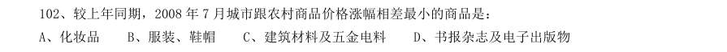

- **A.** 化妆品
- **B.** 服装、鞋帽
- **C.** 建筑材料及五金电料
- **D.** 书报杂志及电子出版物

**答案：暂缺**　**考点：增长率计算与比较｜增长率比较**
**【资料分析·基期量计算｜HB-2009-ty-X103】**

103. 2008 年7 月农村各类商品零售价格与上年同月相比上涨的有:

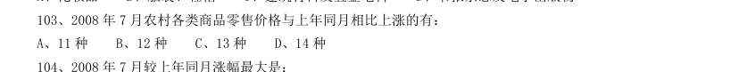

- **A.** 11 种
- **B.** 12 种
- **C.** 13 种
- **D.** 14 种

**答案：暂缺**　**考点：基期量计算｜基期量计算（综合）**
**【资料分析·增长率计算与比较｜HB-2009-ty-X104】**

104. 2008 年7 月较上年同月涨幅最大是:

- **A.** 全国燃料
- **B.** 城市食品
- **C.** 农村体育娱乐用品
- **D.** 全国书报杂志及电子出版物

**答案：暂缺**　**考点：增长率计算与比较｜增长率比较**
**【资料分析·综合分析｜HB-2009-ty-X105】**

105. 下列关于2008 年7 月商品价格的描述正确的是:

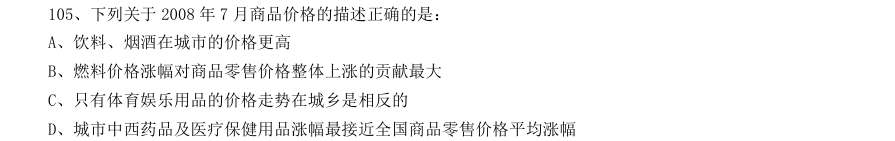

- **A.** 饮料、烟酒在城市的价格更高
- **B.** 燃料价格涨幅对商品零售价格整体上涨的贡献最大
- **C.** 只有体育娱乐用品的价格走势在城乡是相反的
- **D.** 城市中西药品及医疗保健用品涨幅最接近全国商品零售价格平均涨幅

**答案：暂缺**　**考点：综合分析｜选正确项**
**【资料分析·基期量计算｜HB-2009-ty-X106】**
> 材料：2007 年前三季度,我国全社会固定资产投资91529 亿元,同比增长25.7%。其中,城镇固定资产投资78 247 亿元,增长26.4%;农村投资13 282 亿元,增长21.2%。在城镇投资中.国有及国有控股完成投资33 951 亿元,增长16.2%∶房地产开发完成投资16 814 亿元,增长30.3%。从项目隶属关系看,中央项目投资7749 亿元,同比增长15.4%;地方项目投资70 497 亿元,增长27.8%。从产业看,第一、二、三产业分别完成投 资938 亿元、34 522 亿元和42787 亿元,同比分别增长41.1%、29.3%和24.0%。从行业看,煤炭开采及洗 选业投资1 103 亿元,同比增长24.9%;电力、热力的生产与供应业投资5 348 亿元,增长10.6%∶石油和 天然气开采业投资1 232 亿元,增长13.7%;铁路运输业投资1 395 亿元,增长7.1%∶

106. 其中,国内贷 款增长14.5%,利用外资增长15.5%,自筹资金增长32.2%。 2006 年前三季度城镇固定资产投资是:

- **A.** 60479 亿元
- **B.** 61904 亿元
- **C.** 69104 亿元
- **D.** 72815 亿元

**答案：暂缺**　**考点：基期量计算｜已知现期与增长率求基期**
**【资料分析·增长率计算与比较｜HB-2009-ty-X107】**

107. 下列各项投资中,2007 年前三季度增幅最大的一项是:

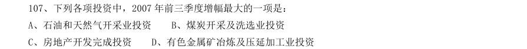

- **A.** 石油和天然气开采业投资
- **B.** 煤炭开采及洗选业投资
- **C.** 房地产开发完成投资
- **D.** 有色金属矿冶炼及压延加工业投资

**答案：暂缺**　**考点：增长率计算与比较｜增长率比较**
**【资料分析·综合分析｜HB-2009-ty-X108】**

108. 就2007 年前三季度而言,下面说法正确的是:

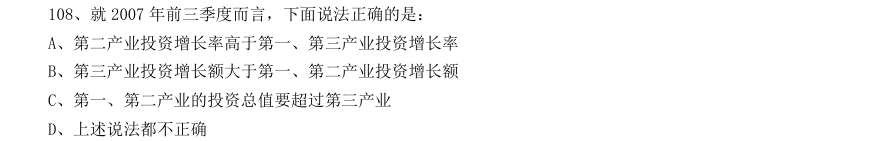

- **A.** 第二产业投资增长率高于第一、第三产业投资增长率
- **B.** 第三产业投资增长额大于第一、第二产业投资增长额
- **C.** 第一、第二产业的投资总值要超过第三产业
- **D.** 上述说法都不正确

**答案：暂缺**　**考点：综合分析｜选正确项**
**【资料分析·综合分析｜HB-2009-ty-X109】**

109. 下列说法与资料相符的是:

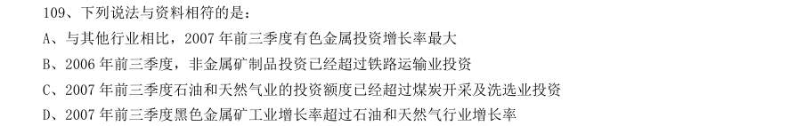

- **A.** 与其他行业相比,2007 年前三季度有色金属投资增长率最大
- **B.** 2006 年前三季度,非金属矿制品投资已经超过铁路运输业投资
- **C.** 2007 年前三季度石油和天然气业的投资额度已经超过煤炭开采及洗选业投资
- **D.** 2007 年前三季度黑色金属矿工业增长率超过石油和天然气行业增长率

**答案：暂缺**　**考点：综合分析｜综合分析（综合）**
**【资料分析·综合分析｜HB-2009-ty-X110】**

110. 关于2007 年前三季度,城镇50 万元以上的项目,下面说法正确的是:

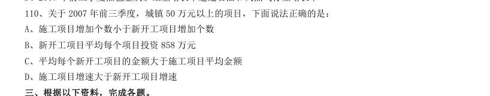

- **A.** 施工项目增加个数小于新开工项目增加个数
- **B.** 新开工项目平均每个项目投资858 万元
- **C.** 平均每个新开工项目的金额大于施工项目平均金额
- **D.** 施工项目增速大于新开工项目增速

**答案：暂缺**　**考点：综合分析｜选正确项**
**【资料分析·增长率计算与比较｜HB-2009-ty-X111】**

111. 2003~2006 年间、广告类节目较上一年增幅最大的是:

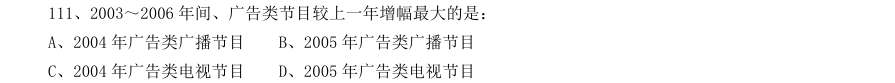

- **A.** 2004 年广告类广播节目
- **B.** 2005 年广告类广播节目
- **C.** 2004 年广告类电视节目
- **D.** 2005 年广告类电视节目

**答案：暂缺**　**考点：增长率计算与比较｜增长率比较**
**【资料分析·增长率计算与比较｜HB-2009-ty-X112】**

112. 2006 年新闻类电视节目时数相对于1995 年的增幅是:

- **A.** 699.9%
- **B.** 718.9%
- **C.** 899%
- **D.** 789%

**答案：暂缺**　**考点：增长率计算与比较｜增长率计算**
**【资料分析·增长率计算与比较｜HB-2009-ty-X113】**

113. 2003 年广告类节目时数中,广播要比电视多出:

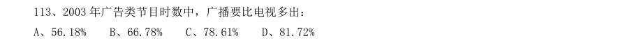

- **A.** 56.18%
- **B.** 66.78%
- **C.** 78.61%
- **D.** 81.72%

**答案：暂缺**　**考点：增长率计算与比较｜增长率计算（综合）**
**【资料分析·增长率计算与比较｜HB-2009-ty-X114】**

114. 在2005 年、2006 年中,下列哪些节目时数增幅下降最明显:

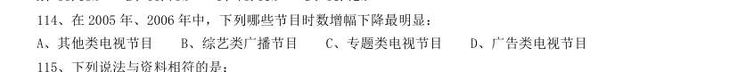

- **A.** 其他类电视节目
- **B.** 综艺类广播节目
- **C.** 专题类电视节目
- **D.** 广告类电视节目

**答案：暂缺**　**考点：增长率计算与比较｜增长率计算**
**【资料分析·综合分析｜HB-2009-ty-X115】**

115. 下列说法与资料相符的是:

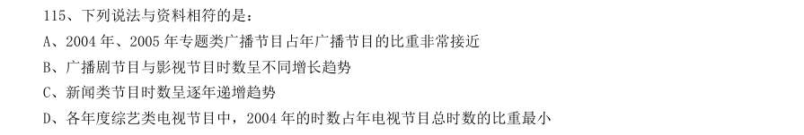

- **A.** 2004 年、2005 年专题类广播节目占年广播节目的比重非常接近
- **B.** 广播剧节目与影视节目时数呈不同增长趋势
- **C.** 新闻类节目时数呈逐年递增趋势
- **D.** 各年度综艺类电视节目中,2004 年的时数占年电视节目总时数的比重最小

**答案：D**　**考点：综合分析｜选错误项**
**【资料分析·基期量计算｜HB-2009-ty-X116】**
> 材料：2007 年末全国就业人员76990 万人,比上年末增加590 万人。

116. 2007 年我国第三产业就业人员比第二产业约多多少万人:

- **A.** 1600
- **B.** 4100
- **C.** 4300
- **D.** 10800

**答案：C**　**考点：基期量计算｜基期量计算（综合）**
**【资料分析·增长率计算与比较｜HB-2009-ty-X117】**

117. 2007 年和2003 年相比,第一产业的就业人数约下降了:

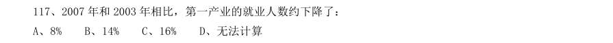

- **A.** 8%
- **B.** 14%
- **C.** 16%
- **D.** 无法计算

**答案：B**　**考点：增长率计算与比较｜增长率计算（综合）**
**【资料分析·比重计算与比较｜HB-2009-ty-X118】**

118. 2007 年末城镇就业人员中私营个体就业人员所占比重比2006 年末增加了约:

- **A.** 2%
- **B.** 27%
- **C.** 0.4%
- **D.** 4%

**答案：A**　**考点：比重计算与比较｜现期比重**
**【资料分析·基期量计算｜HB-2009-ty-X119】**

119. 从以上图表中无法得到的推论是:

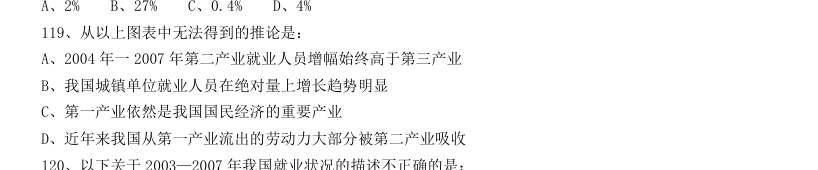

- **A.** 2004 年一2007 年第二产业就业人员增幅始终高于第三产业
- **B.** 我国城镇单位就业人员在绝对量上增长趋势明显
- **C.** 第一产业依然是我国国民经济的重要产业
- **D.** 近年来我国从第一产业流出的劳动力大部分被第二产业吸收

**答案：B**　**考点：基期量计算｜基期量计算（综合）**
**【资料分析·综合分析｜HB-2009-ty-X120】**

120. 以下关于2003—2007 年我国就业状况的描述不正确的是:

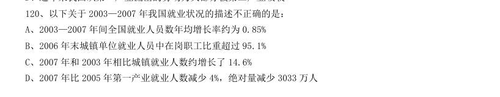

- **A.** 2003—2007 年间全国就业人员数年均增长率约为0.85%
- **B.** 2006 年末城镇单位就业人员中在岗职工比重超过95.1%
- **C.** 2007 年和2003 年相比城镇就业人数约增长了14.6%
- **D.** 2007 年比2005 年第一产业就业人数减少4%,绝对量减少3033 万人

**答案：A**　**考点：综合分析｜选错误项**