# 2010 年湖北行测（统一卷）

- 题量：139（含答案 139）
- 模块分布：资料分析20 / 数量关系20 / 言语理解40 / 判断推理30 / 常识判断29
- 试卷编号：`湖北-2010-统一卷`

## 题目与答案

**【言语理解·逻辑填空｜HB-2010-ty-X001】**
> 材料：分类:行测/湖北

1. 家庭是社会生产和生活的一个基本单位,家庭收入和支出的 ,是反映家庭经济水平的一个重 要 。

- **A.** 数量原则
- **B.** 渠道因素
- **C.** 模式指标
- **D.** 状况侧面

**答案：C**　**考点：逻辑填空｜逻辑填空（综合）**　**难度：★☆☆☆☆**
**【言语理解·逻辑填空｜HB-2010-ty-X002】**

2. 音乐是声音中最早进入电影的一个艺术 ,它向来以擅长表现感情、 气氛而受到编创人员 的喜爱。

- **A.** 环节烘托
- **B.** 元素渲染
- **C.** 手段打造
- **D.** 形式调动

**答案：B**　**考点：逻辑填空｜逻辑填空（综合）**　**难度：★☆☆☆☆**
**【言语理解·中心理解｜HB-2010-ty-X003】**

3. 郭店《老子》的文字考释工作主要是由湖北省荆门市博物馆进行的,其成果《郭店楚墓竹简》一书已成为各学 科学者进一步研究的基础,这充分证明其工作是 的,此后,又有不少学者对该书有所补充,有 所 。

- **A.** 有条不紊借鉴
- **B.** 有目共睹修订
- **C.** 独树一帜讨论
- **D.** 卓有成效匡正

**答案：D**　**考点：中心理解｜对策优先**　**难度：★☆☆☆☆**
**【言语理解·逻辑填空｜HB-2010-ty-X004】**

4. 苏东坡成全了黄州,黄州也成全了苏东坡,这实在是一种 的有趣关系。东坡写于黄州的那些杰作, 既宣告着黄州进入了一个新的美学等级,也宣告着东坡进入了一个新的人生阶段,两方面一起 ,谁 也离不开谁。

- **A.** 相辅相成提升
- **B.** 水乳交融闻名
- **C.** 如影随形升华
- **D.** 同舟共济流传

**答案：A**　**考点：逻辑填空｜成语辨析**　**难度：★☆☆☆☆**
**【言语理解·中心理解｜HB-2010-ty-X005】**

5. 这本书虽然以心理学经典理论为基础,但其主要内容都是年轻人非常 的话题,再加上轻松的语言、 丰富的事例,使得年轻人在阅读时总能找到自己的 。

- **A.** 敏感收获
- **B.** 熟悉影子
- **C.** 热衷答案
- **D.** 时髦榜样

**答案：B**　**考点：中心理解｜中心句与主旨**　**难度：★☆☆☆☆**
**【言语理解·逻辑填空｜HB-2010-ty-X006】**

6. 老舍能写反映北京底层市民生活的《骆驼祥子》,恐怕写不了表现上海工商界生活的《子夜》。大师熟悉 的 也会是有限的,谁也不是全能的。

- **A.** 领域
- **B.** 话题
- **C.** 体裁
- **D.** 形象

**答案：A**　**考点：逻辑填空｜逻辑填空（综合）**　**难度：★☆☆☆☆**
**【言语理解·逻辑填空｜HB-2010-ty-X007】**

7. 一旦我们把某种东西认为是 的,对于那些熟悉的事物,我们就很难看清它们的真面目,正所 谓“只缘身在此山中”。 填入划横线部分最恰当的一项是:

- **A.** 理所当然
- **B.** 平淡无奇
- **C.** 司空见惯
- **D.** 由来已久

**答案：A**　**考点：逻辑填空｜成语辨析**　**难度：★☆☆☆☆**
**【言语理解·逻辑填空｜HB-2010-ty-X008】**

8. 唐高宗李治在位时期完成的《唐律疏议》是一部极为重要的法典,全面体现了中国古代法律制度的 、 风格和基本特征,成为中华法系的 性法典,对后世及周边国家产生了极为深远的影响。

- **A.** 性质权威
- **B.** 原则方向
- **C.** 水平代表
- **D.** 观念指导

**答案：C**　**考点：逻辑填空｜一空**　**难度：★☆☆☆☆**
**【言语理解·逻辑填空｜HB-2010-ty-X009】**

9. 江汉平原的黄土地, 可以种植任何农作物,不仅出产颇丰,而且水资源丰富,渔业发达,成为长 江中下游平原上的鱼米之乡,为鄂菜提供了 的原材料。

- **A.** 自古五味俱全
- **B.** 完全种类繁多
- **C.** 由于独具特色
- **D.** 几乎用之不竭

**答案：D**　**考点：逻辑填空｜一空**　**难度：★☆☆☆☆**
**【言语理解·逻辑填空｜HB-2010-ty-X010】**

10. 每年“世界读书日”前后,“阅读”都会成为一个热门话题。在 地广泛提倡读书之外,近年来, “阅读”领域内的一些新变化,如迅速 开来的“浅阅读”现象,也越来越引起人们的关注。

- **A.** 一如既往流行
- **B.** 大张旗鼓蔓延
- **C.** 始终如一活跃
- **D.** 不遗余力扩展

**答案：A**　**考点：逻辑填空｜成语辨析**　**难度：★☆☆☆☆**
**【言语理解·逻辑填空｜HB-2010-ty-X011】**

11. 如果一个人同时戴两块手表,可能会觉得不 ,因为他不知道该相信哪一块手表;如果在一个企 业里出现两种不同的标准,则必将让员工 。

- **A.** 愿意各行其是
- **B.** 舒服怨声载道
- **C.** 适应无所适从
- **D.** 放心人心涣散

**答案：C**　**考点：逻辑填空｜逻辑填空（综合）**　**难度：★☆☆☆☆**
**【言语理解·逻辑填空｜HB-2010-ty-X012】**

12. 容易犯错误是我们人类无法避免的一个弱点,不管科技发展到什么程度,事故总是会在不经意间发生。懂得 这个道理,我们就可以“ ”,只有这样,或许我们才能 应对一切可能出现的麻烦。

- **A.** 未卜先知巧妙
- **B.** 未雨绸缪从容
- **C.** 先发制人完美
- **D.** 稳操胜券主动

**答案：B**　**考点：逻辑填空｜成语辨析**　**难度：★☆☆☆☆**
**【言语理解·逻辑填空｜HB-2010-ty-X013】**

13. 一个人的心理只要是健康的,他就有自知之明,就有可能 地了解自己,知道自己存在的价值, 对自己的能力,性格和优缺点都能做出 的评价。

- **A.** 透彻恰如其分
- **B.** 如实不偏不倚
- **C.** 客观条分缕析
- **D.** 准确鞭辟入里

**答案：A**　**考点：逻辑填空｜成语辨析**　**难度：★☆☆☆☆**
**【言语理解·逻辑填空｜HB-2010-ty-X014】**

14. 在人们的认识领域里,心理学总是被蒙上一层神秘的面纱,认为心理学 ,离我们的生活很遥远。 实际上,心理学与我们的日常生活紧密相连,心理学 在生活的表象之下,支配着人们的行动。

- **A.** 深不可测隐藏
- **B.** 夸大其词蕴含
- **C.** 变幻莫测躲藏
- **D.** 高不可攀掩盖

**答案：A**　**考点：逻辑填空｜成语辨析**　**难度：★☆☆☆☆**
**【言语理解·逻辑填空｜HB-2010-ty-X015】**

15. 中华文明之所以绵延数千年而不绝,中国社会之所以会有超 结构的历史,就是因为它一直有一 套 的,为多数民众所接受的主流价值观念,即所谓的儒家价值观。

- **A.** 稳定完整
- **B.** 平衡悠久
- **C.** 严谨通俗
- **D.** 系统平和

**答案：A**　**考点：逻辑填空｜逻辑填空（综合）**　**难度：★☆☆☆☆**
**【言语理解·逻辑填空｜HB-2010-ty-X016】**

16. 入世以来,中国加大了和国际市场的融合,金融市场开放让中国不能再像亚洲金融危机时那样 。 面对危机,中国沉着冷静,努力将此次冲击化作调整和发展的 。

- **A.** 束手无策机遇
- **B.** 独善其身契机
- **C.** 毫发无损动力
- **D.** 自行其是起点

**答案：B**　**考点：逻辑填空｜成语辨析**　**难度：★☆☆☆☆**
**【言语理解·逻辑填空｜HB-2010-ty-X017】**

17. 我国大气环境污染问题日益严峻,并逐渐呈现区域性复合型污染的新 。目前,大气污染的范围 已不再局限于单个城市或单个工业区周围,城市间大气污染的相互影响和 日渐突出,在珠三角,长 三角,京津冀等城市群地区尤其 。

- **A.** 形势制约突出
- **B.** 特点叠加明显
- **C.** 局面传播惊人
- **D.** 趋势牵制严重

**答案：B**　**考点：逻辑填空｜逻辑填空（综合）**　**难度：★★☆☆☆**
**【言语理解·逻辑填空｜HB-2010-ty-X018】**

18. 在全球金融危机的影响下,国内许多地方企业成批停产,倒闭,但国家高新区却 ,依然保持着 较高的增长率。

- **A.** 迎难而上
- **B.** 因势利导
- **C.** 另辟蹊径
- **D.** 逆风飞扬

**答案：D**　**考点：逻辑填空｜逻辑填空（综合）**　**难度：★☆☆☆☆**
**【言语理解·逻辑填空｜HB-2010-ty-X019】**

19. 传统绘画风格对中国动画电影的影响 ,其中意义最为深远的就是水墨画对国产动画电影所作 的 ,这不仅是中国民族风格的体现,也是世界动画界的一次 。

- **A.** 比比皆是革新合作
- **B.** 不胜枚举突破尝试
- **C.** 不一而足贡献创举
- **D.** 至关重要贡献创举

**答案：C**　**考点：逻辑填空｜成语辨析**　**难度：★☆☆☆☆**
**【言语理解·逻辑填空｜HB-2010-ty-X020】**

20. 以德为先,首要的是提高干部的党性修养, 是要解决党员干部的信仰问题,而关键之处在于通 过积极有效的载体化虚为实, 。

- **A.** 重中之重有目共睹
- **B.** 首当其冲雷厉风行
- **C.** 归根结底立竿见影
- **D.** 千方百计有的放矢

**答案：C**　**考点：逻辑填空｜成语辨析**　**难度：★☆☆☆☆**
**【言语理解·中心理解｜HB-2010-ty-X021】**

21. 湖北以在洞庭湖之北而得名,但在地理上提的最多的却是长江。她影响着整个湖北的气候,土壤,物产,同 时也酝酿了灿烂辉煌的楚文化。 这段文字中的“她”指的是:

- **A.** 湖北
- **B.** 洞庭湖
- **C.** 地理特点
- **D.** 长江

**答案：D**　**考点：中心理解｜转折与因果**　**难度：★☆☆☆☆**
**【言语理解·中心理解｜HB-2010-ty-X022】**

22. 大多数人一般选择夏季旅行,其实在全国的绝大多数省份,夏季都是最没有旅行质量的季节,高温难耐,体 力消耗大,此时的风景极少有吸引眼球的特质,景致大打折扣,尤其是一些人文景点,在强光的照射下更显得索 然无味。 对这段文字的意图概括最准确的是:

- **A.** 建议大家尽量避开夏季出游
- **B.** 说明季节变化会影响景观质量
- **C.** 探讨影响旅行质量的各方面因素
- **D.** 分析人们对旅行存在的认识误区

**答案：A**　**考点：中心理解｜对策优先**　**难度：★★☆☆☆**
**【言语理解·中心理解｜HB-2010-ty-X023】**

23. 地处美丽富饶的江汉平原腹地的荆州古城,有着2600 多年的历史,是历朝封王置府的重镇。这里东衔九省通 衢的武汉三镇,西临举世瞩目的长江三峡,南傍浩淼无垠的洞庭湖,北垂雄奇险秀的武当山,区位优势十分明显。 这段文字主要介绍荆州:

- **A.** 地理位置
- **B.** 悠久历史
- **C.** 灿烂文化
- **D.** 富饶物产

**答案：A**　**考点：中心理解｜转折与因果**　**难度：★★☆☆☆**
**【言语理解·中心理解｜HB-2010-ty-X024】**

24. 农业有着艺术永远无法比拟的实践性。湖北的农民在节庆的巫文化中,按照自己的需要造就了各种神灵,向 它们许愿,祈求它们保佑农业生产的顺利进行。这种节庆活动,意外地促成了农业生产经验的发展,比如“春社” 中放在社神前的“社种”,竟使农民能利用温室观察稻种出芽的情况;“嫁毛娘”的过程中,燃烧的火把消灭了 大量飞蛾。 这段文字意在说明:

- **A.** 巫文化对农业与艺术的不同影响
- **B.** 巫文化怎样促进农业生产的发展
- **C.** 推动历史进步的是人力而非神力
- **D.** 湖北的农民创造了哪些节庆形式

**答案：B**　**考点：中心理解｜对策优先**　**难度：★★★☆☆**
**【言语理解·中心理解｜HB-2010-ty-X025】**

25. 有一次,就在一架民航客机即将着陆时,乘务员突然通知机上的乘客说“由于机场拥挤,无法降落,预计到 达时间要推迟1 个小时”,机舱里顿时一片抱怨之声,乘客们都在焦急等待着度过这段难熬的时间。几分钟后, 乘务员又宣布“再过 分钟,飞机可以安全降落”,乘客们如释重负地松了口气。又过了5 分钟,广播里又 说“现在飞机就要降落了”,尽管晚了十几分钟,乘客们还是喜出望外。 这段文字传达的道理是:

- **A.** 既来之,则安之
- **B.** 退一步海阔天空
- **C.** 道歉更易获得别人的谅解
- **D.** 适当的言语有利于稳定情绪

**答案：D**　**考点：中心理解｜转折与因果**　**难度：★★★★☆**
**【言语理解·中心理解｜HB-2010-ty-X026】**

26. 人类社会的发展历史证明,中间阶层是社会的稳定器,他们有稳定的工作和收入,经济上乐于消费,政治上 渴望稳定。中国目前的问题是中间阶层的规模还不够大,也不稳定,而且随着经济形势的变化,也开始面临失业 的威胁。如果政府袖手旁观,置之不理,将不利于社会的稳定。 这段文字意在说明:

- **A.** 稳定是社会发展的前提和保障
- **B.** 中间阶层的壮大有利于扩大内需
- **C.** 为什么中间阶层是社会的稳定器
- **D.** 要培育和帮助中间阶层发展壮大

**答案：D**　**考点：中心理解｜转折与因果**　**难度：★★☆☆☆**
**【言语理解·细节判断｜HB-2010-ty-X027】**

27. 从概念本身来说,“文化旅游”并非一个新名词,早在古罗马时代,人们就已经尝试了以文化需求为诱导的 外出旅行活动。宗教朝圣、探寻历史古迹、参加特殊节庆活动等,都是旅游体验的一部分。可以说,旅游本身就 有文化因子,而文化旅游,更是可以在丰富旅游者旅行见闻的同时,提供旅行者和被访地双方更加独特的文化碰 撞和交流。20 世纪70 年代后期,作为一种特殊的旅游概念,“文化旅游”模式逐渐兴起。 下列说法与原文相符的是:

- **A.** 蕴含文化色彩的旅游由来已久
- **B.** “文化旅游”模式诞生于古罗马
- **C.** 文化交流可以促进旅游业的繁荣
- **D.** 文化是促使人们旅游的关键因素

**答案：A**　**考点：细节判断｜细节判断**　**难度：★★★★☆**
**【言语理解·逻辑填空｜HB-2010-ty-X028】**

28. 低碳城市是一个新生事物,没有现成可借鉴的模式。专家指出,对低碳经济的认识问题上,首先需要澄清“低 碳等于贫困”、“低碳等于高成本”等误区。低碳经济是在较高的文明发展水平前提下,出现的一种碳生产力水 平较高、但人均碳排放水平较低的经济状态。在这个过程中,能源结构的清洁化和资源禀赋起着决定性作用,单 位产出所需要的能源消耗不断下降。 “这个过程”指的是:

- **A.** 建设低碳城市的过程
- **B.** 提高社会文明程度的过程
- **C.** 降低人均碳排放水平的过程
- **D.** 转变对低碳经济认识的过程

**答案：C**　**考点：逻辑填空｜逻辑填空（综合）**　**难度：★★★★☆**
**【言语理解·逻辑填空｜HB-2010-ty-X029】**

29. 汽车销售员乔·吉拉德的推销方式有点儿与众不同,他会做一些在别人看来费力不讨好的事。例如,他的1 万多名顾客每个月都会收到他寄来的问候卡片,上面永远只有这样一句话:“我喜欢你。”除此之外,别无他语, 也别无他物。这样一种不可思议的方法帮助乔平均每天卖出5 辆车,创造出连续12 年销售第一的奇迹,被吉尼斯 世界纪录称为“世界上最了不起的卖车人”。 乔·吉拉德运用的最独特销售“秘诀”是:

- **A.** 细节决定成败
- **B.** 莫以善小而不为
- **C.** 喜欢可以引起喜欢
- **D.** 千里之行,始于足下

**答案：C**　**考点：逻辑填空｜逻辑填空（综合）**　**难度：★★★★☆**
**【言语理解·中心理解｜HB-2010-ty-X030】**

30. 长期以来,“准确定位”被认为是制定城市发展战略的头等大事,也被视为提升城市竞争力的关键环节。这 种定位思维偏重城市作为空间的存在和物理形态的延续,却忽视了城市的功能和价值的体现,忽视了对“人”这 个城市主体的观照,最终造成城市建设“摊大饼”、千城一面。如果说资源禀赋决定了城市竞争中的比较优势, 那么城市的品牌和价值才是城市竞争优势的核心。只有从定位导向转到价值导向,才能真正提升城市品质、产业 品质和市民生活品质,推动城市竞争力的提升和城市生产力发展的良性循环。 对这段文字的主旨概括最准确的是:

- **A.** 城市竞争力实际是多种因素的综合体
- **B.** 城市建设“摊大饼”的模式并不可取
- **C.** 城市发展要更加重视城市价值的提升
- **D.** 制定城市发展战略应该注意因地制宜

**答案：C**　**考点：中心理解｜对策优先**　**难度：★★★★★**
**【言语理解·逻辑填空｜HB-2010-ty-X031】**

31. 很多人都打过篮球,知道打篮球与踢足球相比,投进一个球比踢进一个球要容易得多。这跟篮球架的高度有 关。如果把篮球架做成两层楼那样高,要进球可就不那么容易了。反过来讲,假如篮球架只有普通人那么高,进 球更容易了,我们还会去玩它吗?就是因为篮球架有一个适当的高度,我们跳一跳就够得着,才使得篮球成为一 个世界性的体育项目。 这个事例提醒我们:

- **A.** 制定一个奋斗目标,是成功的前提
- **B.** 真正伟大的目标,一定是面对未来的
- **C.** 目标高度合适,有利于调动人的积极性
- **D.** 一步步完成小目标,最终可以完成大目标

**答案：C**　**考点：逻辑填空｜逻辑填空（综合）**　**难度：★★★☆☆**
**【言语理解·中心理解｜HB-2010-ty-X032】**

32. 2009 年 月 日,武汉市深化医药卫生体制改革工作会议召开,具有武汉本土特色的医改方案正式 出台,并同步推出全国首个普通市民看得懂的“市民版”方案。“市民版”方案中所提炼的“要让市民平时少得 病,得病有保障,看病更方便,治病少花钱”四项承诺,是武汉此次医改的根本所在。按照方案,本市 年医 改目标为:实现基本医保全面覆盖,优先使用基本药物,取消公立医院药品加成,挤干药价水分,切实降低居民 就医负担。2009 年,武汉市级财政已经安排 12.93 亿元资金,用于支持医疗机构建设,为此次医改奠定基础。 对这段文字的主旨概括最准确的是:

- **A.** 强调实现医改目标的必要条件
- **B.** 强调财政支持对实施医改的意义
- **C.** 介绍武汉市医改方案的主要特色
- **D.** 介绍武汉市医改方案及初步进展

**答案：D**　**考点：中心理解｜中心句与主旨**　**难度：★★★★★**
**【言语理解·中心理解｜HB-2010-ty-X033】**

33. 在过去的一个世纪,中国所发生的变化用任何形容词来表述都不为过。形容词有一个优势,可以让每个人充 分发挥自己的想象力;但这个优势同时也是一个劣势,那就是每个人想象的内容是不可比较的。没有比较,就难 以看出系统性变化。能够看出系统性变化的是基于一定标准的追踪调查数据。非常遗憾的是,对人类历史上发生 的如此重大的变化,迄今为止,尚没有可供比较的跟踪数据。 这段文字意在说明:

- **A.** 中国在过去一个世纪中发生了重大的变化
- **B.** 数据比较是准确评价历史变化的前提
- **C.** 应该建立系统数据反映中国发生的变化
- **D.** 人们对中国所发生的变化存在不同认识

**答案：C**　**考点：中心理解｜对策优先**　**难度：★★★★☆**
**【言语理解·中心理解｜HB-2010-ty-X034】**

34. 2009 年 月 日,武汉农村综合产权交易所正式挂牌运营,成为农村产权交易市场化的新平台。在 交易产品设计上,武汉农交所的特色在于“综合”二字。与成都、重庆相比,武汉农交所的交易品种更多,交易 范围更广。成都农村产权交易所的交易产品主要是农村土地流转和林地流转,重庆农村土地交易所仅限于土地交 易,而武汉农交所的交易产品覆盖了当前农村产权交易不存在争议的所有九大类,其中,农业领域产权交易、农 村集体经济组织股权交易、农村房屋产权交易在全国都有突破意义。 这段文字主要:

- **A.** 分析武汉农交所成立的背景
- **B.** 比较武汉农交所目前的优势
- **C.** 说明武汉农交所的交易范围
- **D.** 强调武汉农交所的突出特点

**答案：D**　**考点：中心理解｜转折与因果**　**难度：★★★★★**
**【言语理解·逻辑填空｜HB-2010-ty-X035】**

35. 学历的高低决定着网民对信息的判断能力,决定着表达自身意见和意志的理性程度。 ,也就是: 网民学历越低,其信息判断力就越弱,表达自身意见和意志的理性程度就越弱。 根据文意,下列那句话填入划线处最合适:

- **A.** 一般情况下,二者之间呈正相关关系
- **B.** 网络如同放大器,可以放大个体的非理性
- **C.** 青少年网民容易出问题,主要原因在于学历
- **D.** 从历史变化看,中国网民学历结构呈下降趋势

**答案：A**　**考点：逻辑填空｜一空**　**难度：★★☆☆☆**
**【言语理解·逻辑填空｜HB-2010-ty-X036】**

36. 中国的农产品不是没有市场 , ,引导农民种植适销对路的产品。比如,有些特色农产品, 像东北参、冬虫夏草,在国外卖得都比一座楼房还贵,就是普通的蕨菜、核桃这些农产品,在韩国、日本都是十 分抢手的紧缺货。 根据文意,下列那句话填入划线处最合适:

- **A.** 加快农村现代化物流基础设施建设
- **B.** 要重视发挥农产品经纪人的积极作用
- **C.** 关键是要获得全面而准确的需求信息
- **D.** 资金匮乏是农村规模难以扩大的“瓶颈”

**答案：C**　**考点：逻辑填空｜一空**　**难度：★★☆☆☆**
**【言语理解·逻辑填空｜HB-2010-ty-X037】**

37. 有专家认为,央企并购地方国企并不值得大力提倡。从以往的并购重组经验来看,央企与国企之间的并购重 组,效果并不比民营与国企、外资与国企重组的效果好。央企与地方国企之间,出资人代表虽然不一样,但机制 和体制却相差不多, ,并不利于重组后的创新。 根据文意,下列哪句话填入划线处最合适:

- **A.** 在经营理念和价值取向上是趋同化的
- **B.** 央企在经营困难时更容易得到政府的支持
- **C.** 这些央企大规模并购地方企业的风潮值得警惕
- **D.** 一些央企是否具备市场并购主体的地位值得警惕

**答案：A**　**考点：逻辑填空｜一空**　**难度：★★★☆☆**
**【言语理解·逻辑填空｜HB-2010-ty-X038】**

38. 社会上,人与人之间大多是依照他们了解并一致遵守的规则进行交往的。当规则有争议、不一致或是不清楚 时, 。不单小孩子玩的游戏、职业球赛是这样,生产和贸易也是如此。 根据文意,下列哪句话填入横线处最合适:

- **A.** “游戏”就倾向于崩溃
- **B.** 规则需要有相当程度的稳定性
- **C.** 最终会确立一套只对一方有利的规则
- **D.** 参赛者需要一定时间来理解并适应新规则

**答案：A**　**考点：逻辑填空｜一空**　**难度：★★☆☆☆**
**【言语理解·语句排序｜HB-2010-ty-X039】**

39. 1以体现一个国家经济形势的危机状况 2并不预示着一个国家马上就会改换门庭 3国家有别于企业的最显著特点是“国家主权神圣不可侵犯” 4“国家破产”更像是一个形容词 5而不是一个动词 将以上5 个句子重新排序,语序正确的是:

- **A.** 41532
- **B.** 45123
- **C.** 34152
- **D.** 31245

**答案：C**　**考点：语句排序｜语句排序**　**难度：★★★★★**
**【言语理解·语句排序｜HB-2010-ty-X040】**

40. 1尤其需要说明的是,湖北发现的晚期猿人化石——郧县猿人和郧西猿人 2说明湖北是晚期猿人重要的生活区域之一 3湖北境内目前已经发现的人类化石主要是晚期人类化石 4因此具有十分重要的时空坐标意义 5不仅在时间上分别与蓝田猿人和北京猿人相当 6而且在空间上分别位于蓝田猿人和北京猿人的南方 将以上6 个句子重新排序,语序正确的是:

- **A.** 123564
- **B.** 156432
- **C.** 341562
- **D.** 321564

**答案：D**　**考点：语句排序｜语句排序**　**难度：★★★★★**
**【数量关系·数字推理｜HB-2010-ty-X041】**

41. 1,8,28,80,208,( )

- **A.** 468
- **B.** 498
- **C.** 508
- **D.** 512

**答案：D**　**考点：数字推理｜数字推理（综合）**　**难度：★★★★☆**
**【数量关系·数字推理｜HB-2010-ty-X042】**

42. 6,7,18,23,( ),47

- **A.** 25
- **B.** 38
- **C.** 40
- **D.** 50

**答案：B**　**考点：数字推理｜幂次数列**　**难度：★★★★☆**
**【数量关系·数字推理｜HB-2010-ty-X043】**

43. 1,10,26,75,196,( )

- **A.** 380
- **B.** 425
- **C.** 520
- **D.** 612

**答案：C**　**考点：数字推理｜幂次数列**　**难度：★★★★☆**
**【数量关系·数字推理｜HB-2010-ty-X044】**

44. 123,139,177,261,463,( )

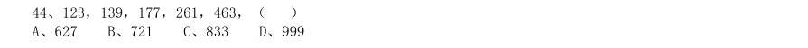

- **A.** 627
- **B.** 721
- **C.** 833
- **D.** 999

**答案：D**　**考点：数字推理｜幂次数列**　**难度：★★★★☆**
**【数量关系·其他数量关系｜HB-2010-ty-X045】**

45. （本题题干为图形/公式，文字层无题干，图见原卷）

- **A.** 97
- **B.** 114
- **C.** 126
- **D.** 147

**答案：D**　**考点：其他数量关系｜和差倍比**　**难度：★★☆☆☆**
**【数量关系·其他数量关系｜HB-2010-ty-X046】**

46. 建造一个容积为16 立方米,深为4 米的立方体无盖水池,如果池底和池壁的造价分别为每平方米160 元和每 平方米100 元,那么该水池的最低造价是多少元:

- **A.** 3980
- **B.** 3560
- **C.** 3270
- **D.** 3840

**答案：D**　**考点：其他数量关系｜方程与不定方程**　**难度：★☆☆☆☆**
**【数量关系·行程问题｜HB-2010-ty-X047】**

47. 有 名学生需要到河对岸去参观明清时期的古民居。现只有一条船,每条船最多载 人(其中 人 划船),往返一次需要 分钟,如果早晨 点钟准时开始渡河,到 点 分时,至少还有多少人在 等待渡河:

- **A.** 10
- **B.** 15
- **C.** 20
- **D.** 25

**答案：B**　**考点：行程问题｜环形与往返**　**难度：★★☆☆☆**
**【数量关系·最值问题｜HB-2010-ty-X048】**

48. 参加某部门招聘考试的共有 人,考试内容共有 道题。1 至 道题分别有 人,88 人, 人,76 人,72 人和 人答对,如果答对 道题或 道以上的人员能通过考试,那么至少有多 少人能通过考试:

- **A.** 50
- **B.** 61
- **C.** 75
- **D.** 80

**答案：B**　**考点：最值问题｜最值优化**　**难度：★★★★☆**
**【数量关系·其他数量关系｜HB-2010-ty-X049】**

49. 足球比赛的计分规则是:胜一场得 分,平一场得 分,负一场得 分,如果某国家足球队共打 了 场比赛,其中负 场,共得 分,那么这个队胜了多少场:

- **A.** 8
- **B.** 10
- **C.** 12
- **D.** 9

**答案：D**　**考点：其他数量关系｜方程与不定方程**　**难度：★☆☆☆☆**
**【数量关系·年龄问题｜HB-2010-ty-X050】**

50. 小张,小王,小李和小东四人,其中每三个人的岁数之和为 65,68,62,75。这四个人中年龄最小的是多 少岁:

- **A.** 15
- **B.** 16
- **C.** 17
- **D.** 18

**答案：A**　**考点：年龄问题｜年龄差不变**　**难度：★☆☆☆☆**
**【数量关系·其他数量关系｜HB-2010-ty-X051】**

51. 有一项工作任务,小明先做 小时,小方接着做 小时可以完成,小明先做 小时,小方接着 做 小时也可以完成,如果小明先做 小时后再让小方接着做,那么小方可以完成工作还需要几个小时:

- **A.** 8
- **B.** 10
- **C.** 11
- **D.** 12

**答案：D**　**考点：其他数量关系｜方程与不定方程**　**难度：★★☆☆☆**
**【数量关系·其他数量关系｜HB-2010-ty-X052】**

52. 去超市购买商品,如果购买 件甲商品,5 件乙商品和 件丙商品一共需要 元。如果购 买 件甲商品,7 件乙商品和 件丙商品一共需要 元。若甲、乙、丙三种商品各买 件,共需 要多少钱:

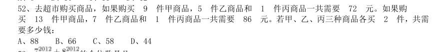

- **A.** 88
- **B.** 66
- **C.** 58
- **D.** 44

**答案：A**　**考点：其他数量关系｜方程与不定方程**　**难度：★★☆☆☆**
**【数量关系·其他数量关系｜HB-2010-ty-X053】**

53. 的个位数是几:

- **A.** 3
- **B.** 5
- **C.** 7
- **D.** 9

**答案：C**　**考点：其他数量关系｜基础计算**　**难度：★☆☆☆☆**
**【数量关系·其他数量关系｜HB-2010-ty-X054】**

54. 三位数的自然数 N 满足:除以 余 3,除以 余 3,除以 也余 3,则符合条件的自然 数 N 有几个:

- **A.** 8
- **B.** 9
- **C.** 15
- **D.** 16

**答案：C**　**考点：其他数量关系｜和差倍比**　**难度：★☆☆☆☆**
**【数量关系·行程问题｜HB-2010-ty-X055】**

55. 老张和老王两个人在周长为 米的圆形池塘边散步。老张每分钟走 米,老王每分钟走 米。 现在两个人从同一点反方向行走,那么出发后多少分钟他们第二次相遇:

- **A.** 16
- **B.** 32
- **C.** 25
- **D.** 20

**答案：B**　**考点：行程问题｜相遇追及**　**难度：★☆☆☆☆**
**【数量关系·其他数量关系｜HB-2010-ty-X056】**

56. 有一条新修的道路,现在需要在该道路的两边植树,已知路长为 米,如果每隔 米植一棵树,那 么一共需要植多少棵树:

- **A.** 1646
- **B.** 1648
- **C.** 1686
- **D.** 1628

**答案：C**　**考点：其他数量关系｜其他数量关系（综合）**　**难度：★☆☆☆☆**
**【数量关系·容斥问题｜HB-2010-ty-X057】**

57. 某俱乐部会下中国象棋的有 人,会下围棋的有 人,两种都会下的有 人,两种都不会下的 有 人,那么该俱乐部共有多少人:

- **A.** 128
- **B.** 146
- **C.** 158
- **D.** 166

**答案：B**　**考点：容斥问题｜两集合**　**难度：★☆☆☆☆**
**【数量关系·其他数量关系｜HB-2010-ty-X058】**

58. 甲家庭和乙家庭共有图书 册,甲家庭的图书数量是乙家庭的 倍,甲家庭和乙家庭各有图书多少 册:

- **A.** 2596,649
- **B.** 2425,820
- **C.** 2620,625
- **D.** 2530,715

**答案：A**　**考点：其他数量关系｜和差倍比**　**难度：★☆☆☆☆**
**【数量关系·最值问题｜HB-2010-ty-X059】**

59. 有一只青蛙在井底,每天上爬 米,又下滑 米,这口井深 米,这只青蛙爬出井口至少需要多 少天:

- **A.** 2
- **B.** 3
- **C.** 4
- **D.** 5

**答案：C**　**考点：最值问题｜最值问题（综合）**　**难度：★★★★☆**
**【数量关系·排列组合｜HB-2010-ty-X060】**

60. 有颜色不同的五盏灯,每次使用一盏、两盏、三盏、四盏和五盏,并按一定次序挂在灯杆上表示不同的信号, 这些颜色不同的灯共可以表示多少种不同的信号:

- **A.** 240
- **B.** 300
- **C.** 320
- **D.** 325

**答案：D**　**考点：排列组合｜基础排列组合**　**难度：★★★★★**
**【判断推理·图形推理｜HB-2010-ty-X061】**

61. 从四个选项选择最合适的一个填入问号处,使之呈现一定的规律性。

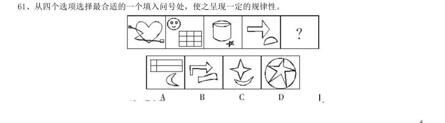

> （本题为图形题，选项为图片，见原卷）

**答案：C**　**考点：图形推理｜数量规律**　**难度：★★★☆☆**
**【判断推理·图形推理｜HB-2010-ty-X062】**

62. 从四个选项选择最合适的一个填入问号处,使之呈现一定的规律性。

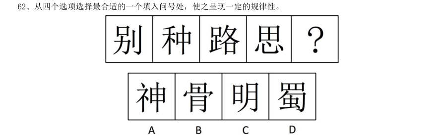

> （本题为图形题，选项为图片，见原卷）

**答案：D**　**考点：图形推理｜数量规律**　**难度：★★★☆☆**
**【判断推理·图形推理｜HB-2010-ty-X063】**

63. 从四个选项选择最合适的一个填入问号处,使之呈现一定的规律性。

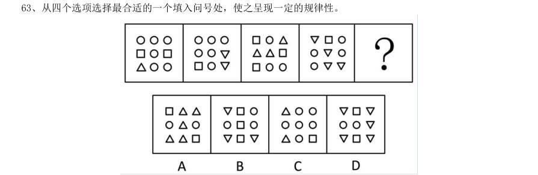

> （本题为图形题，选项为图片，见原卷）

**答案：A**　**考点：图形推理｜位置规律**　**难度：★★★☆☆**
**【判断推理·图形推理｜HB-2010-ty-X064】**

64. 从四个选项选择最合适的一个填入问号处,使之呈现一定的规律性。

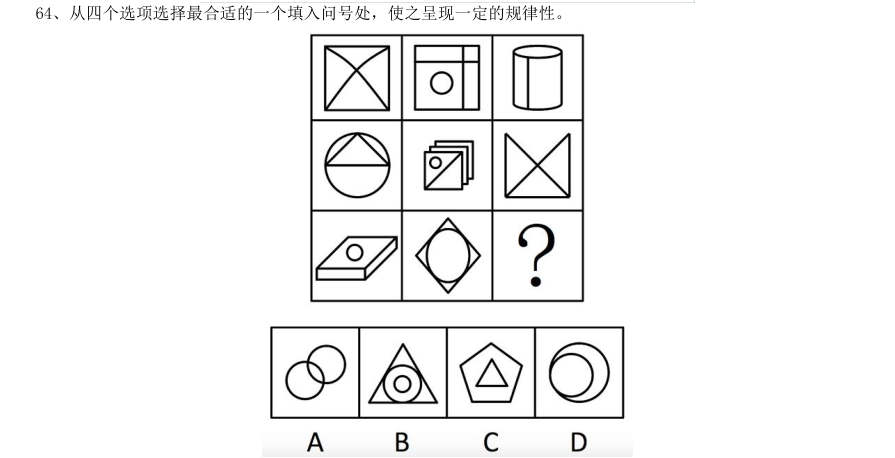

> （本题为图形题，选项为图片，见原卷）

**答案：A**　**考点：图形推理｜数量规律**　**难度：★★★☆☆**
**【判断推理·图形推理｜HB-2010-ty-X065】**

65. 从四个选项选择最合适的一个填入问号处,使之呈现一定的规律性。

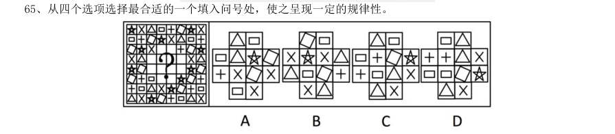

> （本题为图形题，选项为图片，见原卷）

**答案：C**　**考点：图形推理｜样式规律**　**难度：★★★☆☆**
**【判断推理·图形推理｜HB-2010-ty-X066】**

66. 从四个选项选择最合适的一个填入问号处,使之呈现一定的规律性。

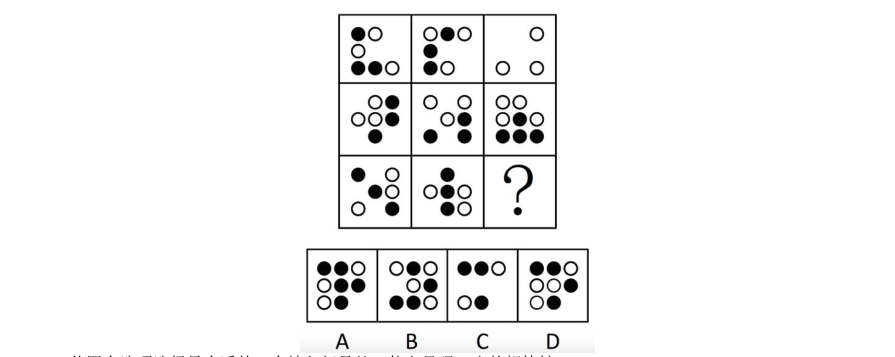

> （本题为图形题，选项为图片，见原卷）

**答案：D**　**考点：图形推理｜样式规律**　**难度：★★★☆☆**
**【判断推理·图形推理｜HB-2010-ty-X067】**

67. 从四个选项选择最合适的一个填入问号处,使之呈现一定的规律性。

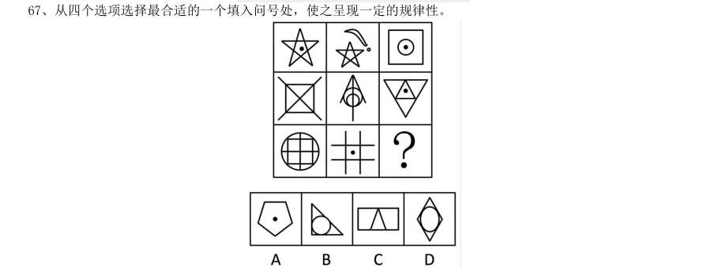

> （本题为图形题，选项为图片，见原卷）

**答案：C**　**考点：图形推理｜数量规律**　**难度：★★★☆☆**
**【判断推理·图形推理｜HB-2010-ty-X068】**

68. 给定纸盒外表面,下面哪个图形可以和题中图形折成同样的盒子。

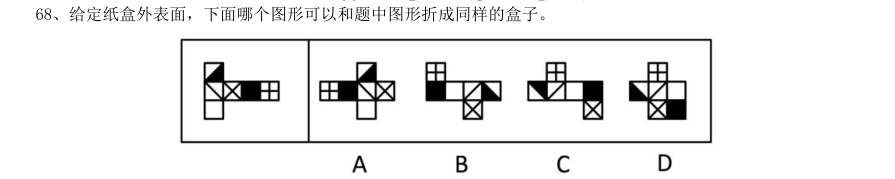

> （本题为图形题，选项为图片，见原卷）

**答案：B**　**考点：图形推理｜位置规律**　**难度：★★★☆☆**
**【判断推理·图形推理｜HB-2010-ty-X069】**

69. 给定纸盒外表面,下面哪一个图形是由他折成的:

> （本题为图形题，选项为图片，见原卷）

**答案：A**　**考点：图形推理｜位置规律**　**难度：★★★☆☆**
**【判断推理·图形推理｜HB-2010-ty-X070】**

70. 下面左视图和主视图正确的是:

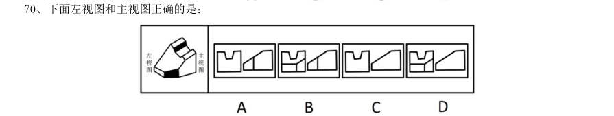

> （本题为图形题，选项为图片，见原卷）

**答案：B**　**考点：图形推理｜位置规律**　**难度：★★★☆☆**
**【判断推理·定义判断｜HB-2010-ty-X071】**

71. 口红效应是指每当经济不景气,人们的消费就会转向购买廉价商品,而口红虽非生活必需品,却兼具廉价和 粉饰的作用,能够给消费者带来心理慰藉。 下列符合口红效应的是:

- **A.** 近来公司效益不好,胡老板卖掉了自己的高级轿车,改骑自行车上班,既环保又锻炼身体
- **B.** 为了约会,小刘虽然工资不高,还是买了一身名牌西装来装扮
- **C.** 今年单位效益不好,小杨取消了假期带全家到国外旅行的计划,改为到近郊旅游,结果感觉还不错
- **D.** 为了明天的面试,小黄到理发店理了一个新发型,看上去朝气蓬勃,使他信心十足

**答案：C**　**考点：定义判断｜单定义**　**难度：★★☆☆☆**
**【判断推理·定义判断｜HB-2010-ty-X072】**

72. 原始取得是指根据法律规定,最初取得财产的所有权或不依赖于原所有人的意志而取得财产的所有权。 下列不属于原始取得的是:

- **A.** 农民种植并收获的粮食
- **B.** 老王养的牛产下的牛犊
- **C.** 违法犯罪分子的财产收归国家所有
- **D.** 朋友赠送的礼物

**答案：D**　**考点：定义判断｜单定义**　**难度：★☆☆☆☆**
**【判断推理·定义判断｜HB-2010-ty-X073】**

73. 从权利:民事权利可分为主权利与从权利。从权利是指在互有关联的两个民事权利中,其效力受另一效力制 约的权利。从权利随主权利的存在而存在或消灭而消灭。 下列属于从权利的是:

- **A.** 抵押权
- **B.** 债权
- **C.** 著作权
- **D.** 上诉权

**答案：A**　**考点：定义判断｜单定义**　**难度：★★☆☆☆**
**【判断推理·逻辑判断｜HB-2010-ty-X074】**

74. 学习迁移即一种学习对另一种学习的影响,它广泛地存在于知识、技能、态度和行为规范的学习中。任何一 种学习都会受到学习者已有知识经验、技能、态度等的影响,只要有学习,就有迁移。 下列属于学习迁移的是:

- **A.** 小王的父亲是著名的画家,受父亲影响,他从小就对绘画产生了兴趣,后来也成为一名画家
- **B.** 某大学生在人多的教室里复习功课总容易分心,于是换到一个独处的安静环境,学习效率非常高
- **C.** 小芳学会了拉二胡,自己尝试拉小提琴,结果也很快学会
- **D.** 某学生沉迷于网络游戏致使学习成绩下降,后来通过老师的教育和同学的帮助,改掉了毛病,学习进步非常快

**答案：C**　**考点：逻辑判断｜逻辑判断（综合）**　**难度：★★★★★**
**【判断推理·定义判断｜HB-2010-ty-X075】**

75. 投射效应是指以己度人,认为自己具有某种特性,他人也一定会有与自己相同的特性,从而把自己的感情、 意志、特性投射到他人身上,同时认为对方也应该有同样的感受和认知。简单来说,这是一种强加于人的一种认 知障碍。 下列属于投射效应的是:

- **A.** 某人非常喜欢打篮球,只要跟别人说话就围绕着篮球的话题没完没了,不管别人是否感兴趣
- **B.** 某人喜爱武术,因而看电影只喜欢看武打片
- **C.** 林丽与王飞两人性格相投,一见钟情,不顾家人反对结为夫妻
- **D.** 公司林老板看到新招聘来的大学生很像自己年轻时的样子,因而非常喜欢他,同时对他寄予很高的期望

**答案：A**　**考点：定义判断｜单定义**　**难度：★★★☆☆**
**【判断推理·类比推理｜HB-2010-ty-X076】**

76. 十堰:武当山

- **A.** 宜昌:神农架
- **B.** 咸宁:九宫山
- **C.** 襄阳:古隆中
- **D.** 黄陂:木兰山

**答案：B**　**考点：类比推理｜对应关系**　**难度：★☆☆☆☆**
**【判断推理·图形推理｜HB-2010-ty-X077】**

77. 收入分配:基尼系数 A、食品支出:恩格尔系数 B CPI:消费者价格指数 C、环境保护:幸福指数 D、香港:恒生指数

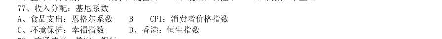

> （本题为图形题，选项为图片，见原卷）

**答案：A**　**考点：图形推理｜图形推理（综合）**　**难度：★★★☆☆**
**【判断推理·类比推理｜HB-2010-ty-X078】**

78. 交通违章:警察:银行

- **A.** 招商:企业家:政府
- **B.** 离婚:夫妻:民政局
- **C.** 犯罪:法官:监狱
- **D.** 比赛:裁判:运动场

**答案：C**　**考点：类比推理｜对应关系**　**难度：★☆☆☆☆**
**【判断推理·类比推理｜HB-2010-ty-X079】**

79. 光线:折射:水

- **A.** 绿叶:光合作用:叶绿素
- **B.** 水蒸气:凝结:玻璃
- **C.** 电脑:计算:数据
- **D.** 海洋:洋流:台风

**答案：B**　**考点：类比推理｜类比推理（综合）**　**难度：★☆☆☆☆**
**【判断推理·类比推理｜HB-2010-ty-X080】**

80. ( )对于终止相当于回车对于( )

- **A.** 叫停打的
- **B.** 继续前行
- **C.** 句号换行
- **D.** 犯罪网络

**答案：C**　**考点：类比推理｜类比推理（综合）**　**难度：★☆☆☆☆**
**【判断推理·逻辑判断｜HB-2010-ty-X081】**

81. 进入6 月份,不少市民发现,蚊子越来越多,简直无法控制,灭蚊剂也杀不死,一些曾经“一用就灵”的灭 蚊剂如今渐渐失效。在武汉的各大医院皮肤科被蚊虫叮咬的儿童患者挤满了病房。 以下哪项不是这一现象出现的原因:

- **A.** 6 月份气温适中,雨量充沛,最适宜蚊子繁殖生长
- **B.** 蚊子的抗药性非常强,被杀死的往往是“娇弱”的蚊种,适者则顽强地生存了下来
- **C.** 蚊子特别喜欢叮咬儿童
- **D.** 不规范使用灭蚊剂导致蚊子抗药性的产生和快速增强

**答案：C**　**考点：逻辑判断｜解释评价**　**难度：★★★★☆**
**【判断推理·逻辑判断｜HB-2010-ty-X082】**

82. 如果不能有效解决房价过高、房租不断上涨以及不成正比的工资收入这些问题,那么“蚁族”生活的期限将 被延长,“蚁族”的梦想也将推迟实现。 由此推出:

- **A.** 只有有效抑制房价过高和租金上涨,保持工资收入增长的合理比例,才能不推迟“蚁族”梦想的实现
- **B.** 如果有效解决了房价过高、房屋租金不断上涨以及不成正比的工资收入这些问题,“蚁族”生活的期限将会缩短,“蚁族”的梦想也能够实现
- **C.** 缩短“蚁族”生活的期限,就能加速“蚁族”梦想的实现
- **D.** 如果“蚁族”的梦想被推迟实现,就不能有效解决房价过高、房屋租金不断上涨以及不成正比的工资收入这些

**答案：A**　**考点：逻辑判断｜翻译推理**　**难度：★★★★☆**
**【判断推理·逻辑判断｜HB-2010-ty-X083】**

83. 每年高考成绩公布期间,社会总要掀起一阵“状元热”和“排名热”。国人热衷于排名的做法,往往会阻碍 了创新型人才的成长。 以下哪项不能支持上述观点:

- **A.** “排名热”具有社会需求,有利于促进竞争
- **B.** 排名就是固化,容易滋生固步自封情绪,而创新排斥各种排名
- **C.** 过分支持一次考试的赢者,容易形成不宽容失败者的氛围,不利于创新型人才的成长
- **D.** 社会需要各式各样的人才,高考只是评价人才的一种标准

**答案：A**　**考点：逻辑判断｜削弱**　**难度：★★★★☆**
**【判断推理·逻辑判断｜HB-2010-ty-X084】**

84. 某学校甲、乙、丙三位老师年龄各不相同,一位喜欢足球,一位喜欢篮球,一位喜欢排球。现在知道:甲比 喜欢足球的人年龄大;喜欢排球的老师比喜欢篮球的老师年龄小;乙老师年龄最大。 由此可以推出:

- **A.** 甲老师年龄最小
- **B.** 乙老师喜欢排球
- **C.** 丙老师喜欢足球
- **D.** 三人年龄大小无法确定

**答案：C**　**考点：逻辑判断｜归纳推导**　**难度：★★★★☆**
**【判断推理·逻辑判断｜HB-2010-ty-X085】**

85. 吸烟有害健康是众所周知的说法,如何在烟盒上做出恰当的警示,从而有效降低人们尤其是青少年的吸烟欲 望,却很不容易。加拿大规定,每一条香烟都必须从政府规定的16 种警示语中选择至少6 种,并且要经常更换; 最好不用大字标题,不得出现“禁止向未成年人销售”字句。 这种做法是以下面哪项为前提假设的: I.用语气生硬的大字标题容易引起青少年的逆反心理 II.“禁止向未成年人销售”字句会被青少年认为“香烟是成年人的专用品”而更加起劲地尝试 III.过分强调吸烟有害健康会引起烟草企业的反对 IV.警示语经常更换以免被当成老生常谈或出现过期消息

- **A.** I、II、III和IV
- **B.** I、II和III
- **C.** I、II和IV
- **D.** I和II

**答案：C**　**考点：逻辑判断｜加强**　**难度：★★★★★**
**【判断推理·逻辑判断｜HB-2010-ty-X086】**

86. 托勒密派天文学家坚持“地球静止说”,其根据是如果地球是转动的,每天一圈,那么地球表面上任何一点 在很短的时间都将运动很大一段距离。这时,如果一块石头从塔顶落下来,应该落在离塔很远的地方。可是人们 看到的情景并非如此。石头总是落在塔基边缘,可见“地球运动说”是错误的。 下面哪个选项最能对这些论断提出质疑:

- **A.** 难道从塔顶落下的石头不会受到人为的干扰吗?
- **B.** 难道塔一定是垂直的吗?
- **C.** 地球不转动怎么会有白天和黑夜的替换?
- **D.** 从正在航行的船桅杆顶上落下的一件重物不也是落到桅杆脚下而没有落到船底吗?

**答案：D**　**考点：逻辑判断｜削弱**　**难度：★★★★☆**
**【判断推理·逻辑判断｜HB-2010-ty-X087】**

87. 文化是活的生命。持久的生命力有赖于其影响力,而社会大众的喜爱是构成影响力的前提条件。 由此可以推出:

- **A.** 受到大众喜爱的文化就会有影响力和持久的生命力
- **B.** 不受大众喜爱的文化就没有持久的生命力
- **C.** 文化没有影响力就不会受到社会大众的喜爱
- **D.** 只有具备了持久的生命力,才可能会受到社会大众的喜爱

**答案：B**　**考点：逻辑判断｜前提假设**　**难度：★★★☆☆**
**【判断推理·逻辑判断｜HB-2010-ty-X088】**

88. 尽管中国现在不缺乏大企业,也不缺乏受重视的企业,但他们不等同于受人尊重的企业。对企业内部的员工、 外部的消费者、利益相关者不尊重,尤其是对资源、环境及其利益相关者不负责任的企业,即使每天都在捐款, 也不会受到尊重。 上述论证是以下面哪项为前提假设的?( )

- **A.** 企业知名度与受人尊重的程度不一定成正比
- **B.** 只有主动承担内部与外部责任的企业才能成为受人尊重的企业
- **C.** 受人尊重的程度对企业的长远发展至关重要
- **D.** 企业受尊重不一定要捐款

**答案：B**　**考点：逻辑判断｜加强**　**难度：★★★★☆**
**【判断推理·逻辑判断｜HB-2010-ty-X089】**

89. 实行低利率政策是抗击通货膨胀的有效手段。目前的低利率水平可以使中国通货膨胀处于可控范围之内,不 会发生恶性通胀,也使企业能够以较低廉的利息代价得到资金支持,从而使企业渡过难关。 以下哪项如果为真,最能反驳上述论断:

- **A.** 我国的利率不仅是低利率,而且已经是负利率
- **B.** 最近政府正在考虑提高利率
- **C.** 实行低利率未必对企业有利
- **D.** 低利率政策下的信贷爆发式增长在一定程度上增加了通胀发生的可能性

**答案：D**　**考点：逻辑判断｜削弱**　**难度：★★★★☆**
**【判断推理·逻辑判断｜HB-2010-ty-X090】**

90. 长期以来,大家对金融危机的认识是,发生金融危机的国家受损最大。的确,过去的金融危机是受伤,而这 次金融危机则让所在国受益。美国是这次金融危机的源头,赚的却比赔的多。 下列哪些选项可以支持这个结论: I.欧债危机泛滥,使欧洲的竞争力弱化,而美国的竞争力则在增强 II.美国利用危机强化了对石油、黄金的捆绑,使之变成美元的另类筹码 III.美国非常善于利用危机实现自己的长远目的,使之成为实现战略目标的契机 IV.美元独霸的货币制度在成功回归,美元地位并未下降和削弱

- **A.** I、II、III和IV
- **B.** I、II和III
- **C.** I、II和IV
- **D.** I和II

**答案：A**　**考点：逻辑判断｜削弱**　**难度：★★★★★**
**【资料分析·比重计算与比较｜HB-2010-ty-X091】**
> 材料：理。 (一) 根据以下资料,完成各题。 2009 年,中国农业生产在国家继续加大支农政策力度的作用下,克服不利气候条件的影响,实现了稳步的增长。 据国家统计局公布的统计数据显示,2009 年第一产业增加值35477 亿元(包括农林牧渔服务业),比上年实际增 长4.2%。第一产业增加值占国内生产总值的比重为10.6%,比上年下降0.1 个百分点。在农、林、牧、渔业增 加值中,农业增加值19699 亿元,实际增长3.1%;林业增加值1581 亿元,实际增长6.0%;畜牧业增加值达到 9640 亿元,实际增长5.5%;渔业增加值达到3431 亿元,实际增长5.5%。

91. 第一产业内部,农业比重比上年提高 1.6 个百分点;林业比重为4.5%,渔业比重为7.9%,均比上年略有提高;畜牧业比重为27.2%,比上年下降2.4 个百分点。 2009 年国内生产总值是多少亿元:

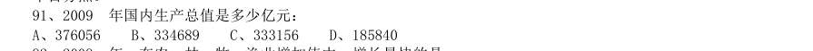

- **A.** 376056
- **B.** 334689
- **C.** 333156
- **D.** 185840

**答案：B**　**考点：比重计算与比较｜比重升降判断**　**难度：★★★☆☆**
**【资料分析·增长量计算｜HB-2010-ty-X092】**

92. 2009 年,在农、林、牧、渔业增加值中,增长最快的是:

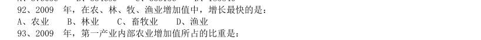

- **A.** 农业
- **B.** 林业
- **C.** 畜牧业
- **D.** 渔业

**答案：B**　**考点：增长量计算｜增长量计算（综合）**　**难度：★★☆☆☆**
**【资料分析·比重计算与比较｜HB-2010-ty-X093】**

93. 2009 年,第一产业内部农业增加值所占的比重是:

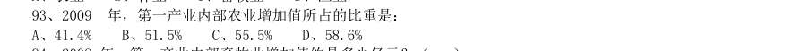

- **A.** 41.4%
- **B.** 51.5%
- **C.** 55.5%
- **D.** 58.6%

**答案：C**　**考点：比重计算与比较｜现期比重**　**难度：★★☆☆☆**
**【资料分析·增长量计算｜HB-2010-ty-X094】**

94. 2008 年,第一产业内部畜牧业增加值约是多少亿元?( )

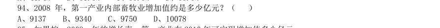

- **A.** 9137
- **B.** 9340
- **C.** 9750
- **D.** 10078

**答案：A**　**考点：增长量计算｜增长量计算（综合）**　**难度：★★☆☆☆**
**【资料分析·增长率计算与比较｜HB-2010-ty-X095】**

95. 如果按 年的增长率,第一产业在2010 年可实现增加值多少亿元:

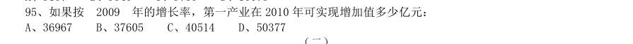

- **A.** 36967
- **B.** 37605
- **C.** 40514
- **D.** 50377

**答案：A**　**考点：增长率计算与比较｜增长率计算**　**难度：★★☆☆☆**
**【资料分析·综合分析｜HB-2010-ty-X096】**

96. 根据以下资料,完成各题。 “家电下乡”产品销售额下降最多的是几月份:

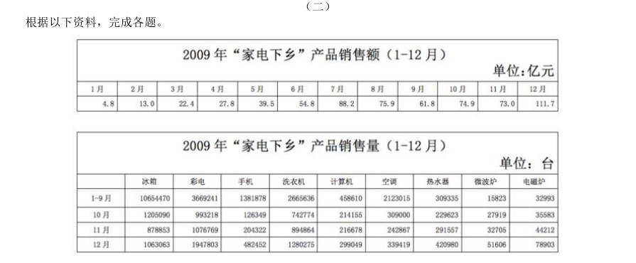

- **A.** 8 月
- **B.** 9 月
- **C.** 10 月
- **D.** 11 月

**答案：B**　**考点：综合分析｜选正确项**　**难度：★★★★☆**
**【资料分析·增长率计算与比较｜HB-2010-ty-X097】**

97. “家电下乡”产品销售额增幅最大的是几月份:

> 材料图见 images/HB-2010-ty-X096-m.jpg

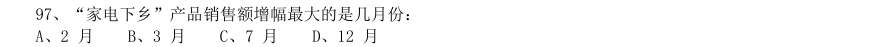

- **A.** 2 月
- **B.** 3 月
- **C.** 7 月
- **D.** 12 月

**答案：A**　**考点：增长率计算与比较｜增长率比较**　**难度：★★☆☆☆**
**【资料分析·增长量计算｜HB-2010-ty-X098】**

98. “家电下乡”产品销售额增量最多的月份增加了几个亿:

> 材料图见 images/HB-2010-ty-X096-m.jpg

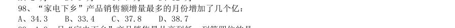

- **A.** 34.3
- **B.** 33.4
- **C.** 37.8
- **D.** 38.7

**答案：D**　**考点：增长量计算｜增长量比较**　**难度：★★☆☆☆**
**【资料分析·综合分析｜HB-2010-ty-X099】**

99. 1-9 月“家电下乡”产品销售量从高到低,列第四位的是:

> 材料图见 images/HB-2010-ty-X096-m.jpg

- **A.** 手机
- **B.** 空调
- **C.** 计算机
- **D.** 热水器

**答案：B**　**考点：综合分析｜选正确项**　**难度：★★★★☆**
**【资料分析·倍数计算｜HB-2010-ty-X100】**

100. 与 月相比,12 月“家电下乡”产品中销售量增加一倍以上的产品有多少种:

> 材料图见 images/HB-2010-ty-X096-m.jpg

- **A.** 1 种
- **B.** 2 种
- **C.** 3 种
- **D.** 4 种

**答案：B**　**考点：倍数计算｜是几倍**　**难度：★★☆☆☆**
**【资料分析·综合分析｜HB-2010-ty-X101】**

101. 由以上数据,下列结论中可以推出的是:

> 材料图见 images/HB-2010-ty-X096-m.jpg

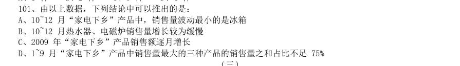

- **A.** 10~12 月“家电下乡”产品中,销售量波动最小的是冰箱
- **B.** 10~12 月热水器、电磁炉销售量增长较为缓慢
- **C.** 2009 年“家电下乡”产品销售额逐月增长
- **D.** 1~9 月“家电下乡”产品中销售量最大的三种产品的销售量之和占比不足75%

**答案：A**　**考点：综合分析｜选错误项**　**难度：★★★★★**
**【资料分析·增长率计算与比较｜HB-2010-ty-X102】**

102. 根据以下资料,完成各题。 2004-2009 年全国猪肉产量 单位:万吨 与 年相比,2009 年猪肉产量增长率为:

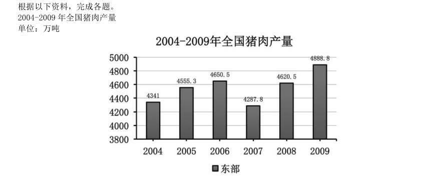

- **A.** 4.6%
- **B.** 5.8%
- **C.** 7.1%
- **D.** 10.2%

**答案：B**　**考点：增长率计算与比较｜增长率计算**　**难度：★★☆☆☆**
**【资料分析·增长率计算与比较｜HB-2010-ty-X103】**

103. 2004-2009 年,增长率最高的是哪个时期:

> 材料图见 images/HB-2010-ty-X102-m.jpg

- **A.** 2005 年
- **B.** 2004-2006 年
- **C.** 2008 年
- **D.** 2007-2009 年

**答案：C**　**考点：增长率计算与比较｜增长率比较**　**难度：★★☆☆☆**
**【资料分析·综合分析｜HB-2010-ty-X104】**

104. 2005-2009 年,增长率从高到低依次排列正确的是:

> 材料图见 images/HB-2010-ty-X102-m.jpg

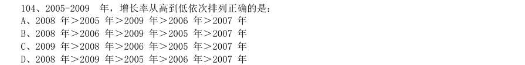

- **A.** 2008 年>2005 年>2009 年>2006 年>2007 年
- **B.** 2008 年>2006 年>2009 年>2005 年>2007 年
- **C.** 2009 年>2008 年>2006 年>2005 年>2007 年
- **D.** 2008 年>2009 年>2005 年>2006 年>2007 年

**答案：D**　**考点：综合分析｜选正确项**　**难度：★★★★★**
**【资料分析·平均数计算｜HB-2010-ty-X105】**

105. 2004-2009 年,哪年的产量最接近平均值:

> 材料图见 images/HB-2010-ty-X102-m.jpg

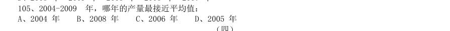

- **A.** 2004 年
- **B.** 2008 年
- **C.** 2006 年
- **D.** 2005 年

**答案：D**　**考点：平均数计算｜现期平均数**　**难度：★★☆☆☆**
**【资料分析·年均增长率｜HB-2010-ty-X106】**

106. 根据以下资料,完成各题。 2000-2009 年,农村居民家庭人均纯收入平均每年增长:

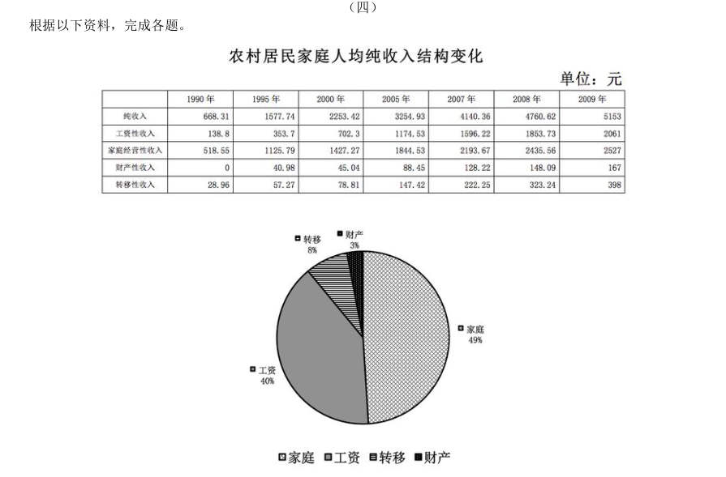

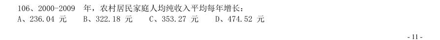

- **A.** 236.04 元
- **B.** 322.18 元
- **C.** 353.27 元
- **D.** 474.52 元

**答案：B**　**考点：年均增长率｜年均增长率计算**　**难度：★★☆☆☆**
**【资料分析·平均数计算｜HB-2010-ty-X107】**

107. 与 年相比,2009 年农村居民家庭人均纯收入增长率为:

> 材料图见 images/HB-2010-ty-X106-m.jpg

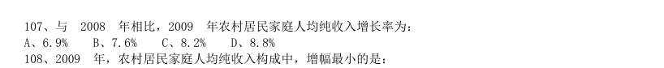

- **A.** 6.9%
- **B.** 7.6%
- **C.** 8.2%
- **D.** 8.8%

**答案：C**　**考点：平均数计算｜现期平均数**　**难度：★★☆☆☆**
**【资料分析·平均数计算｜HB-2010-ty-X108】**

108. 2009 年,农村居民家庭人均纯收入构成中,增幅最小的是:

> 材料图见 images/HB-2010-ty-X106-m.jpg

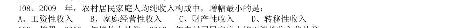

- **A.** 工资性收入
- **B.** 家庭经营性收入
- **C.** 财产性收入
- **D.** 转移性收入

**答案：B**　**考点：平均数计算｜现期平均数**　**难度：★★☆☆☆**
**【资料分析·平均数计算｜HB-2010-ty-X109】**

109. 按照 年增长率计算,2010 年农村居民家庭人均工资性收入将达到:

> 材料图见 images/HB-2010-ty-X106-m.jpg

- **A.** 2291.45 元
- **B.** 2309.37 元
- **C.** 2345.86 元
- **D.** 2326.21 元

**答案：A**　**考点：平均数计算｜现期平均数**　**难度：★★☆☆☆**
**【资料分析·综合分析｜HB-2010-ty-X110】**

110. 由以上数据,可以推出下列哪个结论正确:

> 材料图见 images/HB-2010-ty-X106-m.jpg

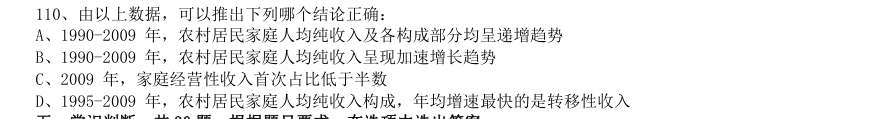

- **A.** 1990-2009 年,农村居民家庭人均纯收入及各构成部分均呈递增趋势
- **B.** 1990-2009 年,农村居民家庭人均纯收入呈现加速增长趋势
- **C.** 2009 年,家庭经营性收入首次占比低于半数
- **D.** 1995-2009 年,农村居民家庭人均纯收入构成,年均增速最快的是转移性收入

**答案：D**　**考点：综合分析｜选错误项**　**难度：★★★★★**
**【常识判断·生活常识｜HB-2010-ty-X111】**

111. (多选题) 【不定选】下列日常生活常识,正确的是:

- **A.** 甲烷的主要成分是氢气
- **B.** 焚烧塑料会产生白色污染
- **C.** 棉花、涤纶是高分子有机材料
- **D.** 蛋白质是人体所需要的六大营养元素之一

**答案：C**　**考点：生活常识｜生活常识**　**难度：★★☆☆☆**
**【常识判断·政治常识｜HB-2010-ty-X112】**

112. 下列名言与出处,对应正确的是:

- **A.** 《管子》:学而时习之,不亦说乎
- **B.** 《老子》:四海之内皆兄弟
- **C.** 《论语》:天行健,君子以自强不息
- **D.** 《庄子》:吾生也有涯,而知也无涯

**答案：D**　**考点：政治常识｜政治常识（综合）**　**难度：★★☆☆☆**
**【常识判断·历史人文｜HB-2010-ty-X113】**

113. 对民主社会主义认识正确的是: 1最初的民主社会主义是资本主义社会主义 2民主社会主义是马克思社会主义的分支 3民主社会主义否认了社会制度的客观性 4民主社会主义肯定了工人阶级的领导地位 5民主社会主义把社会主义看成是一种道德需要、道德抗议,否认其历史必然性

- **A.** 1234
- **B.** 2345
- **C.** 1345
- **D.** 1245

**答案：C**　**考点：历史人文｜中国古代史**　**难度：★★★★☆**
**【常识判断·政治常识｜HB-2010-ty-X114】**

114. 实践高于理论的原因是因为实践有:

- **A.** 普遍有用性
- **B.** 主观能动性
- **C.** 直接现实性
- **D.** 客观现实性

**答案：C**　**考点：政治常识｜马克思主义基本原理**　**难度：★★☆☆☆**
**【常识判断·政治常识｜HB-2010-ty-X115】**

115. 马克思说:“蒸汽、电力和自动纺织机甚至是比巴尔贝斯、拉斯拜尔和布朗基诸位公民更危险万分的革命家。” 这一论断的含义是:

- **A.** 科技革命对统治者的地位有威胁
- **B.** 科技革命会导致政治变革
- **C.** 科技革命对社会变革有直接决定作用
- **D.** 滥用科技革命的成果会给人类带来危险

**答案：B**　**考点：政治常识｜马克思主义基本原理**　**难度：★★☆☆☆**
**【常识判断·法律常识｜HB-2010-ty-X116】**

116. 2009 年,中共十七届四中全会强调,在新时期加强党的建设,应着重: 1坚持解放思想,坚持改革开放,创建和谐社会 2提高党的执政能力建设 3增强党员的责任感和使命感 4立法为公、执政为民 5加强党与人民群众的血肉联系

- **A.** 1234
- **B.** 2345
- **C.** 1345
- **D.** 1235

**答案：D**　**考点：法律常识｜法律常识（综合）**　**难度：★★★★☆**
**【常识判断·政治常识｜HB-2010-ty-X117】**

117. 根据《公务员法》的回避原则,下列哪种情况不需要回避:

- **A.** 一个市内,丈夫是公安局局长,妻子是教育局局长
- **B.** 父亲是某市公安局局长,儿子是下级分局局长
- **C.** 丈夫是某市公安局局长,妻子的妹妹的女儿是该局财政科科员
- **D.** 丈夫是某市公安局局长,妻子是该局财政科科员

**答案：C**　**考点：政治常识｜政治常识（综合）**　**难度：★★☆☆☆**
**【常识判断·政治常识｜HB-2010-ty-X118】**

118. 把长江分为上游、中游、下游的两个城市是:

- **A.** 重庆、湖口
- **B.** 宜昌、湖口
- **C.** 宜昌、九江
- **D.** 重庆、九江

**答案：B**　**考点：政治常识｜政治常识（综合）**　**难度：★★☆☆☆**
**【常识判断·政治常识｜HB-2010-ty-X119】**

119. 成立股份有限公司,向公司登记机关登记的应该是:

- **A.** 全体股东指定的代表
- **B.** 全体股东指定的法律代理人
- **C.** 公司董事长
- **D.** 公司总经理

**答案：A**　**考点：政治常识｜政治常识（综合）**　**难度：★★☆☆☆**
**【常识判断·经济常识｜HB-2010-ty-X120】**

120. 扩张性货币政策指的是:

- **A.** 提高基本存款利率
- **B.** 发行国库券
- **C.** 提高贴现率
- **D.** 降低贴现率

**答案：D**　**考点：经济常识｜宏观经济**　**难度：★★☆☆☆**
**【常识判断·法律常识｜HB-2010-ty-X121】**

121. 英国《权利法案》的颁布具有历史意义,它包含的内容有: 1国王没有权利废止法律或者终止法律的实行 2人人生而平等,每个人都是自由的 3国王在和平年代不可以有武装军队 4私有财产神圣不可侵犯 5 议会可以监督国王和大臣的活动

- **A.** 1234
- **B.** 24
- **C.** 135
- **D.** 12345

**答案：C**　**考点：法律常识｜宪法**　**难度：★★★★☆**
**【常识判断·政治常识｜HB-2010-ty-X122】**

122. 赵某下班以后去财务科领取工资,财务因粗心多给了他500 元,赵某因赶着回家,所以拿到钱,没有数,就 直接塞进了口袋。他的行为属于:

- **A.** 无因管理
- **B.** 不当得利
- **C.** 无权处分行为
- **D.** 盗窃

**答案：B**　**考点：政治常识｜政治常识（综合）**　**难度：★★★☆☆**
**【常识判断·政治常识｜HB-2010-ty-X123】**

123. 下列属于后果预测法的有: 1德尔菲法 2对演法 3会议法 4集思广益法 5推理法

- **A.** 1234
- **B.** 24
- **C.** 135
- **D.** 12345

**答案：C**　**考点：政治常识｜马克思主义基本原理**　**难度：★★☆☆☆**
**【常识判断·科技常识｜HB-2010-ty-X124】**

124. 从社会总成本角度,分析社会资本再生产问题的核心是:

- **A.** 社会总成本的结构
- **B.** 社会总成本的补偿
- **C.** 社会总成本的支出
- **D.** 社会总成本的收入

**答案：B**　**考点：科技常识｜科技常识（综合）**　**难度：★★☆☆☆**
**【常识判断·政治常识｜HB-2010-ty-X125】**

125. ( ),法国人攻克巴士底狱,揭开了法国资产阶级革命的序幕。

- **A.** 1789 年7 月12 日
- **B.** 1789 年7 月14 日
- **C.** 1789 年7 月16 日
- **D.** 1789 年12 月12 日

**答案：B**　**考点：政治常识｜毛中特与党史**　**难度：★★☆☆☆**
**【常识判断·政治常识｜HB-2010-ty-X126】**

126. 自然人的( )始于出生,终于死亡。

- **A.** 行为能力
- **B.** 责任能力
- **C.** 权利能力
- **D.** 法律能力

**答案：C**　**考点：政治常识｜政治常识（综合）**　**难度：★★☆☆☆**
**【常识判断·法律常识｜HB-2010-ty-X127】**

127. 根据法律规定,农民土地承包经营权转移时,要坚持“三不得”原则,指的是: 1不得改变土地所有权 2不得改变土地的用途 3不得改变经营权的关系 4不得改变土地集体所有的性质 5不得侵害农民的权益

- **A.** 123
- **B.** 245
- **C.** 345
- **D.** 125

**答案：B**　**考点：法律常识｜法律常识（综合）**　**难度：★★★☆☆**
**【常识判断·政治常识｜HB-2010-ty-X128】**

128. 下列战役按时间先后顺序排列正确的是: 1武汉会战 2淞沪会战 3徐州会战 4太原会战 5枣庄会战

- **A.** 24315
- **B.** 23415
- **C.** 32145
- **D.** 32541

**答案：A**　**考点：政治常识｜政治常识（综合）**　**难度：★★☆☆☆**
**【常识判断·政治常识｜HB-2010-ty-X129】**

129. 在被猫、狗咬到以后,为了遏制狂犬病的发生,最好是在( )小时以内打狂犬疫苗。

- **A.** 24 小时
- **B.** 36 小时
- **C.** 48 小时
- **D.** 60 小时

**答案：A**　**考点：政治常识｜政治常识（综合）**　**难度：★★☆☆☆**
**【常识判断·政治常识｜HB-2010-ty-X130】**

130. “政权是从枪杆子中打出来的”,毛泽东的这句话是在哪次会议中提出来的:

- **A.** 八七会议
- **B.** 遵义会议
- **C.** 古田会议
- **D.** 瓦窑堡会议

**答案：A**　**考点：政治常识｜马克思主义基本原理**　**难度：★★☆☆☆**
**【常识判断·政治常识｜HB-2010-ty-X131】**

131. “存在即被感知”这句话是谁提出来的:

- **A.** 柏拉图
- **B.** 黑格尔
- **C.** 康德
- **D.** 贝克莱

**答案：D**　**考点：政治常识｜马克思主义基本原理**　**难度：★★☆☆☆**
**【常识判断·经济常识｜HB-2010-ty-X133】**
> 材料：双螺旋结构是谁提出来的: A、孟德尔 B、达尔文 C、沃森和克里克 D、巴甫洛夫

133. 1949 年,以美国为首的15 个西方国家成立了( ),对社会主义国家实施经济封锁。

- **A.** 北大西洋公约组织
- **B.** 国际货币基金组织
- **C.** 华盛顿委员会
- **D.** 巴黎委员会

**答案：A**　**考点：经济常识｜宏观经济**　**难度：★★☆☆☆**
**【常识判断·地理常识｜HB-2010-ty-X134】**

134. 第一个从欧洲到印度的人是:

- **A.** 拿破仑
- **B.** 麦哲伦
- **C.** 达·伽马
- **D.** 迪亚士

**答案：C**　**考点：地理常识｜世界地理**　**难度：★★☆☆☆**
**【常识判断·政治常识｜HB-2010-ty-X135】**

135. 为了加快文件的传递,可以:

- **A.** 直接行文
- **B.** 越级行文
- **C.** 逐级行文
- **D.** 多级行文

**答案：D**　**考点：政治常识｜政治常识（综合）**　**难度：★★☆☆☆**
**【常识判断·政治常识｜HB-2010-ty-X136】**

136. 甲、乙、丙三人共同享有一所房屋的所有权,甲占 70%,现在甲想把这间房屋向银行抵押 万元,需 要:

- **A.** 经得乙和丙的同意
- **B.** 经得乙或丙一人的同意
- **C.** 无处分权利
- **D.** 不需经得任何人同意

**答案：D**　**考点：政治常识｜政治常识（综合）**　**难度：★★☆☆☆**
**【常识判断·政治常识｜HB-2010-ty-X137】**

137. 劳动教养的对象不包括:

- **A.** 未成年人一般违法人员
- **B.** 犯罪情节显著轻微的未成年人
- **C.** 违反法律16 岁以下的未成年人
- **D.** 违反法律18 岁以下的未成年人

**答案：C**　**考点：政治常识｜政治常识（综合）**　**难度：★★☆☆☆**
**【常识判断·政治常识｜HB-2010-ty-X138】**

138. 下列文件不能成为法官处理行政案件的依据的是:

- **A.** 国务院的行政法规
- **B.** 国务院部委的规章
- **C.** 省人大制定的地方性法规
- **D.** 民族自治地区的自治性法规

**答案：B**　**考点：政治常识｜政治常识（综合）**　**难度：★★☆☆☆**
**【常识判断·法律常识｜HB-2010-ty-X139】**

139. 对于特别行政区,下列说法正确的是: 1特别行政区设立的依据是我国宪法 2人大常委会对特别行政区的法律法规具有修改权 3人大常委会对特别行政区的法律法规具有解释权 4特别行政区的行政长官有权任命法院法官 5特别行政区的行政长官不能有外国居留权

- **A.** 1234
- **B.** 2345
- **C.** 145
- **D.** 1245

**答案：C**　**考点：法律常识｜宪法**　**难度：★★★★☆**
**【常识判断·政治常识｜HB-2010-ty-X140】**

140. 评价工人工资最标准的是:

- **A.** 货币工资
- **B.** 实际工资
- **C.** 计件工资
- **D.** 绩效工资

**答案：B**　**考点：政治常识｜政治常识（综合）**　**难度：★★☆☆☆**