# 2011 年湖北行测（统一卷）

- 题量：118（含答案 117）
- 模块分布：资料分析19 / 数量关系9 / 言语理解40 / 判断推理30 / 常识判断20
- 试卷编号：`湖北-2011-统一卷`

## 题目与答案

**【言语理解·逻辑填空｜HB-2011-ty-X001】**
> 材料：个选项中选出一个最恰当的答案。

1. 文化的本性在于创造,其使命与一切墨守成规、刻板一致、千篇一律都是不相容的,创造性必然导致多样 性,在文化领域,只有 才会使文化丰富多彩和具有生机勃勃的活力,而统一性必然窒息文化。 填入划横线部分最恰当的一项是:

- **A.** 不拘一格
- **B.** 独树一帜
- **C.** 推陈出新
- **D.** 别出心裁

**答案：A**　**考点：逻辑填空｜成语辨析**　**难度：★★☆☆☆**
**【言语理解·逻辑填空｜HB-2011-ty-X002】**

2. 近年来志愿者活动 ,说明我国经济获得长足发展之后,已经有了推行志愿者运动的 , 尽管初始滞步,但既然开始了,且方向是正确的,总会逐渐成熟。 依次填入划线部分最恰当的是:

- **A.** 悄然兴起条件
- **B.** 方兴未艾机制
- **C.** 欣欣向荣实力
- **D.** 如火如荼资本

**答案：A**　**考点：逻辑填空｜成语辨析**　**难度：★☆☆☆☆**
**【言语理解·逻辑填空｜HB-2011-ty-X003】**

3. 卡夫卡生活在世界形势激烈动荡的时期,他看到西方社会的内在危机,但无法找到解决这些危机的出路。 他孤独、苦恼, ,心情矛盾,他的小说大多描写人的孤独和犯罪心理,或人在重重压迫下不了解自己的 命运以致异化的现象,内容 。 依次填入划横线部分最恰当的一项是:

- **A.** 自怨自艾怪诞离奇
- **B.** 垂头丧气荒谬绝伦
- **C.** 怨天尤人光怪陆离
- **D.** 愤世嫉俗荒诞不经

**答案：A**　**考点：逻辑填空｜成语辨析**　**难度：★★☆☆☆**
**【言语理解·逻辑填空｜HB-2011-ty-X004】**

4. 事业的成败往往不只取决于人才的 ,还在于人才的有效使用,世界上只有 的人,而没有无用 的人,问题的关键在于如何使用人才。 依次填入划横线部分最恰当的一项是:

- **A.** 多寡失意
- **B.** 得失错位
- **C.** 优劣失败
- **D.** 高低误用

**答案：B**　**考点：逻辑填空｜虚词与关联词**　**难度：★☆☆☆☆**
**【言语理解·逻辑填空｜HB-2011-ty-X005】**

5. 英国经济学家哥尔柏说:“税收这种技术,就是拔最多的鹅毛,听最少的鹅叫。”此话不免有几分 , 但却形象地说明,制定税收政策必须寻找一个合适的 点。 依次填入划横线部分最恰当的一项是:

- **A.** 戏谑切入
- **B.** 夸张落脚
- **C.** 揶揄平衡
- **D.** 幽默增长

**答案：C**　**考点：逻辑填空｜语境分析**　**难度：★☆☆☆☆**
**【言语理解·逻辑填空｜HB-2011-ty-X006】**

6. 知识,不是静止的,知识人总是与他的时代发生千丝万缕的联系。在看似 的书斋生活的背后,精神 世界的丰富图景却使任何“一言以蔽之”的企图成为 。 依次填入划横线部分最恰当的一项是:

- **A.** 平淡空谈
- **B.** 雷同徒劳
- **C.** 普通泡影
- **D.** 相同可能

**答案：B**　**考点：逻辑填空｜语境分析**　**难度：★☆☆☆☆**
**【言语理解·逻辑填空｜HB-2011-ty-X007】**

7. 酒主要以液态形式存在。在古代缺乏严密容器的条件下是很难 保存的,因此出土的古酒就十分 。 依次填入画横线部分最恰当的一项是:

- **A.** 长期罕见
- **B.** 完好珍贵
- **C.** 妥善难得
- **D.** 大量稀少

**答案：A**　**考点：逻辑填空｜语境分析**　**难度：★☆☆☆☆**
**【言语理解·逻辑填空｜HB-2011-ty-X008】**

8. 和基础教育一样,医疗卫生 地拥有公共产品的属性。但在市场化的改革中,他们都曾经 了公 共性质,也因而带来了种种矛盾。 依次填入划横线部分最恰当的一项是:

- **A.** 与生俱来丧失
- **B.** 理所当然摒弃
- **C.** 毋庸置疑偏离
- **D.** 责无旁贷扭曲

**答案：C**　**考点：逻辑填空｜成语辨析**　**难度：★☆☆☆☆**
**【言语理解·逻辑填空｜HB-2011-ty-X009】**

9. 茶艺是一种综合性的生活艺术,但对于“茶艺”的 诠释究竟是什么却众说纷纭,即使开茶艺馆的人, 也多半 。 依次填入划横线部分最恰当的一项是:

- **A.** 合理人云亦云
- **B.** 准确语焉不详
- **C.** 精确各执己见
- **D.** 全面一知半解

**答案：B**　**考点：逻辑填空｜成语辨析**　**难度：★☆☆☆☆**
**【言语理解·逻辑填空｜HB-2011-ty-X010】**

10. 当人们常常感叹于艺术的功利化和庸俗化倾向,这已是有目共睹的现实。这种倾向的本质正在于画家选美 精神和文化品格的 。在油画创作中,技巧固然重要,但这毕竟只是 ,实质起作用的还是画家自 身的审美精神和文化品格。 依次填入划横线部分最恰当的一项是:

- **A.** 意识性外表
- **B.** 趋向性铺垫
- **C.** 鄙俗化方法
- **D.** 贫乏化基础

**答案：D**　**考点：逻辑填空｜语境分析**　**难度：★★☆☆☆**
**【言语理解·逻辑填空｜HB-2011-ty-X011】**

11. 中国古代官员普遍好读书,这是一个悠久的良性传统。在古代,官员的读书是 的现象,大凡为 官一生,“致仕”(退休)时一般也要“刻部稿”,期盼给后代留下一点 。 依次填入划横线部分最恰当的一项是:

- **A.** 广泛性流风余韵
- **B.** 官场化星星之火
- **C.** 持续性雪泥鸿爪
- **D.** 社会化前车之鉴

**答案：C**　**考点：逻辑填空｜成语辨析**　**难度：★☆☆☆☆**
**【言语理解·逻辑填空｜HB-2011-ty-X012】**

12. 不管日益严峻的交通问题对你来说是什么,如果能 到各种交通问题和交通本身一样古老,你就多 少会感到 。自从人类开始依靠自身的努力向前发展,这个社会就一直在努力追求运动的意义,社会 和技术依据新的需求不断做出 。 依次填入划横线部分最恰当的一项是:

- **A.** 意识轻松调整
- **B.** 联想失落更新
- **C.** 认识欣慰反应
- **D.** 考虑遗憾让步

**答案：A**　**考点：逻辑填空｜语境分析**　**难度：★★☆☆☆**
**【言语理解·逻辑填空｜HB-2011-ty-X013】**

13. 毫无疑问,睡眠对于每个人都必不可少,但在一些 情况下,我们需要抛开生物节律的 。 长时间保持清醒状态。“头悬梁、锥刺股”固然可行,但过于 。这时人们就不得不借助一些促清醒 的药物。 依次填入划线部分最恰当的一项是:

- **A.** 意外局限得不偿失
- **B.** 非常限制矫揉造作
- **C.** 特殊安排强人所难
- **D.** 极端束缚触目惊心

**答案：D**　**考点：逻辑填空｜成语辨析**　**难度：★★☆☆☆**
**【言语理解·逻辑填空｜HB-2011-ty-X014】**

14. 当前一些城市 于表面繁荣、豪华的发展模式, 对于百姓的服务功能;一些城市不顾自 身经济承受能力,急于建设华而不实的新城;城市形象 求新、求大、求洋,在推土机的轰鸣中, 许多并未达到使用寿命的建筑纷纷倒地。这种城市化建设中的“贵族化”倾向必须 。 依次填入划线部分最恰当的一项是:

- **A.** 陶醉轻视过分警觉
- **B.** 倾向漠视注重截止C、热衷忽视过度警惕
- **D.** 致力注重极度警醒

**答案：暂缺**　**考点：逻辑填空｜语境分析**　**难度：★★★☆☆**
**【言语理解·逻辑填空｜HB-2011-ty-X015】**

15. 在经过一段急速的发展后,三维动画技术在最近两年进入一个 期。不是因为技术本身无法 再 ,而是技术前进的脚步太快,人们需要停下思考一下应该如何 这些技术。 依次填入划线部分最恰当的一项是:

- **A.** 平台革新应用
- **B.** 瓶颈创新驾驭
- **C.** 停滞突破消化
- **D.** 平稳发展适应

**答案：C**　**考点：逻辑填空｜语境分析**　**难度：★☆☆☆☆**
**【言语理解·逻辑填空｜HB-2011-ty-X016】**

16. 根据美国《发现》杂志最新 ,一项新研究发现成年人出汗时皮肤发出的刺鼻气味在动物王国堪 称 。这使人类成为世界上最臭的动物,这种臭味也成为吸引蚊子叮咬的主要原因。 依次填入划线部分最恰当的一项是:

- **A.** 报导史无前例
- **B.** 报道独一无二
- **C.** 报料独树一帜
- **D.** 报告绝无仅有

**答案：B**　**考点：逻辑填空｜成语辨析**　**难度：★☆☆☆☆**
**【言语理解·逻辑填空｜HB-2011-ty-X017】**

17. 微软前技术总监纳森·梅尔沃德2001 年组建“智力风险”公司,雇佣一群最聪明的人 生产技 术专利,迄今已申请了价值八千万美元的专利,这证明“想法”并不 ,到处都是,我们以为发明所必 须具备的天才、专心、灵感和机缘巧合并不是 。 依次填入划线部分最恰当的一项是:

- **A.** 集体虚幻千载难逢
- **B.** 合作遥远遥不可及
- **C.** 批量稀罕必不可少
- **D.** 专门离奇不可替代

**答案：C**　**考点：逻辑填空｜成语辨析**　**难度：★★☆☆☆**
**【言语理解·逻辑填空｜HB-2011-ty-X018】**

18. 合作是新形势下实现共同发展的必由之路,唯有合作我们才能 矛盾,唯有合作我们才能不 断 共同利益;唯有合作我们才能有效应对各种挑战 共赢的彼岸。 依次填入括号最恰当的一项是:

- **A.** 弱化维护通向
- **B.** 消除加深到达
- **C.** 搁置拥有驶向
- **D.** 超越扩大抵达

**答案：D**　**考点：逻辑填空｜实词辨析**　**难度：★☆☆☆☆**
**【言语理解·逻辑填空｜HB-2011-ty-X019】**

19. 随着时代变迁,摩天大楼能耗过大,维护成本过高影响环境等多种弊端,促使人们重新 超高建筑的 必要性和合理性,世界上许多著名城市都对建设超高建筑保持 态度,并用严格的规划控制城市建筑高 度,力求制定更为科学合理的城市规划, 绿色宜居可持续的城市发展理念。 依次填入括号最恰当的一项是:

- **A.** 审视谨慎践行
- **B.** 论证反对坚持
- **C.** 反思消极扩大
- **D.** 批判保守发展

**答案：A**　**考点：逻辑填空｜语境分析**　**难度：★★★☆☆**
**【言语理解·逻辑填空｜HB-2011-ty-X020】**

20. 事实上任何一个不可避免的灾害原本就是社会人口因素与生态系统中潜在的破坏性因素相结合的产物。就 舟曲泥石流而言,人类活动的 和社会管理 显然是灾害的要素之一,但在地质专家们看来, 这些原因还远不足以将舟曲之灾 为人祸之故。 依次填入括号最恰当的一项是:

- **A.** 加速疏忽断言
- **B.** 破坏漏洞归咎
- **C.** 频繁忽略断定
- **D.** 加剧疏漏妄定

**答案：D**　**考点：逻辑填空｜语境分析**　**难度：★★☆☆☆**
**【言语理解·中心理解｜HB-2011-ty-X021】**

21. 北极海域浮冰面积逐渐减小,总计缩小达20%左右,使北极熊难以在浮冰上长久立足,加之某些国家对海 豹大量捕杀,使本来就不多的北极海豹越来越少,北极熊更难在浮冰上捕食海豹,我们来到北极斯匹兹卑尔根 岛西北海岸北纬80 度附近一海湾时,惊讶地拍摄了北极熊捕鱼的全过程,我们看到北极熊改变了以捕食海豹 为生和“不下水”的习性开始跳下冰冷的海水抓鱼为食。 这段文字充分表明:

- **A.** 北极环境日益恶劣
- **B.** 物竞天择,适者生存
- **C.** 聪明的物种更难适应环境
- **D.** 环境变化改变了北极熊的生活习性

**答案：D**　**考点：中心理解｜对策优先**　**难度：★★★★☆**
**【言语理解·逻辑填空｜HB-2011-ty-X022】**

22. 科幻小说大师阿瑟·克拉克说:“如果一个德高望重的老科学家说:‘这件事情是可能的’,那他可能是 正确的;但如果他说:‘某件事情是不可能的’,那他也许是非常错误的。” 阿瑟·克拉克想说的是:

- **A.** 科技进步永无止境
- **B.** 想得到就能做得到
- **C.** 未来可能远远超出想象
- **D.** 迷信权威会阻碍前进的步伐

**答案：C**　**考点：逻辑填空｜逻辑填空（待细分）**　**难度：★☆☆☆☆**
**【言语理解·中心理解｜HB-2011-ty-X023】**

23. 有个教授把学生分成几组,发给每组一些拼图碎片,并且计时,看看哪一组能够最先完成。其实,每片拼 图背面都按顺序标注了数字只需要按照这些数字的顺序拼接,很快就能拼出整个画面,不过很少有哪组注意到 这一点,有的拼了很长时间才发现背面有数字标记,有的压根就没看到。 这段文字意在说明:

- **A.** 细致的观察更有利于成功
- **B.** 注意正反两面才能全面了解事物
- **C.** 机会只给有准备的人
- **D.** 磨刀不误砍柴工

**答案：A**　**考点：中心理解｜对策优先**　**难度：★★☆☆☆**
**【言语理解·逻辑填空｜HB-2011-ty-X024】**

24. 调查显示少儿图书在2007 年的销售量同比增长近25%,成为继经管、学术文化类图书后的又一高增长模 块。在2007 年全国图书零售市场中,少儿图书所占的比重达到11%以上;本土原创儿童文学作品销量更是呈 井喷之势,在各大书店的少儿图书畅销排行榜上,往往占据至少一半以上的席位。 符合原文意思的是:

- **A.** 少儿图书销量超过学术文化图书
- **B.** 图书市场整体结构发生较大变化
- **C.** 少儿图书销量占零售市场的两成以上
- **D.** 畅销儿童文学作品有本土原创化的倾向

**答案：D**　**考点：逻辑填空｜语境分析**　**难度：★★★☆☆**
**【言语理解·逻辑填空｜HB-2011-ty-X025】**

25. 网络成瘾的心理机制比较复杂,有需要、动机等动力因素和抑郁、孤独、自制力等人格特质因素,专家认 为,体育锻炼作为网络替代品在满足个体需要过程中与人格关系密切,据报道,与不锻炼的人相比,经常参加 体育锻炼的人有较强的自制力,他们更聪明、认真、富有想象力、有较强的自立能力。不仅如此,体育运动还 可以产生短期心理健康效应。 由此可知:

- **A.** 评论体育锻炼对人格培养的重要意义
- **B.** 指出体育锻炼作为网络替代品可能性
- **C.** 阐述体育锻炼对治疗网络成瘾的价值
- **D.** 说明体育锻炼具有促进心理健康的基本功能

**答案：C**　**考点：逻辑填空｜逻辑填空（待细分）**　**难度：★★★☆☆**
**【言语理解·逻辑填空｜HB-2011-ty-X026】**

26. 好的散文不会让读者感到与作者生疏,作品在描摹眼中世界的同时也在清晰地勾画着自身的影像。实际上, 无论作品本身是优是劣, ,“作者形象”并不等同于作家的自画像,它是作家灵魂的投影,是展现 在文字中的一种人生境界,是写作视角和阅读视角综合的结果。 填入划横线处最恰当的一句是:

- **A.** 写作是一种意味深长的印记
- **B.** 作品传达的是作者独有的情感体验
- **C.** 没有一部作品不在描绘着“作者形象”
- **D.** 每一篇散文都是人文情怀与精神价值的融合

**答案：C**　**考点：逻辑填空｜语境分析**　**难度：★★☆☆☆**
**【言语理解·中心理解｜HB-2011-ty-X027】**

27. 法国人谈起中国人心目中的法国文学,总忍不住用一种轻蔑的口吻说:“你们喜欢《茶花女》。”在法国 人眼里,喜欢大仲马还算有些品味,毕竟他有一部《基督山伯爵》,有《三个火枪手》。小仲马有什么呢?只 不过写了一个交际花而已。法国文学是法国人的骄傲,在世界文学中有着举足轻重的地位。仅喜欢《茶花女》, 显而易见是对法国文学的不尊重。《茶花女》在中国成为一种流行,差不多是一百多年前的事情。当时正赶上 戊戌变法失败,人心沮丧,改良的路行不通,大家只好将就胡乱看小说。“茶花女”在中国本土的诞生,是生 逢其时。 这段文字意在说明:

- **A.** 《茶花女》在中国的流行有一定的社会背景
- **B.** 对文学作品的喜好能反映出一个人的品味
- **C.** 评价文学作品要结合其诞生的时代背景
- **D.** 中国人和法国人的文学审美观存在区别

**答案：A**　**考点：中心理解｜中心句与主旨**　**难度：★★★★★**
**【言语理解·中心理解｜HB-2011-ty-X028】**

28. 细小的火山灰中含有二氧化硅,这种化合物的熔点是1100 摄氏度。而目前大部分飞机的涡轮发动机工作 温度为1400 摄氏度,一旦火山灰被吸入引擎的内部,二氧化硅溶化后就会吸附在涡轮叶片和涡轮导向叶片上, 导致灾难性后果。1982 年,两架飞机曾经从印度尼西亚西爪哇省加隆贡火山喷发的火山灰中穿过,两架飞机 的八个引擎全部停转,在从11000 米高空滑翔至400 米高度后才重新启动得以紧急迫降。 这段文字主要介绍:

- **A.** 火山灰对飞机飞行有严重影响
- **B.** 二氧化硅是火山灰的主要成分
- **C.** 降温能使飞机有效避免火山灰的危害
- **D.** 历史上火山喷发曾险些导致飞行事故

**答案：A**　**考点：中心理解｜中心句与主旨**　**难度：★★★★☆**
**【言语理解·中心理解｜HB-2011-ty-X029】**

29. 从羊皮纸、竹简到纸张、活字印刷术的发明,从莫尔斯电码、二进制代码到影像的数字化,文化产品的载 体,越来越轻盈,精神产品的传播也越来越迅捷。特别是互联网的发明和应用正好打破了文化的内容传播的时 空界限,让文字、视频、音乐也可以在瞬间传到地球上的任何一个角落。同时,借助科技创新的种种新工具, 人们可以以更快捷的速度,制作精彩纷呈的动漫游戏、数字影视、手机报纸、网络出版、有声读物等等,并由 此创造出一个个全新的文化产业。 这段文字主要说明了:

- **A.** 文化的进步包含科技的发展和创新
- **B.** 科技创新使文化创新的潜力变得无穷
- **C.** 科技创新大大推进了文化创新的进程
- **D.** 科技创新为文化创新提供了工具和载体

**答案：D**　**考点：中心理解｜中心句与主旨**　**难度：★★★★★**
**【言语理解·中心理解｜HB-2011-ty-X030】**

30. 一战后,不仅仅是自然科学,德国整个学术文化都呈现出一片繁荣景象,海德格尔在哲学史上的地位无需 赘述,马克思·韦伯名震整个社会科学史,施密特是影响现代宪政最重要的人物之一;心理学方面,格式塔学 派也悄然兴起,在文学上,霍普特曼和托马斯曼两位诺贝尔得主双星闪耀,雷马克的《西线无战事》是上个世 纪最有名的作品之一;戏剧、电影和音乐亦都迅速进入黄金时代,风格变的迷人而多样化,德国似乎要把它在 政治和经济上所失去的,从科学和文化上赢回来,对于当时内外交困,14 年间更迭了多次内阁的政权来说, 这样的繁荣,也算是一个小小的奇迹。 下列说法和这段文字相符的是:

- **A.** 一战后德国在学术文化方面引领世界
- **B.** 德国政府历来十分重视科技的发展与进步
- **C.** 学术文化和政治经济的发展不一定是同步的D、自然科学与社会科学的发展往往是相互促进的

**答案：C**　**考点：中心理解｜对策优先**　**难度：★★★★★**
**【言语理解·中心理解｜HB-2011-ty-X031】**

31. 网络时代是一个“信息过剩而注意力稀缺”的时代,以网络为基础的当代经济本质是“注意力经济”,在 这种经济形态中,最重要的资源是注意力,因此在互联网上如何吸引注意力成为一个非常重要的问题。网络时 代对注意力的经济价值的强调无疑是必须的,但如果忽视了对吸引注意力的道德评价和精神意义,却会导致对 注意力缺乏应有的人文关怀和起码的尊重,以至于会有人利用网络手段的便捷性和隐匿性,通过不实和不良信 息去浪费、污染、践踏他人的注意力,这无疑也是一种严重的精神伤害。 根据这段文字,可以看出作者的意图是:

- **A.** 呼吁网络时代要善用注意力,珍视其精神和文化价值
- **B.** 强调网络时代如何吸引注意力是创造经济价值的关键
- **C.** 强调网络时代忽略了对吸引注意力的道德评价
- **D.** 呼吁应加强对网络注意力污染和扭曲的管理

**答案：A**　**考点：中心理解｜对策优先**　**难度：★★★★★**
**【言语理解·中心理解｜HB-2011-ty-X032】**

32. 早在1990 年第一辆电动汽车就已经上路。尽管近些年一些知名汽车厂商先后推出了各自的纯电动概念车, 但这并未拉近电动汽车与现实生活之间的距离。究其原因,电动汽车的研发并非只是将传统发动机更换为电动 机这般简单,而是一个庞大的研究课题,仅车用电池就存在电池容量、存储能力、稳定性等诸多问题。此外, 用电动机代替传统发动机后,车身设计、传统系统、电器系统都会发生颠覆性的变化。解决这一系列问题,需 要汽车厂家具备雄厚的研发能力。 这段文字意在说明:

- **A.** 电动汽车研发的瓶颈是蓄电池的问题
- **B.** 电动汽车广泛应用于实际生活尚需时日
- **C.** 电动汽车已成为汽车工业研究发展的新方向
- **D.** 电动汽车的研发进程取决于厂家的研发实力

**答案：B**　**考点：中心理解｜中心句与主旨**　**难度：★★★★★**
**【言语理解·细节判断｜HB-2011-ty-X033】**

33. 从我国古代文献看,商代甲骨文中已有“稻”字出现,在《诗经》中已将黍、稻并提。春秋以前,因我国 北方种稻量少,水稻被列为五谷之末,如“禾、稷、菽、麦、稻”;而至宋代,便因种植数量多而升至五谷之 首了,民间更流传着“苏湖熟,天下足”的说法;到了明代,更有天下谷类“稻居什七”之说,稻米成为我国 的主要粮食。 下列说法与原文相符的是:

- **A.** 水稻从商代开始种植
- **B.** 春秋时期,北方不产水稻
- **C.** 宋代人以稻米为主要粮食
- **D.** 水稻在我国古代长期为五谷之一

**答案：D**　**考点：细节判断｜细节判断**　**难度：★★★☆☆**
**【言语理解·中心理解｜HB-2011-ty-X034】**

34. 美国农业部的数据库里有常见食物的各种维生素含量,有人统计了各种食物在“生”和“熟”状态下的数 据,剔除含水量变化的影响得出了各种维生素通过加热之后的损失比例,虽然这些数据不一定非常准确,但是 足够我们得到一个有意义的影响:维生素A 和E 受温度影响不大,食物加工为熟食之后损失为10%左右,维生 素C 的损失是16%,而维生素B 最不稳定,损失为26%,其他的维生素也基本上在这个范围之内,总体而言, 把食物加热做成熟食之后,维生素的损失大致在10%~25%之间。 这段文字主要强调的是:

- **A.** 生食与熟食的维生素含量没有差异
- **B.** 食物中不同维生素受温度影响不同
- **C.** 加热对食物中维生素的破坏是有限的
- **D.** 加热后的食物中维生素损失比例

**答案：D**　**考点：中心理解｜转折与因果**　**难度：★★★★★**
**【言语理解·语句排序｜HB-2011-ty-X035】**

35. 1无论从事什么职业,处于什么岗位 2思维能力在人的成功过程中起着举足轻重的作用 3著名科学家霍金说过:有一个聪明的大脑,你会比别人更接近成功 4没有思维活动的参与,人类的任何发明创造都是根本不可能完成的 5都是快速走向成功的有利资本 6拥有较高的智商、活跃的思维 上述句子按语序排列组合,最连贯的一项是:

- **A.** 216543
- **B.** 261534
- **C.** 324165
- **D.** 346152

**答案：C**　**考点：语句排序｜语序排列**　**难度：★★★★★**
**【言语理解·语句排序｜HB-2011-ty-X036】**

36. 1每年清明节期间,新茶初出,最适合参斗 2斗茶,即比赛茶的优劣,又名斗茗、茗战,始于唐,盛于宋,是古代有钱有闲人的雅玩 3斗茶的场所,多选在有规模的茶叶店,前后二进,前期扩大为店面,后天狭小,兼有厨房便于煮茶 4在古代,斗茶可谓风靡一时,如同西班牙斗牛一般惹人眷爱,但不同的是,斗茶要文雅的多,其文化内涵也 十足丰富 5有些人家,有比较雅洁的内室或花木扶疏的庭院,或临水,或清幽,都是斗茶的好场所 6宋代是一个极讲究茶道的时代,宋徽宗、赵佶撰《大观茶论》,蔡襄撰《茶录》,黄儒撰《品茶要录》,可 见宋代斗茶之风极盛 上述句子按语序排列组合,最连贯的一项是:

- **A.** 635214
- **B.** 426135
- **C.** 213546
- **D.** 126354

**答案：B**　**考点：语句排序｜语序排列**　**难度：★★★★★**
**【言语理解·中心理解｜HB-2011-ty-X037】**

37. 近年来,在经济发展前景不明和资金链吃紧的压力下,多数跨国公司基于实际考虑,开始实行战略性收缩, 以期回笼资金,抵御国际金融危机的冲击,与此同时,另一些跨国公司基于对未来的判断,提高了新兴市场和 新兴产业在战略中的比重,抢占下一个繁荣的先机。例如,自国际金融危机发生以来,某跨国公司在全球裁员 数以千计的情况下,通过各种渠道向亚太地区提供了7.4 亿欧元的资金发展新业务。 这段文字主要说明:

- **A.** 跨国公司在应对金融危机时,采取了不同策略
- **B.** 亚太地区已经成为全球经济体系中的一个重点
- **C.** 金融危机迫使很多跨国公司进行局部性的战略收缩
- **D.** 发展新兴市场和行业是经济复苏的一条捷径

**答案：A**　**考点：中心理解｜中心句与主旨**　**难度：★★★★☆**
**【言语理解·中心理解｜HB-2011-ty-X038】**

38. 尽管“负面新闻”关注的是体现冲突、对抗、不和谐的负面题材,报道者对题材的使用角度的表现方式却 可能不尽相同,优秀的报道者往往在负面题材中发现积极的因素,即使发现不了积极的因素,也会以建设性的 态度处理消极因素,给人以警醒、反思;而蹩脚的报道者面对某些负面题材,会以猎奇把玩的心态进行报道, 使人徘徊于感官的刺激当中,难以获得精神的震撼、洗礼与反思,反而会扩大人们对社会的恐惧与不安全感, 造成极坏的影响。 这段文字意在说明:

- **A.** 即使负面题材也包含着可供挖掘的积极因素。
- **B.** 报道者是否优秀主要体现在对负面题材的挖掘深度。
- **C.** 对负面题材的处理方式是影响新闻效果的关键因素。
- **D.** 优秀的新闻工作者应该以更为积极的视角处理负面题材。

**答案：C**　**考点：中心理解｜中心句与主旨**　**难度：★★★★☆**
**【言语理解·中心理解｜HB-2011-ty-X039】**

39. 历史证明每一轮经济危机都伴随着一场深刻的技术革命,然后逐渐走出低谷,并开始复苏。不得不承认, 金融危机让“中国制造”遭遇空前危机,这造成的直接结果是各地区都在抓产业升级。但同时新的问题出现了, 在“抓大放小”的惯性思维下,不少人认为产业升级是大企业的事,与中小企业没有多大干系。显然这是一种 误读。产业升级的核心动力是科技创新,而中小企业是科技创新最为活跃的力量。 这段文字主要说明了:

- **A.** 产业升级过程中,中国企业面临的新问题
- **B.** 产业升级过程中,离不开中小企业的参与
- **C.** 技术变革是企业度过金融危机的最好手段
- **D.** 产业升级是使“中国制造”渡过金融危机的关键

**答案：B**　**考点：中心理解｜主题词**　**难度：★★★★☆**
**【言语理解·中心理解｜HB-2011-ty-X040】**

40. 加拿大研究人员对北美不同地区平均年龄29 岁的308 位志愿者(其中198 位是女性)进行了调查,结果 发现,50.7%的人有互联网拖延症而且上网时间的47%不是用来工作,而是用来拖延工作,研究表明:白领的 拖延情况,比蓝领更严重,被雇佣白领比自由经营的白领更严重,雇佣情况下,下级比上级拖延情况更严重, 如果人们对成功的确定性大或者容易转移注意力就更容易拖延,而令人愉悦的工作、更直接的回报、更大的机 会,会让人有动力完成的更快。 根据这段文字以下最不容易患互联网拖延症的一项是:

- **A.** 较少的体力付出
- **B.** 丰厚的薪酬
- **C.** 有趣的工作内容
- **D.** 明确的人生

**答案：C**　**考点：中心理解｜对策优先**　**难度：★★★★★**
**【数量关系·年龄问题｜HB-2011-ty-X041】**

41. 刘女士今年48 岁,她说:“我有两个女儿,当妹妹长到姐姐现在的年龄时,姐妹俩的年龄之和比我到那 时的年龄还大2 岁。”问姐姐今年多少岁:

- **A.** 24
- **B.** 23
- **C.** 25
- **D.** 不确定

**答案：C**　**考点：年龄问题｜年龄差不变**　**难度：★☆☆☆☆**
**【数量关系·最值问题｜HB-2011-ty-X042】**

42. 某单位招待所有若干间房间,现在安排一支考察队的队员住宿,若每间住3 人则有2 人无房可住;若每间 住4 人,则有一间房间不空也不满,则该招待所的房间最多有:

- **A.** 4 间
- **B.** 5 间
- **C.** 6 间
- **D.** 7 间

**答案：B**　**考点：最值问题｜最值优化**　**难度：★★★★☆**
**【数量关系·其他数量关系｜HB-2011-ty-X043】**

43. 某单位招录了10 名新员工,按其应聘成绩排名1 到10,并用10 个连续的四位自然数依次作为他们的工 号,凑巧的是每个人的工号都能被他们的成绩排名整除,问排名第三的员工工号所有数字之和是多少:

- **A.** 12
- **B.** 9
- **C.** 15
- **D.** 18

**答案：A**　**考点：其他数量关系｜和差倍比**　**难度：★★☆☆☆**
**【数量关系·概率问题｜HB-2011-ty-X044】**

44. 小王开车上班需经过4 个交通路口,假设经过每个路口遇到红灯的概率分别为0.1,0.2,0.25,0.4,他 上班经过4 个路口至少有一处遇到绿灯的概率是:

- **A.** 0.988
- **B.** 0.899
- **C.** 0.989
- **D.** 0.998

**答案：D**　**考点：概率问题｜摸球与抽取**　**难度：★★★★☆**
**【数量关系·几何问题｜HB-2011-ty-X045】**

45. 把一个正四面体的每个表面都分成9 个相同的等边三角形,用任意颜色给这些小三角形上色,要求有公共 边的小三角形颜色不同,问最多有多少个小三角形颜色相同:

- **A.** 15
- **B.** 12
- **C.** 16
- **D.** 18

**答案：A**　**考点：几何问题｜平面几何**　**难度：★★★★☆**
**【数量关系·行程问题｜HB-2011-ty-X047】**
> 材料：问最重的箱子重量最多是多少公斤: A、500/23 B、200/11 C、20 D、25

47. 一条环形赛道前半段为上坡,后段为下坡,上坡和下坡的长度相等,两辆车同时从赛道起点出发同向行驶, 其中A 车上、下坡时速相等,而B 车上坡时速比A 车慢20%,下坡时速比A 车快20%,问A 车跑到第几圈时两 车再次齐头并进:

- **A.** 23
- **B.** 22
- **C.** 24
- **D.** 25

**答案：D**　**考点：行程问题｜环形与往返**　**难度：★★☆☆☆**
**【数量关系·最值问题｜HB-2011-ty-X048】**

48. 某公司要买100 本便签纸和100 支胶棒,附近有两家超市。A 超市的便签纸0.8 元一本,胶棒2 元一支且 买2 送1。B 超市的便签纸1 元一本且买3 送1,胶棒1.5 元一支,如果公司采购员要在这两家超市买这些物 品,他至少要花多少元钱:

- **A.** 183.5
- **B.** 208.5
- **C.** 225
- **D.** 230

**答案：B**　**考点：最值问题｜最值优化**　**难度：★★★★★**
**【数量关系·其他数量关系｜HB-2011-ty-X049】**

49. 有甲、乙、丙三辆公交车于上午8:00 同时从公交总站出发,三辆车再次回到公交总站所用的时间分别为 40 分钟、25 分钟和50 分钟,假设这三辆公交车中途不休息,请问它们下次同时到达公交总站将会是几点:

- **A.** 11 点整
- **B.** 11 点20 分
- **C.** 11 点40 分
- **D.** 12 点整

**答案：B**　**考点：其他数量关系｜和差倍比**　**难度：★★☆☆☆**
**【数量关系·其他数量关系｜HB-2011-ty-X050】**

50. 一条路上依次有A B C 三个站点,加油站M 恰好位于A C 的中点,加油站N 恰好位于B C 的 中点,若想知道M 和N 两个加油站之间的距离,只需知道哪两点之间的距离: A B 和C B C 和N C、A 和M D、A 和B

> （本题为图形题，选项为图片，见原卷）

**答案：D**　**考点：其他数量关系｜和差倍比**　**难度：★★☆☆☆**
**【判断推理·图形推理｜HB-2011-ty-X051】**

51. 从所给的四个选项中,选择最合适的一个填入问号处,使之呈现一定的规律性。

> （本题为图形题，选项为图片，见原卷）

**答案：A**　**考点：图形推理｜数量规律**　**难度：★★★★☆**
**【判断推理·图形推理｜HB-2011-ty-X052】**

52. 从所给的四个选项中,选择最合适的一个填入问号处,使之呈现一定的规律性。

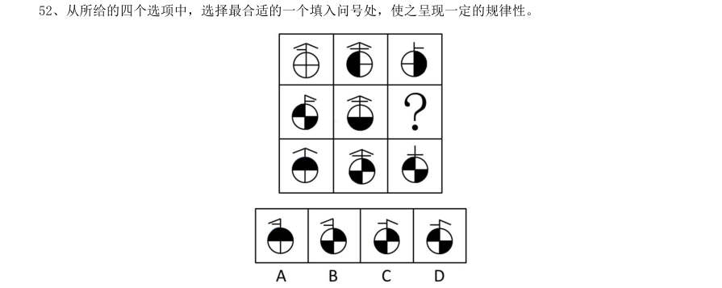

> （本题为图形题，选项为图片，见原卷）

**答案：A**　**考点：图形推理｜样式规律**　**难度：★★★★☆**
**【判断推理·图形推理｜HB-2011-ty-X053】**

53. 从所给的四个选项中,选择最合适的一个填入问号处,使之呈现一定的规律性。

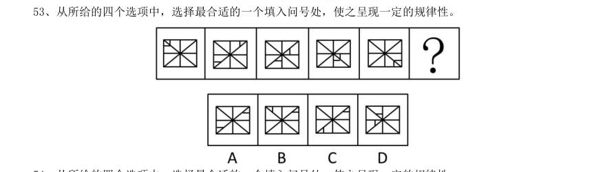

> （本题为图形题，选项为图片，见原卷）

**答案：C**　**考点：图形推理｜位置规律**　**难度：★★★★☆**
**【判断推理·图形推理｜HB-2011-ty-X054】**

54. 从所给的四个选项中,选择最合适的一个填入问号处,使之呈现一定的规律性。

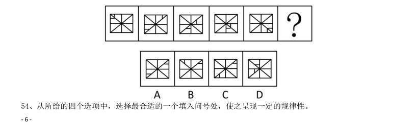

> （本题为图形题，选项为图片，见原卷）

**答案：D**　**考点：图形推理｜数量规律**　**难度：★★★★☆**
**【判断推理·图形推理｜HB-2011-ty-X055】**

55. 请从所给的四个选项中,选择最合适的一个填入问号处,使之呈现一定的规律性。

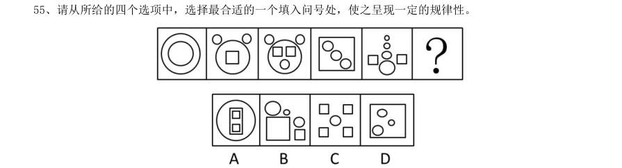

> （本题为图形题，选项为图片，见原卷）

**答案：D**　**考点：图形推理｜数量规律**　**难度：★★★★☆**
**【判断推理·图形推理｜HB-2011-ty-X056】**

56. 从所给的四个选项中,选择最合适的一个填入问号处,使之呈现一定的规律性。

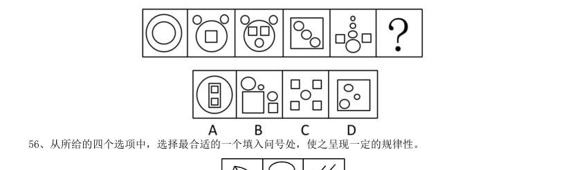

> （本题为图形题，选项为图片，见原卷）

**答案：A**　**考点：图形推理｜立体拼合**　**难度：★★★★☆**
**【判断推理·图形推理｜HB-2011-ty-X057】**

57. 请从所给的四个选项中,选择最合适的一项填在问号处,使之呈现一定的规律性。

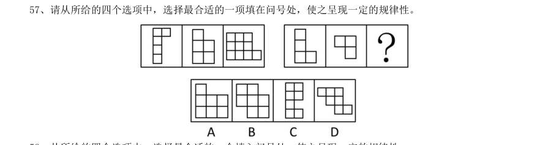

> （本题为图形题，选项为图片，见原卷）

**答案：A**　**考点：图形推理｜位置规律**　**难度：★★★★☆**
**【判断推理·图形推理｜HB-2011-ty-X058】**

58. 从所给的四个选项中,选择最合适的一个填入问号处,使之呈现一定的规律性。

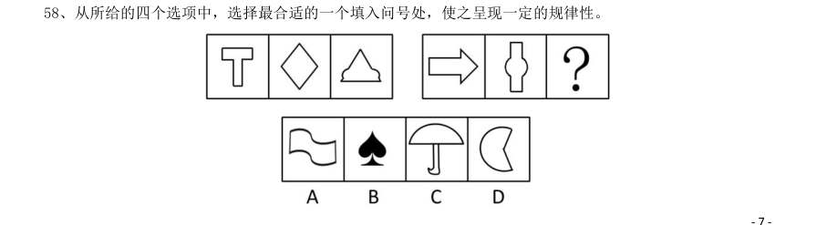

> （本题为图形题，选项为图片，见原卷）

**答案：D**　**考点：图形推理｜属性规律**　**难度：★★★★☆**
**【判断推理·图形推理｜HB-2011-ty-X059】**

59. 左边给定的是纸盒外表面的展开图,右边哪一项能由它折叠而成?请把它找出来:

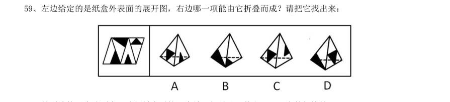

> （本题为图形题，选项为图片，见原卷）

**答案：C**　**考点：图形推理｜折纸盒**　**难度：★★★★☆**
**【判断推理·图形推理｜HB-2011-ty-X060】**

60. 从所给的四个选项中,选择最合适的一个填入问号处,使之呈现一定的规律性。

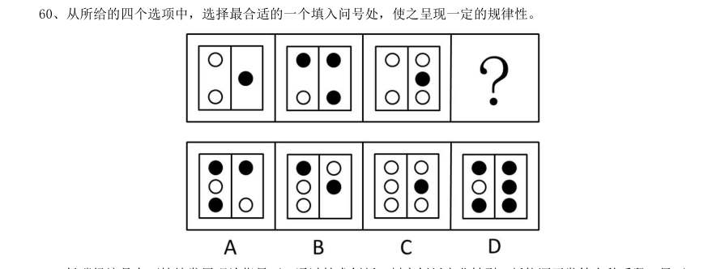

> （本题为图形题，选项为图片，见原卷）

**答案：D**　**考点：图形推理｜数量规律**　**难度：★★★★☆**
**【判断推理·定义判断｜HB-2011-ty-X061】**

61. 低碳经济是在可持续发展理论指导下,通过技术创新、制度创新产业转型、新能源开发等多种手段,尽可 能地减少煤炭、石油高碳能源消耗,减少温室气体排放,达到社会经济发展与生态环境保护双赢的一种经济发 展形态。 根据上述定义,下列不符合低碳经济理念的是:

- **A.** 某粮油食品公司大力推广绿色食品
- **B.** 某小区住房都安装了太阳能电池板
- **C.** 某空调公司引进了低能耗空调生产线
- **D.** 在荒山、滩头、草甸兴建风力发电站

**答案：A**　**考点：定义判断｜单定义**　**难度：★★☆☆☆**
**【判断推理·定义判断｜HB-2011-ty-X062】**

62. 如果概念B 所表达的对象均在概念A 所表达的范围之内,概念A 所表达的对象有些在概念B 所表达的范围 之内,有些不在概念B 所表述的范围之内,则称概念A 与概念B 之间存在真包含关系。 根据上述定义,下列哪项中划横线的两个概念是真包含关系:

- **A.** 榕树在很多城市被作为行道树
- **B.** 启明星就是金星
- **C.** 植物有时候也会表现出类似动物的行为
- **D.** 科学包括多种学科,例如气象学、遗传学等

**答案：D**　**考点：定义判断｜单定义**　**难度：★★☆☆☆**
**【判断推理·定义判断｜HB-2011-ty-X063】**

63. 沉没成本是指已经付出且不可收回的成本。沉没成本是由过去的决策或环境决定的,它所造成的成本是不 能由现在或将来的任何决策而改变的。 根据上述定义,下列不涉及沉没成本的是:

- **A.** 小李花100 美元买了一台二手台式电脑,回国时由于无法携带,只好忍痛将电脑丢弃
- **B.** 某煤矿的煤炭已经开采完,矿井里的一些采掘设备由于无法取出,只好被废弃
- **C.** 小陈如果在承包的山林中放养野鸡,比放养野兔的年收益更多,但管理更多,于是他选择了放养野兔
- **D.** 小张准备约小丽一起去看电影,因为小丽临时加班,又不能退票,小张只好将两张电影票充当了留言条

**答案：C**　**考点：定义判断｜单定义**　**难度：★★☆☆☆**
**【判断推理·定义判断｜HB-2011-ty-X064】**

64. 学习障碍是指从发育的早期阶段起,儿童获得学习技能的正常方式方法受损。这种损害不是单纯缺乏学习 机会的结果,不是智力的发展迟缓的结果,也不是后天的脑外伤或疾病的结果,这种障碍来源于认知处理过程 的异常,表现在阅读、拼写、计算等方面有特殊的障碍。 根据上述定义,下列属于学习障碍的是:

- **A.** 九岁的小强刚从国外回来,不能识别简体字,在阅读学习材料时面临不少困难
- **B.** 小华原来学习优秀,随父母移居国外后由于听课困难,学习成绩大幅下降
- **C.** 小明的成绩不好,三年级时接受了专业的智力的测验,结果发现他的智力只相当于六岁只相当于六岁儿童的水平
- **D.** 小红聪明可爱,但上学之后读书时常出现跳行跳字的现象,虽然老师多次引正但她仍然难以改正

**答案：D**　**考点：定义判断｜单定义**　**难度：★★★☆☆**
**【判断推理·定义判断｜HB-2011-ty-X065】**

65. 行政赔偿是指行政机关及其工作从员违法行使职权,侵犯了公民,法人或其他组织的合法权益并造成损害, 由国家承担赔偿责任的制度。 根据上述定义,下列各项要求中属于行政赔偿范围的是:

- **A.** 某区政府工作人员王某驾驶区政府车辆外出办事途中顺路回家探亲,因超速行驶撞伤村民张某,张某要求该区政府进行损害赔偿
- **B.** 交通警察孙某与出租车司机李某素有嫌隙,孙某诬陷李某违反交通规则,并吊销其驾照,李某要求交通管理部门赔偿其损失
- **C.** 某市工商局发现某公司涉嫌销售假冒伪劣产品而将其产品扣押,该公司以其财产给遭受损失为由要求赔偿
- **D.** 公安局销毁了一片非法种植的罂粟,种植者老刘认为他种植罂粟的目的是为母亲治病,公安机关不应销毁,

**答案：B**　**考点：定义判断｜单定义**　**难度：★★☆☆☆**
**【判断推理·定义判断｜HB-2011-ty-X066】**

66. 绿色公关是指企业以生态与经济可持续发展观念影响公关,选择具有“绿色”特征的媒体开展传播活动, 以“绿色”为特色塑造企业形象,赢得公众的信任与支持,给企业带来更多便利和竞争优势的一系列公关活动。 根据上述定义,下列属于绿色公关的是:

- **A.** 某软件公司推出一款绿色软件,无需安装即可使用,移除后也不会有任何残留记录留在电脑里,受到了很多用户的欢迎
- **B.** 某快餐企业推出了“种植一棵树”的宣传活动,并倡导减少包装以节约资源,创造了良好的经营环境和社会氛围
- **C.** 某小区居委会按照当地政府的要求进行垃圾分类宣传,在小区举办垃圾分类知识竞赛,现场发放不同颜色的垃圾袋供居民使用,受到大家的欢迎
- **D.** 人民网举办了以“发展低碳经济引领绿色潮流”为主题的“2010 首届低碳中国年度创新论坛”,揭晓了2010

**答案：B**　**考点：定义判断｜单定义**　**难度：★★★☆☆**
**【判断推理·定义判断｜HB-2011-ty-X067】**

67. 敌意性归因偏差是指在情景不明的情况下,会将对方的动机或意图视为有敌意的倾向。 根据上述定义,下列属于敌意性归因偏差的是:

- **A.** 小刘在社团主席竞选中败得很惨,当小王劝他再参加学生会将要进行的主席选举时,他觉得小王是故意来挖苦他的
- **B.** 领导看到小张在晋升前的民主评议中得票很低,就断定他人品不好,打消了提升他的念头
- **C.** 王老师班上的学生陈强一向表现平平,却在最近的学科竞赛上获得了全校最好成绩,王老师觉得陈强在竞赛中存在作弊行为
- **D.** 某公司赵总一直不同意李总提出的年底奖金分配方案,李总多次与之沟通收效甚微,李总认为赵总过于维

**答案：A**　**考点：定义判断｜单定义**　**难度：★★☆☆☆**
**【判断推理·定义判断｜HB-2011-ty-X068】**

68. 食品污染物指不是有意加入食品中,而是在生产,制造,加工,调制,处理,填充,包装,运输和贮藏等 过程中带入食品中,或是由于环境污染带入食品中的任何物质。 根据上述定义,下列属于食品污染物的是:

- **A.** “三鹿奶粉”事件中“问题奶粉”含有三聚氰胺成分
- **B.** 对肉质进行嫩化改良而使用的木瓜蛋白酶成分
- **C.** 油炸食品在加工过程中由于加入增多剂而产生的铝成分
- **D.** 食品腌制中,使用的添加剂中含有的对人体有害的亚硝酸盐

**答案：D**　**考点：定义判断｜单定义**　**难度：★★☆☆☆**
**【判断推理·定义判断｜HB-2011-ty-X069】**

69. 范围经济是由厂商的经营范围而非规模带来的经济,是指同时生产两种产品的费用低于分别生产每种产品 的费用的经济现象 根据上述定义,下列属于范围经济的是:

- **A.** 某啤酒制造厂收购了一个经营亏损的小型啤酒厂,生产线扩大后原料采购成本降低,两个厂区啤酒的生产效益均有提高
- **B.** 某家具生产厂家实行桌子与衣柜全并生产后,相同的生产过程使成本有效降低
- **C.** 因为市场需求扩大,布鞋和鞋垫的手工作坊式生产逐渐被机器生产取代,生产成本大幅下降
- **D.** 某奶制品厂实行奶酪与酸奶一起生产生,二者的生产工艺相互借鉴,产品改良,销量大增

**答案：B**　**考点：定义判断｜单定义**　**难度：★★☆☆☆**
**【判断推理·定义判断｜HB-2011-ty-X070】**

70. 自我设限是指个体针对可能到来的失败威胁,事先调协障碍,为失败创造一个合理的借口,从而保护自我 价值,维护自我形象。 根据上述定义,下列属于自我设限的是:

- **A.** 小周和小田一起竞选班长,小田跟朋友说,小周学习好,人缘也好,还在学生社团担任干部,老师都比较喜欢他,自己估计没戏了,最后果然小周当选了班长。
- **B.** 小王即将参加某公司的面试,但总觉得自己无法通过,面试前一天,他因为突然生病被送进了医院,错过了这次面试
- **C.** 小李毕业后进入保险公司做销售代理,第一个月没有签订一单合同,他解释是因为受全球金融危机影响,市场行情很不好
- **D.** 小明的语文成绩在班上一直名列前茅,每次考试前他都跟同学说,自己状态不好肯定会考砸,但他最后的

**答案：A**　**考点：定义判断｜单定义**　**难度：★★☆☆☆**
**【判断推理·逻辑判断｜HB-2011-ty-X071】**

71. 小刘是环保志愿者组织“拯救地球”的成员,由于身患重病,不能到上海做世博会志愿者,而该组织其他 成员都是获得了上海世博会志愿者的资格。 由此可以推出:

- **A.** 小刘是“拯救地球”的成员,但未获得上海世博会志愿者资格
- **B.** 上海世博会志愿者都是“拯救地球”的成员
- **C.** 如果有人是上海世博会志愿者,又是“拯救地球”成员,他一定不是小刘
- **D.** 如果有人是“拯救地球”的成员,但不是上海世博会志愿者,他一定是小刘

**答案：C**　**考点：逻辑判断｜结论推出**　**难度：★★★★☆**
**【判断推理·逻辑判断｜HB-2011-ty-X072】**

72. 在选购地板时,消费都很关心地板散发的气味,因为地板的刺激性气味强,往往是有毒有害物质超标的一 种表现,最近有一种据称是香味环保地板赢得了不少消费者的青睐。销售人员声称地板散发的香味可以消毒杀 菌,去除空气中的异味。当销售人员在推销这种产品时,往往会拿来几种不同的地板,让有购买意向的消费者 闻一闻,并指出散发着清香气味的地板,即是香味环保地板。 以下哪项如果为真,最能削弱销售人员的观点:

- **A.** 气味并不是判别地板是否环保的唯一标准,除气味外,消费者更关心地板中有机挥发物的含量
- **B.** 事实上,由于木材本身的气味以及受制造工艺所限,地板或多或少都带有一定的刺激性气味
- **C.** 到目前为止,国家有关部门还没有出台香味环保地板的专门标准,所谓的“香味”不过是厂家炒作的概念
- **D.** 检验证明,不少厂商是通过在地板中添加大量香精等化学助剂来达到掩盖或者中和刺激性气味的目的

**答案：D**　**考点：逻辑判断｜削弱论证**　**难度：★★★★★**
**【判断推理·逻辑判断｜HB-2011-ty-X073】**

73. 生理学家发现,人类掌管记忆和思维等高级认知功能的大脑皮质在正常情况下有6 层,如果胎儿缺乏一种 名为“Cdk5”的酶,大脑皮质的发育就会变得极为缓慢,无法最终形成正常大脑皮质的层结构,从而严重影响 儿童认知发展,一些医药界人士推测,利用这一发现,将有望研发出药物,普遍提高学生的学习能力。 如果以下为真,哪项不能质疑上述推测:

- **A.** 人体不能吸收外部补充的“Cdk5”酶
- **B.** 学生的学习能力主要是通过后天学习获得的
- **C.** 青少年过了脑发育关键期后,补充“Cdk5”酶不起作用
- **D.** 一些“Cdk5”酶含量高的人学习能力并不突出

**答案：D**　**考点：逻辑判断｜削弱论证**　**难度：★★★★★**
**【判断推理·逻辑判断｜HB-2011-ty-X074】**

74. 食品安全的实现,必须有政府的有效管理。只有政府部门之间的相互协调配合,才能确保政府进行有效的 管理。但是,如果没有健全的监督制约机制,是不可能实现政府各部门之间协调配合的。 由此可以推出:

- **A.** 没有健全的监督制约机制,不可能实现食品安全
- **B.** 要想健全监督的机制,必须有政府的有效管理
- **C.** 有了政府各部门之间的相互协调配合,就能实现食品安全
- **D.** 一个不能进行有效管理的政府,即是没有建立起健全的监督制约机制的政府

**答案：A**　**考点：逻辑判断｜翻译推理**　**难度：★★★★★**
**【判断推理·逻辑判断｜HB-2011-ty-X075】**

75. 虎山长城遗址除一号台址发现很少的残砖之外,其他地方均没有发现城砖。虎山村及附近村庄也没有从长 城上拆下城砖用于民房建筑的情况。由此可以推测,虎山长城用砖是极少的。 上述推测还需要隐含哪一项假设:

- **A.** 虎山长城遗址附近没有发现古砖窑
- **B.** 当地县志记载虎山长城是夯土筑成
- **C.** 此地山高坡陡,城砖难以运进运出
- **D.** 此地土质极差,不适宜烧制长城用砖

**答案：C**　**考点：逻辑判断｜前提假设**　**难度：★★★☆☆**
**【判断推理·逻辑判断｜HB-2011-ty-X076】**

76. 伏案工作者长时间低头阅读,书写很容易患腰颈椎疾病,为帮助这部分人预防和缓解腰颈椎疾病,某单位 工会为职工印发了宣传册,教大家一些预防和治疗腰颈椎疾病的一些方法。 以下哪项如果为真,最能对上述宣传效果提出质疑:

- **A.** 预防和缓解腰颈椎疾病的方法因人而异
- **B.** 腰颈椎疾病很难进行自我预防和治疗
- **C.** 预防和治疗腰颈椎疾病需要专业人士指导
- **D.** 不经常伏案工作的人也可能患腰颈椎疾病

**答案：B**　**考点：逻辑判断｜削弱论证**　**难度：★★★☆☆**
**【判断推理·逻辑判断｜HB-2011-ty-X077】**

77. 克山病是一种原因未明的地方性心肌病,山东省两次克山病流行均发生在病区居民生活困难时期,此时居 民饮食结构单一,营养缺乏。1978 年以后,由于农村经济体制的改革,病区居民生活逐渐好转,营养结构趋 向合理,克山病新发病人越来越少,达到基本控制标准。一些研究者据此推测,营养缺乏可能是克山病发病的 重要因素。 如果以下各项为真,哪项不能质疑上述推论:

- **A.** 原来克山病病区的土壤、水质在几十年中发生了较大变化
- **B.** 1978 前农村生活水平普遍较低,但克山病仅在个别地方出现
- **C.** 一些生活水平高的地区,也出现过克山病病例
- **D.** 通过调整饮食结构,无法治愈克山病

**答案：D**　**考点：逻辑判断｜削弱论证**　**难度：★★★★★**
**【判断推理·逻辑判断｜HB-2011-ty-X078】**

78. 出于安全考虑,使用年限超过10 年的电梯必须更换钢索,在必须更换钢索的电梯中有一些是S 品牌的, 所有S 品牌电梯都不存在安全隐患。 由此可以推出:

- **A.** 有些存在安全隐患的电梯必须更换钢索
- **B.** 有些S 品牌的电梯必须更换钢索
- **C.** 有些S 品牌的电梯不需要更换钢索
- **D.** 所有必须更换钢索的电梯使用限都超过了10 年

**答案：B**　**考点：逻辑判断｜翻译推理**　**难度：★★★☆☆**
**【判断推理·逻辑判断｜HB-2011-ty-X079】**

79. 德国经济在席卷全球的金融危机当中受到的冲击与其他发达国家相比较小,主要原因是德国经济建立在先 进的制造业的基础上,德国的机械装备和汽车制造业保持了很强的竞争力。一些人根据德国的例子得出结论: 只有具备强大的制造业竞争水平,一个国家的经济才有高度的稳定性。 如果以下各项为真,哪项能够质疑上述结论:

- **A.** 有些制造业不发达的国家在金融危机中受影响较小
- **B.** 某国制造业不发达,该国经济一直动荡不安
- **C.** 有些国家保持长期经济稳定,却没有发达的制造业
- **D.** 有些国家制造业很发达,但经济并没有长期保持稳定

**答案：C**　**考点：逻辑判断｜削弱论证**　**难度：★★★★☆**
**【判断推理·逻辑判断｜HB-2011-ty-X080】**

80. 传统观点认为鸡蛋黄胆固醇含量高是直接造成高血压,动脉粥样硬化、冠心病及脑中风的罪魁祸首。所以, 很多中老年人不敢吃鸡蛋黄,最近,营养学家组织了一个专门研究鸡蛋黄与胆固醇之间关系的小组,对116 名 50 至65 岁男性进行了为期半年的实验。 假定以下是几种实验的结果,哪种将最能削弱传统观点:

- **A.** 将被试者分为两组,分别食用蛋黄和蛋清,结果发现两组被试者体内胆固醇含量没有明显差异
- **B.** 将被试者分为两组,分别食用蛋黄和蛋清,结果发现食用蛋清的一组被试者体内胆固醇含量明显增加
- **C.** 将被试者分为两组,一组食用蛋黄,一组不食用蛋黄,半年后发现没有食用蛋黄的被试者体内胆固醇含量有所减少
- **D.** 将被试者分为两组,一组食用蛋黄,一组不食用蛋黄,半年后被试者体内的胆固醇含量均没有发生变化

**答案：D**　**考点：逻辑判断｜削弱论证**　**难度：★★★★★**
**【常识判断·历史人文｜HB-2011-ty-X081】**

81. 被称作“雨巷诗人”的现代派诗人是:

- **A.** 戴望舒
- **B.** 徐志摩
- **C.** 胡适
- **D.** 闻一多

**答案：A**　**考点：历史人文｜文学与文化**　**难度：★★☆☆☆**
**【常识判断·生活常识｜HB-2011-ty-X082】**

82. 改革开放30 多年来,中国的选人用人制度改革逐步展开、不断深化,取得了巨大成就。以下不能体现中 国干部人事制度变迁轨迹的一项是:

- **A.** 建立公务员制度
- **B.** 推行新闻发言人制度
- **C.** 实行企事业单位人员聘用制
- **D.** 实现干部“四化”

**答案：B**　**考点：生活常识｜常识（待细分）**　**难度：★★★☆☆**
**【常识判断·政治常识｜HB-2011-ty-X083】**

83. 在新民主主义革命和社会主义建设的重要关头,中国共产党成功地完成了三次重大转变:武装反抗国民党 反动派;工作重心由农村转向城市、由战争转向生产建设;拨乱反正,开辟了中国特色社会主义道路。以下四 项中哪一会议与这些转变无关:

- **A.** 十一届三中全会
- **B.** 八七会议
- **C.** 七届二中全会
- **D.** 遵义会议

**答案：D**　**考点：政治常识｜新时代理论**　**难度：★★★★☆**
**【常识判断·科技常识｜HB-2011-ty-X084】**

84. 联合国开发计划署把新能源分为:

- **A.** 水能、太阳能、风能、地热能
- **B.** 传统能源之外的各种能源形式
- **C.** 大中型水电、新可再生能源,传统生物质能
- **D.** 小水电、太阳能、风能、现代生物质能,地热能

**答案：C**　**考点：科技常识｜基础科学**　**难度：★★☆☆☆**
**【常识判断·经济常识｜HB-2011-ty-X085】**

85. 下列不属于紧缩性货币政策的措施是:

- **A.** 提高存款准备金率
- **B.** 发行央行票据
- **C.** 买进政府债券
- **D.** 提高再贴现率

**答案：C**　**考点：经济常识｜宏观经济**　**难度：★★☆☆☆**
**【常识判断·生活常识｜HB-2011-ty-X086】**

86. 下列关于照明灯的描述不正确的是:

- **A.** 荧光节能灯的节能效果比LED 灯效果好
- **B.** LED 灯长时间工作会光衰引起老化
- **C.** 荧光节能灯的发光原理是采用高压电子撞击荧光粉而产生
- **D.** 白炽灯直接由钨丝加热产生亮度,用久了会发黑是因为钨丝升华

**答案：A**　**考点：生活常识｜科技常识**　**难度：★★☆☆☆**
**【常识判断·法律常识｜HB-2011-ty-X087】**

87. 下列做法不符合法律规定的是:

- **A.** 某区人大常委会接受区长辞职
- **B.** 某县人民法院受理起诉县教育局的案件
- **C.** 某省人民政府制定《行政程序暂行规定》
- **D.** 某市人大常委会听取市长的述职报告并进行评议

**答案：C**　**考点：法律常识｜宪法**　**难度：★★☆☆☆**
**【常识判断·法律常识｜HB-2011-ty-X088】**

88. 行政机关在其法定职权范围内,依照法律、法规、规章的规定,可以委托下列哪一机关或者单位实施行政 许可:

- **A.** 所属事业单位
- **B.** 其他行政机关
- **C.** 其他国家机关
- **D.** 其他行政机关和所属事业单位

**答案：B**　**考点：法律常识｜行政法**　**难度：★★☆☆☆**
**【常识判断·科技常识｜HB-2011-ty-X089】**

89. 下列哪项属于21 世纪取得的科学成就:

- **A.** 器官移植成为常规疗法
- **B.** “炎黄一号”项目的成功
- **C.** 克隆羊“多莉”的诞生
- **D.** 试管婴儿路易斯·布朗诞生

**答案：B**　**考点：科技常识｜基础科学**　**难度：★★☆☆☆**
**【常识判断·科技常识｜HB-2011-ty-X090】**

90. 下列关于卫星导航系统的表述不正确的是:

- **A.** GPS 的信号强度与准度是可控的
- **B.** GPS 是欧盟建立的卫星导航系统
- **C.** 北斗导航系统是我国自主研发的卫星导航系统
- **D.** “伽利略”导航系统是第一个基于民用的全球卫星导航系统

**答案：B**　**考点：科技常识｜科技成就**　**难度：★★☆☆☆**
**【常识判断·生活常识｜HB-2011-ty-X091】**

91. 下列关于行政监督的说法正确的是:

- **A.** 人民法院可以通过法纪检查对国家行政机关和公务员实行监督
- **B.** 王某不服从交警处罚向交警支队提起行政复议不属于行政监督的范畴
- **C.** 人民政协委员可以通过视察、调查、研究等方式进行行政监督
- **D.** 行政监督的主体是执政党以外的政党组织、国家机关、各人民团体、群众组织和社会公众

**答案：C**　**考点：生活常识｜法律常识**　**难度：★★★★★**
**【常识判断·生活常识｜HB-2011-ty-X092】**

92. 下列关于医学常识的说法正确的是:

- **A.** 人体内缺乏维生素E 易患夜盲症
- **B.** 现有抗生素药物对超级细菌不起作用
- **C.** 贫血指血液中红细胞和白细胞数量低于正常水平
- **D.** 手足口病的最主要传播途径是血液传播和母婴传播

**答案：B**　**考点：生活常识｜科技常识**　**难度：★★☆☆☆**
**【常识判断·生活常识｜HB-2011-ty-X093】**

93. 下列关于我国武装力量的说法不正确的是( )。

- **A.** 我国武装力量受中国共产党领导
- **B.** 中国人民武装警察的职责中不包括防卫作战
- **C.** 国务院、中央军委共同领导全国的国防动员工作
- **D.** 我国的武装力量由中国人民解放军现役部队及预备役部队、武装警察和民兵组成

**答案：B**　**考点：生活常识｜经济常识**　**难度：★★☆☆☆**
**【常识判断·生活常识｜HB-2011-ty-X094】**

94. 下列说法不正确的是:

- **A.** 当交通信号灯、交通标志与交警的指挥不一致时,应当服从信号灯的指挥
- **B.** 强降水是泥石流、滑坡的主要诱因
- **C.** 举办大型会展和文化体育等重大活动,主办单位应制定应急预案并报当地人民政府备案
- **D.** 有关单位和人员报送、报告突发事件信息,应当做到及时、客观、真实,不得迟报、谎报、瞒报、漏报

**答案：A**　**考点：生活常识｜科技常识**　**难度：★★★★★**
**【常识判断·生活常识｜HB-2011-ty-X095】**

95. 下列关于太阳风的说法不正确的是:

- **A.** 由于太阳风的作用,彗星周围的灰尘和气体会形成彗尾
- **B.** 太阳风会促进大气中臭氧的产生,影响地球的空间环境
- **C.** 太阳风是太阳黑子活动高峰阶段射出的超音速等离子体流
- **D.** 两极的高层大气受到太阳风的袭击会发出光芒,形成极光

**答案：B**　**考点：生活常识｜科技常识**　**难度：★★★★★**
**【常识判断·生活常识｜HB-2011-ty-X096】**

96. 下列说法正确的是:

- **A.** 我国有6 个省级行政区与邻国接壤
- **B.** 庐山在黄山以北,嵩山以南
- **C.** 在我国,丹顶鹤的主要栖息地是东北
- **D.** 新疆和青海的部分地区是属于印度洋流域

**答案：C**　**考点：生活常识｜地理常识**　**难度：★★☆☆☆**
**【常识判断·历史人文｜HB-2011-ty-X097】**

97. 以下哪部是我国古代的地理学巨著:

- **A.** 《梦溪笔谈》
- **B.** 《太平广记》
- **C.** 《天工开物》
- **D.** 《水经注》

**答案：D**　**考点：历史人文｜中国古代史**　**难度：★★☆☆☆**
**【常识判断·历史人文｜HB-2011-ty-X098】**

98. 下列关于文化艺术的表述不正确的是:

- **A.** 印象派绘画的代表人物是莫奈、马奈、梵高等
- **B.** 芭蕾舞起源于意大利,兴盛于法国
- **C.** 北宋时期的文人画多以山水、花鸟为主要内容
- **D.** 中国传统的弹拨乐器有古筝、扬琴、琵琶、马头琴等

**答案：D**　**考点：历史人文｜文学与文化**　**难度：★★☆☆☆**
**【常识判断·生活常识｜HB-2011-ty-X099】**

99. 下列说法不正确的是:

- **A.** 为反映某年度政府预算执行的结果,需要编制该年度的政府决算
- **B.** 为提高出口货物在国际市场上的竞争力,世界各国一般多在本国实行出口退税制度
- **C.** 如果货币的期汇比现汇贵,则称该货币远期升水,否则,称该货币远期贴水
- **D.** 根据现代企业制度,公司的权力机构是董事会

**答案：D**　**考点：生活常识｜经济常识**　**难度：★★★★★**
**【常识判断·时事政治｜HB-2011-ty-X100】**

100. 城市建设与发展过程中如果规划不当,到了炎热的夏天往往会出现热岛效应。下列有关热岛效应的表述 不正确的是:

- **A.** 热岛效应只会在大城市出现,中小城市不会出现这种情况
- **B.** 城市增加的车辆与住户的空调加剧了热岛效应
- **C.** 出现热岛效应的地方,温度比周围郊区一般要高两三度甚至四五度
- **D.** 城市高楼大厦越来越多,通风与气流不畅是造热岛效应的原因之一

**答案：A**　**考点：时事政治｜政策文件**　**难度：★★★★★**
**【资料分析·年均增长率｜HB-2011-ty-X101】**

101. 请你根据资料所提供的信息进行分析、比较、计算和判断处理。 (一)根据以下资料,完成各题。 A0 级型车比A00 级型车在过去的五年中每年平均销售份额约高出:

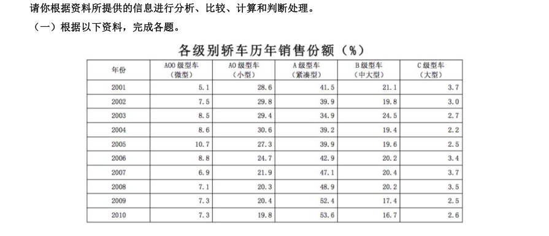

- **A.** 15 个百分点
- **B.** 14 个百分点
- **C.** 16 个百分点
- **D.** 17 个百分点

**答案：B**　**考点：年均增长率｜年均增长率计算**　**难度：★★☆☆☆**
**【资料分析·增长率计算与比较｜HB-2011-ty-X102】**

102. 相对于2001 年,10 年的销售份额增长率最大的车型是:

> 材料图见 images/HB-2011-ty-X101-m.jpg

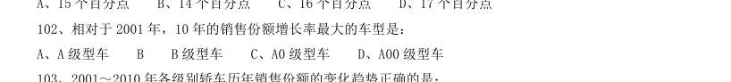

- **A.** A 级型车B
- **B.** 级型车
- **C.** A0 级型车
- **D.** A00 级型车

**答案：D**　**考点：增长率计算与比较｜增长率比较**　**难度：★★☆☆☆**
**【资料分析·综合分析｜HB-2011-ty-X103】**

103. 2001~2010 年各级别轿车历年销售份额的变化趋势正确的是: A B 级型车销售份额逐年减小 B、近十年来,C 级型车销售份额最平稳 C、A00 级型车的销售份额始终是C 级型车销售份额的2 倍以上 D、2010 年A0 级型车的销售量相比于2001 年有所减少

> 材料图见 images/HB-2011-ty-X101-m.jpg

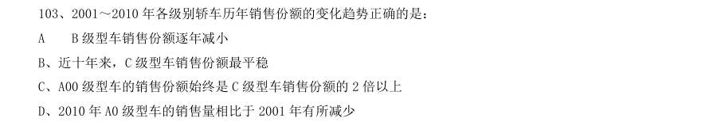

> （本题为图形题，选项为图片，见原卷）

**答案：B**　**考点：综合分析｜倍数**　**难度：★★★★★**
**【资料分析·增长率计算与比较｜HB-2011-ty-X104】**

104. 因1.6 升购置税调整,A 级型车市场从2008 年到2009 年的上升率相对于B 级型车同比下降率的比值约 为:

> 材料图见 images/HB-2011-ty-X101-m.jpg

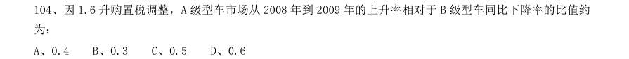

- **A.** 0.4
- **B.** 0.3
- **C.** 0.5
- **D.** 0.6

**答案：C**　**考点：增长率计算与比较｜增长率计算（综合）**　**难度：★★☆☆☆**
**【资料分析·增长量计算｜HB-2011-ty-X106】**
> 材料：A、2.64 B、2.84 C、3.56 D、2.44 (二)根据以下资料,完成各题。 2010 年1~3 月,法国货物贸易进出口总额为2734.4 亿美元,同比增长13.4%。其中,出口1264.7 亿美 元,同比增长14.5%;进口1469.7 亿美元,同比增长12.4%;逆差205.0 亿美元,同比增长1.0%。 1~3 月,中法双边贸易额为142.7 亿美元,同比增长22.4%。其中,法国对中国出口32.1 亿美元,同比 增长43.5%;自中国进口110.6 亿美元,同比增长17.4%;法国逆差78.5 亿美元,同比增长9.3%。中国在法 国主要出口伙伴中排名第九位、在法国的主要进口来源地中居第四位。 1~3 月,法国对中国出口的前三大产品为机电产品、运输设备和化工产品,出口额分别为9.8 亿美元、 8.4 亿美元和4.0 亿美元,同比分别增长14.9%、99.7%和25.9%,这

106. 另外,法国自中国进 口的化工产品的进口额同比增长最快,为38.8%。 2010 年1~3 月,法国货物贸易出口额比上年同期增长了约:

> 材料图见 images/HB-2011-ty-X101-m.jpg

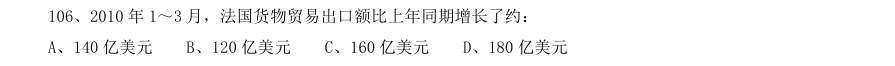

- **A.** 140 亿美元
- **B.** 120 亿美元
- **C.** 160 亿美元
- **D.** 180 亿美元

**答案：C**　**考点：增长量计算｜增长量计算（综合）**　**难度：★★★☆☆**
**【资料分析·增长率计算与比较｜HB-2011-ty-X107】**
> 材料：A、2.64 B、2.84 C、3.56 D、2.44 (二)根据以下资料,完成各题。 2010 年1~3 月,法国货物贸易进出口总额为2734.4 亿美元,同比增长13.4%。其中,出口1264.7 亿美 元,同比增长14.5%;进口1469.7 亿美元,同比增长12.4%;逆差205.0 亿美元,同比增长1.0%。 1~3 月,中法双边贸易额为142.7 亿美元,同比增长22.4%。其中,法国对中国出口32.1 亿美元,同比 增长43.5%;自中国进口110.6 亿美元,同比增长17.4%;法国逆差78.5 亿美元,同比增长9.3%。中国在法 国主要出口伙伴中排名第九位、在法国的主要进口来源地中居第四位。 1~3 月,法国对中国出口的前三大产品为机电产品、运输设备和化工产品,出口额分别为9.8 亿美元、 8.4 亿美元和4.0 亿美元,同比分别增长14.9%、99.7%和25.9%,这

107. 资料中括号处应填入的数字为:

> 材料图见 images/HB-2011-ty-X101-m.jpg

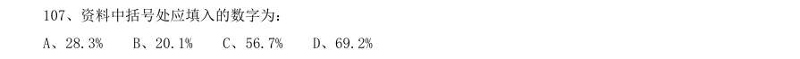

- **A.** 28.3%
- **B.** 20.1%
- **C.** 56.7%
- **D.** 69.2%

**答案：D**　**考点：增长率计算与比较｜增长率计算（综合）**　**难度：★★☆☆☆**
**【资料分析·增长率计算与比较｜HB-2011-ty-X108】**
> 材料：A、2.64 B、2.84 C、3.56 D、2.44 (二)根据以下资料,完成各题。 2010 年1~3 月,法国货物贸易进出口总额为2734.4 亿美元,同比增长13.4%。其中,出口1264.7 亿美 元,同比增长14.5%;进口1469.7 亿美元,同比增长12.4%;逆差205.0 亿美元,同比增长1.0%。 1~3 月,中法双边贸易额为142.7 亿美元,同比增长22.4%。其中,法国对中国出口32.1 亿美元,同比 增长43.5%;自中国进口110.6 亿美元,同比增长17.4%;法国逆差78.5 亿美元,同比增长9.3%。中国在法 国主要出口伙伴中排名第九位、在法国的主要进口来源地中居第四位。 1~3 月,法国对中国出口的前三大产品为机电产品、运输设备和化工产品,出口额分别为9.8 亿美元、 8.4 亿美元和4.0 亿美元,同比分别增长14.9%、99.7%和25.9%,这

108. 2010 年1~3 月,法国对中国出口的各类产品中,出口额比上年同期增长最多的是:

> 材料图见 images/HB-2011-ty-X101-m.jpg

- **A.** 机电产品
- **B.** 运输设备
- **C.** 化工产品
- **D.** 家具玩具

**答案：B**　**考点：增长率计算与比较｜增长率计算（综合）**　**难度：★★☆☆☆**
**【资料分析·综合分析｜HB-2011-ty-X109】**
> 材料：A、2.64 B、2.84 C、3.56 D、2.44 (二)根据以下资料,完成各题。 2010 年1~3 月,法国货物贸易进出口总额为2734.4 亿美元,同比增长13.4%。其中,出口1264.7 亿美 元,同比增长14.5%;进口1469.7 亿美元,同比增长12.4%;逆差205.0 亿美元,同比增长1.0%。 1~3 月,中法双边贸易额为142.7 亿美元,同比增长22.4%。其中,法国对中国出口32.1 亿美元,同比 增长43.5%;自中国进口110.6 亿美元,同比增长17.4%;法国逆差78.5 亿美元,同比增长9.3%。中国在法 国主要出口伙伴中排名第九位、在法国的主要进口来源地中居第四位。 1~3 月,法国对中国出口的前三大产品为机电产品、运输设备和化工产品,出口额分别为9.8 亿美元、 8.4 亿美元和4.0 亿美元,同比分别增长14.9%、99.7%和25.9%,这

109. 2010 年1~3 月,法国纺织品及原料的进口额约为多少亿美元:

> 材料图见 images/HB-2011-ty-X101-m.jpg

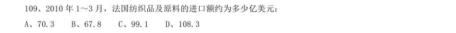

- **A.** 70.3
- **B.** 67.8
- **C.** 99.1
- **D.** 108.3

**答案：A**　**考点：综合分析｜综合分析（综合）**　**难度：★★★★☆**
**【资料分析·综合分析｜HB-2011-ty-X110】**
> 材料：A、2.64 B、2.84 C、3.56 D、2.44 (二)根据以下资料,完成各题。 2010 年1~3 月,法国货物贸易进出口总额为2734.4 亿美元,同比增长13.4%。其中,出口1264.7 亿美 元,同比增长14.5%;进口1469.7 亿美元,同比增长12.4%;逆差205.0 亿美元,同比增长1.0%。 1~3 月,中法双边贸易额为142.7 亿美元,同比增长22.4%。其中,法国对中国出口32.1 亿美元,同比 增长43.5%;自中国进口110.6 亿美元,同比增长17.4%;法国逆差78.5 亿美元,同比增长9.3%。中国在法 国主要出口伙伴中排名第九位、在法国的主要进口来源地中居第四位。 1~3 月,法国对中国出口的前三大产品为机电产品、运输设备和化工产品,出口额分别为9.8 亿美元、 8.4 亿美元和4.0 亿美元,同比分别增长14.9%、99.7%和25.9%,这

110. 关于2010 年1~3 月中法双边贸易情况的描述,以下说法与资料相符合的是:

> 材料图见 images/HB-2011-ty-X101-m.jpg

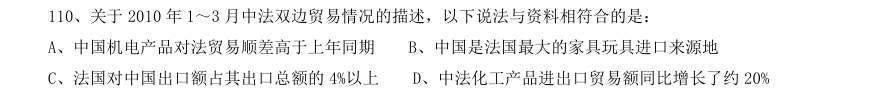

- **A.** 中国机电产品对法贸易顺差高于上年同期
- **B.** 中国是法国最大的家具玩具进口来源地
- **C.** 法国对中国出口额占其出口总额的4%以上
- **D.** 中法化工产品进出口贸易额同比增长了约20%

**答案：A**　**考点：综合分析｜基期量**　**难度：★★★★☆**
**【资料分析·综合分析｜HB-2011-ty-X111】**
> 材料：2009 年,某省全年粮食作物播种面积253.85 万公顷,比上年增长1.5%;糖蔗种植面积13.58 万公顷,下降0.2%;油料种植面积33.14 万公顷,增长2.3%;蔬菜种植面积113.84 万公顷,增长2.3%。

111. 2009 年,某省全年粮食作物播种面积253.85 万公顷,比上年增长1.5%;糖蔗种植面积13.58 万公顷,下 降0.2%;油料种植面积33.14 万公顷,增长2.3%;蔬菜种植面积113.84 万公顷,增长2.3%。 以下三种作物按2009 年亩产量从高到低排序正确的是:

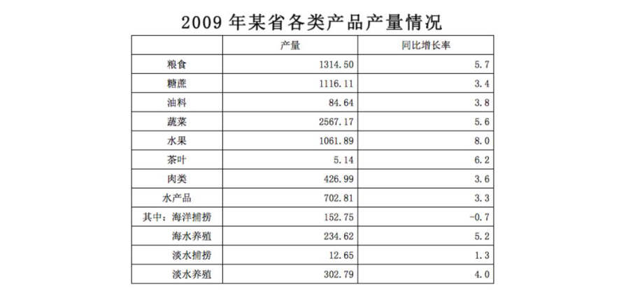

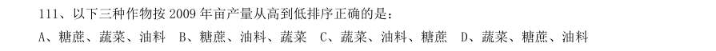

- **A.** 糖蔗、蔬菜、油料
- **B.** 糖蔗、油料、蔬菜
- **C.** 蔬菜、油料、糖蔗
- **D.** 蔬菜、糖蔗、油料

**答案：A**　**考点：综合分析｜平均数**　**难度：★★★★★**
**【资料分析·综合分析｜HB-2011-ty-X112】**
> 材料：2009 年,某省全年粮食作物播种面积253.85 万公顷,比上年增长1.5%;糖蔗种植面积13.58 万公顷,下降0.2%;油料种植面积33.14 万公顷,增长2.3%;蔬菜种植面积113.84 万公顷,增长2.3%。

112. 下列作物2009 年比2008 年增产量最多的是:

> 材料图见 images/HB-2011-ty-X111-m.jpg

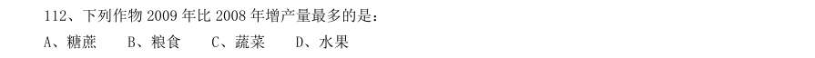

- **A.** 糖蔗
- **B.** 粮食
- **C.** 蔬菜
- **D.** 水果

**答案：C**　**考点：综合分析｜增长量**　**难度：★★★★☆**
**【资料分析·比重计算与比较｜HB-2011-ty-X113】**
> 材料：2009 年,某省全年粮食作物播种面积253.85 万公顷,比上年增长1.5%;糖蔗种植面积13.58 万公顷,下降0.2%;油料种植面积33.14 万公顷,增长2.3%;蔬菜种植面积113.84 万公顷,增长2.3%。

113. 2009 年,海水养殖业产量占水产品养殖业产量的比重为:

> 材料图见 images/HB-2011-ty-X111-m.jpg

- **A.** 33.4%
- **B.** 77.5%
- **C.** 60.8%
- **D.** 43.7%

**答案：D**　**考点：比重计算与比较｜现期比重**　**难度：★★☆☆☆**
**【资料分析·增长率计算与比较｜HB-2011-ty-X114】**
> 材料：2009 年,某省全年粮食作物播种面积253.85 万公顷,比上年增长1.5%;糖蔗种植面积13.58 万公顷,下降0.2%;油料种植面积33.14 万公顷,增长2.3%;蔬菜种植面积113.84 万公顷,增长2.3%。

114. 若保持2009 年的增长速度,哪一年水果的年产量开始超过糖蔗:

> 材料图见 images/HB-2011-ty-X111-m.jpg

- **A.** 2011 年
- **B.** 2010 年
- **C.** 2012 年
- **D.** 2013 年

**答案：A**　**考点：增长率计算与比较｜增长率计算（综合）**　**难度：★★☆☆☆**
**【资料分析·综合分析｜HB-2011-ty-X115】**
> 材料：2009 年,某省全年粮食作物播种面积253.85 万公顷,比上年增长1.5%;糖蔗种植面积13.58 万公顷,下降0.2%;油料种植面积33.14 万公顷,增长2.3%;蔬菜种植面积113.84 万公顷,增长2.3%。

115. 能够从上述资料中推出的是:

> 材料图见 images/HB-2011-ty-X111-m.jpg

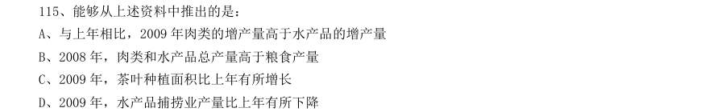

- **A.** 与上年相比,2009 年肉类的增产量高于水产品的增产量
- **B.** 2008 年,肉类和水产品总产量高于粮食产量
- **C.** 2009 年,茶叶种植面积比上年有所增长
- **D.** 2009 年,水产品捕捞业产量比上年有所下降

**答案：D**　**考点：综合分析｜基期量**　**难度：★★★★☆**
**【资料分析·综合分析｜HB-2011-ty-X116】**

116. 以下说法正确的是:

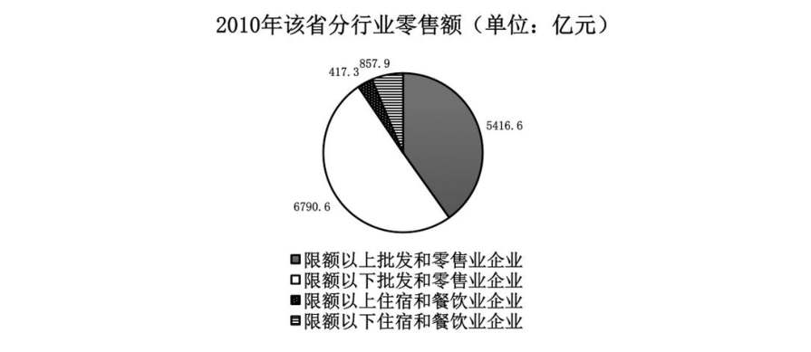

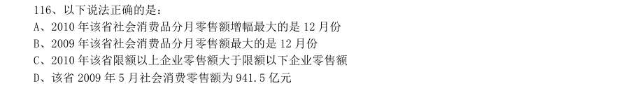

- **A.** 2010 年该省社会消费品分月零售额增幅最大的是12 月份
- **B.** 2009 年该省社会消费品分月零售额最大的是12 月份
- **C.** 2010 年该省限额以上企业零售额大于限额以下企业零售额
- **D.** 该省2009 年5 月社会消费零售额为941.5 亿元

**答案：B**　**考点：综合分析｜增长率**　**难度：★★★★★**
**【资料分析·增长率计算与比较｜HB-2011-ty-X117】**

117. 已知2010 年该省限额以下批发和零售企业零售额相比于2009 年同期增幅为18.7%,那么2009 年该省限 额以下批发和零售企业零售额均为:

> 材料图见 images/HB-2011-ty-X116-m.jpg

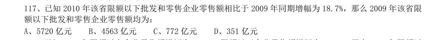

- **A.** 5720 亿元
- **B.** 4563 亿元
- **C.** 772 亿元
- **D.** 351 亿元

**答案：A**　**考点：增长率计算与比较｜增长率计算**　**难度：★★☆☆☆**
**【资料分析·增长率计算与比较｜HB-2011-ty-X118】**

118. 已知2010 年限额以上企业零售额增幅为27.4%,限额以下企业零售额增幅为12.8%,那么2009 年限额以 下企业和限额以上企业零售额差值比2010 年差值:

> 材料图见 images/HB-2011-ty-X116-m.jpg

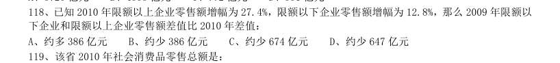

- **A.** 约多386 亿元
- **B.** 约少386 亿元
- **C.** 约少674 亿元
- **D.** 约少647 亿元

**答案：A**　**考点：增长率计算与比较｜增长率计算**　**难度：★★☆☆☆**
**【资料分析·综合分析｜HB-2011-ty-X119】**

119. 该省2010 年社会消费品零售总额是:

> 材料图见 images/HB-2011-ty-X116-m.jpg

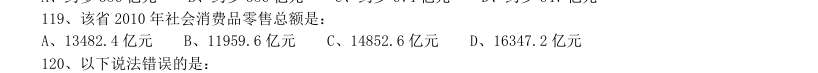

- **A.** 13482.4 亿元
- **B.** 11959.6 亿元
- **C.** 14852.6 亿元
- **D.** 16347.2 亿元

**答案：A**　**考点：综合分析｜综合分析（综合）**　**难度：★★★★☆**
**【资料分析·综合分析｜HB-2011-ty-X120】**

120. 以下说法错误的是:

> 材料图见 images/HB-2011-ty-X116-m.jpg

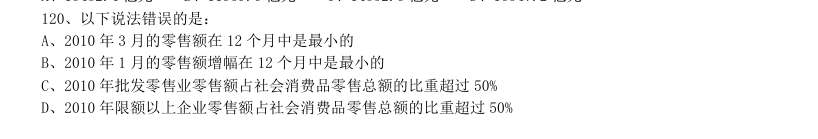

- **A.** 2010 年3 月的零售额在12 个月中是最小的
- **B.** 2010 年1 月的零售额增幅在12 个月中是最小的
- **C.** 2010 年批发零售业零售额占社会消费品零售总额的比重超过50%
- **D.** 2010 年限额以上企业零售额占社会消费品零售总额的比重超过50%

**答案：D**　**考点：综合分析｜比重**　**难度：★★★★★**