# 2013 年湖北行测（统一卷）

- 题量：154（含答案 154）
- 模块分布：资料分析20 / 数量关系15 / 言语理解50 / 判断推理44 / 常识判断25
- 试卷编号：`湖北-2013-统一卷`

## 题目与答案

**【常识判断·经济常识｜HB-2013-ty-X001】**
> 材料：注:此套题为联考题库,联考省份一般从里面抽110-120 题

1. 十八大报告提出“两个翻番”,到2020 年实现国内生产总值(GDP)和城乡居民人均收入比2010 年翻一番。 下列关于“两个翻番”,表述错误的是:

- **A.** 党的十八大首次对城乡居民收入增长提出了量化目标
- **B.** 到2020 年我国城乡居民每人收入预计都能够实现倍增
- **C.** 城乡居民人均收入翻番是GDP 翻番的出发点和落脚点
- **D.** 到2020 年我国GDP 预计将超过2000 年GDP 的4 倍

**答案：B**　**考点：经济常识｜经济指标**
**【常识判断·地理常识｜HB-2013-ty-X002】**

2. 与我国接壤的金砖国家有:

- **A.** 1 个
- **B.** 2 个
- **C.** 3 个
- **D.** 4 个

**答案：B**　**考点：地理常识｜中国地理**
**【常识判断·经济常识｜HB-2013-ty-X003】**

3. 经济增长通常是指在一个较长的时间跨度上,一个国家人均产出(或人均收入)水平的持续增加。拉动经济 增长的三大主要因素不包括:

- **A.** 投资
- **B.** 消费
- **C.** 信贷
- **D.** 出口

**答案：C**　**考点：经济常识｜经济指标**
**【常识判断·政治常识｜HB-2013-ty-X004】**

4. 下列奖项与其表彰的对象,对应关系错误的是:

- **A.** 菲尔兹奖——数学家
- **B.** 普利策奖——记者
- **C.** 南丁格尔奖——医生
- **D.** 图灵奖——计算机科学家

**答案：C**　**考点：政治常识｜政治常识（综合）**
**【常识判断·政治常识｜HB-2013-ty-X005】**

5. 地震是地球上的主要自然灾害之一。下列关于地震的说法,错误的是:

- **A.** 地震活动在时间分布上具有一定的周期性
- **B.** 环太平洋地震带是地球上地震最活跃的地区
- **C.** 里氏地震规模每增强一级,释放的能量约增加10 倍
- **D.** 有记录以来最大的一次大地震是1960 年的智利大地震,其震级为9.5 级

**答案：C**　**考点：政治常识｜政治常识（综合）**
**【常识判断·政治常识｜HB-2013-ty-X006】**

6. 下列关于医学常识的说法,错误的是:

- **A.** 临床上一般以红血球蛋白的浓度值作为诊断贫血的依据
- **B.** 卡介苗是一种疫苗,一般在婴儿出生后接种,可以预防结核病
- **C.** 游泳时应避免将水咽入口中,以免水通过鼻咽进入中耳引发中耳炎
- **D.** 人体骨密度在达到高峰值后会逐渐下降,男性下降幅度较女性大

**答案：D**　**考点：政治常识｜政治常识（综合）**
**【常识判断·政治常识｜HB-2013-ty-X007】**

7. 下列物品利用凸透镜透光原理的是:

- **A.** 近视镜
- **B.** 显微镜目镜
- **C.** 汽车观后镜
- **D.** 手电筒反光镜

**答案：A**　**考点：政治常识｜政治常识（综合）**
**【常识判断·历史人文｜HB-2013-ty-X008】**

8. 下列历史文化遗址位于我国最南边的是:

- **A.** 半坡遗址
- **B.** 周口店遗址
- **C.** 河姆渡遗址
- **D.** 大汶口遗址

**答案：C**　**考点：历史人文｜中国古代史**
**【常识判断·政治常识｜HB-2013-ty-X009】**

9. 关于《四库全书》,下列说法错误的是:

- **A.** 编修于乾隆时期
- **B.** 反映了清代图书的全貌
- **C.** 在编纂过程中纪晓岚贡献突出
- **D.** 分经、史、子、集四目

**答案：B**　**考点：政治常识｜政治常识（综合）**
**【常识判断·政治常识｜HB-2013-ty-X010】**

10. 关于京剧艺术,下列说法错误的是:

- **A.** 《红灯记》和《智取威虎山》是现代京剧
- **B.** 京剧表演的艺术手段主要有唱、念、做、打
- **C.** 京剧的主要题材是才子佳人的故事
- **D.** 京剧的脸谱一般用于净、丑两个角色

**答案：C**　**考点：政治常识｜毛中特与党史**
**【常识判断·历史人文｜HB-2013-ty-X011】**

11. 下列选项中,都与中国古代科举考试有关的一组词语是:

- **A.** 蟾宫折桂、桂冠、连中三元
- **B.** 问鼎中原、独占鳌头、蟾宫折桂
- **C.** 连中三元、五子登科、名落孙山
- **D.** 金榜题名、桂冠、独占鳌头

**答案：C**　**考点：历史人文｜中国古代史**
**【常识判断·政治常识｜HB-2013-ty-X012】**

12. 《三国演义》开篇称“天下大势,分久必合,合久必分”。 但是这句话未必准确,因为:

- **A.** 事物的发展需以条件为前提
- **B.** 事物的本质不以时间为转移
- **C.** 事物的质变是从量变开始的
- **D.** 矛盾双方是可以相互转化的

**答案：B**　**考点：政治常识｜政治常识（综合）**
**【常识判断·政治常识｜HB-2013-ty-X013】**

13. 某小区内业主共有的道路被物业公司划出停车位对外出租,其收益应该归 所有。

- **A.** 房地产开发商
- **B.** 物业公司
- **C.** 小区业主共有
- **D.** 小区所在地居委会

**答案：C**　**考点：政治常识｜政治常识（综合）**
**【常识判断·科技常识｜HB-2013-ty-X014】**

14. 下列有关核能的表述,正确的是:

- **A.** 氢弹爆炸发生轻核聚变,其威力比原子弹小
- **B.** 核电站使用的燃料一般是铀等放射性重金属
- **C.** 自然界只有在人为条件下才会发生热核反应
- **D.** 核电站的能量转换过程是直接从核能到电能

**答案：A**　**考点：科技常识｜科技成就**
**【常识判断·政治常识｜HB-2013-ty-X015】**

15. 下列行为侵犯到他人知识产权的是:

- **A.** 甲模仿某知名作家的写作风格创作小说并以该作家名字公开发表
- **B.** 甲因无法分辨真假销售某高仿皮具,但未给商标权利人造成损失
- **C.** 甲开发“A 之C”游戏并公开销售,但“AC”商标的权利人是乙
- **D.** 甲申请注册“AC”琴行,“AC”二字与某知名电脑商标完全重合

**答案：A**　**考点：政治常识｜政治常识（综合）**
**【常识判断·政治常识｜HB-2013-ty-X016】**

16. 下列关于隐形飞机的原理,说法错误的是:

- **A.** 外层涂料的颜色为天蓝色或银白色,以避免被雷达发现
- **B.** 隐形飞机采用非金属材料或者雷达吸波材料,吸收而不是反射雷达波
- **C.** 改进发动机的进气道和尾喷口等所有能产生镜面反射的表面,以减少对雷达波的反射
- **D.** 除了发动机、电子设备等部件,其他飞机上的部件用透波材料来制作

**答案：A**　**考点：政治常识｜政治常识（综合）**
**【常识判断·政治常识｜HB-2013-ty-X017】**

17. 下列哪项没有运用热胀冷缩原理?

- **A.** 医生用水银温度计给病人量体温
- **B.** 架设天线时,两个电线杆之间的电线要略有下垂
- **C.** 夏季自行车胎不能打太足的气
- **D.** 古代人在冬天往岩石缝里灌水,水结冰膨胀后使岩石碎裂

**答案：D**　**考点：政治常识｜政治常识（综合）**
**【常识判断·历史人文｜HB-2013-ty-X018】**

18. 下列诗句描写菊花的是:

- **A.** 纵被东风吹作雪,绝胜南陌碾成尘
- **B.** 不要人夸好颜色,只留清气满乾坤
- **C.** 疑是广寒宫里种,一秋三度送天香
- **D.** 寂寞东篱湿露华,依前金靥照泥沙

**答案：A**　**考点：历史人文｜中国古代史**
**【常识判断·历史人文｜HB-2013-ty-X019】**

19. “中华老字号”沿袭和传承中华民族优秀的文化传统,每个老字号都有特色的产品、技艺或服务。下列按经 营服务范围对老字号进行归类正确的是:

- **A.** 稻香村、女儿红
- **B.** 小绍兴、王老吉
- **C.** 瑞蚨祥、老凤祥
- **D.** 片仔癀、福胶

**答案：A**　**考点：历史人文｜历史人文（综合）**
**【常识判断·地理常识｜HB-2013-ty-X020】**

20. 中国是世界上稀土资源最丰富的国家,素有“稀土王国”之称。 下列关于稀土的表述,错误的是:

- **A.** 稀土一般是以氧化物状态分离出来的,稀土的得名是因为很稀少
- **B.** 美国是稀土的主要使用国,目前中国出口的稀土数量居全球之首
- **C.** 我国是稀土资源储藏大国,也是稀土产品生产、应用和出口大国
- **D.** 我国的稀土储量占世界稀土储量的百分比近年来因开发已经下降

**答案：B**　**考点：地理常识｜中国地理**
**【常识判断·政治常识｜HB-2013-ty-X021】**

21. 血浆包括各种矿物质、糖类、脂类、蛋白质、激素和维生素等。 在上述各种物质中,造成血液颜色为红色的是:

- **A.** 激素
- **B.** 蛋白质
- **C.** 糖类
- **D.** 维生素

**答案：B**　**考点：政治常识｜政治常识（综合）**
**【常识判断·法律常识｜HB-2013-ty-X022】**

22. 下列关于民事纠纷诉讼的说法,不符合法律规定的是:

- **A.** 我国民事诉讼实行两审终审制
- **B.** 二审案件由审判员组成的合议庭进行审理,合议庭成员为单数
- **C.** 起诉时,必须以书面形式向人民法院提交起诉状
- **D.** 简易程序只适用于基层人民法院及其派出法庭

**答案：A**　**考点：法律常识｜民法典**
**【常识判断·政治常识｜HB-2013-ty-X023】**

23. 下列语句与出处对应错误的是:

- **A.** 不战而屈人之兵——《孙子兵法》
- **B.** 知之为知之,不知为不知,是知也——《韩非子》
- **C.** 天时不如地利,地利不如人和——《孟子》
- **D.** 青出于蓝而胜于蓝——《荀子》

**答案：B**　**考点：政治常识｜政治常识（综合）**
**【常识判断·地理常识｜HB-2013-ty-X024】**

24. 以下是一组古迹的图片,下列选项中国家排序与这组古迹对应关系正确的是:

- **A.** 墨西哥—英国—智利—希腊
- **B.** 墨西哥—希腊—英国—智利
- **C.** 智利—希腊—英国—墨西哥
- **D.** 智利—希腊—墨西哥—英国

**答案：D**　**考点：地理常识｜中国地理**
**【常识判断·地理常识｜HB-2013-ty-X025】**

25. 当前下列国家中,国民用于购买食物费用占日常支出平均比重最高的是:

- **A.** 美国
- **B.** 智利
- **C.** 希腊
- **D.** 刚果

**答案：D**　**考点：地理常识｜世界地理**
**【言语理解·逻辑填空｜HB-2013-ty-X026】**
> 材料：当的答案。

26. 对于一个经历过贫困童年的富翁来说,他的消费行为有时显得 ,对于大金额的支出,他会随随便 便,甚至显得有些铺张浪费;对于小金额的支出,他则不得不与自己 的吝啬性作斗争。 依次填入划横线部分最恰当的一项是:

- **A.** 变幻莫测积重难返
- **B.** 出人意料与生俱来
- **C.** 反复无常根深蒂固
- **D.** 不可思议始终如一

**答案：C**　**考点：逻辑填空｜成语辨析**
**【言语理解·逻辑填空｜HB-2013-ty-X027】**

27. 文具行业以其覆盖面广、技术含量低、进入门槛极低、投资少见效快、市场需求大等因素吸引许多中小企业 纷纷投资,但有些企业单纯为了扩大 ,采取降价策略,屡屡造成国际贸易 ,这些问题亟需 引起有关部门重视并加以调控。 依次填入划横线部分最恰当的一项是:

- **A.** 效益纠纷
- **B.** 规模争端
- **C.** 产量矛盾
- **D.** 出口摩擦

**答案：D**　**考点：逻辑填空｜成语辨析**
**【言语理解·逻辑填空｜HB-2013-ty-X028】**

28. 拉丁美洲曾深受西方殖民主义之害,这形成了拉美人民在苦难中反思和抗争的传统,并铸就了 的 精神,正是这种精神气质使拉美电影在世界影坛 。 依次填入划横线部分最恰当的一项是:

- **A.** 百折不挠独树一帜
- **B.** 坚忍不拔长盛不衰
- **C.** 矢志不渝别具一格
- **D.** 奋发图强独具匠心

**答案：A**　**考点：逻辑填空｜一空**
**【言语理解·逻辑填空｜HB-2013-ty-X029】**

29. “查清中国海,进军三大洋,登上南极洲”是曾经的海洋梦想老三样,这个梦想也只是在本世纪初才得 以 实现。但限于当时的能力,主要做的是海洋的表面文章,对于海面之下隐藏的深海神秘世界,则只 是 。 依次填入划横线部分最恰当的一项是:

- **A.** 完整浅尝辄止
- **B.** 部分走马观花
- **C.** 彻底浮光掠影
- **D.** 具体蜻蜓点水

**答案：A**　**考点：逻辑填空｜成语辨析**
**【言语理解·逻辑填空｜HB-2013-ty-X030】**

30. 口感好、有营养、无污染......随着这些理念的 ,有机产品迅速发展。然而,一些问题也开始 ; 有的生产或销售企业有机产品认证标志使用不规范;有的企业甚至以普通产品 有机产品。 依次填入划横线部分最恰当的一项是:

- **A.** 推行突现替换
- **B.** 推进凸现代替
- **C.** 推动突显冒充
- **D.** 推广凸显假冒

**答案：D**　**考点：逻辑填空｜一空**
**【言语理解·逻辑填空｜HB-2013-ty-X031】**

31. 人类和其他生物一样,都是自然界进化的结果,其他生物在享用大自然赋予的资源时,与人类拥有同样 的 。达尔文在《物种起源》一书的最后,写下了一段 的话语:地球依照重力定理绕行太阳, 从这么简单的起源,进化出无数最美丽、最奥妙的事物。这样的生命观,庄严、高贵而且壮阔。 依次填入划横线部分最恰当的一项是:

- **A.** 待遇深入浅出
- **B.** 地位奥妙无穷
- **C.** 权利发人深省
- **D.** 优势耐人寻味

**答案：C**　**考点：逻辑填空｜一空**
**【言语理解·逻辑填空｜HB-2013-ty-X032】**

32. 欧盟《传统植物药注册程序指令》大限将至,中药出口欧洲遭遇严冬,人们不禁对中药 产生了不小 的怀疑。这其中确有中药自身种植、生产加工不统一的原因,致使药效和安全性能受到国际市场 ,但究 其深层原因,则与国际中药市场暗藏的利益争夺不无关系。 依次填入划横线部分最恰当的一项是:

- **A.** 标准化排斥
- **B.** 现代化指责
- **C.** 产业化发难
- **D.** 国际化质疑

**答案：D**　**考点：逻辑填空｜一空**
**【言语理解·逻辑填空｜HB-2013-ty-X033】**

33. 在多元化语境下,出现 的情感价值取向实属正常现象,我们充分尊重个人的情感选择。但是,过 度 情感的极端自由、极端物欲,其实会给个人的幸福带来许多内伤。 依次填入划横线部分最恰当的一项是:

- **A.** 林林总总鼓吹
- **B.** 琳琅满目渲染
- **C.** 纷繁芜杂追逐
- **D.** 标新立异强调

**答案：A**　**考点：逻辑填空｜一空**
**【言语理解·逻辑填空｜HB-2013-ty-X034】**

34. 及时纠偏, 纠错,不仅体现一个社会的集体智慧,也是一个国家理性力量的表现。就像当初如能 认识到人口问题的严重性,今天解决人口超负荷的难度就会低得多。因此,从及时纠错的现代理性角度看,适度 容忍不同声音是相当必要的,多元价值的重要意义之一便是达到某种 ,以免在一个方向上走得太远而使 纠错成本过大。 依次填入划横线部分最恰当的一项是:

- **A.** 尽早制衡
- **B.** 彻底均衡
- **C.** 公开均势
- **D.** 坦诚和谐

**答案：A**　**考点：逻辑填空｜一空**
**【言语理解·逻辑填空｜HB-2013-ty-X035】**

35. 在知识大爆炸的今天,不少人已习惯于浅阅读,这虽在所难免,其 也是明显的。浅阅读虽能够收获 一些印象式的谈资,但 之中透露出的是浮躁心气,很难 为提升阅读者主体素质的扎实“文化 准备“。 依次填入划横线部分最恰当的一项是:

- **A.** 代价走马观花转换
- **B.** 影响浅尝辄止汲取
- **C.** 弊端浮光掠影沉淀
- **D.** 局限言语举止锤炼

**答案：C**　**考点：逻辑填空｜成语辨析**
**【言语理解·逻辑填空｜HB-2013-ty-X036】**

36. 负面新闻并不是永远都制造 ,从商业角度看,负面宣传在某种情况下可以 销售,尤其在公司 和产品不知名的情况下。曾有研究者发现,如果某些书籍的作者让读者感觉 ,书被评为劣作却能起到相 反的效果——它们的销售增加了45%。 依次填入划横线部分最恰当的一项是:

- **A.** 伤害促进亲切
- **B.** 损失带动熟悉
- **C.** 悲剧刺激陌生
- **D.** 难题提高冷淡

**答案：C**　**考点：逻辑填空｜一空**
**【言语理解·逻辑填空｜HB-2013-ty-X037】**

37. 优秀的企业需要什么样的员工?他们需要的不仅仅是 的员工,更需要员工发挥其聪明才智。如果领 导者不能充分信任员工、激励员工,很多员工并不会多走一步,主动承担责任,为企业做出额外的贡献。即使员 工能对上司的吩咐一五一十地执行,不会消极怠工,但也绝不会主动 。 依次填入划横线部分最恰当的一项是:

- **A.** 朝气蓬勃完成
- **B.** 兢兢业业工作
- **C.** 脚踏实地改进
- **D.** 言听计从创新

**答案：D**　**考点：逻辑填空｜成语辨析**
**【言语理解·逻辑填空｜HB-2013-ty-X038】**

38. 对于吸引人才,地方政府最应该做的,是营造一个适合人才流动、有利人才成长的环境与空间,而不是直接 参与、甚至 企业的人才录用过程。其实,自由、公平的竞争本身就是对人才最好的回报,足够的成长空 间才是 吸引人才、留住人才的沃土。 依次填入划横线部分最恰当的一项是:

- **A.** 影响有效
- **B.** 干预直接
- **C.** 破坏长期
- **D.** 主导长久

**答案：D**　**考点：逻辑填空｜一空**
**【言语理解·逻辑填空｜HB-2013-ty-X039】**

39. 如果全球变暖导致海平面大幅上升,和其他国家一样,中国将要 被海水淹没地区的人口,特别是长 江下游河段,或者建造大坝保护地处低洼地区的沿海城市,这些都需要巨大的花费。中国和其他国家面临的挑战 是限制二氧化碳的排放,从而 全球变暖所导致的最坏结果的发生,这在未来20 年里更加重要。 依次填入划横线部分最恰当的一项是:

- **A.** 转移阻止
- **B.** 控制避免
- **C.** 延缓减少
- **D.** 安置改变

**答案：A**　**考点：逻辑填空｜一空**
**【言语理解·逻辑填空｜HB-2013-ty-X040】**

40. 龙马负图、神龟载书,远古时代河图洛书的传说,数千年来被认为是中华传统文化的源头。河图出于河南洛 阳市的孟津县,人们对它已是 ,而洛书出于何处,一直 ,没有定论。 依次填入划横线部分最恰当的一项是:

- **A.** 无可厚非莫衷一是
- **B.** 了然于胸疑窦重重
- **C.** 如数家珍扑朔迷离
- **D.** 妇孺皆知影影绰绰

**答案：B**　**考点：逻辑填空｜成语辨析**
**【言语理解·逻辑填空｜HB-2013-ty-X041】**

41. 当然,想象并不是凭空 的。丰富的想象来源于知识的广博和平时对生活深入、细致地观察。观 察就要用专业的角度去关注、 周围的事物,有意识地汲取、思索、分析,看在眼里,记在心里。 依次填入划横线部分最恰当的一项是:

- **A.** 杜撰体验
- **B.** 虚构体味
- **C.** 捏造体会
- **D.** 臆造体察

**答案：D**　**考点：逻辑填空｜一空**
**【言语理解·逻辑填空｜HB-2013-ty-X042】**

42. 从社会学的眼光看,重复博弈的结果之一可能是博弈双方由陌生人变为熟人,甚至成为 ,并发展出 超越当下经济互动关系之外的其他社会关系,假如当前的经济互动关系只不过是发生在双方之间的多种社会交往 之中的一种,其他社会交往就可能 当事人在当下博弈中的策略选择。 依次填入划横线部分最恰当的一项是:

- **A.** 伙伴加快
- **B.** 搭档操纵
- **C.** 朋友影响
- **D.** 同僚改变

**答案：C**　**考点：逻辑填空｜一空**
**【言语理解·逻辑填空｜HB-2013-ty-X043】**

43. 情报专家巴克斯特在给花草浇水时,脑子里突然出现了一个 的念头,也许是经常与间谍、情报打 交道的缘故,他竟 把测谎仪器的电极绑到一株天南星植物的叶片上,他惊奇地发现,测谎仪上显示出 的曲线图形居然与人在激动时测到的曲线图形很相似。 依次填入划横线部分最恰当的一项是:

- **A.** 古怪异想天开
- **B.** 奇特心血来潮
- **C.** 怪异浮想联翩
- **D.** 奇怪突发奇想

**答案：A**　**考点：逻辑填空｜一空**
**【言语理解·逻辑填空｜HB-2013-ty-X044】**

44. 在美国,失业保险金的主要 是雇主缴纳的失业保险税,只有少数几个州会向职工征收失业保险 税,税率根据雇主裁员前享受失业保险待遇的雇员人数的多少而上下浮动,解雇率高,税率越高,这种计算方式 可以有效 雇主的解雇行为。 依次填入划横线部分最恰当的一项是:

- **A.** 构成避免
- **B.** 类型减少
- **C.** 来源控制
- **D.** 保障降低

**答案：C**　**考点：逻辑填空｜一空**
**【言语理解·逻辑填空｜HB-2013-ty-X045】**

45. 意大利地处欧亚大陆和非洲大陆板块的挤压带上,因此境内活火山较多,频繁爆发的火山给意大利人带来了 丰厚的 –可作为优质胶凝材料的火山灰。这种 的自然条件使古罗马人利用火山灰发明 了自然混凝土。 依次填入划横线部分最恰当的一项是:

- **A.** 收获天造地设
- **B.** 回报应有尽有
- **C.** 财富举世无双
- **D.** 馈赠得天独厚

**答案：D**　**考点：逻辑填空｜一空**
**【言语理解·逻辑填空｜HB-2013-ty-X046】**

46. 国际市场疲软给中国经济带来了不确定性,面对外汇资产缩水风险、出口贸易受到影响和输入性通胀压力上 升等 ,中国需要 考量应对,谋定而后动,制定短期和中长期的、货币和财政 的、战略的和战术的、经济和政治的“中国政策” 。 依次填入划横线部分最恰当的一项是:

- **A.** 困境郑重迫在眉睫
- **B.** 考验审慎刻不容缓
- **C.** 局面仔细急如星火
- **D.** 局势认真十万火急

**答案：B**　**考点：逻辑填空｜一空**
**【言语理解·逻辑填空｜HB-2013-ty-X047】**

47. 想法或假说的产生,来源于研究者 的思想,用来解释事物的成因,寻找或构造相关的 , 以便揭示所观察到的事实的真相,因而,假说完全有可能是 的,知道这一点,养成产生想法时保留判 断的习惯就非常重要。 依次填入划横线部分最恰当的一项是:

- **A.** 自由证据错误
- **B.** 主观定律歪曲
- **C.** 特别学说荒谬
- **D.** 独立理论虚假

**答案：A**　**考点：逻辑填空｜一空**
**【言语理解·逻辑填空｜HB-2013-ty-X048】**

48. 新闻媒介是沟通社会与政府的重要桥梁,在政务信息传输系统中具有 的作用,但体制转型的压力, 加之巨大利益的诱惑及制度缺失,给记者的职业操守带来巨大 ,各种虚假报道不时见诸报端,成为小道 消息的渊源,因此我们必须不断完善新闻从业人员资格准入制度及新闻评估核实制度。 依次填入划横线部分最恰当的一项是:

- **A.** 独一无二冲击
- **B.** 独树一帜影响
- **C.** 无与伦比挫折
- **D.** 无可厚非挑战

**答案：A**　**考点：逻辑填空｜一空**
**【言语理解·逻辑填空｜HB-2013-ty-X049】**

49. 前些年翻看先生的这本书时,尽管自己对民国话题有着欲说还休的浓厚兴味,对这本话语剪辑独出心裁的编 排方式下潜藏的 常常默契会心,但读完仍是感到 。 依次填入划横线部分最恰当的一项是:

- **A.** 至理名言戛然而止
- **B.** 妙言要道耳目一新
- **C.** 不经之谈百读不厌
- **D.** 微言大义意犹未尽

**答案：D**　**考点：逻辑填空｜一空**
**【言语理解·逻辑填空｜HB-2013-ty-X050】**

50. 对城市建设焕然一新的追求,不仅会使城市记忆受到损坏甚至毁灭,也是对城市中人的生活感情的 。 城市中长期积淀形成的文化风格和人文环境,被当作了“过时”的东西予以 或抛弃,城市记忆也因 此没有了依托对象,公众的情感认同无法被唤起,在心灵上就会出现 的不安状态。 依次填入划横线部分最恰当的一项是:

- **A.** 轻视改造居无定所
- **B.** 淡忘分解无依无靠
- **C.** 漠然整饬孤苦伶仃
- **D.** 亵渎批判举目无亲

**答案：A**　**考点：逻辑填空｜一空**
**【言语理解·下文推断｜HB-2013-ty-X051】**

51. 有人说,传统小说是依赖经验的写作,而网络小说是依赖想象的写作。看来,这两种写作需要找到一个结合 点,依赖经验的写作需要吸纳网络小说的想象,而依赖想象的写作则需要揉入传统小说中丰厚充实的经验。因此, 当今的文学要从原创力日益萎缩的窘境中走出来,作家们增加生活经验的积累应该是一个非常关键的举措。但这 还只是由经验通往原创力的第一步,接下来必须在体验上进行认真的修炼,使生活经验转化为心灵体验,使客观 的经验世界转化为作家主观的心灵世界。 这段文字重点强调的是:

- **A.** 如何转化经验吸纳想象
- **B.** 怎样找到传统和网络小说的结合点
- **C.** 作家应该如何不断地积累生活经验
- **D.** 如何提高文学的原创力

**答案：D**　**考点：下文推断｜下文推断**
**【言语理解·语句填入｜HB-2013-ty-X052】**

52. 历史学家的工作对象是史料,这些史料主要是各种文献、遗存,它们可以归为广义上的文本,而且最终它们 都要以语言形式进入史家的研究。就此而论,历史学家永远无法真正直接接触到过去本身,而只能借助于各种历 史文本对过去有所言说,因而, 。 填入划横线部分最恰当的一项是:

- **A.** 文本性就是历史学家的全部工作所无法脱离的樊篱
- **B.** 无法接触完整的史料对历史学家来说是一种遗憾
- **C.** 对史料本身的收集和考证就成了史学家客观性的保证
- **D.** 重建和还原历史的本来面目就成了历史学的根本目的

**答案：A**　**考点：语句填入｜语句填入**
**【言语理解·中心理解｜HB-2013-ty-X053】**

53. 公元1616 年,莎士比亚与汤显祖同年逝世。二人可算作16、17 世纪之交的伟大剧作家。二人都酷爱写剧本, 不过写法却不大一样。比如《罗密欧与朱丽叶》故事临近结尾,一双恋人殉情身亡,惨烈的悲剧以双方家族的和 解收尾。和解的意愿的确美妙,只可惜,莎翁用于和解的笔墨太过不经意,仿佛仅仅为了“和解”的概念草草应 付收场。《牡丹亭》里的杜丽娘,因梦中的相遇而相思,而哀,而死,又因此而还生,而圆满。汤显祖将笔墨挥 洒于爱而不耗损于恨,推敲于柔美而不沉醉于暴力,他笔下的爱,期待、给予、容纳、无嗔。 这段文字的主旨是:

- **A.** 阐述莎士比亚和汤显祖的伟大之处
- **B.** 分析《牡丹亭》独特的写作手法
- **C.** 比较莎士比亚和汤显祖的艺术风格
- **D.** 总结中外古典戏曲的共同点

**答案：C**　**考点：中心理解｜转折与因果**
**【言语理解·逻辑填空｜HB-2013-ty-X054】**

54. 目前,国内增值税的征税范围仅包括建筑业外的第二产业和第三产业中的商品批发零售以及加工、修理装配 业,对第三产业的大部分行业则课征营业税。而营业税对服务业的营业额全额征税,不可避免地会产生重复征税, 并会导致服务生产内部化,不利于服务业的专业化分工和服务外包的发展;又由于在出口时无法进行退税,导致 服务含税出口,使得中国的服务出口在国际竞争中处于劣势,因此, 。 填入划横线部分最合适的一项是:

- **A.** 扩大增值税的征税范围被提上了日程
- **B.** 取消营业税可减轻第三产业的负担
- **C.** 增值税与营业税的分立对服务业的发展造成了不利影响
- **D.** 调整增值税的征收范围有利于提高中国服务业的国际竞争力

**答案：C**　**考点：逻辑填空｜一空**
**【言语理解·细节判断｜HB-2013-ty-X055】**

55. 近几年中国的投资环境发生了根本性的变化,劳动力成本上升、劳动保护加强、土地成本上升、环保成本上 升、能源资源使用成本上升、优惠政策取消,外资企业需要在更高的成本上与内资企业竞争,这是外资企业必须 正视的事实和趋势。但要素和能源资源成本上升,伴随的是生产方式和经济结构的提升,意味着经济发展水平和 人民生活水平的提高,也意味着市场规模的扩大。取消优惠政策,不是对外资实行歧视政策,而是为了实行国民 待遇,是为了挤出低效率企业,给市场公平竞争的机会。 由这段文字可以推出:

- **A.** 中国的投资环境在朝良性发展的方向转化
- **B.** 生产成本的增加可以促使外资更加注重效率
- **C.** 取消外资优惠政策是对国内外企业负责任的举措
- **D.** 外资企业应抓住近年市场规模扩大的发展好时机

**答案：A**　**考点：细节判断｜细节判断**
**【言语理解·中心理解｜HB-2013-ty-X056】**

56. 解决城市交通可以尝试一种新机制:公交因为承担着为低收入者、环保人士等提供社会公益性服务的职能, 由政府购买公交服务低价提供给公众;个体自行车出行或纳入到政府购买体系,或推行自行车优先措施;出租车 因为价格的高低并不会影响需求者对出租车这种出行方式的选择,所以自然由开放的竞争市场来提供相应的服 务,对小汽车的使用者可以征收道路使用费,是交通拥堵的外部性内化,这种机制的实施,还要求有配套措施, 比如完善公交优先基础设施,鼓励拼车行为、恢复或建设自行车车道、制定针对绿色出行的政策法规,引导和鼓 励绿色出行方式等。 对文中的“新机制”最恰当的概括是:

- **A.** “主体---配套”机制
- **B.** “多元---环保”机制C、“保障---市场”机制
- **D.** “公平---高效”机制

**答案：C**　**考点：中心理解｜对策优先**
**【言语理解·中心理解｜HB-2013-ty-X057】**

57. 我们说儒家是道德至上或者道德决定论的时候,有一种宏观上的总体定性和评价。所谓“子罕言利”或者“小 人喻于利”是着眼于人作为一种道德存在、超越存在的“应然”特质而立论,所拒斥和鄙夷的只是“不义而富且 贵”。具体到关乎民生的问题,儒家并非不言利、否定利,而是主张让利于民,惠民富民,并非认为道德决定民 生,而是认为民生决定道德。 根据这段文字,以下说法正确的是:

> （本题为图形题，选项为图片，见原卷）

**答案：B**　**考点：中心理解｜中心句与主旨**
**【言语理解·中心理解｜HB-2013-ty-X058】**

58. “真实”是指事实、真理,它可以用于客观事物:自然、社会、个人;它的反面是虚假,是不真。“真诚” 也是“真”,但是是指主观意识领域里的真,它仅涉及人,而且是主体的个人,它强调的是向内反省,要求的是 忠实于自己,是不欺己、不欺心,这就好像内心有一个法官在检查所有的意识和念头,看它们是真的发自内心, 还是一些浮在表面的托辞和借口。彻底的真诚要求一个人能鉴别和杜绝一切有意无意哄骗自己的念头,在行为上 就反映为:言其真心所欲言,行其真心所欲行。 这段文字意在说明:

- **A.** “真实”与“真诚”的区别
- **B.** “真诚”的本质含义及外部表现
- **C.** “真诚”行为属于主观表现因而难以鉴别
- **D.** 如何使“真实”与“真诚”实现内在统一

**答案：B**　**考点：中心理解｜转折与因果**
**【言语理解·中心理解｜HB-2013-ty-X059】**

59. 今后,技术的交叉与融合会越来越明显,新一轮技术和产业革命的方向不会仅仅依赖于一两类学科或某种单 一技术,而是多学科、多技术领域的高度交叉和深度融合,技术融合趋势决定了战略性新兴产业不可能也不应该 孤立地发展,而是既要有利于推动传统产业的创新,又要有利于未来新兴产业的崛起。而且,战略性新兴产业与 其他产业之间,战略性新兴产业内部之间的融合也是大势所趋,这将使得行业间的界限越来越模糊,综合竞争也 越来越猛烈。 这段文字主要说的是:

> （本题为图形题，选项为图片，见原卷）

**答案：A**　**考点：中心理解｜对策优先**
**【言语理解·中心理解｜HB-2013-ty-X060】**

60. 现代农业的发展不能脱离生态安全和产品安全两个基本要求,因此,农业污染防治应作为现代农业发展的重 要任务之一。不同于工业污染和城市污染,农业污染涉及面广而隐蔽性强,评估难度大,不适合建立惩罚型机制。 同时,由于农民收入水平相对较低,不可能进行“污染收费”。所以,必须建立激励型经济补偿机制,从根本上 提高农户防控污染的积极性。这种补偿机制实质上是对生态建设与保护所付出的成本(包括放弃发展机会的损失) 进行补偿。 对这段文字的主旨概括最准确的是:

- **A.** 农业污染防治是现代化农业发展的重要任务
- **B.** 治理农业污染与工业污染的方法有所不同
- **C.** 转变农业发展模式是治理农业污染的前提
- **D.** 现代农业污染防治应树立激励补偿型理念

**答案：D**　**考点：中心理解｜对策优先**
**【言语理解·中心理解｜HB-2013-ty-X061】**

61. 在市场经济条件下,企业要想达到自身获利的目的,必须首先生产或提供对他人有价值的东西。如果企业置 他人利益不顾,采取欺骗的手段进行不正当的交换,不仅不被社会容忍,而且要受到法律惩罚。市场经济内在要 求企业遵循诚信、公平、负责等交换准则。这些交换准则,内含着维系和推动企业发展的道德力量。换言之,不 具备道德力的企业、不对他人或社会负责任的企业,终究被淘汰出局。 这段文字意在说明:

> （本题为图形题，选项为图片，见原卷）

**答案：C**　**考点：中心理解｜对策优先**
**【言语理解·中心理解｜HB-2013-ty-X062】**

62. 阅读危机与障碍在发达国家与欠发达国家均不同程度地存在着,并且呈现出比较一致的规律。一项关于“阅 读危机”的调查报告表明,人们在逐渐远离书籍,而接近电视和电子媒体。还有一项题为“读还是不读”的研究 报告指出:人们读书的时间越来越少了,而青少年是读书最少的人群。和过去的20 年相比,家庭用于买书的费 用减少了,阅读理解技能正在退化,阅读质量受阅读者的社会、文化、经济状况的影响越来越大。 对这段文字概括最准确的一段文字是:

- **A.** 关于阅读现状的研究引起各界的关注
- **B.** 全球范围内人们的阅读现状令人堪忧
- **C.** 青少年阅读能力和阅读兴趣普遍下降
- **D.** 电视和电子媒体对读书构成较大威胁

**答案：B**　**考点：中心理解｜转折与因果**
**【言语理解·中心理解｜HB-2013-ty-X063】**

63. 隋唐时期的三彩陶器,标志着彩釉陶器的横空出世,同时也开启了中国陶器与西域的交流,襟怀宽广的大唐 盛世,借鉴了中亚、南亚诸国的金银器造型及工艺,丰富了中国壶具的型制与装饰语言。长沙窑的盘口壶、广口 壶,还有更具代表性的执壶等名声显赫的中国陶瓷,则通过陆上、海上两条途径实现了西至阿拉伯与欧洲、非洲, 东到日本、朝鲜及东南亚诸国的商品与文化输出,并深刻影响了这些国家民众的生活方式。 这段文字主要介绍了:

- **A.** 唐代文化艺术交流对其他国家产生影响
- **B.** 陶瓷发展的历程闪现着文化交流的光辉
- **C.** 唐代陶器吸收国外工艺并向全世界输出
- **D.** 陶制壶具的输出影响当地居民生活方式

**答案：B**　**考点：中心理解｜中心句与主旨**
**【言语理解·中心理解｜HB-2013-ty-X064】**

64. 学术评价中,往往交织着主客观的各种复杂因素。由于学术评价常受到评价主体学术观点、情感倾向、价值 观等因素的影响,所以人们倾向于依靠量化数据进行评价。事实上,这类数据所包含的评价意义是由点击者、下 载者、引用者体现出的,过度倚重这类数据就是把量化数据的制作者当成了评价主体。 这段文字意在说明:

- **A.** 以量化指标为标准的评价体系备受争议
- **B.** 在进行学术评价时不能过多依赖量化数据
- **C.** 正确的学术评价需要经历很长的历史过程
- **D.** 经得住实践检验的学术评价才是可靠的

**答案：B**　**考点：中心理解｜对策优先**
**【言语理解·中心理解｜HB-2013-ty-X065】**

65. 审慎原则并不是不尊重科学,而是对科学应用的务实态度。科研成果的取得及其社会认可,往往代表着巨大 的经济利益甚或科学家的终身成就,这就很难保证科学家不会放松科学原则要求而违规;科研成果的社会化往往 与企业利益相连,企业逐利时难免会刻意隐瞒危害。由于科研的未知性因素和危险的发现难度及时间跨度过大, 即使科学家和企业都秉承道德原则,也很难保证能发现科研成果的潜在危害。 这段文字意在强调:

- **A.** 对科学成果的应用应当秉承谨慎态度
- **B.** 科研成果应用的潜在危险无法被预测
- **C.** 科学附带的经济效益腐化了科学精神
- **D.** 道德原则是科学研究首要遵循的原则

**答案：A**　**考点：中心理解｜转折与因果**
**【言语理解·中心理解｜HB-2013-ty-X066】**

66. 很早以前,科学家就发现有些人对于某些药物的反应和其他病人不同。例如,某种麻醉用肌肉松弛剂会导致 特定的人无法呼吸。后来,科学家发现产生这种问题的原因在于这类人拥有特定的基因。这也就带来了一个大问 题:研究人们之间的遗传差异是否可以促进医学发展出更高级的治疗手段。也就是说,根据个人的基因进行“量 体裁药”。科学家已经辨认出一批与药物相互作用的基因,但是要真正实现,恐怕为时尚早。 根据这段文字,以下说法正确的是:

- **A.** 基因学的研究成果已广泛应用于医学
- **B.** 医学用药不当会导致人体遗传基因变异
- **C.** 人体的基因差异可能会体现在药物反应上
- **D.** 基因与药物能够互相作用的假设还无法证明

**答案：C**　**考点：中心理解｜转折与因果**
**【言语理解·语句排序｜HB-2013-ty-X067】**

67. 1上海海纳百川、兼容并蓄的特征也开始初露端倪 2历史上的上海,处于传统江南文化的边缘地位 3来自各地的商帮,如浙江的宁波帮、绍兴帮,湖南的洞庭商帮,广东潮州帮,福建泉漳帮等活跃在上海 4从经济地理角度而言,上海距离素称“鱼米之乡”的苏杭尚有相当距离,在以农耕文明为主体的传统社会中自 然不占突出位置 5在这样的历史条件下,作为政治、经济、文化三重边陲的上海,尚无法在以苏杭为代表的江南主流文化方面有 什么建树 6虽然在文化上处于边缘地位,但由于优越的地理条件,上海在明清时期已经成为江南重要的商业市镇之一 将以上6 个句子重新排列,语序正确的是:

- **A.** 425613
- **B.** 154326
- **C.** 632451
- **D.** 245631

**答案：D**　**考点：语句排序｜语句排序**
**【言语理解·语句排序｜HB-2013-ty-X068】**

68. 1第一本防水平装书还将拥有强大的防伪功能 2澳大利亚的银行现在已经使用该项技术来延长纸币的使用寿命,同时减少伪造的风险 3英国出版商今日透露,世界上第一本防水平装书有望明年夏天上架销售 4书的外面还有一层防撕毁的坚韧的聚合物涂层,整本书的架上寿命可以由此增加两倍 5据了解,防水平装书将采用先进的防水技术,外面包裹透明的蜡封,这样即便书潮湿了,字迹也不会模糊,书 页也不会损毁 6这将是此技术首次应用于普通平装书,目前只有专业的潜水用书可以做到完全防水 将以上6 个句子重新排序,语序正确的是:

- **A.** 354612
- **B.** 312546
- **C.** 512463
- **D.** 546213

**答案：A**　**考点：语句排序｜语句排序**
**【言语理解·下文推断｜HB-2013-ty-X069】**

69. 人生不可能是尽善尽美的,我们也是难找到一朵花是完美无缺的。虽然人体总的来说是左右对称的,可是这 种对称远远不是完全的,每个人左右手的粗细不一样,一只眼睛比另一只眼睛更大或更圆。两个耳垂的形状也是 不同,最明显的,就是每个人只有一个心脏,通常都在靠左的位置。 这段文字是一篇文章的开头,文章接下来最可能讲述的是:

- **A.** 弥补不对称缺憾的诸多方式
- **B.** 人生中的不完美也能转换为完美
- **C.** 不对称也能产生和谐与平衡的美感
- **D.** 人体之所以产生不对称现象的生理基础

**答案：C**　**考点：下文推断｜下文推断**
**【言语理解·中心理解｜HB-2013-ty-X070】**

70. 18 世纪产业革命以后,能源的大量开发利用成为各国经济发展的主流,其开发程度的规模直接决定了一国 经济的增长,特别是煤炭的大规模开发利用和大量廉价石油的供应改写了工业化国家的经济发展史。经济学研究 的能源战略也主要是如何以不断增长的能源供给保证经济社会发展日益增长的需要,而任何提高能源消费水平的 研究和开发都被认为是不合算和不经济的,这种能源战略对鼓励人们开发利用资源,保证工业化国家基础建设和 工业的高速增长起了积极作用,但对开发能源不作限制,造成了能源资源的破坏和浪费,形成了到现在还无法根 治的环境污染和公害。 根据这段文字,以下说法正确的是:

- **A.** 能源战略的经济意义远远不能抵消其对环境造成的危害
- **B.** 18 世纪后的能源开发战略追求对能源的无限制开发和利用
- **C.** 煤炭和石油的开发程度是一国经济发展的标志
- **D.** 能源开发缺乏合理地规划使产业革命后的能源开发陷入无序

**答案：A**　**考点：中心理解｜对策优先**
**【言语理解·中心理解｜HB-2013-ty-X071】**

71. 数学方法是西方科学中极其重要和不可或缺的方法,严谨和精确是科学精神的重要组成部分,而严谨和精确 在很大程度上是由数学方法带来的。科学要求各种概念尽可能被定量且能以一定的精确性加以检验。定律和定理 的精确性体现在它的数学表达上,实验测定值与定律和定理的数学推定值二者的符合或接近,是定律和定理得以 成立的主要依据,也是定律和定理令人信服的主要原因。长期以来形成的观念是:一门学科如果不能“数学化“, 就算不得精确学科,或被认为是不成熟的学科。 对这段文字的主旨概括最准确的是:

- **A.** 数学的魅力在于严谨和精确
- **B.** 数学表达使定律和定理更精准
- **C.** 数学化是衡量科学成果的标准
- **D.** 数学方法是使科学精准化的手段

**答案：D**　**考点：中心理解｜中心句与主旨**
**【言语理解·逻辑填空｜HB-2013-ty-X072】**

72. 弗拉门戈舞是歌舞和吉他音乐三位一体的艺术。一般认为是它从北印度出发的吉卜赛人,几经跋涉来到西班 牙南部,带来的一种融合印度、阿拉伯、犹太、拜占庭及西班牙南部元素的乐舞。因为被居住在西班牙安达鲁西 亚的吉卜赛人创立传承,所以被称为弗拉门戈舞。 。就像提起桑巴,人们会想巴西,提起踢踏舞,会想到爱 尔兰,那么说到弗拉门戈舞,你一定就会想到西班牙。 填入划横线部分最合适的一项是:

- **A.** 弗拉门戈舞已经成为西班牙的文化符号
- **B.** 弗拉门戈舞代表了西班牙人的生活方式
- **C.** 想了解弗拉门戈舞必须要了解她的发展历史
- **D.** 弗拉门戈舞是西班牙舞坛最流行的舞种之一

**答案：A**　**考点：逻辑填空｜一空**
**【言语理解·中心理解｜HB-2013-ty-X073】**

73. 水资源短缺一直是我国在人口增长、城市化和工业化过程中所面临的一个长期的、趋势性的问题,成为制约 我国经济发展的一大瓶颈。专家认为,海水淡化是沿海及临海地区最经济、最实用、最灵活的水危机解决方案。 随着技术的进步,海水淡化的成本将逐步降低,最终将达到与成本正逐步上升的城市自来水竞争的程度,从而得 以大规模推广。 这段文字主要强调的是:

- **A.** 海水淡化的必要性和可行性
- **B.** 海水淡化的经济性和实用性
- **C.** 制约中国经济发展的水危机
- **D.** 解决沿海地区水危机的有效措施

**答案：A**　**考点：中心理解｜对策优先**
**【言语理解·中心理解｜HB-2013-ty-X074】**

74. 19 世纪,爱默生和其他一些作家向读者传授一种称为“自助论“的理论,在这些人看来,一个有个性的人 必须要有一颗充实的大脑。在这种思想的指导下,为了得到他人的尊重,有必要在闲暇时广泛涉猎文化史上的杰 出著作。同时,也有必要熟悉哲学、神学和世界范围内的重大政治事件。这种风气在一个多世纪的时间里塑造了 美国新闻业。在那几十年里,杂志致力于推广古典歌剧、高雅艺术和宗教神学,而不是电影或大众健康常识。 这段文字意在说明:

- **A.** 广泛阅读可以充实我们的大脑
- **B.** 主流媒体有引导大众品位的责任
- **C.** 新闻媒体是主流文化观的集中体现
- **D.** 自助论为美国新闻业的发展提供了方向

**答案：D**　**考点：中心理解｜对策优先**
**【言语理解·中心理解｜HB-2013-ty-X075】**

75. 传记,从本质上说,是人的生命活动的记载,是人类生命的一种特殊载体。人的生命活动,不仅表现出生存 和发展的渴求,而且表现出自身潜能的开发、释放。这种自身潜能的开发、释放,就是一种力的创造。创造,包 括多种形式,有政治家治国平天下的才能展现,有哲学家、思想家在精神领域的探索,有军事家运筹帷幄、驰骋 疆场的战斗较量,有科学家的发明创造,有文学家、艺术家的才华展示,有改革家对生存环境的革新改造,等等。 这是一幅幅壮丽的生命画卷,是活力向惰性的挑战。人类只有在这样的挑战中才能保持其生命的活力,并为活力 的凝聚创造更好的条件。中国古典传记,正是这种生命活力的形象性展现。 这段文字主要说明了:

- **A.** 传记是人类生命活动最为生动的记载
- **B.** 中国古典传记从多角度展现了生命活力
- **C.** 人类自身潜能的开发包括多种形式
- **D.** 人类个体与整体创造性在传记中有不同的表现

**答案：B**　**考点：中心理解｜转折与因果**
**【数量关系·其他数量关系｜HB-2013-ty-X076】**

76. 某商场开展购物优惠活动:一次购买300 元及以下的商品九折优惠;一次购买300 元以上的商品,其中300 元九折优惠,超过的部分八折优惠。小王购物第一次付款144 元,第二次又付款310 元。如果他一次购买并付款, 可以节省多少元?

- **A.** 16
- **B.** 22.4
- **C.** 30.6
- **D.** 48

**答案：A**　**考点：其他数量关系｜其他数量关系（综合）**
**【数量关系·最值问题｜HB-2013-ty-X077】**

77. 有100 人参加运动会的三个项目,每人至少参加一项,其中未参加跳远的有50 人,未参加跳高的有60 人, 未参加赛跑的有70 人,问至少有多少人参加了不只一项活动:

- **A.** 7
- **B.** 10
- **C.** 15
- **D.** 20

**答案：B**　**考点：最值问题｜最值优化**
**【数量关系·其他数量关系｜HB-2013-ty-X078】**

78. 某三年制普通初中连续六年在校生人数为 、 、 、 、 、 ,假设该校所有学生都能顺利毕业,那么 前三年的入学学生总数与后三年的入学学生总数之差为:

- **A.** 
- **B.** 
- **C.** 
- **D.** 

**答案：C**　**考点：其他数量关系｜方程与不定方程**
**【数量关系·其他数量关系｜HB-2013-ty-X079】**

79. A B 两桶中共装有108 公斤水。从A 中取出1/4 的水倒入B,再从B 中取出1/4 的水倒入A,此时

> （本题为图形题，选项为图片，见原卷）

**答案：D**　**考点：其他数量关系｜方程与不定方程**
**【数量关系·概率问题｜HB-2013-ty-X080】**

80. 某次投资活动中在三个箱子中均放有红、黄、绿、蓝、紫、橙、白、黑8 种颜色的球各一个。奖励规则如下: 从三个箱子分别摸出一个球,摸出的3 个球均为红球得一等奖,摸出的3 个球至少有一个绿球得二等奖,摸出的 3 个球均为彩色球(黑、白除外)得三等奖,那么不中奖的概率是:

- **A.** 0 至25%之间
- **B.** 25 至50%之间
- **C.** 50 至75%之间
- **D.** 75 至100%之间

**答案：B**　**考点：概率问题｜摸球与抽取**
**【数量关系·其他数量关系｜HB-2013-ty-X081】**

81. 某单位今年一月份购买5 包A4 纸、6 包B5 纸,购买A4 纸的钱比B5 纸少5 元;第一季度该单位共购买A4 纸15 包 B5 纸12 包,共花费510 元。 那么每包B5 纸的价格比A4 纸便宜:

- **A.** 1.5 元
- **B.** 2.0 元
- **C.** 2.5 元
- **D.** 3.0 元

**答案：C**　**考点：其他数量关系｜方程与不定方程**
**【数量关系·其他数量关系｜HB-2013-ty-X082】**

82. 一个班有50 名学生,他们的名字都是由2 个字或3 个字组成的。将他们平均分为两组之后,两组的学生名 字字数之差为10。 此时两组学生中名字字数为2 的学生数量之差为:

- **A.** 5
- **B.** 8
- **C.** 10
- **D.** 12

**答案：C**　**考点：其他数量关系｜和差倍比**
**【数量关系·最值问题｜HB-2013-ty-X083】**

83. 某种密码锁的界面是一组汉字键,只有不重复并且不遗憾地依次按下界面上的汉字才能打开,其中只有一种 顺序是正确的。要使得每次对密码锁进行破解的成功率在万分之一以下,则密码锁的界面至少要设置多少个汉字 键?

- **A.** 5
- **B.** 6
- **C.** 7
- **D.** 8

**答案：D**　**考点：最值问题｜最值问题（综合）**
**【数量关系·行程问题｜HB-2013-ty-X084】**

84. 小张、小王二人同时从甲地出发,驾车匀速在甲乙两地之间往返行驶。小张的车速比小王快,两人出发后第 一次和第二次相遇都在同一地点,那么小张的车速是小王的多少倍:

- **A.** 1.5
- **B.** 2
- **C.** 2.5
- **D.** 3

**答案：B**　**考点：行程问题｜环形与往返**
**【数量关系·几何问题｜HB-2013-ty-X085】**

85. 连接正方体每个面的中心构成一个正八面体(如下图所示)。已知正方体的边长为6 厘米,则正八面体的体 积为多少立方厘米:

- **A.** 
- **B.** 
- **C.** 36
- **D.** 72

**答案：C**　**考点：几何问题｜立体几何**
**【数量关系·最值问题｜HB-2013-ty-X086】**

86. 60 名员工投票从甲、乙、丙三人中评选最佳员工,选举时每人只能投票选举一人,得票最多的人当选。开 票中途累计,前30 张选票中,甲得15 票,乙得10 票,丙得5 票。在尚未统计的选票中,甲至少再得多少票就 一定当选:

- **A.** 15
- **B.** 13
- **C.** 10
- **D.** 8

**答案：B**　**考点：最值问题｜最值优化**
**【数量关系·工程问题｜HB-2013-ty-X087】**

87. 早上7 点两组农民开始在麦田里收割麦子,其中甲组20 人,乙组15 人。8 点半,甲组分出10 个人捆麦子; 10 点,甲组将本组所有已割的麦子捆好后,全部帮乙组捆麦子;如果乙组农民一直在割麦子,什么时候乙组所 有已割麦子能够捆好(假设每个农民的工作效率相同):

- **A.** 
- **B.** 
- **C.** 
- **D.** 

**答案：B**　**考点：工程问题｜给定效率型**
**【数量关系·其他数量关系｜HB-2013-ty-X088】**

88. 出租车队去机场接某会议的参与者,如果每车坐3 名参与者,则需另外安排一辆大巴送走余下的50 人,如 每车坐4 名参与者,则最后正好多出3 辆空车。 则该车队有多少辆出租车?

- **A.** 50
- **B.** 55
- **C.** 60
- **D.** 62

**答案：D**　**考点：其他数量关系｜其他数量关系（综合）**
**【数量关系·年龄问题｜HB-2013-ty-X089】**

89. 孙儿孙女的平均年龄是10 岁,孙儿年龄的平方减去孙女年龄的平方所得的数值,正好是爷爷出生年份的后 两位,爷爷生于上个世纪40 年代。 则孙儿孙女的年龄差是多少岁:

- **A.** 2
- **B.** 4
- **C.** 6
- **D.** 8

**答案：A**　**考点：年龄问题｜年龄差不变**
**【数量关系·利润问题｜HB-2013-ty-X090】**

90. 某产品售价为67.1 元,在采用新技术生产节约10%成本之后,售价不变,利润可比原来翻一番。则该产品 最初的成本为多少元:

- **A.** 51.2
- **B.** 54.9
- **C.** 61
- **D.** 62.5

**答案：C**　**考点：利润问题｜基础利润**
**【判断推理·图形推理｜HB-2013-ty-X091】**

91. 请从所给的四个选项中,选择最合适的一个填入问号处,使之呈现一定的规律性:

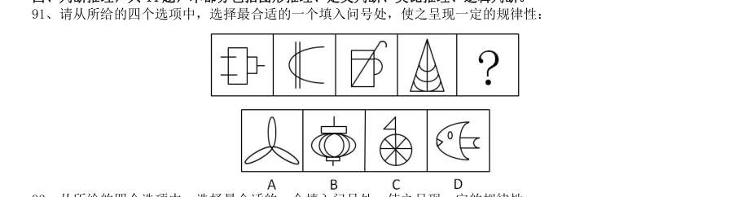

> （本题为图形题，选项为图片，见原卷）

**答案：D**　**考点：图形推理｜图形推理（综合）**
**【判断推理·图形推理｜HB-2013-ty-X092】**

92. 从所给的四个选项中,选择最合适的一个填入问号处,使之呈现一定的规律性:

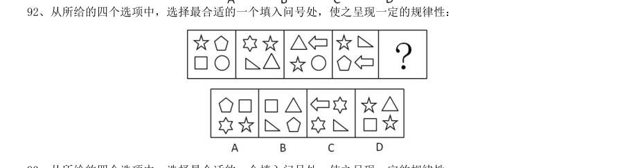

> （本题为图形题，选项为图片，见原卷）

**答案：A**　**考点：图形推理｜数量规律**
**【判断推理·图形推理｜HB-2013-ty-X093】**

93. 从所给的四个选项中,选择最合适的一个填入问号处,使之呈现一定的规律性:

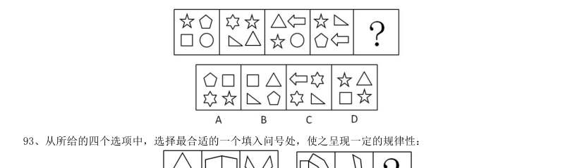

> （本题为图形题，选项为图片，见原卷）

**答案：A**　**考点：图形推理｜属性规律**
**【判断推理·图形推理｜HB-2013-ty-X094】**

94. 从所给的四个选项中,选择最合适的一个填入问号处,使之呈现一定的规律性:

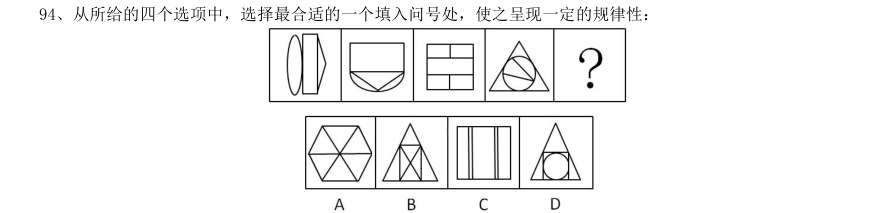

> （本题为图形题，选项为图片，见原卷）

**答案：B**　**考点：图形推理｜数量规律**
**【判断推理·图形推理｜HB-2013-ty-X095】**

95. 从所给的四个选项中,选择最合适的一个填入问号处,使之呈现一定的规律性:

> （本题为图形题，选项为图片，见原卷）

**答案：A**　**考点：图形推理｜样式规律**
**【判断推理·图形推理｜HB-2013-ty-X096】**

96. 从所给的四个选项中,选择最合适的一个填入问号处,使之呈现一定的规律性:

> （本题为图形题，选项为图片，见原卷）

**答案：B**　**考点：图形推理｜数量规律**
**【判断推理·图形推理｜HB-2013-ty-X097】**

97. 左边为立方体的外表面,右边哪个立方体可以由它折成?

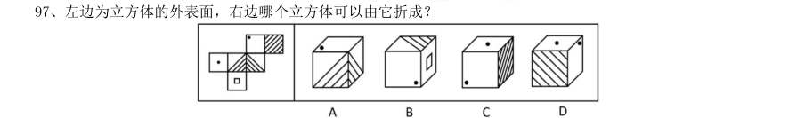

> （本题为图形题，选项为图片，见原卷）

**答案：A**　**考点：图形推理｜数量规律**
**【判断推理·图形推理｜HB-2013-ty-X098】**

98. 以下为立方体的外表面,下列哪个立方体可以由此折成:

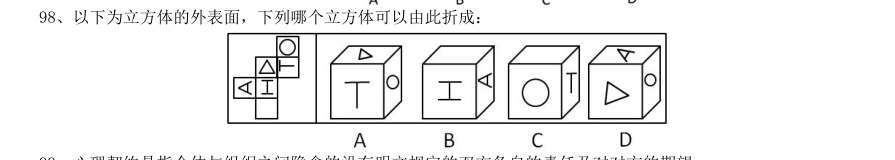

> （本题为图形题，选项为图片，见原卷）

**答案：A**　**考点：图形推理｜立体图形**
**【判断推理·图形推理｜HB-2013-ty-X099】**

99. 心理契约是指个体与组织之间隐含的没有明文规定的双方各自的责任及对对方的期望。 根据上述定义,下列属于建立心理契约的措施是:

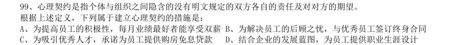

> （本题为图形题，选项为图片，见原卷）

**答案：D**　**考点：图形推理｜图形推理（综合）**
**【判断推理·定义判断｜HB-2013-ty-X100】**

100. 自白任意性规则是指只有基于犯罪嫌疑人自由意志而作出的、承认有罪的真实陈述,才具有证据能力。 根据上述定义,下列符合自白任意性规则做法的是:

- **A.** 为避免犯罪嫌疑人有可能作出虚假陈述,应中止询问
- **B.** 犯罪嫌疑人的有罪陈述与收集到的证据材料一致
- **C.** 犯罪嫌疑人主张自己无罪,可以不承担举证责任
- **D.** 以从轻处罚为条件,换取犯罪嫌疑人的有罪答疑

**答案：B**　**考点：定义判断｜单定义**
**【判断推理·定义判断｜HB-2013-ty-X101】**

101. 印记学习是指发生在动物生活的早期阶段、由直接印象形成的学习行为,印记学习行为虽发生在早期,但 对晚期行为也具有一定的影响。 根据上述定义,下列不属于印记学习行为的是:

- **A.** 绵羊走近并试图留在喂养过它的主人身边
- **B.** 由人喂养大的斑马雀会向主人的手指求偶
- **C.** 绵羊用舌舔小羊的方式来标记自己的后代
- **D.** 刚出生的绿头鸭跟随着一个移动的物体走

**答案：C**　**考点：定义判断｜单定义**
**【判断推理·定义判断｜HB-2013-ty-X102】**

102. 蒸发冷却是指液体在蒸发气体的过程中会吸热,从而降低周围的温度起到冷却效果。蒸发冷却效应是指在 目的或志趣相同的人们组成的社会团体中,团体的价值跟液体的整体温度类似,当价值较高的成员离开社团后, 社团自身的平均价值会降低。 根据上述定义,下列属于蒸发冷却效应的是:

- **A.** 某高校的街舞社团的团长毕业离开学校后,该社团便没有在街舞比赛中取得较好的名次
- **B.** 某知名流行音乐演唱组合中的一个歌手因意外去世,大批歌迷认为这个歌手的离开导致该组合整体演唱水平大打折扣
- **C.** 某教育机构的一些老师离开该机构创办的教育公司,使该机构在市场竞争中的形势变得更加严峻
- **D.** 某社交网站的影评小组建立之初人数较少,影评质量较高,后来有大量人加入这个小组上传影评,使这里整

**答案：A**　**考点：定义判断｜单定义**
**【判断推理·定义判断｜HB-2013-ty-X103】**

103. 威客模式是指一些人通过互联网把自己的智慧、知识、能力、经验转换成实际收益,他们在互联网上通过 解决科学、技术、工作、生活、学习中的问题从而让知识、智慧、经验、技能产生经济价值。 根据上述定义,下列属于威客模式的是:

- **A.** 某IT 技术人员用业余时间开了一个小公司,主要在网络上远程帮助他人修理电脑
- **B.** 某大学毕业生在一个B2C 网站上开了一家服装店,运用自己的人脉资源使网店很快就开始盈利
- **C.** 某摄影师个人网站上的摄影作品吸引了大批网友浏览、转发,后来该摄影师依靠该网站上发布摄影器材广告带来了大量收入
- **D.** 某高校学生建立的免费回答中小学生学习问题的公益网站受到了学生和家长的好评,当地一家教育机构出资

**答案：A**　**考点：定义判断｜单定义**
**【判断推理·定义判断｜HB-2013-ty-X104】**

104. 临终关怀是指为临终患者提供医疗、护理、心理、社会等多方位的关怀照顾,使每位患者的生命受到尊重, 症状得到控制,生命质量得到提高。 根据上述定义,下列不属于临终关怀的是:

- **A.** 老赵肝癌晚期,医生尽最大努力进行治疗,不惜一切代价延长其生命
- **B.** 老王肾衰竭晚期希望回到故乡,他在接受疼痛处理后被同意出院
- **C.** 老李白血病晚期,医生对他进行保守治疗,配合适当的绘画与音乐治疗
- **D.** 老刘胃癌晚期,某大学组织志愿者陪他聊天

**答案：A**　**考点：定义判断｜单定义**
**【判断推理·定义判断｜HB-2013-ty-X105】**

105. 农产品补贴通常是指一国政府对本国的农产品市场商或者经营者提供资金或财政上的支持,包括现金补贴、 价格补贴或其他政策优惠待遇,使其农产品在国际、国内市场上与未受补贴的同类产品相比获得竞争优势。 根据上述定义,下列属于农产品补贴的是:

- **A.** 为了稳定农产品价格,某市政府对农贸市场经营者的摊位租金实行减免政策外,还规定若摊位租金低于限定额数,可以向经营者发放10%—40%不等的补贴
- **B.** 某国政府为农民和水稻研究所牵线搭桥,使该国农民种植了新品种水稻。该品种水稻的质量和产量大幅度提升,使得该国水稻出口价格与国际市场上的水稻相差无几
- **C.** 甲国市场上,政府以高于市场价格收购农民种植的玉米,再低价出售,以鼓励农民种植玉米。该国某企业利用玉米作为主要饲料培育肉鸡,再大量出口到乙国
- **D.** 甲地主要是草原,由于过度放牧导致草场退化。该国政府根据该地区情况,发放牧民8—10 年的补贴,请他

**答案：C**　**考点：定义判断｜单定义**
**【判断推理·定义判断｜HB-2013-ty-X106】**

106. 调查显示,59.4%的公众感觉当前社会“逆淘汰”现象普遍,其中18.8%的人觉得“非常多”。所谓“逆淘 汰”,即指坏的淘汰好的,劣质的淘汰优胜的,平庸的淘汰杰出的等现象。 根据上述定义,下列属于逆淘汰现象的是:

- **A.** 某公司拥有领先的卫星通话技术,语音质量高,覆盖范围广,但该技术的维持费用高昂。后来该公司入不敷出,宣告破产
- **B.** 市场上某些价格高昂的止咳药疗效实际不如价格低廉的常用药,而事实上常用药所占市场份额较小
- **C.** 许多公司都有对工作发牢骚的人,结果,凡是公司中有对工作发牢骚的人,那家公司一定比没有这种人的公司要成功得多
- **D.** 名牌大学毕业的甲和普通大学毕业的乙同时进入某国际知名公司,但甲始终未获提升,乙却逐渐得到了公司

**答案：B**　**考点：定义判断｜单定义**
**【判断推理·定义判断｜HB-2013-ty-X107】**

107. 逆向服务是在产品(服务)销售以后,企业向顾客提供实现产品(服务)使用价值的服务。 根据上述定义,下列不属于逆向服务的是:

- **A.** 某电信运营商推出“存话费送手机”的优惠活动
- **B.** 某空调生产商为客户提供终身免费上门维修服务
- **C.** 某网店推出售后商品7 天内可免费退换货服务
- **D.** 某汽车4S 店为客户提供二手车估价转让服务

**答案：A**　**考点：定义判断｜单定义**
**【判断推理·定义判断｜HB-2013-ty-X108】**

108. 政策性亏损是指为保证国民经济的协调发展和人民生活的安定,企业在实现政府规定的社会公益服务目标, 生产经营某种商品的过程中,由于国家限价等原因而产生的亏损。发生这类亏损,由财政部门审核后给予合理补 偿。 根据上述定义,下列属于政策性亏损的是:

- **A.** 2012 年某粮食直补每亩增至120 元,补贴资金将通过“省财政涉农补贴一本通”发放到种粮农民手中,以弥补农民增加的种粮成本
- **B.** 国家出台提高小麦最低收购保护价政策,某粮油企业为开拓市场大量抢购小麦,又将大量面粉低于市场价销售,因此造成了亏损
- **C.** 政府为实现农业现代化目标,加大了对农业生产改造的资金收入,某农机企业在这种形式下扩大生产规划导致了亏损,得到了退税补偿
- **D.** 某县的粮食购销企业在经营政府规定的平价粮食过程中,因国家粮食保护价高但粮油成品销售价格低导致了

**答案：D**　**考点：定义判断｜单定义**
**【判断推理·定义判断｜HB-2013-ty-X109】**

109. 自我建构指个体通过行为表现表明自己符合在他人心目中的已经建立起来的社会身份和社会形象。 根据上述定义,下列属于自我建构的是:

- **A.** 16 岁的女孩欢欢经常模仿话剧演员的表演并像他们一样早起练功,她希望自己以后也成为话剧演员
- **B.** 某公司创立之初就定下服务社会的企业使命,后来在偏远山区建立多所希望小学,树立了公司热心于社会公益事业的良好形象
- **C.** 一些企业家经常穿着昂贵的西装,坐豪华轿车,有些人认为这是“炫富”,但他们认为如果不是这样,就不会得到同行的认可
- **D.** 不同航空公司要求本公司的空中乘务员穿着不同的制服,他们认为员工形象会影响到公司在旅客心中的形象

**答案：C**　**考点：定义判断｜单定义**
**【判断推理·定义判断｜HB-2013-ty-X110】**

110. 某些产品的精心设计使产品方便高效,能给客户带来舒适感,使用时不用阅读复杂的说明或是求助他人。 而有些产品恰恰相反,它们的设计没有考虑用户的使用习惯和需要,因而使人们在使用过程中会遇到困难或者迷 惑不解的情况,这类产品被人们称为诺曼产品。 根据上述定义,下列属于诺曼产品的是:

- **A.** 某品牌木制大衣柜的底部滑轮质量较差,用户很难将门拉开
- **B.** 某款网络游戏很难通关,很多玩家在网上求助怎样破解其中的关卡
- **C.** 汽车收音机按钮和其他设备开关的形状、大小都一样,用户很难分辨哪个是收音机按钮
- **D.** 某科技公司的精密实验设备附有300 页的说明书,一般人觉得里面术语太多,很难读懂

**答案：C**　**考点：定义判断｜单定义**
**【判断推理·类比推理｜HB-2013-ty-X111】**

111. 地理:自然地理:经济地理

- **A.** 城市:居民区:商业区
- **B.** 卫星:遥感:雷达
- **C.** 糖果:水果糖:芝麻糖
- **D.** 单位:千米:公里

**答案：C**　**考点：类比推理｜逻辑关系**
**【判断推理·类比推理｜HB-2013-ty-X112】**

112. 量尺:厘米

- **A.** 时间:小时
- **B.** 天平:千克
- **C.** 电话:号码
- **D.** 细胞:显微镜

**答案：B**　**考点：类比推理｜对应关系**
**【判断推理·类比推理｜HB-2013-ty-X113】**

113. 军队:命令

- **A.** 乐队:指挥
- **B.** 游客:向导
- **C.** 志愿者:号召
- **D.** 学生:教导

**答案：A**　**考点：类比推理｜对应关系**
**【判断推理·类比推理｜HB-2013-ty-X114】**

114. 文字:剧本:话剧

- **A.** 水:水果:果汁
- **B.** 叶子:植物:中药
- **C.** 字母:键盘:文章
- **D.** 音符:乐谱:歌曲

**答案：D**　**考点：类比推理｜逻辑关系**
**【判断推理·类比推理｜HB-2013-ty-X115】**

115. 平静:讲述

- **A.** 欣喜:接受
- **B.** 恼怒:言论
- **C.** 悲哀:哀乐
- **D.** 快乐:行为

**答案：A**　**考点：类比推理｜对应关系**
**【判断推理·类比推理｜HB-2013-ty-X116】**

116. 软件:程序员:编写

- **A.** 木头:木匠:打制
- **B.** 渔网:渔民:编织
- **C.** 车票:乘客:购买
- **D.** 麦克风:歌手:唱歌

**答案：B**　**考点：类比推理｜对应关系**
**【判断推理·类比推理｜HB-2013-ty-X117】**

117. 发动机:飞机:旅客

- **A.** 琴键:钢琴:音乐
- **B.** 电池:手电筒:灯光
- **C.** 发条:钟表:时间
- **D.** 杆秤:秤杆:重量

**答案：C**　**考点：类比推理｜逻辑关系**
**【判断推理·类比推理｜HB-2013-ty-X118】**

118. 兴趣:索然无味

- **A.** 知识:不学无术
- **B.** 误会:善解人意
- **C.** 骨气:卑躬屈膝
- **D.** 礼貌:盛气凌人

**答案：C**　**考点：类比推理｜语义关系**
**【判断推理·类比推理｜HB-2013-ty-X119】**

119. ( )对于家具相当于花岗岩对于( )

- **A.** 书桌石膏
- **B.** 家电岩石
- **C.** 木材雕塑
- **D.** 房间石矿

**答案：C**　**考点：类比推理｜逻辑关系**
**【判断推理·类比推理｜HB-2013-ty-X120】**

120. ( )对于湿地相当于稀土对于( )

- **A.** 候鸟工业
- **B.** 生态资源
- **C.** 雨水黄金
- **D.** 沼泽矿产

**答案：D**　**考点：类比推理｜逻辑关系**
**【判断推理·逻辑判断｜HB-2013-ty-X121】**

121. ( )对于领航相当于规则对于( )

- **A.** 航班选手
- **B.** 航标犯规
- **C.** 导航比赛
- **D.** 航线裁判

**答案：D**　**考点：逻辑判断｜朴素逻辑（排序/匹配）**
**【判断推理·类比推理｜HB-2013-ty-X122】**

122. 邮局对于( )相当于( )对于网购

- **A.** 快递:网店
- **B.** 邮政:网银
- **C.** 电子邮件:百货商场
- **D.** 驿站:网站

**答案：C**　**考点：类比推理｜逻辑关系**
**【判断推理·逻辑判断｜HB-2013-ty-X123】**

123. 2 亿年前,在恐龙统治地球之时,一小撮夜行性的远古爬行动物在不知不觉中找到了一条生存策略,并 最终走向了大脑进化之路。科学家从与原始哺乳动物及其类似的远古爬行动物的头骨化石中得出结论,正是嗅觉 的发展促进了远古爬行动物的大脑的进化。 以下哪项如果为真,最能支持以上述结论?

- **A.** 许多早期哺乳动物由于自然进化出了更小的身体,而它们的脑却未能按比例缩小
- **B.** 研究人员分析了爬行动物犬齿龙类化石,其中早期哺乳动物摩根兽亲缘关系很近,但摩根兽的大脑比犬齿龙要大一倍,其中处理嗅觉的区域明显增大
- **C.** 早期夜行性哺乳动物进化出更大的脑是为了促进他们的听觉,因为视觉在夜晚并不能起到很大的作用
- **D.** 研究表明,与现存哺乳动物关系最近的巨颅兽,其大脑容量和鼻腔所占空间都要比早期爬行动物大一些

**答案：B**　**考点：逻辑判断｜加强**
**【判断推理·逻辑判断｜HB-2013-ty-X124】**

124. 我国生产婴幼儿配方奶粉的企业有130 多家,而美国只有4 家企业,但是美国吃配方奶粉的婴幼儿数量远 高于我国。“设想一下,如果只有4 家企业生产配方奶粉,企业会倍加珍惜自己的品牌价值,不断加强食品安全 意识,任何可能的食品安全风险都是企业自身无法容忍的,发生三聚氰胺这样的问题是不可想象的”。 以下哪项如果为真,最能削弱上述观点?

- **A.** 我国市场的婴幼儿奶粉的企业太多,品牌价值对于企业并不重要,所以这些企业敢在奶粉中添加三聚氰胺
- **B.** 某国的婴幼儿配方奶粉有90 多家,它们之中大多数企业生产出的奶粉均未查出过三聚氰胺
- **C.** 某公司是我国生产奶制品的著名企业,其品牌价值很高,但是在其生产出的奶制品中查出了三聚氰胺
- **D.** 某企业是美国婴幼儿配方奶粉的著名生产商,在他们生产的某品牌配方奶粉中查出了三聚氰胺

**答案：D**　**考点：逻辑判断｜削弱**
**【判断推理·逻辑判断｜HB-2013-ty-X125】**

125. 科学家们认为,梦是大脑中主管人体各种功能的各个中心点联合作用的结果。人在睡眠时其部分脑细胞仍 然在活动着,这就是梦的基础。最近的研究成果证实,做梦不仅不会影响人的睡眠和健康,而且还是保护大脑健 康所必需的生理活动之一。 以下哪项如果为真,最能支持以上述结论?

- **A.** 根据问卷分析,长期不做梦的人比经常做梦者所需的睡眠时间更长,在休息后有一半人仍会感到疲倦
- **B.** 实验中研究人员在睡眠者出现做梦的脑电波时,就立即将其阻断,结果发现被试者的血压和体温明显增高
- **C.** 研究中,梦境被打扰的被试者在醒来后显得焦虑不安,容易紧张,并出现记忆的短期障碍
- **D.** 调查显示,能完整讲述梦境的被试者相比遗忘梦境者,在工作中更能快速集中注意力,从而工作效率更高

**答案：A**　**考点：逻辑判断｜加强**
**【判断推理·逻辑判断｜HB-2013-ty-X126】**

126. 研究人员在正常的海水和包含两倍二氧化碳浓度的海水中分别培育了某种鱼苗,鱼苗长大后被放入一个迷 宫。每当遇到障碍物时,在正常海水中孵化的鱼都会选择正确的方向避开。然而那些在高二氧化碳浓度下孵化的 鱼却会随机地选择左转或向右转,这样,这种鱼遇到天敌时,生存机会减少。因此,研究人员认为在高二氧化碳 环境中孵化的鱼,生存的能力将会减弱。 以下哪项如果为真,不能支持该项结论?

- **A.** 人类燃烧化石燃料产生的二氧化碳大约有三分之一都被地球上的海洋吸收了,这使得海水逐渐酸化,会软化海洋生物的外壳和骨骼
- **B.** 在二氧化碳含量高的海洋区域,氧气含量较低。氧气少使海洋生物呼吸困难,觅食、躲避掠食者以及繁衍后代也变得更加困难
- **C.** 二氧化碳是很多海洋生物的重要营养物质,它们在曝光照射下把叶子吸收的二氧化碳和概况输送来的水分转变为糖、淀粉以及氧气
- **D.** 将小丑鱼幼鱼放在二氧化碳浓度较高的海水中饲养,并播放天敌发出的声音,结果这组小鱼听不到声音

**答案：C**　**考点：逻辑判断｜削弱**
**【判断推理·逻辑判断｜HB-2013-ty-X127】**

127. 富裕起来的这一代中国父母,仍然处在家庭教育的“初级阶段”内,习惯于物质欲望的满足、用金钱砸下 的“抢跑”来帮助孩子“赢在起跑线上”,用不肯放手来表达对孩子的爱、对教育的重视。快乐对于单纯的孩子 而言,实在是很简单的事。有爱心的父母,没有那么多期望与要求,放下怀抱的焦虑感,没有那么多对社会、制 度、他人的怨愤,单纯地和孩子在一起,为他们营造一个更安全的环境,一起度过快乐美好的一天。 由此可以推出:

- **A.** 关心孩子会给孩子带来比金钱更多的快乐
- **B.** 让孩子“赢在起跑线上”是一种错误的想法
- **C.** 满足孩子的物质欲望也是爱孩子的一种方式D、孩子希望父母陪伴而不是把孩子们送进补习班

**答案：D**　**考点：逻辑判断｜归纳推导**
**【判断推理·逻辑判断｜HB-2013-ty-X128】**

128. 某单位每逢年底会针对全体员工进行评优,评优项有5 个,分别是最佳敬业奖、最佳创意奖、最佳协作奖、 最佳写作奖、年度明星奖。其中如果评选了年度明星奖则不能再评选最佳创意奖和最佳敬业奖;如果评选了协作 奖,就不能再获得写作奖;如果评选了敬业奖,则不能再获得协作奖。每个人最多获得两个奖项。综合科一共3 位员工,揽括了所有奖项,每个人都获奖,但是奖项各不相同。已知员工甲获得了明星奖,员工乙和员工丙二人 之间有人获得了写作奖。 由此可知,下列推测一定正确的是:

- **A.** 如果乙获得了写作奖,则其还获得了敬业奖
- **B.** 如果乙获得了协作奖,则乙和丙各获得两个奖项
- **C.** 如果乙获得了写作奖和创意奖,则甲一定只获得一个奖项
- **D.** 如果丙获得了协作奖,则乙一定不能获得敬业奖

**答案：B**　**考点：逻辑判断｜翻译推理**
**【判断推理·逻辑判断｜HB-2013-ty-X129】**

129. 树木枝干和许多植物的茎秆通常含有大量难以分解的木质素,因此利用它们来提炼生物燃料的效率要大打 折扣。目前,人们发现了一种名为红球菌的细菌,它具有分解木头和其他植物中木质素的能力,因此,人们认为 可以将红球菌广泛用于以往大都废弃的茎秆,从而大大提高生物燃料的利用率。 以下哪项如果为真,最能支持以上述结论?

- **A.** 红球菌能分泌一种酶,这种酶具有分解木质素的能力,但是其分泌能力呈现周期性变化
- **B.** 一些真菌也具有分解木质素的能力,研究发现,这些真菌的生长需要特定的温度和湿度
- **C.** 红球菌易于培养,目前对红球菌已完成基因测序,因此可以利用红球菌大规模地生产分解木质素的酶
- **D.** 木质素是一种优质高分子材料,迄今为止,超过95%的木质素都是直接排入江河或浓缩后烧掉,很少有效利

**答案：C**　**考点：逻辑判断｜加强**
**【判断推理·逻辑判断｜HB-2013-ty-X130】**

130. 研究人员完成了两项记忆实验,实验一中参试者学习10 组单词,实验二中参试者学习一系列手指信号。两 实验中,只告诉一半参试者10 小时后将接受测试,实际上所有参试者都将测试。只安排一部分参试者在学习和 测试之间小睡。结果发现,睡觉组参试者比不睡觉参试者表现更好;事先被告知要进行测试的参试者,测试成绩 也比较高,因此,研究人员认为,睡眠有助于大脑存储对将来有用的记忆信息。 如果以下各项为真,最能反驳该结论的一项是:

- **A.** 实验一中参试者都是记忆力较好的,在某语言专业学习的年轻人
- **B.** 有些被告知要进行测试的参试者,小睡时没有睡着,他们无意识地在大脑中复习所学过的内容
- **C.** 安排小睡时间的参试者,均为年龄较小的少年,而众所周知,人在少年时期的记忆力比较好
- **D.** 实验二中部分小睡的参试者以放松的心态参加考试,取得了较好的成绩

**答案：C**　**考点：逻辑判断｜削弱**
**【判断推理·逻辑判断｜HB-2013-ty-X131】**

131. 所有的战争和混乱都是在没有协商、无理可讲的时候发生的,讲理和协商都离不开语言,然而,并非有语 言的地方就自动会有说理,有语言的地方必须有自由才能有说理。 由此可以推出:

- **A.** 所有的战争和混乱都是因为没有自由而发生的
- **B.** 并非所有的战争和混乱都是在不可以协商和不可以讲理的时候发生的
- **C.** 如果没有自由,不能讲理,就可能发生战争和混乱
- **D.** 有语言和自由的地方就一定不会发生战争

**答案：C**　**考点：逻辑判断｜翻译推理**
**【判断推理·逻辑判断｜HB-2013-ty-X132】**

132. 科学家发现,儿童时期不接触细菌和病菌,是5 岁以下人群糖尿病病例近年来急剧增加的主要原因之一。 而那些生活在农村的孩子由于更早接触到带菌的物质,有更多机会与宠物相处,患过敏症、哮喘和湿疹等疾病的 几率反而很低。所以,将细菌消灭得过于彻底的环境可能反而会给儿童的健康带来危害。 以下哪项如果为真,将有力地支持上述结论?

- **A.** 刚出生的婴儿,其体表和体内是无菌的,但开始吃奶、喝水后,细菌便乘机进入体内
- **B.** 人体皮肤上的细菌大多起保护作用,并为每个人制造出独特的体味
- **C.** 大部分细菌是有益于身体健康的,人的健康长寿离不开正常的菌群
- **D.** 很多有害细菌平时与人体相安无事,当人体免疫力下降时,细菌便开始侵害人体

**答案：C**　**考点：逻辑判断｜削弱**
**【判断推理·逻辑判断｜HB-2013-ty-X133】**

133. 传统观点认为,尽管用于制造贫铀弹所使用的贫铀放射性低,仍会导致人类染色体受损,从而引发肿瘤或 癌症。但是,在最近的一项研究中,研究员对接触过贫铀弹的退伍老兵的血细胞进行研究,到目前为止,还没有 检测到任何染色体断裂和重复,并没有发现任何由于接触贫铀弹而造成的负面健康影响。因此相关研究人员认为, 放射性低的贫铀弹不会对人类的健康造成影响。 以下哪项如果为真,最能削弱研究人员的结论?

- **A.** 某地居民向法院起诉,声称该国军队试验贫铀弹,已影响该地居民健康
- **B.** 世界上很多国家的专家都在致力于解决贫铀弹的放射性问题
- **C.** 有数据显示,这些退伍老兵的后代患有先天性缺陷的比率高于正常值
- **D.** 没有接触过贫铀弹的人也会患有肿瘤或癌症

**答案：C**　**考点：逻辑判断｜削弱**
**【判断推理·图形推理｜HB-2013-ty-X134】**
> 材料：传播媒介拥有不可抵抗的强大力量,它们所传递的信息在受传者身上就像子弹击中身体、药剂注入皮肤一 样,受众完全处于被动的地位,消极地等待和接受媒介所灌输的各种思想、感情、知识,受众的性格差异对大众 传媒提供的信息产生的反应可以忽略不计。 如果以下各项为真,最能削弱上述观点的是: A、人受到某种特定刺激就必然引起某种特定反应B、坚持读者需求导向并不能为受众创造最大利益 C、社会对电视节目庸俗化倾向普遍存在担忧心理D、取消电影分级制度未影响其观众的数量和构成 分析、比较、计算和判断处理。 (一) 2011 年 月,全国造船完工5101 万载重吨,同比增长 ,9 月当月完工786 万载重吨,环比增长 , 新承接船舶订单规模2902 万载重吨,同比下降 ,手持船舶订单规模16886 万载重吨,同比下降 ,比 2010 年底下降 。 月,全国规模以上船舶工业企业1526 家,完成工业总产值5734 亿元

134. 全国完工出口船舶规模4305 万载重吨,占全国造船总量的 ;新承接出口船舶订单规模2162 万载重吨,占 新接订单的 ;手持出口船舶订单规模13863 万载重吨,占全部手持订单的 。 9 月当月,我国船舶行业仅承接船舶订单规模94 万载重吨,是2009 年6 月以来月度成交的最低值。截至9 月底,全国约有 的船厂没有接到订单,部分企业明年上半年可能陷入开工任务不足的困境,一些小船厂已开 始停产、转产。

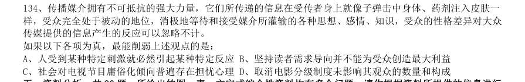

> （本题为图形题，选项为图片，见原卷）

**答案：C**　**考点：图形推理｜数量规律**
**【资料分析·基期量计算｜HB-2013-ty-X135】**

135. 2011 年 月,全国造船完工总量为多少万载重吨?

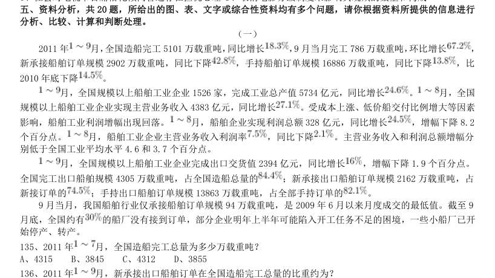

- **A.** 4315
- **B.** 3845
- **C.** 4312
- **D.** 3855

**答案：B**　**考点：基期量计算｜基期量计算（综合）**
**【资料分析·比重计算与比较｜HB-2013-ty-X136】**

136. 2011 年 月,新承接出口船舶订单在全国造船完工总量的比重约为?

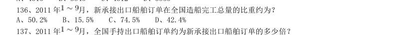

- **A.** 50.2%
- **B.** 15.5%
- **C.** 74.5%
- **D.** 42.4%

**答案：D**　**考点：比重计算与比较｜现期比重**
**【资料分析·倍数计算｜HB-2013-ty-X137】**

137. 2011 年 月,全国手持出口船舶订单约为新承接出口船舶订单的多少倍?

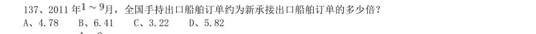

- **A.** 4.78
- **B.** 6.41
- **C.** 3.22
- **D.** 5.82

**答案：B**　**考点：倍数计算｜是几倍**
**【资料分析·比重计算与比较｜HB-2013-ty-X138】**

138. 2011 年 月,全国规模以上船舶工业企业完成出口交货值占全国规模以上船舶企业工业总产值中的比重 与2010 年该比重相比,下降了约几个百分点?

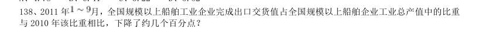

- **A.** 3
- **B.** 4
- **C.** 5
- **D.** 6

**答案：A**　**考点：比重计算与比较｜比重升降判断**
**【资料分析·综合分析｜HB-2013-ty-X139】**

139. 下列说法中正确的是:

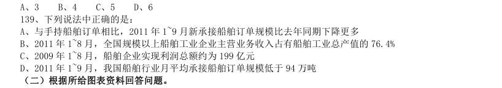

- **A.** 与手持船舶订单相比,2011 年1~9 月新承接船舶订单规模比去年同期下降更多
- **B.** 2011 年1~8 月,全国规模以上船舶工业企业主营业务收入占有船舶工业总产值的76.4%
- **C.** 2009 年1~8 月,船舶企业实现利润总额约为199 亿元
- **D.** 2011 年1~9 月,我国船舶行业月平均承接船舶订单规模低于94 万吨

**答案：A**　**考点：综合分析｜选错误项**
**【资料分析·基期量计算｜HB-2013-ty-X140】**

140. 2011 年7 月产量低于上半年月均产量的是:

- **A.** 电
- **B.** 钢材
- **C.** 水泥
- **D.** 乙烯

**答案：D**　**考点：基期量计算｜基期量计算（综合）**
**【资料分析·比重计算与比较｜HB-2013-ty-X141】**

141. 2011 年7 月轿车产量占汽车产量的比重与上年同期相比:

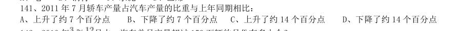

- **A.** 上升了约7 个百分点
- **B.** 下降了约7 个百分点
- **C.** 上升了约14 个百分点
- **D.** 下降了约14 个百分点

**答案：A**　**考点：比重计算与比较｜比重升降判断**
**【资料分析·基期量计算｜HB-2013-ty-X142】**

142. 2010 年 月中,汽车单月产量超过150 万辆的月份有多少个?

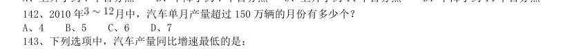

- **A.** 4
- **B.** 5
- **C.** 6
- **D.** 7

**答案：C**　**考点：基期量计算｜基期量计算（综合）**
**【资料分析·增长率计算与比较｜HB-2013-ty-X143】**

143. 下列选项中,汽车产量同比增速最低的是:

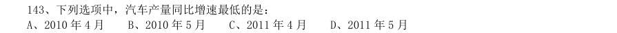

- **A.** 2010 年4 月
- **B.** 2010 年5 月
- **C.** 2011 年4 月
- **D.** 2011 年5 月

**答案：D**　**考点：增长率计算与比较｜增长率比较**
**【资料分析·综合分析｜HB-2013-ty-X144】**

144. 以下说法与资料相符的是:

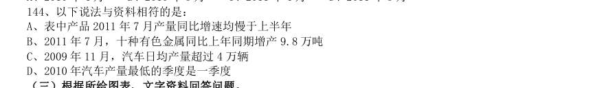

- **A.** 表中产品2011 年7 月产量同比增速均慢于上半年
- **B.** 2011 年7 月,十种有色金属同比上年同期增产9.8 万吨
- **C.** 2009 年11 月,汽车日均产量超过4 万辆
- **D.** 2010 年汽车产量最低的季度是一季度

**答案：C**　**考点：综合分析｜选正确项**
**【资料分析·比重计算与比较｜HB-2013-ty-X145】**
> 材料：2011 年上半年,我国软件产业实现软件业务收入8065 亿元,同比增长29.3%,增速比去年同期高0.2 个百 分点;实现利润103 亿元,同比增长3.49%。其中,6 月份完成软件业务收入1828 亿元,同比增长32.9%,增速 比5 月份回升3.6 个百分点。 上半年,信息技术咨询服务、数据处理和营运服务实现收入761 和1073 亿元,同比增长36.5%和34.5,分 别高出全行业7.2 和5.2 个百分点;嵌入式系统软件实现收入1443 亿元,同比增长33.8%,增速比去年同期高 14.2 个百分点。软件产品和信息系统集成服务发展较为稳定,分别实现收入2867 和1673 亿元,同比增长28.2% 和23.9%。

145. IC 设计增长放缓,上半年实现收入248 亿元,同比增长13.7%,低于去年同期20 个百分点以上。 2011 年6 月份我国软件业务收入占上半年的总值比重约为:

- **A.** 22.7%
- **B.** 24.6%
- **C.** 26.5%
- **D.** 29.1%

**答案：A**　**考点：比重计算与比较｜两期比重差**
**【资料分析·增长量计算｜HB-2013-ty-X146】**

146. 与2011 年一季度相比,二季度软件业务收入增长了约:

- **A.** 30.2%
- **B.** 33.5%
- **C.** 36.7%
- **D.** 39.4%

**答案：B**　**考点：增长量计算｜增长量计算（综合）**
**【资料分析·增长量计算｜HB-2013-ty-X147】**

147. 2011 年上半年嵌入式系统软件收入同比增长了:

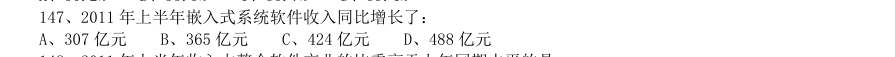

- **A.** 307 亿元
- **B.** 365 亿元
- **C.** 424 亿元
- **D.** 488 亿元

**答案：B**　**考点：增长量计算｜增长量计算（415 份数法）**
**【资料分析·比重计算与比较｜HB-2013-ty-X148】**

148. 2011 年上半年收入占整个软件产业的比重高于上年同期水平的是:

- **A.** 信息系统集成
- **B.** 嵌入式系统集成
- **C.** IC 设计
- **D.** 软件产品

**答案：B**　**考点：比重计算与比较｜基期比重**
**【资料分析·综合分析｜HB-2013-ty-X149】**

149. 以下说法与资料相符的是:

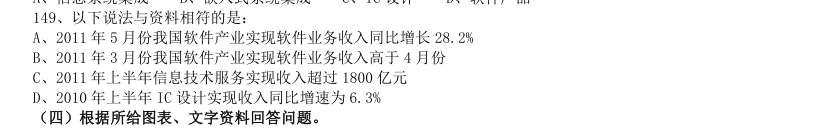

- **A.** 2011 年5 月份我国软件产业实现软件业务收入同比增长28.2%
- **B.** 2011 年3 月份我国软件产业实现软件业务收入高于4 月份
- **C.** 2011 年上半年信息技术服务实现收入超过1800 亿元
- **D.** 2010 年上半年IC 设计实现收入同比增速为6.3%

**答案：C**　**考点：综合分析｜选正确项**
**【资料分析·增长量计算｜HB-2013-ty-X150】**
> 材料：某市2010 年全年实现农业增加值124.3 亿元,比上年下降1.6%。粮食播种面积22.3 万公顷,比上年减少 0.3 万公顷;粮食产量115.7 万吨,比上年下降7.3%。 全市农业观光园1303 个,比上年增加9 个;观光园总收入17.8 亿元,比上年增长16.7%。民俗旅游实际经 营户7979 户,比上年减少726 户;民俗旅游总收入7.3 亿元,增长20.7%。种业收入14.6 亿元,比上年增长13.5%。

150. 设施农业总面积18323 公顷,比上年下降2.3%;实现收入40.7 亿元,增长20.1%。 该市2009 年全年实现农业增加值约:

- **A.** 124 亿元
- **B.** 126 亿元
- **C.** 129 亿元
- **D.** 132 亿元

**答案：B**　**考点：增长量计算｜增长量计算（综合）**
**【资料分析·平均数计算｜HB-2013-ty-X151】**

151. 该市2010 年粮食平均产量约为每公顷:

- **A.** 4.6 吨
- **B.** 5.2 吨
- **C.** 5.8 吨
- **D.** 6.5 吨

**答案：B**　**考点：平均数计算｜现期平均数**
**【资料分析·基期量计算｜HB-2013-ty-X152】**

152. 该市主要农副产品与上年相比,产量变化绝对值最小的是:

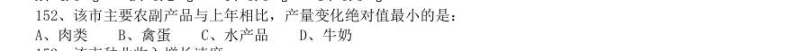

- **A.** 肉类
- **B.** 禽蛋
- **C.** 水产品
- **D.** 牛奶

**答案：B**　**考点：基期量计算｜已知现期与增长量求基期**
**【资料分析·增长率计算与比较｜HB-2013-ty-X153】**

153. 该市种业收入增长速度:

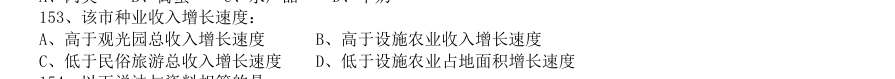

- **A.** 高于观光园总收入增长速度
- **B.** 高于设施农业收入增长速度
- **C.** 低于民俗旅游总收入增长速度
- **D.** 低于设施农业占地面积增长速度

**答案：C**　**考点：增长率计算与比较｜增长率计算**
**【资料分析·综合分析｜HB-2013-ty-X154】**

154. 以下说法与资料相符的是:

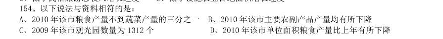

- **A.** 2010 年该市粮食产量不到蔬菜产量的三分之一
- **B.** 2010 年该市主要农副产品产量均有所下降
- **C.** 2009 年该市观光园数量为1312 个
- **D.** 2010 年该市单位面积粮食产量比上年有所下降

**答案：D**　**考点：综合分析｜选正确项**