# 2014 年湖北行测（统一卷）

- 题量：125（含答案 124）
- 模块分布：资料分析20 / 数量关系15 / 言语理解35 / 判断推理35 / 常识判断20
- 试卷编号：`湖北-2014-统一卷`

## 题目与答案

**【常识判断·政治常识｜HB-2014-ty-X001】**

1. 关于我国公务员制度,下列叙述正确的是:

- **A.** 正在接受纪律审查的公务员不得辞去公职
- **B.** 我国公务员培训基地是党校
- **C.** 公务员对降职不服,可以向人民法院提出申诉
- **D.** 公务员考核的基本内容包括德、能、勤、绩、才

**答案：A**　**考点：政治常识｜政治常识（综合）**
**【常识判断·政治常识｜HB-2014-ty-X002】**

2. 关于我国的农民工现象,下列说法错误的是:

- **A.** 农民工是我国特有的城乡二元体制的产物
- **B.** 近年来跨省流动农民工所占比重继续下降
- **C.** 从输出地看,中部地区输出农民工最多,西部次之,东部最少
- **D.** “新生代农民工”主要指80 后、90 后,目前在农民工群体中占一半以上

**答案：A**　**考点：政治常识｜政治常识（综合）**
**【常识判断·地理常识｜HB-2014-ty-X003】**

3. 关于亚洲政坛女性首脑,下列说法错误的是:

- **A.** 科拉松·阿基诺夫人是亚洲首位女总统
- **B.** 阿罗约曾任菲律宾总统之职
- **C.** 朴槿惠的父亲曾任韩国总统
- **D.** 英拉·西那瓦是马来西亚总理

**答案：A**　**考点：地理常识｜中国地理**
**【常识判断·政治常识｜HB-2014-ty-X004】**

4. 关于四大文明古国及其数学成就,下列对应错误的是:

- **A.** 古埃及:“0”的发现
- **B.** 古印度:阿拉伯数字
- **C.** 古巴比伦:六十进位制
- **D.** 古中国:勾股定理

**答案：A**　**考点：政治常识｜政治常识（综合）**
**【常识判断·政治常识｜HB-2014-ty-X005】**

5. 下列思想流派与产生时代对应错误的是:

- **A.** 心学——明代
- **B.** 玄学——魏晋
- **C.** 理学——宋代
- **D.** 儒学——汉代

**答案：A**　**考点：政治常识｜马克思主义基本原理**
**【常识判断·政治常识｜HB-2014-ty-X006】**

6. 关于政治思想,下列表述错误的是:

- **A.** 孟德斯鸠提出三权分立学说
- **B.** 伏尔泰最早提出社会契约论的思想
- **C.** 柏拉图主张建立哲学王统治的国家
- **D.** 让·布丹提出君主主权学说

**答案：A**　**考点：政治常识｜马克思主义基本原理**
**【常识判断·政治常识｜HB-2014-ty-X007】**

7. 关于下列各组人物说法错误的是:

- **A.** 苏格拉底、柏拉图和亚里士多德被称为“古希腊三贤”
- **B.** 颜回、曾子都属孔子七十二门徒
- **C.** 荀子及其弟子韩非子是法家学派的代表人物
- **D.** 康有为、梁启超都是“公车上书”的发起人

**答案：A**　**考点：政治常识｜政治常识（综合）**
**【常识判断·政治常识｜HB-2014-ty-X008】**

8. 下列关于铅的说法错误的是:

- **A.** 铅笔芯的主要成分是铅
- **B.** 香烟中是含铅的
- **C.** 铅在人体内日积月累,不会分解
- **D.** 汽油中添加铅元素可以起到防爆的作用

**答案：A**　**考点：政治常识｜政治常识（综合）**
**【常识判断·政治常识｜HB-2014-ty-X009】**

9. 下列说法错误的是:

- **A.** 蓝藻对地球表面从无氧到有氧的大气环境起了巨大作用
- **B.** 植物光合作用主要在细胞的线粒体进行
- **C.** 呼吸作用分为有氧呼吸和无氧呼吸两种类型
- **D.** 种子植物是地球表面绿色的主体

**答案：A**　**考点：政治常识｜政治常识（综合）**
**【常识判断·政治常识｜HB-2014-ty-X010】**

10. 下列关于火山的表述错误的是:

- **A.** 喷出的物质有气态、流态和固态三种
- **B.** 页岩是最常见的岩浆岩
- **C.** 五大连池的形成与火山喷发有关
- **D.** 可分为死火山、活火山和休眠火山

**答案：A**　**考点：政治常识｜政治常识（综合）**
**【常识判断·政治常识｜HB-2014-ty-X011】**

11. 关于天体及其运行,下列表述错误的是:

- **A.** 天球是为了确定天体位置和运动而假想的圆球
- **B.** 在火星和木星轨道之间存在一个小行星带
- **C.** 黄道面是指月球绕地球运行的轨道面
- **D.** 星座是指在天球上投影位置相近的恒星群落

**答案：A**　**考点：政治常识｜政治常识（综合）**
**【常识判断·政治常识｜HB-2014-ty-X012】**

12. 下列关于石灰的说法错误的是:

- **A.** 生石灰通常可以作为食品干燥剂
- **B.** 澄清石灰水放置在空气中易变浑浊
- **C.** 汉白玉与石灰石的主要成分相同
- **D.** “烈火焚烧若等闲”指熟石灰的高温煅烧

**答案：A**　**考点：政治常识｜政治常识（综合）**
**【常识判断·政治常识｜HB-2014-ty-X013】**

13. 下列哪组不属于夺命“急症”:

- **A.** 肺栓塞、哮喘
- **B.** 冠心病、毒品过量
- **C.** 脑出血、急性坏死性胰腺炎
- **D.** 阑尾炎、腹膜炎

**答案：D**　**考点：政治常识｜政治常识（综合）**
**【常识判断·政治常识｜HB-2014-ty-X014】**

14. 下列哪组物品均属可燃固体?

- **A.** 香蕉水、酒精
- **B.** 面粉、油漆
- **C.** 沥青、松香
- **D.** 甲烷、乙炔

**答案：A**　**考点：政治常识｜政治常识（综合）**
**【常识判断·地理常识｜HB-2014-ty-X015】**

15. 下列哪项不在中国地形的第二级阶梯上?

- **A.** 秦岭
- **B.** 呼伦贝尔高原
- **C.** 鄂尔多斯高原
- **D.** 巴颜喀拉山

**答案：D**　**考点：地理常识｜中国地理**
**【常识判断·政治常识｜HB-2014-ty-X016】**

16. 关于农作物,下列说法正确的是:

- **A.** 中国是最早栽培大豆的国家
- **B.** 玉米是通过丝绸之路传入中国的
- **C.** 花生是世界上最主要的油料作物
- **D.** 泰国是世界上最大的稻米出口国

**答案：A**　**考点：政治常识｜政治常识（综合）**
**【常识判断·政治常识｜HB-2014-ty-X017】**

17. 下列体育人物与其擅长领域对应错误的是:

- **A.** 罗尼·奥沙利文:斯诺克台球
- **B.** 拉菲尔·纳达尔:棒球
- **C.** 罗杰·费德勒:网球
- **D.** 泰格·伍兹:高尔夫

**答案：A**　**考点：政治常识｜政治常识（综合）**
**【常识判断·政治常识｜HB-2014-ty-X018】**

18. 下列事件与相关人物对应错误的是:

- **A.** 三藩之乱:吴三桂、康熙
- **B.** 七国之乱:吴王刘濞、汉景帝
- **C.** 八王之乱:苻坚、谢玄
- **D.** 安史之乱:郭子仪、史思明

**答案：C**　**考点：政治常识｜政治常识（综合）**
**【常识判断·法律常识｜HB-2014-ty-X019】**

19. 根据民事诉讼法的规定,下列说法错误的是:

- **A.** 人民法院调解和好的离婚案件,可以不制作调解书
- **B.** 修改后的民事诉讼法增加了“公益诉讼”的内容
- **C.** 人民法院可以根据实际情况,决定采取传真的方式送达判决书
- **D.** 修改后的民事诉讼法规定,当事人所在社区可推荐公民作为诉讼代理

**答案：A**　**考点：法律常识｜民法典**
**【常识判断·法律常识｜HB-2014-ty-X020】**

20. 下列犯罪嫌疑人、被告人中,哪个人不适用取保候审?

- **A.** 甲在逮捕后侦查羁押期限届满仍需继续查证
- **B.** 有证据证明乙犯故意杀人罪,有可能被判十年以上有期徒刑
- **C.** 丙涉嫌侮辱罪被起诉
- **D.** 丁被逮捕后发现其怀孕3 个月

**答案：B**　**考点：法律常识｜刑法**
**【言语理解·逻辑填空｜HB-2014-ty-X021】**

21. 关于如何有效解释两次世界大战的起源和暴行产生的机制,战争史家一直感到 。他们发现,当落 实到细节研究上时,常常 迭出。譬如马克思主义史家认为经济压力是大战的动因,但历史事实却是二 战爆发在欧洲的经济上扬期,因此许多战争史家不得不有此共识:战争起源问题并非历史学专业所能解释。 依次填入划横线部分最恰当的一项是:

- **A.** 尴尬谬论
- **B.** 困惑悖论
- **C.** 犹豫矛盾
- **D.** 沮丧误解

**答案：B**　**考点：逻辑填空｜一空**
**【言语理解·逻辑填空｜HB-2014-ty-X022】**

22. 预循环是一种更环保的生活方式,指通过 购入会产生垃圾的家庭或商业物品来减少垃圾数量的 行为。可循环的垃圾经过处理后可以 别的功效,可是处理这些可循环物质也是要消耗能源并产生垃 圾的,所以更加环保的方式是尽量少用会产生垃圾的物品。 依次填入画横线部分最恰当的一项是:

- **A.** 避免发挥
- **B.** 杜绝具备
- **C.** 放弃衍生
- **D.** 禁止实现

**答案：A**　**考点：逻辑填空｜一空**
**【言语理解·逻辑填空｜HB-2014-ty-X023】**

23. 以鸟类迁徙为话题的纪录片《迁徙的鸟》向我们充分展示了一个自然界的奇迹,虽然大部分地表已经被人类 改造得___ _____。但鸟儿仍是主角,无论雪鹅、野鸭还是云雀,都自有其尊严。“我们需要与自然界和平相处, 因为人类不可能____________地生活在地球上,”雅克贝汉如是说。 依次填入画横线部分最恰当的一项是:

- **A.** 面目全非孤单
- **B.** 支离破碎傲慢
- **C.** 元气大伤自私
- **D.** 体无完肤麻木

**答案：A**　**考点：逻辑填空｜一空**
**【言语理解·逻辑填空｜HB-2014-ty-X024】**

24. 信用问题本质上是一个制度问题。信用使人们为了获得长远利益而愿意牺牲眼前利益。一个人的最优行为与 他的生命预期有关,生命预期越长,他的行为就越_____,就越愿意坚持_____自己的承诺。所以,建立信用制度, 最重要的是使每一个公民都有一个长期的预期。 依次填入画横线部分最恰当的一项是:

- **A.** 主动履行
- **B.** 规范兑现
- **C.** 明确遵守
- **D.** 一致尊重

**答案：B**　**考点：逻辑填空｜一空**
**【言语理解·逻辑填空｜HB-2014-ty-X025】**

25. 由于石化能源存在污染及蕴藏量减少的问题,新能源一直被视为重要替代品,其中核能更是各国开发 的 。但日本核事故却引起大家对核能安全的 ,各国政府无不希望在短期内找出更安全、经 济的新能源,以减少对石油长期的依赖。 依次填入画横线部分最恰当的一项是:

- **A.** 热点疑虑
- **B.** 要点警觉
- **C.** 重点忧虑
- **D.** 基点警惕

**答案：C**　**考点：逻辑填空｜一空**
**【言语理解·逻辑填空｜HB-2014-ty-X026】**

26. 观察过去五年广东的发展路径,可以 地看到当地政府、企业、民众从歧路彷徨到艰难转型的过程。 要触动既得利益,要牺牲眼前利益,不仅需要勇气,更需要智慧。要 已有的“获利”路径, 要 用惯的政策“拐杖”,不仅需要“自我革命”,还需要“群体参与”。 依次填入画横线部分最恰当的一项是:

- **A.** 完整抛弃脱离
- **B.** 欣慰放弃放开
- **C.** 客观背弃松开
- **D.** 清楚舍弃扔掉

**答案：D**　**考点：逻辑填空｜一空**
**【言语理解·逻辑填空｜HB-2014-ty-X027】**

27. 流言常常令人不悦,却很可能有助于丑事的暴露,阻止恶行的继续。对很多公众人物来说,单单是人们的议 论就可以阻止不良行为。总有人 八卦和流言毁了自己心目中的明星,但事实上,少有哪个坐得正、 行得端的明星最终被流言蜚语摧毁;被破坏的仅仅是对偶像的 想象,被 的是明星的 为所欲为和不良行径。 依次填入画横线部分最恰当的一项是:

- **A.** 担心主观曝光
- **B.** 斥责浪漫质疑
- **C.** 惋惜片面揭露
- **D.** 抱怨完美约束

**答案：D**　**考点：逻辑填空｜一空**
**【言语理解·逻辑填空｜HB-2014-ty-X028】**

28. 从20 世纪末开始的十几年间,中国大学招生数激增了五六倍,为制造业和高科技行业提供了_____的劳动力, 但增长速度过快,远超过普通或无技能劳动力的增速,导致就业市场配置错位。 填入画横线部分最恰当的一项是:

- **A.** 源源不断
- **B.** 应有尽有
- **C.** 形形色色
- **D.** 数不胜数

**答案：A**　**考点：逻辑填空｜成语辨析**
**【言语理解·逻辑填空｜HB-2014-ty-X029】**

29. 在环境问题上,我们所面临的困境不是由于我们 ,而是我们尽力了,但却无法遏制环境恶化的势 头,这是一个信号:把魔鬼从瓶子里放出来的人类,已经失去把魔鬼再装回去的能力。 填入画横线部分最恰当的一项是:

- **A.** 无所顾忌
- **B.** 无所不为
- **C.** 无所事事
- **D.** 无所作为

**答案：D**　**考点：逻辑填空｜成语辨析**
**【言语理解·逻辑填空｜HB-2014-ty-X030】**

30. 自2006 年《烟草控制框架公约》在中国正式生效,烟草界与控烟界过招已数百回合,双方 的是, 均将视线集中于青年群体,烟草依赖的形成是一个长期的过程。烟草界企图“从娃娃抓起”;控烟界也将青年时 期作为吸烟行为的萌芽阶段,向青少年大力宣传烟草的危害。 填入划横线部分最恰当的一项是:

- **A.** 秘而不宣
- **B.** 不谋而合
- **C.** 一成不变
- **D.** 不言而喻

**答案：B**　**考点：逻辑填空｜成语辨析**
**【言语理解·逻辑填空｜HB-2014-ty-X031】**

31. 在美国这样的商业社会里,无论他们抛出了多少关乎人文、情怀、精神的辞藻,几乎所有艺术与技术, 都 是一门生意,即便是教主乔布斯和他的苹果也不例外。但这本身无可指摘,也不 这些公司和这些人缔 造一个伟大的时代。 依次填入画横线部分最恰当的一项是:

- **A.** 自始至终影响
- **B.** 归根结底妨碍
- **C.** 毋庸讳言干扰
- **D.** 理所当然排斥

**答案：B**　**考点：逻辑填空｜成语辨析**
**【言语理解·逻辑填空｜HB-2014-ty-X032】**

32. 中外合拍片对中方和好莱坞电影工厂均有好处,但是由于存在文化环境和审美趣味的差异,中国元素很难真 正与好莱坞电影_______。为了照顾全球影迷的哲学口味,好莱坞电影只能减少中国元素的分量。因此,仅针对 中国内地市场的“中国特供版”便_______。 依次填入画横线部分最恰当的一项是:

- **A.** 契合粉墨登场
- **B.** 协调东山再起
- **C.** 融合应运而生
- **D.** 匹配大行其道

**答案：C**　**考点：逻辑填空｜一空**
**【言语理解·逻辑填空｜HB-2014-ty-X033】**

33. 近代中外历史告诉我们,群众的民主权利就像一切个人权利一样,当它没有受到 的宪政约束时, 很容易转变为它的反面,成为一种暴虐的权力。因此,许多思想家对于各种群众领袖挟民意而行独裁的负面作 用 。 依次填入画横线部分最恰当的一项是:

- **A.** 严格嗤之以鼻
- **B.** 良好讳莫如深
- **C.** 恰当忧心忡忡
- **D.** 普遍谈虎色变

**答案：C**　**考点：逻辑填空｜一空**
**【言语理解·逻辑填空｜HB-2014-ty-X034】**

34. 现在,很多保健品的广告做得很好,但消费者并不知道自己有没有必要买这些东西,其实很多保健品在研究 时并未做过_______调查,并不知道哪些营养素是大家普遍缺乏的。服用未经这样的调查就开发出的保健品,对 消费者来说完全是一种_______。 依次填入画横线部分最恰当的一项是:

- **A.** 实地伤害
- **B.** 科学浪费
- **C.** 跟踪欺骗
- **D.** 严格误导

**答案：B**　**考点：逻辑填空｜一空**
**【言语理解·逻辑填空｜HB-2014-ty-X035】**

35. 德国人卡尔·奔驰研制的第一台以汽油为动力的汽车于1886 年获得专利,从此汽油汽车_______,燃烧汽油 作为动力也似乎成为_______的事,然而世界经济论坛评出的“2008 年科技先驱”,却赫然将细菌“开动”小汽 车列入其中。我们是否正在_______汽油汽车时代?真正环保的汽车是否正向我们走来? 依次填入画横线部分最恰当的一项是:

- **A.** 风靡全球天经地义告别
- **B.** 大行其道水到渠成抛弃
- **C.** 势不可挡约定俗成终结
- **D.** 唯我独尊理所当然变革

**答案：A**　**考点：逻辑填空｜一空**
**【言语理解·逻辑填空｜HB-2014-ty-X036】**

36. 最近,一项关于体重与死亡率的研究让人 。该研究认为,按照国际 的体重评价标准,超重 人群比体重正常人群在同一时期内的死亡率可能要低6%。这一结果一经公布,立即掀起了轩然大波,因为大众 媒体数十年来一直 的观念是,超重甚至是适度的体重增加都不利于健康。 依次填入画横线部分最恰当的一项是:

- **A.** 啼笑皆非公认同意
- **B.** 出乎意料通行宣传
- **C.** 匪夷所思现行强调
- **D.** 无话可说认可灌输

**答案：B**　**考点：逻辑填空｜一空**
**【言语理解·逻辑填空｜HB-2014-ty-X037】**

37. “手机当电视用、电脑当电视用、电视当摆设用”,对于电视机制造企业来说,这似乎已经成了一个 的 事实。互联网给了视频内容一个 的传输和展示渠道,仅仅作为显示屏的电视似乎难逃被淘汰的命运。 如何才能提高这块硕大显示屏的价值? 电视机“智能”,已经成为这个产业的共识。 依次填入画横线部分最恰当的一项是:

- **A.** 铁定快捷开发
- **B.** 公认多维研究
- **C.** 严峻灵活整合
- **D.** 尴尬全新赋予

**答案：D**　**考点：逻辑填空｜一空**
**【言语理解·标题填入｜HB-2014-ty-X038】**

38. 最新研究显示,所谓“好胆固醇”也许并非真的那么好。研究引用大量基因资料,发现俗称“好胆固醇”的 高密度蛋白型胆固醇(HDL)水平即使升高,对降低心脏病的风险并不低于天生HDL 水平较低的人士。如果HDL 真的有助于降低心脏病风险,前者患心脏病的机会应该较低。没有参与研究的学者对相关结果感到不安。 下列哪项最适合做这段文字的标题?

- **A.** 遗传因素与心脏病
- **B.** 心脏病研究的新发现
- **C.** “好胆固醇”或并不存在
- **D.** 胆固醇对心脏病的影响

**答案：C**　**考点：标题填入｜标题填入**
**【言语理解·标题填入｜HB-2014-ty-X039】**

39. 人类的选举制度出现了问题,其间充斥了太多的金钱和毫无意义的争辩。或许我们应将目光转向大自然,从 中找寻选举的内涵,纠正或改善我们的制度。昆虫学家汤姆•西利建议我们应向蜜蜂学习。西利的研究表明,蜂 巢是一个真正的民主社会,当蜜蜂需要找个新家时,地点的选择是由许多蜜蜂投票的,比如根据这一地点的大小、 湿度和周围鲜花多少等“质量”参数。每只蜜蜂都用舞蹈投票,当跳某种舞蹈的蜜蜂数目足够多时,大多数的意 见也就倾向于舞蹈所代表的地点。蜜蜂不仅投票决定“迁都”,在候选蜂后的决斗中,工蜂也会以某种方式干预 “选举”的走向,选择出对整个蜂巢的发展最有好处的那位当女王。 下列哪项最适合做标题的是:

- **A.** 聪明的蜜蜂
- **B.** 选举的内涵
- **C.** 蜜蜂的民主
- **D.** 人类的榜样

**答案：C**　**考点：标题填入｜标题填入**
**【言语理解·中心理解｜HB-2014-ty-X040】**

40. 在没有特别说明的情况下,通货膨胀一般是用消费者价格指数(CPI)衡量的物价涨幅,这主要是因为CPI 是根据一国消费者最终消费支出的商品种类和权重编制的价格指数。该指数直接影响居民收入的真实购买力。政 府从维护居民福利的角度看,没有哪个价格指数比CPI 更合适,更体贴民意了。而食品价格波动主导了中国的消 费者价格波动,这不仅是因为食品价格在商品篮子中超过三成以上的比重,更重要的是食品价格本身的剧烈变动。 故而关注食品价格波动成为研究中国通货膨胀的重中之重。 对这段文字概括最准确的是:

- **A.** 说明在中国食品价格为何成为研究通胀问题的焦点
- **B.** 分析控制食品价格波动对中国国计民生的重要意义
- **C.** 解释食品价格波动如何对消费者价格指数产生影响
- **D.** 强调提高居民的真实购买力应从控制食品价格入手

**答案：A**　**考点：中心理解｜对策优先**
**【言语理解·中心理解｜HB-2014-ty-X041】**

41. 在中国传统观念中,雕塑一直未被看作是与绘画同等的艺术形式;在中国传统学术中,也只有“画学”而没 有“雕塑学”。历史上的这种不重视,造成19 世纪末20 世纪初,大量具有极高史料研究价值的石雕作品流失海 外。而今天,新兴收藏家们的目光也只停留在艺术品的财富表象上,因此使得元、明、清三代的铜塑金佛像价格 一路飞涨。而面对那些真正体现中国雕塑文化及历史风貌的高古石雕时,他们表现得却有些畏畏缩缩、举棋不定, 这难免让人觉得遗憾。 这段文字主要谈论的是:

- **A.** 观念上重视雕塑艺术的意义
- **B.** 目前雕塑收藏家不成熟的心态
- **C.** 高古石雕在中国不受重视的原因
- **D.** 雕塑收藏品价格与价值背离的状况

**答案：C**　**考点：中心理解｜对策优先**
**【言语理解·逻辑填空｜HB-2014-ty-X042】**

42. “苍蝇妈妈”是对那些过分关注孩子的家长的称谓,这类家长试图时刻走在孩子前面,提前为他们扫清障碍。 美国华盛顿大学的一项相关研究显示,过分关照孩子的父母会妨碍儿童个人能力和独立意识的发展;无微不至的 照料会降低儿童的幸福感,并令他们长大后难以正确对待压力。受到父母过度照料的儿童,长大以后会经常意志 消沉,对生活不满,精神焦虑。为了孩子的身心健康,“苍蝇妈妈”们___________。 填入横线部分最恰当的一项:

- **A.** 请适当降低对孩子的期望值
- **B.** 请移开你们挡在孩子面前的身体
- **C.** 请先学会不被其他意见影响或左右
- **D.** 请相信你们纠结的事情其实没那么重要

**答案：B**　**考点：逻辑填空｜一空**
**【言语理解·中心理解｜HB-2014-ty-X043】**

43. 英国有着高福利的传统,1601 年英国引入世界首部《济贫法》,1948 年依据《贝弗里奇计划》,宣布建成 世界上第一个福利国家,承诺提供“从摇篮到坟墓”全天候福利保障制度服务。但随着经济不景气、尤其是老龄 化的日趋严重,英国65 岁以上老年人口目前已达16%,养老金严重入不敷出,目前养老金缺口已达GDP 的26%。 养老金改革合情合理,但这无疑触动了国民养老费用的奶酪,遭至强烈反抗也在情理之中。显然,福利制度的刚 性特征使得由简入奢易,由奢入简难。 对这段文字概括最准确的是:

- **A.** 描述英国养老金改革计划举步维艰的状况
- **B.** 揭示人口老龄化对英国政府提出的新要求
- **C.** 反思英国实行全天候福利保障制度的弊端
- **D.** 分析英国高福利传统难以为继的客观原因

**答案：A**　**考点：中心理解｜对策优先**
**【言语理解·中心理解｜HB-2014-ty-X044】**

44. 历史上,语言在世界上的分布反映了世界权力的分配,使用最广泛的语言,如英语、西班牙语、法语、阿拉 伯语和俄语,都是或曾是帝国的语言,这些帝国曾积极促进其他民族使用它们的语言。权力分配的变化产生了语 言使用的变化,英国和法国都曾坚持在其殖民地使用自己的语言,但大多数前殖民地独立后,都在不同程度上努 力用本土语言代替帝国语言,并取得了不同程度的成功。 这段文字意在说明:

- **A.** 本土语言是民族独立的重要标志
- **B.** 语言使用是政治权力的某种表现
- **C.** 利用权力推行语言是无法持续的
- **D.** 殖民统治对语言分布有深刻影响

**答案：B**　**考点：中心理解｜对策优先**
**【言语理解·中心理解｜HB-2014-ty-X045】**

45. 默读电视新闻、广告和节目文稿的人,比观看电视节目本身的人能记住和回想起更多信息;你鄙视某杂志的 价值原则,仍可以津津有味地读它,如果电视节目出现这种情况,你就看不下去,赶紧换台。在这种情况下,我 们不愿意把时间花在不同意的观点上,就不太可能进行反思,实际上对一切东西的质疑都将更为稀少。把两个书 面记录摆在一起看,很容易发现不一致处,甚至能很容易地辨别信息之间权威程度的差别;比较两个视频报道就 比较麻烦了,在被要求从两个互相冲突的电视报道中加以选择时,观众要么依靠直觉,要么依靠他在观看之前相 信的东西。 这段文字意在说明:

- **A.** 阅读文本比看电视更助于思考
- **B.** 信息接受途径影响人的行为习惯
- **C.** 电视有可能使人形成错误的价值观
- **D.** 喜欢阅读的人比爱看电视的人更冷静

**答案：A**　**考点：中心理解｜对策优先**
**【言语理解·中心理解｜HB-2014-ty-X046】**

46. 在漫长的进化过程中,食物匮乏一直是人类面临的首要威胁。由于食物供应的不确定性和食物不能长期保留, 人类一直过着饱一顿、饿几顿的生活,能够最大限度有效利用食物的个体具有生存优势。在经历了反复的饥荒选 择后,具有生存优势的个体和他们体内的基因,就会通过自然选择的方式被保留下来。这些基因能在饱餐一顿后 刺激胰岛素大量分泌,从而最大限度地转化利用血液中的葡萄糖。虽然这样做的代价是可能导致肥胖,但它对肌 体的危害所造成的生存威胁,却直到中年后才会表现出来,而在人类历史的绝大部分时间里,人的平均寿命不到 30 岁。 这段文字意在说明:

- **A.** 古人的生存环境与现代人完全不同
- **B.** 人类的生理结构是自然选择的结果
- **C.** 食物匮乏是人类长期应对的首要问题
- **D.** 肥胖与人类生存繁衍的优势基因相关

**答案：D**　**考点：中心理解｜对策优先**
**【言语理解·中心理解｜HB-2014-ty-X047】**

47. 商标作为一种大众传播的视觉符号,一定要具有特定含义,并且需要以简洁的形象,鲜明地传达出它所具有 的特定信息。所以,只具有形象美而不具有丰富内涵的商标是不能称为“标志”的,充其量只是一种图案或图形。 同时,我们也必须明白,每个企业都必然具有多方面的特性,试图用一种形象涵盖所有信息是不可能的,试图在 一枚商标中容纳所有特征,也是不可取的。这就需要设计师通过分析和筛选,提炼出对象所具有的独特属性,使 其与视觉形象完美融合,从而创造出全新的、具有鲜明指示性的符号标识。 这段文字意在说明:

- **A.** 商标怎样才能呈现企业的独特属性
- **B.** 商标的创造过程是对设计师的考验
- **C.** 商标应该是形象与内涵的完美统一
- **D.** 商标的内涵是对商标的最基本要求

**答案：C**　**考点：中心理解｜对策优先**
**【言语理解·中心理解｜HB-2014-ty-X048】**

48. 亚洲国家躲过了近年来的全球大萧条,其中最主要的原因是它未被卷入2008 年金融危机。然而近日一项 调查显示,亚洲的债务水平正在以可怕的速度增长。从某些方面来说,这有部分合理理由,许多国家的超低息政 策鼓励贷款,债务增长是财富增长的自然产物,但值得警惕的是,亚洲国家需要借助更大的债务规模来保持经济 增长。这个信息表明,亚洲经济健康状况不像GDP 增长速度反映的那样良好,亚洲目前的债务水平总体来说低于 欧洲,还处在安全范围内,但债务的迅速增长会让经济体更容易遭受冲击。 这段文字意在表明:

- **A.** 亚洲国家经济增长缺乏后劲
- **B.** 盲目追求GDP 增长速度后患无穷
- **C.** 亚洲国家需警惕陷入债务危机
- **D.** 要全面认识超低息贷款政策的利弊

**答案：C**　**考点：中心理解｜对策优先**
**【言语理解·中心理解｜HB-2014-ty-X049】**

49. 气象条件及其变化不仅影响人的生理健康,对心理情绪的影响也非常明显。有利的气象条件使人情绪高涨、 心情舒畅;不利的气象条件使人情绪低落、懒惰无力,甚至导致心理及精神病态和行为异常。研究表明,高温、 高湿、阴雨以及一些异常天气事件,都不利于人的心理健康。世卫组织的一份资料表明,20 世纪的厄尔尼诺现 象使全球约10 万人患上抑郁症,精神病发病率上升8%。究其原因,是该现象引起全球范围的气候异常和天气灾 难,超过部分人的心理承受能力,导致其出现坐卧不安、思维迟钝等精神异常状况。 这段文字意在说明:

- **A.** 异常天气会对人的精神状况产生不利影响
- **B.** 抑郁症与气候异常、天气灾难有一定关系
- **C.** 有必要深入研究厄尔尼诺等异常气象条件
- **D.** 古代“天人合一”的说法有一定的科学道理

**答案：A**　**考点：中心理解｜对策优先**
**【言语理解·逻辑填空｜HB-2014-ty-X050】**

50. 传统理论认为,人类祖先由于气候变化、树木减少,被迫离开树栖环境,选择在地面上直立行走。一项最新 研究则认为,早期人类直立行走源自现今非洲东部和南部崎岖山脉地区,该地形是上新世时期火山喷发和构造板 块移动形成的。人类的祖先被岩石地形和峡谷所吸引,这里可提供很好的庇护栖息地,同时有机会诱捕猎物;这 种环境要求早期人类具备直立行走和攀登的能力,因此人类祖先最终逐渐进化为两足直立行走。 下列哪项与最新研究的结论相符:

- **A.** 气候变化致使早期人类选择直立行走
- **B.** 人类祖先选择直立行走是为了更好地适应地形环境
- **C.** 地质条件的变化改变了人类早期祖先的行走方式
- **D.** 人类祖先由于食物匮乏被迫离开最初的生活环境

**答案：B**　**考点：逻辑填空｜逻辑填空（综合）**
**【言语理解·中心理解｜HB-2014-ty-X051】**

51. 据英国《每日邮报》报道,科学家和心理学家长期以来一直未解开一个谜团——为什么我们会忘记童年发生 的事情?这是人生之中最无忧无虑、最快乐的时光。目前,两位科学家认为他们揭开了谜底。他们指出,生命初 期大脑记忆中枢的细胞快速生长,这意味着早期存在的大脑记忆细胞之间的关键性连接将被更新替代,因此,人 们童年时期的记忆就不太可能恢复。他们认为,这可以解释为什么人类很少有对幼年时期的回忆。实际上,无法 回忆起童年生活的细节也具有一定的好处,它能使人们不会经常回忆起婴儿时期发生的一些不愉快事件。 根据这段文字,童年回忆缺失的主要原因是:

- **A.** 大脑记忆细胞快速发育
- **B.** 记忆随时间而模糊消退
- **C.** 生命初期语言能力较低
- **D.** 儿童具有自我保护机制

**答案：A**　**考点：中心理解｜对策优先**
**【言语理解·中心理解｜HB-2014-ty-X052】**

52. 几乎每个人的内心深处,都有着对乌托邦和理想社会的向往。反乌托邦主题则是将其逻辑进行推演,最终会 发现理想(主要是对制度和技术的崇拜)往往会导致种种无法控制的弊端:极权统治、非人性社会、精神压抑等。 与乌托邦批判“旧”或允诺“新”的热度相比,反乌托邦的语汇更加冷峻,也更尊重人性的真实,大多数反乌托 邦作品都充满想象力和黑色幽默,其辛辣的讽刺让我们哭笑不得,然后冷汗涔涔。 对这段文字概括最准确的是:

- **A.** 介绍反乌托邦作品的特点
- **B.** 揭示乌托邦理想的弊端
- **C.** 描述理想与现实之间的鸿沟
- **D.** 指出乌托邦与反乌托邦作品的差异

**答案：A**　**考点：中心理解｜主题词**
**【言语理解·中心理解｜HB-2014-ty-X053】**

53. 1草原上的大量事例已经证明这些帝国都是昙花一现 2这些民族在历史上是一股巨大的力量 3这种压力不断地影响着这些地区历史的发展 4世界上的游牧民族大都生息在欧亚大草原上 5他们的历史重要性在于他们向东、向西流动时,对中国、波斯、印度和欧洲所产生的压力 6他们的历史重要性主要不在于他们所建立的帝国

- **A.** 146532
- **B.** 165342
- **C.** 426153
- **D.** 416523

**答案：C**　**考点：中心理解｜中心句与主旨**
**【言语理解·细节判断｜HB-2014-ty-X054】**

54. 从山水画史的观点来看,北宋、南宋皇帝虽然都姓赵,但是画风迥异,通常都被分作两部分来讲;明代是朱 家的天下,清代姓爱新觉罗,统治者既非一家一姓,时间跨度亦有540 余年之久,却常被合在一起讲述。这是因 为政治史和美术史并不一定要平行,换言之,明清两代绘画史的主要潮流几乎全受元代画风的影响,临摹风盛, 创意式微,不像两宋绘画有着显著不同的特色。 下列说法与原文相符的是:

- **A.** 宋代帝王很少直接干预绘画创作
- **B.** 元代绘画继承了两宋绘画的特色
- **C.** 明清两朝的绘画风格具有相似性
- **D.** 绘画研究中应特别注重时代背景

**答案：C**　**考点：细节判断｜细节判断**
**【言语理解·下文推断｜HB-2014-ty-X055】**

55. 你肯定听过这种理论:左撇子的右脑运作比较活跃,因此更为感性,具有艺术天赋;右撇子则充分锻炼了左 脑,因而擅长逻辑思维,性格更加理性。这个观念是如此深入人心,以至于有些父母或教育者煞费苦心地让孩子 平衡左右手活动。 接下来作者最有可能谈论的是:

- **A.** 左右脑为何存在分工
- **B.** 左右脑如何协调工作
- **C.** 左右脑分工不同的例子
- **D.** 左右脑未必存在明确分工

**答案：D**　**考点：下文推断｜下文推断**
**【数量关系·其他数量关系｜HB-2014-ty-X056】**

56. 某单位组织参加理论学习的党员和入党积极分子进行分组讨论,如果每组分配7 名党员和3 名入党积极分子, 则还剩下4 名党员未安排;如果每组分配5 名党员和2 名入党积极分子,则还剩下2 名党员未安排,问参加理论 学习的党员比入党积极分子多多少人?

- **A.** 16
- **B.** 20
- **C.** 24
- **D.** 28

**答案：B**　**考点：其他数量关系｜方程与不定方程**
**【数量关系·其他数量关系｜HB-2014-ty-X057】**

57. 某单位利用业余时间举行了3 次义务劳动,总计有112 人次参加。在参加义务劳动的人中,只参加1 次、参 加2 次和3 次全部参加的人数之比为5:4:1。 问该单位共有多少人参加了义务劳动?

- **A.** 70
- **B.** 80
- **C.** 85
- **D.** 102

**答案：A**　**考点：其他数量关系｜方程与不定方程**
**【数量关系·行程问题｜HB-2014-ty-X058】**

58. 环形跑道长400 米,老张、小王、小刘从同一地点同向出发,围绕跑道分别慢走、跑步和骑自行车。已知三 人的速度分别是1 米/秒、3 米/秒和6 米/秒,问小王第3 次超越老张时,小刘已经超越了小王多少次?

- **A.** 3
- **B.** 4
- **C.** 5
- **D.** 6

**答案：B**　**考点：行程问题｜环形与往返**
**【数量关系·排列组合｜HB-2014-ty-X059】**

59. 箱子里有大小相同的3 种颜色玻璃珠各若干颗,每次从中摸出3 颗为一组,问至少要摸出多少组,才能保 证至少有2 组玻璃珠的颜色组合是一样的?

- **A.** 11
- **B.** 15
- **C.** 18
- **D.** 21

**答案：A**　**考点：排列组合｜基础排列组合**
**【数量关系·最值问题｜HB-2014-ty-X060】**

60. 某市电价为一个自然月内用电量在100 度以内的每度电0.5 元,在101 度到200 度之间的每度电1 元,在 201 度以上的每度电2 元。张先生家第三季度缴纳电费370 元,该季度用电最多的月份用电量不超过用电最少的 月份的2 倍,问他第三季度最少用了多少电?

- **A.** 300
- **B.** 420
- **C.** 480
- **D.** 512

**答案：C**　**考点：最值问题｜最值优化**
**【数量关系·几何问题｜HB-2014-ty-X061】**

61. 一菱形土地面积为 平方公里,菱形的最小角为 。如果将这一菱形土地向外扩张变为一正方形土地,问 正方形土地边长最小为多少公里?

- **A.** √2
- **B.** √3
- **C.** √6
- **D.** 2√6

**答案：B**　**考点：几何问题｜平面几何**
**【数量关系·其他数量关系｜HB-2014-ty-X062】**

62. 从A 市到B 市的航班每周一、二、三、五各发一班。某年2 月最后一天是星期三。问当年从A 市到B 市的最 后一次航班是星期几出发的?

- **A.** 星期一
- **B.** 星期二
- **C.** 星期三
- **D.** 星期五

**答案：A**　**考点：其他数量关系｜方程与不定方程**
**【数量关系·行程问题｜HB-2014-ty-X063】**

63. 甲乙两辆车从A 地驶往90 公里外的B 地,两车的速度比为 ,甲车于上午10 点半出发,乙车于10 点40 分出发,最终乙车比甲车早2 分钟到达B 地。问两车的时速相差多少千米/小时?

- **A.** 10
- **B.** 12
- **C.** 12.5
- **D.** 15

**答案：D**　**考点：行程问题｜基础行程**
**【数量关系·其他数量关系｜HB-2014-ty-X064】**

64. 某有色金属公司四种主要有色金属总产量的 为铝, 为铜,镍的产量是铜和铝产量之和的 ,而铅的产量 比铝多600 吨。问该公司镍的产量为多少吨?

- **A.** 600
- **B.** 800
- **C.** 1000
- **D.** 1200

**答案：A**　**考点：其他数量关系｜方程与不定方程**
**【数量关系·其他数量关系｜HB-2014-ty-X065】**

65. 药厂使用电动研磨器将一批晒干的中药磨成药粉。厂长决定从上午10 点开始,增加若干台手工研磨器进行 辅助作业。他估算如果增加2 台,可在晚上8 点完成,如果增加8 台,可在下午6 点完成。问如果希望在下午3 点完成,需要增加多少台手工研磨器?

- **A.** 20
- **B.** 24
- **C.** 26
- **D.** 32

**答案：C**　**考点：其他数量关系｜方程与不定方程**
**【数量关系·最值问题｜HB-2014-ty-X066】**

66. 某工厂有100 名工人报名参加了4 项专业技能课程中的一项或多项,已知A 课程与B 课程不能同时报名。如 果按照报名参加的课程对工人进行分组,将报名参加的课程完全一样的工人分到同一组中,则人数最多的组最少 有多少人?

- **A.** 7
- **B.** 8
- **C.** 9
- **D.** 10

**答案：D**　**考点：最值问题｜最值优化**
**【数量关系·几何问题｜HB-2014-ty-X067】**

67. 一个圆形的草地中央有一个与之同心的圆形花坛,在花坛圆周和草地圆周上各有3 个不同的点,安放了洒水 的喷头。现用直管将这些喷头连上,要求任意两个喷头都能被一根水管连通,问最少需要几根水管(1 根水管上 可以连接多个喷头):

- **A.** 5
- **B.** 8
- **C.** 20
- **D.** 30

**答案：B**　**考点：几何问题｜平面几何**
**【数量关系·工程问题｜HB-2014-ty-X068】**

68. 工厂需要加工一批零件,甲单干工作需要96 个小时完成,乙需要90 个小时、丙需要80 个小时。现在按 照第一天甲乙合作,第二天甲丙合作,第三天乙丙合作的顺序轮班工作,每天工作8 小时,当全部零件完成时, 甲工作了多少小时:

- **A.** 16
- **B.** 24
- **C.** 44
- **D.** 32

**答案：D**　**考点：工程问题｜给定时间型**
**【数量关系·年龄问题｜HB-2014-ty-X069】**

69. 一家四口人的年龄和为149 岁。其中外公年龄、母亲年龄以及两人的年龄之和都是平方数,而父亲7 年前的 年龄正好是孩子年龄的6 倍。问外公年龄上一次是孩子年龄的整数倍是在几年前:

- **A.** 2
- **B.** 4
- **C.** 6
- **D.** 8

**答案：D**　**考点：年龄问题｜年龄和与倍数**
**【数量关系·其他数量关系｜HB-2014-ty-X070】**

70. 一间房屋的长、宽、高分别是6 米、4 米和3 米。施工队员在房屋内表面上画一条封闭的线,其所画的线正 好在一个平面上且该平面正好将房屋的空间分割为两个形状大小完全相同的部分。问其所画的线可能的最长距离 和最短距离之间的差是多少米?

- **A.** 6
- **B.** 6(√5-1)
- **C.** 8
- **D.** 4(√13-2)

**答案：C**　**考点：其他数量关系｜和差倍比**
**【判断推理·图形推理｜HB-2014-ty-X071】**

71. 把下面的六个图形分成两类,使每一类图形都有各自的共同特征或规律,分类正确的一项是:

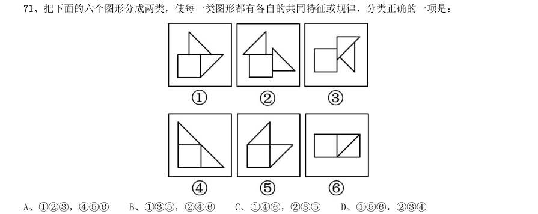

- **A.** 123,456
- **B.** 135,246
- **C.** 146,235
- **D.** 156,234

**答案：A**　**考点：图形推理｜位置规律**
**【判断推理·图形推理｜HB-2014-ty-X072】**

72. 如用白、灰、黑三种颜色的油漆为正方体盒子的6 个面上色,且两个相对面上的颜色都一样,以下哪一个不 可能是该盒子外表图的展开图:

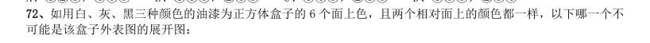

> （本题为图形题，选项为图片，见原卷）

**答案：C**　**考点：图形推理｜立体图形**
**【判断推理·图形推理｜HB-2014-ty-X073】**

73. 左边给定的是纸盒外表面的展开图,右边哪一项能由它折叠而成?请把它找出来:

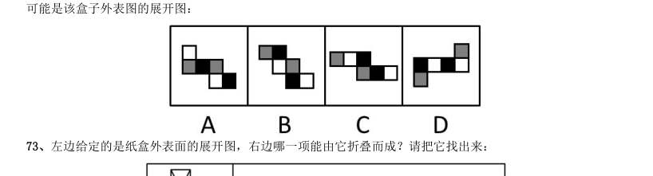

> （本题为图形题，选项为图片，见原卷）

**答案：A**　**考点：图形推理｜数量规律**
**【判断推理·图形推理｜HB-2014-ty-X074】**

74. 从所给的四个选项中,选择最合适的一个填入问号处,使之呈现一定的规律性:

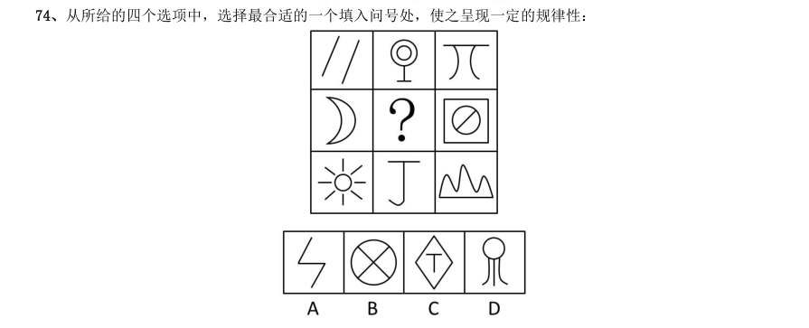

> （本题为图形题，选项为图片，见原卷）

**答案：D**　**考点：图形推理｜数量规律**
**【判断推理·图形推理｜HB-2014-ty-X075】**

75. 下列的立体图形是立方体中挖出一个圆锥台孔后形成的,如果从任一面剖开,以下哪一个不可能是该立体图 形的截面:

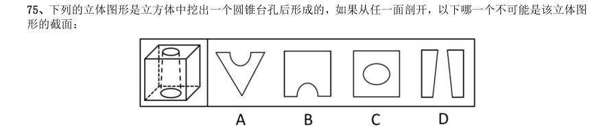

> （本题为图形题，选项为图片，见原卷）

**答案：A**　**考点：图形推理｜数量规律**
**【判断推理·图形推理｜HB-2014-ty-X076】**

76. 从所给的四个选项中,选择最合适的一个填入问号处,使之呈现一定的规律性:

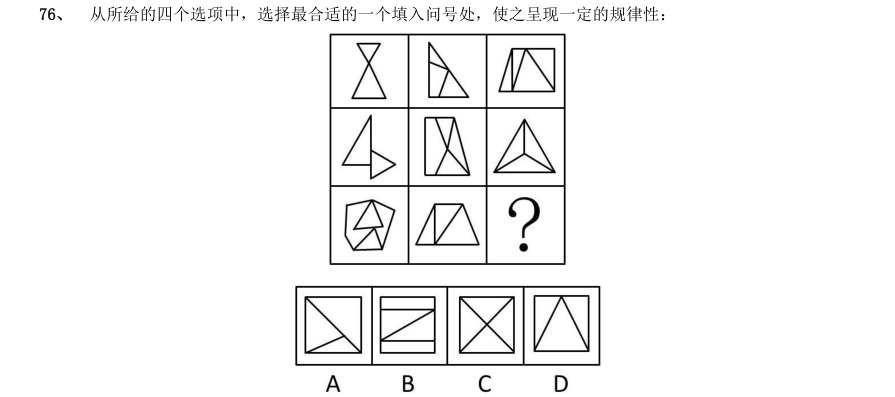

> （本题为图形题，选项为图片，见原卷）

**答案：A**　**考点：图形推理｜数量规律**
**【判断推理·图形推理｜HB-2014-ty-X077】**

77. 请从所给的四个选项中,选择最合适的一项填在问号处,使之呈现一定的规律性。

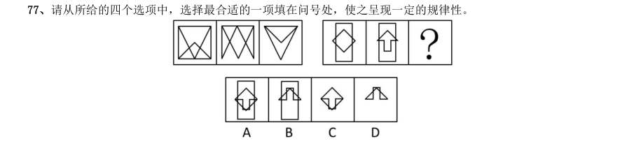

> （本题为图形题，选项为图片，见原卷）

**答案：D**　**考点：图形推理｜位置规律**
**【判断推理·定义判断｜HB-2014-ty-X078】**

78. 诱导运动是一种视错觉,即观察者知觉到某个物体在运动,而实际上该物体没有发生空间移动,只是由于其 他物体的运动使得被观察物体看起来好像在运动。 根据上述定义,下列属于诱导运动的是:

- **A.** 在没有月光的夜晚仰望天空,觉得星星好像在动
- **B.** 电影院里播放的精彩电影
- **C.** 月亮在云彩后面穿行
- **D.** 注视飞速开过的火车之后,会觉得附近的树木向相反方向运动

**答案：C**　**考点：定义判断｜单定义**
**【判断推理·定义判断｜HB-2014-ty-X079】**

79. 经营性资产是在生产和流通中能够为社会提供商品或劳务的资产。经营性资产的使用单位是具有法人地位的 企业,其运营要以追求经济效益为原则。从会计角度看,主要指企业因盈利目的而持有,且实际也具有盈利能力 的资产。 根据上述定义,下列不属于“经营性资产”的是:

- **A.** 某电视机厂中积压的黑白电视机
- **B.** 建设中尚未投入使用的水力发电站
- **C.** 某外贸公司用于交纳税金的银行存款
- **D.** 某重点中学新购入的实验室设备和器材

**答案：D**　**考点：定义判断｜单定义**
**【判断推理·定义判断｜HB-2014-ty-X080】**

80. 选择性接触是指受众在接触大众传播活动之际,并不是不加区别地对待任何媒介和内容,而是更倾向于与自 己的既有立场、观点、态度一致或接近的加以接触,或有意无意地回避与自己既有倾向相左的媒介或内容。 根据上述定义,下列属于“选择性接触”的是:

- **A.** 旅行社推出的夕阳红系列游的团体活动受到很多退休老人的欢迎。
- **B.** 减肥产品最畅销的人群是那些正在减肥的人,而不是那些打算减肥的人。
- **C.** 初中政治老师王某每天回家的第一件事就是收看新闻联播。
- **D.** 赵总监推崇人性化管理,经常参加人本主义取向的心理学培训课程。

**答案：D**　**考点：定义判断｜单定义**
**【判断推理·定义判断｜HB-2014-ty-X081】**

81. 喻代是一种建立于比喻基础之上的以喻体代本体的一种修辞方式。即先比喻,后用喻体代本体。喻代是比喻 后的名称代换,喻体作为别名而存在,其比喻的色彩、意味减弱,含蓄表达成为关键。根据上述定义,下列各项 中没有使用喻代这一修辞方式的是:

- **A.** 我吃了一吓,却见一个五十岁上下的女人站在我的面前,两手搭在髀间,张着两脚,正像一个画图仪器里细脚伶仃的圆规......然而圆规很不平,显示鄙夷的神色。
- **B.** 多么熟悉的声音,多么动人的曲子,去年春节文娱晚会上因这支歌而被同学们昵称为“李谷二”,她的声音,我一下子就能听出来。
- **C.** 他走了,像只风筝,在山坡上摇啊摇,弯弯曲曲的白线越放越长,到底放到头了,那儿是山顶,是和天连着的地方,“风筝”停了,他知道这条白线还拴着一颗心呢。
- **D.** 那外国人想雇我的驴去游山东,我要五块钱,他嫌贵。你嫌贵,我还嫌你胖呢。胖的像大白熊,别压坏了我

**答案：B**　**考点：定义判断｜单定义**
**【判断推理·定义判断｜HB-2014-ty-X082】**

82. 著作人身权,又称著作精神权,指著作权人对其作品所享有的各种与人身相联系或者密不可分而又无直接财 产内容的权利,是作者通过创作表现个人风格的作品而依法享有获得名誉、声望和维护作品完整性的权利。著作 财产权,又称著作经济权,是著作人身权的对称,是指著作权人自己使用或者授权他人以一定方式使用作品而获 得物质利益的权利。 根据上述定义,下列说法中正确的是:

- **A.** 某知名网络小说作家要求出版社使用其真实姓名出版其作品,则该作家行使的是著作人身权
- **B.** 画家王某将自己的画作以高价卖给了姜某,则姜某获得了该画作的著作财产权
- **C.** 某知名舞蹈家创作的舞蹈深受群众喜爱,不少人纷纷模仿并进行商业演出,该舞蹈家要求停止这一侵权行为,则她行使的是著作人身权
- **D.** 某剧作家创作的电视剧因深受观众喜爱而被翻拍,该剧作家要求电视剧制作方不得修改故事的结局,则他行

**答案：A**　**考点：定义判断｜单定义**
**【判断推理·定义判断｜HB-2014-ty-X083】**

83. 生产、销售有毒、有害食品罪是指在生产、销售的食品中掺入有毒、有害的非食品原料,或者销售明知掺有 有毒、有害的非食品原料的食品的行为。 根据上述定义,下列构成生产、销售有毒、有害食品罪的是:

- **A.** 某肉食品加工厂用病死猪肉作原料生产火腿,造成大批消费者食物中毒
- **B.** 刘某在地下工厂用工业高纯度酒精加自来水制造大量假酒,并将其销售给商店,获得8 万多元
- **C.** 某饮料生产厂家在生产的可乐中添加了食品添加剂——咖啡因,但并未在包装上予以注明,使大量消费者饮用了含有咖啡因的可乐
- **D.** 某食品厂在所生产的一批彩虹糖中添加食用色素超标,长期食用会给人体健康造成危害

**答案：B**　**考点：定义判断｜单定义**
**【判断推理·定义判断｜HB-2014-ty-X084】**

84. 姑息治疗是指对那些治愈性治疗无望或不能接受治愈性治疗的病人采取完全的主动的医疗和护理,控制疼痛 及有关症状,并对心理、社会和精神问题予以重视,其目的是为病人和家属赢得最好的生活质量。姑息治疗同样 适用于早期肿瘤病人,将姑息治疗与抗肿瘤治疗相结合。 根据上述定义,下列不属于姑息治疗的是:

- **A.** 某患者因病情恶化且年老体衰,无法翻身,身体生了褥疮,口腔也有霉菌感染,护士为其洗澡擦身,并做了口腔清洁
- **B.** 某患者因为癌症晚期,且自身状况差无法进行抗癌治疗,医生认为患者已没有治疗价值,劝患者回家休养
- **C.** 某年轻患者刚结婚便被诊断为乳腺癌,情绪非常激动,拒绝接受治疗,医生为其进行了心理辅导
- **D.** 某患者手术后严重疼痛,无法入睡,医生给了他止疼药,并给予一定的镇静剂,让患者能好好休息

**答案：D**　**考点：定义判断｜单定义**
**【判断推理·定义判断｜HB-2014-ty-X085】**

85. 心理记账是人们在心理上对结果进行分类、编码、估价和预算的过程。消费者在决策时可能根据不同的任务 进行相应的心理记账。 根据上述定义,下列不属于典型心理记账的是:

- **A.** 损失10 元钱给人心理带来的痛苦要比获得10 元奖金带来的高兴更强烈
- **B.** 王某出差常选星级酒店,因为它比旅馆更可能提供免费网络和自助早餐
- **C.** 相比丢了10 元钱的人,丢了电影票的人更不可能会掏钱买票去看电影
- **D.** 工会发放福利时,不再发实物而改发购物卡以使职工有更多的自由选择

**答案：D**　**考点：定义判断｜单定义**
**【判断推理·类比推理｜HB-2014-ty-X086】**

86. ( )对于汽车,相当于开关对于( )

- **A.** 轮胎:电门
- **B.** 汽油:电灯
- **C.** 钥匙:电视
- **D.** 飞机:电池

**答案：C**　**考点：类比推理｜逻辑关系**
**【判断推理·类比推理｜HB-2014-ty-X087】**

87. 分水岭对于( )相当于( )对于 水稻

- **A.** 山岭:大米
- **B.** 地质:节气
- **C.** 界线:作物
- **D.** 回归线:青稞

**答案：D**　**考点：类比推理｜逻辑关系**
**【判断推理·类比推理｜HB-2014-ty-X088】**

88. 银元:白银:货币

- **A.** 竹筏:竹子:木舟
- **B.** 瓦片:泥土:屋顶
- **C.** 琵琶:木材:弦乐
- **D.** 齿轮:金属:机械

**答案：D**　**考点：类比推理｜逻辑关系**
**【判断推理·类比推理｜HB-2014-ty-X089】**

89. 戒烟:疾病

- **A.** 酒驾:事故
- **B.** 核对:差错
- **C.** 过失:反思
- **D.** 斟酌:顾虑

**答案：B**　**考点：类比推理｜类比推理（综合）**
**【判断推理·类比推理｜HB-2014-ty-X090】**

90. 照片:留念

- **A.** 文件:机密
- **B.** 古董:珍藏
- **C.** 日记:记载
- **D.** 书籍:查阅

**答案：C**　**考点：类比推理｜逻辑关系**
**【判断推理·类比推理｜HB-2014-ty-X091】**

91. 药物:胶囊

- **A.** 桌椅:桌面
- **B.** 电脑:屏幕
- **C.** 书本:封面
- **D.** 物品:木箱

**答案：D**　**考点：类比推理｜逻辑关系**
**【判断推理·类比推理｜HB-2014-ty-X092】**

92. 计算之于( )相当于实验之于( )

- **A.** 推理:逻辑
- **B.** 物理:天文
- **C.** 数学:化学
- **D.** 大脑:助手

**答案：C**　**考点：类比推理｜逻辑关系**
**【判断推理·类比推理｜HB-2014-ty-X093】**

93. 南征北战:东讨西伐

- **A.** 万紫千红:姹紫嫣红
- **B.** 古往今来:天南地北
- **C.** 朝三暮四:喜新厌旧
- **D.** 左顾右盼:东张西望

**答案：暂缺**　**考点：类比推理｜语义关系**
**【判断推理·类比推理｜HB-2014-ty-X094】**

94. 抵押对于( ),相当于( )对于处罚

- **A.** 银行:监狱
- **B.** 担保:罚款
- **C.** 房屋:立法
- **D.** 债务:刑罚

**答案：B**　**考点：类比推理｜对应关系**
**【判断推理·类比推理｜HB-2014-ty-X095】**

95. 居住:居民

- **A.** 继承:继承人
- **B.** 吝啬:守财奴
- **C.** 顺从:独裁者
- **D.** 乞讨:流浪者

**答案：A**　**考点：类比推理｜对应关系**
**【判断推理·逻辑判断｜HB-2014-ty-X096】**

96. 低热量食物是指含淀粉、糖类等碳水化合物类较少的食物。通过食用低热量食品,可以有效控制能量的摄入 量,避免多余能量在体内以脂肪形式储存下来。如果体重已经较重的人改为食用低热量食品,则可在保持饱腹感 的同时达到减肥效果。另外,有许多人认为,低热量食物对糖尿病患者也十分有益。 以下哪项为真,最能支持上述推论:

- **A.** 改食用低热量食物需要逐步进行,否则会引起机体代谢紊乱
- **B.** 研究表明低热量饮食可减少脂肪在胰脏中的沉积,恢复胰岛素的分泌
- **C.** 低热量食品可适当增加进食量,满足饱腹感,享受吃饱的乐趣
- **D.** 低热量食品可以降低超重或糖尿病患者的体重,但需要补充其他营养

**答案：B**　**考点：逻辑判断｜加强**
**【判断推理·逻辑判断｜HB-2014-ty-X097】**

97. 噬菌体是一种病菌,它能够捕食细菌,目前随着医疗中植入技术的发展,越来越多的患者接受着诸如导尿管、 心脏支架等医学植入装置,但随之也带来了细菌感染的风险,因此,一些研究人员认为如果噬菌体吸附在植入装 置材料表面,再将其放入患者体内,就可以避免植入装置引发的感染。 以下哪项为真,最能削弱上述结论:

- **A.** 对植入医学装置的患者,一般通过服用抗生素来防御细菌感染
- **B.** 有细菌的场所就可能有相应噬菌体的存在,只是数量差异
- **C.** 噬菌体能够攻击治病细菌,但有时也“捕食”有益的细菌
- **D.** 一些噬菌体进入机体后,无法适应体液环境,难以保持活性

**答案：D**　**考点：逻辑判断｜削弱**
**【判断推理·逻辑判断｜HB-2014-ty-X098】**

98. 以往的研究认为火山喷发会释放大量热量,引发全球变暖,但今日研究发现,火山喷发不仅不会引发全球温 度上升,还可以削弱全球变暖的影响。 以下哪项为真,最能支持上述结论:

- **A.** 研究表明,火山爆发时地下岩浆喷出地面,与空气接触,产生氧化反应,引起局部温度升高。
- **B.** 火山爆发能够抑制某种分解有机物的细菌,其分解的有机物中含有甲烷,甲烷是一种可燃性气体,可产生热能。
- **C.** 火山喷发后会带来大规模的酸雨,酸雨能在短期内降低火山区气温,但是也引发了农作物虫害。
- **D.** 研究发现火山喷发物质——二氧化硫可与大气物质形成“水粒”并将阳光反射,减少对地面的热辐射,延缓

**答案：D**　**考点：逻辑判断｜削弱**
**【判断推理·逻辑判断｜HB-2014-ty-X099】**

99. 随着人们的生活和工作环境进入高楼大厦,人们接触日光的机会变少,研究发现,日光是合成维生素D 的必 要条件,而维生素D 是促进钙吸收的关键因素。因此有人得出结论:现代人更容易患骨质疏松等因缺钙引起的疾 病。 以下哪项为真,最能质疑上述结论:

- **A.** 骨质疏松疾病患者多晒太阳就可以缓解或治愈
- **B.** 现代人饮食结构中的含钙食品比以前丰富很多
- **C.** 骨质疏松症患者接触日光的时长与其他人无异
- **D.** 口服维生素D 片是加了促吸收剂的合成配方

**答案：C**　**考点：逻辑判断｜削弱**
**【判断推理·逻辑判断｜HB-2014-ty-X100】**

100. 软件用户的调查显示,通常一个软件会有1000 个用户采用,如果一个软件每天被下载安装的次数达到55 次,这个软件的流行度会急速上升,最多时有1200 万个用户采用,大量用户几乎是完全根据其他用户的行为来 选择安装这个软件,而很少关注其本身的内在特点。 根据以上描述可以推出:

- **A.** 网站上最流行的软件未必是最实用的软件
- **B.** 参考别人选择安装软件是不明智的
- **C.** 网站上推出的软件未必都是有用的
- **D.** 用户安装在电脑上的一些软件或许会被删除

**答案：A**　**考点：逻辑判断｜归纳推导**
**【判断推理·逻辑判断｜HB-2014-ty-X101】**

101. 一项新的研究发现,短期摄入高脂食物有益心脏,研究人员在实验后期人工引发老鼠心脏缺血性伤害,类 似人心脏病发作时的情况。他们发现,吃高脂食物24 小时、1 周和2 周的老鼠心脏组织受损状况比吃6 周高脂 食物的老鼠和“吃素”的老鼠轻70%。研究人员认为这是由于短期摄入高脂食品可以使心脏肌肉获得更多能量, 增强抵御伤害能力。他们认为,短期摄入高脂饮食或可保护心脏机能。 以下哪项为真,最能支持题干的结论:

- **A.** 高脂食物中所含有的低密度脂蛋白胆固醇是人体所不可缺少的物质
- **B.** 高脂食物可以使人体获得进行新陈代谢等活动所必需的物质和能量
- **C.** 如果让老鼠“吃一天荤”后改“吃素”,它们心脏抵御伤害的能力比一开始就“吃素”的老鼠强
- **D.** 要想降低患心脏病风险,应注意饮食平衡,适当摄入脂肪和胆固醇

**答案：C**　**考点：逻辑判断｜加强**
**【判断推理·图形推理｜HB-2014-ty-X102】**

102. R 医院连续五年在C 市举办的“我最满意的医院”调查中高居榜首,该医院负责人表示,这是由于该医院 提供了比其他医院更加优质的导诊服务。以下哪项为真,最能支持该医院负责人的观点: A C 市各大医院都在导诊服务中投入了大量精力,力图提高导诊服务质量 B C 市“我最满意的医院”调查已开展20 年,高居榜首的均是公立医院 C C 市共有200 多家医院,并非所有的医院都参与了此次调查 D、与R 医院医疗水平相当,但导诊服务不佳的医院排名均不如R 医院

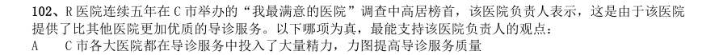

> （本题为图形题，选项为图片，见原卷）

**答案：D**　**考点：图形推理｜图形推理（综合）**
**【判断推理·逻辑判断｜HB-2014-ty-X103】**

103. 在地球构造活动频繁的时期,环非洲、南美和欧洲的新海洋盆地开始扩展,产生了新的空间,大气中大量 二氧化碳与光合作用的生物发生反应,死亡的生物随后被埋在海底沉积物中,形成了富含碳元素的页岩。大气中 的碳被固定下来,使得大气中二氧化碳的水平下降,减小了温室效应并降低了全球温度,这对海洋生命来说是非 常严重的后果。因此科学家认为,全球变冷或变暖后果同样严重。 下列哪项为真,最能支持科学家的论断:

- **A.** 在全球变冷的200 年后,由于频繁的火山爆发,使得固化在岩叶中的碳以二氧化碳的形式重回到大气层,部分恢复了温室效应
- **B.** 全球变暖会导致海洋生物生态危机,科学家发现在26 万年前全球变冷的时期,海洋生物发生过类似的危机
- **C.** 大规模且长期的自然变化,或由于人类活动而造成全球温室效应在短期内的巨大改变对整个系统来说都具有冲击作用
- **D.** 科学家观察到气候变冷的发生超过几百万年,而不是几十年或几百年,这还很难和我们迅速变化的现代气候

**答案：B**　**考点：逻辑判断｜加强**
**【判断推理·逻辑判断｜HB-2014-ty-X104】**

104. 兄弟姐妹四人,甲、乙、丙、丁。甲说:丁是最小的妹妹。乙说:兄弟姐妹中只有哥哥一个男孩。丙说: 我是甲的姐姐。 如果上述都为真。以下推断正确的是:

- **A.** 丙排行第二,是女孩;丁排行最小,是女孩
- **B.** 乙排行第二,是女孩:丙排行第一,是女孩
- **C.** 甲排行第二,是男孩;乙排行第三,是女孩
- **D.** 甲排行第二,是女孩;丙排行第一,是女孩

**答案：C**　**考点：逻辑判断｜真假推理**
**【判断推理·逻辑判断｜HB-2014-ty-X105】**

105. 研究人员认为肥胖症和人体内寄生某些能产生特定气体的微生物有关,这些微生物使他们呼出的气体味道 更难闻。加州洛杉矶CS 医学中心分析了792 位体检者的呼吸,发现呼出甲烷和氢气量高的人的身高体重指数(BMI) 比正常人要高2.4 点,即属于肥胖人群。 根据以上描述不能推出:

- **A.** 胖人体内可能寄生着某些产生特定气体的微生物
- **B.** 可以通过气体是否难闻来判定呼气者是否是肥胖症患者
- **C.** 呼出气体中甲烷和氢气含量高的人群比正常人群更胖
- **D.** 甲烷和氢气的混合物味道较难闻

**答案：B**　**考点：逻辑判断｜归纳推导**
**【资料分析·倍数计算｜HB-2014-ty-X106】**
> 材料：理。 (一) 2013 年3 月末,金融机构人民币各项贷款余额65.76 万亿元,同比增长14.9%,增速比上年同期低0.8 个百 分点。 2013 年3 月末,主要金融机构及小型农村金融机构,外资银行人民币小微企业贷款余额11.78 万亿元,同 比增长13.5%,比全部企业贷款余额增速高1.2 个百分点。 2013 年3 月末,主要金融机构本外币工业中长期贷款余额6.46 万亿元,同比增长3.2%。其中,轻工业中长 期贷款余额6824 亿元,同比增长7.6%;重工业中长期贷款余额5.77 万亿元,同比增长2.7%,服务业中长期贷款 余额16.55 万亿元,同比增长8.9%。 2013 年3 月末,主要金融机构及小型农村金融机构、村镇银行、财务公司本外币农村贷款余额15.24 万亿 元,同比增长18.4%;农户贷款余额3.86 万亿元,同比增长16.9%;农业贷款余额2.87 万亿元,同比

106. 2013 年3 月末,金融机构人民币各项贷款余额约是2011 年同期的多少倍?

- **A.** 1.1
- **B.** 1.2
- **C.** 1.4
- **D.** 1.3

**答案：D**　**考点：倍数计算｜是几倍**
**【资料分析·比重计算与比较｜HB-2014-ty-X107】**

107. 2013 年3 月末,轻工业中长期贷款余额占工业中长期贷款余额总体的比重与上年相比:

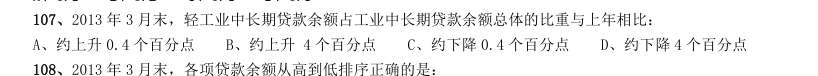

- **A.** 约上升0.4 个百分点
- **B.** 约上升4 个百分点
- **C.** 约下降0.4 个百分点
- **D.** 约下降4 个百分点

**答案：A**　**考点：比重计算与比较｜比重升降判断**
**【资料分析·综合分析｜HB-2014-ty-X108】**

108. 2013 年3 月末,各项贷款余额从高到低排序正确的是:

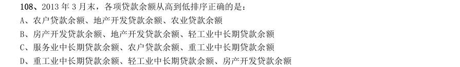

- **A.** 农户贷款余额、地产开发贷款余额、农业贷款余额
- **B.** 房产开发贷款余额、地产开发贷款余额、轻工业中长期贷款余额
- **C.** 服务业中长期贷款余额、农户贷款余额、重工业中长期贷款余额
- **D.** 重工业中长期贷款余额、轻工业中长期贷款余额、房产开发贷款余额

**答案：B**　**考点：综合分析｜选错误项**
**【资料分析·增长率计算与比较｜HB-2014-ty-X109】**

109. 2013 年3 月末,房地产开发余额同比增速为:

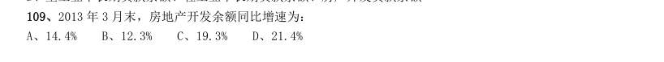

- **A.** 14.4%
- **B.** 12.3%
- **C.** 19.3%
- **D.** 21.4%

**答案：A**　**考点：增长率计算与比较｜增长率计算**
**【资料分析·综合分析｜HB-2014-ty-X110】**

110. 关于2013 年3 月末贷款余额的情况,能够从上述材料中推出的是:

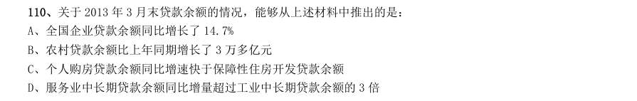

- **A.** 全国企业贷款余额同比增长了14.7%
- **B.** 农村贷款余额比上年同期增长了3 万多亿元
- **C.** 个人购房贷款余额同比增速快于保障性住房开发贷款余额
- **D.** 服务业中长期贷款余额同比增量超过工业中长期贷款余额的3 倍

**答案：A**　**考点：综合分析｜选正确项**
**【资料分析·增长率计算与比较｜HB-2014-ty-X111】**

111. 图 2008—2012 年全国一次能源、石油生产量与消费量的情况 图2 2008—2012 年全国矿产品进出口情况 2009—2012 年间一次能源生产量增速最快的一年是:

- **A.** 2009 年
- **B.** 2010 年
- **C.** 2011 年
- **D.** 2012 年

**答案：B**　**考点：增长率计算与比较｜增长率比较**
**【资料分析·基期量计算｜HB-2014-ty-X112】**

112. 图中一次能源消费量与生产量差值最大的一年,该差值为多少亿吨标准煤?

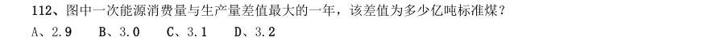

- **A.** 2.9
- **B.** 3.0
- **C.** 3.1
- **D.** 3.2

**答案：D**　**考点：基期量计算｜基期量比较**
**【资料分析·基期量计算｜HB-2014-ty-X113】**

113. 2009—2012 年间全国商品进出口总额最高年份,矿产品进出口总额比上年:

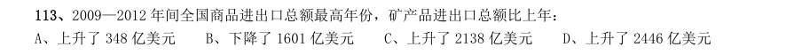

- **A.** 上升了348 亿美元
- **B.** 下降了1601 亿美元
- **C.** 上升了2138 亿美元
- **D.** 上升了2446 亿美元

**答案：A**　**考点：基期量计算｜已知现期与增长率求基期**
**【资料分析·倍数计算｜HB-2014-ty-X114】**

114. 2008—2012 年间,全国石油消费量超过全国石油产量2 倍的年份有几个?

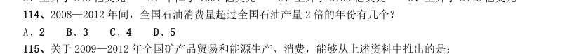

- **A.** 2
- **B.** 3
- **C.** 4
- **D.** 5

**答案：C**　**考点：倍数计算｜是几倍**
**【资料分析·综合分析｜HB-2014-ty-X115】**

115. 关于2009—2012 年全国矿产品贸易和能源生产、消费,能够从上述资料中推出的是:

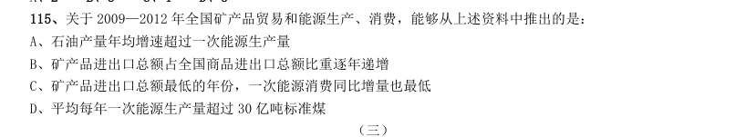

- **A.** 石油产量年均增速超过一次能源生产量
- **B.** 矿产品进出口总额占全国商品进出口总额比重逐年递增
- **C.** 矿产品进出口总额最低的年份,一次能源消费同比增量也最低
- **D.** 平均每年一次能源生产量超过30 亿吨标准煤

**答案：A**　**考点：综合分析｜选正确项**
**【资料分析·增长率计算与比较｜HB-2014-ty-X116】**
> 材料：2012 年,某省规模以上工业增加值10875 亿元,比上年增长7.1%,月度增速从1-2 月的2.9%回升到10-12 月的 10%以上,大型、中型和小微型企业增加值分别为3074、3217 和4584 亿元,比上年分别增长8.2%、6.8%和6.7%。 2012 年,该省规模以上工业企业主营收入56730 亿元,比上年增长3.5%,增速比全国低7.5 个百分点;利润总 额2900 亿元,比上年下降6.1%。

116. 2012 某省规模以上工业增加值同比增速情况: 与2011 年相比,2012 年该省规模以上工业增加值约增加了多少亿元?

- **A.** 600
- **B.** 720
- **C.** 840
- **D.** 960

**答案：B**　**考点：增长率计算与比较｜增长率计算**
**【资料分析·增长率计算与比较｜HB-2014-ty-X117】**

117. 2012 年3—10 月间,中型企业增加值增速和规模以上工业增加值总体增速差异最大的月份是:

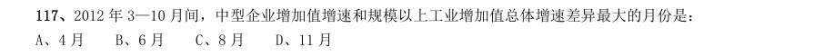

- **A.** 4 月
- **B.** 6 月
- **C.** 8 月
- **D.** 11 月

**答案：A**　**考点：增长率计算与比较｜增长率比较**
**【资料分析·增长率计算与比较｜HB-2014-ty-X118】**

118. 2012 年3—10 月间,三类企业工业增加值同比增速均超过5%的月份有几个?

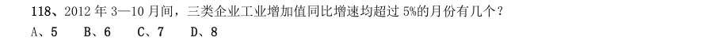

- **A.** 5
- **B.** 6
- **C.** 7
- **D.** 8

**答案：A**　**考点：增长率计算与比较｜增长率计算**
**【资料分析·增长率计算与比较｜HB-2014-ty-X119】**

119. 与2011 年相比,2012 年全国规模以上工业企业主营业务收入:

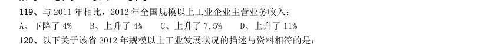

- **A.** 下降了4%
- **B.** 上升了4%
- **C.** 上升了7.5%
- **D.** 上升了11%

**答案：D**　**考点：增长率计算与比较｜增长率比较**
**【资料分析·基期量计算｜HB-2014-ty-X120】**

120. 以下关于该省2012 年规模以上工业发展状况的描述与资料相符的是:

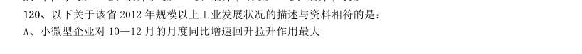

- **A.** 小微型企业对10—12 月的月度同比增速回升拉升作用最大
- **B.** 全年小微型企业增加值同比增量低于中型企业
- **C.** 规模以上工业企业主营业务利润率高于上年水平
- **D.** 第三季度大型企业工业增加值同比增速高于其他两类企业

**答案：A**　**考点：基期量计算｜已知现期与增长率求基期**
**【资料分析·平均数计算｜HB-2014-ty-X121】**

121. 2013 年1—5 月,保险业平均每月业务及管理费用约为多少亿元?

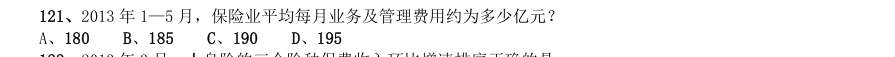

- **A.** 180
- **B.** 185
- **C.** 190
- **D.** 195

**答案：B**　**考点：平均数计算｜现期平均数**
**【资料分析·综合分析｜HB-2014-ty-X122】**

122. 2013 年3 月,人身险的三个险种保费收入环比增速排序正确的是:

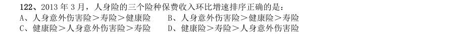

- **A.** 人身意外伤害险>寿险>健康险
- **B.** 人身意外伤害险>健康险>寿险
- **C.** 健康险>人身意外伤害险>寿险
- **D.** 健康险>寿险>人身意外伤害险

**答案：B**　**考点：综合分析｜排序与图示判断**
**【资料分析·基期量计算｜HB-2014-ty-X123】**

123. 以下各月中,哪个月全行业保险赔付支出额与保险保费收入额比值最低?

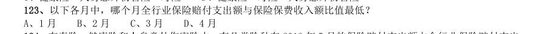

- **A.** 1 月
- **B.** 2 月
- **C.** 3 月
- **D.** 4 月

**答案：A**　**考点：基期量计算｜基期量比较**
**【资料分析·比重计算与比较｜HB-2014-ty-X124】**

124. 在寿险、健康险和人身意外伤害险中,有几类险种在2013 年5 月的保险赔付支出额占全行业保险赔付支出 总额的比重高于上年同期水平?

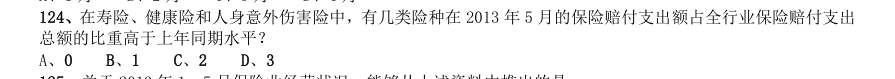

- **A.** 0
- **B.** 1
- **C.** 2
- **D.** 3

**答案：B**　**考点：比重计算与比较｜比重升降判断**
**【资料分析·综合分析｜HB-2014-ty-X125】**

125. 关于2013 年1—5 月保险业经营状况,能够从上述资料中推出的是:

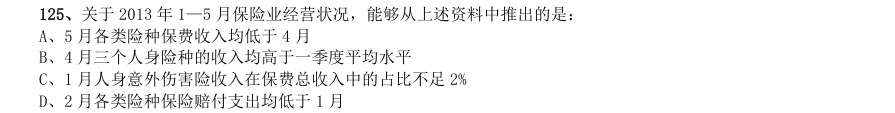

- **A.** 5 月各类险种保费收入均低于4 月
- **B.** 4 月三个人身险种的收入均高于一季度平均水平
- **C.** 1 月人身意外伤害险收入在保费总收入中的占比不足2%
- **D.** 2 月各类险种保险赔付支出均低于1 月

**答案：C**　**考点：综合分析｜选正确项**