# 2015 湖北省考·行测

- 题量：125（含答案 119）
- 考试类型：湖北省考
- 模块分布：资料分析20 / 数量关系14 / 言语理解35 / 判断推理36 / 常识判断20
- 试卷编号：`湖北-2015-统一卷`

## 题目与答案

**【2015 湖北省考·第 1 题】常识判断·时事政治｜HB-2015-ty-X001**

1. 党的十八届三中全会审议通过了《中共中央关于全面深化改革若干重大问题的决定》(以下简称《决定》), 对全面深化改革作出了总体部署。在未来一个阶段,《决定》对普通公民的生活可能带来的改变有: 1、如果你要考大学,那么可能不必文理分科

> （本题为图形题，选项为图片，见原卷）

**答案：C**　**考点：时事政治｜重要会议**　**难度：★★★★☆**
**【2015 湖北省考·第 2 题】常识判断·生活常识｜HB-2015-ty-X002**

2. 如果你是“单独家庭”,那么可以生育第二胎

> （本题为图形题，选项为图片，见原卷）

**答案：B**　**考点：生活常识｜经济常识**　**难度：★★★☆☆**
**【2015 湖北省考·第 3 题】常识判断·生活常识｜HB-2015-ty-X003**

3. 如果你是农村户口,那么宅基地可以私有

> （本题为图形题，选项为图片，见原卷）

**答案：C**　**考点：生活常识｜常识（待细分）**　**难度：★★★☆☆**
**【2015 湖北省考·第 4 题】常识判断·生活常识｜HB-2015-ty-X004**

4. 如果你是劳动者,那么可能可以延迟退休

- **A.** 123
- **B.** 234
- **C.** 124
- **D.** 1234

**答案：C**　**考点：生活常识｜历史人文**　**难度：★★★☆☆**
**【2015 湖北省考·第 5 题】常识判断·历史人文｜HB-2015-ty-X005**
> 材料：列不属于行政手段的是: A、规定各级电视台每日播出境外各类影视节目时间 B、设立专项经费用于鼓励本土作家创作优秀剧本 C、国家出台“限娱令”规范娱乐节目播出类型 D、每年引进的境外动漫作品同类题材数量设置上限 3、下列雕塑作品表现唐太宗李世民生平战功的是: A、马踏匈奴 B、击鼓说唱俑 C、昭陵六骏 D、乾陵石雕 4、下列诗句背景与科举制实行无关的是: A、慈恩寺下题名处,十七人中最少年 B、太宗皇帝真长策,赚得英雄尽白头 C、黑发不知勤学早,白首方悔读书迟 D、春风得意马蹄疾,一日看尽长安花

5. 中国古代小说塑造了很多莽汉形象,他们外表威猛阳刚,性格天真似儿童,深受读者的喜爱。下列小说中莽 汉的时代顺序排列正确的是: 1、张飞 2、程咬金 3、李逵 4、牛皋

- **A.** 2134
- **B.** 2143
- **C.** 4213
- **D.** 1234

**答案：D**　**考点：历史人文｜中国古代史**　**难度：★★★☆☆**
**【2015 湖北省考·第 6 题】常识判断·法律常识｜HB-2015-ty-X006**

6. 下列情形符合法律规定的是:

- **A.** 甲、乙二人自由恋爱,因两人均年满20 周岁,经双方父母同意,两人可以结婚
- **B.** 丙12 岁,玩火酿成火灾造成重大财产损失,但丙不承担失火罪的刑事责任
- **C.** 丁6 岁,春节收到红包若干,其母认为丁尚年幼,红包里的钱应归监护人所有
- **D.** 19 岁的大学生戊,认为父母有义务支付他的教育费及生活费至其独立工作为止

**答案：B**　**考点：法律常识｜民法典**　**难度：★★★★★**
**【2015 湖北省考·第 7 题】常识判断·生活常识｜HB-2015-ty-X007**

7. 下列不属于心理学效应的是:

- **A.** 晕轮效应
- **B.** 马太效应
- **C.** 破窗效应
- **D.** 配位效应

**答案：D**　**考点：生活常识｜科技常识**　**难度：★★★☆☆**
**【2015 湖北省考·第 8 题】常识判断·地理常识｜HB-2015-ty-X008**

8. 所谓硬水是指水中存在较多的矿物质成分,水的硬度指的是水中钙镁离子的总和。下列关于硬水的说法错误的 是:

- **A.** 加入石灰能降低水的硬度
- **B.** 可以用肥皂水鉴别软硬水
- **C.** 将水煮沸可以降低水的硬度
- **D.** 可以长期饮用硬度较高的水

**答案：D**　**考点：地理常识｜地理常识（待细分）**　**难度：★★★☆☆**
**【2015 湖北省考·第 9 题】常识判断·科技常识｜HB-2015-ty-X009**

9. 呼吸作用是生物体细胞把有机物氧化分解并产生能量的过程,没有氧气参与的呼吸称为无氧呼吸,无氧呼吸 是指细胞在缺氧的条件下,通过酶的催化作用把葡萄糖等有机物分解为尚未彻底氧化的产物。下列现象与无氧呼 吸有关的是:

- **A.** 人剧烈运动后肌肉酸痛
- **B.** 用糯米和酒曲酿造米酒
- **C.** 农作物受涝时短时间内不会死亡
- **D.** 把生水果和熟苹果放在密闭的缸里催熟

**答案：A**　**考点：科技常识｜基础科学**　**难度：★★★★☆**
**【2015 湖北省考·第 10 题】常识判断·历史人文｜HB-2015-ty-X010**

10. 地球自转一圈的时间是一天,地球半径为6371 千米。毛泽东诗词“坐地日行八万里”是有科学依据的,人 可以随着地球的自转运动,那么与诗句最吻合的可能是哪个国家的人:

- **A.** 阿富汗
- **B.** 南非
- **C.** 新加坡
- **D.** 挪威

**答案：C**　**考点：历史人文｜文学与文化**　**难度：★★★☆☆**
**【2015 湖北省考·第 11 题】常识判断·经济常识｜HB-2015-ty-X011**

11. 社会上普遍存在着当市场上充斥着大量差(假)产品而不能为消费者识别时,好的产品最终也将退出市场的现 象。下列属于这一现象的是:

- **A.** 南郭滥竽充数
- **B.** 民间借贷危机
- **C.** 三聚氰胺事件
- **D.** 行人集结闯红灯

**答案：C**　**考点：经济常识｜微观与市场**　**难度：★★★☆☆**
**【2015 湖北省考·第 12 题】常识判断·历史人文｜HB-2015-ty-X012**

12. 古人记月除常用的序数法外,还以物候的特点来命名,或以孟、仲、季来命名各季节的三个月。那么,下列 对应关系正确的是:

- **A.** 孟春—桃月
- **B.** 仲夏—荷月
- **C.** 仲秋—桂月
- **D.** 季冬—菊月

**答案：C**　**考点：历史人文｜历史人文（待细分）**　**难度：★★★☆☆**
**【2015 湖北省考·第 13 题】常识判断·科技常识｜HB-2015-ty-X013**

13. 通过云计算技术可以实现共享软硬件资源和信息。下列直接使用到云计算技术的是:

- **A.** 将ADSL 升级为光纤线路
- **B.** 设计并制作Web 网站页面
- **C.** 向ISP 申请注册网站域名
- **D.** 使用Google App Engine 服务,部署个人网站

**答案：D**　**考点：科技常识｜基础科学**　**难度：★★★☆☆**
**【2015 湖北省考·第 14 题】常识判断·科技常识｜HB-2015-ty-X014**

14. “旅行者1 号”空间探测器经过36 年的人类星际探索,沿途探索1木星2土星3土卫二4土卫六是否存在 生命迹象,并发回资料。阅读表格,依据探测资料判断将来最有可能孕育生命的天体是

- **A.** 1
- **B.** 2
- **C.** 3
- **D.** 4

**答案：C**　**考点：科技常识｜基础科学**　**难度：★★★☆☆**
**【2015 湖北省考·第 15 题】常识判断·科技常识｜HB-2015-ty-X015**

15. 结合化学知识和生活经验,下列说法不能减少环境污染的是:

- **A.** 将废弃的塑料袋、一次性塑料餐具等塑料制品集中堆放焚烧
- **B.** 将汽车发动机产生的尾气通过放有氧化钯催化剂的排气管后排放
- **C.** 在燃烧前对煤进行净化,去除原煤中的硫成分和灰成分
- **D.** 城市公交车和出租车采用液化天然气(LNG)代替普通汽油

**答案：A**　**考点：科技常识｜基础科学**　**难度：★★★★★**
**【2015 湖北省考·第 16 题】常识判断·生活常识｜HB-2015-ty-X016**

16. 下列生活中保存食物的方法,理解错误的是:

- **A.** 盐腌制食品是因为盐可以形成高渗环境,抑制了微生物的生理活动
- **B.** 真空保存食物可以破坏需氧菌类的生存环境
- **C.** 冷藏保存食物是因为低温可以将细菌冻死
- **D.** 充入氮气保存食品是为了隔绝食品和氧气的接触

**答案：C**　**考点：生活常识｜科技常识**　**难度：★★★☆☆**
**【2015 湖北省考·第 17 题】常识判断·生活常识｜HB-2015-ty-X017**

17. 在计算机网络通信领域中,防火墙是一项协助确保信息安全的设备。它会依据特定的规则,允许或是限制传 输的数据通过。小张在自己电脑上安装了防火墙软件,下列论述正确的是( )

- **A.** 防火墙软件有可能导致小张的电脑不能访问特定的Web 网站
- **B.** 防火墙软件有可能导致小张无法访问自己电脑硬盘上存储的文档
- **C.** 防火墙软件使得小张在网络购物时,不容易被虚假广告所欺骗
- **D.** 防火墙软件使得小张在和陌生网友聊天时,可以伪装自己的性别和姓名。

**答案：A**　**考点：生活常识｜科技常识**　**难度：★★★★★**
**【2015 湖北省考·第 18 题】常识判断·科技常识｜HB-2015-ty-X018**

18. 马航MH370 航班失踪之后,国际海事卫星组织试图利用多普勒原理计算出失踪航班的下落。多普勒原理,源 于这样的一种物理现象(多普勒效应):随着飞机高速接近(或远离)接受微波信号的卫星,卫星所侦测到的微波频 率都会越来越高(或越来越低)。下列描述的现象中,哪一种也体现了同样的多普勒效应:

- **A.** 站在铁轨附近的人,听到鸣笛的火车由远及近高速驶来时,汽笛的音调逐渐变得尖锐。
- **B.** 一束自然光射入三棱镜,射出时,被分解为不同的颜色。
- **C.** 向平静的湖面投入一颗小石子,激起涟漪呈圆形逐渐向周围扩散。
- **D.** 在日环食的过程中,观测到太阳黑子的存在。

**答案：A**　**考点：科技常识｜科技成就**　**难度：★★★★★**
**【2015 湖北省考·第 19 题】常识判断·历史人文｜HB-2015-ty-X019**

19. 2014 年是“和平共处五项原则”发表60 周年,下列与其发表时间相同的历史事件是:

- **A.** 东西两德统一
- **B.** 古巴导弹危机
- **C.** 联合国军完全撤出朝鲜
- **D.** 越南抗美战争彻底结束

**答案：C**　**考点：历史人文｜中国古代史**　**难度：★★★☆☆**
**【2015 湖北省考·第 20 题】常识判断·科技常识｜HB-2015-ty-X020**

20. 现代中医借助西医的物理检验手段,提高传统的“望-闻-问-切-处”的诊断准确性。这样的优化属于:

- **A.** 工期优化
- **B.** 技术优化
- **C.** 成本优化
- **D.** 流程优化

**答案：B**　**考点：科技常识｜基础科学**　**难度：★★★☆☆**
**【2015 湖北省考·第 21 题】言语理解·逻辑填空｜HB-2015-ty-X021**

21. 我国著名语言学家罗常培说过:语言文字是一个民族文化的结晶。这个民族过去的文化靠着它来流传。未来 的文化也仗着它来____。我们可以从诸多文字现象中,如汉字的造字、构词,汉字词义的形成和____中找寻中国 文化形成与发展的理据。 依次填入划横线部分最恰当的一项是:

- **A.** 推动变革
- **B.** 提升演进
- **C.** 弘扬变迁
- **D.** 推进演变

**答案：D**　**考点：逻辑填空｜实词辨析**　**难度：★★☆☆☆**
**【2015 湖北省考·第 22 题】言语理解·逻辑填空｜HB-2015-ty-X022**

22. 哈佛大学的一位校长曾提出这样的思考:我们培养出来的青年人该用什么样的方式来回报这所学校?是选择 自己更好的生活,还是更好地为公众服务?150 年过去了,这个问题仍然可以____当下。这位校长希望有朝一日 能够在学校的纪念碑上,____选择后者的毕业生的名字。今天,在中国,已经有越来越多的青年人作出了这样的 人生抉择。 依次填入划横线部分最恰当的一项是:

- **A.** 叩问雕刻
- **B.** 质问铭刻
- **C.** 拷问镌刻
- **D.** 追问铭记

**答案：C**　**考点：逻辑填空｜语境分析**　**难度：★★★★☆**
**【2015 湖北省考·第 23 题】言语理解·逻辑填空｜HB-2015-ty-X023**

23. 与形象相比,声音更是一种让人甚感扑朔迷离的东西。记得几年前一次上课,我突然感觉好像被自己营造的 诗意场景带入了云端。那一瞬间,我忘掉了自己,教室里的同学似乎也变得_____。华光普照的水光潋滟之间, 似乎只有声音的涟漪在教室上空_____,其他一切不见。这是一种袅袅上升的声音,是一种与一切物质现象相剥 离的明朗或华美。 依次填入划横线部分最恰当的一项是:

- **A.** 虚置飘荡
- **B.** 空幻飘舞
- **C.** 虚无飘荡
- **D.** 虚幻缥缈

**答案：C**　**考点：逻辑填空｜语境分析**　**难度：★★★★☆**
**【2015 湖北省考·第 24 题】言语理解·逻辑填空｜HB-2015-ty-X024**

24. 从“抢盐风波”到“各地发生地震”,网络造谣滋生的“网络炸弹”影响甚远。虽然很多情况下,我们可以 凭借自身的常识去分析,但每个人都有自己的知识盲点,不可能完全应付得了,一不留神,便可能成为受害者。 因此,必须打击网络谣言,才能_____舆论的正义,_____社会正常的理性和诚信。 依次填入划横线部分最恰当的一项是:

- **A.** 庇护修复
- **B.** 维护恢复
- **C.** 保卫重建
- **D.** 护卫匡复

**答案：B**　**考点：逻辑填空｜实词辨析**　**难度：★★★☆☆**
**【2015 湖北省考·第 25 题】言语理解·逻辑填空｜HB-2015-ty-X025**

25. 英国车,汽车工艺的代表,处处____出高贵、优雅、灵动、恒久的艺术气质。而这一切,源自于英国人一直 ____的传统造车技艺——始终以手工进行装嵌。 依次填入划横线部分最恰当的一项是:

- **A.** 彰显迷恋
- **B.** 展示擅长
- **C.** 流露秉承
- **D.** 体现坚守

**答案：C**　**考点：逻辑填空｜语境分析**　**难度：★☆☆☆☆**
**【2015 湖北省考·第 26 题】言语理解·逻辑填空｜HB-2015-ty-X026**

26. 今年的“双十一购物节”让外界____中国热闹异常的电子商务产业。美国媒体感叹中国的“双十一”一天的 销售规模已经赶超美国两大网上购物日,预计电子商务将____中国在2015 年成为全球最大的零售市场。 依次填入画横线部分最恰当的一项是:

- **A.** 惊诧力推
- **B.** 关注助推
- **C.** 热议襄助
- **D.** 聚焦助力

**答案：D**　**考点：逻辑填空｜语境分析**　**难度：★★☆☆☆**
**【2015 湖北省考·第 27 题】言语理解·逻辑填空｜HB-2015-ty-X027**

27. 如今,改革进入深水区,无论简政放权还是调节收入,仍有部门、地方的利益_____,仍有保守、畏难的观 念_____,方此之时,不能进一步解放思想、实事求是,就难以看清各种利益固化的症结,难以找准突破的方向 和着力点。 依次填入画横线部分最恰当的一项是:

- **A.** 阻挠藩篱
- **B.** 诉求限制
- **C.** 掣肘樊篱
- **D.** 牵制束缚

**答案：C**　**考点：逻辑填空｜语境分析**　**难度：★★☆☆☆**
**【2015 湖北省考·第 28 题】言语理解·逻辑填空｜HB-2015-ty-X028**

28. 求学者如果孜孜于衣食居住的安适,一定谈不上好学。同样,好学的目的也不是为了______,心灵之养甚于 居养之安。学习的目的是成为“有道”之人,名闻利养并非先务。这不是______物质,而是强调学习就是学习, 不要附带上物质目的。 依次填入画横线部分最恰当的一项是:

- **A.** 养尊处优否定
- **B.** 丰衣足食摈斥
- **C.** 锦衣玉食排斥
- **D.** 肥马轻裘抵触

**答案：C**　**考点：逻辑填空｜语境分析**　**难度：★★☆☆☆**
**【2015 湖北省考·第 29 题】言语理解·逻辑填空｜HB-2015-ty-X029**

29. 在如今浅阅读盛行的时代,一边是快餐式、碎片式阅读的轻松,一边是慢读、细读的沉重,经典自然免不了 有点____的味道。就阅读是一种学习、一种对自我的提升而言,浅阅读并不是真正的阅读,长久沉浸在浅阅读的 习惯之中,也只会让人离那些最好的书籍愈来愈远。然而,只是____对经典的珍重,却不如对于经典真实的理解 更为重要。 依次填入划横线部分最恰当的一项是:

- **A.** 阳春白雪提倡
- **B.** 曲高和寡呼唤
- **C.** 孤芳自赏强调
- **D.** 凄风苦雨苛求

**答案：B**　**考点：逻辑填空｜成语辨析**　**难度：★★★★☆**
**【2015 湖北省考·第 30 题】言语理解·逻辑填空｜HB-2015-ty-X030**

30. 社会性的焦虑特属于某些社会或时代,它是一种_____的心神不安和精神不定,是一种弥漫于社会不同阶层 的焦虑,它不会轻易消退,不容易通过心理的调适而化解,人们所焦虑的对象或有不同,但在其性质和内容上又 存在着一些共性,就如贫困者忧虑自己生存缺乏保障,而富有者也可能忧虑自己财产缺乏保障,两者虽然不可 _____,而忧虑则同。 依次填入划横线部分最恰当的一项是:

- **A.** 特有混为一谈
- **B.** 广泛等量齐观
- **C.** 普遍相提并论
- **D.** 固有同日而语

**答案：B**　**考点：逻辑填空｜成语辨析**　**难度：★★★★☆**
**【2015 湖北省考·第 31 题】言语理解·逻辑填空｜HB-2015-ty-X031**

31. 火星上是否有生物存在?长期以来,科学家们争论不休,也曾引起____。美国和前苏联自20 世纪60 年代以 来进行长期探测,美国先后向火星发射了一系列探测器,前苏联也发射过相应的探测器。他们对火星上有巨石人 面像、金字塔等类似城市遗迹先是____,20 世纪80 年代后期才逐渐向公众披露。 依次填入划横线部分最恰当的一项是:

- **A.** 轰动秘而不宣
- **B.** 争议不置可否
- **C.** 质疑各执一端
- **D.** 反响视而不见

**答案：该题答案缺失，见原卷**　**考点：逻辑填空｜成语辨析**　**难度：★★★☆☆**
**【2015 湖北省考·第 32 题】言语理解·逻辑填空｜HB-2015-ty-X032**

32. 近年来,男护士在医院中的比例越来越高,他们帮助女护士____了不少繁重的工作,也为患者家属减轻了不 少____。现在医院的男护士在普通病房工作的比较少,一般都是在手术室和重症监护室____比较耗费体力的工作。 依次填入划横线部分最恰当的一项是:

- **A.** 担负分担负担
- **B.** 担负负担分担
- **C.** 分担担负负担
- **D.** 分担负担担负

**答案：D**　**考点：逻辑填空｜语境分析**　**难度：★★☆☆☆**
**【2015 湖北省考·第 33 题】言语理解·逻辑填空｜HB-2015-ty-X033**

33. 在漫长的历史______中,公民社会作为关于人类社会认知的一个范畴,可以说一直走在时代的前面。如同引 领人类思想和社会进步的一把火炬,它从希腊城邦激辩的淬火中走出,经历了罗马深厚的法律文明、中世纪城市 文明、宗教革命与政治变革的______,经历了资产阶级革命与民主共和的政治______,见证了东西方文明冲突和 演变。 依次填入画横线部分最恰当的一项是:

- **A.** 进程冲击磨炼
- **B.** 演进洗礼历练
- **C.** 演变影响磨砺
- **D.** 发展交替锤炼

**答案：B**　**考点：逻辑填空｜实词辨析**　**难度：★★★★☆**
**【2015 湖北省考·第 34 题】言语理解·逻辑填空｜HB-2015-ty-X034**

34. 本土的东西要想传承,一定要拥有充分的文化自信,要善于理解并_____多元的文化门类,从自己的世界走 到更加丰富多彩的世界中去。毕竟,世界上没有一种文化是因为封闭和自锁而实现持久传扬的,不勇于迎接挑战, 不在挑战的磕碰中_____、革新、发展,就难像浴火的凤凰一样,实现自身的_____。 依次填入划横线部分最恰当的一项是:

- **A.** 吸收反省升华
- **B.** 包容自省涅槃
- **C.** 吸纳醒悟突破
- **D.** 兼容觉醒重生

**答案：B**　**考点：逻辑填空｜语境分析**　**难度：★★★☆☆**
**【2015 湖北省考·第 35 题】言语理解·逻辑填空｜HB-2015-ty-X035**

35. 没有心痛的感觉,认识不到中国科学界与世界的差距,这不是科学的态度;没有_____思考,对国外的获奖 者一味的追捧,也不是科学的态度;没有_____考证,对国内的科研人员一味求全责备,也不是科学的态度;没 有_____精神,对获奖者背后付出的多年努力视而不见,一味看重奖项的荣耀,更加不是科学的态度。但喧哗过 后,我们更应对诺贝尔奖热多几分“冷”思考。 依次填入划横线部分最恰当的一项是:

- **A.** 严谨的独立的奉献的
- **B.** 辩证的细致的独立的
- **C.** 独立的严谨的思辨的
- **D.** 深刻的思辨的严谨的

**答案：C**　**考点：逻辑填空｜语境分析**　**难度：★★★★☆**
**【2015 湖北省考·第 36 题】言语理解·逻辑填空｜HB-2015-ty-X036**

36. 冰川,顾名思义,冰之河流也。不同的是,河流动如脱兔,冰川____,河流一泻千里,冰川却只能往前蠕动。 当然,二者也有相似之处:河流可以载舟也可以覆舟,冰川也是一样。河流或哗哗流淌,像在低吟;或翻腾咆哮, 像在高歌。冰川有时会劈啪作响,像在____;有时会震天怒吼,像在____。 依次填入划横线部分最恰当的一项是:

- **A.** 镇定自如鼓掌欢呼愤怒焦虑
- **B.** 静若处子自言自语大声疾呼
- **C.** 幼稚调皮嬉戏玩耍激愤抗议
- **D.** 纯洁剔透出声思考激动欢呼

**答案：B**　**考点：逻辑填空｜成语辨析**　**难度：★★★☆☆**
**【2015 湖北省考·第 37 题】言语理解·逻辑填空｜HB-2015-ty-X037**

37. 自然界的各种物种之间,都有着_____的联系,共同编织着错综复杂的生物链条。每一根链条的断裂,都会 或多或少地影响到整个生态系统的平衡,进而可能招致一些未知的灾难。生活在这个_____的世界,每一个物种 都有着它独有的_____,不要等到它成了稀有物种才想着去保护。 依次填入划横线部分最恰当的一项是:

- **A.** 千头万绪休戚与共意义
- **B.** 千丝万缕互利共荣价值
- **C.** 唇齿相依互惠共赢属性
- **D.** 密不可分弱肉强食贡献

**答案：B**　**考点：逻辑填空｜成语辨析**　**难度：★★★☆☆**
**【2015 湖北省考·第 38 题】言语理解·细节判断｜HB-2015-ty-X038**

38. 最新研究发现,几千万年前一支长有罕见怪异特征的哺乳动物家族移居地下生活,并从6500 万年前的大灭 绝事件中幸存下来,科学家将其命名为Necrolestes。一直以来,这个绰号为“坟墓强盗”的生物被认为是有袋 类动物。然而进一步的分析发现,它其实属于生物进化树上完全出人意料的某哺乳动物分支,后者被认为早在 Necrolestes 生活时代前4500 万年前就已经完全灭绝。这便是“拉扎勒斯效应”的一个典型例子,该效应描述 了一组生物体生活的时间远比原本预料的长得多。 下列说法与原文不符的是:

- **A.** Necrolestes 是1 亿多年前某哺乳动物的孑遗
- **B.** 一直以来人类对Necrolestes 的存在均不知情
- **C.** Necrolestes 的实际生活时间出人意料得长久
- **D.** 被认定为已经灭绝的物种可能被“重新发现”

**答案：B**　**考点：细节判断｜细节判断**　**难度：★★★★★**
**【2015 湖北省考·第 39 题】言语理解·细节判断｜HB-2015-ty-X039**

39. 在不同的时期,约有7000 种植物和几百种动物被人类当作食物。物种的丧失将使食物的多样性减少,使人 类仅仅依赖个别几种主要的食物,从而打破人们均衡的饮食结构。此外,随着森林、田野中物种的丧失可能导致 某些病原体的增加,而这些病原体是有机体感染疾病的元凶。一些最有可能灭绝的动物、植物和微生物,实际上 是传染病传播的“缓冲区”,它们在人类受到感染之前,代人类承担了很多疾病的侵袭。 下列说法与原文不符的是:

- **A.** 特有物种能够缓冲传染病的传播
- **B.** 生物多样性的丧失影响人类健康
- **C.** 物种的丧失危及人类食品的安全
- **D.** 物种多样性与疾病感染关系微妙

**答案：C**　**考点：细节判断｜细节判断**　**难度：★★★★☆**
**【2015 湖北省考·第 40 题】言语理解·细节判断｜HB-2015-ty-X040**

40. WiFi 依赖看不见的无线电波传输,设备功率越来越大,局部电磁辐射必增强;无线信号穿墙而过,网络信 息不安全。这些安全隐患,在LiFi 中“一扫而光”。光谱比无线电频谱大10000 倍,意味着更大的宽带和更高 的速度,网络设置又几乎不需要任何新的基础设施。LiFi 技术本身也有其局限性,若灯光被阻挡,网络信号将 被切断。目前的一系列关键技术产品都有研究人员“动手做”,还没有商用的芯片组,要像WiFi 那样走进千家 万户,还有很长的路要走。 下列说法与原文不符的是:

- **A.** LiFi 技术致力于借助灯光传输信号
- **B.** WiFi 技术在信息安全方面存在隐患
- **C.** LiFi 完成网络设置无需任何基础设施
- **D.** WiFi 目前已经得到大规模的普遍应用

**答案：C**　**考点：细节判断｜细节判断**　**难度：★★★★★**
**【2015 湖北省考·第 41 题】言语理解·细节判断｜HB-2015-ty-X041**

41. 研究表明,进入雷云的宇宙射线,使得雷云中的空气产生电离,进而便在周围产生许多悬浮的自由电子。已 在云层中的电场,则使自由电子带有更高的能量。当空气中的现有电子和水分子碰撞时,释放出更多的电子,研 究者将其称之为高能量微粒的雪暴,最终产生一次“逃逸崩溃”,这种放电过程就是人们所认为的闪电。 下列说法与原文不符的是:

- **A.** 闪电因宇宙射线而产生
- **B.** 雪暴放电过程产生闪电
- **C.** 闪电因云朵碰撞而产生
- **D.** 电子与水分子碰撞引起闪电

**答案：C**　**考点：细节判断｜细节判断**　**难度：★★★☆☆**
**【2015 湖北省考·第 42 题】言语理解·细节判断｜HB-2015-ty-X042**

42. 当我们在承受某些心理痛苦——比如孤独、社会孤立、自我怀疑、负面情绪、觉得人生无意义时,怀旧可以 起到应对机制的作用。这些烦恼使大脑开始筛选自己的记忆库,总结出一些有特定叙事特色的片段。我们通过怀 旧,让过去的成功经历和亲密的人际关系重新浮出水面,那些时候我们的生活有安全感也有秩序。心理学家解释 道:“你在向自己重申‘我做过很棒的事情’,也希望这句话能预测未来的发展。‘虽然我现在不甚确定,但看 看我的过去,就知道我是个可爱的人。我命中注定要成就大事。’” 下列说法与原文不符的是:

- **A.** 怀旧会让我们逃避现实
- **B.** 怀旧是我们前进的动力
- **C.** 怀旧有情感缓冲的作用
- **D.** 怀旧能使我们变得乐观

**答案：A**　**考点：细节判断｜细节判断**　**难度：★★★★★**
**【2015 湖北省考·第 43 题】言语理解·中心理解｜HB-2015-ty-X043**

43. 黏土看上去似乎是一种肥沃度差、由多种矿物质组成的混合物,但却可能是地球生命的起源地。在模拟古代 的海水中,黏土会形成水凝胶——由大量可吸收液体的微小空间构成(像海绵一样)。过去几十亿年里,被禁锢在 这些空间里的化学物质可能发生了复杂的反应,从而形成了蛋白质、脱氧核糖核酸以及最终生成活细胞的各种系 统。黏土形成的水凝胶可能对上述化学过程起到了禁锢和保护的作用,直至发育出将活细胞包裹住的细胞膜为止。 这段文字意在说明:

- **A.** 黏土富含生命需要的营养物质
- **B.** 水凝胶对生化反应的保护作用
- **C.** 黏土在地球生命起源中的作用
- **D.** 地球生命也许最初发源于黏土

**答案：D**　**考点：中心理解｜中心句与主旨**　**难度：★★★★☆**
**【2015 湖北省考·第 44 题】言语理解·中心理解｜HB-2015-ty-X044**

44. 专家认为,家庭氛围不和谐、缺少父母关爱是导致青少年出现心理精神问题、继而迷上网游的原因之一。家 庭是孩子体验情感,发展情商的关键场所。如果家庭中不能给孩子提供需要的安全感、尊重、亲密与爱,孩子很 有可能在网游中逃避恐惧和孤独,寻求安慰。忙于工作的父亲和爱批评唠叨的母亲往往“善于”制造这样的情感 生态。如果一个充满冒险精神追求刺激的男孩过着单调和一成不变的生活时,网游世界自然显得精彩无限。 这段文字的主要观点是:

- **A.** 应尽可能地保证孩子的情感供给
- **B.** 情感缺位容易使孩子沉迷于网游
- **C.** 亲子关系和谐可使孩子冷落网游
- **D.** 应创造满足孩子个性的情感生态

**答案：B**　**考点：中心理解｜对策优先**　**难度：★★★★☆**
**【2015 湖北省考·第 45 题】言语理解·中心理解｜HB-2015-ty-X045**

45. “商业信誉”无疑指向的就是“信用”和“名誉”。它是指社会公众对具体商业主体的经济能力、信用状况 等所给予的社会评价,在刑法上,并不是所有“损害”商业信誉的行为都将构成犯罪。如该商业主体自身存在问 题,经媒体曝光后信誉大跌、名誉扫地,这种损害实则是由主体自身的问题所带来的。而媒体行使舆论监督权并 无违法,反而应该得到法律的保护。 这段文字意在强调:

- **A.** 媒体曝光商家不守信誉的行为不违法
- **B.** 商家自身问题造成信誉损害不受法律保护
- **C.** 法律对损害商业信誉行为的认定十分审慎
- **D.** 应出台法律保护媒体对商家进行舆论监督

**答案：A**　**考点：中心理解｜对策优先**　**难度：★★★☆☆**
**【2015 湖北省考·第 46 题】言语理解·中心理解｜HB-2015-ty-X046**

46. 近年来我国中小学音乐课程在许多地区还是没有受到足够的重视,教材内容不能与时俱进,一些音乐教师只 注重技能培养而忽略了音乐教育的主旨首先应当是“树德立志”。在教授学生一部音乐作品之前,教师首先应该 理解其中所表现的道德思想,然后以多样化的形式对学生的身心进行正面教育。作为音乐教师当以此为己任,使 孩子们真正热爱音乐,在他们的心灵中种下一颗真、善、美的健康种子。 这段文字意在强调:

- **A.** 音乐教育应注重作品的道德教化
- **B.** 教师应以培养孩子真善美为己任
- **C.** 音乐教育以强调树德立志为主旨
- **D.** 音乐教育的内容、主旨都须转变

**答案：A**　**考点：中心理解｜对策优先**　**难度：★★★★☆**
**【2015 湖北省考·第 47 题】言语理解·中心理解｜HB-2015-ty-X047**

47. 关于演员认证,大家最为熟悉的莫过于“一级演员”这个称谓,而“一级演员”的评选,有一个主要考量标 准是,“为繁荣中国的文化事业做出了突出贡献”,这样的考量标准本身也是含糊的。另据相关资料显示,把“一 级演员”称为“国家一级演员”只是习惯使然,在职称前面冠以“国家”二字,更多是出于对荣耀的显示。也可 以这么理解,一个演员的知名度和受欢迎程度,主要来自他的作品,和他的职称并无关系。 这段文字主要强调:

- **A.** 评价演员的标准应明确、可行
- **B.** 演员认证不是衡量能力的标尺
- **C.** 评价演员应看重作品而非职称
- **D.** 当前演员认证存在的现实问题

**答案：C**　**考点：中心理解｜中心句与主旨**　**难度：★★★★☆**
**【2015 湖北省考·第 48 题】言语理解·下文推断｜HB-2015-ty-X048**

48. 相对于影响范围较小、较方便找到污染源头的水污染、噪音污染,大气污染的成因复杂,往往是跨地域的工 业污染、汽车排放乃至烹饪油烟等等,再加上特定的天气因素共同造成了雾霾等灾害性天气。这就很难将某天的 雾霾归因于具体的哪个、哪几个企业的污染,那么受大气污染损害的公民该向谁索赔?又如何抗辩自身罹患的疾 病等是大气污染造成,而不是其他原因造成的?如果公民真的起诉一长串的可能的污染企业,那么结果就是众多 污染企业摊薄了赔偿款,不能起到震慑污染企业的作用。 作者接下来最有可能讲述的是:

- **A.** 介绍大气污染索赔的成功案例
- **B.** 如何规制企业的大气污染行为
- **C.** 进行大气污染索赔的法律依据
- **D.** 进行大气污染索赔的现实困境

**答案：A**　**考点：下文推断｜下文推断**　**难度：★★★★★**
**【2015 湖北省考·第 49 题】言语理解·中心理解｜HB-2015-ty-X049**

49. 目前,各城市的城管机构设置不尽相同,一般分为城建监察大队、城市管理局、城市管理行政执法局、城市 管理委员会四种。由于城管工作实际是各自为政,没有一部专门的全国性法律来指导,各地方政府根据立法权限 制定了一些地方性条例,但差异很大,难以系统化,并由此导致近年来各地不断出现一些“城管暴力执法”事件, 影响到社会安定。 这段文字意在说明:

- **A.** 当前我国城市多头管理之“乱”
- **B.** 城管执法问题是社会关注的焦点
- **C.** 城管纳入法制轨道是当务之急
- **D.** 有必要制定全国性的城管法规

**答案：D**　**考点：中心理解｜转折与因果**　**难度：★★★☆☆**
**【2015 湖北省考·第 50 题】言语理解·逻辑填空｜HB-2015-ty-X050**

50. 红色文化渗透着对中国特色社会主义共同理想的向往、对民族精神的传承、对时代精神的创造和对社会主义 荣辱观的践行,是社会主义核心价值体系的内在组成部分。红色文化资源内容生动、感染力强,在价值观教育方 面有极好的说服力。红色文化资源分布广泛,易于开发,具有广泛的适应性和针对性,是社会主义核心价值体系 建设的文化基础、文化资源和文化素材。挖掘红色文化的内在价值,大力传承与弘扬红色文化,____。 填入划横线部分最恰当的一句是:

- **A.** 构建社会主义核心价值观教育的全新模式
- **B.** 对培育社会主义核心价值观具有重要意义
- **C.** 把社会主义核心价值体系融入国民教育中
- **D.** 引领国民认同并践行社会主义核心价值观

**答案：B**　**考点：逻辑填空｜逻辑填空（待细分）**　**难度：★★★★☆**
**【2015 湖北省考·第 51 题】言语理解·中心理解｜HB-2015-ty-X051**

51. 所谓“环境资源商品化”就是赋予自然以经济价值,并将环境纳入市场经济体系中,将环境转化成像其他商 品那样也可以进行分析的产品。只要在经济决策中赋予环境适当的价值,环境就能得到更好的保护。这种观点认 为,各种生态环境问题的出现,正是由于资源环境没有被视为“商品”,没有拿到市场上进行交易造成的。 这段文字意在说明:

- **A.** 自然和环境应被赋予经济的价值
- **B.** 环境是当今市场经济中的重要元素
- **C.** 环境资源商品化可以更好地对环境进行保护
- **D.** 生态问题的出现与资源环境未被视为与“商品”有关

**答案：A**　**考点：中心理解｜转折与因果**　**难度：★★★☆☆**
**【2015 湖北省考·第 52 题】言语理解·中心理解｜HB-2015-ty-X052**

52. 分布于不同地方的语言使用者,在长期的发展过程中,积累了生产生活的共同或独特的经验,这些经验或知 识体系都凝聚在语言之中。而各个语言群体对自然界的认识分别在不同的方面达到了不同的深度,形成了认识结 构的互补分布,共同构成了人类广博精深的知识体系。 这段文字意在说明:

- **A.** 语言促进了各个群体知识体系的分化
- **B.** 人类群体通过语言将经验和知识加以发扬和运用
- **C.** 人类知识体系通过不同群体以语言的方式保存和建构
- **D.** 人类各群体的经验和知识体系在深度和广度上各不相同

**答案：C**　**考点：中心理解｜中心句与主旨**　**难度：★★☆☆☆**
**【2015 湖北省考·第 53 题】言语理解·中心理解｜HB-2015-ty-X053**

53. 唐卡是极富藏族文化特色的一种绘画形式,自吐蕃王朝兴起至今已有1300 多年的历史,是雪域高原的文化 瑰宝。它的题材除了宗教外,还有很多历史和民俗内容,因此又被称为了解西藏的“百科全书”。所以,要想了 解西藏的历史,除了正襟危坐地阅读严谨但略显呆板的大部头史书外,你还可以选择一种惬意和愉悦的方式—— 欣赏唐卡,与众多的古人对话,想象曾经的历史事件,体味藏人丰富的精神世界,了解独特的藏地民俗,这是一 个让历史变得立体可感的过程。 这段文字意在说明:

- **A.** 唐卡可以给大家提供一种惬意轻松的了解西藏的方式
- **B.** 唐卡中记录了独特的藏族民俗和曾经的历史事件
- **C.** 唐卡是了解西藏文化和历史的“百科全书”式的绘画形式
- **D.** 唐卡是极富藏族文化特色且历史悠久的一种绘画形式。

**答案：A**　**考点：中心理解｜转折与因果**　**难度：★★★★★**
**【2015 湖北省考·第 54 题】言语理解·语句排序｜HB-2015-ty-X054**

54. 1.火星作为太阳系内的一颗行星,离地球距离较近 2.火星有稀薄的大气层,也有四季分明,科研价值很大 3.火星跟其他星球相比,跟地球的相似程度非常高 4.且被很多人认为是人类进行星际移民的首选之地 5.随着人类航天事业的进步,太空探测越来越向深空发展 将以上5 个句子重新排序,语序正确的是:

- **A.** 1 3 2 4 5
- **B.** 5 1 3 2 4
- **C.** 1 4 3 2 5
- **D.** 5 1 4 3 2

**答案：B**　**考点：语句排序｜语序排列**　**难度：★★★★★**
**【2015 湖北省考·第 55 题】言语理解·语句排序｜HB-2015-ty-X055**

55. 1员工一般通过深层扮演和表层扮演这两种方式来实现情绪劳动 2情绪劳动是指员工为了给顾客提供更为优质的服务而表达出组织所需情绪的行为 3此时员工的情绪体验并没有改变,改变的只是对其服务对象的情绪表达 4从本质上来说,深层扮演是员工改变自己情绪体验的过程 5情绪劳动对组织而言有更多的积极效应,对员工个人来说则消极影响更多 6表层扮演是员工通过掩饰、夸大或抑制等方式来调整自己的情绪表达 将以上6 个句子重新排列,语序正确的是:

- **A.** 231465
- **B.** 214635
- **C.** 523146
- **D.** 514623

**答案：B**　**考点：语句排序｜语序排列**　**难度：★★★★★**
**【2015 湖北省考·第 56 题】数量关系·最值问题｜HB-2015-ty-X056**

56. 设有编号为1 到10 的10 张背面向上的纸牌,现有10 名游戏者,第1 名游戏者将所有编号是1 的倍数的纸 牌翻成另一面向上的状态,接着第2 名游戏者将所有编号是2 的倍数的纸牌翻成另一面向上的状态,......,第n 名(n≤10)游戏者,将所有编号是n 的倍数的纸牌翻成另一面向上的状态,如此下去,当第10 名游戏者翻完纸 牌后,那些纸牌正面向上的最大编号与最小编号的差是:

- **A.** 2
- **B.** 4
- **C.** 6
- **D.** 8

**答案：D**　**考点：最值问题｜最值优化**　**难度：★★★★★**
**【2015 湖北省考·第 57 题】数量关系·其他数量关系｜HB-2015-ty-X057**

57. 野生动物保护机构考查某圈养动物的状态,在n(n 为正整数)天中观察到:(1)有7 个不活跃日(一天中有出 现不活跃的情况); (2)有5 个下午活跃; (3)有6 个上午活跃;(4)当下午不活跃时,上午必活跃。则n 等于:

- **A.** 7
- **B.** 8
- **C.** 9
- **D.** 10

**答案：C**　**考点：其他数量关系｜基础计算**　**难度：★★☆☆☆**
**【2015 湖北省考·第 58 题】数量关系·行程问题｜HB-2015-ty-X058**

58. 在一次航海模型展示活动中,甲乙两款模型在长100 米的水池两边同时开始相向匀速航行,甲款模型航行 100 米要72 秒,乙款模型航行100 米要60 秒,若调头转身时间略去不计,在12 分钟内甲乙两款模型相遇次数 是:

- **A.** 9
- **B.** 10
- **C.** 11
- **D.** 12

**答案：C**　**考点：行程问题｜相遇追及**　**难度：★★☆☆☆**
**【2015 湖北省考·第 59 题】数量关系·排列组合｜HB-2015-ty-X059**

59. 某超市销售“双层锅”和“三层锅”两种蒸锅全套,其中“双层锅”需要2 层锅身和1 个锅盖,“三层锅” 需要3 层锅身和1 个锅盖,并且每卖一个“双层锅”获利20 元,每卖一个“三层锅”获利30 元。现有7 层锅身 和4 个锅盖来组合“双层锅”和“三层锅”两种蒸锅套装,那么最大获利为:

- **A.** 50 元
- **B.** 60 元
- **C.** 70 元
- **D.** 80 元

**答案：C**　**考点：排列组合｜基础排列组合**　**难度：★★★★★**
**【2015 湖北省考·第 60 题】数量关系·概率问题｜HB-2015-ty-X060**

60. 掷两个骰子,掷出的点数之和为奇数的概率为P1,掷出的点数之和为偶数的概率为P2,问P1 和P2 的大小 关系?

- **A.** P1=P2
- **B.** P1>P2
- **C.** P1<P2
- **D.** 无法确定

**答案：A**　**考点：概率问题｜摸球与抽取**　**难度：★★★★☆**
**【2015 湖北省考·第 61 题】数量关系·行程问题｜HB-2015-ty-X061**

61. 为了国防需要,A 基地要运载1480 吨的战备物资到1100 千米外的B 基地。现在A 基地只有一架“运9”大 型运输机和一列“货运列车”,“运9”速度550 千米每小时,载重能力为20 吨,“货运列车”速度100 千米 每小时,运输能力为600 吨,那么这批战备物资到达B 基地的最短时间为:

- **A.** 53 小时
- **B.** 54 小时
- **C.** 55 小时
- **D.** 56 小时

**答案：B**　**考点：行程问题｜基础行程**　**难度：★★★☆☆**
**【2015 湖北省考·第 62 题】数量关系·概率问题｜HB-2015-ty-X062**

62. 某单位共有四个科室,第一科室20 人,第二科室21 人,第三科室25 人,第四科室34 人,随机抽取一人到 外地考察学习,抽到第一科室的概率是多少?

- **A.** 0.3
- **B.** 0.25
- **C.** 0.2
- **D.** 0.15

**答案：C**　**考点：概率问题｜摸球与抽取**　**难度：★★★★☆**
**【2015 湖北省考·第 63 题】数量关系·其他数量关系｜HB-2015-ty-X063**

63. 随着台湾自由行的开放,农村农民生活质量的提高,某一农村的农民自发组织若干同村农民到台湾旅行,其 旅行费用包括,个人办理赴台手续费,在台旅行的车费平均每人503 元,飞机票平均每人1998 元,其它费用平 均每人1199 元。已知这次旅行的总费用是92000 元,总的平均费用是4600 元。问赴台的总人数和个人办理赴台 手续费分别是多少?

- **A.** 20 人,700 元
- **B.** 21 人,650 元
- **C.** 20 人,900 元
- **D.** 22 人,850 元

**答案：C**　**考点：其他数量关系｜和差倍比**　**难度：★★★★☆**
**【2015 湖北省考·第 64 题】数量关系·行程问题｜HB-2015-ty-X064**

64. 每年三月某单位都要组织员工去A B 两地参加植树活动,已知去A 地每人往返车费20 元,人均植树5 棵, 去B 地每人往返车费30 元,人均植树3 棵,设到A 地有员工x 人,A B 两地共植树y 棵,y 与x 之间满足 ,若往返车费总和不超过3000 元时,那么,最多可植树多少棵?

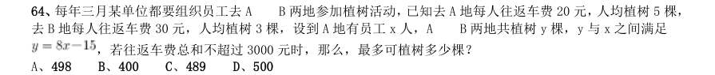

- **A.** 498
- **B.** 400
- **C.** 489
- **D.** 500

**答案：C**　**考点：行程问题｜环形与往返**　**难度：★★★☆☆**
**【2015 湖北省考·第 65 题】数量关系·最值问题｜HB-2015-ty-X065**

65. 有135 人参加某单位的招聘,31 人有英语证书和普通话证书,37 人有英语证书和计算机证书,16 人有普通 话证书和计算机证书,其中一部分人有三种证书,而一部分人则只有一种证书。该单位要求必须至少有两种上述 证书的应聘者才有资格参加面试。问至少有多少人不能参加面试?

- **A.** 50
- **B.** 51
- **C.** 52
- **D.** 53

**答案：D**　**考点：最值问题｜最值优化**　**难度：★★★★★**
**【2015 湖北省考·第 66 题】数量关系·其他数量关系｜HB-2015-ty-X066**

66. 一只挂钟的秒针长30 厘米,分针长20 厘米,当秒针的顶点走过的弧长约为9.42 米时,分针的顶点走过的 弧长约为多少厘米?

- **A.** 6.98
- **B.** 10.47
- **C.** 15.70
- **D.** 23.55

**答案：B**　**考点：其他数量关系｜日期与钟表**　**难度：★☆☆☆☆**
**【2015 湖北省考·第 67 题】数量关系·其他数量关系｜HB-2015-ty-X067**

67. 某果农要用绳子捆扎甘蔗,有三种规格的绳子可供使用:长绳子1 米,每根能捆7 根甘蔗;中等长度绳子 0.6 米,每根能捆5 根甘蔗;短绳子0.3 米,每根能捆3 根甘蔗。果农最后捆扎好了23 根甘蔗,则果农总共最 少使用多少米的绳子?

- **A.** 2.1 米
- **B.** 2.4 米
- **C.** 2.7 米
- **D.** 2.9 米

**答案：B**　**考点：其他数量关系｜其他数量关系（综合）**　**难度：★★☆☆☆**
**【2015 湖北省考·第 68 题】数量关系·工程问题｜HB-2015-ty-X068**

68. 有A 和B 两个公司想承包某项工程,A 公司需要300 天才能完工,费用为1.5 万元/天,B 公司需要200 天就 能完工,费用为3 万元/天,综合考虑时间和费用问题,在A 公司开工50 天后,B 公司才加入工程,按以上方案, 该项工程的费用为多少?

- **A.** 475 万元
- **B.** 500 万元
- **C.** 525 万元
- **D.** 615 万元

**答案：C**　**考点：工程问题｜给定时间型**　**难度：★★★☆☆**
**【2015 湖北省考·第 69 题】数量关系·概率问题｜HB-2015-ty-X069**

69. 某场羽毛球单打比赛采取三局两胜制。假设甲选手在每局都有80%的概率赢乙选手,那么这场单打比赛甲有 多大的概率战胜乙选手?

- **A.** 0.768
- **B.** 0.800
- **C.** 0.896
- **D.** 0.924

**答案：C**　**考点：概率问题｜比赛与赛制**　**难度：★★★★☆**
**【2015 湖北省考·第 70 题】判断推理·图形推理｜HB-2015-ty-X070**

70. 从所给四个选项中,选择最合适的一个填入问号处,使之呈现一定的规律性:

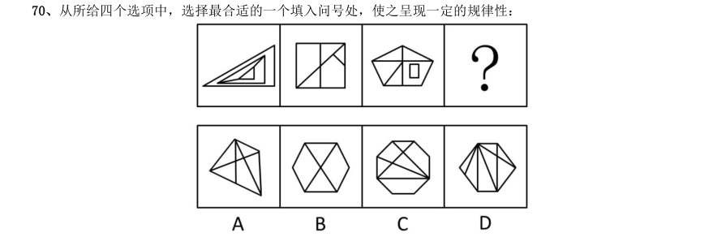

> （本题为图形题，选项为图片，见原卷）

**答案：D**　**考点：图形推理｜数量规律**　**难度：★★★★☆**
**【2015 湖北省考·第 71 题】判断推理·图形推理｜HB-2015-ty-X071**

71. 从所给四个选项中,选择最合适的一个填入问号处,使之呈现一定的规律性:

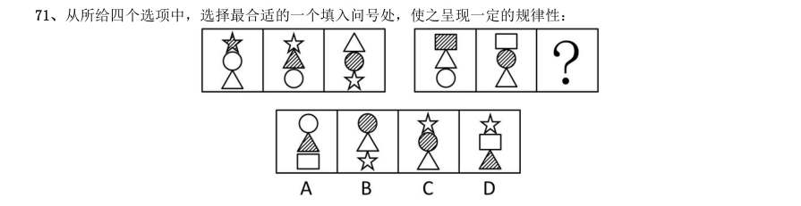

> （本题为图形题，选项为图片，见原卷）

**答案：A**　**考点：图形推理｜样式规律**　**难度：★★★★☆**
**【2015 湖北省考·第 72 题】判断推理·图形推理｜HB-2015-ty-X072**

72. 将下面的六个图形分成两类,使每一类图形都有各自的共同特征或规律,分类正确的一项是:

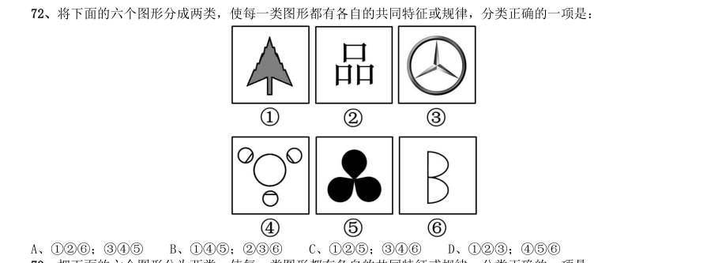

- **A.** 126;345
- **B.** 145;236
- **C.** 125;346
- **D.** 123;456

**答案：该题答案缺失，见原卷**　**考点：图形推理｜分组分类**　**难度：★★★☆☆**
**【2015 湖北省考·第 73 题】判断推理·图形推理｜HB-2015-ty-X073**

73. 把下面的六个图形分为两类,使每一类图形都有各自的共同特征或规律,分类正确的一项是:

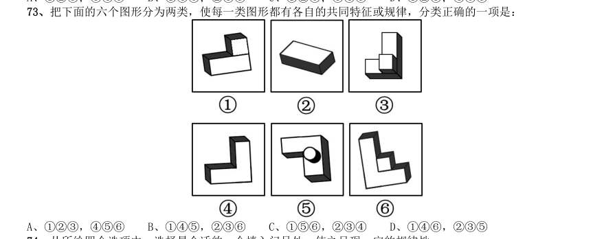

- **A.** 123,456
- **B.** 145,236
- **C.** 156,234
- **D.** 146,235

**答案：D**　**考点：图形推理｜分组分类**　**难度：★★★☆☆**
**【2015 湖北省考·第 74 题】判断推理·图形推理｜HB-2015-ty-X074**

74. 从所给四个选项中,选择最合适的一个填入问号处,使之呈现一定的规律性:

> （本题为图形题，选项为图片，见原卷）

**答案：C**　**考点：图形推理｜位置规律**　**难度：★★★★☆**
**【2015 湖北省考·第 75 题】判断推理·图形推理｜HB-2015-ty-X075**

75. 请从所给的四个选项中,选择最合适的一项填在问号处,使之呈现一定的规律性:

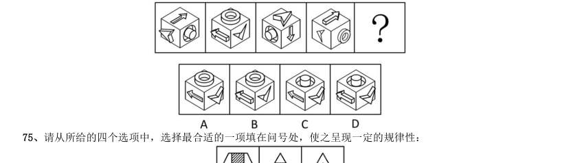

> （本题为图形题，选项为图片，见原卷）

**答案：B**　**考点：图形推理｜样式规律**　**难度：★★★★☆**
**【2015 湖北省考·第 76 题】判断推理·图形推理｜HB-2015-ty-X076**

76. 左边给定的是纸盒的外表面,下列哪一项能由它折叠而成:

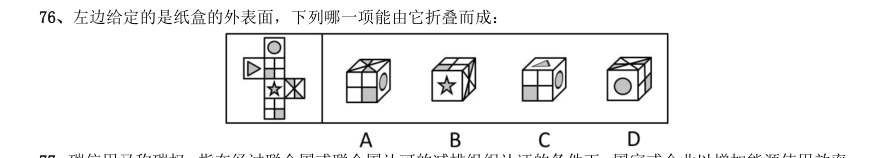

> （本题为图形题，选项为图片，见原卷）

**答案：D**　**考点：图形推理｜折纸盒**　**难度：★★★★☆**
**【2015 湖北省考·第 77 题】判断推理·定义判断｜HB-2015-ty-X077**

77. 碳信用又称碳权,指在经过联合国或联合国认可的减排组织认证的条件下,国家或企业以增加能源使用效率、 减少污染或减少开发等方式减少碳排放,因此得到可以进入碳交易市场的碳排放计量单位,一个碳信用相当于一 吨二氧化碳排放量。 某燃煤发电厂去年碳排放额超标,根据上述定义,该电厂对应做法不包括:

- **A.** 将该厂从城市郊区迁到海边
- **B.** 减少该厂全年的发电总产量
- **C.** 改进设备提高热源转化效率
- **D.** 购买碳信用来实现排放达标

**答案：A**　**考点：定义判断｜单定义**　**难度：★★☆☆☆**
**【2015 湖北省考·第 78 题】判断推理·定义判断｜HB-2015-ty-X078**

78. 行政不作为是行政机关对于公民、法人和其他组织的符合条件的申请依法应该实施某种行为或履行某种法定 职责却无正当理由拒绝履行或拖延履行的行政违法行为。 根据上述定义,下列选项中行政机关行为不属于行政不作为的是:

- **A.** 王某要求所在地交通局告知有关汽车养路费标准,三个月未答复
- **B.** 陈某在某市建设局工作多年,符合职称评定申请,申请职称评定被拒绝
- **C.** 林某投诉某医药公司贩卖假药,该市药监局以不属于主管范围而拒绝
- **D.** 何某因制止违章建筑施工被打伤,公安机关以对违章建筑无权处理不理睬

**答案：B**　**考点：定义判断｜单定义**　**难度：★★★☆☆**
**【2015 湖北省考·第 79 题】判断推理·逻辑判断｜HB-2015-ty-X079**

79. 反社会人格犯罪是行为人基于反社会型变态人格而实施的犯罪行为。行为人的特点是:1智力和精神上并无 明显缺陷,没有妄想或其他思维障碍;2多数有劣迹前科,有多次、多类型的违纪、违法、犯罪行为;3行为冲 动、缺乏深思熟虑和明确的动机;4没有悔过和自责的心理,在接受服刑以后仍然照旧违法犯罪,难以自控。 下列选项中行为人精神智力正常,其中最符合反社会人格犯罪特征的是:

- **A.** 陈某经常怀疑有人跟踪自己,某天下班后将走在自己后面的李某刺伤
- **B.** 林某多次上班迟到被领导当众呵斥,林某感觉受辱,将领导打成重伤
- **C.** 吴某有偷盗前科,某天下班遭遇抢劫,与劫匪搏斗中将劫匪打成残疾
- **D.** 王某街上闲逛,突然将陌生人郭某连刺两刀,随后将停在路边的汽车砸毁

**答案：D**　**考点：逻辑判断｜前提假设**　**难度：★★★★★**
**【2015 湖北省考·第 80 题】判断推理·逻辑判断｜HB-2015-ty-X080**

80. “公众参与”是一种有计划的行动。它通过政府部门与公众之间双向交流,使公民能参加行政决策过程并且 防止和化解公民和政府机构与开发单位之间、公民与公民之间的冲突。 下列选项与上述定义最不符合的是:

- **A.** 某市宣传部发布倡议书,号召全体市民“绿色出行”,十万人回应支持
- **B.** 居民多次向某市人大投诉规划局违规审批项目,该项目在实施前被叫停
- **C.** 某县政府拟在工业园区内引进两条茶籽油生产线,组织附近村民座谈
- **D.** 某市政府公开新建垃圾填埋场选址方案,收到10 万条反对意见而缓行

**答案：A**　**考点：逻辑判断｜逻辑判断（待细分）**　**难度：★★★★★**
**【2015 湖北省考·第 81 题】判断推理·定义判断｜HB-2015-ty-X081**

81. 近因原则是保险人对于承保范围的保险事故作为直接的、最接近的原因引起的损失承担保险责任,而对于承 保范围以外的原因造成的损失不负赔偿责任。按照该原则,承担责任并不取决于时间上或空间上的接近,而是取 决于导致保险标损失的风险事故是否在承保范围内,如果存在多个原因导致损失,其中最直接、最有效、起决定 作用的原因,以及不可避免会产生事故作用的原因就是近因。 根据上述定义,下列原因不属于近因的是:

- **A.** 张某夜间打猎不慎摔伤,在等待救援时受凉感冒引发肺炎导致死亡,其死亡原因是摔伤
- **B.** 王某的保险车辆遇暴雨浸泡汽缸进水,他强行启动车辆时发动机受损,受损原因是暴雨
- **C.** 暴雨致电线杆倒塌,电线短路引发火花引燃仓库,库存商品燃烧殆尽,损失原因是暴风雨
- **D.** 船舶进水,所载皮革进水腐烂,糜烂恶臭致邻舱的烟草变质,烟草受损原因是船舶进水

**答案：A**　**考点：定义判断｜单定义**　**难度：★★★★☆**
**【2015 湖北省考·第 82 题】判断推理·定义判断｜HB-2015-ty-X082**

82. 环境标志也称绿色标志、生态标志,是指由政府部门或公共团体依据一定的环境标准向有关厂家颁布证书, 证明其产品的生产、使用及处置过程全部符合环保要求,对环境无害或危害极少,同时有利于资源的再生和回收 利用的一种特定标志。中国的环境标志唯一认证机构是中国环境产品认证委员会及其秘书处。 根据上述定义,下列选项不符合环境标志要求的是:

- **A.** 甲公司产品不在中国环境标志产品认证范围内,但其仍有权向认证机构填报环境标志产品种类建议表
- **B.** 乙公司的污染物排放不符合国家排放标准,但只要其生产的节能荧光灯符合认证条件,其产品仍可获得环境标志认证
- **C.** 丙公司生产的运动鞋2012 年获得了环境标志认证,根据环境标志的时效性,该标志3 年后仍需要重新申请环境标志认证
- **D.** 丁公司有权在其获得环境标志认证的产品及其包装上使用认证的环境标志图形,也可在认证产品广告宣传中

**答案：B**　**考点：定义判断｜单定义**　**难度：★★★☆☆**
**【2015 湖北省考·第 83 题】判断推理·定义判断｜HB-2015-ty-X083**

83. 贫困的要素不仅包括物质和收入水平指标,还包括能力指标,即人类基本能力和权利的剥夺。权利贫困就是 缺乏政治、经济、文化和社会基本人权的一种贫困状态。权利贫困是贫困的核心,物质贫困是贫困的具体表现, 权利贫困是造成物质贫困的根本原因。 根据上述定义,下列选项不属于权利贫困的是:

- **A.** 张某大学毕业在京成为“蚁族”一员,收入低下,蜗居城乡结合部多年
- **B.** 王某好心救人却被讹诈,因无证据证明无辜,被判承担全部医疗费用
- **C.** 李某在深圳私企打工多年,因工伤丧失劳动能力,却得不到任何赔偿
- **D.** 辛某房屋被强拆,致使一家人居无定所,其申诉上访过程中多次被拘留

**答案：A**　**考点：定义判断｜单定义**　**难度：★★★☆☆**
**【2015 湖北省考·第 84 题】判断推理·定义判断｜HB-2015-ty-X084**

84. 交易成本,是指在协商、谈判和履行协议等交易性活动中,为达成合作所需要支付的各种资源的总和。只要 存在交易活动就存在交易成本,它已经成为人类社会中不可分割的组成部分。 下列选项不属于交易成本的是:

- **A.** 某公司为了搜索交易信息消耗了两天时间
- **B.** 某工厂为了开拓生产花费五十万元购买专利
- **C.** 老王在购房中为契约向中介支付了五千元
- **D.** 某企业因违反合同而支付五百万元的违约金

**答案：B**　**考点：定义判断｜单定义**　**难度：★★☆☆☆**
**【2015 湖北省考·第 85 题】判断推理·定义判断｜HB-2015-ty-X085**

85. 社会方言是由社会群体的不同性质而形成的语言变体,是在某一社会群体、社会阶层或次文化群中被使用的 语言,它是由不同的职业、社会地位、政治信仰、受教育程度因素或这些因素构成的社区交际习惯所形成的语言 差异。主要差别是语言风格和表达方式,以及一些特殊词汇的使用。 根据上述定义,下列选项不属于社会方言的是:

- **A.** 贵族语言
- **B.** 学生腔
- **C.** 法律术语
- **D.** 客家话

**答案：该题答案缺失，见原卷**　**考点：定义判断｜单定义**　**难度：★★☆☆☆**
**【2015 湖北省考·第 86 题】判断推理·定义判断｜HB-2015-ty-X086**

86. 符号是人们共同约定来指称一定对象的标志物,它可以包括以任何形式通过感觉来显示意义的全部现象,在 这些现象中某种可以感觉的东西就是对象及其意义的体现者。 根据上述定义,下列选项属于符号的是:

- **A.** 中医诊断时所观察的舌苔
- **B.** 野外行路时人所使用的指南针
- **C.** 十字路口指示用的红绿灯
- **D.** 搜救犬救人时所闻的人体气味

**答案：C**　**考点：定义判断｜单定义**　**难度：★★☆☆☆**
**【2015 湖北省考·第 87 题】判断推理·类比推理｜HB-2015-ty-X087**

87. 港湾:停泊

- **A.** 基因:遗传
- **B.** 法庭:诉讼
- **C.** 电缆:发电
- **D.** 公路:运输

**答案：D**　**考点：类比推理｜对应关系**　**难度：★☆☆☆☆**
**【2015 湖北省考·第 88 题】判断推理·类比推理｜HB-2015-ty-X088**

88. 爆胎:事故:保险

- **A.** 旱灾:减产:补贴
- **B.** 前卫:时尚:流行
- **C.** 能源:电力:生产
- **D.** 论坛:交流:学术

**答案：A**　**考点：类比推理｜逻辑关系**　**难度：★☆☆☆☆**
**【2015 湖北省考·第 89 题】判断推理·类比推理｜HB-2015-ty-X089**

89. 海关:检查:关税

- **A.** 光缆:通讯:网速
- **B.** 过滤:净化:饮用
- **C.** 树林:氧气:健康
- **D.** 沙漠:骆驼:运输

**答案：A**　**考点：类比推理｜对应关系**　**难度：★☆☆☆☆**
**【2015 湖北省考·第 90 题】判断推理·类比推理｜HB-2015-ty-X090**

90. 树根:根雕:工艺品

- **A.** 纸张:风筝:春天
- **B.** 粘土:唐三彩:古董
- **C.** 消费:借贷:信用
- **D.** 泥沙:混凝土:建筑

**答案：B**　**考点：类比推理｜逻辑关系**　**难度：★☆☆☆☆**
**【2015 湖北省考·第 91 题】判断推理·类比推理｜HB-2015-ty-X091**

91. 谎言:欺骗

- **A.** 谣言:抱怨
- **B.** 谗言:无知
- **C.** 佯言:委婉
- **D.** 诤言:劝诫

**答案：D**　**考点：类比推理｜对应关系**　**难度：★☆☆☆☆**
**【2015 湖北省考·第 92 题】判断推理·类比推理｜HB-2015-ty-X092**

92. 竞争:淘汰

- **A.** 惊吓:失色
- **B.** 疏忽:失算
- **C.** 亏损:失信
- **D.** 判断:失误

**答案：D**　**考点：类比推理｜对应关系**　**难度：★☆☆☆☆**
**【2015 湖北省考·第 93 题】判断推理·类比推理｜HB-2015-ty-X093**

93. 沧桑:白发

- **A.** 博学:眼镜
- **B.** 稚嫩:乳牙
- **C.** 鲁莽:健壮
- **D.** 清纯:酒窝

**答案：B**　**考点：类比推理｜语义关系**　**难度：★☆☆☆☆**
**【2015 湖北省考·第 94 题】判断推理·类比推理｜HB-2015-ty-X094**

94. 家属:亲属:家族

- **A.** 而立:不惑:古稀
- **B.** 助教:讲师:教授
- **C.** 蓝领:粉领:白领
- **D.** 事故:事变:事情

**答案：D**　**考点：类比推理｜逻辑关系**　**难度：★☆☆☆☆**
**【2015 湖北省考·第 95 题】判断推理·类比推理｜HB-2015-ty-X095**

95. 赛事 对于( )相当于( )对于 编辑

- **A.** 裁判:书稿
- **B.** 运动:校对
- **C.** 哨子:文字
- **D.** 进取:精确

**答案：A**　**考点：类比推理｜对应关系**　**难度：★☆☆☆☆**
**【2015 湖北省考·第 96 题】判断推理·类比推理｜HB-2015-ty-X096**

96. 三顾茅庐∶刘备

- **A.** 负荆请罪∶蔺相如
- **B.** 请君入瓮∶周兴
- **C.** 雪中送炭∶宋太宗
- **D.** 程门立雪:程颐

**答案：C**　**考点：类比推理｜类比推理（综合）**　**难度：★☆☆☆☆**
**【2015 湖北省考·第 97 题】判断推理·逻辑判断｜HB-2015-ty-X097**

97. 美国一项新研究发现,人体生理反应的节奏跟昼夜交替一致,一旦这个节奏被破坏,人们免疫系统的抗病能 力就会降低。 如果以下各项为真,最能削弱上述观点的是:

- **A.** 坐飞机到不同时区易产生头疼反胃等时差综合症
- **B.** 熬夜易使胃酸分泌过多而诱发胃溃疡病症
- **C.** 长跑运动后立即大量饮水容易破坏体内代谢平衡而致病
- **D.** 免疫系统先天缺陷的病人,即使正常饮食患病概率也很高

**答案：D**　**考点：逻辑判断｜削弱论证**　**难度：★★★☆☆**
**【2015 湖北省考·第 98 题】判断推理·逻辑判断｜HB-2015-ty-X098**

98. 研究发现,大西洋、太平洋海面水温的微小变化与南美洲亚马逊热带雨林地区火灾的面积具有密切联系,将 这种联系建立数学模型,可以用来预测亚马逊热带雨林地区来年的火灾情况。 以下哪项如果为真,最能支持上述观点:

- **A.** 大西洋海水温度升高0.2°C,亚马逊雨林次年火灾发生面积增加11%
- **B.** 海水温度增高会引起水分蒸发,导致降水减少,发生干旱或致火灾
- **C.** 海水温度变化虽然微小,但可能对热带雨林生态系统造成重要影响
- **D.** 北冰洋等海面水温可预测其附近的西伯利亚雨林火灾发生率和面积

**答案：该题答案缺失，见原卷**　**考点：逻辑判断｜加强论证**　**难度：★★★★★**
**【2015 湖北省考·第 99 题】判断推理·逻辑判断｜HB-2015-ty-X099**

99. 蚊子可传播多种疾病,如疟疾、丝虫病、乙型脑炎等。有人担心由于蚊子叮咬了HIV 感染的人而在叮咬下一 位时会将存在蚊子体内的HIV 在人际间传播。但研究人员指出这样的担心大可不必。 如果以下各项为真,最能支持研究人员观点的是:

- **A.** HIV 感染的人血液中并不总是拥有高水平的HIV 病毒
- **B.** 蚊子叮咬HIV 感染的人后不一定立即去叮咬下一个人
- **C.** 蚊子通过食管吸入血液,这种血液的吸入总是单向的
- **D.** 孩子容易被蚊子叮咬,但他们身上极少发生HIV 感染

**答案：C**　**考点：逻辑判断｜加强论证**　**难度：★★★★★**
**【2015 湖北省考·第 100 题】判断推理·逻辑判断｜HB-2015-ty-X100**

100. 研究者发现细菌就像人类的简化版本,它们有自我意识,有自己的语言,群居,既交友也树敌,喜欢偷窥 邻居家的隐私,还能以讹传讹,甚至杀害手足。各种细菌在自己的地盘上各司其职,相互配合,促进社会的稳定。 如果以下各项为真,最能质疑上述论断的是:

- **A.** 通过释放某种物质,细菌可召集群体成员执行各种任务
- **B.** 新型研制的阻断细菌交流的药物可以代替普通的抗菌素
- **C.** 细菌的生活极其单调,不是在单独进食,就是在自我繁殖
- **D.** 霍乱、肺炎和食物中毒,实际就是各种细菌聚集的后果

**答案：C**　**考点：逻辑判断｜削弱论证**　**难度：★★★★★**
**【2015 湖北省考·第 101 题】判断推理·逻辑判断｜HB-2015-ty-X101**

101. 科学就是不断接近真理的过程,我们深信不疑的事情中很大部分是会过期的,所以理解这一点的人都明白 在发展过程中不断更新知识才是科学进步的正道。然而这个过程有时会令人困惑和不安。 如果以下各项为真,最能质疑上述论断的是:

- **A.** 婴儿该仰睡还是趴着睡,孕妇抽烟喝酒是否安全,答案一代和一代不同
- **B.** 医学院的老师会告诉学生,五年内他们所学的知识里有一半都不会适用
- **C.** 我一直以为“雷龙”这个名字正确无误,但后来才发现根本没有雷龙
- **D.** 吸烟有害健康被大量科学研究和事实所证实,这一结论至今难以改变

**答案：该题答案缺失，见原卷**　**考点：逻辑判断｜削弱论证**　**难度：★★★★★**
**【2015 湖北省考·第 102 题】判断推理·逻辑判断｜HB-2015-ty-X102**

102. 矿产勘探人员观察发现,不同颜色和形状的矿物结晶体虽然有各自不同的名称和表象,但可能是化学组成 相同的物质在不同的物理化学条件下结晶成不同结构的晶体,而且一般都有着不同的物理特征。所以说,不同的 矿物种类可以有相同的化学成分。 以下选项最能支持上述论断的是:

- **A.** 二氧化碳和干冰名称不同而且表象也不同
- **B.** 不同颜色的矿物晶体暴露在空气中会变色
- **C.** 分析仪器能快速判断矿物晶体的化学成分
- **D.** 二氧化硅可以有12 种不同的矿物结晶体

**答案：D**　**考点：逻辑判断｜加强论证**　**难度：★★★☆☆**
**【2015 湖北省考·第 103 题】判断推理·逻辑判断｜HB-2015-ty-X103**

103. 国外的心理学研究表明,当遇到有人冒犯你时,如果你选择原谅冒犯者,冒犯者会更有可能在心理上感到 悔恨而产生内在的愧疚。因此,类似的冒犯行为再次发生的可能性将会大大降低。 根据以上观点,可以推出:

- **A.** 遇到冒犯者,原谅是唯一避免再次发生冒犯的方法
- **B.** 如果你不原谅冒犯者,类似的冒犯行为必然会增加
- **C.** 经常原谅冒犯者,就可能减少自己被冒犯的可能性
- **D.** 被冒犯者原谅冒犯者,将可能有助于感化冒犯者

**答案：该题答案缺失，见原卷**　**考点：逻辑判断｜结论推出**　**难度：★★★☆☆**
**【2015 湖北省考·第 104 题】判断推理·逻辑判断｜HB-2015-ty-X104**

104. 根据经济学家最新的研究显示,年收入在10000 美元以下时,随着家庭收入的增加,家庭成员的幸福感会 明显增强。但是,一旦年收入达到10000 美元以上,即使经济持续繁荣,家庭收入持续增加,家庭成员幸福感的 增强却很缓慢。 根据上述观点,可以推出:

- **A.** 年收入不足10000 美元的家庭可能会更加幸福
- **B.** 研究显示,幸福感与金钱之间并没有直接关系
- **C.** 调查表明,幸福感随家庭年收入的增加而增加
- **D.** 收入10000 美元以上的家庭将面临幸福感危机

**答案：C**　**考点：逻辑判断｜结论推出**　**难度：★★★☆☆**
**【2015 湖北省考·第 105 题】判断推理·逻辑判断｜HB-2015-ty-X105**

105. 有关研究表明,手机比电脑更伤人,因为手机屏幕小,玩手机时注意力更投入,目不转睛,因此更伤眼。 使用电脑时,人们的肢体还能活动活动,可是“手机控”往往很少活动,这对身心健康更为不利。 如果以下各项为真,最能削弱上述论断的是:

- **A.** 电脑在使用过程中,显示屏会发出电磁、电离辐射
- **B.** 科学研究表明使用手机与脑瘤和癌症的发病率无关
- **C.** 电脑背景光比手机更容易引起使用者视力下降和头痛
- **D.** 长期使用电脑人群容易患鼠标手、颈椎病等“电脑病”

**答案：C**　**考点：逻辑判断｜削弱论证**　**难度：★★★☆☆**
**【2015 湖北省考·第 106 题】资料分析·综合分析｜HB-2015-ty-X106**
> 材料：理。 (一) 2013 年二季度,我国税收月收入同比增速逐步提高,分别为7.9%、8.3%和12.9%。截至2013 年6 月,全国 税收总收入完成59260.61 亿元,同比增长7.9%,较上年同期回落1.9 个百分点。

106. 其中,国内增值税、企业所得 税同比分别增长6.6%和14.2%,较上年同期增速分别回落1.5 和3.1 个百分点;房产税同比增长11%,比上年同 期增速回落19.1 个百分点;进口货物增值税、消费税和关税同比分别下降17.1%和16%,比上年同期增速分别回 落24.5 和22.9 个百分点。 2012 年1-6 月全国税收总收入为:

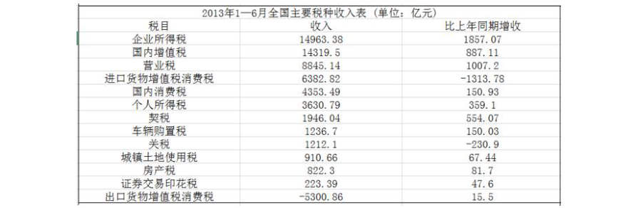

- **A.** 52973.28 亿元
- **B.** 54921.79 亿元
- **C.** 56938.68 亿元
- **D.** 63942.19 亿元

**答案：B**　**考点：综合分析｜增长率**　**难度：★★★★★**
**【2015 湖北省考·第 107 题】资料分析·比重计算与比较｜HB-2015-ty-X107**
> 材料：理。 (一) 2013 年二季度,我国税收月收入同比增速逐步提高,分别为7.9%、8.3%和12.9%。截至2013 年6 月,全国 税收总收入完成59260.61 亿元,同比增长7.9%,较上年同期回落1.9 个百分点。

107. 2013 年上半年,房产税、城镇土地使用税及契税等三项增收之和占全国税收增收比重为:

> 材料图见 images/HB-2015-ty-X106-m.jpg

- **A.** 1.2%
- **B.** 6.2%
- **C.** 11.2%
- **D.** 16.2%

**答案：D**　**考点：比重计算与比较｜现期比重**　**难度：★★☆☆☆**
**【2015 湖北省考·第 108 题】资料分析·综合分析｜HB-2015-ty-X108**
> 材料：理。 (一) 2013 年二季度,我国税收月收入同比增速逐步提高,分别为7.9%、8.3%和12.9%。截至2013 年6 月,全国 税收总收入完成59260.61 亿元,同比增长7.9%,较上年同期回落1.9 个百分点。

108. 2011 年1—6 月全国关税收入约:

> 材料图见 images/HB-2015-ty-X106-m.jpg

- **A.** 1300 亿元
- **B.** 1350 亿元
- **C.** 1380 亿元
- **D.** 1540 亿元

**答案：B**　**考点：综合分析｜增长率**　**难度：★★★★☆**
**【2015 湖北省考·第 109 题】资料分析·增长率计算与比较｜HB-2015-ty-X109**
> 材料：理。 (一) 2013 年二季度,我国税收月收入同比增速逐步提高,分别为7.9%、8.3%和12.9%。截至2013 年6 月,全国 税收总收入完成59260.61 亿元,同比增长7.9%,较上年同期回落1.9 个百分点。

109. 2013 年上半年与上年同期相比,下面四个税种中增速最快的税种是:

> 材料图见 images/HB-2015-ty-X106-m.jpg

- **A.** 企业所得税
- **B.** 国内增值税
- **C.** 出口货物增值税消费税
- **D.** 契税

**答案：D**　**考点：增长率计算与比较｜增长率比较**　**难度：★★☆☆☆**
**【2015 湖北省考·第 110 题】资料分析·增长率计算与比较｜HB-2015-ty-X110**
> 材料：理。 (一) 2013 年二季度,我国税收月收入同比增速逐步提高,分别为7.9%、8.3%和12.9%。截至2013 年6 月,全国 税收总收入完成59260.61 亿元,同比增长7.9%,较上年同期回落1.9 个百分点。

110. 下列说法与资料相符合的有几个: 12013 年第一季度我国税收总收入同比增速低于7.9% 22013 年我国税收总收入预计可以达到118520 亿元 3若2013 年上半年进口货物增值税消费税维持上年同期水平,那么,2013 年上半年我国税收总收入同比增长将 比2012 年提高约0.5 个百分点 42013 年我国上半年企业所得税、国内增值税两项之和超过同期税收总收入的50%

> 材料图见 images/HB-2015-ty-X106-m.jpg

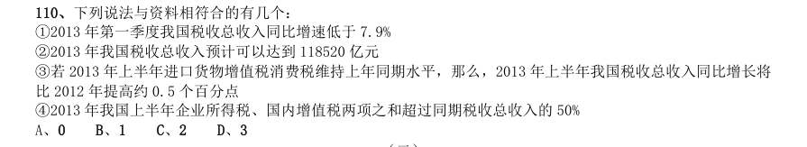

- **A.** 0
- **B.** 1
- **C.** 2
- **D.** 3

**答案：C**　**考点：增长率计算与比较｜增长率比较**　**难度：★★★☆☆**
**【2015 湖北省考·第 111 题】资料分析·综合分析｜HB-2015-ty-X111**
> 材料：经过50 多年的发展,我国台湾地区资本市场建立起由“证券交易所集中市场—上柜市场—兴柜市场”构成的完 善成熟的多层级资本市场体系。今年由于金融海啸、欧债危机等因素影响,台湾多层次资本市场总体成交值从 2010 至2012 年连续3 年下降,2012 年较2011 年衰退23.38%。周转率也呈现逐年下降趋势,2012 年证券交易所 几种市场周转率为97%,上柜市场周转率为175%,兴柜市场周转率为27%。 台湾资本市场第一层次是证券交易所集中市场。在准入门槛方面,台湾证交所要求上市企业实收资本6 亿新台币 以上;从设立年限来看,要求上市企业设立满3 年以上;从获利能力来看,要求上市企业最近1 个会计年度无累计 亏损,且税前利润占财务报表中的比率最近5 个年度达到3%以上,或最近2 个年度都达6%。至2012 年底止,上 市公司有809 家,资本额6.384 兆新台币,台湾证券交易所总市值在

111. 至2012 年底,上柜公司有638 家,资本额0.667 兆新台 币,总市值1.737 兆新台币。 台湾资本市场第三层次为兴柜市场。在准入门槛方面,兴柜市场没有营业利润、资本额、设立年限的限制,只须 符合已经申报上市或上柜辅导且两家以上证券商书面推荐。至2012 年底,兴柜公司285 家,资本额0.335 兆新 台币,总市值0.538 兆新台币。 2012 年,台湾某企业实收资本额为2 亿新台币,该企业最近2 个年度会计报表获利能力均为3%,该企业最 适合进入台湾哪个层次资本市场:

> 材料图见 images/HB-2015-ty-X106-m.jpg

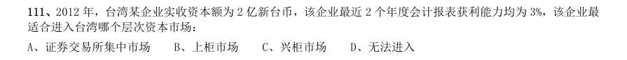

- **A.** 证券交易所集中市场
- **B.** 上柜市场
- **C.** 兴柜市场
- **D.** 无法进入

**答案：B**　**考点：综合分析｜综合分析（综合）**　**难度：★★★★★**
**【2015 湖北省考·第 112 题】资料分析·综合分析｜HB-2015-ty-X112**
> 材料：经过50 多年的发展,我国台湾地区资本市场建立起由“证券交易所集中市场—上柜市场—兴柜市场”构成的完 善成熟的多层级资本市场体系。今年由于金融海啸、欧债危机等因素影响,台湾多层次资本市场总体成交值从 2010 至2012 年连续3 年下降,2012 年较2011 年衰退23.38%。周转率也呈现逐年下降趋势,2012 年证券交易所 几种市场周转率为97%,上柜市场周转率为175%,兴柜市场周转率为27%。 台湾资本市场第一层次是证券交易所集中市场。在准入门槛方面,台湾证交所要求上市企业实收资本6 亿新台币 以上;从设立年限来看,要求上市企业设立满3 年以上;从获利能力来看,要求上市企业最近1 个会计年度无累计 亏损,且税前利润占财务报表中的比率最近5 个年度达到3%以上,或最近2 个年度都达6%。至2012 年底止,上 市公司有809 家,资本额6.384 兆新台币,台湾证券交易所总市值在

112. 2012 年世界交易所联合会(WFE)会员总市值为:

> 材料图见 images/HB-2015-ty-X106-m.jpg

- **A.** 894.73 兆新台币
- **B.** 1593.43 兆新台币
- **C.** 1799.73 兆新台币
- **D.** 2135.22 兆新台币

**答案：B**　**考点：综合分析｜比重**　**难度：★★★★☆**
**【2015 湖北省考·第 113 题】资料分析·平均数计算｜HB-2015-ty-X113**
> 材料：经过50 多年的发展,我国台湾地区资本市场建立起由“证券交易所集中市场—上柜市场—兴柜市场”构成的完 善成熟的多层级资本市场体系。今年由于金融海啸、欧债危机等因素影响,台湾多层次资本市场总体成交值从 2010 至2012 年连续3 年下降,2012 年较2011 年衰退23.38%。周转率也呈现逐年下降趋势,2012 年证券交易所 几种市场周转率为97%,上柜市场周转率为175%,兴柜市场周转率为27%。 台湾资本市场第一层次是证券交易所集中市场。在准入门槛方面,台湾证交所要求上市企业实收资本6 亿新台币 以上;从设立年限来看,要求上市企业设立满3 年以上;从获利能力来看,要求上市企业最近1 个会计年度无累计 亏损,且税前利润占财务报表中的比率最近5 个年度达到3%以上,或最近2 个年度都达6%。至2012 年底止,上 市公司有809 家,资本额6.384 兆新台币,台湾证券交易所总市值在

113. 2012 年台湾证券交易所集中市场平均每家公司成交值是兴柜市场平均每家公司成交值的倍数为:

> 材料图见 images/HB-2015-ty-X106-m.jpg

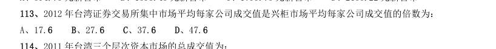

- **A.** 17.6
- **B.** 27.6
- **C.** 37.6
- **D.** 47.6

**答案：D**　**考点：平均数计算｜现期平均数**　**难度：★★☆☆☆**
**【2015 湖北省考·第 114 题】资料分析·综合分析｜HB-2015-ty-X114**
> 材料：经过50 多年的发展,我国台湾地区资本市场建立起由“证券交易所集中市场—上柜市场—兴柜市场”构成的完 善成熟的多层级资本市场体系。今年由于金融海啸、欧债危机等因素影响,台湾多层次资本市场总体成交值从 2010 至2012 年连续3 年下降,2012 年较2011 年衰退23.38%。周转率也呈现逐年下降趋势,2012 年证券交易所 几种市场周转率为97%,上柜市场周转率为175%,兴柜市场周转率为27%。 台湾资本市场第一层次是证券交易所集中市场。在准入门槛方面,台湾证交所要求上市企业实收资本6 亿新台币 以上;从设立年限来看,要求上市企业设立满3 年以上;从获利能力来看,要求上市企业最近1 个会计年度无累计 亏损,且税前利润占财务报表中的比率最近5 个年度达到3%以上,或最近2 个年度都达6%。至2012 年底止,上 市公司有809 家,资本额6.384 兆新台币,台湾证券交易所总市值在

114. 2011 年台湾三个层次资本市场的总成交值为:

> 材料图见 images/HB-2015-ty-X106-m.jpg

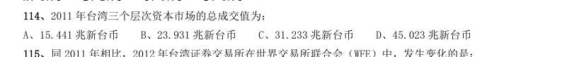

- **A.** 15.441 兆新台币
- **B.** 23.931 兆新台币
- **C.** 31.233 兆新台币
- **D.** 45.023 兆新台币

**答案：C**　**考点：综合分析｜增长率**　**难度：★★★★☆**
**【2015 湖北省考·第 115 题】资料分析·综合分析｜HB-2015-ty-X115**
> 材料：经过50 多年的发展,我国台湾地区资本市场建立起由“证券交易所集中市场—上柜市场—兴柜市场”构成的完 善成熟的多层级资本市场体系。今年由于金融海啸、欧债危机等因素影响,台湾多层次资本市场总体成交值从 2010 至2012 年连续3 年下降,2012 年较2011 年衰退23.38%。周转率也呈现逐年下降趋势,2012 年证券交易所 几种市场周转率为97%,上柜市场周转率为175%,兴柜市场周转率为27%。 台湾资本市场第一层次是证券交易所集中市场。在准入门槛方面,台湾证交所要求上市企业实收资本6 亿新台币 以上;从设立年限来看,要求上市企业设立满3 年以上;从获利能力来看,要求上市企业最近1 个会计年度无累计 亏损,且税前利润占财务报表中的比率最近5 个年度达到3%以上,或最近2 个年度都达6%。至2012 年底止,上 市公司有809 家,资本额6.384 兆新台币,台湾证券交易所总市值在

115. 同2011 年相比,2012 年台湾证券交易所在世界交易所联合会(WFE)中,发生变化的是:

> 材料图见 images/HB-2015-ty-X106-m.jpg

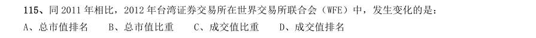

- **A.** 总市值排名
- **B.** 总市值比重
- **C.** 成交值比重
- **D.** 成交值排名

**答案：C**　**考点：综合分析｜比重**　**难度：★★★★☆**
**【2015 湖北省考·第 116 题】资料分析·综合分析｜HB-2015-ty-X116**
> 材料：2012 年末,中国大陆总人口135404 万人,全年出生人口1635 万人,死亡人口966 万人。从性别结构看,男性 人口69395 万人,同比增加327 万人,女性人口66009 万人,同比增加342 万人;从城乡结构看,城镇人口71182 万人,同比增加2103 万人;乡镇人口64222 万人,同比减少1434 万人。 2012 年末全国就业人员76704 万人,比上年末增加284 万人。其中城镇就业人员37102 万人,比上年末增加1188 万人;乡村就业人员39602 万人。 2012 年末,0~14 岁(含不满15 周岁)人口22287 万人,占总人口的16.5%。15~59 岁(含不满60 周岁)劳动年 龄人口93727 万人,占总人口的68.2%;60 岁及以上人口19390 万人,占总人口的14.3%。 2012 年全国农民工总量26261 万人,比上年增加983 万人,

116. 其中本地农民工9925 万人,增长5.4%; 外出农民工16336 万人,增长3.0%。 2011 年中国大陆总人口是:

> 材料图见 images/HB-2015-ty-X106-m.jpg

- **A.** 133769 万人
- **B.** 136370 万人
- **C.** 134735 万人
- **D.** 136103 万人

**答案：C**　**考点：综合分析｜综合分析（综合）**　**难度：★★★★☆**
**【2015 湖北省考·第 117 题】资料分析·综合分析｜HB-2015-ty-X117**
> 材料：2012 年末,中国大陆总人口135404 万人,全年出生人口1635 万人,死亡人口966 万人。从性别结构看,男性 人口69395 万人,同比增加327 万人,女性人口66009 万人,同比增加342 万人;从城乡结构看,城镇人口71182 万人,同比增加2103 万人;乡镇人口64222 万人,同比减少1434 万人。 2012 年末全国就业人员76704 万人,比上年末增加284 万人。其中城镇就业人员37102 万人,比上年末增加1188 万人;乡村就业人员39602 万人。 2012 年末,0~14 岁(含不满15 周岁)人口22287 万人,占总人口的16.5%。15~59 岁(含不满60 周岁)劳动年 龄人口93727 万人,占总人口的68.2%;60 岁及以上人口19390 万人,占总人口的14.3%。 2012 年全国农民工总量26261 万人,比上年增加983 万人,

117. 相较于2011 年,2012 年乡村就业人员的变化为:

> 材料图见 images/HB-2015-ty-X106-m.jpg

- **A.** 增加904 万人
- **B.** 减少904 万人
- **C.** 增加1472 万人
- **D.** 减少1472 万人

**答案：B**　**考点：综合分析｜综合分析（综合）**　**难度：★★★★☆**
**【2015 湖北省考·第 118 题】资料分析·综合分析｜HB-2015-ty-X118**
> 材料：2012 年末,中国大陆总人口135404 万人,全年出生人口1635 万人,死亡人口966 万人。从性别结构看,男性 人口69395 万人,同比增加327 万人,女性人口66009 万人,同比增加342 万人;从城乡结构看,城镇人口71182 万人,同比增加2103 万人;乡镇人口64222 万人,同比减少1434 万人。 2012 年末全国就业人员76704 万人,比上年末增加284 万人。其中城镇就业人员37102 万人,比上年末增加1188 万人;乡村就业人员39602 万人。 2012 年末,0~14 岁(含不满15 周岁)人口22287 万人,占总人口的16.5%。15~59 岁(含不满60 周岁)劳动年 龄人口93727 万人,占总人口的68.2%;60 岁及以上人口19390 万人,占总人口的14.3%。 2012 年全国农民工总量26261 万人,比上年增加983 万人,

118. 2012 年中国男性人口、女性人口、城镇人口的同比增长率按大小排序正确的是:

> 材料图见 images/HB-2015-ty-X106-m.jpg

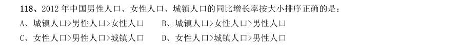

- **A.** 城镇人口>男性人口>女性人口
- **B.** 城镇人口>女性人口>男性人口
- **C.** 女性人口>男性人口>城镇人口
- **D.** 女性人口>城镇人口>男性人口

**答案：B**　**考点：综合分析｜增长率**　**难度：★★★★☆**
**【2015 湖北省考·第 119 题】资料分析·综合分析｜HB-2015-ty-X119**
> 材料：2012 年末,中国大陆总人口135404 万人,全年出生人口1635 万人,死亡人口966 万人。从性别结构看,男性 人口69395 万人,同比增加327 万人,女性人口66009 万人,同比增加342 万人;从城乡结构看,城镇人口71182 万人,同比增加2103 万人;乡镇人口64222 万人,同比减少1434 万人。 2012 年末全国就业人员76704 万人,比上年末增加284 万人。其中城镇就业人员37102 万人,比上年末增加1188 万人;乡村就业人员39602 万人。 2012 年末,0~14 岁(含不满15 周岁)人口22287 万人,占总人口的16.5%。15~59 岁(含不满60 周岁)劳动年 龄人口93727 万人,占总人口的68.2%;60 岁及以上人口19390 万人,占总人口的14.3%。 2012 年全国农民工总量26261 万人,比上年增加983 万人,

119. 根据上述资料,可以推出的是:

> 材料图见 images/HB-2015-ty-X106-m.jpg

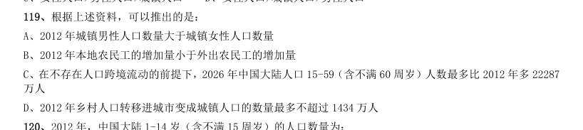

- **A.** 2012 年城镇男性人口数量大于城镇女性人口数量
- **B.** 2012 年本地农民工的增加量小于外出农民工的增加量
- **C.** 在不存在人口跨境流动的前提下,2026 年中国大陆人口15-59(含不满60 周岁)人数最多比2012 年多22287万人
- **D.** 2012 年乡村人口转移进城市变成城镇人口的数量最多不超过1434 万人

**答案：C**　**考点：综合分析｜增长量**　**难度：★★★★★**
**【2015 湖北省考·第 120 题】资料分析·综合分析｜HB-2015-ty-X120**
> 材料：2012 年末,中国大陆总人口135404 万人,全年出生人口1635 万人,死亡人口966 万人。从性别结构看,男性 人口69395 万人,同比增加327 万人,女性人口66009 万人,同比增加342 万人;从城乡结构看,城镇人口71182 万人,同比增加2103 万人;乡镇人口64222 万人,同比减少1434 万人。 2012 年末全国就业人员76704 万人,比上年末增加284 万人。其中城镇就业人员37102 万人,比上年末增加1188 万人;乡村就业人员39602 万人。 2012 年末,0~14 岁(含不满15 周岁)人口22287 万人,占总人口的16.5%。15~59 岁(含不满60 周岁)劳动年 龄人口93727 万人,占总人口的68.2%;60 岁及以上人口19390 万人,占总人口的14.3%。 2012 年全国农民工总量26261 万人,比上年增加983 万人,

120. 2012 年,中国大陆1-14 岁(含不满15 周岁)的人口数量为:

> 材料图见 images/HB-2015-ty-X106-m.jpg

- **A.** 20652 万人
- **B.** 23922 万人
- **C.** 22287 万人
- **D.** 1635 万人

**答案：A**　**考点：综合分析｜综合分析（综合）**　**难度：★★★★☆**
**【2015 湖北省考·第 121 题】资料分析·综合分析｜HB-2015-ty-X121**
> 材料：2012 年,全国国内旅游人数29.57 亿人次,比上年增长12.0%。其中,城镇居民19.33 亿人次。2012 年,全国 国内旅游收入22706.22 亿元人民币,比上年增长17.6%。

121. 2012 年全年入境外国游客人数比上年增长0.3%,其中, 亚洲市场入境人数1664.88 万人次,与上年基本持平,占入境外国游客人数的61.2%;欧洲市场入境人数592.16 万人次,增长0.2%;美洲市场入境人数317.95 万人次,减少0.7%;大洋洲市场入境人数91.49 万人次,增长 6.5%;非洲市场入境人数52.49 万人次,增长7.4%。 2011 年,全国国内旅游收入约为:

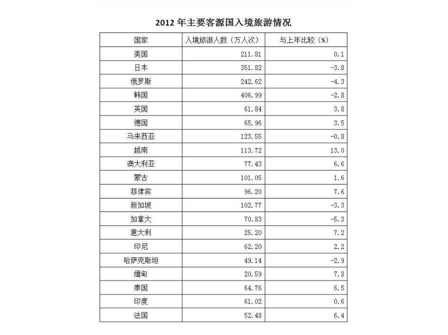

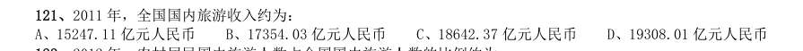

- **A.** 15247.11 亿元人民币
- **B.** 17354.03 亿元人民币
- **C.** 18642.37 亿元人民币
- **D.** 19308.01 亿元人民币

**答案：D**　**考点：综合分析｜基期量**　**难度：★★★★★**
**【2015 湖北省考·第 122 题】资料分析·比重计算与比较｜HB-2015-ty-X122**
> 材料：2012 年,全国国内旅游人数29.57 亿人次,比上年增长12.0%。其中,城镇居民19.33 亿人次。2012 年,全国 国内旅游收入22706.22 亿元人民币,比上年增长17.6%。

122. 2012 年,农村居民国内旅游人数占全国国内旅游人数的比例约为:

> 材料图见 images/HB-2015-ty-X121-m.jpg

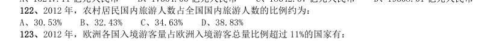

- **A.** 30.53%
- **B.** 32.43%
- **C.** 34.63%
- **D.** 38.83%

**答案：C**　**考点：比重计算与比较｜现期比重**　**难度：★★☆☆☆**
**【2015 湖北省考·第 123 题】资料分析·比重计算与比较｜HB-2015-ty-X123**
> 材料：2012 年,全国国内旅游人数29.57 亿人次,比上年增长12.0%。其中,城镇居民19.33 亿人次。2012 年,全国 国内旅游收入22706.22 亿元人民币,比上年增长17.6%。

123. 2012 年,欧洲各国入境游客量占欧洲入境游客总量比例超过11%的国家有:

> 材料图见 images/HB-2015-ty-X121-m.jpg

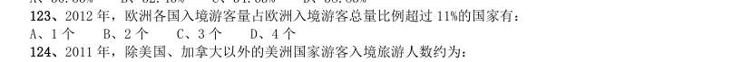

- **A.** 1 个
- **B.** 2 个
- **C.** 3 个
- **D.** 4 个

**答案：B**　**考点：比重计算与比较｜现期比重**　**难度：★★☆☆☆**
**【2015 湖北省考·第 124 题】资料分析·综合分析｜HB-2015-ty-X124**
> 材料：2012 年,全国国内旅游人数29.57 亿人次,比上年增长12.0%。其中,城镇居民19.33 亿人次。2012 年,全国 国内旅游收入22706.22 亿元人民币,比上年增长17.6%。

124. 2011 年,除美国、加拿大以外的美洲国家游客入境旅游人数约为:

> 材料图见 images/HB-2015-ty-X121-m.jpg

- **A.** 13.8 万人次
- **B.** 23.8 万人次
- **C.** 33.8 万人次
- **D.** 43.8 万人次

**答案：C**　**考点：综合分析｜增长率**　**难度：★★★★☆**
**【2015 湖北省考·第 125 题】资料分析·综合分析｜HB-2015-ty-X125**
> 材料：2012 年,全国国内旅游人数29.57 亿人次,比上年增长12.0%。其中,城镇居民19.33 亿人次。2012 年,全国 国内旅游收入22706.22 亿元人民币,比上年增长17.6%。

125. 根据上述资料,不能推出的是:

> 材料图见 images/HB-2015-ty-X121-m.jpg

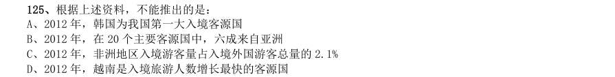

- **A.** 2012 年,韩国为我国第一大入境客源国
- **B.** 2012 年,在20 个主要客源国中,六成来自亚洲
- **C.** 2012 年,非洲地区入境游客量占入境外国游客总量的2.1%
- **D.** 2012 年,越南是入境旅游人数增长最快的客源国

**答案：C**　**考点：综合分析｜增长率**　**难度：★★★★★**