# 2017 年湖北行测（统一卷）

- 题量：125（含答案 125）
- 模块分布：资料分析20 / 数量关系15 / 言语理解35 / 判断推理35 / 常识判断20
- 试卷编号：`湖北-2017-统一卷`

## 题目与答案

**【常识判断·政治常识｜HB-2017-ty-X001】**

1. 下列关于“海上丝绸之路”的说法错误的是:

- **A.** 是陆上丝绸之路的一种补充形式
- **B.** 是意大利人马可·波罗回国所走之路
- **C.** 始于秦汉,繁荣于唐宋,衰落于明清
- **D.** 是古代中外贸易和对外交往的海上通道

**答案：C**　**考点：政治常识｜政治常识（综合）**　**难度：★★★☆☆**
**【常识判断·历史人文｜HB-2017-ty-X002】**

2. 某高校拟结合9 月份我国通行的节日、纪念日举办校园文化系列活动,下列哪些主题会出现在当月的活动项目计 划中: 1学习国防知识,增强国防观念 2缅怀抗战先烈,弘扬抗战精神 3吾爱吾师,感念师恩 4节约粮食,从我做起 5口腔健康,全身健康

- **A.** 2345
- **B.** 1235
- **C.** 1345
- **D.** 1245

**答案：B**　**考点：历史人文｜文学与文化**　**难度：★★★★☆**
**【常识判断·政治常识｜HB-2017-ty-X003】**

3. 下列我国的世界遗产不属于多省联合申遗的是:

- **A.** 土司遗址
- **B.** 丝绸之路
- **C.** 中国丹霞
- **D.** 大足石刻

**答案：D**　**考点：政治常识｜政治常识（综合）**　**难度：★★★☆☆**
**【常识判断·政治常识｜HB-2017-ty-X004】**

4. 下列关于国际战争的说法错误的是:

- **A.** 前苏联于1978 年入侵阿富汗,持续十余年
- **B.** 1990 年开始的海湾战争源于伊朗入侵科威特
- **C.** 中东战争是以色列与周边阿拉伯国家所进行的5 次大规模战争
- **D.** 1982 年4 月-6 月,英国和阿根廷爆发了马尔维纳斯群岛海战

**答案：B**　**考点：政治常识｜政治常识（综合）**　**难度：★★★★★**
**【常识判断·政治常识｜HB-2017-ty-X005】**

5. “云母屏风烛影深,长河渐落晓星沉”描写的是一天之中的哪一时段:

- **A.** 黄昏
- **B.** 夜半
- **C.** 黎明
- **D.** 午后

**答案：C**　**考点：政治常识｜政治常识（综合）**　**难度：★★★☆☆**
**【常识判断·历史人文｜HB-2017-ty-X006】**

6. 下列关于世界古代文明的说法正确的是:

- **A.** 《理想国》的作者是古希腊哲学家苏格拉底
- **B.** 古代埃及人建造的胡夫金字塔是世界上现存规模最大的金字塔
- **C.** 公元1 世纪前后,罗马帝国分裂为东罗马帝国和西罗马帝国
- **D.** 世界四大文明古国是指古代埃及、古代希腊、古代印度和古代中国

**答案：A**　**考点：历史人文｜中国古代史**　**难度：★★★★★**
**【常识判断·政治常识｜HB-2017-ty-X007】**

7. 人们常用“杏林春暖”、“杏林满园”、“誉满杏林”来赞扬医生的精湛医术和高尚医德,“杏林”典出下列哪 一医家:

- **A.** 张仲景
- **B.** 华佗
- **C.** 董奉
- **D.** 扁鹊

**答案：A**　**考点：政治常识｜政治常识（综合）**　**难度：★★★☆☆**
**【常识判断·政治常识｜HB-2017-ty-X008】**

8. 下列哪一项不属于孔子提倡的教学方法?

- **A.** 因材施教
- **B.** 学而优则仕
- **C.** 启发诱导
- **D.** 学思行结合

**答案：B**　**考点：政治常识｜政治常识（综合）**　**难度：★★★☆☆**
**【常识判断·科技常识｜HB-2017-ty-X009】**

9. 自来水厂用来进行水消毒处理的常用化学试剂是:

- **A.** 臭氧
- **B.** 氯气
- **C.** 过氧化氢
- **D.** 碘伏

**答案：B**　**考点：科技常识｜基础科学**　**难度：★★★☆☆**
**【常识判断·法律常识｜HB-2017-ty-X010】**

10. 王某将自家三层楼房的承建工程承包给没有施工资质的包工头李某。双方合同约定,李某“包工不包料”,在施 工过程中产生的一切责任由李某承担。李某找来邻居张某帮工,工资100 元/天。施工过程中脚手架倒塌,将在地面 上递砖块的张某压成重伤。张某要求包工头李某赔偿医药费、误工费等。李某不允,双方闹至法院。那么,下列说法 正确的是:

- **A.** 李某承担全部责任
- **B.** 王某、李某、张某都要承担责任
- **C.** 李某、张某承担责任,王某没有责任
- **D.** 王某、李某承担责任,张某没有责任

**答案：D**　**考点：法律常识｜民法典**　**难度：★★★★★**
**【常识判断·政治常识｜HB-2017-ty-X011】**

11. 历法是推算年月日、使其与相关天象对应并协调时间的方法。现行历法主要有三种:阳历即太阳历,主要依据为 回归年;阴历或称太阴历,主要依据为朔望月;阴阳历的平均历年为回归年,历月为朔望月。那么,我国农历属于:

- **A.** 阴历
- **B.** 阳历
- **C.** 阴阳历
- **D.** 以上都不是

**答案：C**　**考点：政治常识｜政治常识（综合）**　**难度：★★★★☆**
**【常识判断·生活常识｜HB-2017-ty-X012】**

12. 下列关于生活常识的表述错误的是:

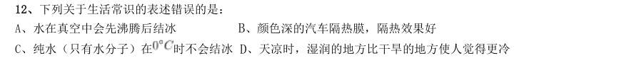

- **A.** 水在真空中会先沸腾后结冰
- **B.** 颜色深的汽车隔热膜,隔热效果好
- **C.** 纯水(只有水分子)在时不会结冰D、天凉时,湿润的地方比干旱的地方使人觉得更冷

**答案：A**　**考点：生活常识｜生活常识**　**难度：★★★☆☆**
**【常识判断·政治常识｜HB-2017-ty-X013】**

13. 下列关于胎儿与母体关系的表述错误的是:

- **A.** 胎儿与母体具有不同的遗传物质
- **B.** 胎儿与母体的血液通过脐带相通
- **C.** 胎儿在母体中的发育场所是子宫
- **D.** 胎儿与母体通过胎盘进行物质交换

**答案：A**　**考点：政治常识｜政治常识（综合）**　**难度：★★★☆☆**
**【常识判断·政治常识｜HB-2017-ty-X014】**

14. 随着我国社会逐步进入老龄化,现有的养老模式一般包括家庭养老、机构养老、社区养老和以房养老等。下列关 于我国农村老人养老模式的表述错误的是:

- **A.** 张大爷根据四个儿子之间的协议,每月轮流到其中一个儿子家中生活
- **B.** 王大娘的两个儿子均没空照顾老人,于是将其送到附近一家养老机构
- **C.** 李大爷选择将房子抵押给金融机构,由金融机构每月支付其养老费用
- **D.** 赵大娘不愿离开熟悉的社区和朋友,于是选择在社区服务机构中养老

**答案：A**　**考点：政治常识｜政治常识（综合）**　**难度：★★★★★**
**【常识判断·政治常识｜HB-2017-ty-X015】**

15. 下列哪两种疾病是由细菌引起的:

- **A.** 手足口病、狂犬病
- **B.** 麻疹、腮腺炎
- **C.** 肺结核、破伤风
- **D.** 非典型肺炎、水痘

**答案：C**　**考点：政治常识｜政治常识（综合）**　**难度：★★★☆☆**
**【常识判断·法律常识｜HB-2017-ty-X016】**

16. 下列行为属于公民正确行使法定权利的是: 1陈某向有关部门举报公交站旁的诈骗团伙 2林某将朋友送给他的手表又送给他的弟弟 3张某在妻子中止妊娠后第四个月起诉离婚 4吴某应聘时因受到用人单位性别歧视而起诉至法院

- **A.** 123
- **B.** 124
- **C.** 234
- **D.** 134

**答案：B**　**考点：法律常识｜民法典**　**难度：★★★★☆**
**【常识判断·政治常识｜HB-2017-ty-X017】**

17. 近年来,粉尘爆炸事件屡见不鲜。下列粉尘中不容易引起爆炸的是:

- **A.** 肥皂粉
- **B.** 水泥粉
- **C.** 面粉
- **D.** 奶粉

**答案：B**　**考点：政治常识｜政治常识（综合）**　**难度：★★★☆☆**
**【常识判断·政治常识｜HB-2017-ty-X018】**

18. 下列哪一选项描述的是竞争关系:

- **A.** 鹬蚌相争
- **B.** 不见兔子不撒鹰
- **C.** 螳螂捕蝉,黄雀在后
- **D.** 鸠占鹊巢

**答案：D**　**考点：政治常识｜政治常识（综合）**　**难度：★★★☆☆**
**【常识判断·政治常识｜HB-2017-ty-X019】**

19. 对着电视画面拍照,应关闭照相机闪光灯和室内照明灯,这样照出的照片画面更清晰。这是因为:

- **A.** 闪光灯和照明灯在电视屏上的反射光会干扰电视画面的透射光
- **B.** 闪光灯和照明灯在电视屏上的反射光会干扰电视画面的散射光
- **C.** 闪光灯和照明灯在电视屏上的透射光会干扰电视画面的散射光
- **D.** 闪光灯和照明灯在电视屏上的透射光会干扰电视画面的反射光

**答案：A**　**考点：政治常识｜政治常识（综合）**　**难度：★★★★★**
**【常识判断·政治常识｜HB-2017-ty-X020】**

20. 香烟点燃后,所产生的能减低红血球将氧输送到全身的成分是:

- **A.** 焦油
- **B.** 一氧化碳
- **C.** 苯丙芘
- **D.** 尼古丁

**答案：A**　**考点：政治常识｜政治常识（综合）**　**难度：★★★☆☆**
**【言语理解·逻辑填空｜HB-2017-ty-X021】**

21. 在“互联网+”时代,通过教育信息化建设,可以突破 障碍,逐步缩小区域、城乡数字差距,扩大优质 教育资源覆盖面,把优秀的教育资源送到农村去,送到最需要的地方去,让更多的孩子同在蓝天下共享优质教育。 填入画横线部分最恰当的一项是:

- **A.** 文化
- **B.** 思维
- **C.** 认知
- **D.** 空间

**答案：D**　**考点：逻辑填空｜一空**　**难度：★★☆☆☆**
**【言语理解·逻辑填空｜HB-2017-ty-X022】**

22. 中国绘画是以庄子哲学为精神宗旨的,其最高境界是在人与对象的双重自然状态下实现物我浑融,《庄子·田子 方》载,宋元君招试画师,应试者皆 ,唯有一后到者,“解衣盘礴赢”,任性自然地投身于画作。宋元 君称此人为“真画者”。所谓“真画者”,指的是突破规范束缚而进入自由率真的创作状态的画家。这是庄子为后世 中国画家塑造的模范。 填入画横线部分最恰当的一项是:

- **A.** 循规蹈矩
- **B.** 墨守成规
- **C.** 按部就班
- **D.** 循规拘礼

**答案：D**　**考点：逻辑填空｜成语辨析**　**难度：★★★★☆**
**【言语理解·逻辑填空｜HB-2017-ty-X023】**

23. 汛期恶劣的环境,让查找堤坝渗漏部位和渗漏入、出水口变得极为困难。而如能及时对管涌渗漏进行快 速 ,确定其具体位置、形状,采取相应有效措施,就能够 洪灾中可能发生的溃坝风险。 依次填入画横线部分最恰当的一项是:

- **A.** 监测避让
- **B.** 检测规避
- **C.** 防堵回避
- **D.** 封堵避免

**答案：B**　**考点：逻辑填空｜一空**　**难度：★★☆☆☆**
**【言语理解·逻辑填空｜HB-2017-ty-X024】**

24. 本地杂草野花由于经历了千百年的自然 ,对当地气候和土质都有极好的适应性,根本不需要过多额外 的养护。而且,与属于外来物种的人工草坪相比,本地杂草野花还有一个 就是生态安全。 依次填入画横线部分最恰当的一项是:

- **A.** 洗礼优点
- **B.** 进化长处
- **C.** 选择优势
- **D.** 淘汰好处

**答案：C**　**考点：逻辑填空｜一空**　**难度：★★☆☆☆**
**【言语理解·逻辑填空｜HB-2017-ty-X025】**

25. 在动画片的题材中,童话、神话、民间故事占了很大的比例,就是因为这些题材都是带有浓厚幻想色彩的 故 事,具有鲜明的 、假定与象征的因素,神奇虚幻的故事借助动画的假定性不仅可以得到淋漓尽致的表现, 而且动画艺术的特征也能够得以充分发挥。 依次填入画横线部分最恰当的一项是:

- **A.** 虚构寓意
- **B.** 虚幻含义
- **C.** 虚假含意
- **D.** 虚拟喻义

**答案：A**　**考点：逻辑填空｜一空**　**难度：★★☆☆☆**
**【言语理解·逻辑填空｜HB-2017-ty-X026】**

26. 礼仪服饰庄重而 ,自生一种威仪。事实上,这种威仪感,来自礼服各个不同部件背后的渊源和寓意。而 另一方面,如果将礼服层层剥开来看,就是一部 的政治史。 依次填入画横线部分最恰当的一项是:

- **A.** 华美恢弘
- **B.** 艳丽壮阔
- **C.** 美丽宏美
- **D.** 秀美磅礴

**答案：A**　**考点：逻辑填空｜一空**　**难度：★☆☆☆☆**
**【言语理解·逻辑填空｜HB-2017-ty-X027】**

27. 20 世纪90 年代,有人 传统书信将被新兴的通信方式取代。然而我们惊奇地发现,传统的纸质 书信依然健康发展,与电子通信方式 ,在当下生活中发挥着重要的作用。 依次填入画横线部分最恰当的一项是:

- **A.** 坦言并驾齐驱
- **B.** 预言并行不悖
- **C.** 断言相向而行
- **D.** 妄言背道而驰

**答案：B**　**考点：逻辑填空｜一空**　**难度：★☆☆☆☆**
**【言语理解·逻辑填空｜HB-2017-ty-X028】**

28. 哲人说:“你的心态就是你真正的主人。”乐观向上、心态阳光,即便一时身处困境,仍有“竹杖芒鞋轻胜马” 的 ,在茫茫暗夜中亦能读出星星指引的方向。相反,悲观低沉、心态消极, 也能感受“夕 阳西下,断肠人在天涯”的悲情,在一杯愁绪中迷失自我。 依次填入画横线部分最恰当的一项是:

- **A.** 坚韧沧海一粟
- **B.** 旷达杯水风波
- **C.** 狂喜瓜田李下
- **D.** 纯真一叶知秋

**答案：B**　**考点：逻辑填空｜一空**　**难度：★★☆☆☆**
**【言语理解·逻辑填空｜HB-2017-ty-X029】**

29. 古典农业社会中,人的乡愁和城市没有太大的关系。彼时的乡愁大抵是怀才不遇的流荡,以及战争带来 的 和乡土难返。而现在,大多数“乡愁感慨”是具有城市生活经历的人发出的,他们发愁的是城市“工 作好不好找,房子买不买得起”等等,过去随时可以返回的家乡,正逐渐消失在城市化运动中。因此,他们对乡愁 的 可能完全不是同一个方向,甚至可能是“城愁”。 依次填入画横线部分最恰当的一项是:

- **A.** 背井离乡认同
- **B.** 流离失所认识
- **C.** 民不聊生认可
- **D.** 饥寒交迫认知

**答案：A**　**考点：逻辑填空｜一空**　**难度：★★★★☆**
**【言语理解·逻辑填空｜HB-2017-ty-X030】**

30. 沿着卢瓦尔河,法国的历史被书写进河谷里 的城堡群中。想要探寻几百年间法国乃至欧洲王官贵胄 间的权利斗争,窥视 的宫廷秘事,就要从走进这一座座城堡开始。 依次填入画横线部分最恰当的一项是:

- **A.** 鳞次栉比不可捉摸
- **B.** 星罗棋布波诡云谲
- **C.** 浩如烟海变幻莫测
- **D.** 不计其数变幻无常

**答案：B**　**考点：逻辑填空｜一空**　**难度：★☆☆☆☆**
**【言语理解·逻辑填空｜HB-2017-ty-X031】**

31. 2016 年中央电视台春节联欢晚会表演的节目《华阴老腔一声喊》,吸纳了非物质文化遗产元素。它源于生活,既 接地气又创新出彩, 。它的成功,关键在于华阴老腔的魅力,传统音乐元素没有随着岁月流逝而失去光泽, 它在现代音乐的包装下还能 。 依次填入画横线部分最恰当的一项是:

- **A.** 雅俗共赏熠熠生辉
- **B.** 风靡一时赏心悦目
- **C.** 曲高和寡美不胜收
- **D.** 喜闻乐见大放异彩

**答案：A**　**考点：逻辑填空｜一空**　**难度：★★☆☆☆**
**【言语理解·逻辑填空｜HB-2017-ty-X032】**

32. 近年来,一些不负责任的网络谣言泛滥成灾,极大地 着社会成本, 着世道人心。 网 络谣言,净化网络环境,已经成为包括广大网民、互联网企业和管理部门等在内的全社会的共识。 依次填入画横线部分最恰当的一项是:

- **A.** 耗费扰乱遏止
- **B.** 消耗损害遏制
- **C.** 耗尽蛊惑禁绝
- **D.** 侵蚀破坏杜绝

**答案：B**　**考点：逻辑填空｜一空**　**难度：★★☆☆☆**
**【言语理解·逻辑填空｜HB-2017-ty-X033】**

33. 书法一旦离开了文字所表达的思想内涵和精神境界,就如同艺术只剩下技术而毫无风骨气韵,书法艺术唯有思想 上的 ,文学上的滋润,文化上的 ,心灵上的寄托,才能 出打动人心的魅力。 依次填入画横线部分最恰当的一项是:

- **A.** 高尚传承展现
- **B.** 充沛弘扬展示
- **C.** 充盈传承彰显
- **D.** 高贵弘扬突显

**答案：C**　**考点：逻辑填空｜一空**　**难度：★★☆☆☆**
**【言语理解·逻辑填空｜HB-2017-ty-X034】**

34. “一带一路”的宏伟构想,从历史深处走来,融通古今、连接中外, 和平、发展、合作、共赢的时 代潮流, 丝绸之路沿途各国发展繁荣的梦想, 古老丝绸之路崭新的时代内涵,契合沿线国 家的共同需求,为沿线国家优势互补、开放发展开启了新的机遇之窗。 依次填入画横线部分最恰当的一项是:

- **A.** 追溯实现植入
- **B.** 顺应承载赋予
- **C.** 遵循明晰提出
- **D.** 适应承接蕴蓄

**答案：B**　**考点：逻辑填空｜一空**　**难度：★★☆☆☆**
**【言语理解·逻辑填空｜HB-2017-ty-X035】**

35. 语言本身就是人类文化长期 的智慧结晶。一切人类创造的思想文化成果都需要通过语言来深度表达和精 彩 ,如果将文化视为人类精神或思维自觉 的形形色色的神奇“痕迹”,那么,语言就是这种“痕 迹”中最鲜活、最深邃和最久远的核心部分。 依次填入画横线部分最恰当的一项是:

- **A.** 演进描述保存
- **B.** 培育演绎留传
- **C.** 发展诠释存留
- **D.** 积淀阐释遗留

**答案：D**　**考点：逻辑填空｜一空**　**难度：★★☆☆☆**
**【言语理解·逻辑填空｜HB-2017-ty-X036】**

36. 所谓类文本,指的是出版物中所有作者文字之外的部分。尽管类文本也是阅读对象,但它们 地成为阅 读的主体,甚至造成了对于文本的阅读 ,实在有 之嫌。 依次填入画横线部分最恰当的一项是:

- **A.** 反客为主困难以一持万
- **B.** 主客颠倒妨碍舍本逐末
- **C.** 太阿倒持艰难轻重倒置
- **D.** 喧宾夺主障碍本末倒置

**答案：D**　**考点：逻辑填空｜一空**　**难度：★☆☆☆☆**
**【言语理解·逻辑填空｜HB-2017-ty-X037】**

37. 责任心,是创业者 的品质。经常在生活中磨练的人一定碰到过困难与荆棘、遇到过挑战与挫折、感受 过真情与冷暖、领悟过付出与回报,久而久之,人的内心变得坚强,说话做事更有担当,“责任”二字通过潜移默化 的行为训练 创业者的血液里,变成人的气节与气质,形成了独有的 。 依次填入画横线部分最恰当的一项是:

- **A.** 千金难求植入感召力
- **B.** 不可多得渗入亲和力
- **C.** 难能可贵融入竞争力
- **D.** 绝无仅有介入创新力

**答案：C**　**考点：逻辑填空｜成语辨析**　**难度：★★★☆☆**
**【言语理解·逻辑填空｜HB-2017-ty-X038】**

38. 近日,国际著名学术杂志《自然—材料》(Nature Materials)刊登了铁基高温超导体材料研究领域的一项重 要 ——新型一维拓扑边界态的发现。拓扑超导体最 的应用就是高能量子计算机,它能在 计算机中发现错误,一旦出错就会在信息 过程中产生抵抗。 依次填入画横线部分最恰当的一项是:

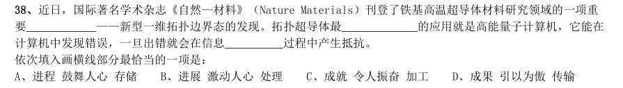

- **A.** 进程鼓舞人心存储
- **B.** 进展激动人心处理
- **C.** 成就令人振奋加工
- **D.** 成果引以为傲传输

**答案：B**　**考点：逻辑填空｜一空**　**难度：★★★☆☆**
**【言语理解·中心理解｜HB-2017-ty-X039】**

39. 目前,以“文化 科技”“文化 金融”“文化 创意”等为代表的融合模式,已经得到广泛应用。“文化 科 技”,主要是促使高新技术成果向文化领域转化应用,强化文化对信息产业的内容支撑和创意提升。“文化 金融”, 重在引导各类社会资本投资文化领域,利用互联网金融模式,发挥金融创新对文化消费的刺激作用。“文化 创意”, 更多的是以文化为资源,以创意为手段,以产业为目的,发展文化创意产业,同时实现与其他产业的深度融合。 从宏观层面看,以上三个内容同属于“文化 ”融合趋势的哪一种形态:

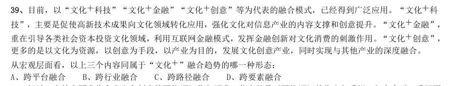

- **A.** 跨平台融合
- **B.** 跨行业融合
- **C.** 跨路径融合
- **D.** 跨要素融合

**答案：D**　**考点：中心理解｜中心句与主旨**　**难度：★★★★★**
**【言语理解·中心理解｜HB-2017-ty-X040】**

40. 超过一半的人要求将有意义和创意的网络词汇收入词典,代表的是对网络词汇的肯定与重视。但在今天,重视网 络词汇,是否非得通过将之纳入词典的方式来表现?毕竟,相较于传统词汇的变化速度和路径,网络词汇已有很大的 不同。比如,不少网络词汇可能火过一阵就开始被遗忘;比如,传统汉语中的新词一般是通过入选词典而被加以确认, 从而逐渐被推广、使用,然而网络词汇更多源自自发式生长。 这段文字意在说明:

- **A.** 我们对网络词汇需要有开放的态度
- **B.** 网络词汇相较于传统词汇没有生命力
- **C.** 将某些网络词汇纳入词典,确有必要
- **D.** 网络词汇是否纳入词典,要谨慎对待

**答案：D**　**考点：中心理解｜对策优先**　**难度：★★★★☆**
**【言语理解·中心理解｜HB-2017-ty-X041】**

41. 研究发现,长期吃核桃等坚果能改善一些与大脑功能相关的指标,和人们所期待的核桃“补脑”功能并不是一回 事。截至目前,并没有直接的研究证据表明,吃了核桃之后,就能短期内提高人的智商,或者提高考试成绩。而且, 多数人的智力会在20-30 岁左右达到顶峰,之后则很难提升。正确的饮食包括日常摄入少量核桃等坚果,确实有利于 延缓大脑衰老,减少包括中风在内的疾病风险,但那种吃了马上就“反应快了,记忆好了,智力蹭蹭往上跑了”之类 的效果,只是我们的一种美好想象。 根据这段文字,下列说法正确的是:

- **A.** 长期吃核桃不能改善与大脑功能相关的指标
- **B.** 吃核桃短期内能够提高人的智商或考试成绩
- **C.** 吃核桃使多数人的智力在20-30 岁达到顶峰
- **D.** 日常摄入适量核桃有利于延缓大脑衰老过程

**答案：A**　**考点：中心理解｜中心理解（综合）**　**难度：★★★★★**
**【言语理解·逻辑填空｜HB-2017-ty-X042】**

42. 大数据时代,正是通过挖掘个人选择偏好、生活轨迹、金融信用等数据,把握社会整体的需要、供给和趋势,进 而更好地造福社会。有了大数据,企业可以据此实现颠覆式创新,创造个性化、定制化的产品。政府部门可以据此提 高治理效能,相关政策可以更好辨证施治。对于个人而言,大数据带来的是更方便、更精准、更有效率。可以 说, ,正在成为现代社会最重要的进步动力之一。 填入画横线部分最恰当的一项是:

- **A.** 大数据使得统计上显著的相关关系越来越多
- **B.** 大数据日益改变着人类日益普及的网络行为
- **C.** 大数据利用信息技术创造持久有力的竞争优势
- **D.** 大数据将信息从知识的载体进化为智慧的源泉

**答案：D**　**考点：逻辑填空｜一空**　**难度：★★★★☆**
**【言语理解·下文推断｜HB-2017-ty-X043】**

43. 一位科学家用玻璃板把大鲨鱼和小鱼隔开,大鲨鱼欲捕食小鱼但屡屡撞到玻璃隔板;一段时间后悄悄移开隔板, 大鲨鱼却不再攻击小鱼了。 这段文字接下来最可能讲述的是:

- **A.** 不同种族之间完全可以和谐相处
- **B.** 因循守旧者,只会一再品味失败
- **C.** 固化的经验对我们的思维影响不大
- **D.** 适应新环境,把握新机遇需要新思维

**答案：D**　**考点：下文推断｜下文推断**　**难度：★☆☆☆☆**
**【言语理解·中心理解｜HB-2017-ty-X044】**

44. 有“明清古建筑博物馆”之称的三坊七巷街区,有人将其比喻为鱼骨与鱼刺,有人则形容为菩提树叶,或直呼为 “非”字形。笔者觉得,它倒更像一片优美的棕榈树枝叶,南后街似叶片的主脉,向西伸出的三条支脉为三坊,向东 生出的七条细脉是七巷。由北向南的三坊依次为衣锦坊、光禄坊、文儒坊,七巷的顺序依次为杨桥巷、郎官巷、塔巷、 黄巷、安民巷、官巷和吉庇巷。 对这段文字的内容概括最恰当的一项是:

- **A.** 三坊七巷的历史
- **B.** 三坊七巷的走向
- **C.** 三坊七巷的建筑
- **D.** 三坊七巷的格局

**答案：D**　**考点：中心理解｜中心句与主旨**　**难度：★★★★☆**
**【言语理解·细节判断｜HB-2017-ty-X045】**

45. 自然界产生的电磁辐射,又称为环境电磁波的本底辐射。本底辐射对人类生存环境,无不良影响。“阳光也是一 种电磁辐射,亿万年来我们正是依靠阳光的照射才生存到现在。”但是,另外一类电磁辐射源所发射的电磁波,会对 环境产生不良影响,对人类健康造成危害。资料显示,环境中的电磁辐射源包括人类发明、制造和使用的能够产生辐 射电磁波的一切电子仪器、装置和设备。这一类电磁辐射源,被称为电磁波辐射污染源。 下列说法与原文不符的是:

- **A.** 阳光属于本底辐射中的一种
- **B.** 雷达属于电磁波辐射污染源
- **C.** 电磁波不会对人类造成危害
- **D.** 本底辐射对环境无不良影响

**答案：C**　**考点：细节判断｜细节判断**　**难度：★★★★☆**
**【言语理解·逻辑填空｜HB-2017-ty-X046】**

46. 科学家们表示,年幼的狨猴会学着在别的狨猴呼喊结束后再发声,这一发现或可帮助我们 。除了人类以 外的灵长类动物都学不会发声,没有模仿所听到的声音的能力——这种能力对于说话来说必不可少。但是狨猴研究者 表示,灵长类动物仍然在以近乎交谈的方式互相呼喊,因为它们会等待别人呼喊结束后再发声——而这种能力经常在 语言进化的讨论中被忽略。如果这种技能是后天习得的,那么它该更接近人类的相当技能,因为婴儿是在和母亲咿咿 呀呀的过程中学会这种技能的。 填入画横线部分最恰当的一项是:

- **A.** 更好的分析人类交往的方式
- **B.** 更好地理解人类语言的起源
- **C.** 更好的解决人类交流的障碍
- **D.** 更好探讨人类文明的起源

**答案：B**　**考点：逻辑填空｜一空**　**难度：★★★★★**
**【言语理解·中心理解｜HB-2017-ty-X047】**

47. 当下,电视节目主打媒体融合和多终端传播的概念并不新鲜,只要在不同终端进行内容投放的节目都自称是媒体 融合。技术拓展了媒体类型和渠道,真正的媒体融合要借鉴互联网的用户思维,要以不同渠道用户的多层次的“真实 需求”为导向定制内容,与用户之间形成相互分享信息关系,形成媒体融合关键点。 这段文字意在强调:

- **A.** 在不同终端进行相同内容投放成为当下电视节目进行媒体融合的普遍做法
- **B.** 媒体融合本身不能提升节目的内容品质,但能让节目得到更好的传播与吸收
- **C.** 要做到媒体融合,就要把各种终端、渠道整合成一个有机体,形成信息传播的“生态圈”
- **D.** 以用户需求为出发点,内容生产者与用户之间形成相互分享信息关系,是媒体融合的关键

**答案：D**　**考点：中心理解｜对策优先**　**难度：★★★★★**
**【言语理解·标题填入｜HB-2017-ty-X048】**

48. 中国的FAST(500 米口径球面射电望远镜)主体的落成为何引起海内外的热烈关注?原因有三。一是看得远。作 为目前口径最大的射电望远镜,FAST 在理论上可以接收到137 亿光年以外的电磁信号。二是很灵活。FAST 的索网结 构可以随着天体移动变化,极大提升观测效率。三是高精度。FAST 射电望远镜的结构,处处都是毫米级精度要求;用 来编织索网手臂般粗细的钢缆,加工精度都被控制在1 毫米以内;最终的天线精度是3 毫米,小面板的制造精度是1.5 毫米。这一切意味着我们将能倾听来自宇宙更深处的声音,观测宇宙更隐蔽的奥秘。 这段文字最适合的标题是:

- **A.** 海内外热烈关注中国的FAST
- **B.** 走近中国FAST 走进宇宙深处
- **C.** 中国的FAST 有三大过人之处
- **D.** 一起倾听来自宇宙深处的声音

**答案：B**　**考点：标题填入｜标题填入**　**难度：★★★★★**
**【言语理解·中心理解｜HB-2017-ty-X049】**

49. 家犬是人类的好朋友,它们虽差异巨大,却有共同祖先——灰狼。灰狼在全球分布非常广泛,但各地的家犬并不 是从各地的灰狼演化而来。通过从基因组DNA 入手,比较来自不同地区的家犬群体的遗传多样性,研究者发现,来自 东亚南部地区的家犬群体具有最高的多样性。同时,系统发育树的结构也支持家犬这一共同的起源地。在系统发育树 上,每一个枝的末端代表一个群体,亲缘关系较近的群体在树上的位置也会比较近。而来自东亚南部地区的家犬样品, 都位于系统发育树的基部位置。 这段文字意在说明:

- **A.** 家犬起源于在全球具有非常广泛分布的灰狼
- **B.** 性情不同、形态各异的家犬有着共同起源地
- **C.** 系统发育树原理为动物演化研究提供了支撑
- **D.** 基因组DNA 的研究根本解决了家犬起源问题

**答案：B**　**考点：中心理解｜主题词**　**难度：★★★★★**
**【言语理解·中心理解｜HB-2017-ty-X050】**

50. 月球是地球唯一的自然卫星,也是人类目前唯一能够抵达的地外星球。在人造卫星之外,利用这颗自然卫星开展 对地球的遥感观测,有着诸多的优势和不可替代性。月球表面积远远大于任何的人造卫星,因而在月球上布设遥感器, 不用考虑载荷多少、大小、重量等,可同时置放很多不同类型的遥感器,形成主被动、全波段同步观测的能力,对于 观测大尺度地球科学现象——全球环境变化、陆海气相互作用、板块构造及固体潮、三极对比研究等会有深入的认识, 并有可能观测到先前未知的科学现象。 对上述文字概括最准确的是:

- **A.** 月球比人造卫星更加适合布设遥感器
- **B.** 月球对地观测有着天然的综合性优势
- **C.** 月球有望能给空间对地观测带来革命
- **D.** 月球开辟对地观测科学与技术新方向

**答案：B**　**考点：中心理解｜中心句与主旨**　**难度：★★★★★**
**【言语理解·中心理解｜HB-2017-ty-X051】**

51. 在读屏时代,从倡导多读多写汉字的角度,“汉字听写”无疑是一件好事。但是一旦过度,好事也会变成坏事。 比如,比赛偏重冷僻字词,参赛小选手们只能强化记忆,在比赛中展示了“中国式教育”。就连汉字拼音之父周有光 先生也认为,现在把通用汉字增加到8000 多个,这个数量实在有点太多了。联想到近几年一直没有停歇过的汉字繁 简之争以及中高考改革方案的推出,我们不难发现,大家对汉语言文字的关注在日渐深入,民众的母语水平和学习母 语的积极性在不断提高。 从这段文字,可以看出作者的态度是:

- **A.** 新时期的汉字听写比赛应该适度适当导向正确
- **B.** 读屏时代的汉字听写加快语言教育改革的步伐
- **C.** 汉字听写数量过多会引发民众提笔忘字的忧虑
- **D.** 中国式教育与强化记忆是语文教育的必要手段

**答案：A**　**考点：中心理解｜对策优先**　**难度：★★★★★**
**【言语理解·中心理解｜HB-2017-ty-X052】**

52. 近年来,我国推行了一系列改革,为双创营造制度环境。大学生、海归、大企业高管和连续创业者、科技人员这 支“新四军”的崛起,可以看作是创业主体从精英走向大众的一个强有力的信号。不过,因为机制体制不健全,一些 法律、法规、政策存在矛盾,人的价值的最终实现还存在着不少障碍。倘若人的价值迟迟不能得到充分保障,创新创 业者才能的释放势必会受到影响,诸多科技成果就可能烂在抽屉里,诸多科技企业就可能因为缺乏创新而死去。 这段文字意在强调:

- **A.** 改革要为双创营造制度环境
- **B.** 创业主体将从精英走向大众
- **C.** 机制体制阻碍人的价值实现
- **D.** 保障人的价值是双创的前提

**答案：D**　**考点：中心理解｜对策优先**　**难度：★★★★☆**
**【言语理解·中心理解｜HB-2017-ty-X053】**

53. 当20 世纪各种文化遭受危机与困惑之时,学者们往往返身探求不同文明的原点和文化资源,通过世界性的比较 与对话,以寻找未来的发展方向与道路。此时,音乐权威话语的主流地位也开始让位于对话。实现对话的前提是平等 的价值观,以此条件,中西音乐才有对话的可能。否则,我们只有听话的资格,而没有发言与对话的权利。因此,中 国音乐传统不是以其提供给专业音乐创作的素材、音色库、原料等来进行其价值定位的,而是参照当今东西方音乐文 化比较研究而定位的。 本段概括最恰当的一项是:

- **A.** 通过比较与对话探求解决文化危机的途径
- **B.** 中西音乐进行对话的前提是平等的价值观
- **C.** 探讨如何对中国音乐的传统进行价值定位
- **D.** 通过平等对话以摆脱中国音乐传统的困境

**答案：C**　**考点：中心理解｜转折与因果**　**难度：★★★★★**
**【言语理解·语句排序｜HB-2017-ty-X054】**

54. 1更令人震惊的是,这些土著们在语言和文化上表现出超乎想象的统一性 2他们没有航海设备,只有原始的舟筏,却在占据了将近地球三分之一面积的大洋中,找到了一个个孤悬海上的小岛 3他们有着相似的风俗习惯,在相隔极远、完全陌生的岛上,竟然可以用同一种语言进行简单交流 4原始的南岛语族,创造了航海奇迹 5这使得许多世纪后,“地理大发现”浪潮中驶入太平洋的西方航海家们惊异地发现,几乎他们每找到一处新的岛屿, 都已有了土著们居住过的痕迹 6然后定居其上,传承和发展着自己的文化 将上述6 个句子重新排列,语序正确的是:

- **A.** 452136
- **B.** 426513
- **C.** 265431
- **D.** 312645

**答案：B**　**考点：语句排序｜语句排序**　**难度：★★★★★**
**【言语理解·语句排序｜HB-2017-ty-X055】**

55. 1我们要感恩大自然造就我们的生命,给我们来到世界的机会,感恩大自然赋予我们丰富的生活所需资源 2宋代张载指出:“乾曰父,坤曰母”,就是说天就是我们的父亲,地就是我们的母亲 3我们要树立与天地万物同属一个生命世界,生死与共的天人观,树立感恩自然、爱护自然的大自然观、大环境观和 大生态观。 4大自然是我们生命所来与所归的地方,从来自自然,在自然中生息,到最后又回归到自然 5阳光、空气和水,人们须臾不可离,没有大自然,人就无法生活和生存,人与自然生死攸关 6没有自然界,就没有我们的一切 将上述6 个句子重新排列,语序正确的是:

- **A.** 642513
- **B.** 315426
- **C.** 243165
- **D.** 426153

**答案：D**　**考点：语句排序｜语句排序**　**难度：★★★★★**
**【数量关系·几何问题｜HB-2017-ty-X056】**

56. 某单位准备扩建一矩形花圃,若将矩形花圃的长和宽各增加4 米,则新矩形花圃的面积比原来的面积增加了40 平方米。那么,原矩形花圃的周长是多少?

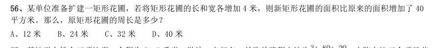

- **A.** 12 米
- **B.** 24 米
- **C.** 32 米
- **D.** 40 米

**答案：A**　**考点：几何问题｜相似与比例**　**难度：★★★★☆**
**【数量关系·行程问题｜HB-2017-ty-X057】**

57. 某地举办铁人三项比赛,全程为51.5 千米,游泳、自行车、长跑的路程之比为 。小陈在这三个项目花 费的时间之比为 ,比赛中他长跑的平均速度是15 千米/小时,且两次换项共耗时4 分钟,那么他完成比赛共 耗时多少?

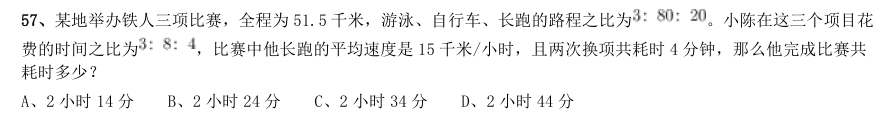

- **A.** 2 小时14 分
- **B.** 2 小时24 分
- **C.** 2 小时34 分
- **D.** 2 小时44 分

**答案：C**　**考点：行程问题｜等距离平均速度**　**难度：★★☆☆☆**
**【数量关系·行程问题｜HB-2017-ty-X058】**

58. 小张家距离工厂15 千米,乘坐班车20 分钟可到工厂。一天,他错过班车,改乘出租车上班。出租车出发时间比 班车晚4 分钟,送小张到工厂后出租车马上原路返回,在距离工厂1.875 千米处与班车相遇。如果班车和出租车都是 匀速运动且不计上下车时间,那么小张比班车早多少分钟到达工厂?

- **A.** 3
- **B.** 4
- **C.** 5
- **D.** 6

**答案：B**　**考点：行程问题｜相遇追及**　**难度：★★★☆☆**
**【数量关系·几何问题｜HB-2017-ty-X059】**

59. 妈妈为了给过生日的小东一个惊喜,在一底面半径为20cm、高为60cm 的圆锥形生日帽内藏了一个圆柱形礼物盒。 为了不让小东事先发现礼物盒,该礼物盒的侧面积最大为多少?

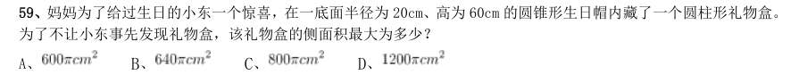

- **A.** 
- **B.** 
- **C.** 
- **D.** 

**答案：A**　**考点：几何问题｜立体几何**　**难度：★★★★★**
**【数量关系·容斥问题｜HB-2017-ty-X060】**

60. 由于连日暴雨,某水库水位急剧上升,逼近警戒水位。假设每天降雨量一致,若打开2 个水闸放水,则3 天后正 好到达警戒水位;若打开3 个水闸放水,则4 天后正好到达警戒水位。气象台预报,大雨还将持续七天,流入水库的 水量将比之前多 。若不考虑水的蒸发、渗透和流失,则至少打开几个水闸,才能保证接下来的七天都不会到达警 戒水位?

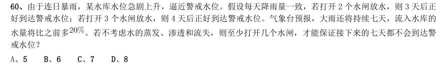

- **A.** 5
- **B.** 6
- **C.** 7
- **D.** 8

**答案：B**　**考点：容斥问题｜容斥问题（综合）**　**难度：★★★★☆**
**【数量关系·排列组合｜HB-2017-ty-X061】**

61. 小王从编号分别为1、2、3、4、5 的5 本书中随机抽出3 本,那么,这3 本书的编号恰好为相邻三个整数的概率 为:

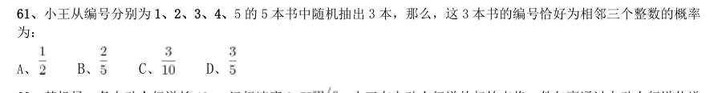

- **A.** 
- **B.** 
- **C.** 
- **D.** 

**答案：C**　**考点：排列组合｜捆绑法**　**难度：★★★★★**
**【数量关系·行程问题｜HB-2017-ty-X062】**

62. 某机场一条自动人行道长42m,运行速度0.75 。小王在自动人行道的起始点将一件包裹通过自动人行道传递 给位于终点位置的小明。小明为了节省时间,在包裹开始传递时,沿自动人行道逆行领取包裹并返回。假定小明的步 行速度是1 ,则小明拿到包裹并回到自动人行道终点共需要的时间是:

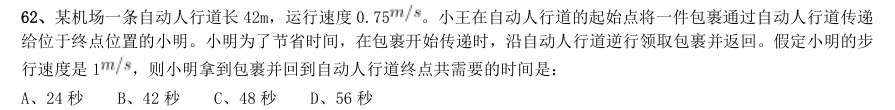

- **A.** 24 秒
- **B.** 42 秒
- **C.** 48 秒
- **D.** 56 秒

**答案：C**　**考点：行程问题｜环形与往返**　**难度：★★★☆☆**
**【数量关系·行程问题｜HB-2017-ty-X063】**

63. 如右图所示,甲和乙在面积为54π的半圆形游泳池内游泳,他们分别从位置A 和B 同时出发,沿直线同时游到位 置C。若甲的速度为乙的2 倍,则原来甲、乙两人相距:

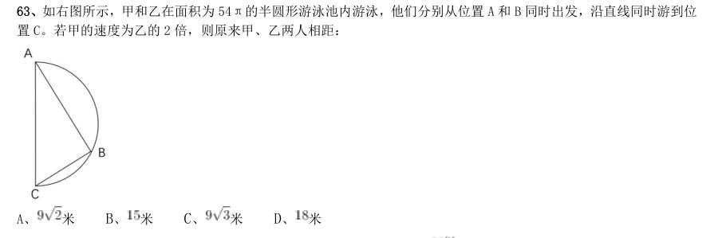

- **A.** 米
- **B.** 米
- **C.** 米
- **D.** 

**答案：D**　**考点：行程问题｜相遇追及**　**难度：★☆☆☆☆**
**【数量关系·工程问题｜HB-2017-ty-X064】**

64. 某件刺绣产品,需要效率相当的三名绣工8 天才能完成;绣品完成 时,一人有事提前离开,绣品由剩下的两 人继续完成;绣品完成 时,又有一人离开,绣品由最后剩下的那个人做完。那么,完成该件绣品一共用了:

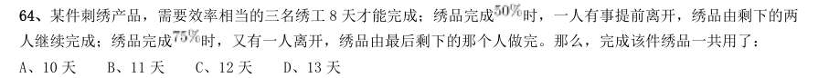

- **A.** 10 天
- **B.** 11 天
- **C.** 12 天
- **D.** 13 天

**答案：D**　**考点：工程问题｜给定效率型**　**难度：★★☆☆☆**
**【数量关系·工程问题｜HB-2017-ty-X065】**

65. 体育彩票22 选5 中使用的22 个彩球除编号不同外,其余完全一样。由于生产过程疏忽,22 个彩球中有一个球的 重量略重于其它球。现需用天平将该球找出,那么,在最优方案下,最多要使用天平:

- **A.** 3 次
- **B.** 4 次
- **C.** 5 次
- **D.** 6 次

**答案：A**　**考点：工程问题｜工程问题（综合）**　**难度：★★☆☆☆**
**【数量关系·鸡兔同笼｜HB-2017-ty-X066】**

66. 小明负责将某农场的鸡蛋运送到小卖部。按照规定,每送达1 枚完整无损的鸡蛋,可得运费0.1 元;若有鸡蛋破 损,不仅得不到该枚鸡蛋的运费,每破损一枚鸡蛋还要赔偿0.4 元。小明10 月份共运送鸡蛋25000 枚,获得运费2480 元。那么,在运送过程中,鸡蛋破损了:

- **A.** 20 枚
- **B.** 30 枚
- **C.** 40 枚
- **D.** 50 枚

**答案：C**　**考点：鸡兔同笼｜鸡兔同笼**　**难度：★★★☆☆**
**【数量关系·其他数量关系｜HB-2017-ty-X067】**

67. 某公司销售部拟派3 名销售主管和6 名销售人员前往3 座城市进行市场调研,每座城市派销售主管1 名,销售人 员2 名。那么,不同的人员派遣方案有:

- **A.** 540 种
- **B.** 1080 种
- **C.** 1620 种
- **D.** 3240 种

**答案：A**　**考点：其他数量关系｜和差倍比**　**难度：★☆☆☆☆**
**【数量关系·其他数量关系｜HB-2017-ty-X068】**

68. 如下图所示,某条河流一侧有A B 两家工厂,与河岸的距离分别为4km 和5km,且A 与B 的直线距离为11km。 为了处理这两家工厂的污水,需要在距离河岸1km 处建造一个污水处理厂,分别铺设排污管道连接A B 两家工厂。 假定河岸是一条直线,则排污管道总长最短是:

- **A.** 12km
- **B.** 13km
- **C.** 14km
- **D.** 15km

**答案：B**　**考点：其他数量关系｜和差倍比**　**难度：★★★☆☆**
**【数量关系·概率问题｜HB-2017-ty-X069】**

69. 某商店促销,购物满足一定金额可进行摸球抽奖,中奖率 。规则如下:抽奖箱中有大小相同的若干个红球和 白球,从中摸出两个球,如果都是红球,获一等奖;如果都是白球,获二等奖;如果是一红一白,获三等奖。假定一、 二、三等奖的概率分别为0.1、0.3、0.6,那么抽奖箱中球的个数为:

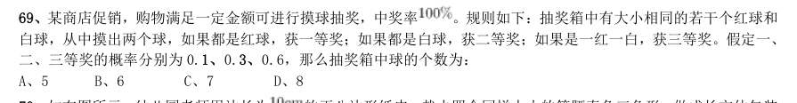

- **A.** 5
- **B.** 6
- **C.** 7
- **D.** 8

**答案：A**　**考点：概率问题｜摸球与抽取**　**难度：★★★★★**
**【数量关系·几何问题｜HB-2017-ty-X070】**

70. 如右图所示,幼儿园老师用边长为 的正八边形纸皮,裁去四个同样大小的等腰直角三角形,做成长方体包装 盒。如果用该包装盒存放体积为 的立方体积木(不得凸出包装盒外沿),那么,这个盒子最多可以放入多少块积 木?

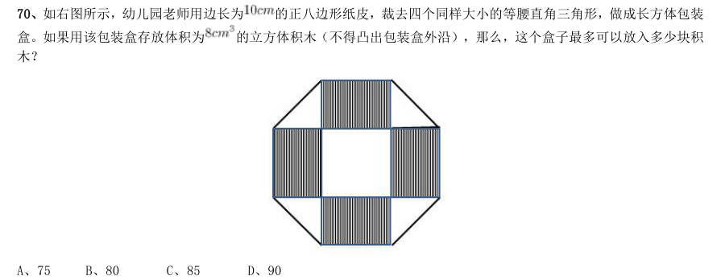

- **A.** 75
- **B.** 80
- **C.** 85
- **D.** 90

**答案：A**　**考点：几何问题｜立体几何**　**难度：★★★★★**
**【判断推理·图形推理｜HB-2017-ty-X071】**

71. 左边给定的是削掉一个角的纸盒,下列哪一项不是由它展开而成?

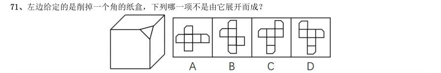

> （本题为图形题，选项为图片，见原卷）

**答案：C**　**考点：图形推理｜数量规律**　**难度：★★★☆☆**
**【判断推理·图形推理｜HB-2017-ty-X072】**

72. 把下面的六个图形分为两类,使每一类图形都有各自的共同特征或规律,分类正确的一项是:

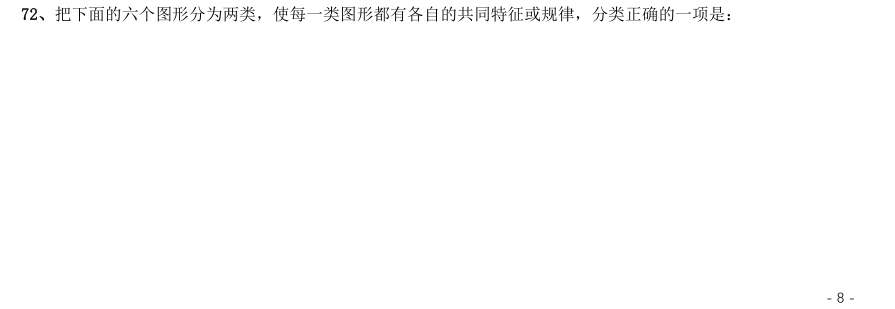

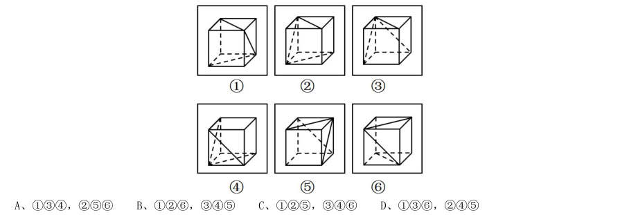

- **A.** 134,256
- **B.** 126,345
- **C.** 125,346
- **D.** 136,245

**答案：B**　**考点：图形推理｜数量规律**　**难度：★★★☆☆**
**【判断推理·图形推理｜HB-2017-ty-X073】**

73. 从所给的四个选项中,选择最合适的一个填入问号处,使之呈现一定的规律性:

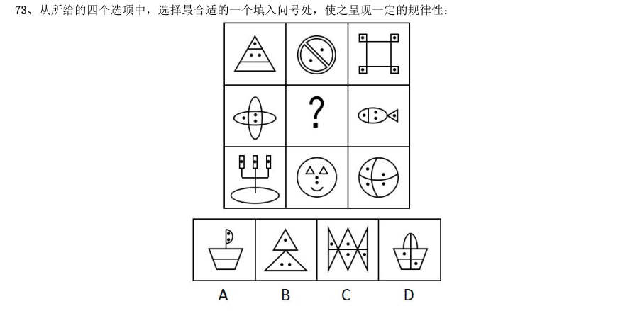

> （本题为图形题，选项为图片，见原卷）

**答案：A**　**考点：图形推理｜数量规律**　**难度：★★★☆☆**
**【判断推理·图形推理｜HB-2017-ty-X074】**

74. 从所给的四个选项中,选出一个最合适的填入问号处,使之呈现一定的规律:

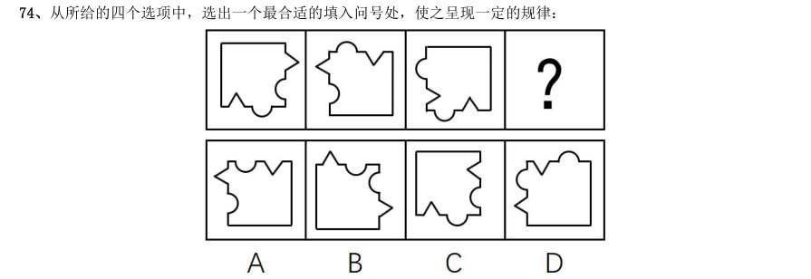

> （本题为图形题，选项为图片，见原卷）

**答案：B**　**考点：图形推理｜位置规律**　**难度：★★★☆☆**
**【判断推理·图形推理｜HB-2017-ty-X075】**

75. 如图所示,立方体上叠加圆柱体再打通一个圆柱孔,然后从任意面剖开,下面哪一项不可能是该立体的截面?

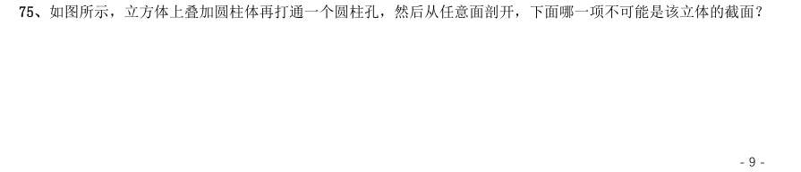

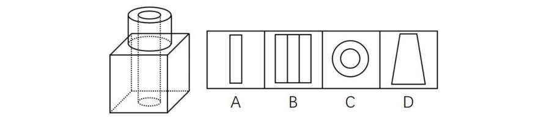

> （本题为图形题，选项为图片，见原卷）

**答案：A**　**考点：图形推理｜样式规律**　**难度：★★★☆☆**
**【判断推理·定义判断｜HB-2017-ty-X076】**

76. 共享经济指借助网络第三方平台,基于闲置资源使用权的暂时性转移,实现生产要素的社会化,提高存量资产的 使用效率以创造更多价值,促进社会经济的可持续发展。 根据上述定义,下列经济活动不属于共享经济的是:

- **A.** 王某从某网络平台订车去飞机场,方便快捷
- **B.** 李某从某网络平台贷款炒股,获得了预期收益
- **C.** 马某旅行前从某网络平台预定民宿,抵达后入住
- **D.** 张某从某网络平台购买外卖美食,在家享受美味

**答案：D**　**考点：定义判断｜单定义**　**难度：★★☆☆☆**
**【判断推理·定义判断｜HB-2017-ty-X077】**

77. 自我效能感是个体对自己能否成功操作某一行为达到某种预期效果的主观预期和推断。当面临困难任务时,低自 我效能感的人比高自我效能感的人更集中于问题存在的障碍、失败影响以及个人缺陷上。 根据上述定义,下列选项属于低自我效能感表现的是:

- **A.** 破釜沉舟
- **B.** 画饼充饥
- **C.** 心急如焚
- **D.** 睹物兴悲

**答案：C**　**考点：定义判断｜单定义**　**难度：★★☆☆☆**
**【判断推理·定义判断｜HB-2017-ty-X078】**

78. 数据挖掘(Data mining)是指从大量的存储数据中利用统计、情报检索、模式识别、在线分析处理和专家系统 (依靠过去的经验)等方法或技术,发现隐含在其中、事先不知道但又是潜在有用的信息和知识的信息处理过程。 根据上述定义,下列选项不属于数据挖掘应用的是:

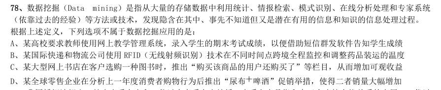

- **A.** 某高校要求教师使用网上教学管理系统,录入学生的期末考试成绩,以便借助短信群发软件告知学生成绩
- **B.** 某国际快递和物流公司使用RFID(无线射频识别)技术在不同时间点跨境全程监控和调整药品装运的温度
- **C.** 某大型网上书店在客户选购一种图书时,推出“购买该商品的用户还购买了”等栏目,从而增加可观收益
- **D.** 某全球零售企业在分析上一年度消费者购物行为后推出“尿布

**答案：A**　**考点：定义判断｜单定义**　**难度：★★★★☆**
**【判断推理·定义判断｜HB-2017-ty-X079】**

79. 我国婚姻法规定,禁止直系血亲和三代以内旁系血亲结婚。直系血亲是指和自己有直接血缘关系的亲属,三代以 内旁系血亲是指与己身出自同一父母或同一祖父母、外祖父母,除直系血亲外的所有血亲。 根据上述定义,下列选项中的甲和乙可以结婚的是:

- **A.** 张某是甲(女)的姨父,乙系张某的儿子
- **B.** 李某是乙(女)的姑父,甲系李某的儿子
- **C.** 甲是林某与前夫的儿子,乙是林某与后夫的女儿
- **D.** 王某是张某的舅舅,甲系王某的儿子,乙系张某的女儿

**答案：D**　**考点：定义判断｜单定义**　**难度：★★☆☆☆**
**【判断推理·定义判断｜HB-2017-ty-X080】**

80. 随着科学技术的发展,人机交流已经成为现实,这其中的关键是脑机接口技术。所谓脑机接口,就是连接大脑与 计算机之间的信息系统,可让大脑直接和计算机沟通。脑机接口可以从大脑传递信息到计算机,又可以从计算机传递 信息进入大脑。 根据上述定义,下列应用不属于脑机接口技术的是:

- **A.** 某游戏玩家的大脑植入一部装置,通过该装置用意念控制机械手,端起杯子喝茶
- **B.** 某游戏玩家佩戴一套义肢设备,经过多次练习,凭着坚强意志力,实现独立行走
- **C.** 某游戏玩家佩戴一种脸部饰品,饰品根据佩戴者的情绪变化作出相应的指示动作
- **D.** 某游戏玩家戴上一套高科技耳机,集中注意力,通过精神控制小球飞越各种障碍

**答案：B**　**考点：定义判断｜单定义**　**难度：★★★★☆**
**【判断推理·定义判断｜HB-2017-ty-X081】**

81. 逻辑思维是人的理性认识阶段,是人类反映事物本质和规律的认识过程。逻辑思维既涉及逻辑思维形式和逻辑方 法规则,也涉及逻辑思维的基本规律。逻辑思维形式和逻辑方法规则是指把自然语言抽象概括为形式语言,形成初始 符号或规则,用来研究概念、判断和推理,只在局部范围内起作用;逻辑思维基本规律是人类进行正确逻辑思维的根 本准则和基本依据,普遍适用于人们的思维。 根据上述定义,下列选项违反逻辑思维形式和逻辑思维方法规则的是:

- **A.** 把不同概念相互混淆或改换同一概念的含义
- **B.** 把两个互相矛盾或反对的思想都认为是真的
- **C.** 对某个概念进行划分时存在越级划分的错误
- **D.** 把没有经过证明的假设作为论证的充分前提

**答案：C**　**考点：定义判断｜单定义**　**难度：★★★★☆**
**【判断推理·定义判断｜HB-2017-ty-X082】**

82. 人类增强就是利用生物医学技术、智能技术、神经科学技术、信息技术和纳米技术等高新技术手段使健康人类的 机体功能或能力超出其正常范围,从而使人类的体貌、寿命、人格、认知和行为等能力发生根本性变化并具有全新能 力的一种技术手段,其目的是显著提高人类生活的质量。 根据上述定义,下列选项不属于人类增强的是:

- **A.** 演员赵某用药剂延缓衰老
- **B.** 医生建议老张去做心脏搭桥手术
- **C.** 医生将传感器植入老陈大脑提高其记忆力
- **D.** 小王为了增加自己的身高服用类增高药物

**答案：B**　**考点：定义判断｜单定义**　**难度：★★☆☆☆**
**【判断推理·定义判断｜HB-2017-ty-X083】**

83. 木椅子效应是指将成绩相等的两组学生分别安排坐在舒适的沙发椅和很不舒服的木椅子上学习,不久之后,坐木 椅子的学生学习成绩要比坐沙发椅的学生成绩高出许多。原因是坐木椅子的学生因为不舒服而不断调整坐姿,表面看 来好像不安而好动,实质却因此给脑部供应了更多的血液和营养;而坐沙发椅的学生,由于舒适而一动不动,致使血 液循环相对减慢,脑部得到的血液和营养相对减少,学习效果因此就差了一些。 根据上述定义,下列选项最能体现木椅子效应的是:

- **A.** 某学生从小到大饱受责罚,学习成绩一直不理想
- **B.** 小刚每天步行上学和回家,风雨无阻却学得很好
- **C.** 某家长为鼓励孩子暑天学习,每天为其提供冷饮
- **D.** 搬入新书房一个月后,小明的成绩名次一路攀升

**答案：B**　**考点：定义判断｜单定义**　**难度：★★★★☆**
**【判断推理·定义判断｜HB-2017-ty-X084】**

84. 心理人类学是介于文化人类学与心理学之间的交叉学科,主要研究并了解文化对所属社会成员产生影响的心理机 制,发现在个体水平上的心理变量与在总体水平上的文化、社会、经济、生态和生物变量之间的关系。 根据上述定义,下列选项属于心理人类学研究范畴的是:

- **A.** “五四”前后诗歌风格的比较
- **B.** 当代流行话语下的社会主流价值
- **C.** 草原文明与蒙古民族性格的养成
- **D.** 从《背影》看作者对父亲态度的变化

**答案：C**　**考点：定义判断｜单定义**　**难度：★★☆☆☆**
**【判断推理·定义判断｜HB-2017-ty-X085】**

85. 心理会计是指人们在心里无意识地把财富划归不同的账户进行管理,并对结果(尤其是经济结果)加以编码、分 类和估价的过程,且不同的心理账户有不同的记账方式和心理运算规则。小到个体、家庭,大到企业集团,都有一套 或隐或显的心理账户系统,其心理记账方式与经济学和数学的运算方式都不相同,因此经常以非预期的方式影响着决 策,使个体的决策违背最简单的理性经济法则。 根据上述定义,下列选项最能体现心理会计现象的是:

- **A.** 整日忧心忡忡的小李将自己全部存款的四分之三用于购买人寿保险
- **B.** 小陈已经攒够购买相机的钱,但他一定要等领到年底奖金再买相机
- **C.** 小王在两家不同银行都有储蓄卡,但他总是去离家更近的银行取款
- **D.** 小刘因公司奖励出游某地感觉不错,后来自费重游此地却感觉不佳

**答案：D**　**考点：定义判断｜单定义**　**难度：★★★★★**
**【判断推理·类比推理｜HB-2017-ty-X086】**

86. 茶树:茉莉花茶

- **A.** 梅树:梅花糕
- **B.** 小麦:肉夹馍
- **C.** 螃蟹:蟹黄包
- **D.** 冬瓜:冬瓜糖

**答案：C**　**考点：类比推理｜逻辑关系**　**难度：★☆☆☆☆**
**【判断推理·类比推理｜HB-2017-ty-X087】**

87. 进士:状元

- **A.** 河水:海水
- **B.** 银河:天文
- **C.** 学位:博士
- **D.** 宪法:民法

**答案：C**　**考点：类比推理｜逻辑关系**　**难度：★☆☆☆☆**
**【判断推理·类比推理｜HB-2017-ty-X088】**

88. 救援:围魏救赵

- **A.** 进攻:风声鹤唳
- **B.** 防守:草木皆兵
- **C.** 追击:穷寇勿追
- **D.** 转移:斗折蛇行

**答案：C**　**考点：类比推理｜语义关系**　**难度：★☆☆☆☆**
**【判断推理·类比推理｜HB-2017-ty-X089】**

89. 虚数:复数

- **A.** 法律:刑法
- **B.** 麦子:水稻
- **C.** 祥林嫂:《祝福》
- **D.** 人工智能:计算机科学

**答案：D**　**考点：类比推理｜逻辑关系**　**难度：★☆☆☆☆**
**【判断推理·类比推理｜HB-2017-ty-X090】**

90. 鸿雁:笺札:书信

- **A.** 月老:红娘:媒人
- **B.** 乾坤:天地:宇宙
- **C.** 红豆:相思:恋人
- **D.** 东宫:王子:储君

**答案：A**　**考点：类比推理｜语义关系**　**难度：★☆☆☆☆**
**【判断推理·类比推理｜HB-2017-ty-X091】**

91. 讨论:会议:方案

- **A.** 合作:课题:计划
- **B.** 研究:手机:销量
- **C.** 分析:汽车:技术
- **D.** 调研:基层:实情

**答案：D**　**考点：类比推理｜对应关系**　**难度：★☆☆☆☆**
**【判断推理·类比推理｜HB-2017-ty-X092】**

92. 中子:辐射:军事

- **A.** 货车:交通:运输
- **B.** 电解质:物理:化学
- **C.** 薄膜:隔热:大棚
- **D.** 干冰:吸热:消防

**答案：D**　**考点：类比推理｜对应关系**　**难度：★☆☆☆☆**
**【判断推理·类比推理｜HB-2017-ty-X093】**

93. 农家乐:农家:乐

- **A.** 一日游:一日:游
- **B.** 广场舞:广场:舞
- **C.** 袋鼠跳:袋鼠:跳
- **D.** 颅内伤:颅内:伤

**答案：B**　**考点：类比推理｜对应关系**　**难度：★☆☆☆☆**
**【判断推理·类比推理｜HB-2017-ty-X094】**

94. 盲动:一败涂地:重起炉灶

- **A.** 超速:风驰电掣:按部就班
- **B.** 跟风:鹦鹉学舌:真知灼见
- **C.** 熬夜:萎靡不振:养精蓄锐
- **D.** 传神:生动逼真:洛阳纸贵

**答案：C**　**考点：类比推理｜语义关系**　**难度：★☆☆☆☆**
**【判断推理·类比推理｜HB-2017-ty-X095】**

95. 番茄之于( )相当于( )之于蹴鞠

- **A.** 美洲;中国
- **B.** 炒饭;健身
- **C.** 植物;人类
- **D.** 白菜;篮球

**答案：D**　**考点：类比推理｜逻辑关系**　**难度：★☆☆☆☆**
**【判断推理·逻辑判断｜HB-2017-ty-X096】**

96. 汽车行业作为制造业中技术含量、智能化程度和产业集中度较高的代表,已经成为了德国“工业4.0”的先导阵 地。长期处于2.0 工业思维的中国汽车制造业要在全球占有一席之地,进行技术创新与变革和拥有丰富经验的资深人 才必不可少,而高薪和福利成为吸引人才的制胜法宝。 由此可以推出:

- **A.** 如果能够吸引到资深人才,中国汽车制造业的改革就能成功
- **B.** 高薪和福利是很多中国职场人士选择职业时的一个重要关注点
- **C.** 不进行技术变革,中国汽车制造业就不能在全球占有一席之地
- **D.** 德国汽车制造业在世界汽车行业具有举足轻重的地位和影响力

**答案：C**　**考点：逻辑判断｜归纳推导**　**难度：★★★★★**
**【判断推理·逻辑判断｜HB-2017-ty-X097】**

97. 一项研究显示,先让受试者参加消除某项偏见的学习,并给受试者播放与消除该偏见学习相关联的声音。之后, 让受试者进入深度睡眠状态,同时重复播放那些相关联的声音,以重新激活消除该偏见的学习。结果发现,该偏见比 睡眠前大大减少,且睡眠质量越高,偏见减少得越多。研究人员由此推测,睡眠干预可减少社会偏见与歧视。 以下哪项如果为真,最能支持上述论证?

- **A.** 普通民众难以得到消除偏见学习的睡眠干预
- **B.** 睡眠充足、睡眠质量高的人比其他人更不易产生偏见与歧视
- **C.** 有身高歧视、相貌歧视的人经过睡眠干预后,歧视程度明显降低
- **D.** 在接受睡眠干预的受试者中,有一部分人并不存在明显的偏见或歧视

**答案：C**　**考点：逻辑判断｜削弱**　**难度：★★★★★**
**【判断推理·逻辑判断｜HB-2017-ty-X098】**

98. 在汇率贬值期间,除非借入货币的利率和其他成本足够高卖空贬值货币的投机活动不可避免。如果货币当局有足 够的外汇储备坚持到最后,投机者就只能铩羽而归。但是,如果外汇储备不足,投机者最终就将“饱食远扬”,无论 是在升值还是在贬值的压力下,如果汇率不能迅速反映市场的供求关系,将损害宏观经济稳定,不利于经济结构的调 整。 如果以上论述为真,不能推出下列哪些结论?

- **A.** 或者货币当局有足够的外汇储备坚持到最后,或者投机者“饱食远扬”
- **B.** 如果汇率能够迅速反映市场的供求关系,那么就不会损害宏观经济稳定
- **C.** 除非汇率迅速反映市场供求关系,否则会损害宏观经济稳定,不利于经济结构调整
- **D.** 如果借入货币的利率和其他成本不够高,那么卖空贬值货币的投机活动就不可避免

**答案：B**　**考点：逻辑判断｜真假推理**　**难度：★★★★★**
**【判断推理·逻辑判断｜HB-2017-ty-X099】**

99. 提高能源使用效率、鼓励能源灵活利用是英国减少温室气体排放政策的一个必要环节,它需要采用智能技术,包 括通过智能表将能源使用信息从需求方面或客户发送到能源公司等。该信息可用于制定和实施更高效的能源使用条 例。但英国消费者对此态度不一,因为该技术用于监控和支持能源高效率使用行为时,居民个人及家庭的能源数据不 得不被动分享。所以,个人使用能源相关数据的被动分享有可能成为推广智能技术的最主要障碍。 以下哪项如果为真,最能支持上述结论?

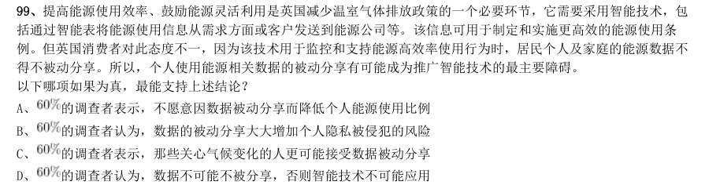

- **A.** 的调查者表示,不愿意因数据被动分享而降低个人能源使用比例
- **B.** 的调查者认为,数据的被动分享大大增加个人隐私被侵犯的风险
- **C.** 的调查者表示,那些关心气候变化的人更可能接受数据被动分享
- **D.** 

**答案：B**　**考点：逻辑判断｜加强**　**难度：★★★★★**
**【判断推理·逻辑判断｜HB-2017-ty-X100】**

100. 荷兰研究人员一直在试图模拟月球和火星的土壤条件进行农作物栽培实验。他们对该项实验种出的小红萝卜、 豌豆、黑麦和西红柿进行初步分析。实验结果令人充满希望,这些产品不仅安全,而且可能比在地球土壤种出的农作 物更健康。英国媒体称,能在火星土壤种出可食用作物,殖民火星的希望又向前迈进了一步。 如果以下各项为真,不能质疑英国媒体说法的是:

- **A.** 火星土壤重金属占比和地球土壤不一样
- **B.** 在另一个同类实验中土豆的长势很糟糕
- **C.** 从实验到真正付诸实践还有很长的路要走
- **D.** 月球、火星、地球的气候条件有很大不同

**答案：A**　**考点：逻辑判断｜削弱**　**难度：★★★★★**
**【判断推理·逻辑判断｜HB-2017-ty-X101】**

101. 作为抗衰老药物,雷帕霉素延长寿命的秘密在于能够阻断mTOR 通道——这也是控制着影响细胞生长繁殖流程的 “主开关”之一。当食物充足时,这种通道从激素和营养物质中获得信号使细胞吸收营养并生长,但细胞进行新陈代 谢和生长的过程中会产生激发细胞老化的副产物;当限制食物热量的摄入时,这个通道可以发出信号使细胞停止生长, 借此来延缓衰老。雷帕霉素可能是目前已发现的最有效可靠的抗衰老药物。 以下哪项如果为真,不能支持上述结论?

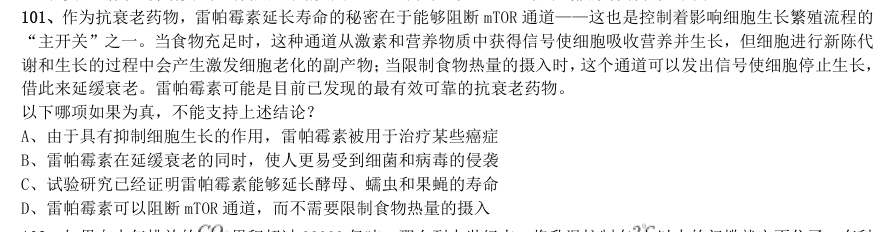

- **A.** 由于具有抑制细胞生长的作用,雷帕霉素被用于治疗某些癌症
- **B.** 雷帕霉素在延缓衰老的同时,使人更易受到细菌和病毒的侵袭
- **C.** 试验研究已经证明雷帕霉素能够延长酵母、蠕虫和果蝇的寿命
- **D.** 雷帕霉素可以阻断mTOR 通道,而不需要限制食物热量的摄入

**答案：B**　**考点：逻辑判断｜削弱**　**难度：★★★★★**
**【判断推理·逻辑判断｜HB-2017-ty-X102】**

102. 如果向大气排放的 累积超过32000 亿吨,那么到本世纪末,将升温控制在 以内的门槛就守不住了。有科 学家认为,为了达到将升温幅度控制在 以内的目标,仅仅限制 排放是不够的,必须在全球范围内大规模开展 大气 的回收行动,使大气污染程度得到有效控制和缓解。 若要使上述科学家的想法成立,最需要补充以下哪项作为前提?

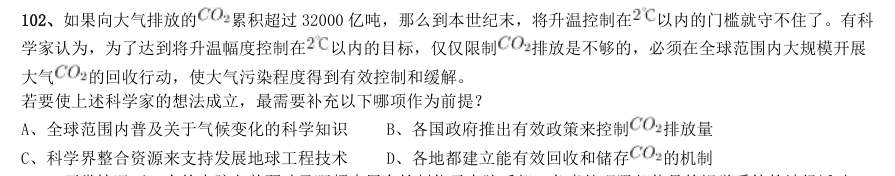

- **A.** 全球范围内普及关于气候变化的科学知识
- **B.** 各国政府推出有效政策来控制排放量
- **C.** 科学界整合资源来支持发展地球工程技术
- **D.** 各地都建立能有效回收和储存

**答案：D**　**考点：逻辑判断｜加强**　**难度：★★★★★**
**【判断推理·逻辑判断｜HB-2017-ty-X103】**

103. 正常情况下,人的大脑左前颞叶及眶频皮层会抑制位于大脑后部、负责处理眼部信号的视觉系统的神经活动, 而在FTD(额频叶痴呆)患者中,这两个区域可能无法发出抑制性信号,如此,大脑就能以一种全新的方式来处理视 觉和声音,尽管额叶的损伤可能会导致患者出现一些病态的异常行为,但也会将患者的艺术敏感性或其他创造力释放 出来。可以说,FTD 是通向艺术殿堂的一扇窗。 如果以下各项为真,最能质疑上述结论的是:

- **A.** 只有不到1%的FTD 患者在患病期间能成为杰出艺术家
- **B.** 20 世纪最伟大的100 名艺术家里,没有一个是FTD 患者
- **C.** 冥想或苦练能让右脑更具创造性进而开发出潜在艺术才能
- **D.** FTD 患者患病后所获得的艺术才能只能是家族遗传的结果

**答案：D**　**考点：逻辑判断｜削弱**　**难度：★★★★★**
**【判断推理·逻辑判断｜HB-2017-ty-X104】**

104. 柠烯,俗称柠檬精油。它通常被用于制作柑橘香味剂,是很多空气清新剂、身体喷雾剂等芳香剂重要的化学成 分之一。柠烯本身并不可怕,因为该化学物质对人体不会形成大的危害,事实上,它可被用于食品的调味剂。然而柠 烯一旦被喷入空气中,很快就会有所变化。研究表明,当柠烯暴露于普遍存在于空气的臭氧中时,两个柠烯分子会形 成一个单分子化合物——甲醇。当房间中大量的柠烯被转化成甲醇时,其影响将迥然不同。 由此可以推出:

- **A.** 使用空气清新剂,可能会对我们自身有害处
- **B.** 柠烯被用作食品的调味剂时,会对人体产生危害
- **C.** 如果房间中测出甲醇浓度高,则说明使用了太多芳香剂D、在生活中,我们应该尽量避免使用含有柠烯成分的物品

**答案：A**　**考点：逻辑判断｜归纳推导**　**难度：★★★★★**
**【判断推理·逻辑判断｜HB-2017-ty-X105】**

105. 某科研机构提出潮湿的沙子是古埃及人在沙漠中搬运巨大石块和雕像的关键。研究人员指出,古埃及人将沉重 的石块放上滑橇后,先在滑橇前铺设一层潮湿的沙子,再牵引它们,这种搬运方式起到了意想不到的效果。在实验中, 研究人员使用流变仪测试沙子的硬度,以证实需要多少牵引力才能使一定数量的沙子变形,并在此基础上设计了牵引 模型,从中发现将潮湿的沙子铺在滑橇前能更容易移动重物,而且沙子所含水分决定了沙子的硬度和牵引力。 如果以下哪项为真,最能支持上述结论?

- **A.** 在一幅古埃及墓室壁画中,一名男子站在滑橇前方,似乎正在浇水
- **B.** 滑橇牵引力与沙子硬度成反比,潮湿沙子的硬度是干燥沙子的两倍
- **C.** 实验证明,铺设在滑橇前的潮湿沙子容易堆积,形成较大滑动阻力
- **D.** 一个实验室版的埃及滑橇被成功建造,能够模拟古埃及工地的实况

**答案：B**　**考点：逻辑判断｜削弱**　**难度：★★★★★**
**【资料分析·综合分析｜HB-2017-ty-X106】**
> 材料：和判断处理。 (一) 2016 年6 月份,我国社会消费品零售总额26857 亿元,同比增长 ,环比增长 。其中,限 额以上单位消费品零售额13006 亿元,同比增长 。 2016 年1~6 月份,我国社会消费品零售总额156138 亿元,同比增长 。其中,限额以上单位消费品零售额 71075 亿元,同比增长 。 按经营单位所在地分,2016 年6 月份,城镇消费品零售额23082 亿元,同比增长 ;乡村消费品零售额3775 亿元,同比增长 。1~6 月份,城镇消费品零售额134249 亿元,同比增长 ;乡村消费品零售额21889 亿元, 同比增长 。 按消费类型分,2016 年6 月份,餐饮收入2907 亿元,同比增长 ;商品零售23951 亿元,同比增长 。 1~6 月份,餐饮收入16683 亿元,同比增长 ;商品零售139455 亿元,同比增长 。 2016 年1~6 月份,全国网上

106. 其中,实物商品网上零售额18143 亿元,同比 增长 。 2016 年5 月份,全国社会消费品零售总额约为:

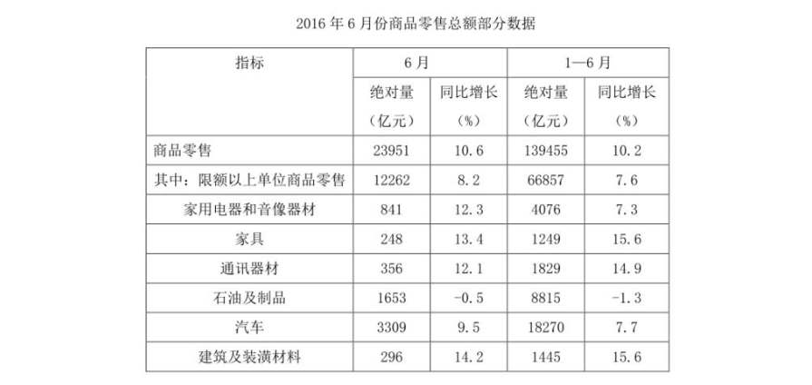

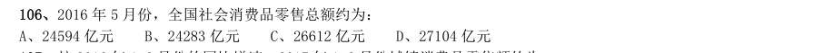

- **A.** 24594 亿元
- **B.** 24283 亿元
- **C.** 26612 亿元
- **D.** 27104 亿元

**答案：C**　**考点：综合分析｜选正确项**　**难度：★★★★★**
**【资料分析·增长率计算与比较｜HB-2017-ty-X107】**

107. 按2016 年1-6 月份的同比增速,2017 年1-6 月份城镇消费品零售额约为:

> 材料图见 images/HB-2017-ty-X106-m.jpg

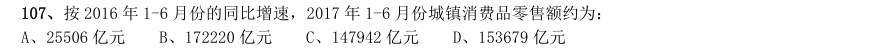

- **A.** 25506 亿元
- **B.** 172220 亿元
- **C.** 147942 亿元
- **D.** 153679 亿元

**答案：C**　**考点：增长率计算与比较｜增长率计算**　**难度：★★☆☆☆**
**【资料分析·增长率计算与比较｜HB-2017-ty-X108】**

108. 2016 年1~6 月份,以下选项中,商品零售同比增速最快的是:

> 材料图见 images/HB-2017-ty-X106-m.jpg

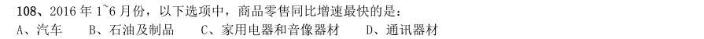

- **A.** 汽车
- **B.** 石油及制品
- **C.** 家用电器和音像器材
- **D.** 通讯器材

**答案：D**　**考点：增长率计算与比较｜增长率比较**　**难度：★★☆☆☆**
**【资料分析·增长率计算与比较｜HB-2017-ty-X109】**

109. 2016 年6 月份,城镇消费品零售额比上年同期增加:

> 材料图见 images/HB-2017-ty-X106-m.jpg

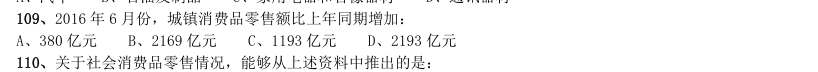

- **A.** 380 亿元
- **B.** 2169 亿元
- **C.** 1193 亿元
- **D.** 2193 亿元

**答案：D**　**考点：增长率计算与比较｜增长率计算（综合）**　**难度：★★☆☆☆**
**【资料分析·综合分析｜HB-2017-ty-X110】**

110. 关于社会消费品零售情况,能够从上述资料中推出的是:

> 材料图见 images/HB-2017-ty-X106-m.jpg

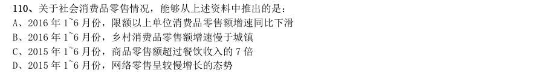

- **A.** 2016 年1~6 月份,限额以上单位消费品零售额增速同比下滑
- **B.** 2016 年1~6 月份,乡村消费品零售额增速慢于城镇
- **C.** 2015 年1~6 月份,商品零售额超过餐饮收入的7 倍
- **D.** 2015 年1~6 月份,网络零售呈较慢增长的态势

**答案：A**　**考点：综合分析｜选错误项**　**难度：★★★★★**
**【资料分析·平均数计算｜HB-2017-ty-X111】**

111. 根据以下资料,回答111~115 题。 2015 年江苏、浙江、江西三省的税收收入平均增速是:

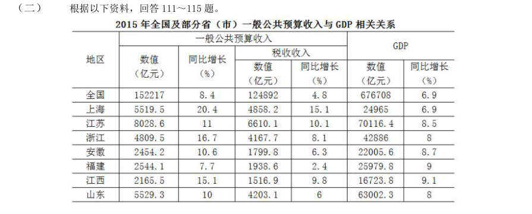

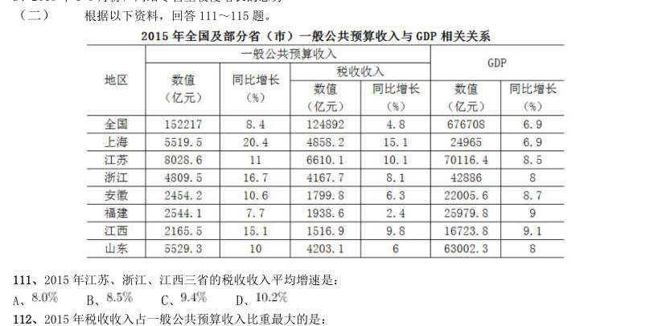

- **A.** 
- **B.** 
- **C.** 
- **D.** 

**答案：C**　**考点：平均数计算｜现期平均数**　**难度：★★☆☆☆**
**【资料分析·比重计算与比较｜HB-2017-ty-X112】**

112. 2015 年税收收入占一般公共预算收入比重最大的是:

> 材料图见 images/HB-2017-ty-X111-m.jpg

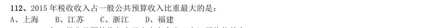

- **A.** 上海
- **B.** 江苏
- **C.** 浙江
- **D.** 福建

**答案：A**　**考点：比重计算与比较｜现期比重**　**难度：★★☆☆☆**
**【资料分析·平均数计算｜HB-2017-ty-X113】**

113. 2015 年一般公共预算收入高于表中七个省(市)平均值的有:

> 材料图见 images/HB-2017-ty-X111-m.jpg

- **A.** 上海、安徽、福建、江西
- **B.** 江苏、浙江、安徽、山东
- **C.** 上海、江苏、浙江、山东
- **D.** 安徽、福建、江西、山东

**答案：C**　**考点：平均数计算｜现期平均数**　**难度：★★☆☆☆**
**【资料分析·综合分析｜HB-2017-ty-X114】**

114. 2015 年一般公共预算收入与GDP 的比值大于 的省(市)有:

> 材料图见 images/HB-2017-ty-X111-m.jpg

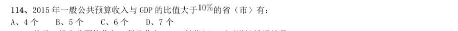

- **A.** 4 个
- **B.** 5 个
- **C.** 6 个
- **D.** 7 个

**答案：B**　**考点：综合分析｜选正确项**　**难度：★★★★☆**
**【资料分析·综合分析｜HB-2017-ty-X115】**

115. 关于一般公共预算收入、税收收入、GDP 等指标,下列说法错误的是:

> 材料图见 images/HB-2017-ty-X111-m.jpg

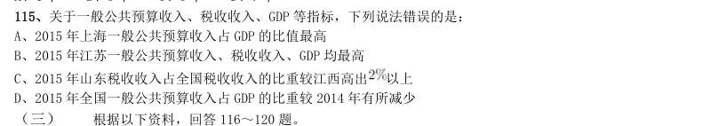

- **A.** 2015 年上海一般公共预算收入占GDP 的比值最高
- **B.** 2015 年江苏一般公共预算收入、税收收入、GDP 均最高
- **C.** 2015 年山东税收收入占全国税收收入的比重较江西高出以上
- **D.** 2015 年全国一般公共预算收入占GDP 的比重较2014 年有所减少

**答案：A**　**考点：综合分析｜选错误项**　**难度：★★★★★**
**【资料分析·综合分析｜HB-2017-ty-X116】**
> 材料：根据以下资料,回答116~120 题。 2015 年国家自然科学基金委全年共接收173017 项各类申请,同比增长约 ,择优资助各类项目40668 项,比 上年增加1579 项,资助直接费用218.8 亿元,平均资助强度(资助直接费用与资助项数的比值)53.8 万元,各项工 作取得新进展新成效。 在研究项目系列方面,面上项目资助16709 项,比上年增加1709 项,占总项数的 ,直接费用102.41 亿元, 平均资助率(资助项目占接收申请项目的比重) ,同比下降2.5 个百分点。重点项目资助625 项,同比增长约 , 直接费用17.88 亿元,重大项目资助20 项,直接费用3.18 亿元。

116. 2014 年国家自然科学基金委共接收青年科学基金的申请数约为:

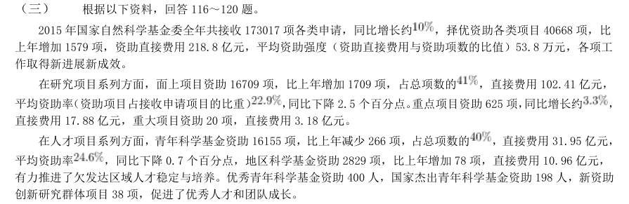

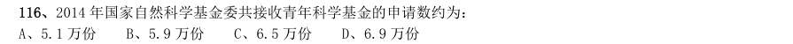

- **A.** 5.1 万份
- **B.** 5.9 万份
- **C.** 6.5 万份
- **D.** 6.9 万份

**答案：C**　**考点：综合分析｜选正确项**　**难度：★★★★★**
**【资料分析·比重计算与比较｜HB-2017-ty-X117】**

117. 2015 年面上项目资助项数占总资助项数的比重较上一年增加约:

> 材料图见 images/HB-2017-ty-X116-m.jpg

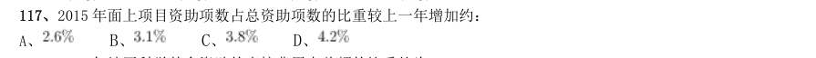

- **A.** 
- **B.** 
- **C.** 
- **D.** 

**答案：A**　**考点：比重计算与比较｜现期比重**　**难度：★★☆☆☆**
**【资料分析·比重计算与比较｜HB-2017-ty-X118】**

118. 2015 年地区科学基金资助的直接费用占总额的比重约为:

> 材料图见 images/HB-2017-ty-X116-m.jpg

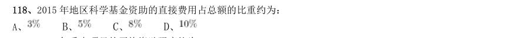

- **A.** 
- **B.** 
- **C.** 
- **D.** 

**答案：B**　**考点：比重计算与比较｜现期比重**　**难度：★★☆☆☆**
**【资料分析·平均数计算｜HB-2017-ty-X119】**

119. 2015 年重点项目的平均资助强度约为:

> 材料图见 images/HB-2017-ty-X116-m.jpg

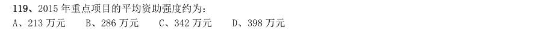

- **A.** 213 万元
- **B.** 286 万元
- **C.** 342 万元
- **D.** 398 万元

**答案：B**　**考点：平均数计算｜现期平均数**　**难度：★★☆☆☆**
**【资料分析·综合分析｜HB-2017-ty-X120】**

120. 能够从上述资料中推出的是:

> 材料图见 images/HB-2017-ty-X116-m.jpg

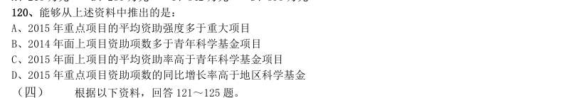

- **A.** 2015 年重点项目的平均资助强度多于重大项目
- **B.** 2014 年面上项目资助项数多于青年科学基金项目
- **C.** 2015 年面上项目的平均资助率高于青年科学基金项目
- **D.** 2015 年重点项目资助项数的同比增长率高于地区科学基金

**答案：A**　**考点：综合分析｜选错误项**　**难度：★★★★★**
**【资料分析·比重计算与比较｜HB-2017-ty-X121】**
> 材料：根据以下资料,回答121~125 题。 2015 年全国共建立社会捐助工作站、点和慈善超市3.0 万个,比上一年减少0.2 万个,其中:慈善超市9654 个, 同比下降 。全年共接收社会捐赠款654.5 亿元,其中:民政部门接收社会各界捐款44.2 亿元,各类社会组织接 收捐款610.3 亿元。全年民政部门接收捐赠衣被4537.0 万件,捐赠物资价值折合人民币5.2 亿元。

121. 全年有1838.4 万 人次困难群众受益,同比增长 ,增长率较上一年下降27.5 个百分点。全年有934.6 万人次在社会服务领域提供 了2700.7 万小时的志愿服务,同比减少10.4 万小时。 2012~2015 年社会组织接收社会捐赠款占总捐赠款的比重最高的是:

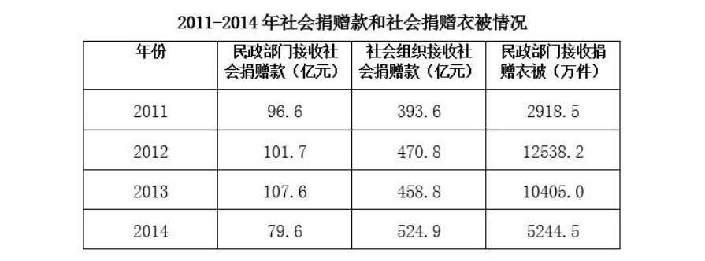

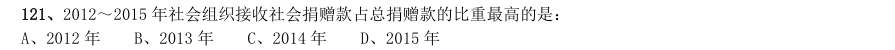

- **A.** 2012 年
- **B.** 2013 年
- **C.** 2014 年
- **D.** 2015 年

**答案：D**　**考点：比重计算与比较｜两期比重差**　**难度：★★★☆☆**
**【资料分析·综合分析｜HB-2017-ty-X122】**

122. 2015 年,全国建立的慈善超市较2014 年约:

> 材料图见 images/HB-2017-ty-X121-m.jpg

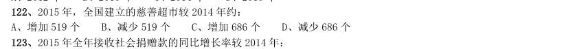

- **A.** 增加519 个
- **B.** 减少519 个
- **C.** 增加686 个
- **D.** 减少686 个

**答案：B**　**考点：综合分析｜选正确项**　**难度：★★★★☆**
**【资料分析·增长率计算与比较｜HB-2017-ty-X123】**

123. 2015 年全年接收社会捐赠款的同比增长率较2014 年:

> 材料图见 images/HB-2017-ty-X121-m.jpg

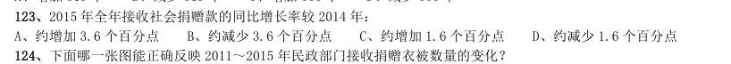

- **A.** 约增加3.6 个百分点
- **B.** 约减少3.6 个百分点
- **C.** 约增加1.6 个百分点
- **D.** 约减少1.6 个百分点

**答案：C**　**考点：增长率计算与比较｜增长率计算**　**难度：★★☆☆☆**
**【资料分析·综合分析｜HB-2017-ty-X124】**

124. 下面哪一张图能正确反映2011~2015 年民政部门接收捐赠衣被数量的变化?

> 材料图见 images/HB-2017-ty-X121-m.jpg

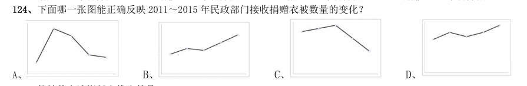

- **A.** 
- **B.** 
- **C.** 
- **D.** 

**答案：A**　**考点：综合分析｜选正确项**　**难度：★★★★☆**
**【资料分析·综合分析｜HB-2017-ty-X125】**

125. 能够从上述资料中推出的是:

> 材料图见 images/HB-2017-ty-X121-m.jpg

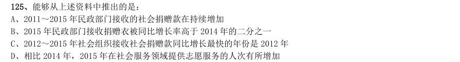

- **A.** 2011~2015 年民政部门接收的社会捐赠款在持续增加
- **B.** 2015 年民政部门接收捐赠衣被同比增长率高于2014 年的二分之一
- **C.** 2012~2015 年社会组织接收社会捐赠款同比增长最快的年份是2012 年
- **D.** 相比2014 年,2015 年在社会服务领域提供志愿服务的人次有所增加

**答案：A**　**考点：综合分析｜选错误项**　**难度：★★★★★**