# 2018 年湖北行测（统一卷）

- 题量：125（含答案 125）
- 模块分布：资料分析20 / 数量关系15 / 言语理解35 / 判断推理35 / 常识判断20
- 试卷编号：`湖北-2018-统一卷`

## 题目与答案

**【常识判断·生活常识｜HB-2018-ty-X001】**

1. 中国共产党第十九届中央委员会第二次全体会议于2018 年1 月18 日至19 日在北京召开,会议的主要议程 是:

- **A.** 研究制定国民经济发展计划
- **B.** 研究全面从严治党的重大问题
- **C.** 讨论修改宪法部分内容的建议
- **D.** 研究党和政府机构改革的重大问题

**答案：C**　**考点：生活常识｜法律常识**　**难度：★★★☆☆**
**【常识判断·生活常识｜HB-2018-ty-X002】**

2. 下列关于我国C919 大型客机研发意义的表述错误的是:

- **A.** 社会效益方面,C919 能带动上下游产业发展,增加就业岗位,促进经济社会发展
- **B.** 技术方面,C919 能提升我国航空工业研发能力,促进航空人才队伍建设,提升民航工业水平
- **C.** 军事方面,以C919 为平台改装成大型军用特种飞机的潜力巨大,短期内实现其军民两用前景良好
- **D.** 经济方面,C919 使我国民航不再依赖进口中层干线客机,打破了西方航空垄断,进而节省外汇

**答案：C**　**考点：生活常识｜科技常识**　**难度：★★★★★**
**【常识判断·生活常识｜HB-2018-ty-X003】**

3. 下列教育家与其名言对应不正确的是:

- **A.** 孔子:“性相近也,习相远也”
- **B.** 孟子:“尽信书,则不如无书”
- **C.** 墨子:“道之所存,师之所存”
- **D.** 荀子:“骐骥一跃,不能十步;驽马十驾,功在不舍”

**答案：C**　**考点：生活常识｜历史人文**　**难度：★★★☆☆**
**【常识判断·地理常识｜HB-2018-ty-X004】**

4. “人有悲欢离合,月有阴晴圆缺”,圆缺就是指“月相变化”,即地球上看到月球被太阳照亮部分的称呼。 右图所示“上弦月”大致的农历日期是:

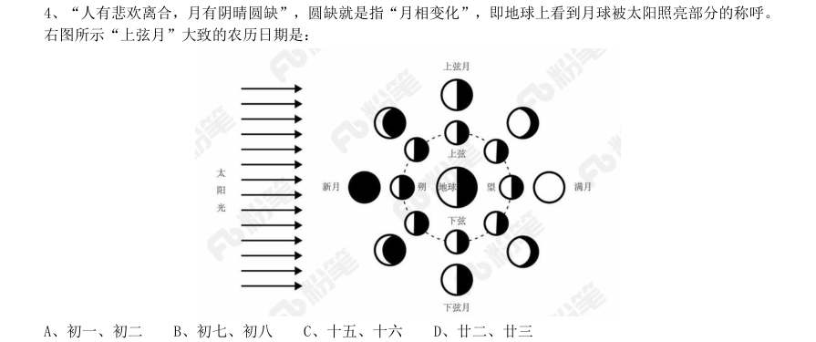

- **A.** 初一、初二
- **B.** 初七、初八
- **C.** 十五、十六
- **D.** 廿二、廿三

**答案：B**　**考点：地理常识｜地理常识（待细分）**　**难度：★★★☆☆**
**【常识判断·生活常识｜HB-2018-ty-X005】**

5. 某患者深夜因剧烈的关节疼痛而惊醒,触摸其手足多个关节,发现有黄白色结晶体隆起。造成这种症状的 代谢改变最有可能是:

- **A.** 糖的无氧分解增强,生成过多乳酸
- **B.** 嘌呤核苷酸分解增强,生成过多尿酸
- **C.** 肝中脂肪酸氧化增强,生成大量酮体
- **D.** 氨基酸脱氨基作用增强,生成大量尿素

**答案：B**　**考点：生活常识｜科技常识**　**难度：★★★☆☆**
**【常识判断·生活常识｜HB-2018-ty-X006】**

6. 面包制作过程中使用酵母主要是利用其哪一种特性:

- **A.** 酵母在生长过程中可合成蛋白
- **B.** 酵母在生长过程中可分解淀粉
- **C.** 酵母在生长过程中可产生乙醇
- **D.** 酵母在生长过程中可产生二氧化碳

**答案：D**　**考点：生活常识｜科技常识**　**难度：★★★☆☆**
**【常识判断·科技常识｜HB-2018-ty-X007】**

7. 通常情况下,使用高压锅可以大大缩短食物的烹煮时间,节约能源。下列对其所用物理原理的解释正确的 是:

- **A.** 锅内蒸汽的压强增大,导致水的沸点降低
- **B.** 锅内水的沸点降低,导致蒸汽的压强增大
- **C.** 锅内蒸汽的压强增大,导致水的沸点升高
- **D.** 锅内水的沸点升高,导致蒸汽的压强增大

**答案：C**　**考点：科技常识｜基础科学**　**难度：★★★☆☆**
**【常识判断·科技常识｜HB-2018-ty-X008】**

8. 下列现象的物理解释错误的是:

- **A.** 露珠呈球状——液体表面张力
- **B.** 铁轨铺在枕木上——减少压强
- **C.** 道路转弯镜——凸透镜对光发散
- **D.** 微波炉烤面包——涡流感应加热

**答案：C**　**考点：科技常识｜基础科学**　**难度：★★★☆☆**
**【常识判断·生活常识｜HB-2018-ty-X009】**

9. 下列四个节气所表示的含义错误的是:

- **A.** 处暑:炎热夏季即将到来
- **B.** 惊蛰:天气回暖,春雷始鸣
- **C.** 冬至:冬季最寒冷的日子开始
- **D.** 小满:夏熟作物籽粒开始灌浆饱满但未成熟

**答案：A**　**考点：生活常识｜生活常识**　**难度：★★★☆☆**
**【常识判断·地理常识｜HB-2018-ty-X010】**

10. 北回归线没有穿越下列哪一著名建筑所在的国家:

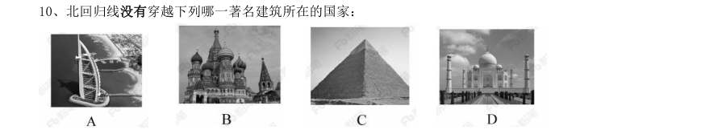

> （本题为图形题，选项为图片，见原卷）

**答案：B**　**考点：地理常识｜世界地理**　**难度：★★★☆☆**
**【常识判断·历史人文｜HB-2018-ty-X011】**

11. 下列古诗中涉及的历史事件,按先后顺序排列正确的是: 1千寻铁锁沉江底,一片降幡出石头 2剑外忽传收蓟北,初闻涕泪满衣裳 3千载琵琶作胡语,分明怨恨曲中论 4江东子弟多才俊,卷土重来未可知

- **A.** 1342
- **B.** 3412
- **C.** 2341
- **D.** 4312

**答案：D**　**考点：历史人文｜中国古代史**　**难度：★★★☆☆**
**【常识判断·历史人文｜HB-2018-ty-X012】**

12. 下列可以作为我国古代天子祭祀礼器的有: 1鼎 2爵 3篡 4璧 5璜 6璋

- **A.** 25
- **B.** 36
- **C.** 14
- **D.** 15

**答案：C**　**考点：历史人文｜中国古代史**　**难度：★★★☆☆**
**【常识判断·历史人文｜HB-2018-ty-X013】**

13. 下列哪一成语的典故不是来自真实历史事件:

- **A.** 暗度陈仓
- **B.** 草木皆兵
- **C.** 逼上梁山
- **D.** 乐不思蜀

**答案：C**　**考点：历史人文｜中国古代史**　**难度：★★★☆☆**
**【常识判断·生活常识｜HB-2018-ty-X014】**

14. 下列药物不适用于清热利咽的是:

- **A.** 胖大海
- **B.** 板蓝根
- **C.** 片仔癀
- **D.** 珍珠粉

**答案：D**　**考点：生活常识｜生活常识**　**难度：★★★☆☆**
**【常识判断·科技常识｜HB-2018-ty-X015】**

15. 下列选项不属于航空航天中货运飞船主要任务的是:

- **A.** 货运飞船发射升空完成后,会与空间站自动或人工交会对接
- **B.** 货运飞船进行空间站实验和技术试验,将获取的研究数据回传
- **C.** 货运飞船为空间站补加推进剂以及空气,带来饮水、食物等补给物资
- **D.** 货运飞船可充当空间站的“垃圾桶”,将站内废弃物品搬运至货运飞船

**答案：B**　**考点：科技常识｜科技成就**　**难度：★★★★★**
**【常识判断·经济常识｜HB-2018-ty-X016】**

16. 下列关于我国金融常识的说法正确的是:

- **A.** 国债、股票、公司债券的投资风险依次递增
- **B.** 理财产品合同中的预期收益率是理财产品实际到期收益率
- **C.** 公众兑换票面残缺的人民币,要到中国人民银行指定的商业银行网点
- **D.** 自然人之间借贷如未约定利息,出借人欲主张支付利息,法院不予支持

**答案：D**　**考点：经济常识｜宏观经济**　**难度：★★★★★**
**【常识判断·法律常识｜HB-2018-ty-X017】**

17. 下列情形中保险公司须承担给付或赔偿保险金的是:

- **A.** 定期寿险合同到期时,被保险人仍生存
- **B.** 在终身寿险中,受益人故意造成被保险人死亡
- **C.** 在意外伤害保险有效期间,被保险人突发心脏病死亡
- **D.** 在投保重大疾病保险时,投保人故意隐瞒其有先天性疾病

**答案：B**　**考点：法律常识｜民法典**　**难度：★★★☆☆**
**【常识判断·经济常识｜HB-2018-ty-X018】**

18. 下列关于我国城镇职工基本医疗保险(简称职工医保)的说法正确的是:

- **A.** 灵活就业人群不属于职工医保的覆盖范围
- **B.** 退休职工满足一定条件可以不缴纳保险费
- **C.** 用人单位缴纳的保险费不进入职工的个人账户
- **D.** 职工医保是社会保险的一种,不是强制保险

**答案：B**　**考点：经济常识｜微观与市场**　**难度：★★★☆☆**
**【常识判断·科技常识｜HB-2018-ty-X019】**

19. “21 世纪金属”具有较高的强度、良好的抗氧化性和优异的耐腐蚀性,对人体无毒且无不良反应,被称 为“亲生物金属”,可作为人造骨材料。下列关于“21 世纪金属”的说法正确的是:

- **A.** “21 世纪金属”是指钛和钛合金
- **B.** “21 世纪金属”只运用于航空航天领域
- **C.** “21 世纪金属”是一种新型石墨烯材料
- **D.** “21 世纪金属”是21 世纪发现的一种金属元素

**答案：A**　**考点：科技常识｜基础科学**　**难度：★★★☆☆**
**【常识判断·科技常识｜HB-2018-ty-X020】**

20. 下列事件按时间先后顺序排列正确的是: 1中国女排获得里约奥运会女排比赛冠军 2中国(上海)自由贸易实验区正式设立 3第九届金砖国家领导人会晤在厦门举行 4我国举行纪念中国人民抗日战争暨世界反法西斯战争胜利70 周年阅兵式

- **A.** 2314
- **B.** 4123
- **C.** 2413
- **D.** 2134

**答案：C**　**考点：科技常识｜科技常识（待细分）**　**难度：★★★★☆**
**【言语理解·逻辑填空｜HB-2018-ty-X021】**
> 材料：当的答案。

21. 泥石流的 依赖于三个危险因素:沉积物中的粘土、大量的水快速涌入以及山区的地势差异。 发生泥石流时,地上的各种大小石头和泥,小到直径只有零点几微米的粘土,大到数十厘米乃至更大的巨型漂 砾,都有可能 在泥石流中“泥沙俱下”。 依次填入划横线部分最恰当的一项是:

- **A.** 诱发裹挟
- **B.** 成因汇集
- **C.** 出现夹杂
- **D.** 引发聚集

**答案：A**　**考点：逻辑填空｜语境分析**　**难度：★★☆☆☆**
**【言语理解·逻辑填空｜HB-2018-ty-X022】**

22. 崇尚和平、和睦、和谐的理念,深深根植于中华民族绵延五千余载的 文明。中国人民从苦 难中走过来,深知和平的珍贵、发展的 ,怕的就是动荡,求的就是稳定,盼的就是天下太平。 依次填入划横线部分最恰当的一项是:

- **A.** 古老意义
- **B.** 悠久价值
- **C.** 辉煌重要
- **D.** 灿烂方向

**答案：B**　**考点：逻辑填空｜语境分析**　**难度：★★☆☆☆**
**【言语理解·逻辑填空｜HB-2018-ty-X023】**

23. 哲学社会科学作为人们认识世界、改造世界的重要 ,历来是推动历史发展和社会进步的重 要力量。纵观人类历史,人类社会每一次重大跃进,人类文明每一次重大发展,都离不开哲学社会科学的知 识 和思想先导。哲学社会科学的发展水平,反映了一个民族的思维能力、精神品格、文明素质, 体现了一个国家的综合国力和国际竞争力。 依次填入划横线部分最恰当的一项是:

- **A.** 指南增进
- **B.** 途径进步
- **C.** 方法积累
- **D.** 工具变革

**答案：D**　**考点：逻辑填空｜语境分析**　**难度：★★★☆☆**
**【言语理解·逻辑填空｜HB-2018-ty-X024】**

24. 细胞表面的磷脂酰丝氨酸是促进HIV 与细胞融合的重要辅因子,是HIV 入侵细胞过程中的“ ”目标, 若这一目标不存在了,则会影响HIV 的入侵。因此, 外源性磷脂酰丝氨酸,或抑制TMEM16F 蛋白,就会 抑制病毒蛋白的介导融合,从而阻止HIV 对细胞的感染。 依次填入画横线部分最恰当的一项是:

- **A.** 捆绑阻隔
- **B.** 锁定阻拦
- **C.** 绑定阻止
- **D.** 绑架阻断

**答案：D**　**考点：逻辑填空｜语境分析**　**难度：★★★☆☆**
**【言语理解·逻辑填空｜HB-2018-ty-X025】**

25. 国家主席习近平在G20 汉堡峰会上对全球经济治理的建议极具针对性,加强宏观政策 ,有助于促进 各方 ,避免沟通不畅或是以邻为壑,进而打造开放共赢的合作模式。 依次填入划横线部分最恰当的一项是:

- **A.** 协调互动
- **B.** 调控互通
- **C.** 沟通联动
- **D.** 交流联通

**答案：C**　**考点：逻辑填空｜语境分析**　**难度：★☆☆☆☆**
**【言语理解·逻辑填空｜HB-2018-ty-X026】**

26. 家风是具有鲜明特征的家庭文化,良好家风是一个家庭最宝贵的精神财富,也是每个家庭成员形成正确世 界观、人生观、价值观的 。家庭是人生的第一所学校,良好家风是人生幸福生活的“第一组密码”。“积 善之家,必有余庆;积不善之家,必有余殃。”只有守住和 好温暖的家庭,才能有人生的成功。 依次填入划横线部分最恰当的一项是:

- **A.** 基点庇护
- **B.** 基准保护
- **C.** 基础爱护
- **D.** 基石呵护

**答案：D**　**考点：逻辑填空｜语境分析**　**难度：★★★☆☆**
**【言语理解·逻辑填空｜HB-2018-ty-X027】**

27. 每一项工业遗产都 着城市社会发展的演变规律,实施对工业遗产的发掘保护,开发利用,对 维护城市风貌, 生机特色,克服千城一面现象,具有重要意义。 依次填入划横线部分最恰当的一项是:

- **A.** 凝结保持
- **B.** 凝集保留
- **C.** 凝聚突出
- **D.** 凝滞凸显

**答案：A**　**考点：逻辑填空｜语境分析**　**难度：★☆☆☆☆**
**【言语理解·逻辑填空｜HB-2018-ty-X028】**

28. 欧盟委员会发布消息称,回顾全球“金融危机”以来的 ,欧盟采取得当的 ,有效地 控制住了危机的蔓延与发展,从而在最近几年取得了经济持续增长的佳绩。 依次填入划横线部分最恰当的一项是:

- **A.** 历史办法
- **B.** 历程措施
- **C.** 经历手段
- **D.** 经过举措

**答案：B**　**考点：逻辑填空｜语境分析**　**难度：★☆☆☆☆**
**【言语理解·逻辑填空｜HB-2018-ty-X029】**

29. 无论是现代游戏,还是传统游戏,都____出了一定的知识、社会和时代特征,同时也____了团结、多样性 和包容的价值。但随着社会变迁和时代发展,很多有价值的传统游戏正在一代又一代的____中逐渐消逝。 依次填入划横线部分最恰当的一项是:

- **A.** 反射传播更新
- **B.** 折射传递更迭
- **C.** 影射传承更替
- **D.** 投射传达更动

**答案：B**　**考点：逻辑填空｜语境分析**　**难度：★★☆☆☆**
**【言语理解·逻辑填空｜HB-2018-ty-X030】**

30. 总的来讲,“社会”在处理与国家的关系过程中强调其自主性的成长与释放,并 了各种形式的 自我保护运动。而且,“社会”也在改变其生存与发展策略,它不仅仅满足在国家为其 的范围 内行动,而且还通过与国家的主动接触与互动, 与政府的相关性,并以协作或合作的方式参与社会 问题的解决。 依次填入划横线部分最恰当的一项是:

- **A.** 展开规定保持
- **B.** 拓展制定保护
- **C.** 开展划定维持
- **D.** 发展制订保障

**答案：A**　**考点：逻辑填空｜实词辨析**　**难度：★★★☆☆**
**【言语理解·逻辑填空｜HB-2018-ty-X031】**

31. 这部著作把对历史文化追索的触角更深入地探触到历史时空的幽微之处,更敏锐地 虽然缥 缈却血脉相连的文化传承,让远逝的鸿影显现出朦胧的真相,使冰冷荒漠的历史有了人性的 。 他将华夏祖先的图腾放置在人类文明进步的历史大背景中予以 ,在历史与现实之间辗转反侧、 抒发见解,带给我们新的思考。 依次填入划横线部分最恰当的一项是:

- **A.** 感知温度观照
- **B.** 揭示弱点洞察
- **C.** 探究纠葛揣度
- **D.** 体悟温暖臆想

**答案：A**　**考点：逻辑填空｜语境分析**　**难度：★★★☆☆**
**【言语理解·逻辑填空｜HB-2018-ty-X032】**

32. 古代中国数秘术与古希腊数秘术的区别在于,前者侧重解象,后者侧重数术。中国的数秘术后来发展成了 更具意义的宇宙形而上学,与算术渐行渐远, 。 填入划横线部分最恰当的一项是:

- **A.** 南辕北辙
- **B.** 分道扬镳
- **C.** 缘木求鱼
- **D.** 背道而驰

**答案：B**　**考点：逻辑填空｜语境分析**　**难度：★☆☆☆☆**
**【言语理解·逻辑填空｜HB-2018-ty-X033】**

33. 中国传统菜肴对于烹调方法极为讲究,而且长期以来,由于物产和风俗的差异,各地的饮食习惯和品味爱 好 , 的烹调技术经过历代人民的创造,形成了丰富多彩的地方菜系。 依次填入划横线部分最恰当的一项是:

- **A.** 迥然不同源远流长
- **B.** 天差地别积厚流光
- **C.** 殊途同归连绵不断
- **D.** 如出一辙博大精深

**答案：A**　**考点：逻辑填空｜语境分析**　**难度：★☆☆☆☆**
**【言语理解·逻辑填空｜HB-2018-ty-X034】**

34. 当下,“网红食品”让一些美食爱好者 。然而,朋友圈里的美食宣传往往真假莫辨。“网红食品” 利用朋友圈熟人关系、口碑传播的社交特性推销产品,甚至 营销公众号为其背书。 依次填入划横线部分最恰当的一项是:

- **A.** 接踵而来鼓动
- **B.** 蜂拥而至发起
- **C.** 亦步亦趋策动
- **D.** 趋之若鹜发动

**答案：D**　**考点：逻辑填空｜语境分析**　**难度：★★☆☆☆**
**【言语理解·逻辑填空｜HB-2018-ty-X035】**

35. 科学的发展和进步往往____于科学假说,科学理论发展的历史就是假说的形成、发展和假说之间的竞争、 更迭的历史。面对茫茫人类历史源头,面对_______、虚虚实实的人类文明历史遗存,科学假说同样至关重要。 他_______地将历史、文化、人性、环境视角的“聚光灯”汇集在一起,形成了属于他的一盏“无影灯”,并 以这样的视角照射幽暗的历史深处,从而解析出一些可能接近历史本源的朦胧真相。 依次填入划横线部分最恰当的一项是:

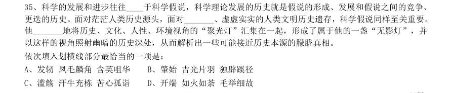

- **A.** 发轫凤毛麟角含英咀华
- **B.** 肇始吉光片羽独辟蹊径
- **C.** 滥觞汗牛充栋苦心孤诣
- **D.** 开端如火如荼毛举细故

**答案：B**　**考点：逻辑填空｜语境分析**　**难度：★★★★☆**
**【言语理解·细节判断｜HB-2018-ty-X036】**

36. 安全数据显示,2017 年上半年,PC 端总计拦截病毒10 亿次,病毒总体数量环比2016 年下半年增长 ; 相较于2016 年第二季度的病毒拦截量增长 。2017 年上半年手机病毒感染用户数为1.09 亿,同比减少 ,与2015 年和2016 年上半年相比均有所下降。但2017 年上半年手机安全软件有效查杀的病毒次数却 达到6.93 亿次,同比增长 ,比2016 年上半年多了1 倍多。此外,二维码扫描成为2017 年上半年主流 病毒的渠道来源,占比高达20.8% 从这段文字我们可以推出:

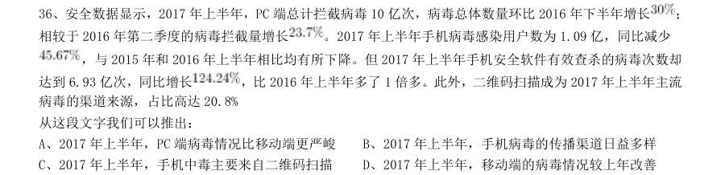

- **A.** 2017 年上半年,PC 端病毒情况比移动端更严峻
- **B.** 2017 年上半年,手机病毒的传播渠道日益多样
- **C.** 2017 年上半年,手机中毒主要来自二维码扫描
- **D.** 2017 年上半年,移动端的病毒情况较上年改善

**答案：D**　**考点：细节判断｜细节判断**　**难度：★★★★★**
**【言语理解·中心理解｜HB-2018-ty-X037】**

37. 从对技术与知识关系的梳理以及互联网技术自主性的趋向来看,未来新闻传播学科重构中应该注意一个核 心问题:如何平衡人与技术的关系问题,使研究者从沉浸其中的技术系统中跳脱出来,以一种批判的眼光对待 技术体系,避免成为因互联网自主性导致社会失序的推手。对此,唐•伊德指出,“正是因为太熟悉,我们不 仅忽视了由技术系统进行批判性反思的需要,而且也忽视了从这种批判性反思中获得的结果”。因此需要从一 个超越的角度来对待围困我们的技术社会。 这段文字意在强调:

- **A.** 新闻传播学重构有技术与知识双重困难
- **B.** 新闻传播学重构必须正确对待技术体系
- **C.** 新闻传播学重构要梳理人与技术的关系
- **D.** 新闻传播学重构要重视互联网的自主性

**答案：C**　**考点：中心理解｜对策优先**　**难度：★★★★★**
**【言语理解·中心理解｜HB-2018-ty-X038】**

38. 在中国城镇化进程中,传统戏曲面临着前所未有的生态变化。民间职业演出积极地适应农村娱乐需要,或 者重新恢复传统民俗演剧形式,借助节庆礼俗,发挥戏曲传统的礼乐教化职能;或者与时俱进,以时尚流行的 艺术元素充实戏曲本体,衍生出新的戏剧娱乐形态。体制内职业剧团在传统与创新中进行艺术传承,或者深入 农村、送戏下乡,仍然维持在基层农村的演出;或者放弃农村,寻求多元的创新方式,勉力维持城市市场,导 致戏曲在农村文化生活中趋于弱势和边缘。 这段文字意在说明:

- **A.** 戏曲艺术的传承与发展要寻求多元与时俱进
- **B.** 戏曲是传承和弘扬优秀传统文化的重要载体
- **C.** 政府要加大力度支持职业剧团在农村的演出
- **D.** 戏曲在农村的影响力出现了两极化发展趋势

**答案：D**　**考点：中心理解｜对策优先**　**难度：★★★★★**
**【言语理解·中心理解｜HB-2018-ty-X039】**

39. 一线城市的高房价以及90 后年轻人对生活品质的追求,催生了租赁公寓的兴起。租赁公寓迎合了年轻人 的消费观念,租房由过去的不得已转变成享受生活的一种方式。据调查,虽然拥有自己的住房仍是90 后的刚 性需求,但他们当中只有 愿意为了买房而降低生活质量;另有 的90 后不愿意买房,因为房贷过于沉 重会降低生活质量。由此观之,这些更看重个人价值的90 后,可能成为“不买房一代”。 这段文字意在强调:

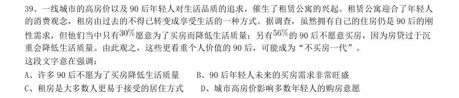

- **A.** 许多90 后不愿为了买房降低生活质量
- **B.** 90 后年轻人未来的买房需求非常旺盛
- **C.** 租房是大多数人更易于接受的居住方式
- **D.** 城市高房价影响多数年轻人的购房意愿

**答案：A**　**考点：中心理解｜中心句与主旨**　**难度：★★★★☆**
**【言语理解·逻辑填空｜HB-2018-ty-X040】**

40. 传统文化、其幽静深邃堪比深深庭院,正是因为有最单纯、最本初的文化热爱,路过之人才愿意叩开门扉, 一探究竟。以或萌或雅的方式吸引人来,只是极为关键的第一步,而最终决定大家能在这庭院之中停留多久的, 还是文化本身的魅力。因此,判断文化创意产品是否成功,一条重要的原则就是看能否将 融 会贯通。 填入划横线部分最恰当的一项是:

- **A.** 幽静深邃的意蕴与单纯本初的文化热爱
- **B.** 传统文化的精神与国际潮流的一般走向
- **C.** 极为关键的萌感与停留心中的高雅文化
- **D.** 吸引人的巧妙形式与留住人的文化内核

**答案：D**　**考点：逻辑填空｜语境分析**　**难度：★★★☆☆**
**【言语理解·中心理解｜HB-2018-ty-X041】**

41. 黑洞是爱因斯坦广义相对论最不祥的预言:过多物质或能量集中在一处,终将导致空间坍塌,像魔术师的 外套一样吞进万物,万事万物皆逃不脱。直到40 年前霍金博士宣称颠覆了黑洞——或者可能是彻底推翻了。 他的方程式表明:黑洞不会永存。一段时间之后,它们会“泄掉”,然后爆炸成辐射和微粒。但是,有一个障 碍:按照霍金的估算,黑洞崩塌时散出的辐射是随机的,落入其中的万事万物的“信息”大部分将被抹掉。这 违反了现代物理学的一条原则:时间是可以扭转的,黑洞里发生过的事情可以重建。 这段文字的主旨是:

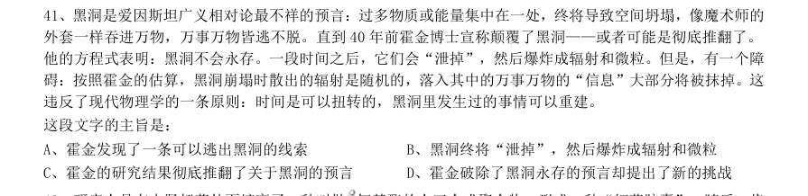

- **A.** 霍金发现了一条可以逃出黑洞的线索
- **B.** 黑洞终将“泄掉”,然后爆炸成辐射和微粒
- **C.** 霍金的研究结果彻底推翻了关于黑洞的预言
- **D.** 霍金破除了黑洞永存的预言却提出了新的挑战

**答案：D**　**考点：中心理解｜转折与因果**　**难度：★★★★★**
**【言语理解·中心理解｜HB-2018-ty-X042】**

42. 研究人员在大肠杆菌外面缠裹了一种叫做 氨基酯的人工合成聚合物,形成一种“细菌胶囊”。随后,将 其插入抵抗肺炎球菌的蛋白质疫苗。实验证明,这种胶囊能被动或主动地瞄准一种特殊免疫细胞,它能提升人 体免疫反应,具有很强的抗肺炎球菌疾病的能力。研究人员指出,这种胶囊疫苗成本低,使用便利,用这种胶 囊输送疫苗能引发特定免疫反应,比现有接种疫苗效率更高,效果更好。 根据这段文字,下列说法正确的是:

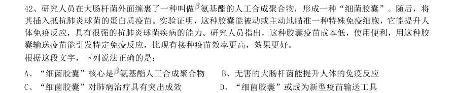

- **A.** “细菌胶囊”核心是氨基酯人工合成聚合物
- **B.** 无害的大肠杆菌能提升人体的免疫反应
- **C.** “细菌胶囊”对肺病治疗具有突出成效
- **D.** “细菌胶囊”或成为新型疫苗输送工具

**答案：D**　**考点：中心理解｜主题词**　**难度：★★★★☆**
**【言语理解·逻辑填空｜HB-2018-ty-X043】**

43. 许多企业正遭遇来自网络罪犯前所未有的攻击。有数据显示,“想哭”病毒仅攻击网络一次,就能造成高 达40 亿美元的损失。网络罪犯擅长兜售自己成功的战略,他们将所谓的勒索软件当成一种服务,其中涉及一 种许可软件,可冻结公司的电脑文件直至对方付款。这些黑客不一定都是自由职业者,事实上,当今绝大多数 灾难性的网络攻击都有某些组织的支持。遭受攻击的企业寻求执法人员帮助存在风险,因为不但企业费时费钱, 而且会增加将敏感信息公之于众的风险。因此, 。 填入划横线部分最恰当的一项是:

- **A.** 政府应该加强监管,帮助企业应对黑客攻击
- **B.** 企业为了减少损失,寻找私人网络安全公司
- **C.** 新的行业应运而生,网络安全成为热门行业
- **D.** 要将黑客绳之以法,减少网络罪犯攻击企业

**答案：C**　**考点：逻辑填空｜语境分析**　**难度：★★★★★**
**【言语理解·中心理解｜HB-2018-ty-X044】**

44. 全社会要形成抵制网络不良信息的“防火墙”。网络文化产品直接面向社会公众,经营者是否违法经营, 受众最先知道、最有发言权。对网络文化产业进行监管要依靠群众、发动群众。应健全群众举报体系,构建严 密的社会监督网络,使网络文化产业发展中的违法行为无藏身之地;引导和教育广大网民增强鉴别能力,面对 形形色色的网络文化产品保持清醒头脑,不受骗上当,不误入歧途;帮助网民提高自身道德修养,从思想上打 造铜墙铁壁,自觉抵制通过网络传播的不良信息。 这段文字意在强调:

- **A.** 对网络文化产业进行监管要构建监督网络
- **B.** 对网络文化产业进行监管要依靠群众力量
- **C.** 网络文化产业经营者要自觉抵制不良信息
- **D.** 网络文化产业经营者要主动接受群众监管

**答案：B**　**考点：中心理解｜中心句与主旨**　**难度：★★★★★**
**【言语理解·中心理解｜HB-2018-ty-X045】**

45. 虽然说经营性养老机构的定价是放开的,政府不能够干预,但是,从保障购买者权益、稳定养老床位价格、 规范市场秩序等角度来说,有关方面需要高度警惕这种销售床位的经营模式带来的种种问题。比方说,床位可 以炒卖,既有可能背离了养老机构床位的属性——把养老服务变成一种投资形式,还有可能把养老机构床位的 价格哄抬高,造成老人们买不起也住不起。另外,床位售价被炒高后很有可能会出现闲置浪费。 这段文字意在强调:

- **A.** 养老机构炒卖床位将带来各种问题
- **B.** 政府应当关注养老机构的床位定价
- **C.** 政府应当规范养老机构的经营模式
- **D.** 养老机构炒卖床位会导致资源浪费

**答案：C**　**考点：中心理解｜对策优先**　**难度：★★★★☆**
**【言语理解·中心理解｜HB-2018-ty-X046】**

46. 近年,研究人员研发出了一种“人造皮肤”,能够模仿健康年轻皮肤的特点,有望成为人类的“第二层皮 肤”,“人造皮肤”交叉融合了医学、生物、化学、材料、工程等多个学科,通过对材料的不断筛选、优化及 临床测试,最终才取得这样的成果。现实中,类似的成果还有很多,比如通过心脏外科医生与电气工程学家及 计算机科学家的紧密合作,利用3D 打印将患者病变心脏的扫描成像转变成用于心脏手术的物理模型。历史上, 任何一项医疗技术和医疗器械创新都并非是临床医生或某个学科专家单独完成的。基于临床问题的多学科交叉 合作,才能真正实现医疗技术和医疗器械领域的自主创新。 这段文字意在强调:

- **A.** 医疗自主创新促进多学科合作
- **B.** 医疗领域的自主创新成果显著
- **C.** 医疗技术和医疗器械难以创新
- **D.** 医疗自主创新依托多学科合作

**答案：D**　**考点：中心理解｜中心句与主旨**　**难度：★★★★★**
**【言语理解·语句填入｜HB-2018-ty-X047】**

47. 文字是人类继语言之后的第二大发明。如果说,语言的出现使人类实现了由动物到人的转变,那么文字的 发明,则使人类从原始社会的低级阶段上升到文明社会的高级阶段,从而使人们的生活发生了质的飞跃。文字 是一个民族与国家文化传承与创新的基础,因此, 。 填入划横线部分最恰当的一项是:

- **A.** 在世界文化格局中,每一种文化都有它自己的渊源和特点
- **B.** 能够使用和传承自己本民族的文字,不仅是一种文化责任和文化能力,更是一种文化情怀和文化热爱
- **C.** 中国文字文化的演变具有非常清晰的传承谱系,这正是中华文明与世界其他文明的区别所在
- **D.** 正是有了汉字,才有了中国人自己的精神,才有了中国五千年绵延不绝光辉灿烂的文化

**答案：B**　**考点：语句填入｜语句填入（综合）**　**难度：★★★★★**
**【言语理解·中心理解｜HB-2018-ty-X048】**

48. 方言,指各地用语。周秦之时,政府派遣“轩使者”(乘坐轻车的使者)到各地搜集地方用语,并加以记 录整理。两千多年前,西汉扬雄著《轩使者绝代语释别国方言》,东汉应劭将此书名简称为《方言》,此后“方 言”开始作为特定词语使用。与方言对应的是雅言,后称官话、国语。1956 年后称普通话并予以推广。60 年 后,普通话推广已非常成功,而方言却面临着式微、需要保护的局面。 根据这段文字,下列说法正确的是:

- **A.** 说明方言与普通话的发展相辅相成密不可分
- **B.** 说明方言与普通话都拥有非常悠久的发展历史
- **C.** 作者认为普通话的推广导致了方言式微的局面
- **D.** 应该思考如何让推广普通话与保护方言相得益彰

**答案：D**　**考点：中心理解｜对策优先**　**难度：★★★★☆**
**【言语理解·中心理解｜HB-2018-ty-X049】**

49. 水熊虫也叫水熊,是对缓步动物门生物的俗称,有记录的约有900 余种,大多是世界性分布的。它们的体 型极小,最小的只有50 微米,最大的也只有1.4 毫米,必须用显微镜才能看清。水熊虫是地球上已知生命力 最强的生物,能在冷冻、水煮、风干的状态下存活,甚至能在真空中或者放射性射线下存活,而一旦将其放回 到正常环境下,仍能恢复到正常状态。 这段文字旨在说明:

- **A.** 水熊虫是缓步动物门生物,种类繁多,分布性广
- **B.** 水熊虫体型非常小,使其易于在极端状态下存活
- **C.** 水熊虫生命力极强,在极端恶劣条件下也可存活
- **D.** 水熊虫可长时间放慢或停止自己的新陈代谢活动

**答案：C**　**考点：中心理解｜对策优先**　**难度：★★★★☆**
**【言语理解·中心理解｜HB-2018-ty-X050】**

50. 近年来,高空坠物事件屡有发生,受到社会广泛关注。不可否认,法律层面的规定,避免了高空坠物发生 后出现索赔难的情形,确保了被侵权人的合法权益得到切实保护。然而,侵权责任法律的规定,明显具有滞后 性,也就是说只有发生侵害行为后,法律才会介入。那么,当侵权行为发生后,伤害或死亡悲剧已经发生,根 本无法实现亡羊补牢的效果。因此,如何强化法律的前置性功能,让法律成为高空坠物的安全防护网,是解决 问题的关键所在。 下列说法与这段文字的主旨无关的是:

- **A.** 强化立法源头设计,有效避免高空坠物
- **B.** 高空坠物侵权法律责任规定还不够完善
- **C.** 有关高空坠物的法律存在明显的滞后性
- **D.** 筑牢安全防护网,让法律成为“事前诸葛”

**答案：D**　**考点：中心理解｜转折与因果**　**难度：★★★★★**
**【言语理解·中心理解｜HB-2018-ty-X051】**

51. 离开家乡转眼近二十载,立业,成家,每日忙忙碌碌,即使回去,也是行色匆匆,没有机会走街串巷品尝 家乡的美食。一把雪里蕻引起我对家乡美食的馋涎,也勾起我许多的乡愁。我怀念家乡的味道,不仅仅是这些 美味,还有空气中那夹杂的某种浅浅的腥土味以及混合着的一些青草花香的气息,更有那热情洋溢的七邻八舍 的咋呼声。这些平常熟悉的味道,这些以前常被我忽略了的味道,在我离开家乡多年后却给我以某种完全不同 的感受,家乡一切陌生的、熟悉的细节纷至沓来,那些微小的触觉因了怀念都一一被放大了起来,也变得弥足 珍贵起来。 对这段文字概括最准确的关键词是:

- **A.** 乡愁味道
- **B.** 故乡记忆
- **C.** 乡村气息
- **D.** 童年情结

**答案：A**　**考点：中心理解｜主题词**　**难度：★★★★★**
**【言语理解·逻辑填空｜HB-2018-ty-X052】**

52. 20 世纪30 年代,图灵提出计算机能够思维的观点,主张凡是能够通过“图灵测试”的计算机就能够思维。 所谓“图灵测试”,就是说一个人如果不能判断与之对话的隐藏主体是人还是机器,我们就不得不承认即便是 机器也能思维。“图灵测试”能否判断机器的思维, 。如果将思维定义为计算过程,那么计 算机当然能够思维。这就是著名的“计算机隐喻”,即人是计算机,思维就是计算——这是计算机表征主义的 核心思想。 填入划横线部分最恰当的一项是:

- **A.** 取决于如何定义计算机
- **B.** 取决于思维的活动过程
- **C.** 取决于计算机的功能配备
- **D.** 取决于我们如何定义思维

**答案：D**　**考点：逻辑填空｜语境分析**　**难度：★★★★☆**
**【言语理解·语句排序｜HB-2018-ty-X053】**

53. 为什么一些商品的供求关系会落入尴尬境地?为什么人们对中国品牌信心不足? 可见,这种营商 理念下的商业模式,迷失了产业优化升级的方向,破坏了我国经济的微观基础,造成了供求的不匹配。 1如果一种产品利润极低,则肯定无法投入资金进行创新和提升品牌形象 2这一营商理念的问题在哪里呢 3在过去很长一段时间里,我国企业实行的是低成本低利润扩张、追求市场份额最大化的做法 4我们知道,对于任何产品,只有存在合理利润,才有可能继续投入资金进行研发,促使产品更新换代,促使 品牌深入人心 5这需要分析我国企业的营商理念与商业模式 6同时,极低利润基础上的低成本竞争极易导致假冒伪劣商品横行,这又进一步损害了品牌形象 将以上6 个句子重新排列后插入横线中,语序正确的是:

- **A.** 253416
- **B.** 532416
- **C.** 532164
- **D.** 253146

**答案：B**　**考点：语句排序｜语序排列**　**难度：★★★★★**
**【言语理解·语句排序｜HB-2018-ty-X054】**

54. 1这不仅表明了工业社会对于文化生产的接管、改造和重新规划,而且,技术的意义开始占据前所未有的 份额 2电影的诞生是技术介入艺术的里程碑事件 3技术始终是文化生产的组成部分 4尽管如此,技术从未扮演艺术的主角 5庄子、杜甫、苏东坡,《窦娥冤》《红楼梦》,这些经典令人敬重的原因是深刻的思想和洞察力,而不是由 于书写于竹筒,上演于舞台,或者印刷在书本里 6从青铜铸鼎、笔墨纸砚到瓦舍勾栏的兴盛、印刷时代的降临,艺术符号的制作及其传播从来没有离开技术的 支持 将上述6 个句子重新排列,语序正确的是:

- **A.** 354621
- **B.** 654213
- **C.** 364521
- **D.** 645321

**答案：C**　**考点：语句排序｜语序排列**　**难度：★★★★★**
**【言语理解·语句排序｜HB-2018-ty-X055】**

55. 1数据足迹通过互联网络和云技术实现对外开放和共享 2因此带来了我们以前从未遇到过的伦理与责任问题 3形成与物理足迹相对应的数据足迹 4大数据技术通过智能终端、物联网、云计算等技术手段来“量化世界” 5其中最突出的是数据权益、数据隐私和人性自由等三个重要问题 6从而将自然、社会、人类的一切状态、行为都记录并存储下来 将以上6 个句子重新排列,语序正确的是

- **A.** 431652
- **B.** 463125
- **C.** 152436
- **D.** 164352

**答案：B**　**考点：语句排序｜语序排列**　**难度：★★★★★**
**【数量关系·行程问题｜HB-2018-ty-X056】**

56. 甲、乙、丙、丁四人同时同地出发,绕一椭圆形环湖栈道行走。甲顺时针行走,其余三人逆时针行走。已 知乙的行走速度为60 米/分钟,丙的速度为48 米/分钟。甲在出发6、7、8 分钟时分别与乙、丙、丁三人相遇, 求丁的行走速度是多少?

- **A.** 31 米/分钟
- **B.** 36 米/分钟
- **C.** 39 米/分钟
- **D.** 42 米/分钟

**答案：C**　**考点：行程问题｜相遇追及**　**难度：★★☆☆☆**
**【数量关系·利润问题｜HB-2018-ty-X057】**

57. 某苗木公司准备出售一批苗木,如果每株以4 元出售,可卖出20 万株,若苗木单价每提高0.4 元,就会 少卖10000 株。问在最佳定价的情况下,该公司最大收入是多少万元?

- **A.** 60
- **B.** 80
- **C.** 90
- **D.** 100

**答案：C**　**考点：利润问题｜利润问题（综合）**　**难度：★☆☆☆☆**
**【数量关系·概率问题｜HB-2018-ty-X058】**

58. A B 两地间有三种类型列车运行,其中高速铁路动车组列车每天6 车次,普通动车组列车每天5 车次, 快速旅客列车每天4 车次。甲、乙两人要同一天从A 地出发前往B 地。假设他们买票前没有互通信息,而且火 车票票源充足,问他们买到同一趟列车车票的概率有多大?

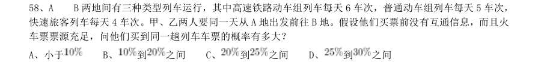

- **A.** 小于
- **B.** 到之间
- **C.** 到之间
- **D.** 

**答案：A**　**考点：概率问题｜摸球与抽取**　**难度：★★★★★**
**【数量关系·最值问题｜HB-2018-ty-X059】**
> 材料：之间

59. 某公司新近录用五名应聘人员,将分别安排到产品开发、管理、销售和售后服务这四个部门工作,每个部 门至少一人。若其中有两人只能从事销售或售后服务两个部门的工作,其余三人均能从事四个部门的工作,则 不同的选派方案共有:

- **A.** 12 种
- **B.** 18 种
- **C.** 36 种
- **D.** 48 种

**答案：D**　**考点：最值问题｜最值优化**　**难度：★★★★★**
**【数量关系·行程问题｜HB-2018-ty-X060】**

60. 一直升机在海上救援行动中搜索到遇险者方位后通知快艇,快艇立即朝遇险者直线驶去。此时,直升机距 离海平面的垂直高度200 米,从机上看,遇险者在正南方向,俯角(朝下看时视线与水平面的夹角)为 , 快艇在正东方向,俯角为 。若忽略当时风向、潮流等其它因素,且假定遇险者位置不变,则快艇以60 千米 /小时的速度匀速前进需要多长时间才能到达遇险者的位置?

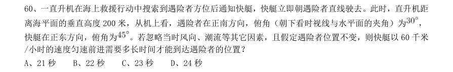

- **A.** 21 秒
- **B.** 22 秒
- **C.** 23 秒
- **D.** 24 秒

**答案：D**　**考点：行程问题｜基础行程**　**难度：★★★★☆**
**【数量关系·排列组合｜HB-2018-ty-X061】**

61. 甲、乙、丙三所学校的学生被安排在周一至周五参观某革命纪念馆。纪念馆每天最多只能安排一所学校, 其中甲学校连续参观两天,其余学校均只参观一天,那么共有多少种安排方法?

- **A.** 12 种
- **B.** 24 种
- **C.** 36 种
- **D.** 60 种

**答案：B**　**考点：排列组合｜基础排列组合**　**难度：★★★★★**
**【数量关系·几何问题｜HB-2018-ty-X062】**

62. 装修工人小郑用相同的长方形瓷砖装饰正方形墙面,每10 块瓷砖组成一个如右图所示的图案。小郑用这 个图案恰好铺满该墙面,那么,他最少用了多少块瓷砖?

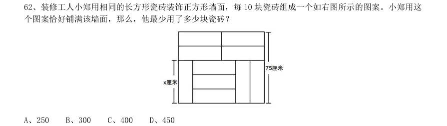

- **A.** 250
- **B.** 300
- **C.** 400
- **D.** 450

**答案：B**　**考点：几何问题｜平面几何**　**难度：★★★★☆**
**【数量关系·几何问题｜HB-2018-ty-X063】**

63. 小庄要制作一个工业模具。他在一个边长4 厘米的正方体上表面正中心位置向下挖掉一个直径2 厘米、高 2 厘米的圆柱体,接着再向下挖掉一个直径1 厘米、高1 厘米的小圆柱体(如右图所示)。那么,该模具的表 面积约为多少平方厘米?

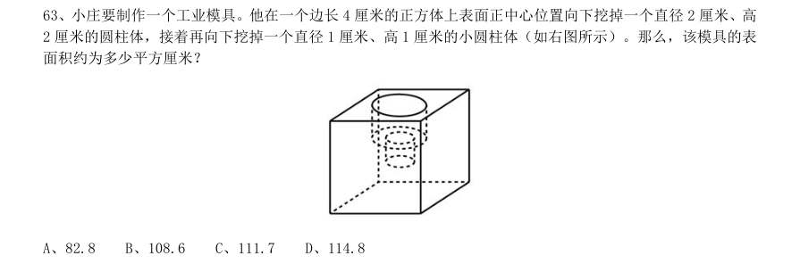

- **A.** 82.8
- **B.** 108.6
- **C.** 111.7
- **D.** 114.8

**答案：C**　**考点：几何问题｜立体几何**　**难度：★★★★★**
**【数量关系·其他数量关系｜HB-2018-ty-X064】**

64. 某银行推出3 年期和5 年期的两种理财产品A 和B。小王分别购买这两种产品各1 万元,结果发现,按单 利计算(即利息不产生收益),B 产品平均年收益率比A 产品多2 个百分点,期满后,B 产品总收益是A 产品 的2.5 倍。那么,小王各花1 万元购买A B 两种产品的平均年收益分别是:

- **A.** 700 元和900 元
- **B.** 600 元和900 元
- **C.** 500 元和700 元
- **D.** 400 元和600 元

**答案：D**　**考点：其他数量关系｜和差倍比**　**难度：★★★☆☆**
**【数量关系·容斥问题｜HB-2018-ty-X065】**

65. 某试验室通过测评I和II来核定产品的等级:两项测评都不合格的为次品,仅一项测评合格的为中品,两 项测评都合格的为优品。某批产品只有测评I合格的产品数是优品数的2 倍,测评I合格和测评II合格的产品 数之比为 。若该批产品次品率为 ,则该批产品的优品率为:

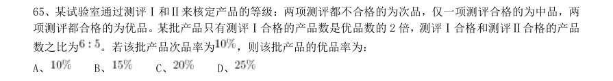

- **A.** 
- **B.** 
- **C.** 
- **D.** 

**答案：C**　**考点：容斥问题｜容斥问题（综合）**　**难度：★★★☆☆**
**【数量关系·几何问题｜HB-2018-ty-X066】**

66. 某水渠长100 米,截面为等腰梯形,其中渠面宽2 米,渠底宽1 米,渠深2 米。因突降暴雨,水深由1 米 涨至1.8 米。则水渠水量增加了:

- **A.** 112 立方米
- **B.** 136 立方米
- **C.** 272 立方米
- **D.** 324 立方米

**答案：B**　**考点：几何问题｜平面几何**　**难度：★★★★☆**
**【数量关系·其他数量关系｜HB-2018-ty-X067】**

67. 某社团组织周末自驾游,集合后发现小王和小李未到。由于每辆小车限坐5 人,按照现有车辆恰有1 人坐 不上车。为难之际,小王和小李分别开车赶到,于是所有人都坐上车,且每辆车人数均相同。那么,参加本次 自驾游的小车数为:

- **A.** 9
- **B.** 8
- **C.** 7
- **D.** 6

**答案：C**　**考点：其他数量关系｜和差倍比**　**难度：★★☆☆☆**
**【数量关系·容斥问题｜HB-2018-ty-X068】**

68. 联欢会上,有24 人吃冰激凌、30 人吃蛋糕、38 人吃水果,其中既吃冰激凌又吃蛋糕的有12 人,既吃冰 激凌又吃水果的有16 人,既吃蛋糕又吃水果的有18 人,三样都吃的则有6 人。假设所有人都吃了东西,那么 只吃一样东西的人数是多少?

- **A.** 12
- **B.** 18
- **C.** 24
- **D.** 32

**答案：B**　**考点：容斥问题｜三集合**　**难度：★★★☆☆**
**【数量关系·最值问题｜HB-2018-ty-X069】**

69. 一个班级组织跑步比赛,共设100 米、200 米、400 米三个项目。班级有50 人,报名参加100 米比赛的有 27 人,参加200 米比赛的有25 人,参加400 米比赛的有21 人。如果每人最多只能报名参加2 项比赛,那么 该班最多有多少人未报名参赛?

- **A.** 11
- **B.** 12
- **C.** 13
- **D.** 14

**答案：C**　**考点：最值问题｜最值优化**　**难度：★★★★★**
**【数量关系·几何问题｜HB-2018-ty-X070】**

70. 某村民要在屋顶建造一个长方体无盖贮水池,如果池底每平方米的造价为150 元,池壁每平方米的造价为 120 元,那么要造一个深为3 米容积为48 立方米的无盖贮水池最低造价是多少元?

- **A.** 6460
- **B.** 7200
- **C.** 8160
- **D.** 9600

**答案：C**　**考点：几何问题｜立体几何**　**难度：★★★★★**
**【判断推理·图形推理｜HB-2018-ty-X071】**
> 材料：选项。

71. 从所给的四个选项中,选择最合适的一个填入问号处,使之呈现一定的规律性:

> （本题为图形题，选项为图片，见原卷）

**答案：A**　**考点：图形推理｜属性规律**　**难度：★★★★☆**
**【判断推理·图形推理｜HB-2018-ty-X072】**

72. 把下面的图形分为两类,使每一类图形都有各自的共同特征或规律,分类正确的一项是:

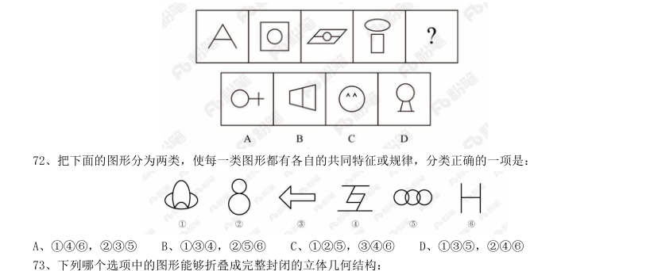

- **A.** 146,235
- **B.** 134,256
- **C.** 125,346
- **D.** 135,246

**答案：C**　**考点：图形推理｜分组分类**　**难度：★★★☆☆**
**【判断推理·图形推理｜HB-2018-ty-X073】**

73. 下列哪个选项中的图形能够折叠成完整封闭的立体几何结构:

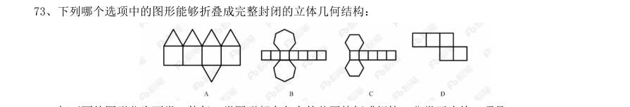

> （本题为图形题，选项为图片，见原卷）

**答案：B**　**考点：图形推理｜折纸盒**　**难度：★★★★☆**
**【判断推理·图形推理｜HB-2018-ty-X074】**

74. 把下面的图形分为两类,使每一类图形都有各自的共同特征或规律,分类正确的一项是:

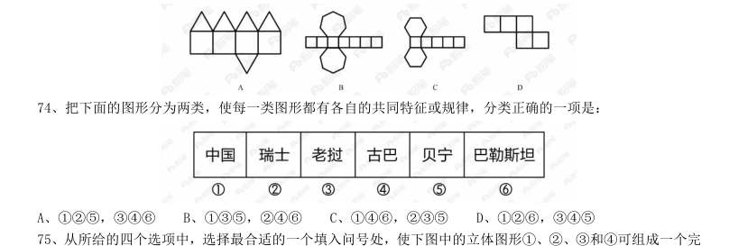

- **A.** 125,346
- **B.** 135,246
- **C.** 146,235
- **D.** 126,345

**答案：C**　**考点：图形推理｜分组分类**　**难度：★★★☆☆**
**【判断推理·图形推理｜HB-2018-ty-X075】**

75. 从所给的四个选项中,选择最合适的一个填入问号处,使下图中的立体图形1、2、3和4可组成一个完 整的长方体:

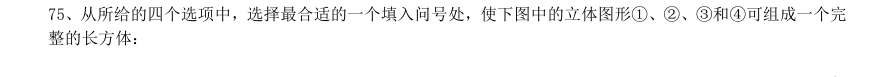

> （本题为图形题，选项为图片，见原卷）

**答案：C**　**考点：图形推理｜立体拼合**　**难度：★★★★☆**
**【判断推理·定义判断｜HB-2018-ty-X076】**

76. 情感广告是诉诸于消费者的情绪或情感反应,传达商品带给他们的附加值或情绪满足的一种广告策略。这 种情绪在消费者心目中的价值可能远远超出商品本身,从而使消费者形成积极的品牌态度。 根据上述定义,下列广告语不属于情感广告的是:

- **A.** 某品牌饮料广告语:“××可乐,中国人自己的可乐!”
- **B.** 某品牌啤酒进入东南亚市场的广告语:“好不好,家乡水。”
- **C.** 某品牌纸尿裤广告语:“宝宝天天好心情,妈妈一定更美丽。”
- **D.** 某品牌润肤露广告语:“为了肌肤柔美润舒,请使用××润肤露。”

**答案：D**　**考点：定义判断｜单定义**　**难度：★★★☆☆**
**【判断推理·定义判断｜HB-2018-ty-X077】**

77. 精准医疗是指以个体化医疗为基础,通过基因组、蛋白质组等技术,对大样本人群与特定疾病类型进行生 物标记物的分析与鉴定、验证与应用,从而精确寻找到疾病的原因和治疗的靶点,最终实现对疾病和特定患者 进行个性化精确治疗。 根据上述定义,下列选项不属于精准医疗的是:

- **A.** 甲某罹患癌症,医生对其基因进行全面检测并确定治疗方案
- **B.** 乙某近期反常头晕,医生询问症状后就给其开了非处方药物
- **C.** 丙某在就医时称自己对某种药物过敏,医生根据其过敏情况设计用药方案
- **D.** 丁某患失眠症到中医院就诊,医生据“同病异治,异病同治”的理念施治

**答案：B**　**考点：定义判断｜单定义**　**难度：★★★☆☆**
**【判断推理·定义判断｜HB-2018-ty-X078】**

78. 理性预期指的是,针对某个经济现象进行预期的时候,如果人们是理性的,那么他们就会最大限度地充分 利用所得到的信息来作出行动而不会犯系统性的错误。 根据以上定义,下列属于理性预期的是:

- **A.** 省立医院分院一投入使用,小陈就在附近开了一家水果店
- **B.** 老秦获悉某政策即将施行,凭着长期炒股的经验进行股票操作
- **C.** 传言说城南要建某重点中学分校,老刘立即在附近买了一套房子
- **D.** 小张得知其高考成绩在全省排第二十位,果断决定第一志愿报清华大学

**答案：A**　**考点：定义判断｜单定义**　**难度：★★☆☆☆**
**【判断推理·定义判断｜HB-2018-ty-X079】**

79. 在决断之前,每个事物的价值在决策者心中大致相近,则难于决断其优劣;但在作出选择之后,决策者对 这些事物的态度评价就发生了改变。这种现象叫作决断后效应。 根据上述定义,下列现象属于决断后效应的是:

- **A.** 某职员对自己的去留一筹莫展,一番考量之后他认为留下来要面对许多复杂关系,不如重新开创新天地
- **B.** 某女士对各有优劣的两个品牌手机难以抉择,最后她从经济角度考虑选择其中一款,可到货后发现这款有色差
- **C.** 某老师对选A 还是B 去参加比赛犹豫不决,班长建议选B。事后,老师认为选B 完全正确,因为B 最终夺得冠军
- **D.** 某学生填报志愿时对报甲大学还是乙大学犹豫不决,最后他听从老师建议选择了甲大学,从此觉得甲大学

**答案：D**　**考点：定义判断｜单定义**　**难度：★★☆☆☆**
**【判断推理·定义判断｜HB-2018-ty-X080】**

80. 绿色设计是指在整个产品周期内,着重考虑产品的环境属性,如可拆卸性、可回收性、可维护性、可重复 利用性等,并将其作为设计目标,在满足环境保护条件的同时,保证产品的质量达到最优状态。 根据上述定义,下列选项符合绿色设计理念的是:

- **A.** 迪拜太阳村巧摆太阳能收集器以实现日照时间最大化
- **B.** 荷兰某化学品公司将健康环保作为公司重要的价值观
- **C.** 巴西流行利用绿色植物代替砖、石、钢筋水泥来砌墙
- **D.** 某学校将教室背景设计为浅绿色来保护孩子们的眼睛

**答案：C**　**考点：定义判断｜单定义**　**难度：★★☆☆☆**
**【判断推理·定义判断｜HB-2018-ty-X081】**

81. 广义相对论是爱因斯坦以几何语言建立而成的引力理论,他将引力改描写成因时空中的物质与能量而弯曲 的时空,以取代传统对于引力是一种力的看法,而这种时空曲率与处于时空中的物质与辐射的能量动量直接相 关。 根据上述定义,下列选项中的现象不涉及广义相对论的是:

- **A.** 科学家在观察日全食时发现,光线经过太阳附近时会产生偏角弯曲
- **B.** 科学家发现,在强引力场中时钟要走得慢一些,因而从巨大质量的星体表面发射到地球的光线,会向光谱的红端移动
- **C.** 科学家发现,当一个星体足够致密时,其引力使时空中的区域极端扭曲以至光线都无法逸出,由此发现了黑洞的存在
- **D.** 麦哲伦航行时发现,驶向远方的船帆逐渐下沉,最后消失在视线中,而海平面似呈弯曲状,远处的海水似

**答案：D**　**考点：定义判断｜单定义**　**难度：★★★☆☆**
**【判断推理·定义判断｜HB-2018-ty-X082】**

82. 在企业活动中,库存有多种类型。装运库存是指在价值链末端工厂的库房里,那些已经准备好可以随时出 货的产品。在途库存又称中转库存,指尚未到达目的地,正处于运输状态或等待运输状态而储备在运输工具中 的库存。 根据上述定义,下列选项属于在途库存的是:

- **A.** 小张给自己网购了一件毛衣,下单两天后查知该毛衣已到某中转站
- **B.** 某高速服务区内一辆大货车满载着A 超市从B 地采购的各类毛巾
- **C.** 某皮鞋厂的卡车里,堆满了该厂用于制造新款皮鞋的牛皮
- **D.** 某公司在城南的自有库房中存放着给城北门店销售的玩具

**答案：B**　**考点：定义判断｜单定义**　**难度：★★★☆☆**
**【判断推理·定义判断｜HB-2018-ty-X083】**

83. 水体游泳是人们前往水体及周边区域以寻求愉悦为主要目的的一种具有社会、休闲和消费属性的短期经历, 目前已逐渐成为人们休闲时尚与区域旅游开发的重要载体。水体旅游资源是指水域(水体)及相关联的岸地、 岛屿、林草、建筑等能对人产生吸引力的自然景观和人文景观。 根据上述定义,下列选项不属于水体旅游资源的是:

- **A.** 武夷山“九曲溪”两旁随处可见历代文人墨客的题词
- **B.** 秦淮河岸的街道上,有一座建于明代的“江南贡院”
- **C.** 某森林公园建有一个放养着上千条锦鲤的“放生池”
- **D.** 某大厦矗立于长江岸边,成为游客拍照留念的背景

**答案：C**　**考点：定义判断｜单定义**　**难度：★★☆☆☆**
**【判断推理·定义判断｜HB-2018-ty-X084】**

84. 刺激泛化是指条件作用的形成使有机体习得了对某一刺激做出特定反应的行为,因此也就可能对类似的刺 激做出同样的行为反应。刺激分化是通过选择性强化和消退使有机体学会对条件刺激和与条件刺激相类似的刺 激做出不同的行为反应。 根据上述定义,下列说法不正确的是:

- **A.** “一朝被蛇咬,十年怕井绳”属于刺激泛化
- **B.** “横看成岭侧成峰,远近高低各不同”属于刺激分化
- **C.** 为突出品牌,厂家对包装进行独特设计,力图使顾客产生刺激分化
- **D.** 某品牌牙膏创成名牌后,生产商将其生产的化妆品也以同品牌命名,利用的是顾客的刺激泛化

**答案：B**　**考点：定义判断｜单定义**　**难度：★★★☆☆**
**【判断推理·定义判断｜HB-2018-ty-X085】**

85. 地震震级是通过仪器给出地震大小的一种量度,是划分震源放出能量大小的等级,地震所释放的能量越大, 地震震级也越大,每一次地震只有一个震级。地震烈度表示地震对地表及工程建筑物影响的强弱程度,是在没 有仪器记录的情况下,凭地震时人们的感觉或地震发生后器物反应的程度、工程建筑物的破坏程度、地表的变 化状况而定的一种宏观尺度。 根据上述定义,下列说法正确的是:

- **A.** 地震震级越大,地震烈度相应越强
- **B.** 一次地震只有一个震级,一个烈度
- **C.** 距震源越近,震级越大,烈度越强
- **D.** 地表破坏越严重说明地震烈度越强

**答案：D**　**考点：定义判断｜单定义**　**难度：★★☆☆☆**
**【判断推理·类比推理｜HB-2018-ty-X086】**

86. 西子湖:曹娥江

- **A.** 美人蕉:老婆饼
- **B.** 东坡肉:五柳鱼
- **C.** 女儿红:祖母绿
- **D.** 狮子头:凤凰胆

**答案：B**　**考点：类比推理｜逻辑关系**　**难度：★☆☆☆☆**
**【判断推理·类比推理｜HB-2018-ty-X087】**

87. 仪态万方:美丽多姿

- **A.** 风度翩翩:富富有余
- **B.** 腰缠万贯:富甲一方
- **C.** 其貌不扬:荣华富贵
- **D.** 仪表堂堂:身无长物

**答案：B**　**考点：类比推理｜语义关系**　**难度：★☆☆☆☆**
**【判断推理·类比推理｜HB-2018-ty-X088】**

88. 青衿:读书人

- **A.** 南冠:囚犯
- **B.** 浮屠:寺庙
- **C.** 春蚕:奉献
- **D.** 袍泽:官员

**答案：A**　**考点：类比推理｜语义关系**　**难度：★☆☆☆☆**
**【判断推理·类比推理｜HB-2018-ty-X089】**

89. 骡子:耕畜:犁地

- **A.** 基因:生命:遗传
- **B.** 衙役:衙门:当差
- **C.** 鸬鹚:水鸟:捕鱼
- **D.** 恒星:宇宙:发光

**答案：C**　**考点：类比推理｜逻辑关系**　**难度：★☆☆☆☆**
**【判断推理·类比推理｜HB-2018-ty-X090】**

90. 火药:鞭炮:二踢脚

- **A.** 乌铁:刀具:三棱刀
- **B.** 红砖:建筑:四合院
- **C.** 清水:白酒:五粮液
- **D.** 杉木:乐器:六弦琴

**答案：C**　**考点：类比推理｜逻辑关系**　**难度：★☆☆☆☆**
**【判断推理·类比推理｜HB-2018-ty-X091】**

91. 演员:公园:演出

- **A.** 谣言:微信:查处
- **B.** 股民:股市:投资
- **C.** 士兵:战争:升迁
- **D.** 信息:卫星:定位

**答案：B**　**考点：类比推理｜对应关系**　**难度：★☆☆☆☆**
**【判断推理·类比推理｜HB-2018-ty-X092】**

92. 春秋:寒暑:一年

- **A.** 妇孺:老幼:生命
- **B.** 荏苒:蹉跎:岁月
- **C.** 东西:南北:方向
- **D.** 冷热:干湿:温度

**答案：C**　**考点：类比推理｜语义关系**　**难度：★☆☆☆☆**
**【判断推理·类比推理｜HB-2018-ty-X093】**

93. ( )之于风油精相当于碳酸之于( )

- **A.** 薄荷脑;可乐
- **B.** 清凉;陈醋
- **C.** 叶绿素;花露水
- **D.** 液体;二氧化碳

**答案：A**　**考点：类比推理｜逻辑关系**　**难度：★☆☆☆☆**
**【判断推理·类比推理｜HB-2018-ty-X094】**

94. 纺车之于( )相当于( )之于联合收割机

- **A.** 手摇;蒸汽机
- **B.** 织布;传动带
- **C.** 3D 织布机;曲辕犁
- **D.** 自动打线车;发动机

**答案：C**　**考点：类比推理｜逻辑关系**　**难度：★☆☆☆☆**
**【判断推理·类比推理｜HB-2018-ty-X095】**

95. 钟表之于( )相当于( )之于排字工

- **A.** 时间;印刷工
- **B.** 刻度;线装书
- **C.** 更夫;打印机
- **D.** 油纸;修理工

**答案：C**　**考点：类比推理｜逻辑关系**　**难度：★☆☆☆☆**
**【判断推理·逻辑判断｜HB-2018-ty-X096】**

96. 我们身体的生物钟系统会受到许多因素的影响,其中之一就是光照。研究表明,光照可以有效地欺骗大脑 进入“白昼模式”,哪怕当时人的眼睛是闭着的也没关系。研究人员发现可以用光照疗法来帮助我们调整时差, 包括持续光照和不同间隔的闪光,而每10 秒一次持续仅2 毫秒的闪光最有效。研究还发现,在睡眠时经历过 “闪光处理”的人出现困意的周期会延后两个小时。 以下哪项如果是真,最能支持上述观点?

- **A.** 每次闪光间隙的黑暗都有助于让眼睛重启,从而恢复眼睛对光照的敏感
- **B.** 大部分睡眠时经历“闪光处理”的人的睡眠质量都不会受到闪光的影响
- **C.** 去时区早两小时的城市,启程日日出前两小时经光照疗法的人无时差感
- **D.** 依靠自身来调节时差耗时良久,大概平均每天只能倒过一个小时的时差

**答案：C**　**考点：逻辑判断｜加强论证**　**难度：★★★★★**
**【判断推理·逻辑判断｜HB-2018-ty-X097】**

97. 研究人员在普遍使用的功能性磁共振成像技术(fMRI)专用软件中发现了算法错误。他们采集499 名健康 的人处于静息状态时的检查结果,发现其统计方法还需用真实呈现的病例加以验证。这意味着软件有时会错得 离谱,就算大脑处于静止状态时也会显示有活动——软件显示出的活动是软件算法的产物,而非被研究大脑真 的处于活跃状态。 以下哪项如果为真,最能支持上述结论?

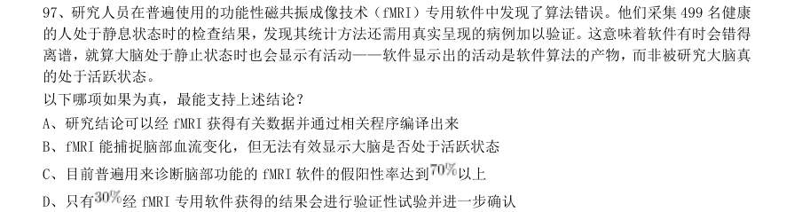

- **A.** 研究结论可以经fMRI 获得有关数据并通过相关程序编译出来
- **B.** fMRI 能捕捉脑部血流变化,但无法有效显示大脑是否处于活跃状态
- **C.** 目前普遍用来诊断脑部功能的fMRI 软件的假阳性率达到以上
- **D.** 只有

**答案：C**　**考点：逻辑判断｜加强论证**　**难度：★★★★★**
**【判断推理·逻辑判断｜HB-2018-ty-X098】**

98. 如果央行允许人民币继续贬值,那么市场对于人民币贬值的预期就容易强化。如果市场形成较强的人民币 贬值预期,大量的资金就会流出我国。资金流出我国,不仅会强化这种人民币的贬值预期,导致更多的资金流 出我国,而且可能会导致我国资产价格全面下跌,继而可能引爆金融市场的区域性风险及系统性风险。这些都 是我们不愿意看到且不允许出现的情况。 由此可以推出:

- **A.** 货币持续贬值会导致资产全面下跌
- **B.** 资金流失严重会出现货币贬值预期
- **C.** 央行不会允许人民币继续贬值
- **D.** 我国将重点着手干预资金外流

**答案：C**　**考点：逻辑判断｜加强论证**　**难度：★★★★★**
**【判断推理·逻辑判断｜HB-2018-ty-X099】**

99. 母亲年龄是唐氏综合征筛查所考虑的风险因素之一。一般认为,母亲年龄越大,宝宝出现遗传异常的风险 就越高。当卵子里有一条多余的21 号染色体时,胎儿就会出现唐氏综合征。随着女性年龄的增长,出现此类 异常的风险也随之升高。最近,一些专家开始对这种筛查方法提出质疑,认为遗传异常并不仅仅只是女方年龄 的问题。 以下哪项如果为真,最能支持上述专家质疑?

- **A.** 精子的21 号染色体也可能粘连多余的遗传物质,父亲的年龄越大,制造精子过程出错的概率就越高
- **B.** 造成宝宝精神健康问题的重点似乎并不在于母亲的“绝对年龄”,而在于父亲与母亲的“相对年龄”
- **C.** 子宫基本不会随着年龄增长发生变化,只要激素水平充足,年老妇女的子宫也能够正常养育胎儿
- **D.** 现代人因为环境以及生活习惯影响,容易产生基因突变,即便是健康夫妇也有生育“唐氏儿”的风险

**答案：A**　**考点：逻辑判断｜削弱论证**　**难度：★★★★★**
**【判断推理·逻辑判断｜HB-2018-ty-X100】**

100. 四位球迷在某球赛的晋级赛开始之前对几个队伍的赛况进行预测,他们比较关注其中的两支球队,分别 作了如下预测: 方某说:如果甲队不能晋级,那么乙队也不能晋级。 白某说:不管甲队能不能晋级,乙队都不能晋级。 夏某说:乙队能晋级,但甲队不能晋级。 邓某说:我看这几支球队都不能晋级。 比赛结果证明,四位球迷中只有一位的预测是正确的。 根据上述情况,以下哪项一定为真?

- **A.** 白某预测是正确的
- **B.** 邓某预测是正确的
- **C.** 如果甲队能够晋级,那么方某的预测是正确的
- **D.** 如果甲队不能晋级,那么方某的预测是正确的

**答案：C**　**考点：逻辑判断｜翻译推理**　**难度：★★★★★**
**【判断推理·逻辑判断｜HB-2018-ty-X101】**

101. 场所恐惧症主要表现为对某些特定环境的恐惧,如高处、广场、客观环境和拥挤的公共场所等,常以自 发性惊恐发作开始,然后产生预期焦虑和回避行为,进而出现条件化的形成。一些临床研究表明,场所恐惧症 患者常伴有惊恐发作。然而,有专家认为最初一次惊恐发作是场所恐惧症起病的必备条件,因而认为场所恐惧 症是惊恐发作发展的后果,应归入惊恐障碍这一类别。 以下哪项如果为真,最能质疑上述专家观点?

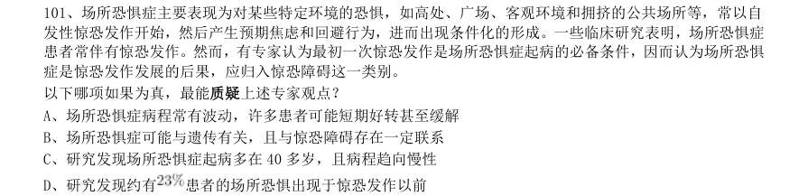

- **A.** 场所恐惧症病程常有波动,许多患者可能短期好转甚至缓解
- **B.** 场所恐惧症可能与遗传有关,且与惊恐障碍存在一定联系
- **C.** 研究发现场所恐惧症起病多在40 多岁,且病程趋向慢性
- **D.** 研究发现约有

**答案：D**　**考点：逻辑判断｜削弱论证**　**难度：★★★★★**
**【判断推理·逻辑判断｜HB-2018-ty-X102】**

102. 月球潮汐力与地球上的地震、海啸、火山爆发等自然灾害存在明显相关性的说法是可疑的,因为每年自 然灾害很多,而“超级月亮”每14 个月才一次,即便考虑月球经过近地点,每个月也只有一次。部分学者会 找出一些和“超级月亮”出现时间相隔不远的灾害来论证,这显然缺乏证据支撑。也忽略了大量事例,比如月 球在远地点前后发生的灾害。基于大量关于地震和月球关系数据的研究表明,地震发生频率和月球经过近地点 没有统计上的相关性,因此说月球潮汐力会引发地震显然缺乏可靠证据。 由此可以推出:

- **A.** 月球潮汐力与月球在远地点前后发生的地震具有相关性
- **B.** 月球潮汐力与月球经过近地点发生的地震具有因果关系
- **C.** 月球潮汐力与地震之间的关系需要在时间和空间上综合分析
- **D.** 地震触发机制有多种因素,但月球潮汐力的作用效果较明显

**答案：C**　**考点：逻辑判断｜前提假设**　**难度：★★★★★**
**【判断推理·逻辑判断｜HB-2018-ty-X103】**

103. 某研究团队让两批测试者分别进入睡眠实验室里睡上一夜。第一批被安排睡得很晚,从而减少总睡眠时 间;第二批被安排睡得早,但在睡眠过程中多次被吵醒。第二晚过后,结果就已经显现:第二批测试者的积极 情绪受到严重影响。他们的精力水平较低,同情心和友善度等积极情绪指数有所下滑。部分研究者据此认为, 被吵醒导致了测试者无法得到足够的慢波睡眠,而慢波睡眠是恢复精力感的关键,但也有研究者对此项研究的 可信度提出质疑。 以下哪项如果为真,最能反驳质疑者?

- **A.** 第一批测试者积极情绪的指数下滑程度不太明显
- **B.** 第二批测试者中大部分人长期以来情绪不够积极
- **C.** 两批测试者的健康状况和心理素质原本就很接近
- **D.** 两批测试者在参与睡眠实验前精力水平参差不齐

**答案：A**　**考点：逻辑判断｜削弱论证**　**难度：★★★★★**
**【判断推理·逻辑判断｜HB-2018-ty-X104】**

104. 宇宙加速膨胀是因为物质之间相互排斥,减速膨胀是因为物质之间相互吸引。因此,要在此基础上解释 宇宙的加速或减速膨胀,必须要有不同特性的物质在不同的时期占主导地位,从而产生强大的排斥力或吸引力。 粒子物理标准模型中的所有粒子都产生吸引的引力,然而星系转动曲线的研究表明,在星系里面还有大量的、 看不到的物质,这些物质可以产生非常强大的吸引性引力。 以上论证如果为真,那么星系转动曲线研究结论隐含了下列哪一项前提?

- **A.** 粒子物理标准模型中的所有粒子产生的吸引性引力不足
- **B.** 粒子物理标准模型中的粒子不是唯一的,存在其它粒子
- **C.** 星系转动曲线的研究说明这个时期的宇宙正在加速膨胀
- **D.** 星系转动曲线的研究说明存在超大质量、看不到的黑洞

**答案：A**　**考点：逻辑判断｜前提假设**　**难度：★★★★★**
**【判断推理·逻辑判断｜HB-2018-ty-X105】**

105. 我国在西南地区进行的页岩气勘探获得重大成果,估算天然气资源量达千亿立方米,这是我国首次在四 川盆地以外的南方复杂构造区取得页岩气勘探的重大突破。有专家称该地有望成为新的工业气田,可以满足上 千万居民的生活和工农业发展的用气需求,促进经济发展。 该专家观点成立的假设前提是:

- **A.** 南方复杂的地质构造有利于天然气生成
- **B.** 凡是勘探到的天然气都能顺利开采出来
- **C.** 我国目前天然气产量无法满足实际需求
- **D.** 天然气作为清洁能源是促进经济发展的重要动力

**答案：B**　**考点：逻辑判断｜前提假设**　**难度：★★★★☆**
**【资料分析·平均数计算｜HB-2018-ty-X106】**
> 材料：2017 年上半年,全国居民人均可支配收入12932 元,比上年同期名义增长8.8%,其中,城镇居民人均可 支配收入18322 元,增长8.1%(以下如无特别说明,均为同比名义增长);农村居民人均可支配收入6562 元, 增长8.5%。

106. 按收入来源分,2017 年上半年,全国居民人均工资性收入7435 元,增长8.6%,占全国居民人均可支配收 入的比重为57.5%;人均经营净收入2117 元,增长5.9%,占全国居民人均可支配收入的比重为16.4%;人均财 产净收入1056 元,增长9.6%,占全国居民人均可支配收入的比重为8.2%;人均转移净收入2324 元,增长11.9%, 占全国居民人均可支配收入的比重为18.0%。 2016 年上半年,城镇居民人均可支配收入约为多少万元?

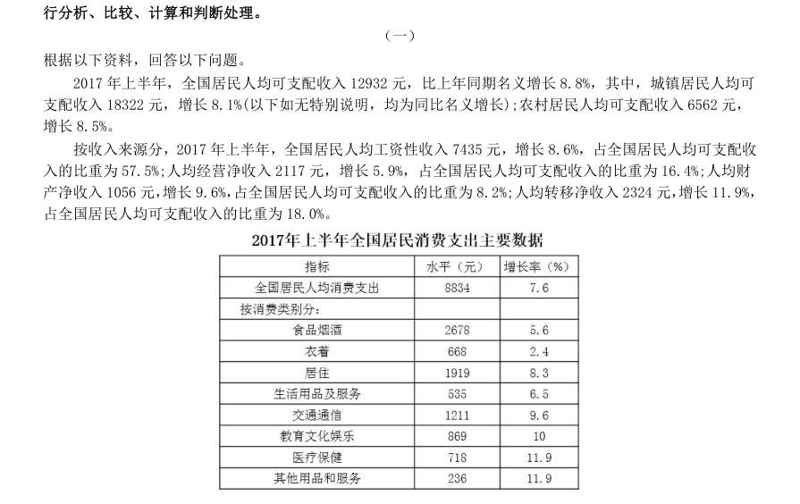

- **A.** 1.4
- **B.** 1.7
- **C.** 2.1
- **D.** 2.3

**答案：B**　**考点：平均数计算｜平均数增长率**　**难度：★★★☆☆**
**【资料分析·平均数计算｜HB-2018-ty-X107】**
> 材料：2017 年上半年,全国居民人均可支配收入12932 元,比上年同期名义增长8.8%,其中,城镇居民人均可 支配收入18322 元,增长8.1%(以下如无特别说明,均为同比名义增长);农村居民人均可支配收入6562 元, 增长8.5%。

107. 2017 年上半年,全国居民消费支出主要数据按消费类别分,其指标的增长率超过全国居民人均消费支出 水平增长率的有几个?

> 材料图见 images/HB-2018-ty-X106-m.jpg

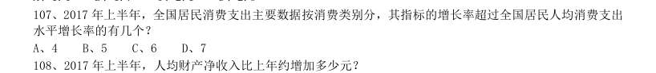

- **A.** 4
- **B.** 5
- **C.** 6
- **D.** 7

**答案：B**　**考点：平均数计算｜现期平均数**　**难度：★★☆☆☆**
**【资料分析·平均数计算｜HB-2018-ty-X108】**
> 材料：2017 年上半年,全国居民人均可支配收入12932 元,比上年同期名义增长8.8%,其中,城镇居民人均可 支配收入18322 元,增长8.1%(以下如无特别说明,均为同比名义增长);农村居民人均可支配收入6562 元, 增长8.5%。

108. 2017 年上半年,人均财产净收入比上年约增加多少元?

> 材料图见 images/HB-2018-ty-X106-m.jpg

- **A.** 92
- **B.** 102
- **C.** 112
- **D.** 122

**答案：A**　**考点：平均数计算｜现期平均数**　**难度：★★☆☆☆**
**【资料分析·综合分析｜HB-2018-ty-X109】**
> 材料：2017 年上半年,全国居民人均可支配收入12932 元,比上年同期名义增长8.8%,其中,城镇居民人均可 支配收入18322 元,增长8.1%(以下如无特别说明,均为同比名义增长);农村居民人均可支配收入6562 元, 增长8.5%。

109. 关于2017 年上半年全国居民收入和消费支出主要数据情况,下列说法正确的是:

> 材料图见 images/HB-2018-ty-X106-m.jpg

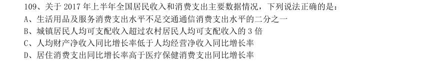

- **A.** 生活用品及服务消费支出水平不足交通通信消费支出水平的二分之一
- **B.** 城镇居民人均可支配收入超过农村居民人均可支配收入的3 倍
- **C.** 人均财产净收入同比增长率低于人均经营净收入同比增长率
- **D.** 居住消费支出同比增长率高于医疗保健消费支出同比增长率

**答案：A**　**考点：综合分析｜平均数**　**难度：★★★★★**
**【资料分析·综合分析｜HB-2018-ty-X110】**
> 材料：2017 年上半年,全国居民人均可支配收入12932 元,比上年同期名义增长8.8%,其中,城镇居民人均可 支配收入18322 元,增长8.1%(以下如无特别说明,均为同比名义增长);农村居民人均可支配收入6562 元, 增长8.5%。

110. 2017 年上半年,全国居民消费支出主要数据按消费类别分。下列哪一个经济指标值最大?

> 材料图见 images/HB-2018-ty-X106-m.jpg

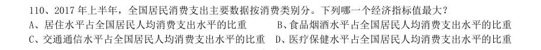

- **A.** 居住水平占全国居民人均消费支出水平的比重
- **B.** 食品烟酒水平占全国居民人均消费支出水平的比重
- **C.** 交通通信水平占全国居民人均消费支出水平的比重
- **D.** 医疗保健水平占全国居民人均消费支出水平的比重

**答案：B**　**考点：综合分析｜比重**　**难度：★★★★☆**
**【资料分析·增长量计算｜HB-2018-ty-X111】**
> 材料：根据以下资料,回答111~115 题。 2017 年第一季度,某省农林牧渔业增加值361.78 亿元元,比上年同期增长5.9%,高于上年同期0.2 个百 分点。具体情况如下: 该省种植业增加值119.21 亿元,比上年同期增长8.2%,其中蔬菜种植面积358.80 万亩,比上年同期增 加18.23 万亩,蔬菜产量471.42 万吨,增长7.5%;茶叶种植面积679.53 万亩,比上年同期增加19.79 万亩, 茶叶产量2.30 万吨,增长19.49%。 该省林业增加值34.84 亿元,比上年同期增长8.3%。 该省畜牧业增加值176.64 亿元,比上年同期增长4.2%,增速比上年同期加快2.1 个百分点。其中生猪存 栏增速由上年同期的下降9.8%转为增长3.1%,出栏增速由上年同期的下降3.2%转为增长3.3%;猪牛羊禽肉产 量67.80 万吨,比上年同期增长3.1%;禽蛋产量5.33 万

111. 该省农林牧渔服务业增加值21.87 亿元,比上年同期增长3.8%。 2015 年第一季度,该省农林牧渔业增加值与下列哪一项最为接近?

> 材料图见 images/HB-2018-ty-X106-m.jpg

- **A.** 320 亿元
- **B.** 340 亿元
- **C.** 360 亿元
- **D.** 380 亿元

**答案：A**　**考点：增长量计算｜增长量计算（综合）**　**难度：★★★☆☆**
**【资料分析·比重计算与比较｜HB-2018-ty-X112】**
> 材料：根据以下资料,回答111~115 题。 2017 年第一季度,某省农林牧渔业增加值361.78 亿元元,比上年同期增长5.9%,高于上年同期0.2 个百 分点。具体情况如下: 该省种植业增加值119.21 亿元,比上年同期增长8.2%,其中蔬菜种植面积358.80 万亩,比上年同期增 加18.23 万亩,蔬菜产量471.42 万吨,增长7.5%;茶叶种植面积679.53 万亩,比上年同期增加19.79 万亩, 茶叶产量2.30 万吨,增长19.49%。 该省林业增加值34.84 亿元,比上年同期增长8.3%。 该省畜牧业增加值176.64 亿元,比上年同期增长4.2%,增速比上年同期加快2.1 个百分点。其中生猪存 栏增速由上年同期的下降9.8%转为增长3.1%,出栏增速由上年同期的下降3.2%转为增长3.3%;猪牛羊禽肉产 量67.80 万吨,比上年同期增长3.1%;禽蛋产量5.33 万

112. 2017 年第一季度,该省占农林牧渔业增加值比重超过三成的包括:

> 材料图见 images/HB-2018-ty-X106-m.jpg

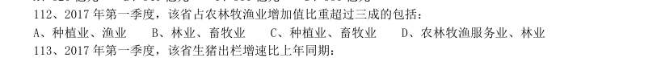

- **A.** 种植业、渔业
- **B.** 林业、畜牧业
- **C.** 种植业、畜牧业
- **D.** 农林牧渔服务业、林业

**答案：C**　**考点：比重计算与比较｜现期比重**　**难度：★★☆☆☆**
**【资料分析·增长率计算与比较｜HB-2018-ty-X113】**
> 材料：根据以下资料,回答111~115 题。 2017 年第一季度,某省农林牧渔业增加值361.78 亿元元,比上年同期增长5.9%,高于上年同期0.2 个百 分点。具体情况如下: 该省种植业增加值119.21 亿元,比上年同期增长8.2%,其中蔬菜种植面积358.80 万亩,比上年同期增 加18.23 万亩,蔬菜产量471.42 万吨,增长7.5%;茶叶种植面积679.53 万亩,比上年同期增加19.79 万亩, 茶叶产量2.30 万吨,增长19.49%。 该省林业增加值34.84 亿元,比上年同期增长8.3%。 该省畜牧业增加值176.64 亿元,比上年同期增长4.2%,增速比上年同期加快2.1 个百分点。其中生猪存 栏增速由上年同期的下降9.8%转为增长3.1%,出栏增速由上年同期的下降3.2%转为增长3.3%;猪牛羊禽肉产 量67.80 万吨,比上年同期增长3.1%;禽蛋产量5.33 万

113. 2017 年第一季度,该省生猪出栏增速比上年同期:

> 材料图见 images/HB-2018-ty-X106-m.jpg

- **A.** 加快12.9%
- **B.** 加快6.7%
- **C.** 加快6.5%
- **D.** 加快0.1%

**答案：C**　**考点：增长率计算与比较｜增长率计算**　**难度：★★☆☆☆**
**【资料分析·综合分析｜HB-2018-ty-X114】**
> 材料：根据以下资料,回答111~115 题。 2017 年第一季度,某省农林牧渔业增加值361.78 亿元元,比上年同期增长5.9%,高于上年同期0.2 个百 分点。具体情况如下: 该省种植业增加值119.21 亿元,比上年同期增长8.2%,其中蔬菜种植面积358.80 万亩,比上年同期增 加18.23 万亩,蔬菜产量471.42 万吨,增长7.5%;茶叶种植面积679.53 万亩,比上年同期增加19.79 万亩, 茶叶产量2.30 万吨,增长19.49%。 该省林业增加值34.84 亿元,比上年同期增长8.3%。 该省畜牧业增加值176.64 亿元,比上年同期增长4.2%,增速比上年同期加快2.1 个百分点。其中生猪存 栏增速由上年同期的下降9.8%转为增长3.1%,出栏增速由上年同期的下降3.2%转为增长3.3%;猪牛羊禽肉产 量67.80 万吨,比上年同期增长3.1%;禽蛋产量5.33 万

114. 2017 年第一季度,下列产业增加值同比增速从快到慢排序正确的是:

> 材料图见 images/HB-2018-ty-X106-m.jpg

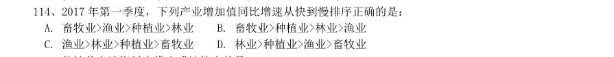

- **A.** 畜牧业>渔业>种植业>林业
- **B.** 畜牧业>种植业>林业>渔业
- **C.** 渔业>林业>种植业>畜牧业
- **D.** 林业>种植业>渔业>畜牧业

**答案：D**　**考点：综合分析｜增长率**　**难度：★★★★☆**
**【资料分析·综合分析｜HB-2018-ty-X115】**
> 材料：根据以下资料,回答111~115 题。 2017 年第一季度,某省农林牧渔业增加值361.78 亿元元,比上年同期增长5.9%,高于上年同期0.2 个百 分点。具体情况如下: 该省种植业增加值119.21 亿元,比上年同期增长8.2%,其中蔬菜种植面积358.80 万亩,比上年同期增 加18.23 万亩,蔬菜产量471.42 万吨,增长7.5%;茶叶种植面积679.53 万亩,比上年同期增加19.79 万亩, 茶叶产量2.30 万吨,增长19.49%。 该省林业增加值34.84 亿元,比上年同期增长8.3%。 该省畜牧业增加值176.64 亿元,比上年同期增长4.2%,增速比上年同期加快2.1 个百分点。其中生猪存 栏增速由上年同期的下降9.8%转为增长3.1%,出栏增速由上年同期的下降3.2%转为增长3.3%;猪牛羊禽肉产 量67.80 万吨,比上年同期增长3.1%;禽蛋产量5.33 万

115. 能够从上述资料中推出或计算出的是:

> 材料图见 images/HB-2018-ty-X106-m.jpg

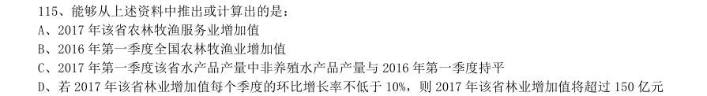

- **A.** 2017 年该省农林牧渔服务业增加值
- **B.** 2016 年第一季度全国农林牧渔业增加值
- **C.** 2017 年第一季度该省水产品产量中非养殖水产品产量与2016 年第一季度持平
- **D.** 若2017 年该省林业增加值每个季度的环比增长率不低于10%,则2017 年该省林业增加值将超过150 亿元

**答案：D**　**考点：综合分析｜增长率**　**难度：★★★★★**
**【资料分析·比重计算与比较｜HB-2018-ty-X116】**
> 材料：根据以下材料,回答116~120 题。 2016 年,我国全年完成邮电业务收入总量43344 亿元,比上年增长52.7%。其中,邮政业务收入7397 亿 元,增长45.7%;电信业务总量35948 亿元,增长54.2%。邮政业全年完成邮政函件业务36.2 亿件,包裹业务 0.3 亿件,快递业务量312.8 亿件;快递业务收入总量3974 亿元。电信业全年新增移动电话交换机容量7318 万户,达到218384 万户。2016 年来全国电话用户总数152856 万户(电话包括固定电话和移动电话两种),其 中移动电话用户132193 万户。移动电话普及率上升至96.2 部,百人。固定互联网宽带接入用户29721 万户, 比上年增加3774 万户,其中固定互联网光纤宽带接入用户22766 万户,比上年增加7941 万户;移动宽带用户 94075 万户,增加2340 万户,移动互联网接入流量93.6

116. 软件信息技术服务业完成软件业务收入48511 亿元,比上年增长14.9%。 2016 年我国快递业务收入总量占邮电业务收入总量的比重为:

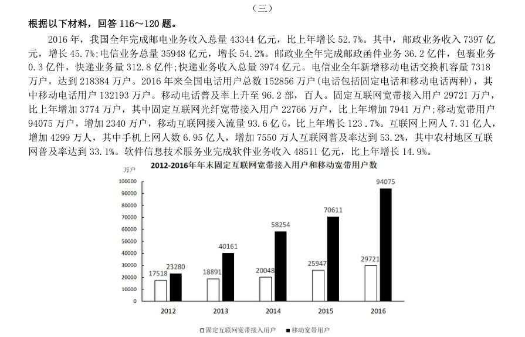

- **A.** 8.17%
- **B.** 9.17%
- **C.** 10.17%
- **D.** 11.17%

**答案：B**　**考点：比重计算与比较｜两期比重差**　**难度：★★★☆☆**
**【资料分析·比重计算与比较｜HB-2018-ty-X117】**
> 材料：根据以下材料,回答116~120 题。 2016 年,我国全年完成邮电业务收入总量43344 亿元,比上年增长52.7%。其中,邮政业务收入7397 亿 元,增长45.7%;电信业务总量35948 亿元,增长54.2%。邮政业全年完成邮政函件业务36.2 亿件,包裹业务 0.3 亿件,快递业务量312.8 亿件;快递业务收入总量3974 亿元。电信业全年新增移动电话交换机容量7318 万户,达到218384 万户。2016 年来全国电话用户总数152856 万户(电话包括固定电话和移动电话两种),其 中移动电话用户132193 万户。移动电话普及率上升至96.2 部,百人。固定互联网宽带接入用户29721 万户, 比上年增加3774 万户,其中固定互联网光纤宽带接入用户22766 万户,比上年增加7941 万户;移动宽带用户 94075 万户,增加2340 万户,移动互联网接入流量93.6

117. 2016 年末,全国固定电话用户占电话用户总数的比重为:

> 材料图见 images/HB-2018-ty-X116-m.jpg

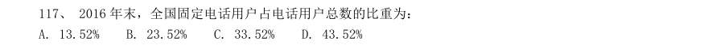

- **A.** 13.52%
- **B.** 23.52%
- **C.** 33.52%
- **D.** 43.52%

**答案：A**　**考点：比重计算与比较｜现期比重**　**难度：★★☆☆☆**
**【资料分析·增长率计算与比较｜HB-2018-ty-X118】**
> 材料：根据以下材料,回答116~120 题。 2016 年,我国全年完成邮电业务收入总量43344 亿元,比上年增长52.7%。其中,邮政业务收入7397 亿 元,增长45.7%;电信业务总量35948 亿元,增长54.2%。邮政业全年完成邮政函件业务36.2 亿件,包裹业务 0.3 亿件,快递业务量312.8 亿件;快递业务收入总量3974 亿元。电信业全年新增移动电话交换机容量7318 万户,达到218384 万户。2016 年来全国电话用户总数152856 万户(电话包括固定电话和移动电话两种),其 中移动电话用户132193 万户。移动电话普及率上升至96.2 部,百人。固定互联网宽带接入用户29721 万户, 比上年增加3774 万户,其中固定互联网光纤宽带接入用户22766 万户,比上年增加7941 万户;移动宽带用户 94075 万户,增加2340 万户,移动互联网接入流量93.6

118. 2013~2016 年期间,我国移动宽带用户数同比增长最快的年份是:

> 材料图见 images/HB-2018-ty-X116-m.jpg

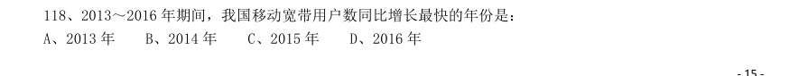

- **A.** 2013 年
- **B.** 2014 年
- **C.** 2015 年
- **D.** 2016 年

**答案：A**　**考点：增长率计算与比较｜增长率比较**　**难度：★★☆☆☆**
**【资料分析·平均数计算｜HB-2018-ty-X119】**
> 材料：根据以下材料,回答116~120 题。 2016 年,我国全年完成邮电业务收入总量43344 亿元,比上年增长52.7%。其中,邮政业务收入7397 亿 元,增长45.7%;电信业务总量35948 亿元,增长54.2%。邮政业全年完成邮政函件业务36.2 亿件,包裹业务 0.3 亿件,快递业务量312.8 亿件;快递业务收入总量3974 亿元。电信业全年新增移动电话交换机容量7318 万户,达到218384 万户。2016 年来全国电话用户总数152856 万户(电话包括固定电话和移动电话两种),其 中移动电话用户132193 万户。移动电话普及率上升至96.2 部,百人。固定互联网宽带接入用户29721 万户, 比上年增加3774 万户,其中固定互联网光纤宽带接入用户22766 万户,比上年增加7941 万户;移动宽带用户 94075 万户,增加2340 万户,移动互联网接入流量93.6

119. 2012~2016 年期间,我国固定互联网宽带接入用户的平均数是:

> 材料图见 images/HB-2018-ty-X116-m.jpg

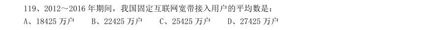

- **A.** 18425 万户
- **B.** 22425 万户
- **C.** 25425 万户
- **D.** 27425 万户

**答案：B**　**考点：平均数计算｜现期平均数**　**难度：★★☆☆☆**
**【资料分析·综合分析｜HB-2018-ty-X120】**
> 材料：根据以下材料,回答116~120 题。 2016 年,我国全年完成邮电业务收入总量43344 亿元,比上年增长52.7%。其中,邮政业务收入7397 亿 元,增长45.7%;电信业务总量35948 亿元,增长54.2%。邮政业全年完成邮政函件业务36.2 亿件,包裹业务 0.3 亿件,快递业务量312.8 亿件;快递业务收入总量3974 亿元。电信业全年新增移动电话交换机容量7318 万户,达到218384 万户。2016 年来全国电话用户总数152856 万户(电话包括固定电话和移动电话两种),其 中移动电话用户132193 万户。移动电话普及率上升至96.2 部,百人。固定互联网宽带接入用户29721 万户, 比上年增加3774 万户,其中固定互联网光纤宽带接入用户22766 万户,比上年增加7941 万户;移动宽带用户 94075 万户,增加2340 万户,移动互联网接入流量93.6

120. 关于我国邮电业务情况的说明,下列说法正确的是:

> 材料图见 images/HB-2018-ty-X116-m.jpg

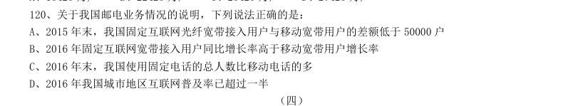

- **A.** 2015 年末,我国固定互联网光纤宽带接入用户与移动宽带用户的差额低于50000 户
- **B.** 2016 年固定互联网宽带接入用户同比增长率高于移动宽带用户增长率
- **C.** 2016 年末,我国使用固定电话的总人数比移动电话的多
- **D.** 2016 年我国城市地区互联网普及率已超过一半

**答案：D**　**考点：综合分析｜增长率**　**难度：★★★★★**
**【资料分析·倍数计算｜HB-2018-ty-X121】**
> 材料：注:1.农村金融机构包括农村商业银行、农村合作银行、农村信用社和新型农村金融机构。
2.其他类金融机构包括政策性银行及国家开发银行、民营银行、外资银行、非银行金融机构、资产管理公司和邮政储蓄银行。
3.净资产额等于总资产额减去总负债额。

121. 2017 年5 月我国股份制商业银行净资产额约是城市商业银行净资产额的多少倍?

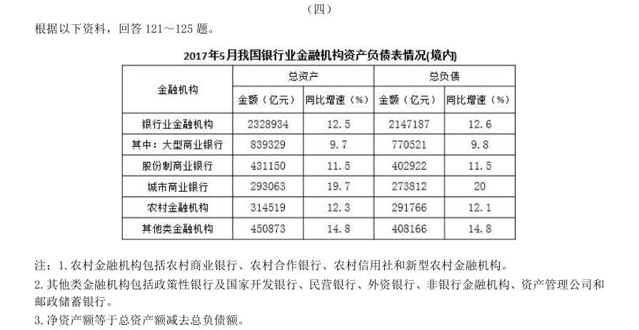

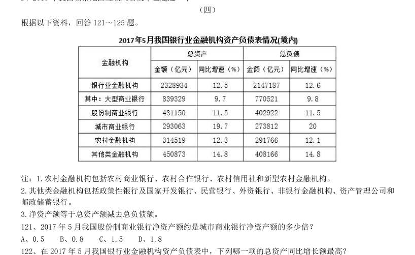

- **A.** 0.5
- **B.** 0.8
- **C.** 1.5
- **D.** 1.8

**答案：C**　**考点：倍数计算｜是几倍**　**难度：★★☆☆☆**
**【资料分析·增长率计算与比较｜HB-2018-ty-X122】**
> 材料：注:1.农村金融机构包括农村商业银行、农村合作银行、农村信用社和新型农村金融机构。
2.其他类金融机构包括政策性银行及国家开发银行、民营银行、外资银行、非银行金融机构、资产管理公司和邮政储蓄银行。
3.净资产额等于总资产额减去总负债额。

122. 在2017 年5 月我国银行业金融机构资产负债表中,下列哪一项的总资产同比增长额最高?

> 材料图见 images/HB-2018-ty-X121-m.jpg

- **A.** 大型商业银行
- **B.** 股份制商业银行
- **C.** 城市商业银行
- **D.** 农村金融机构

**答案：A**　**考点：增长率计算与比较｜增长率比较**　**难度：★★☆☆☆**
**【资料分析·综合分析｜HB-2018-ty-X123】**
> 材料：注:1.农村金融机构包括农村商业银行、农村合作银行、农村信用社和新型农村金融机构。
2.其他类金融机构包括政策性银行及国家开发银行、民营银行、外资银行、非银行金融机构、资产管理公司和邮政储蓄银行。
3.净资产额等于总资产额减去总负债额。

123. 2016 年5 月,银行业金融机构总资产金额为多少万亿元?

> 材料图见 images/HB-2018-ty-X121-m.jpg

- **A.** 167
- **B.** 207
- **C.** 247
- **D.** 287

**答案：B**　**考点：综合分析｜增长率**　**难度：★★★★☆**
**【资料分析·综合分析｜HB-2018-ty-X124】**
> 材料：注:1.农村金融机构包括农村商业银行、农村合作银行、农村信用社和新型农村金融机构。
2.其他类金融机构包括政策性银行及国家开发银行、民营银行、外资银行、非银行金融机构、资产管理公司和邮政储蓄银行。
3.净资产额等于总资产额减去总负债额。

124. 根据所给资料,2017 年5 月:

> 材料图见 images/HB-2018-ty-X121-m.jpg

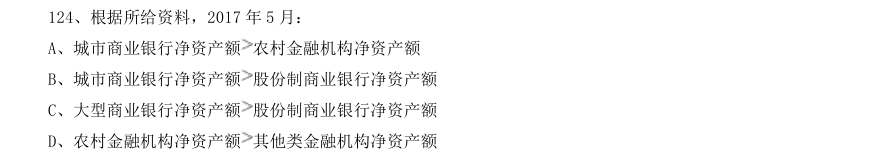

- **A.** 城市商业银行净资产额农村金融机构净资产额
- **B.** 城市商业银行净资产额股份制商业银行净资产额
- **C.** 大型商业银行净资产额股份制商业银行净资产额
- **D.** 农村金融机构净资产额

**答案：C**　**考点：综合分析｜综合分析（综合）**　**难度：★★★★☆**
**【资料分析·综合分析｜HB-2018-ty-X125】**
> 材料：注:1.农村金融机构包括农村商业银行、农村合作银行、农村信用社和新型农村金融机构。
2.其他类金融机构包括政策性银行及国家开发银行、民营银行、外资银行、非银行金融机构、资产管理公司和邮政储蓄银行。
3.净资产额等于总资产额减去总负债额。

125. 关于2017 年5 月我国银行业金融机构资产负债表,下列说法正确的是:

> 材料图见 images/HB-2018-ty-X121-m.jpg

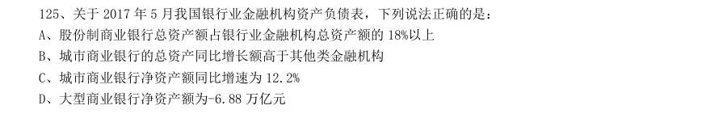

- **A.** 股份制商业银行总资产额占银行业金融机构总资产额的18%以上
- **B.** 城市商业银行的总资产同比增长额高于其他类金融机构
- **C.** 城市商业银行净资产额同比增速为12.2%
- **D.** 大型商业银行净资产额为-6.88 万亿元

**答案：A**　**考点：综合分析｜增长率**　**难度：★★★★☆**