# 2019 年湖北行测（统一卷）

- 题量：125（含答案 123）
- 模块分布：资料分析20 / 数量关系15 / 言语理解35 / 判断推理35 / 常识判断20
- 试卷编号：`湖北-2019-统一卷`

## 题目与答案

**【常识判断·时事政治｜HB-2019-ty-X001】**

1. 习近平总书记在中央政治局第十三次集体学习时强调,要精准有效处置重点领域风险,深化金融改革开放, 增强金融服务 能力,坚决打好防范化解包括金融风险在内的重大风险攻坚战,推动我国金融业健康发展。

- **A.** 实体经济
- **B.** 私营经济
- **C.** 中小企业
- **D.** 国有企业

**答案：A**　**考点：时事政治｜重要会议**　**难度：★★★☆☆**
**【常识判断·法律常识｜HB-2019-ty-X002】**

2. 关于全面依法治国,下列说法不准确的是:

- **A.** 到本世纪中叶,基本建成法治国家、法治政府、法治社会
- **B.** 全面依法治国在“四个全面”中具有基础性、保障性作用
- **C.** 党的领导是社会主义法治最根本的保证
- **D.** 中国特色社会主义法治体系是中国特色社会义制度的法律表现形式

**答案：A**　**考点：法律常识｜行政法**　**难度：★★★☆☆**
**【常识判断·生活常识｜HB-2019-ty-X003】**

3. 关于生态文明建设,下列说法正确的是:

- **A.** 蓝天保卫战是全面建成小康社会的三大攻坚战之一
- **B.** 加快构建生态文明体系是解决污染问题的根本之策
- **C.** 生态环境安全是经济社会持续健康发展的重要保障
- **D.** 地方政府主要领导是本行政区域生态环境保护第一责任人

**答案：C**　**考点：生活常识｜经济常识**　**难度：★★★☆☆**
**【常识判断·经济常识｜HB-2019-ty-X004】**

4. 下列属于改革开放40 年来我国经济建设所取得伟大成就的是: 1建立了最完整的现代工业体系 2成为了世界商品消费第一大国 3主要农产品的产量跃居世界前列 4外汇储备连续多年位居世界第一

- **A.** 124
- **B.** 134
- **C.** 234
- **D.** 1234

**答案：B**　**考点：经济常识｜微观与市场**　**难度：★★★☆☆**
**【常识判断·科技常识｜HB-2019-ty-X005】**

5. 2018 年我国科技界取得了一系列重大成果,这些成果中不包括:

- **A.** 第二艘航母出海试航
- **B.** 嫦娥四号探测器发射成功
- **C.** 造岛神器“天鲲号”下水
- **D.** 国产大型水陆两栖飞机水上首飞

**答案：C**　**考点：科技常识｜科技成就**　**难度：★★★☆☆**
**【常识判断·生活常识｜HB-2019-ty-X006】**

6. 下列关于血糖的说法错误的是:

- **A.** 正常人进食后血糖浓度会升高
- **B.** 正常人空腹超过12 小时会引起低血糖
- **C.** 南瓜能抑制葡萄糖吸收,具有降血糖作用
- **D.** 胰岛素是人体产生的唯一能够降低血糖的激素

**答案：B**　**考点：生活常识｜科技常识**　**难度：★★★☆☆**
**【常识判断·生活常识｜HB-2019-ty-X007】**

7. 下列选项对“夏满芒夏暑相连”中节气的表述错误的是:

- **A.** “小满”表明了降水的时间和强度
- **B.** “芒种”反映了自然物候现象或农事活动
- **C.** “立夏”“夏至”体现了寒来暑往的季节变化
- **D.** “小暑”“大暑”标明了一年之中最热的时段

**答案：A**　**考点：生活常识｜生活常识**　**难度：★★★☆☆**
**【常识判断·历史人文｜HB-2019-ty-X008】**

8. 下列历史事件与人物搭配正确的是:

- **A.** 锦帆未落干戈起——隋炀帝
- **B.** 烽火四起戏诸侯——周宣王
- **C.** 一骑红尘妃子笑——唐睿宗
- **D.** 车同轨,书同文——周武王

**答案：A**　**考点：历史人文｜中国古代史**　**难度：★★★☆☆**
**【常识判断·历史人文｜HB-2019-ty-X009】**

9. 下列送别诗句中不属于描写目送友人场景的是:

- **A.** 孤帆远影碧空尽,唯见长江天际流
- **B.** 山回路转不见君,雪上空留马行处
- **C.** 日暮酒醒人已远,满天风雨下西楼
- **D.** 青枫江上秋帆远,白帝城边古木疏

**答案：C**　**考点：历史人文｜文学与文化**　**难度：★★★☆☆**
**【常识判断·生活常识｜HB-2019-ty-X010】**

10. 荷花虽生长于池塘的污泥中,但荷叶却出污泥而不染,其主要原因是:

- **A.** 荷叶含有大量的叶绿素,能与太阳光发生光合作用,产生自清洁
- **B.** 荷叶表面光滑,具有非常强的光洁度,污泥很难在它的表面吸附
- **C.** 荷叶含有疏水的纳米级蜡质,雨露落在上面会形成水珠清洁叶面
- **D.** 荷花枝干细长,水珠落在荷叶上,容易造成荷叶晃动,甩出污泥

**答案：C**　**考点：生活常识｜科技常识**　**难度：★★★★★**
**【常识判断·历史人文｜HB-2019-ty-X011】**

11. 首次把《大学》《中庸》《论语》和《孟子》编在一起的学者是:

- **A.** 朱熹
- **B.** 程颐、程颢
- **C.** 董仲舒
- **D.** 颜之推

**答案：A**　**考点：历史人文｜中国古代史**　**难度：★★★☆☆**
**【常识判断·生活常识｜HB-2019-ty-X012】**

12. 下列关于粉尘爆炸的说法错误的是:

- **A.** 颗粒越小越易燃烧,爆炸也越剧烈
- **B.** 越易氧化的物质,其粉尘越易爆炸
- **C.** 越易带电的物质,其粉尘越易爆炸
- **D.** 含卤素和钾、钠的粉尘,爆炸趋势增强

**答案：暂缺**　**考点：生活常识｜科技常识**　**难度：★★★☆☆**
**【常识判断·生活常识｜HB-2019-ty-X013】**

13. 下列表述正确的是:

- **A.** 鄱阳湖栖息着世界上最大的白鹤群
- **B.** 我国最早出现的种植业位于松花江流域
- **C.** 被誉为“天上云霞,地下鲜花”的是四川蜀绣D、东北平原是中国第二大平原,也是中国重要的粮棉生产基地

**答案：A**　**考点：生活常识｜地理常识**　**难度：★★★★★**
**【常识判断·生活常识｜HB-2019-ty-X014】**

14. 唐太宗李世民曾言:为官择人,唯才是与;苟或不才,虽亲不用。下列哪一人才选拔制度与其所言体现的用 人理念最契合:

- **A.** 科举制
- **B.** 察举制
- **C.** 世卿世禄制
- **D.** 九品中正制

**答案：A**　**考点：生活常识｜历史人文**　**难度：★★★☆☆**
**【常识判断·生活常识｜HB-2019-ty-X015】**

15. 下列说法错误的是:

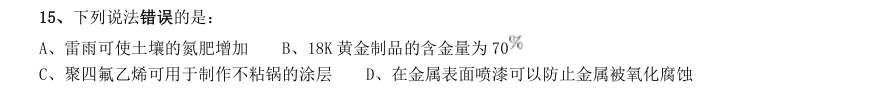

- **A.** 雷雨可使土壤的氮肥增加
- **B.** 18K 黄金制品的含金量为70
- **C.** 聚四氟乙烯可用于制作不粘锅的涂层
- **D.** 在金属表面喷漆可以防止金属被氧化腐蚀

**答案：B**　**考点：生活常识｜科技常识**　**难度：★★★☆☆**
**【常识判断·历史人文｜HB-2019-ty-X016】**

16. 下列成语和人物的对应关系错误的是:

- **A.** 口蜜腹剑——李义府
- **B.** 十面埋伏——项羽
- **C.** 程门立雪——杨时
- **D.** 东床快婿一一王羲之

**答案：A**　**考点：历史人文｜文学与文化**　**难度：★★★☆☆**
**【常识判断·历史人文｜HB-2019-ty-X017】**

17. 下列我国古代国家行政机构不具有行政监察职能的是:

- **A.** 御史台
- **B.** 太常寺
- **C.** 六科给事中
- **D.** 都察院

**答案：B**　**考点：历史人文｜中国古代史**　**难度：★★★☆☆**
**【常识判断·生活常识｜HB-2019-ty-X018】**

18. 管理大师杰克·韦尔奇有句名言:管得少,就是管得好。他主要强调管理应该注重:

- **A.** 沟通
- **B.** 分权
- **C.** 组织
- **D.** 控制

**答案：B**　**考点：生活常识｜常识（待细分）**　**难度：★★★☆☆**
**【常识判断·科技常识｜HB-2019-ty-X019】**

19. 下列气体是人体能够产生的,能发挥抗炎、神经功能调节和血管松弛等作用,但若吸入过量会与血红素结合 导致中毒的是:

- **A.** 一氧化氮
- **B.** 一氧化碳
- **C.** 硫化氢
- **D.** 氨气

**答案：A**　**考点：科技常识｜基础科学**　**难度：★★★☆☆**
**【常识判断·科技常识｜HB-2019-ty-X020】**

20. 下列我国空间站发展的重要标志性事件按完成步骤排列正确的是: 1“天宫二号”空间实验室成功发射 2“神舟十一号”成功发射,完成与“天官二号”对接 3陆续发射科学实验舱和空间站核心舱,组建中国空间站 4“天舟一号”货运飞船成功发射,完成与“天官二号”对接

- **A.** 1234
- **B.** 4123
- **C.** 1342
- **D.** 1243

**答案：D**　**考点：科技常识｜基础科学**　**难度：★★★★☆**
**【言语理解·逻辑填空｜HB-2019-ty-X021】**
> 材料：答案。

21. 科学家将松力纤维蛋白原和可吸收材料共混后,采用静电纺技术制成具有超亲水性、类似细胞外基质的生物 复合支架材料。由该材料制成的人工韧带具有良好的组织 和合适的机械强度,植入肌体后,可在逐 层降解的同时进行组织再生,诱导肌体自身组织长入韧带中,逐步演变成自身韧带组织,实现腱骨融合,达到永 久愈合的目的。 填入划横线部分最恰当的一项是:

- **A.** 相容性
- **B.** 自愈性
- **C.** 亲和性
- **D.** 再生性

**答案：A**　**考点：逻辑填空｜语境分析**　**难度：★★★☆☆**
**【言语理解·逻辑填空｜HB-2019-ty-X022】**

22. 夏季天气炎热,人很容易犯困、无精打采,这时不妨吃几颗葡萄来帮你提神、消除疲乏之意。因为在葡萄中 含有丰富的葡萄糖成分,且很容易被人体吸收利用,从而为大脑供给所需能量,快速恢复大脑活力。同时,葡萄 中还含有较多的氨基酸,能对神经产生良好的____,帮助人体____衰弱的神经,这也是提神醒脑的有效途径。 依次填入划横线部分最恰当的一项是:

- **A.** 刺激调理
- **B.** 应激调节
- **C.** 激变调整
- **D.** 激发调剂

**答案：A**　**考点：逻辑填空｜语境分析**　**难度：★★★☆☆**
**【言语理解·逻辑填空｜HB-2019-ty-X023】**

23. 纪录片《苏东坡》以苏东坡贬谪黄州四年的生活为横切面, 其一生的心路历程,从文学、艺 术、美食、情感等维度进行透视,多角度地 其生命感悟、精神嬗变和艺术升华的过程,以及对中 国传统文化产生的深远影响。同时,辅之以当今最新的研究成果,再现了一个最丰富、最接近本真的苏东坡形象。 依次填入划横线部分最恰当的一项是:

- **A.** 关照阐释
- **B.** 记载解说
- **C.** 记录阐述
- **D.** 观照解读

**答案：D**　**考点：逻辑填空｜语境分析**　**难度：★★★☆☆**
**【言语理解·逻辑填空｜HB-2019-ty-X024】**

24. 一个艺术家真正的贡献是艺术语言的创新,如果说审美理想的构建是绘画法度和秩序建立的基石,那么绘画 秩序的建立则是绘画风格成熟的 。风格的形成在于画面所搭建的整体构成必须有 的秩 序和法则。 依次填入划横线部分最恰当的一项是:

- **A.** 途径和谐
- **B.** 标志内在
- **C.** 方向全新
- **D.** 目标稳定

**答案：B**　**考点：逻辑填空｜语境分析**　**难度：★★☆☆☆**
**【言语理解·逻辑填空｜HB-2019-ty-X025】**

25. 没有精神内核的娱乐,即便一时热闹, 流于空虚。网民需要文化产品、需要轻松娱乐,但不 需要无下限、无道德的“秀”。应该肯定的是,依法净网。不只是约谈平台、关停账号,而是持续发力、 治 理。 依次填入划横线部分最恰当的一项:

- **A.** 最终固定化
- **B.** 难免长效化
- **C.** 终归常态化
- **D.** 终将平常化

**答案：C**　**考点：逻辑填空｜语境分析**　**难度：★★☆☆☆**
**【言语理解·逻辑填空｜HB-2019-ty-X026】**

26. 极光多姿多彩,变化万千,任何彩笔都很难绘出那在严寒的两极空气中嬉戏无常、变幻莫测的炫目之光。在 自然界中还没有哪种现象能与之 。极光有时出现时间极短,犹如节日的焰火,在空中闪现一下就消失得 无影无踪;有时却可以在苍穹之中 几个小时;有时像一条彩带,有时像一团火焰,有时像一张五光十色 的巨大银幕,仿佛上映一场球幕电影,给人视觉上极美的享受。 依次填入划横线部分最恰当的一项是:

- **A.** 匹敌延宕
- **B.** 相较迤逦
- **C.** 媲美辉映
- **D.** 抗衡映照

**答案：C**　**考点：逻辑填空｜语境分析**　**难度：★★★★☆**
**【言语理解·逻辑填空｜HB-2019-ty-X027】**

27. 除了口误,笔误同样泄露了潜意识的秘密。短信聊天说到我爸身体不舒服却不去医院检查这一事实时,我想 说“我爸就是太固执了”,但我键入的文字竟是“我爸就是太过分了”。那一刻,我突然呆住了。一词之别,却 暴露出我内心深处的真实情绪。“固执”只是一种较为客观的 ,而“过分”却是饱含着情绪的 。

- **A.** 判断认识
- **B.** 体现流露
- **C.** 显示暗示
- **D.** 描述表达

**答案：D**　**考点：逻辑填空｜语境分析**　**难度：★★★☆☆**
**【言语理解·逻辑填空｜HB-2019-ty-X028】**

28. 美好的事物人人向往,若是缺少发现的眼睛,它也容易被 。某次儿童画展,一位小朋友的作品 上有一个洞,评委们好奇地问,这是不是一幅破损的作品。小朋友说,这是进入世外桃源的入口。孩子的答案, 耐人寻味。如何 发现美的眼睛,是一个需要全社会去回答的课题。 依次填入划横线部分最恰当的一项是:

- **A.** 蒙蔽擦拭
- **B.** 遮蔽擦亮
- **C.** 掩饰拂拭
- **D.** 遮掩烛照

**答案：B**　**考点：逻辑填空｜语境分析**　**难度：★★★☆☆**
**【言语理解·逻辑填空｜HB-2019-ty-X029】**

29. 关于科学革命的讨论 于十七世纪。不过,其时革命尚在 地展开,相关讨论的焦点 集中在科学的本性,而未有所谓“科学革命史”的理解。到十九世纪,现代科学的基本模式逐渐定型,一些学者 便回到现代科学的源头做起了编史和整理工作。 依次填入划横线部分最恰当的一项是:

- **A.** 滥觞如火如荼
- **B.** 溯源轰轰烈烈
- **C.** 起源风起云涌
- **D.** 发端方兴未艾

**答案：A**　**考点：逻辑填空｜语境分析**　**难度：★★☆☆☆**
**【言语理解·逻辑填空｜HB-2019-ty-X030】**

30. 城市的文化形象是人们对一个城市的文化 的整体认知与印象,主要来源于城市的发展哲学、城 市精神等构成的理念识别系统,城市各主体的行为方式所构成的行为识别系统以及公共文化空间、文化景观等构 成的视觉识别系统。在新一轮的城市竞争中,城市的文化形象对城市的经济社会发展将起到 的作用。 依次填入划横线部分最恰当的一项是:

- **A.** 观感撼天震地
- **B.** 气质举足轻重
- **C.** 禀赋振聋发聩
- **D.** 特征醍醐灌顶

**答案：B**　**考点：逻辑填空｜语境分析**　**难度：★★★☆☆**
**【言语理解·逻辑填空｜HB-2019-ty-X031】**

31. 说起乡愁,那是一种 的情怀,住在心中的故乡常常鲜活在那里。故乡是安放你的灵魂、温暖你的 寂冷的地方,是接纳你的疲惫、抚慰你的忧伤的地方。翻开一页页被繁忙弄乱的过往,记忆中的余香总 于 儿时的故乡。 依次填入划横线部分最恰当的一项是:

- **A.** 与生俱来氤氲
- **B.** 难以割舍回荡
- **C.** 刻骨铭心徘徊
- **D.** 永生难忘徜徉

**答案：A**　**考点：逻辑填空｜实词辨析**　**难度：★★☆☆☆**
**【言语理解·逻辑填空｜HB-2019-ty-X032】**

32. 古人根据经验编制了许多脍炙人口的农谚,比如“清明前后,种瓜点豆”。不仅是农谚,与二十四节气相关 的诗词歌赋也是 ,比如“蒹葭苍苍,白露为霜”,再比如“清明时节雨纷纷,路上行人欲断魂”。这 些诗词歌赋 ,将二十四节气与天气现象巧妙地结合在一起,具有很好的传播性。 依次填入划横线部分最恰当的一项是:

- **A.** 俯拾皆是沉思翰藻
- **B.** 不胜枚举形神兼备
- **C.** 不计其数文采斐然
- **D.** 举不胜举缀玉联珠

**答案：B**　**考点：逻辑填空｜语境分析**　**难度：★★★☆☆**
**【言语理解·逻辑填空｜HB-2019-ty-X033】**

33. 打开书本,一股久违了的墨香扑面而来;摩挲纸张,淡淡的凹凸感非常舒服。味觉、视觉、触觉顿时都活泛 起来,连脑细胞也显得格外活跃。读累了,就闭眼歇一歇,顺便回味刚读过的情节,思考作者的 ; 看到精彩的描写和精辟的议论,就反复重读、吟咏再三,读到妙处更是 。 依次填入划横线部分最恰当的一项是:

- **A.** 春秋笔法弹冠相庆
- **B.** 言外之意低头折节
- **C.** 弦外之音额手称庆
- **D.** 微言大义击节赞叹

**答案：D**　**考点：逻辑填空｜语境分析**　**难度：★★★☆☆**
**【言语理解·逻辑填空｜HB-2019-ty-X034】**

34. 形成有文化特色、有地域特色、可识别的小城镇发展模式,是一个长期的渐进过程。我们应尊重当地实 际, 、远近结合、量力而行,不能盲目 。在模式选择上,可以借鉴国内外小城镇建设的经验, 但更重要的是结合自身实际、体现自身特色。 依次填入划横线部分最恰当的一项是:

- **A.** 循规蹈矩分庭抗礼
- **B.** 按部就班投闲置散
- **C.** 循序渐进贪大求快
- **D.** 按图索骥急于求成

**答案：C**　**考点：逻辑填空｜语境分析**　**难度：★★☆☆☆**
**【言语理解·逻辑填空｜HB-2019-ty-X035】**

35. 一个城市的建设发展,如果说建筑是她的脊梁,环境是她的容貌,那市民的文明素质就是她的 。 而文化作为承载文明的基石,特别是当跨越时空的优秀传统文化理念、价值标准、审美风范被重新 , 转化为现代人们的精神追求和行为养成时,那她 的不仅是一个城市的文明,也增强了作为一名中 国人立足世界的文化底气和骨气。 依次填入划横线部分最恰当的一项是:

- **A.** 佩饰演绎赋予
- **B.** 神采弘扬荡涤
- **C.** 灵魂唤起涵育
- **D.** 冠冕阐释秉承

**答案：C**　**考点：逻辑填空｜语境分析**　**难度：★★★☆☆**
**【言语理解·逻辑填空｜HB-2019-ty-X036】**

36. 圈椅是明代家具中最为经典的制作。明代圈椅,造型古朴典雅,线条简洁流畅,制作技艺达到了____的境地。 “天圆地方”是中国人文化中____的宇宙观,不但建筑受其影响,也____到了家具的设计之中。 依次填入划横线部分最恰当的一项是:

- **A.** 别有匠心普遍融合
- **B.** 巧夺天工特殊融会
- **C.** 炉火纯青典型融入
- **D.** 入室升堂独特融化

**答案：C**　**考点：逻辑填空｜语境分析**　**难度：★★☆☆☆**
**【言语理解·逻辑填空｜HB-2019-ty-X037】**

37. 关于卫生健康创新发展的高峰论坛围绕“创新驱动,健康中国”主题,____国际和国内远程医学、 “ ”等新技术和新产业,探讨“ ”服务新模式、____发展新业态,____人工智能、 大数据等在医疗健康领域的创新之路,为努力提升我国整体医疗水平作出贡献。 依次填入划横线部分最恰当的一项是:

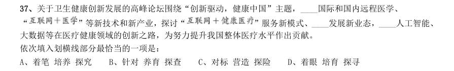

- **A.** 着笔培养探究
- **B.** 针对养育探查
- **C.** 对标营造探险
- **D.** 着眼培育探寻

**答案：D**　**考点：逻辑填空｜实词辨析**　**难度：★★★☆☆**
**【言语理解·逻辑填空｜HB-2019-ty-X038】**

38. 蚕蛾往往能巧妙避开捕食者,它们利用旋转的后翅来 蝙蝠的声纳系统,从而 捕食 者对捕食目标的定位。但人们对蚕蛾的进化史以及它们后翅多样性形成的原因 科学家对数百个基因 组数据库的后翅形状进化过程进行了研究,发现了不同翅型的进化特征。 依次填入划横线部分最恰当的一项是:

- **A.** 躲避引导一知半解
- **B.** 折射诱导茫然不解
- **C.** 规避引诱不求甚解
- **D.** 反射误导知之甚少

**答案：D**　**考点：逻辑填空｜语境分析**　**难度：★★☆☆☆**
**【言语理解·逻辑填空｜HB-2019-ty-X039】**

39. 敦煌研究院将与外部机构进一步合作,开展敦煌壁画的保护和修复,为这个文化宝藏的永续保存探讨更多可 能性。保护和修复也为了更好地传播,依托数字化,“数字敦煌”资源库在2016 年上线。资源库第一期的30 个 经典石窟,跨越北魏、西魏、北周、隋、唐等多个时期,其中绝大多数石窟都是未对游客开放的,全球网友只需 轻点鼠标,就可以免费360 度漫游洞窟,足不出户便能近距离感受千年的文化。千年敦煌石窟,正借助科技的手 段, ,焕发出新的生命与活力。 填入划横线部分最恰当的一项是:

- **A.** 力求重建用户沉浸式体验
- **B.** 以虚拟世界代替现实场景
- **C.** 突破时间、空间上的限制
- **D.** 促进与传统文化深度融合

**答案：C**　**考点：逻辑填空｜语境分析**　**难度：★★★★★**
**【言语理解·逻辑填空｜HB-2019-ty-X040】**

40. 科学家认为,未来的仿生机器人并非是要完全模仿人类的所有功能,而是模仿某项功能。这些智能机器人有 望成为“超人”,有的具有超强的记忆力,有的具有超强的学习能力,有的听觉功能特强,有的嗅觉功能特 强······, 。 填入划横线部分最恰当的一项是:

- **A.** 智能机器将超越人类
- **B.** 不同功能的智能机器人可以用于不同的领域
- **C.** 但它并不具备人类的情感,也不具备人脑的灵活性
- **D.** 人类受限于缓慢的生物学进化速度,无法与之竞争和对抗

**答案：B**　**考点：逻辑填空｜语境分析**　**难度：★★☆☆☆**
**【言语理解·逻辑填空｜HB-2019-ty-X041】**

41. 将不能量化的诗歌(以及纯文学)评价标准和人工智能的算法标准拼接在一起,本来就是一件不伦不类的事。 人工智能在科学研究、生产劳动等方面的贡献,足以证明其本领之强, 。人类也完全没必要拿自己 的优势去跟人工智能的缺点比较,即使科技再发达,想必在未来很长的一段时间内,诗歌与文学的世界依然是人 类情感和灵魂最佳的栖息地,守卫好我们的心灵家园,依然要靠人类自身的智慧与创造力。 填入划横线部分最恰当的一项是:

- **A.** 却不能弥补人类智慧在诗歌创作上的缺陷
- **B.** 完全可以取代人类智慧自主开展诗歌创作
- **C.** 没必要和人类智慧在诗歌创作上一决高下
- **D.** 毫无疑问将能够实现诗歌评价标准的量化

**答案：C**　**考点：逻辑填空｜语境分析**　**难度：★★★★☆**
**【言语理解·中心理解｜HB-2019-ty-X042】**

42. 大数据是科学决策的重要工具,是高精度对未来进行预测的手段。数据是记录人类行为的工具。靠大数据技 术对未来做一个预测和参考是人类发展的成果。但是,人际的沟通和交流不该因为大数据技术而遭弃,而过于依 赖大数据的预测和推理,放弃人际沟通过程,必然产生人际沟通的弱化,进而影响到人的自由意志。 这段文字旨在强调:

- **A.** 大数据是科学决策的重要工具
- **B.** 大数据将发挥越来越重要作用
- **C.** 大数据不应弱化人际沟通
- **D.** 大数据影响人的自由意志

**答案：C**　**考点：中心理解｜转折与因果**　**难度：★★★☆☆**
**【言语理解·逻辑填空｜HB-2019-ty-X043】**

43. 在今天的社会文化实践中,我们更要关注当下的传统文化热是否真正触及了传统文化的人文精神实质,是否 真正提升了人们的精神境界。一般而言,文化的形式要自觉为文化的内容服务,如果忽略了文化的内容,尤其是 忽略了对贯穿其中的人文精神的追求,就必然会走入歧途,背离我们弘扬传统文化的初衷。文化是活的,不能做 简单的固化处理,更不能只注重形式而忽略对其内涵的传承。鉴于此,我们必须 。 填入划横线部分最恰当的一项是:

- **A.** 改变过于强调传统文化的符号性的做法
- **B.** 注意纠正传统文化弘扬中的形式化倾向
- **C.** 以实用心态凸显传统文化的工具性价值
- **D.** 借助现代电子技术手段来弘扬传统文化

**答案：B**　**考点：逻辑填空｜语境分析**　**难度：★★★★☆**
**【言语理解·中心理解｜HB-2019-ty-X044】**

44. 从人口的空间布局看,城镇化是农村人口向城镇转移,是农民向市民的转变。农民向市民的转变过程,是人 的素质的现代化过程。而人的素质的现代化离不开接受现代化的教育。人的教育的现代化是城镇化的基础和支撑。 城镇化还意味着人们的就业和生产从农业领域向工业和服务业的转移。人的生产方式的现代化,是城镇化的本质 特征,更是人的现代化的本质体现。而支撑人的生产方式现代化的基础则是现代职业教育的普及。 这段文字意在强调:

- **A.** 城镇化是人的生产方式的现代化
- **B.** 城镇化是人的素质教育的现代化
- **C.** 城镇化时代的农民需要职业教育
- **D.** 城镇化是进城农民身份的市民化

**答案：B**　**考点：中心理解｜中心句与主旨**　**难度：★★★★☆**
**【言语理解·中心理解｜HB-2019-ty-X045】**

45. 在原始社会,人们唱歌、跳舞,但是不写诗,因为那时候没有文字。同理,史前时代的人也演剧,而且有文 字之后多数中国戏剧演员并不识字,戏剧演出主要是以口传心授的方式传承与传播的。然而长时间以来,人们陷 入了文字与文献崇拜的陷阱不能自拔,乃至文献考据一直成为文学史、戏剧史研究中最受推崇、最有效接近历史 真实的研究方法。如果戏剧史研究领域有“新材料”的话,那一定不仅仅是文献。 这段文字主要强调了:

- **A.** 戏剧史研究要更新理念并创新研究方法
- **B.** 戏剧史研究要对接传统研究并突破局限
- **C.** 戏剧史研究既要重文献又要重考证考据
- **D.** 戏剧史研究应扩大研究领域和研究方法

**答案：A**　**考点：中心理解｜转折与因果**　**难度：★★★★☆**
**【言语理解·中心理解｜HB-2019-ty-X046】**

46. 一部人类史,就是人与自然、科学与社会的互动史。在漫长的文明进程中,科学曾仅仅是“闲人”的志趣, 科学普及无从谈起,人们在“非科学”的禁锢中艰难摸索。随着近现代科学兴起,人类对自然认识不断加深,科 学与社会联系日趋紧密,科学普及在人与自然、科学与社会的结合点上顽强生长,科学在人类现代化道路上散发 出璀璨的光芒。 上述文字主要阐述了:

- **A.** 人与自然、科学与社会的互动极大促进了科学普及
- **B.** 在人类文明进程中,科学普及前进的道路异常艰辛
- **C.** 科学普及应紧密联系社会并且找准结合点和切入点
- **D.** 随着近现代科学兴起,科学普及前景更加灿烂辉煌

**答案：A**　**考点：中心理解｜中心句与主旨**　**难度：★★★☆☆**
**【言语理解·中心理解｜HB-2019-ty-X047】**

47. 20 世纪以来,人类对弦的认识,发生了质的变革。弦就是振动,振动就会产生波,说明波构成了丰富多彩 的大千世界,这为重新认识“美”提供了思想基础和技术方法。研究表明,自然美与物质的波长(或者频率)存 在着深刻的内在联系,物体具有的固有频率与人自身的频率存在耦合关系,“美”是由不同类型波谱的频率与人 的相互作用而产生的。 根据这段文字,下列说法不正确的是:

- **A.** 对同一个人的美丑认识不同,因审美主体的频率不同所致
- **B.** 阳光、鲜花一定时间内大致不变,因为振动频率没有变化
- **C.** 距离产生美,是因为审美主客体在一定频率范围内共振
- **D.** 见义勇为行为得到社会认可,因为审美主体振动频率一致

**答案：D**　**考点：中心理解｜中心句与主旨**　**难度：★★★★★**
**【言语理解·中心理解｜HB-2019-ty-X048】**

48. 工匠精神,匠心为本。有没有工匠精神,关键是看有没有一颗安于默默无闻、执着于追求卓越的匠心。树匠 心,就要坚守初心、执着专注,秉持赤子之心,摒弃浮躁喧嚣,在本职岗位上坐得住、做得好。怎样才能坐得住、 做得好?关键是要做到专心专注、追求至精至善,将产品的每个细节都尽可能做到极致。 这段文字意在强调:

- **A.** 育匠人是传承工匠精神的基础
- **B.** 树匠心是弘扬工匠精神的根本
- **C.** 树匠心要坚守初心、执着专注
- **D.** 树匠心需要良好的社会文化环境

**答案：C**　**考点：中心理解｜中心句与主旨**　**难度：★★★☆☆**
**【言语理解·中心理解｜HB-2019-ty-X049】**

49. 通过对海豚间通信联系的深入研究,科学家发现,齐普夫定律和信息论中的熵值概念可以很好地为分析外星 信号服务。在接收到地外任何可疑信号后,应该首先用齐普夫定律分析是否存在一定斜率直线特征,如果有某种 特征,则证明其并非毫无意义的噪声。然后进行熵值分析,这样可以不必破译信号便知晓其通信的复杂程度。假 设截获到的某一可疑信号,不仅在齐普夫坐标系中具有斜率为 的直线特征,而且拥有高阶熵值,那么这个信 号极有可能就是我们寻找多时的地外文明。 对这段文字概括最恰当的一项是:

- **A.** 研究发现海豚间通信联系与外星信号极为相似
- **B.** 如何运用齐普夫定律和熵值概念分析外星信号
- **C.** 如何判断可疑地外信号是否来自于外星文明
- **D.** 如何通过地外信号判断外星文明的智慧程度

**答案：B**　**考点：中心理解｜对策优先**　**难度：★★★★★**
**【言语理解·中心理解｜HB-2019-ty-X050】**

50. 在智能化无人超市,客人从进门到出门,一举一动都会被数字化,并且被捕捉记录。这些信息回流到云端后, 通过算法模型,可以得到许多非常有价值的信息:比如男性顾客和女性顾客各自进店最集中的时间段是什么,哪 些商品被拿起又放回去的频次最高等。甚至还能做出预测,比如,传感器感应到进店的女客人很多是穿高跟鞋的, 敏锐的老板便会在女鞋区多放些半跟鞋垫和脚踝磨损修复霜。可见,数字化最终目的是实现商品供应链的优化以 及店内货架与商品摆放的人性化。 这段文字主要介绍:

- **A.** 智能无人零售让超市变得更加聪明、更加善解人意
- **B.** 智能无人零售给线下实体商店的发展前景增添亮色
- **C.** 智能无人零售能够对用户购买行为进行记录与描画
- **D.** 智能无人零售给消费者所带来的更良好的购物体验

**答案：A**　**考点：中心理解｜中心句与主旨**　**难度：★★★★★**
**【言语理解·标题填入｜HB-2019-ty-X051】**

51. 为了帮助贫困地区脱贫,长期以来,社会各界以多种形式开展帮扶,扶贫思路更加清晰,扶贫手段更加多样, 文化扶贫、旅游扶贫、电商扶贫等新方式效果显著,脱贫攻坚实现换挡提速。但一些尚未脱贫的地区,因为自然 条件恶劣,发展脱贫产业难度较大。要啃下扶贫的“硬骨头”,还需打好科技牌。 最适合做这段文字标题的是:

- **A.** 打好脱贫攻坚科技牌
- **B.** 啃下扶贫的“硬骨头”
- **C.** 选好脱贫攻坚新方式
- **D.** 脱贫攻坚实现换挡提速

**答案：A**　**考点：标题填入｜标题填入**　**难度：★★★☆☆**
**【言语理解·细节判断｜HB-2019-ty-X052】**

52. 科学家在100 亿光年外的星系里发现一颗超亮超新星,其爆发于宇宙大爆炸后约35 亿年,正值天文学家所 称的“宇宙正午”时期。普通超新星是大质量恒星死亡时发生剧烈爆炸产生的。超亮超新星的亮度比普通超新星 高10 到100 倍,目前还不太清楚其形成机制。以往发现的超亮超新星所在星系质量都较小,使科学家认为小星 系缺乏重元素的环境有利于产生超亮超新星。此次发现的超亮超新星所在星系是普通的大质量星系,使人重新思 考超亮超新星的形成问题。这意味着银河系也可能曾拥有产生超亮超新星的条件。 下列说法与原文相符的是:

- **A.** 超亮超新星产生于恒星形成最剧烈的“宇宙正午”时期
- **B.** 小星系缺乏重元素的环境事实上不利于产生超亮超新星
- **C.** 普通的大质量星系可能曾经拥有产生超亮超新星的条件
- **D.** 大质量恒星死亡时发生剧烈爆炸并不能产生超亮超新星

**答案：C**　**考点：细节判断｜细节判断**　**难度：★★★★★**
**【言语理解·中心理解｜HB-2019-ty-X053】**

53. 完美主义者习惯于把各项标准都定得过高而不切实际,受到挫折打击后,变得逃避、拖延、自责而失去行动 力。完美主义不仅拖后腿,还可能带来许多心理疾病。由于缺乏一种深刻且始终如一的自尊来源,接受失败的打 击对于完美主义者来说尤其困难,而且可能导致一部分人长期抑郁和退缩。完美主义也与社交焦虑和社交恐怖显 著相关,因为他们很担心自己是否能给别人留下好印象,容易出现羞怯、自卑、回避行为。完美主义也容易导致 强迫症,因为完美主义者对每件事都要求完美无瑕。减少“全或无”的心理倾向,内心会更自在、从容,也更利 于进步。 这段文字意在说明:

- **A.** 标准过高而且不切实际会损害自尊
- **B.** 羞怯自卑容易使人长期抑郁和退缩
- **C.** 社交焦虑和社交恐怖会导致强迫症
- **D.** 为了心理健康应避免完美主义倾向

**答案：D**　**考点：中心理解｜转折与因果**　**难度：★★★★★**
**【言语理解·语句排序｜HB-2019-ty-X054】**

54. 1透过中华文化发展史,不难发现,中华文化在几千年的演进过程中,虽历经劫难,但每次都能发扬光大、 传承至今 2根据英国著名学者汤因比的著述,人类文明史上曾经存在26 个文明形态 3可见,中华民族传统文化历久弥新的关键就在于其中蕴含着能够保持旺盛生命力的最根本的精神基因 4这种稳定与新生的辩证统一,是中华优秀传统文化的生命力所在 5中华民族最根本的精神基因深藏于中华民族文化的深层结构之中,具有相对恒久的稳定性,并且能够在新的时 代条件下发出新的光彩 6其他古老文明或中断或湮灭,唯有中华文化体系没有中断而延续至今 将以上6 个句子重新排列,语序正确的是:

- **A.** 312654
- **B.** 125463
- **C.** 541263
- **D.** 261354

**答案：C**　**考点：语句排序｜语序排列**　**难度：★★★★★**
**【言语理解·语句排序｜HB-2019-ty-X055】**

55. 1然而,监管执法的覆盖面毕竟有限,执法成本也相对较高 2但这毕竟只是消极的自我保护,被侵犯的合法权益没有得到弥补,违法违规者也没有受到应有惩戒 3过去,用脚投票是很多“小散”的无奈选择,“惹不起总还躲得起” 4要从根本上保障小投资者的利益,固然要有强有力的外部保护,而增强其自我保护能力也同样重要 5随着监管力度加强,很多损害中小投资者利益的违法行为受到严厉处罚 6在A 股市场,由于个人投资者数量庞大,如何有效保护“股微言轻”的小股东,就显得尤其重要 将以上6 个句子重新排列,语序正确的是:

- **A.** 325146
- **B.** 352164
- **C.** 635241
- **D.** 632514

**答案：D**　**考点：语句排序｜语序排列**　**难度：★★★★★**
**【数量关系·其他数量关系｜HB-2019-ty-X056】**

56. 一工厂生产的某规格齿轮的齿数是一个三位数的质数(除了1 和它本身之外,不能被其他整数整除的正整数), 其个、十、百位数字各不相同且均为质数。若将该齿数的百位数字与个位数字对调,所得新的三位数比该齿数大 495,则该齿数的十位数字为:

- **A.** 7
- **B.** 5
- **C.** 3
- **D.** 2

**答案：B**　**考点：其他数量关系｜和差倍比**　**难度：★★☆☆☆**
**【数量关系·工程问题｜HB-2019-ty-X057】**

57. 甲、乙两个工程队共同参与一项建设工程。原计划由甲队单独施工30 天完成该项工程三分之一后,乙队加 入,两队同时再施工15 天完成该项工程。由于甲队临时有别的业务,其参加施工的时间不能超过36 天,那么为 全部完成该项工程,乙队至少要施工多少天?

- **A.** 18
- **B.** 20
- **C.** 24
- **D.** 30

**答案：A**　**考点：工程问题｜给定时间型**　**难度：★★★☆☆**
**【数量关系·其他数量关系｜HB-2019-ty-X058】**

58. 某楼盘的地下停车位,第一次开盘时平均价格为15 万元/个;第二次开盘时,车位的销售量增加了一倍、销 售额增加了 。那么,第二次开盘的车位平均价格为:

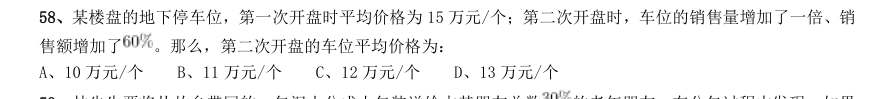

- **A.** 10 万元/个
- **B.** 11 万元/个
- **C.** 12 万元/个
- **D.** 13 万元/个

**答案：C**　**考点：其他数量关系｜和差倍比**　**难度：★☆☆☆☆**
**【数量关系·其他数量关系｜HB-2019-ty-X059】**

59. 林先生要将从故乡带回的一包泥土分成小包装送给占其朋友总数 的老年朋友。在分包过程中发现,如果 每包200 克,则少500 克;如果每包150 克,则多250 克。那么,林先生的朋友共有多少人?

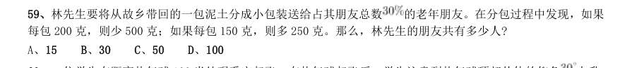

- **A.** 15
- **B.** 30
- **C.** 50
- **D.** 100

**答案：C**　**考点：其他数量关系｜方程与不定方程**　**难度：★★☆☆☆**
**【数量关系·行程问题｜HB-2019-ty-X060】**

60. 一位学生在距离热气球100 米处观看它起飞。在热气球起飞后,学生注意到热气球顶部从他的仰角 上升 到 ,再从 上升到 的位置分别用了11 秒和17 秒。则前后两段时间热气球平均上升速度的比值约为:

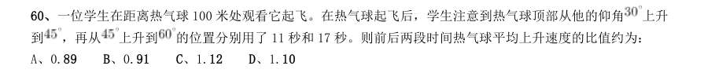

- **A.** 0.89
- **B.** 0.91
- **C.** 1.12
- **D.** 1.10

**答案：A**　**考点：行程问题｜基础行程**　**难度：★★☆☆☆**
**【数量关系·概率问题｜HB-2019-ty-X061】**

61. 幼儿园老师设计了一个摸彩球游戏,在一个不透明的盒子里混放着红、黄两种颜色的小球,它们除了颜色不 同,形状、大小均一致。已知随机摸取一个小球,摸到红球的概率为三分之一。如果从中先取出3 红7 黄共10 个小球,再随机摸取一个小球,此时摸到红球的概率变为五分之二,那么原来盒中共有红球多少个?

- **A.** 5
- **B.** 10
- **C.** 15
- **D.** 20

**答案：A**　**考点：概率问题｜摸球与抽取**　**难度：★★★★★**
**【数量关系·行程问题｜HB-2019-ty-X062】**

62. 甲、乙两部参加军事演习。甲部从大本营以60 千米/小时的速度往西行进,乙部晚半小时由大本营往东行进, 速度比甲部慢。两部同时接到军令紧急集合,集合地位于大本营正北某处。此时两部所在位置与集合地恰好构成 有一角为30 度的直角三角形。若两部同时调整方向往集合地行军,且保持速度不变,则可同时到达集合地。问 集合地与大本营的距离约为多少千米?

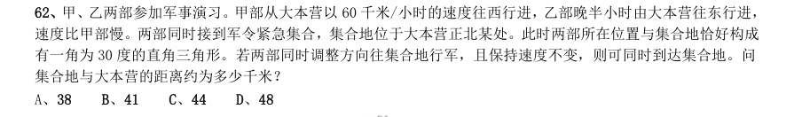

- **A.** 38
- **B.** 41
- **C.** 44
- **D.** 48

**答案：B**　**考点：行程问题｜基础行程**　**难度：★★★★☆**
**【数量关系·利润问题｜HB-2019-ty-X063】**

63. 小张用10 万元购买某只股票1000 股,在亏损 时,又增持该只股票1000 股。一段时间后,小张将该只 股票全部卖出,不考虑交易成本,获利2 万元。那么,这只股票在小张第二次买入到卖出期间涨了多少?

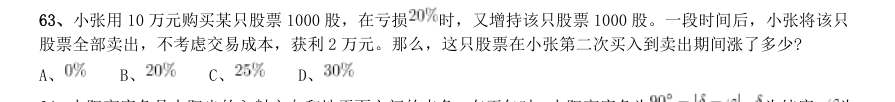

- **A.** 
- **B.** 
- **C.** 
- **D.** 

**答案：C**　**考点：利润问题｜基础利润**　**难度：★★☆☆☆**
**【数量关系·其他数量关系｜HB-2019-ty-X064】**

64. 太阳高度角是太阳光的入射方向和地平面之间的夹角。在正午时,太阳高度角为 , 为纬度, 为 太阳赤纬。已知小陈的身高为180 厘米,他所在地的纬度为 ,当日太阳赤纬为 。那么,在正午时他的影子 长度约为:

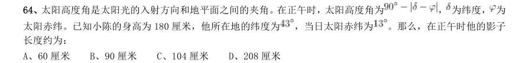

- **A.** 60 厘米
- **B.** 90 厘米
- **C.** 104 厘米
- **D.** 208 厘米

**答案：C**　**考点：其他数量关系｜和差倍比**　**难度：★★☆☆☆**
**【数量关系·概率问题｜HB-2019-ty-X065】**

65. 一家早餐店只出售粥、馒头和包子。粥有三种:大米粥、小米粥和绿豆粥,每份1 元;馒头有两种:红糖馒 头和牛奶馒头,每个2 元;包子只有一种三鲜大肉包,每个3 元。陈某在这家店吃早餐,花了4 元钱,假设陈某 点的早餐不重样,问他吃到包子的概率是多少?

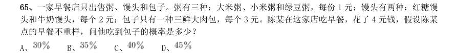

- **A.** 
- **B.** 
- **C.** 
- **D.** 

**答案：A**　**考点：概率问题｜摸球与抽取**　**难度：★★★★★**
**【数量关系·概率问题｜HB-2019-ty-X066】**

66. 甲乙两人相约骑共享单车运动健身。停车点现有9 辆单车,分属3 个品牌,各有2、3、4 辆。假如两人选择 每一辆单车的概率相同,两人选到同一品牌单车的概率约为:

- **A.** 
- **B.** 
- **C.** 
- **D.** 

**答案：C**　**考点：概率问题｜摸球与抽取**　**难度：★★★★★**
**【数量关系·其他数量关系｜HB-2019-ty-X067】**

67. 小张、小李和小王三人以擂台形式打乒乓球,每局2 人对打,输的人下一局轮空。半天下来,小张共打了6 局,小王共打了9 局,而小李轮空了4 局。那么,小李一共打了多少局?

- **A.** 5 局
- **B.** 7 局
- **C.** 9 局
- **D.** 11 局

**答案：B**　**考点：其他数量关系｜和差倍比**　**难度：★☆☆☆☆**
**【数量关系·工程问题｜HB-2019-ty-X068】**

68. 某河道由于淤泥堆积影响到船只航行安全,现由工程队使用挖沙机进行清淤工作,清淤时上游河水又会带来 新的泥沙。若使用1 台挖沙机300 天可完成清淤工作,使用2 台挖沙机100 天可完成清淤工作。为了尽快让河道 恢复使用,上级部门要求工程队25 天内完成河道的全部清淤工作,那么工程队至少要有多少台挖沙机同时工作?

- **A.** 4
- **B.** 5
- **C.** 6
- **D.** 7

**答案：D**　**考点：工程问题｜给定效率型**　**难度：★★★☆☆**
**【数量关系·最值问题｜HB-2019-ty-X069】**

69. 某次田径运动会中,选手参加各单项比赛计入所在团体总分的规则为:一等奖得9 分,二等奖得5 分,三等 奖得2 分。甲队共有10 位选手参赛,均获奖。现知甲队最后总分为61 分,问该队最多有几位选手获得一等奖?

- **A.** 3
- **B.** 4
- **C.** 5
- **D.** 6

**答案：C**　**考点：最值问题｜最值优化**　**难度：★★★★★**
**【数量关系·行程问题｜HB-2019-ty-X070】**

70. 小林在距家1.5 公里的工厂上班。一天,小林出发10 分钟后,父亲老林发现小林的手机没带,立即追出去, 并在距离工厂500 米的地方追上了他。如果老林追赶的速度比小林快6 公里/小时,那么,下列关于小林速度 , 求值所列方程正确的是:

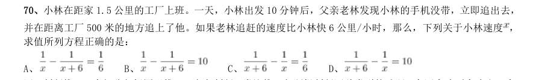

- **A.** 
- **B.** 
- **C.** 
- **D.** 

**答案：A**　**考点：行程问题｜相遇追及**　**难度：★★★☆☆**
**【判断推理·图形推理｜HB-2019-ty-X071】**
> 材料：最恰当的答案。

71. 从所给四个选项中,选择最合适的一个填入问号处,使之呈现一定的规律性:

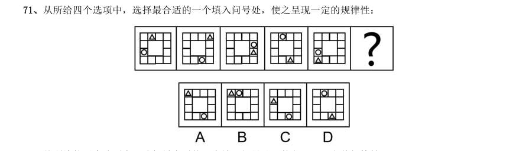

> （本题为图形题，选项为图片，见原卷）

**答案：C**　**考点：图形推理｜位置规律**　**难度：★★★★☆**
**【判断推理·图形推理｜HB-2019-ty-X072】**

72. 从所给的四个选项中,选择最合适的一个填入问号处,使之呈现一定的规律性:

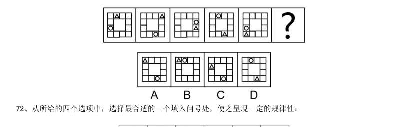

> （本题为图形题，选项为图片，见原卷）

**答案：D**　**考点：图形推理｜属性规律**　**难度：★★★★☆**
**【判断推理·图形推理｜HB-2019-ty-X073】**

73. 从所给的四个选项中,选择最合适的一个填入问号处,使之呈现一定的规律性:

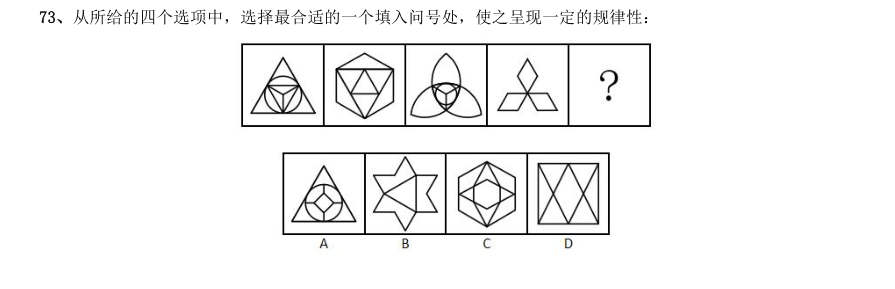

> （本题为图形题，选项为图片，见原卷）

**答案：B**　**考点：图形推理｜属性规律**　**难度：★★★★☆**
**【判断推理·图形推理｜HB-2019-ty-X074】**

74. 把下面的图形分为两类,使每一类图形都有各自的共同特征或规律,分类正确的一项是:

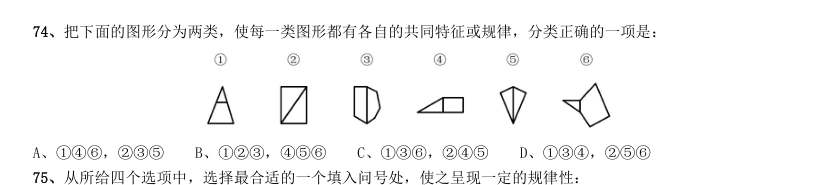

- **A.** 146,235
- **B.** 123,456
- **C.** 136,245
- **D.** 134,256

**答案：A**　**考点：图形推理｜分组分类**　**难度：★★★☆☆**
**【判断推理·图形推理｜HB-2019-ty-X075】**

75. 从所给四个选项中,选择最合适的一个填入问号处,使之呈现一定的规律性:

> （本题为图形题，选项为图片，见原卷）

**答案：C**　**考点：图形推理｜三视图**　**难度：★★★★☆**
**【判断推理·图形推理｜HB-2019-ty-X076】**

76. 正方形切掉一块后剩余部分如下图左侧所示,右侧哪一项是其切去部分的形状?

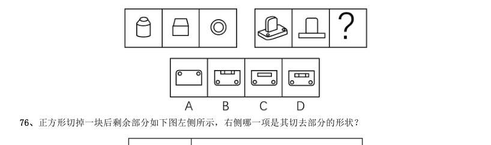

> （本题为图形题，选项为图片，见原卷）

**答案：B**　**考点：图形推理｜立体拼合**　**难度：★★★☆☆**
**【判断推理·定义判断｜HB-2019-ty-X077】**

77. 虚拟现实技术是指一种可以创建和体验虚拟世界的仿真系统,它利用计算机生成可交互的三维环境,向使用 者提供视觉、听觉、触觉等感官的模拟,从而让人有身临其境之感,这是一种360 度视角的沉浸式体验。 根据上述定义,下列选项属于虚拟现实技术运用的是:

- **A.** 张三通过电脑与远在巴黎的父亲视频聊天,亲眼见到了埃菲尔铁塔
- **B.** 李四用手机微信与妻子视频聊天,亲耳听到了儿子背诵古诗的声音
- **C.** 刘五戴上特制头盔网购书桌,能够全方位地体验书桌摆进书房的效果
- **D.** 王二用平板电脑看同学在西藏旅游的视频,感觉自己也到了布达拉宫

**答案：C**　**考点：定义判断｜单定义**　**难度：★★★☆☆**
**【判断推理·定义判断｜HB-2019-ty-X078】**

78. 组织认同是指组织成员在行为或观念等诸方面与其所加入的组织具有一致性,觉得自己在组织中既有理性的 契约和责任感,也有非理性的归属和依赖感,以及在这种心理基础上表现出的对组织活动尽心尽力的行为结果。 根据上述定义,下列选项不属于组织认同的是:

- **A.** “我们要以共产党员的标准严格要求自己”
- **B.** “公司面临困难的时候,我们要不离不弃”
- **C.** “我要每时每刻自觉维护公司的良好形象”
- **D.** “今日我以母校为傲,明日母校以我为荣”

**答案：A**　**考点：定义判断｜单定义**　**难度：★★☆☆☆**
**【判断推理·定义判断｜HB-2019-ty-X079】**

79. 意志的活动过程会体现以下两大定律。其中,意志强度边际效应定律是指意志的强度随着自身行为的活动规 模的增长而下降;意志强度时间衰减定律是指意志的强度随着自身行为的持续时间的增长而呈现负指数下降。 根据上述定义,下列选项最能体现意志强度时间衰减定律的是:

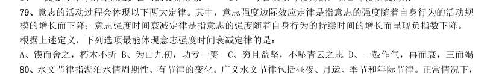

> （本题为图形题，选项为图片，见原卷）

**答案：D**　**考点：定义判断｜单定义**　**难度：★★☆☆☆**
**【判断推理·定义判断｜HB-2019-ty-X080】**

80. 水文节律指湖泊水情周期性、有节律的变化。广义水文节律包括昼夜、月运、季节和年际节律。正常情况下, 由于流域气候和下垫面等因素较稳定,湖泊多年平均水位趋于稳定数值即湖泊正常年平均水位。所以湖泊年际节 律以干扰因素驱动的突变性和适应干扰后的阶段稳定性为特点,无渐变趋向;而昼夜节律对生态系统影响微弱。 因此,狭义水文节律特指月运节律与季节节律。 根据上述定义,下列涉及狭义水文节律的是:

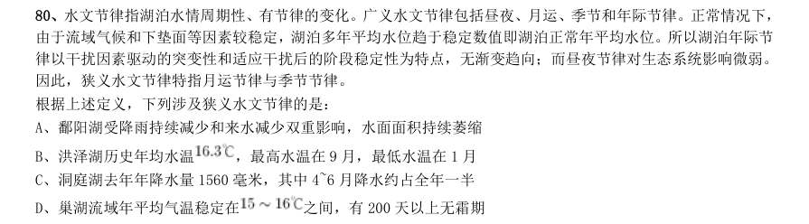

- **A.** 鄱阳湖受降雨持续减少和来水减少双重影响,水面面积持续萎缩
- **B.** 洪泽湖历史年均水温,最高水温在9 月,最低水温在1 月
- **C.** 洞庭湖去年年降水量1560 毫米,其中4~6 月降水约占全年一半
- **D.** 巢湖流域年平均气温稳定在

**答案：B**　**考点：定义判断｜单定义**　**难度：★★★★☆**
**【判断推理·定义判断｜HB-2019-ty-X081】**

81. 时间感知扭曲是指对时间不正确的知觉。在生活中,受各种因素影响,人们对时间的感知往往会不符合实际, 有时候觉得时间过长,有时候觉得时间太短。许多原因都可以造成时间感知扭曲,现实中一场糟糕的表演会让人 如坐针毡、觉得终场遥遥无期,与此相反的是,人们对于美好愉快的时光总嫌太短。 根据上述定义,下列选项不符合时间感知扭曲的是:

- **A.** 一日不见,如三月兮
- **B.** 欢愉嫌夜短,寂寞恨更长
- **C.** 孤馆度日如年,风露渐变
- **D.** 入春才七日,离家已二年

**答案：D**　**考点：定义判断｜单定义**　**难度：★★☆☆☆**
**【判断推理·定义判断｜HB-2019-ty-X082】**

82. 消费滞后是指个人消费滞后于国家经济发展和个人家庭收人所应达到的平均消费水平。消费超前是指当下的 收入水平不足以购买现在所需的产品或服务,以贷款、分期付款、预支等形式进行消费。 根据上述定义,下列属于消费超前的是:

- **A.** 职员小王以信用卡支付的形式在网上订购了火车票
- **B.** 大学生小李通过某借贷平台购买了某知名品牌电脑
- **C.** 退休工人老张名下有商品房和汽车,但坚持只用老式的直板手机
- **D.** 青年教师小刘有十万元定期存款未到期,向同事借了八万元买车

**答案：B**　**考点：定义判断｜单定义**　**难度：★★★☆☆**
**【判断推理·定义判断｜HB-2019-ty-X083】**

83. 类脑计算技术总体分为三个层次:结构层次模仿脑、器件层次逼近脑、智能层次超越脑。其中,结构层次模 仿脑是指将大脑作为一个物质和生理对象进行解析,获得基本单元(各类神经元和神经突触等)的功能及其连接关 系(网络结构);器件层次逼近脑是指研制能够模拟神经元和神经突触功能的器件,从而在有限的物理空间和功 耗条件下构造出人脑规模的神经网络系统;智能层次超越脑是指通过对类脑计算机进行信息刺激、训练和学习, 使其产生与人脑类似的智能。 根据上述定义,下列属于智能层次超越脑的是:

- **A.** 调整神经网络的突触连接关系及连接频率和强度
- **B.** 绘制精确的人类大脑动态图谱以解析探测大脑
- **C.** 开发功能、密度与人类大脑皮层相当的电子装备
- **D.** 捕捉细微的单个神经元放电的非线性动力学过程

**答案：A**　**考点：定义判断｜单定义**　**难度：★★★☆☆**
**【判断推理·类比推理｜HB-2019-ty-X084】**

84. 拥挤:水泄不通

- **A.** 清晰:洞见肺腑
- **B.** 严重:触目惊心
- **C.** 费力:举重若轻
- **D.** 伤心:肝肠寸断

**答案：D**　**考点：类比推理｜语义关系**　**难度：★☆☆☆☆**
**【判断推理·类比推理｜HB-2019-ty-X085】**

85. 成长:衰亡

- **A.** 坚定:彷徨
- **B.** 美好:苦难
- **C.** 深刻:纯真
- **D.** 复杂:单纯

**答案：B**　**考点：类比推理｜语义关系**　**难度：★☆☆☆☆**
**【判断推理·类比推理｜HB-2019-ty-X086】**

86. 孤本:书籍

- **A.** 正方形:长方形
- **B.** 蔬菜:土地
- **C.** 显微镜:实验室
- **D.** 礼物:商品

**答案：A**　**考点：类比推理｜对应关系**　**难度：★☆☆☆☆**
**【判断推理·类比推理｜HB-2019-ty-X087】**

87. 玻璃幕墙:光污染

- **A.** 汽车尾气:酸雨
- **B.** 海上风暴:海啸
- **C.** 火山喷发:地震
- **D.** 空气消毒:臭氧

**答案：A**　**考点：类比推理｜类比推理（综合）**　**难度：★☆☆☆☆**
**【判断推理·类比推理｜HB-2019-ty-X088】**

88. 老字号:新品牌:传承

- **A.** 老传统:新花样:质疑
- **B.** 老配方:新工艺:创新
- **C.** 老问题:新思考:评价
- **D.** 老物件:新东西:区分

**答案：B**　**考点：类比推理｜类比推理（综合）**　**难度：★☆☆☆☆**
**【判断推理·类比推理｜HB-2019-ty-X089】**

89. 人烟辐辏:鸡犬相闻:繁盛

- **A.** 人迹罕至:门可罗雀:荒凉
- **B.** 筑巢引凤:腾笼换鸟:友善
- **C.** 战马长矛:坚船利炮:强大
- **D.** 大国工匠:小国寡民:专注

**答案：A**　**考点：类比推理｜对应关系**　**难度：★☆☆☆☆**
**【判断推理·类比推理｜HB-2019-ty-X090】**

90. 鞋匠:缝纫机:大头皮鞋

- **A.** 厨师:炒菜锅:青椒炒肉
- **B.** 矿工:十字镐:钙铁榴石
- **C.** 记者:录音笔:高端访谈
- **D.** 园丁:洒水壶:鹿角海棠

**答案：A**　**考点：类比推理｜对应关系**　**难度：★☆☆☆☆**
**【判断推理·逻辑判断｜HB-2019-ty-X091】**

91. 效率:公平:市场经济

- **A.** 科学:理性:政治哲学
- **B.** 革命:改良:社会制度C、民主:集中:组织原则D、美丑:善恶:审美范畴

**答案：暂缺**　**考点：逻辑判断｜逻辑判断（待细分）**　**难度：★★★☆☆**
**【判断推理·类比推理｜HB-2019-ty-X092】**

92. 瓮牖绳枢:粗茶淡饭:清寒

- **A.** 叠床架屋:衣锦食肉:奢华
- **B.** 箪食瓢饮:曲肱饮水:简朴
- **C.** 轻车熟路:霜行草宿:轻松
- **D.** 金盆洗手:金屋藏娇:阔绰

**答案：B**　**考点：类比推理｜语义关系**　**难度：★☆☆☆☆**
**【判断推理·类比推理｜HB-2019-ty-X093】**

93. 巾帼 之于 () 相当于 () 之于 监狱

- **A.** 须眉;囚犯
- **B.** 英雄;犯罪
- **C.** 女子;铁窗
- **D.** 头饰;惩罚

**答案：C**　**考点：类比推理｜语义关系**　**难度：★☆☆☆☆**
**【判断推理·类比推理｜HB-2019-ty-X094】**

94. ( ) 对于 幸灾乐祸 相当于 怨天尤人 对于 ( )

- **A.** 得意忘形;呼天号地
- **B.** 乐极生悲;饮恨吞声
- **C.** 兔死狐悲;乐天知命
- **D.** 睚眦必报;破涕为笑

**答案：C**　**考点：类比推理｜语义关系**　**难度：★☆☆☆☆**
**【判断推理·逻辑判断｜HB-2019-ty-X095】**

95. 多数家长的投入对子女学业投入具有显著的正向预测作用,家长投入程度随子女学段升高而降低,同时多数 家长更注重在家辅导的投入,对子女参与社区及学校活动的投入较欠缺。而家长自主支持或控制的教养风格在家 长投入与子女学业投入的关系中起调节作用,且部分通过子女学业心理需要的满足这一中介变量产生作用。 由此可以推出:

- **A.** 多数家长对子女教育投入的减少,意味着子女学段的升高
- **B.** 家长的投入、教养风格必然会对子女的学业投入产生影响
- **C.** 家中学习环境的创设、形成和学校、社区间的联系呈反比关系
- **D.** 子女学业心理需要的满足是影响其学业投入的内驱和首要因素

**答案：C**　**考点：逻辑判断｜加强论证**　**难度：★★★★★**
**【判断推理·逻辑判断｜HB-2019-ty-X096】**

96. 快速、持续、无法预测的竞争环境要求企业规模小,结构简化,同时要有足够的技术储备和抵抗资金风险的 能力。目前解决这一矛盾的途径通常是建立全球范围内的“基于双赢原则”的虚拟企业。虚拟企业是企业间的一 种动态联盟,参加虚拟企业的各成员企业有一定的自主权。当出现了市场机会,各加盟企业就组织在一起,共同 开发并生产销售新产品,一旦发现该产品无利可图,便自动解散。因此,虚拟企业被认为是21 世纪最有竞争力 的企业运行模式。 以下哪项如果为真,最能支持上述观点?

- **A.** 当今社会发达的现代信息技术和通讯手段为各企业间的沟通提供了便利
- **B.** 企业想在当前的竞争环境中生存发展扩大优势,需要一种新的运行模式
- **C.** 虚拟企业中的任一加盟企业生产上出现问题都会中断整个生产链的运行
- **D.** 虚拟企业可迅速集中最强设计加工与销售力量,实现对市场的快速反应

**答案：D**　**考点：逻辑判断｜加强论证**　**难度：★★★★★**
**【判断推理·逻辑判断｜HB-2019-ty-X097】**

97. 信天翁属于鹱形目,有着管状的鼻子,嗅觉灵敏,经常为了觅食在外海上长距离飞行。那些漂浮在海上的塑 料垃圾看起来并非美味,可信天翁为什么会吃下它们,并为此付出沉重代价呢?研究人员认为原因在于:对于信 天翁而言,这些塑料垃圾闻起来“很好吃”。“美食信号”是一种名叫二甲基硫醚(DMS)的化学物质,这种气 味物质在海洋浮游植物的作用下产生。 以下哪项如果为真,无法支持研究人员的观点?

- **A.** 鹱形目鸟类当中有一部分物种常聚集在海洋浮游植物丰盛的地方
- **B.** 误食塑料垃圾会导致海鸟行动不便、消化道阻塞,健康慢性受损
- **C.** 实验证明在海中浸泡三周后的塑料样品上都检测到了DMS 成分
- **D.** 对DMS 气味敏感的鹱形目鸟类可以探测到浓度极低的气味分子

**答案：B**　**考点：逻辑判断｜加强论证**　**难度：★★★★★**
**【判断推理·逻辑判断｜HB-2019-ty-X098】**

98. 研究发现,20 到39 岁的群体更热衷于使用智能手机中的运动类应用。最主要的原因在于该群体大部分都已 经参加工作,且亚健康在该群体中较普遍,所以越来越多的白领和年轻人更注重身体健康;同时,年轻人肥胖率 占比较高,而年轻人对美的追求远远超过中老年人,所以他们更在乎运动;此外,该年龄段的用户群体也更熟悉 智能手机的操作。 以下哪项如果为真,最能削弱上述调研发现?

- **A.** 许多年轻人沉迷于智能手机中的游戏
- **B.** 许多年轻人长期加班,睡眠远远不足
- **C.** 年轻人不坚持运动易引发亚健康问题
- **D.** 当代年轻人营养过于丰富,体型偏胖

**答案：A**　**考点：逻辑判断｜削弱论证**　**难度：★★★★★**
**【判断推理·逻辑判断｜HB-2019-ty-X099】**

99. 长久以来,心理学家都支持“数学天赋论”:数学能力是人类自打娘胎里出来就有的能力,就连动物也有这 种能力。他们认为存在一种天生的数学内核,通过自我慢慢发展,这种数学内核最后会“长”成我们所熟悉的一 切数学能力。最近有反对者提出了不同的看法:数学能力没有天赋,只能是文化的产物。 以下哪项如果为真,最能支持反对者的看法?

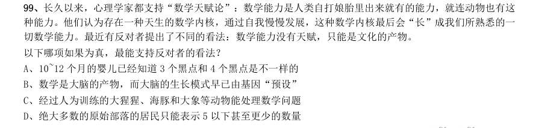

- **A.** 10~12 个月的婴儿已经知道3 个黑点和4 个黑点是不一样的
- **B.** 数学是大脑的产物,而大脑的生长模式早已由基因“预设”
- **C.** 经过人为训练的大猩猩、海豚和大象等动物能处理数学问题
- **D.** 绝大多数的原始部落的居民只能表示5 以下甚至更少的数量

**答案：D**　**考点：逻辑判断｜加强论证**　**难度：★★★★★**
**【判断推理·逻辑判断｜HB-2019-ty-X100】**

100. 牙医在治疗龋齿时,先要去除牙齿龋坏的部分,再填充材料以修补缺损的牙体。但是, 至 的补牙会 失败,且所用的填充物并不具备使牙齿自愈的功能,甚至还有副作用。有鉴于此,研究人员研发出一种用合成生 物材料制成的填充物,可以刺激牙髓中干细胞的生长,修复受损部位。这种填充物能刺激干细胞的增殖,并分化 成牙本质。如果未来补牙的填充物都用这样的再生材料制成,将降低补牙失败率,也可减少蛀牙患者治疗牙髓之 苦。 由此可以推出:

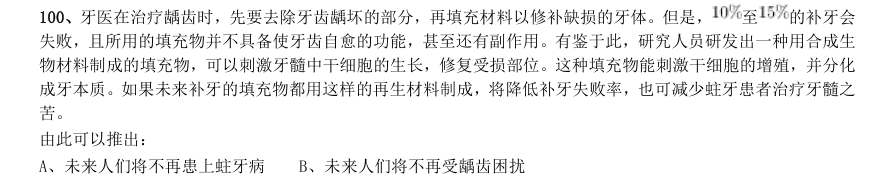

- **A.** 未来人们将不再患上蛀牙病
- **B.** 未来人们将不再受龋齿困扰
- **C.** 新研发的补牙填充物能刺激受损牙齿自愈
- **D.** 新研发的补牙填充物能促进牙本质的生长

**答案：C**　**考点：逻辑判断｜结论推出**　**难度：★★★★★**
**【判断推理·逻辑判断｜HB-2019-ty-X101】**

101. 如今,基于互联网的新型科普方式层出不穷。浅阅读、视频直播以及游戏互动等方式,使得如今获取科学 知识的渠道越来越多、门槛也越来越低。研究者认为,尽管“互联网+科普”令科学知识的获取和传播方式发生 了很大变化,但这不是对科普传播的一种颠覆,而是显示了公民科学素养的提升。 以下哪项如果为真,最能质疑研究者的观点?

- **A.** 新闻应用、微博等资讯类媒体是用户了解科学热点事件的最主要渠道
- **B.** 在许多科学热点事件的传播过程中,公众很难见到权威科学家的身影
- **C.** 数据表明,用户普遍乐于通过图文资讯这样轻松愉悦的形式获取知识
- **D.** 比起明星八卦,在社交媒体转发科普内容更能为转发者本人形象加分

**答案：B**　**考点：逻辑判断｜削弱论证**　**难度：★★★★★**
**【判断推理·逻辑判断｜HB-2019-ty-X102】**

102. 在抗生素大规模医用之前,耐药效果对细菌几乎没有意义,突变自身的有害效果更加重要。正常使用抗生 素能杀死几乎所有的目标细菌,个别漏网之鱼通常也会被人体免疫系统消灭殆尽。其中一些细菌个体虽然已经带 有耐药性的萌芽,但这些萌芽不足以抵御正常剂量抗生素,也会随着个体死去而消失。 由此可以推出:

- **A.** 基因突变是耐药细菌泛滥成灾的根本原因
- **B.** 细菌通过基因突变,来削弱抗生素的作用效果
- **C.** 致病菌产生耐药性之后,抗生素将无法攻击病菌
- **D.** 如果没有抗生素滥用,耐药性不会快速蔓延开来

**答案：D**　**考点：逻辑判断｜结论推出**　**难度：★★★★☆**
**【判断推理·逻辑判断｜HB-2019-ty-X103】**

103. 某国际古生物学研究团队最新报告称,在2.8 亿年前生活在南非的正南龟是现代乌龟的祖先,它们是在二 叠纪至三叠纪大规模物种灭绝事件中幸存下来的。当时,为了躲避严酷的自然环境,它们努力向地下挖洞,同时 为保证前肢的挖掘动作足够有力,身体需要一个稳定的支撑,从而导致了肋骨不断加宽。由此可知,乌龟有壳是 适应环境的表现,只不过不是为了保护,而是为了向地下挖洞。 上述结论的成立需要补充以下哪项作为前提?

- **A.** 只有挖洞才能从大规模物种灭绝事件中幸存
- **B.** 现代乌龟继承了正南龟善于挖洞的某些习性
- **C.** 正南龟前肢足够有力因而并不需要龟壳保护
- **D.** 龟壳是由乌龟的肋骨逐渐加宽后进化而来的

**答案：D**　**考点：逻辑判断｜前提假设**　**难度：★★★★★**
**【判断推理·逻辑判断｜HB-2019-ty-X104】**

104. 自制力不仅关乎自我控制,还包括排除不相关刺激的干扰和坚持完成相关任务(即使是自己不喜欢的任务) 的能力。自制力是稳定不变的,还是会被消耗的,学界各派的看法不一。心理学家把实验对象分为两组,让他们 同场解决难题。一组解题时只能吃萝卜,另一组还可以吃饼干。结果只吃萝卜的这组坚持时间更短,因为他们在 抵制饼干的诱惑的同时,消耗了自制力。他们由此得出结论:人们的自制力是有限的,过度使用会导致自制力下 降。 上述结论的成立需要补充以下哪项作为前提?

- **A.** 实验对象对解决难题的兴趣不完全相同
- **B.** 饼干和萝卜对实验对象的诱惑力不相同
- **C.** 饼干和萝卜补充人体能量的效果不相同
- **D.** 两组实验对象抗干扰的能力不完全相同

**答案：B**　**考点：逻辑判断｜前提假设**　**难度：★★★★★**
**【判断推理·逻辑判断｜HB-2019-ty-X105】**

105. 有研究声称:癌细胞怕热,高体温可以抗癌。人体最容易罹癌的器官包括肺、胃、大肠、乳腺等都是体温 较低的部位,心脏之类的“高温器官”不容易得癌症。因此,可以用运动、喝热水、泡澡等方法提高体温来抗癌。 以下哪项如果为真,最能反驳上述论断?

- **A.** 受呼吸、饮食等影响,人的口腔温度一般比直肠温度低,而世界范围内直肠癌的发生率要高于口腔癌
- **B.** 人的体温存在精准的调控机制,基本保持平稳状态,体内各个脏器之间并没有什么明显的温度差异
- **C.** 热疗或许可以帮助放疗或一些化疗发挥更好的作用,但证明其可靠性的研究数据依然不足
- **D.** 心脏很少发生恶性肿瘤,是因为这里的心肌细胞不再进行分裂增殖,而与温度高低无关

**答案：B**　**考点：逻辑判断｜削弱论证**　**难度：★★★★★**
**【资料分析·综合分析｜HB-2019-ty-X106】**
> 材料：析、比较、计算和判断处理。 (一)根据以下资料,回答下列问题。 2017 年我国成年国民图书阅读率为 ,比上年增加0.3 个百分点;报纸阅读率为 ,比上年降低2.1 个百分点;期刊阅读率为 ,比上年增加1 个百分点。 2017 年我国成年国民数字化阅读方式(网络在线阅读、手机阅读、电子阅读器阅读、平板电脑阅读等)的接 触率为 。

106. 其中,网络在线阅读接触率为 ,比上年增加4.4 个百分点;手机阅读接触率为 ,比上 年增加4.9 个百分点;电子阅读器阅读接触率为 ,比上年增加6.5 个百分点;平板电脑阅读接触率为 , 比上年增加2.2 个百分点。 传统纸质媒介中,2017 年我国成年国民人均每天阅读纸质图书时长为20.38 分钟,人均每天阅读报纸时长 为12.00 分钟,人均每天阅读期刊时长为6.88 分钟。 2016 年我国成年国民报纸阅读率比期刊阅读率高:

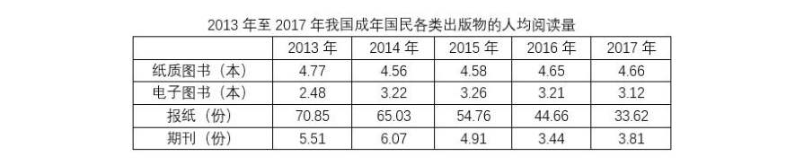

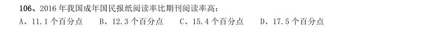

- **A.** 11.1 个百分点
- **B.** 12.3 个百分点
- **C.** 15.4 个百分点
- **D.** 17.5 个百分点

**答案：C**　**考点：综合分析｜平均数**　**难度：★★★★★**
**【资料分析·年均增长率｜HB-2019-ty-X107】**

107. 2013 年至2017 年我国成年国民人均期刊阅读量超过这五年平均水平的年份有:

> 材料图见 images/HB-2019-ty-X106-m.jpg

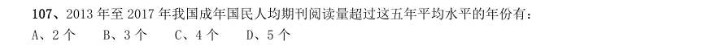

- **A.** 2 个
- **B.** 3 个
- **C.** 4 个
- **D.** 5 个

**答案：B**　**考点：年均增长率｜年均增长率计算**　**难度：★★☆☆☆**
**【资料分析·综合分析｜HB-2019-ty-X108】**

108. 2016 年我国成年国民数字化阅读四个方式的接触率按从高到低排列正确的是:

> 材料图见 images/HB-2019-ty-X106-m.jpg

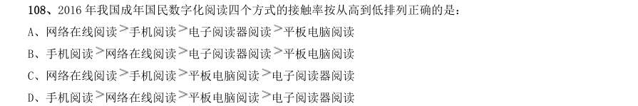

- **A.** 网络在线阅读手机阅读电子阅读器阅读平板电脑阅读
- **B.** 手机阅读网络在线阅读电子阅读器阅读平板电脑阅读
- **C.** 网络在线阅读手机阅读平板电脑阅读电子阅读器阅读
- **D.** 手机阅读

**答案：D**　**考点：综合分析｜基期量**　**难度：★★★★☆**
**【资料分析·平均数计算｜HB-2019-ty-X109】**

109. 平板电脑阅读 电子阅读器阅读 2017 年我国成年国民阅读一本纸质图书平均需要:

> 材料图见 images/HB-2019-ty-X106-m.jpg

- **A.** 20.8 小时
- **B.** 22.3 小时
- **C.** 24.1 小时
- **D.** 26.6 小时

**答案：D**　**考点：平均数计算｜现期平均数**　**难度：★★☆☆☆**
**【资料分析·综合分析｜HB-2019-ty-X110】**

110. 能够从上述资料中推出的是:

> 材料图见 images/HB-2019-ty-X106-m.jpg

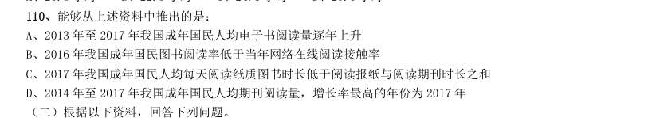

- **A.** 2013 年至2017 年我国成年国民人均电子书阅读量逐年上升
- **B.** 2016 年我国成年国民图书阅读率低于当年网络在线阅读接触率
- **C.** 2017 年我国成年国民人均每天阅读纸质图书时长低于阅读报纸与阅读期刊时长之和
- **D.** 2014 年至2017 年我国成年国民人均期刊阅读量,增长率最高的年份为2017 年

**答案：D**　**考点：综合分析｜平均数**　**难度：★★★★★**
**【资料分析·年均增长率｜HB-2019-ty-X111】**
> 材料：2014 年我国实施“单独两孩”生育政策,出生人口1687 万人,比上年增加47 万人。2016 年实施“全面 两孩”生育政策,出生人口1786 万人,比上年增加131 万人;出生率与“十二五”时期年平均出生率相比,提 高了0.84 个千分点。2017 年我国出生人口1723 万人,虽然比上年减少63 万人,但比“十二五”时期年平均 出生人口多出79 万人;出生率为 ,比上一年降低0.52 个千分点。2017 年二孩数量进一步上升至883 万 人,二孩占全部出生人口的比重达到 ,比2016 年的占比提高了11 个百分点。 2017 年出生人口最多的省份是山东,出生人口174.98 万人,但是比2016 年减少2.08 万人。广东和河南出 生人口也超过百万,其中广东出生人口151.63 万人,同比增加22.18 万人;河南出生人口140.13 万人,较上 年减少2.48 万人。

111. 此外,出生人口排名前十的省份依次还有河北、四川、湖南、安徽、广西、江苏、湖北。其 中,河北、四川、湖南出生人口超90 万人,湖北最少,为74.26 万人。 从人口增量来看,2017 年广东出生人口增量最大,出生人口较2016 年增加22.18 万人。安徽、四川、河北 出生人口增量超过5 万,此外,江苏、湖南、山东、河南出生人口较2016 年有所减少。其中,河南减少最多, 出生人口减少2.48 万人。 2013 年我国出生人口比“十二五”时期年平均出生人口:

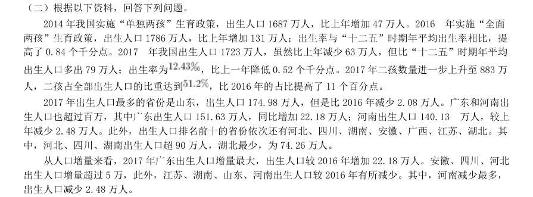

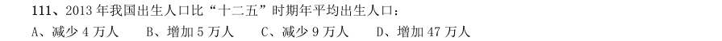

- **A.** 减少4 万人
- **B.** 增加5 万人
- **C.** 减少9 万人
- **D.** 增加47 万人

**答案：A**　**考点：年均增长率｜年均增长率比较**　**难度：★★★☆☆**
**【资料分析·年均增长率｜HB-2019-ty-X112】**

112. “十二五”时期我国年平均出生率为:

> 材料图见 images/HB-2019-ty-X111-m.jpg

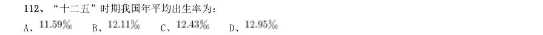

- **A.** 
- **B.** 
- **C.** 
- **D.** 

**答案：B**　**考点：年均增长率｜年均增长率计算**　**难度：★★☆☆☆**
**【资料分析·综合分析｜HB-2019-ty-X113】**

113. 2016 年我国二孩出生人口约为:

> 材料图见 images/HB-2019-ty-X111-m.jpg

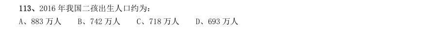

- **A.** 883 万人
- **B.** 742 万人
- **C.** 718 万人
- **D.** 693 万人

**答案：C**　**考点：综合分析｜比重**　**难度：★★★★☆**
**【资料分析·比重计算与比较｜HB-2019-ty-X114】**

114. 2016 年山东、广东和河南三省出生人口之和占当年全国出生人口的比重约为:

> 材料图见 images/HB-2019-ty-X111-m.jpg

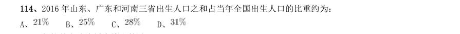

- **A.** 
- **B.** 
- **C.** 
- **D.** 

**答案：B**　**考点：比重计算与比较｜现期比重**　**难度：★★☆☆☆**
**【资料分析·综合分析｜HB-2019-ty-X115】**

115. 能够从上述资料中推出的是:

> 材料图见 images/HB-2019-ty-X111-m.jpg

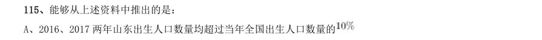

- **A.** 2016、2017 两年山东出生人口数量均超过当年全国出生人口数量的
- **B.** 2016 年广东出生人口数量超过2017 年湖北出生人口数量的2 倍
- **C.** 2017 年出生人口增量超过5 万的省份只有3 个
- **D.** 2017 年出生人口比2013 年增长超过

**答案：D**　**考点：综合分析｜倍数**　**难度：★★★★★**
**【资料分析·比重计算与比较｜HB-2019-ty-X116】**
> 材料：2017 年全国举办马拉松赛事达1102 场,其中,中国田径协会举办的A 类赛事223 场,B 类赛事33 场。2017 年马拉松赛事的参与人次达到了498 万人次,2016 年、2015 年马拉松赛事的参与人次分别为280 万人次、150 万人次。 2017 年全年马拉松直接从业人口数72 万,间接从业人口数200 万。年度产业总规模达700 亿元,比去年同 期增长约 ,中国田径协会设置的发展目标是到2020 年,全国马拉松规模赛事超过1900 场,其中中国田径协 会认证赛事达到350 场,各类赛事参赛人数超过1000 万人次,马拉松运动产业规模达到1200 亿元。 规模赛事数量方面,2017 年排名前三的省份为浙江省、江苏省和广东省,分别为152 场、149 场和103 场, 而2016 年的前三名分别为江苏省37 场,北京市33 场,广东省25 场。 从2017 年全年赛事的覆盖区域

116. 在中国田径协会认证的A 类 B 类赛事中,2017 年全程马拉松项目完 赛26.89 万人次,同比增长 ;半程马拉松项目完赛45.29 万人次,同比减少了0.03 万人次。 按照跑者户籍所在地统计,2017 年参加中国田径协会认证赛事的跑者中,来自江苏的数量最多,共有76469 人参赛,在全国占比 。湖北、广东、山东、福建、浙江等省紧随其后。而在全部参赛选手中,共有3663 人次的男选手在全程项目中跑进3 小时,772 人次女选手跑进3 小时20 分。 2017 年中国田径协会举办的A 类与B 类赛事占全国马拉松赛事的比例约为:

> 材料图见 images/HB-2019-ty-X111-m.jpg

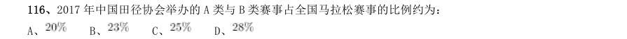

- **A.** 
- **B.** 
- **C.** 
- **D.** 

**答案：B**　**考点：比重计算与比较｜两期比重差**　**难度：★★★☆☆**
**【资料分析·倍数计算｜HB-2019-ty-X117】**

117. 2017 年我国马拉松赛事场次比2011 年增加了:

> 材料图见 images/HB-2019-ty-X111-m.jpg

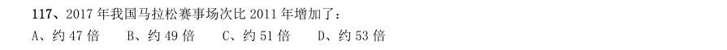

- **A.** 约47 倍
- **B.** 约49 倍
- **C.** 约51 倍
- **D.** 约53 倍

**答案：B**　**考点：倍数计算｜倍数计算（综合）**　**难度：★★☆☆☆**
**【资料分析·增长率计算与比较｜HB-2019-ty-X118】**

118. 2017 年马拉松赛事参与人次的同比增速比2016 年:

> 材料图见 images/HB-2019-ty-X111-m.jpg

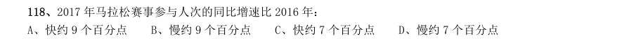

- **A.** 快约9 个百分点
- **B.** 慢约9 个百分点
- **C.** 快约7 个百分点
- **D.** 慢约7 个百分点

**答案：B**　**考点：增长率计算与比较｜增长率计算**　**难度：★★☆☆☆**
**【资料分析·平均数计算｜HB-2019-ty-X119】**

119. 在2017 年马拉松运动年度产业总规模的基础上,从2018 年开始,每年需要平均增长多少才能实现中国田 径协会设置的2020 年马拉松运动产业规模目标?

> 材料图见 images/HB-2019-ty-X111-m.jpg

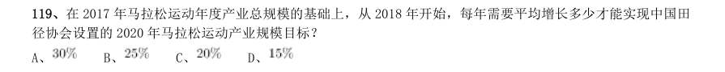

- **A.** 
- **B.** 
- **C.** 
- **D.** 

**答案：C**　**考点：平均数计算｜现期平均数**　**难度：★★☆☆☆**
**【资料分析·综合分析｜HB-2019-ty-X120】**

120. 能够从上述资料中推出的是:

> 材料图见 images/HB-2019-ty-X111-m.jpg

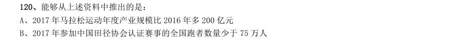

- **A.** 2017 年马拉松运动年度产业规模比2016 年多200 亿元
- **B.** 2017 年参加中国田径协会认证赛事的全国跑者数量少于75 万人
- **C.** 2011 年至2016 年我国马拉松赛事场次之和超过2017 年赛事场次的
- **D.** 在2016 年与2017 年马拉松规模赛事数量上,江苏省、北京市都有进入前三名

**答案：C**　**考点：综合分析｜比重**　**难度：★★★★★**
**【资料分析·综合分析｜HB-2019-ty-X121】**

121. (注:顺差是指在国际收支上,一定时期内收入大于支出的差额;逆差指的是在国际收支上,一定时期内支出大 于收入的差额;表中同比数据为正的代表同比增长,同比数据为负的代表同比下降) 2011 年至2017 年,我国服务进出口逆差最大的年份是:

> 材料图见 images/HB-2019-ty-X111-m.jpg

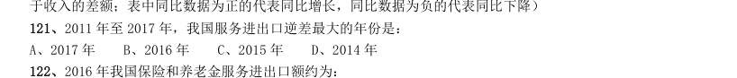

- **A.** 2017 年
- **B.** 2016 年
- **C.** 2015 年
- **D.** 2014 年

**答案：A**　**考点：综合分析｜综合分析（综合）**　**难度：★★★★★**
**【资料分析·综合分析｜HB-2019-ty-X122】**

122. 2016 年我国保险和养老金服务进出口额约为:

> 材料图见 images/HB-2019-ty-X111-m.jpg

- **A.** 857 亿元人民币
- **B.** 1112 亿元人民币
- **C.** 1134 亿元人民币
- **D.** 1158 亿元人民币

**答案：C**　**考点：综合分析｜增长率**　**难度：★★★★☆**
**【资料分析·增长率计算与比较｜HB-2019-ty-X123】**

123. 按照2017 年的同比增速,2018 年知识产权使用费出口额约为:

> 材料图见 images/HB-2019-ty-X111-m.jpg

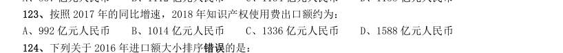

- **A.** 992 亿元人民币
- **B.** 1014 亿元人民币
- **C.** 1336 亿元人民币
- **D.** 1588 亿元人民币

**答案：C**　**考点：增长率计算与比较｜增长率计算**　**难度：★★☆☆☆**
**【资料分析·综合分析｜HB-2019-ty-X124】**

124. 下列关于2016 年进口额大小排序错误的是:

> 材料图见 images/HB-2019-ty-X111-m.jpg

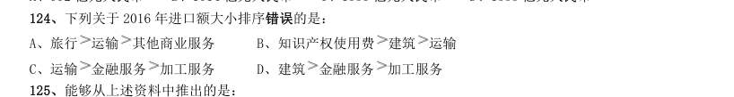

- **A.** 旅行运输其他商业服务
- **B.** 知识产权使用费建筑运输
- **C.** 运输金融服务加工服务
- **D.** 建筑

**答案：B**　**考点：综合分析｜综合分析（综合）**　**难度：★★★★☆**
**【资料分析·综合分析｜HB-2019-ty-X125】**

125. 加工服务 能够从上述资料中推出的是:

> 材料图见 images/HB-2019-ty-X111-m.jpg

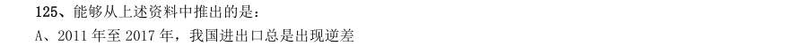

- **A.** 2011 年至2017 年,我国进出口总是出现逆差
- **B.** 2016 年我国建筑服务进出口实现顺差1039 亿元人民币
- **C.** 2017 年我国服务进出口中,其他商业服务进出口实现的顺差最多
- **D.** 2017 年我国服务进出口中,别处未提及的政府服务进出口占比最小

**答案：C**　**考点：综合分析｜比重**　**难度：★★★★★**