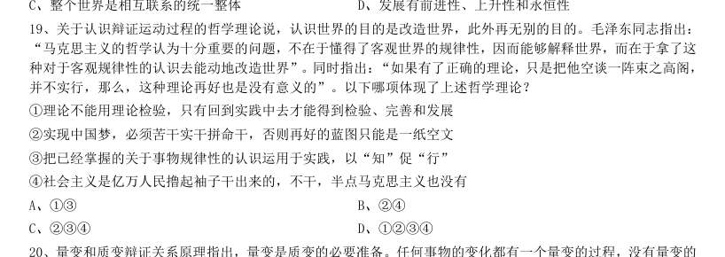
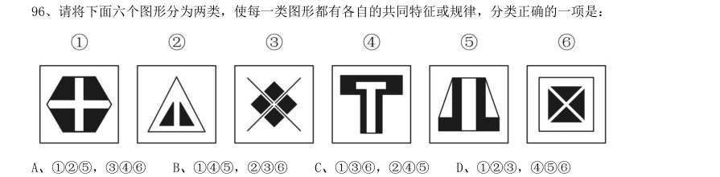
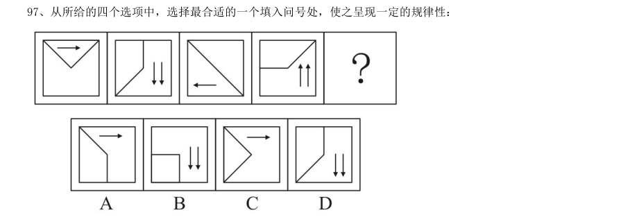
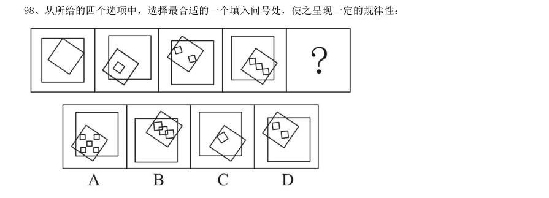
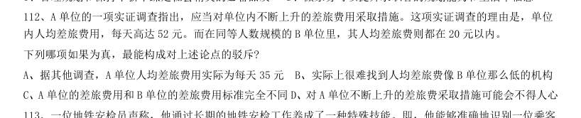
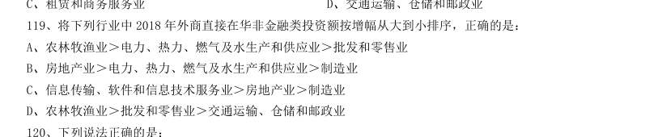
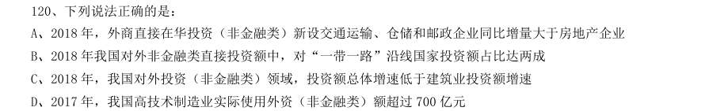
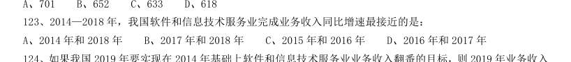
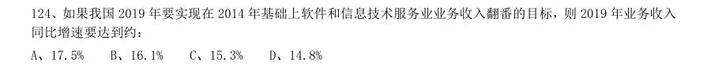
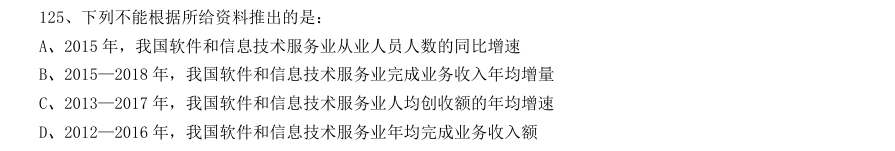

# 2019 年湖北行测（选调）

- 题量：125（含答案 124）
- 模块分布：资料分析10 / 数量关系10 / 言语理解15 / 判断推理20 / 常识判断70
- 试卷编号：`湖北-2019-选调`

## 题目与答案

**【常识判断·经济常识｜HB-2019-xd-X001】**

1. 中央经济工作会议2018 年12 月19 日至21 日在北京举行,会议强调:1坚持稳中求进工作总基调 2坚持 新发展理念 3坚持推动高质量发展 4坚持以供给侧结构性改革为主线 5坚持深化市场化改革、扩大高水平 开放

- **A.** 145
- **B.** 234
- **C.** 125
- **D.** 12345

**答案：D**　**考点：经济常识｜微观与市场**　**难度：★★★★☆**
**【常识判断·经济常识｜HB-2019-xd-X002】**

2. 2018 年4 月,习近平总书记在视察湖北时对湖北提出的“四个切实”的要求是:1切实推动高质量发展 2 切实实施乡村振兴战略 3切实做好民生工作 4切实加强作风建设 5切实推动长江经济带发展

- **A.** 1234
- **B.** 1235
- **C.** 2345
- **D.** 145

**答案：A**　**考点：经济常识｜经济常识（综合）**　**难度：★★★☆☆**
**【常识判断·地理常识｜HB-2019-xd-X003】**

3. 深化党和国家机构改革,要遵循的原则是:1坚持党的全面领导 2坚持以人民为中心 3坚持改革创新、 激发活力 4坚持优化协同高效 5坚持全面依法治国

- **A.** 123
- **B.** 135
- **C.** 2345
- **D.** 1245

**答案：D**　**考点：地理常识｜世界地理**　**难度：★★★☆☆**
**【常识判断·政治常识｜HB-2019-xd-X004】**

4. 党的根本性建设是:

- **A.** 党的思想建设
- **B.** 党的作风建设
- **C.** 党的政治建设
- **D.** 党的组织建设

**答案：C**　**考点：政治常识｜马克思主义基本原理**　**难度：★★★☆☆**
**【常识判断·时事政治｜HB-2019-xd-X005】**

5. 党的十九大报告明确中国特色社会主义事业战略布局是:

- **A.** “五位一体”
- **B.** “四个全面”
- **C.** “四个意识”
- **D.** “四个自信”

**答案：B**　**考点：时事政治｜重要会议**　**难度：★★★☆☆**
**【常识判断·政治常识｜HB-2019-xd-X006】**

6. 我国社会主要矛盾已经转化为人民日益增长的美好生活需要和不平衡不充分的发展之间的矛盾。这表明:

- **A.** 我国基本国情已经发生变化
- **B.** 我国的国际地位发生了改变
- **C.** 我国已进入到社会主义中级阶段
- **D.** 我国仍处于并将长期处于社会主义初级阶段

**答案：D**　**考点：政治常识｜马克思主义基本原理**　**难度：★★★☆☆**
**【常识判断·政治常识｜HB-2019-xd-X007】**

7. 全面深化改革的总目标是:

- **A.** 着力解决好发展不平衡不充分问题
- **B.** 实现社会主义现代化和中华民族伟大复兴
- **C.** 推动我国经济实力、科技实力、国防实力、综合国力进入世界前列
- **D.** 完善和发展中国特色社会主义制度,推进国家治理体系和治理能力现代化

**答案：D**　**考点：政治常识｜毛中特与党史**　**难度：★★★☆☆**
**【常识判断·经济常识｜HB-2019-xd-X008】**

8. 我国经济正在发生深刻变化,深化供给侧结构性改革要更多采取改革的办法,更多运用市场化、法治化手段, 在________上下功夫。这八字方针是当前和今后一个时期深化供给侧结构性改革、推动经济高质量发展管总的要 求。

- **A.** 深化、激活、提高、加速
- **B.** 巩固、激活、提升、加速
- **C.** 巩固、增强、提升、畅通
- **D.** 深化、增强、提高、畅通

**答案：C**　**考点：经济常识｜微观与市场**　**难度：★★★★☆**
**【常识判断·经济常识｜HB-2019-xd-X009】**

9. 湖北省委十一届四次全会暨全省经济工作会议提出,要大力实施的区域和产业发展布局是:1一芯驱动 2 双核驱动 3两带支撑 4三区协同 5多点支撑

- **A.** 135
- **B.** 245
- **C.** 235
- **D.** 134

**答案：D**　**考点：经济常识｜经济常识（综合）**　**难度：★★★☆☆**
**【常识判断·时事政治｜HB-2019-xd-X010】**

10. 习近平总书记在哲学社会科学工作座谈会上说“在解读中国实践、构建中国理论上,我们应该最有发言权。” 中国实践给理论创造、学术繁荣提供了强大动力和广阔空间,中国哲学社会科学唯有深深植根于中国实践,从中 国特色社会主义伟大实践的源头汲取活水,方能具有强大的理论生命力。以上论述所蕴含的认识论原理是:

- **A.** 认识是否有客观真理性,这是个实践问题
- **B.** 实践是认识的基础,对认识具有决定作用
- **C.** 认识只有回到实践中去才能得到检验发展
- **D.** 认识是在实践基础上不断深化的发展过程

**答案：B**　**考点：时事政治｜时事政治（综合）**　**难度：★★★★★**
**【常识判断·历史人文｜HB-2019-xd-X011】**

11. 山水林田湖草是生命共同体。生态是统一的自然系统,是相互依存、紧密联系的有机链条。人的命脉在田, 田的命脉在水,水的命脉在山,山的命脉在土,土的命脉在林和草,这个生命共同体是人类生存发展的物质基础。 以上论述体现的历史唯物主义观点是: 1人类是自然界长期发展的产物和有机组成部分 2生产方式是社会存在和发展的基础和决定力量 3人们离开一定的自然条件就不可能生活和生产 4一定的自然条件对社会发展起促进和延缓作用

- **A.** 34
- **B.** 23
- **C.** 14
- **D.** 13

**答案：D**　**考点：历史人文｜中国古代史**　**难度：★★★★★**
**【常识判断·政治常识｜HB-2019-xd-X012】**

12. 人民是共和国的坚实根基,人民是我们执政的最大底气。一路走来,中国人民自力更生、艰苦奋斗,创造了 举世瞩目的中国奇迹。新征程上,不管乱云飞渡、风吹浪打,我们都要紧紧依靠人民,坚持自力更生、艰苦奋斗, 以坚如磐石的信心,只争朝夕的劲头、坚忍不拔的毅力,一步一个脚印把前无古人的伟大事业推向前进。以上论 述的哲学依据是:

- **A.** 尊重人民的主体地位,把人民利益放在首位
- **B.** 依靠人民,相信人民的创造力是无穷无尽的
- **C.** 人民群众是社会历史的主体和历史的创造者
- **D.** 群众路线是我们党的生命线和根本工作路线

**答案：C**　**考点：政治常识｜马克思主义基本原理**　**难度：★★★★★**
**【常识判断·政治常识｜HB-2019-xd-X013】**

13. 我们既对全面建成小康社会作出全面部署,又强调“小康不小康,关键看老乡”;既对全面深化改革作出顶 层设计,又强调突出抓好重要领域和关键环节的改革;既对全面推进依法治国作出系统部署,又强调以中国特色 社会主义法治体系为总目标和总抓手;既对全面从严治党提出系列要求,又把党风廉政建设作为突破口,着力解 决人民群众反映强烈的“四风”问题,着力解决不敢腐、不能腐、不想腐的问题。从唯物辩证法的角度看,这坚 持了:

- **A.** 对具体问题具体分析的工作方法
- **B.** “两点论”和“重点论”的统一
- **C.** “唯物论”和“辩证法”的统一
- **D.** 从实际出发实事求是的思想路线

**答案：B**　**考点：政治常识｜马克思主义基本原理**　**难度：★★★★★**
**【常识判断·政治常识｜HB-2019-xd-X014】**

14. 马克思主义哲学是研究中国国情最根本的科学的思想武器。掌握了这个思想武器,我们就有了观察宏观中国、 外部中国的“望远镜”,也有了观察微观中国、内部中国的“显微镜”,才能够从宏观与微观、内部与外部等不 同视角广泛而深刻地了解正在发展变化的当代中国。这段话表明马克思主义哲学是:

- **A.** 科学世界观和方法论
- **B.** 马克思主义理论基础
- **C.** 改造世界的精神武器
- **D.** 当今时代精神的精华

**答案：A**　**考点：政治常识｜马克思主义基本原理**　**难度：★★★★☆**
**【常识判断·政治常识｜HB-2019-xd-X015】**

15. 我们党强调理想信念是共产党人精神上的“钙”,强调“革命理想高于天”,这就是精神变物质、物质变精 神的辩证法。广大党员、干部理想信念坚定、干事创业精气神足,人民群众精神振奋、发愤图强,就可以创造出 很多人间奇迹。如果党员、干部理想动摇、宗旨淡化,人民群众精神萎靡、贪图安逸,那往往可以干成的事情也 干不成。这段论述包含的哲学原理是:

- **A.** 社会意识既依赖于社会存在又有其相对独立性
- **B.** 物质决定意识,意识对物质具有能动的反作用
- **C.** 社会意识与社会存在的发展具有不完全同步性
- **D.** 先进社会意识对社会发展起着积极的促进作用

**答案：D**　**考点：政治常识｜马克思主义基本原理**　**难度：★★★★★**
**【常识判断·政治常识｜HB-2019-xd-X016】**

16. 一个盲人到亲戚家做客。天黑回家时,亲戚点了个灯笼给他,说:“路黑,你打个灯笼回家吧!”盲人气愤 地说:“你明知我是瞎子,还让我打灯笼照路,这不是奚落我吗!”亲戚说:“你在路上走,许多人也在路上走, 你打着灯笼,别人可以看到你,就不会撞到你了。”在这件事中,盲人和他亲戚看问题方法的不同点表现为: 1孤立还是联系地看问题 2抽象还是具体地看问题 3片面还是全面地看问题 4主观还是客观地看问题

- **A.** 34
- **B.** 23
- **C.** 14
- **D.** 13

**答案：D**　**考点：政治常识｜马克思主义基本原理**　**难度：★★★★★**
**【常识判断·历史人文｜HB-2019-xd-X017】**

17. 十七世纪末以前,欧洲人认为——所有天鹅都是白色的。因为当时他们在实践中看到的天鹅的确都是白色的, 直到1697 年探险家在澳大利亚发现了黑天鹅,人们才知道错了。马克思主义哲学有关理论认为,实践具有历史 性和局限性,不可能对现有一切认识都作出确定的检验,既不能完全证实也不能完全驳倒一定时期提出的各种认 识结论。 这种哲学理论被称为:

- **A.** 实践作为真理标准的唯一性
- **B.** 实践标准的绝对性和确定性
- **C.** 实践标准的相对性和不确定性
- **D.** 实践的客观性、意识性和社会性

**答案：C**　**考点：历史人文｜中国古代史**　**难度：★★★★★**
**【常识判断·地理常识｜HB-2019-xd-X018】**

18. “一带一路”倡议提出6 年来,已成为世界上规模最大的合作和发展平台,目前已有123 个国家和29 个国 际组织签署了共建“一带一路”合作文件,“七国集团”成员国意大利表态参与“一带一路”建设。通过合作, 东非有了第一条高速公路,马尔代夫有了第一座跨海大桥,肯尼亚的世纪工程蒙内铁路建成通车······大 量事实证明,参与“一带一路”合作,加快了相关各国和地区发展进程,改善了沿线民生需求,开辟了互利共赢 的前景。从哲学角度看,这彰显出:

- **A.** 相互联系必然促进事物运动发展
- **B.** 事物多样性决定了联系的多样性
- **C.** 整个世界是相互联系的统一整体
- **D.** 发展有前进性、上升性和永恒性

**答案：C**　**考点：地理常识｜世界地理**　**难度：★★★★★**
**【常识判断·政治常识｜HB-2019-xd-X019】**

19. 关于认识辩证运动过程的哲学理论说,认识世界的目的是改造世界,此外再无别的目的。毛泽东同志指出: “马克思主义的哲学认为十分重要的问题,不在于懂得了客观世界的规律性,因而能够解释世界,而在于拿了这 种对于客观规律性的认识去能动地改造世界”。同时指出:“如果有了正确的理论,只是把他空谈一阵束之高阁, 并不实行,那么,这种理论再好也是没有意义的”。以下哪项体现了上述哲学理论? 1理论不能用理论检验,只有回到实践中去才能得到检验、完善和发展 2实现中国梦,必须苦干实干拼命干,否则再好的蓝图只能是一纸空文 3把已经掌握的关于事物规律性的认识运用于实践,以“知”促“行” 4社会主义是亿万人民撸起袖子干出来的,不干,半点马克思主义也没有

- **A.** 13
- **B.** 24
- **C.** 234
- **D.** 1234

**答案：C**　**考点：政治常识｜马克思主义基本原理**　**难度：★★★★★**
**【常识判断·政治常识｜HB-2019-xd-X020】**

20. 量变和质变辩证关系原理指出,量变是质变的必要准备。任何事物的变化都有一个量变的过程,没有量变的 积累,质变就不会发生;质变是量变的必然结果。单纯的量变不会永远持续下去,量变达到一定程度必然引起质 变。以下哪句话与上述原理无关?

- **A.** 九层之台,从平地垒土起
- **B.** 千丈之堤,以蝼蚁之穴溃
- **C.** 百尺之室,以突隙之烟焚
- **D.** 故夫变者,古今之公理也

**答案：D**　**考点：政治常识｜马克思主义基本原理**　**难度：★★★★☆**
**【常识判断·时事政治｜HB-2019-xd-X021】**

21. 2019 年中央1 号文件强调,坚持农业农村优先发展,各级党委和政府必须把落实“四个优先”的要求作为 做好“三农”工作的头等大事。“四个优先”是指: 1在政策制定上优先决策 2在干部配备上优先考虑 3在规划布局上优先编制 4在要素配置上优先满足5 在资金投入上优先保障 6在公共服务上优先安排

- **A.** 1234
- **B.** 1356
- **C.** 2456
- **D.** 2345

**答案：C**　**考点：时事政治｜政策文件**　**难度：★★★★★**
**【常识判断·政治常识｜HB-2019-xd-X022】**

22. 根据打赢脱贫攻坚战的任务目标,到2020 年,要确保现行标准下农村贫困人口实现脱贫,消除________; 确保贫困县全部摘帽,解决________。

- **A.** 相对贫困集中连片贫困
- **B.** 绝对贫困区域性整体贫困
- **C.** 绝对贫困集中连片贫困
- **D.** 相对贫困

**答案：B**　**考点：政治常识｜政治常识（综合）**　**难度：★★★☆☆**
**【常识判断·时事政治｜HB-2019-xd-X023】**

23. 实施乡村振兴战略,必须坚持城乡融合发展,加快形成新型工农城乡关系。新型工农城乡关系的内涵包括: 1工农互促 2以工促农 3城乡互补 4以城带乡 5全面融合 6一体统筹 7共同繁荣 8协调均衡

- **A.** 2468
- **B.** 1368
- **C.** 2457
- **D.** 1357

**答案：D**　**考点：时事政治｜时政热点**　**难度：★★★☆☆**
**【常识判断·经济常识｜HB-2019-xd-X024】**

24. 在实施乡村振兴战略中要注意处理好的关系是: 1长期目标和短期目标的关系 2总体谋划和久久为功的关系 3顶层设计和基层探索的关系 4自身发展和协同发展的关系 5充分发挥市场决定性作用和更好发挥政府作用的关系 6增强群众获得感和适应发展阶段的关系

- **A.** 1356
- **B.** 2345
- **C.** 2346
- **D.** 1456

**答案：A**　**考点：经济常识｜微观与市场**　**难度：★★★★☆**
**【常识判断·政治常识｜HB-2019-xd-X025】**

25. 农业农村工作,说一千、道一万,________是关键。

- **A.** 发展农业生产
- **B.** 完善乡村治理
- **C.** 美化农村环境
- **D.** 增加农民收入

**答案：D**　**考点：政治常识｜新时代理论**　**难度：★★★☆☆**
**【常识判断·政治常识｜HB-2019-xd-X026】**

26. 巩固和完善农村基本经营制度,要坚持________基础性地位,赋予双层经营体制新的内涵。

- **A.** 企业经营
- **B.** 家庭经营
- **C.** 集体经营
- **D.** 合作经营

**答案：B**　**考点：政治常识｜政治常识（综合）**　**难度：★★★☆☆**
**【常识判断·政治常识｜HB-2019-xd-X027】**

27. 农村承包地“三权分置”中的“三权”是指: 1所有权 2承包权 3使用权 4经营权

- **A.** 124
- **B.** 234
- **C.** 134
- **D.** 123

**答案：A**　**考点：政治常识｜毛中特与党史**　**难度：★★★☆☆**
**【常识判断·经济常识｜HB-2019-xd-X028】**

28. 大力发展现代农产品加工业,要以“粮头食尾”、“农头工尾”为抓手,支持主产区依托县域形成农产品加 工产业集群,尽可能把________留在县域,改变农村卖原料、城市搞加工的格局。

- **A.** 价值链
- **B.** 产业链
- **C.** 创新链
- **D.** 销售链

**答案：B**　**考点：经济常识｜经济常识（综合）**　**难度：★★★☆☆**
**【常识判断·法律常识｜HB-2019-xd-X029】**

29. 抓实建强农村基层党组织,要落实村党组织________年任期规定,推动全国________换届与县乡换届同步进 行。

- **A.** 3村党组织
- **B.** 5村“两委”
- **C.** 5村委会
- **D.** 3

**答案：B**　**考点：法律常识｜法律常识（综合）**　**难度：★★★☆☆**
**【常识判断·政治常识｜HB-2019-xd-X030】**

30. 把提高脱贫质量放在首位,要强化________和________扶持,帮助有劳动能力的贫困人口摆脱贫困,这是可 持续脱贫的根本之策。

- **A.** 产业就业
- **B.** 技术资金
- **C.** 健康教育
- **D.** 项目

**答案：A**　**考点：政治常识｜政治常识（综合）**　**难度：★★★☆☆**
**【常识判断·法律常识｜HB-2019-xd-X031】**

31. 土地集体所有权的权利主体是:

- **A.** 村党组织
- **B.** 村民委员会
- **C.** 农民集体
- **D.** 村“两委”

**答案：C**　**考点：法律常识｜宪法**　**难度：★★★☆☆**
**【常识判断·政治常识｜HB-2019-xd-X032】**

32. 调整优化农业结构,需要大力发展紧缺和绿色优质农产品生产,推进农业由________导向转向________导向。

- **A.** 增量提效
- **B.** 增速提质
- **C.** 增收提效
- **D.** 增产

**答案：D**　**考点：政治常识｜政治常识（综合）**　**难度：★★★☆☆**
**【常识判断·政治常识｜HB-2019-xd-X033】**

33. 加强农村基层基础工作,要健全自治、法治、德治相结合的乡村治理体系。自治、法治、德治三者之间的关 系是:

- **A.** 自治为本、法治为先、德治为基
- **B.** 自治为基、法治为先、德治为本
- **C.** 自治为先、法治为本、德治为基
- **D.** 自治为基、法治为本、德治为先

**答案：D**　**考点：政治常识｜政治常识（综合）**　**难度：★★★☆☆**
**【常识判断·政治常识｜HB-2019-xd-X034】**

34. 加强社区治理体系建设,要推动社会治理重心向基层下移,打造________的社区治理格局。 1共建 2共创 3共治 4共生 5共享

- **A.** 123
- **B.** 245
- **C.** 135
- **D.** 125

**答案：C**　**考点：政治常识｜政治常识（综合）**　**难度：★★★☆☆**
**【常识判断·法律常识｜HB-2019-xd-X035】**

35. 2018 年3 月11 日,第十三届全国人民代表大会第一次会议通过了《中华人民共和国宪法修正案(2018)》, 该修正案指出,中国特色社会主义最本质的特征是:

- **A.** 坚持人民民主专政
- **B.** 坚持民主集中制原则
- **C.** 坚持人民代表大会制度
- **D.** 坚持中国共产党的领导

**答案：D**　**考点：法律常识｜宪法**　**难度：★★★☆☆**
**【常识判断·政治常识｜HB-2019-xd-X036】**

36. 根据《中华人民共和国民法总则》,以下行为中属于无效民事行为的是:

- **A.** 年满10 周岁的周某接受他人赠予的铅笔一支
- **B.** 年满7 周岁的李某到村头的小商店购买酱油一瓶
- **C.** 年满9 周岁的赵某到村头的小商店购买饮料一瓶
- **D.** 年满16 周岁,以自己的劳动收入为主要生活来源的王某到超市购买了彩电一台

**答案：B**　**考点：政治常识｜政治常识（综合）**　**难度：★★★★★**
**【常识判断·法律常识｜HB-2019-xd-X037】**

37. 2018 年3 月20 日,第十三届全国人民代表大会第一次会议通过了《中华人民共和国监察法》。根据该法, 以下关于监察工作的表述正确的是: 1要坚持中国共产党对国家监察工作的领导 2监察工作要坚持惩前毖后、治病救人和刚柔相济 3监察机关对所有行使公权力的公职人员进行监察 4监察工作要构建不敢腐、不能腐、不想腐的长效机制

- **A.** 24
- **B.** 13
- **C.** 134
- **D.** 1234

**答案：D**　**考点：法律常识｜宪法**　**难度：★★★★★**
**【常识判断·法律常识｜HB-2019-xd-X038】**
> 材料：王某是某纺织公司员工,一日上班时间,王某在车间内突然晕倒,随即被紧急送往医院,并于当天晚上经医 院抢救无效身亡。医院诊断其为脑溢血。经查,王某在纺织公司工作的半年时间里,纺织公司没有与其签订劳动 合同,也没有为其购买任何保险。王某家属与纺织公司在事故是否属于工伤方面各执一词。

38. 请根据以上事实以及 相关法律,判断以下说法正确的是: 1因为王某没有和纺织公司签订劳动合同,所以和纺织公司不存在事实上的劳动关系 2在没有签订劳动合同的情况下,根据“谁主张谁举证”的原则,王某的家属应该搜集工作证、工资条、工友证 言等证据以证明双方存在事实上的劳动关系 3根据《工伤保险条例》,职工在工作时间和工作岗位,突发疾病死亡或者在48 小时以内经抢救无效死亡的, 视同工伤。故本案中的王某属于视同工伤的情形 4根据《工伤保险条例》,职工虽然符合工伤或视同工伤的情形,但有故意犯罪、醉酒或吸毒、自残或自杀等情 形的,不得认定为工伤。因此,本案中的王某不存在该类被否定为工伤的事由

- **A.** 1234
- **B.** 234
- **C.** 13
- **D.** 24

**答案：B**　**考点：法律常识｜民法典**　**难度：★★★★★**
**【常识判断·政治常识｜HB-2019-xd-X039】**

39. 下列关于行政许可的说法不正确的是:

- **A.** 实施行政许可,应当遵循便民的原则,提高办事效率,提供优质服务
- **B.** “行政机关可以通过事后监督等管理方式解决的事项”可以不设行政许可
- **C.** 行政许可法定是行政合法性原则的具体表现
- **D.** 行政许可既可以是依职权的行为也可以是依申请的行为

**答案：D**　**考点：政治常识｜政治常识（综合）**　**难度：★★★★★**
**【常识判断·政治常识｜HB-2019-xd-X040】**

40. 根据《中华人民共和国行政强制法》,以下不属于行政强制执行的是:

- **A.** 甲行政机关对拒不履行罚款义务的乙依法加处罚款
- **B.** 乙行政机关对拒不履行罚款义务的丙依法加处滞纳金
- **C.** 丙行政机关对实施行政违法行为的丁处以500 元的罚款
- **D.** 丁行政机关对拒不履行排除妨碍、恢复原状义务的戊施以代履行

**答案：C**　**考点：政治常识｜政治常识（综合）**　**难度：★★★★★**
**【常识判断·法律常识｜HB-2019-xd-X041】**

41. 在公交车上,一位古稀老人对一位没有及时让座的少年予以掌掴。该事件被媒体报道后引起了很大的社会反 响。有人认为,该老人倚老卖老,掌掴少年的行为是违法行为;也有人认为,该老人获得座位的优先权利应该被 社会尊重;也有人认为,本案中少年买票乘车后对空座临时占有的法律权利更应该受到法律的保护。 从法律和道德角度分析,以下说法正确的是: 1该案中老人获得座位的优先权利并不必然高于少年买票乘车坐座的法律权利 2尊重老人、为老弱病残孕让座是中华民族的传统美德,但本案中老人强行要求让座的行为并不存在法律上的依 据 3少年和老年人一样同属于弱势群体,其合法权利应该得到保护,不应受到来自同属于弱势群体中他方的侵害 4在坚持依法治国的大背景下,“法律和道德相冲突的时候法律优先”不失为解决本案中法律与道德冲突困境的 有效方法

- **A.** 1234
- **B.** 34
- **C.** 124
- **D.** 123

**答案：A**　**考点：法律常识｜法律常识（综合）**　**难度：★★★★★**
**【常识判断·法律常识｜HB-2019-xd-X042】**

42. 《中华人民共和国行政诉讼法》规定,公民、法人或者其他组织认为行政机关和行政机关工作人员的行政行 为侵犯其合法权益,有权向人民法院提起行政诉讼。以下提起的诉讼中不属于行政诉讼受案范围的是:

- **A.** 甲公民对乙公安机关对其作出的行政拘留决定不服
- **B.** 乙公民对丙市政府制定、发布的地方政府规章不服
- **C.** 丙公司对丁行政机关侵犯其经营自主权的行为不服
- **D.** 丁公司对戊行政机关滥用行政权力排除或限制竞争的行为不服

**答案：B**　**考点：法律常识｜行政法**　**难度：★★★☆☆**
**【常识判断·法律常识｜HB-2019-xd-X043】**

43. 根据《中华人民共和国刑法》的规定,下列主体中不应该承担刑事责任的是:

- **A.** 已满十八周岁的公民甲持刀抢劫
- **B.** 已满七十五周岁的公民乙因为过失致人死亡
- **C.** 十五周岁的公民丙多次盗窃公私财物,数额较大
- **D.** 丁公司明知对方是黑社会性质组织犯罪所得,还协助其将资金汇往境外

**答案：C**　**考点：法律常识｜刑法**　**难度：★★★☆☆**
**【常识判断·法律常识｜HB-2019-xd-X044】**

44. 某公务员钱某饮酒后驾驶机动车交通肇事,后经检测构成醉驾。根据相关法律的规定,以下关于该公务员可 能受到的处理或承担的法律责任,正确的是: 1监察机关对公务员钱某进行政务处分 2司法机关追究公务员钱某的刑事责任 3公安机关交通管理部门对钱某进行相应的行政处罚 4若交通肇事中的受害人提起民事诉讼,人民法院还可能追究钱某的民事责任

- **A.** 14
- **B.** 13
- **C.** 23
- **D.** 1234

**答案：D**　**考点：法律常识｜民法典**　**难度：★★★★★**
**【常识判断·法律常识｜HB-2019-xd-X045】**

45. 根据我国农村土地承包相关法律规定,下列表述不正确的是:

- **A.** 林地的承包期限为30 年至70 年
- **B.** 农村土地承包后,承包方可以流转其土地经营权
- **C.** 农村土地家庭承包的承包方是本集体经济组织的农民
- **D.** 农村土地中不宜采取家庭承包方式的荒山可以采取公开协商承包方式

**答案：C**　**考点：法律常识｜法律常识（综合）**　**难度：★★★☆☆**
**【常识判断·法律常识｜HB-2019-xd-X046】**

46. 根据《中国共产党重大事项请示报告条例》,下列表述不正确的是:

- **A.** 党组织请示报告工作不得以党组织负责同志名义代表党组织进行
- **B.** 请示报告制度是中国共产党的一项重要政治纪律、组织纪律、工作纪律
- **C.** 超出党组织和党员、领导干部自身职权范围的重要事情和情况属于重大事项
- **D.** 开展重大事项请示报告工作应当坚持政治导向、权责明晰、客观真实、规范有序

**答案：A**　**考点：法律常识｜法律常识（综合）**　**难度：★★★★★**
**【常识判断·法律常识｜HB-2019-xd-X047】**

47. 根据我国农业法相关规定,下列行为合法的是:

- **A.** 甲县政府向辖区农民收取摊派性费用
- **B.** 乙县政府在辖区农村开展集资活动
- **C.** 丙县政府应该督促有关部门保障农产品运输畅通
- **D.** 丁县教育局通过村小学向学生家长收教育费附加

**答案：C**　**考点：法律常识｜行政法**　**难度：★★★☆☆**
**【常识判断·政治常识｜HB-2019-xd-X048】**

48. 关于我国现行个人所得税法,下列表述不正确的是:

- **A.** 我国个人所得税实行超额累进税率
- **B.** 继续教育支出可以在个人所得税应纳税所得中扣除
- **C.** 个人取得单位发放的实物不属于个人所得税的应纳税所得
- **D.** 非独生子女在进行个人所得税的赡养老人专项附加扣除时最高不超过1000 元

**答案：C**　**考点：政治常识｜政治常识（综合）**　**难度：★★★★★**
**【常识判断·法律常识｜HB-2019-xd-X049】**

49. 根据我国城乡建设规划相关法律,下列表述不符合规定的是:

- **A.** 县政府所在镇的总体规划由县政府编制
- **B.** 乡规划中应当包括本行政区域内的村庄发展布局
- **C.** 直辖市的城市总体规划应由该市政府报省政府审批
- **D.** 镇政府编制的镇总体规划应先经镇人大审议再报上一级政府审批

**答案：C**　**考点：法律常识｜宪法**　**难度：★★★☆☆**
**【常识判断·法律常识｜HB-2019-xd-X050】**

50. 根据我国商标法相关规定,下列表述正确的是:

- **A.** 声音不可以作为商标申请注册
- **B.** 行政机关可以成为商标权的主体
- **C.** 注册商标的有效期自核准注册之日起计算
- **D.** 商标的地理标志主要由该地区的经济因素所决定

**答案：C**　**考点：法律常识｜行政法**　**难度：★★★☆☆**
**【常识判断·政治常识｜HB-2019-xd-X051】**

51. 根据我国村民委员会组织法和居民委员会组织法,下列表述正确的是:

- **A.** 村民委员会委员可以由上级政府委派
- **B.** 居民会议有权撤换和补选居民委员会成员
- **C.** 村集体的宅基地使用方案应由村民委员会讨论决定
- **D.** 机关、团体、部队、企业事业组织可以参加所在地的居民委员会

**答案：B**　**考点：政治常识｜政治常识（综合）**　**难度：★★★☆☆**
**【常识判断·法律常识｜HB-2019-xd-X052】**

52. 根据我国土地管理相关法律,下列表述不正确的是:

- **A.** 村集体的荒地属于国家所有
- **B.** 土地登记资料可以公开查询
- **C.** 镇人民政府应当按照土地利用总体规划组织制定土地整理方案
- **D.** 开发未确定土地使用权的国有荒滩从事林业应经县级以上政府批准

**答案：A**　**考点：法律常识｜法律常识（综合）**　**难度：★★★☆☆**
**【常识判断·政治常识｜HB-2019-xd-X053】**

53. 现代行政管理多应用系统工程思想和方法,以减少人力、物力、财力和时间的支出,提高行政管理的:

- **A.** 水平
- **B.** 效率
- **C.** 技巧
- **D.** 效益

**答案：B**　**考点：政治常识｜政治常识（综合）**　**难度：★★★☆☆**
**【常识判断·政治常识｜HB-2019-xd-X054】**
> 材料：实施工作。在严重的自然灾害面前,市水利局局长黄某勇于担当,积极组织当地干部群众,团结一心,奋力抢险 救灾。黄某多次到相关街道进行宣传教育、沟通协调,保证了救灾工作的顺利进行,完满地完成了抢险救灾任务。 2018 年水利局绩效考核中,群众满意度位居前列。请回答54-57 题:

54. 行政指挥者必须具备的能力素质有: 1敢于指挥2善于指挥3精于指挥4亲临指挥

- **A.** 123
- **B.** 234
- **C.** 12
- **D.** 13

**答案：A**　**考点：政治常识｜政治常识（综合）**　**难度：★★★☆☆**
**【常识判断·政治常识｜HB-2019-xd-X055】**

55. 案例中黄某采取的行政方法属于:

- **A.** 强制性行政方法
- **B.** 诱导性行政方法
- **C.** 参与管理方法
- **D.** 行政责任方法

**答案：B**　**考点：政治常识｜政治常识（综合）**　**难度：★★★☆☆**
**【常识判断·政治常识｜HB-2019-xd-X056】**

56. 在全部行政管理实践工作中,最实际、最经常、最具体的活动是:

- **A.** 行政实施
- **B.** 行政控制
- **C.** 行政协调
- **D.** 行政计划

**答案：A**　**考点：政治常识｜政治常识（综合）**　**难度：★★★☆☆**
**【常识判断·政治常识｜HB-2019-xd-X057】**

57. 市政府对市水利局的行政授权属于:

- **A.** 特定授权
- **B.** 充分授权
- **C.** 复合授权
- **D.** 柔性授权

**答案：B**　**考点：政治常识｜政治常识（综合）**　**难度：★★★☆☆**
**【常识判断·政治常识｜HB-2019-xd-X058】**

58. 近年来,“大众创业,万众创新”方兴未艾。各地政府为促进“以创业带动就业”,从工商登记、资金筹措、 信息咨询、技能培训、经营用地方面对农民工返乡创业给予大力支持,这主要体现了政府行政管理中的________ 职能。

- **A.** 市场监管
- **B.** 社会管理
- **C.** 公共服务
- **D.** 经济调节

**答案：C**　**考点：政治常识｜毛中特与党史**　**难度：★★★★☆**
**【常识判断·科技常识｜HB-2019-xd-X059】**

59. 某市通过电视问政或电话调查了解公民对政府公共服务和公共管理的满意程度。公民满意度属于政府部门绩 效考核的:

- **A.** 业绩指标
- **B.** 效能指标
- **C.** 效率指标
- **D.** 成本指标

**答案：A**　**考点：科技常识｜科技常识（综合）**　**难度：★★★☆☆**
**【常识判断·政治常识｜HB-2019-xd-X060】**

60. 当前信息技术支持下,在一定规模组织中,管理层次与管理幅度的变化趋势是:

- **A.** 管理层次增加,管理幅度变大
- **B.** 管理层次减少,管理幅度变大
- **C.** 管理层次减少,管理幅度变小
- **D.** 管理层次增加,管理幅度变小

**答案：B**　**考点：政治常识｜政治常识（综合）**　**难度：★★★☆☆**
**【常识判断·政治常识｜HB-2019-xd-X061】**

61. 2019 年1 月初,中国人民银行决定下调金融机构存款准备金率1 个百分点,这可以:

- **A.** 保持流动性合理充裕
- **B.** 减轻通货膨胀压力
- **C.** 提高直接融资比重
- **D.** 提高货币购买能力

**答案：A**　**考点：政治常识｜政治常识（综合）**　**难度：★★★☆☆**
**【常识判断·政治常识｜HB-2019-xd-X062】**

62. 古人云:“必物与币两相当值,而无轻重悬绝之偏,然后可以久行而无弊。”这句话体现的是:

- **A.** 等价交换
- **B.** 供求关系
- **C.** 社会分工
- **D.** 货币职能

**答案：暂缺**　**考点：政治常识｜政治常识（综合）**　**难度：★★★☆☆**
**【常识判断·地理常识｜HB-2019-xd-X063】**

63. 国家统计局公布的2018 年全国居民恩格尔系数为28.4%,比上年下降0.9 个百分点。该数据表明:

- **A.** 消费升级特征明显
- **B.** 经济结构调整优化
- **C.** 需求结构调整优化
- **D.** 产业结构持续升级

**答案：A**　**考点：地理常识｜世界地理**　**难度：★★★☆☆**
**【常识判断·时事政治｜HB-2019-xd-X064】**

64. 2019 年3 月,李克强总理在十三届全国人大二次会议所作的政府工作报告中,宣布实施更大规模减税时, 人民大会堂内接连响起两次掌声。“减税降费”主要有利于:

- **A.** 提高财政收入
- **B.** 提振实体经济
- **C.** 提振股市行情
- **D.** 保持社会稳定

**答案：B**　**考点：时事政治｜政策文件**　**难度：★★★☆☆**
**【常识判断·政治常识｜HB-2019-xd-X065】**

65. 下列说法正确的是:

- **A.** 卫星指宇宙中环绕恒星轨道运行的天体
- **B.** 目前国际天文组织公认的星座有88 个
- **C.** 金星、天王星、海王星都属于远日行星
- **D.** 太阳光包括可见光、不可见光和红外线

**答案：B**　**考点：政治常识｜政治常识（综合）**　**难度：★★★☆☆**
**【常识判断·政治常识｜HB-2019-xd-X066】**

66. 下列典故中,与古人勤学无关的是:

- **A.** 韦编三绝
- **B.** 凿壁偷光
- **C.** 悬梁刺股
- **D.** 寻章摘句

**答案：D**　**考点：政治常识｜政治常识（综合）**　**难度：★★★☆☆**
**【常识判断·历史人文｜HB-2019-xd-X067】**

67. 以下诗句与湖北有关的是:

- **A.** 日暮乡关何处是,烟波江上使人愁
- **B.** 旧时王谢堂前燕,飞入寻常百姓家
- **C.** 沧海月明珠有泪,蓝田日暖玉生烟
- **D.** 日出江花红胜火,春来江水绿如蓝

**答案：A**　**考点：历史人文｜中国古代史**　**难度：★★★☆☆**
**【常识判断·政治常识｜HB-2019-xd-X068】**

68. 下列表述错误的是:

- **A.** 世界四大通讯社之一的路透社创立于英国
- **B.** 意大利和加拿大的国球分别为足球、冰球
- **C.** 诺贝尔奖设有物理学奖、数学奖等奖项
- **D.** 自由女神像是法国送给美国的国庆礼物

**答案：C**　**考点：政治常识｜政治常识（综合）**　**难度：★★★☆☆**
**【常识判断·政治常识｜HB-2019-xd-X069】**

69. 下列说法错误的是:

- **A.** 《知否?知否?应是绿肥红瘦》的电视剧名来源于李清照词
- **B.** 莎士比亚的经典剧作《李尔王》又被称作“王子复仇记”
- **C.** 纪晓岚著有《阅微草堂笔记》,“阅微草堂”是其书斋名
- **D.** 鲁滨逊是英国作家丹尼尔·笛福塑造的小说人物形象

**答案：B**　**考点：政治常识｜政治常识（综合）**　**难度：★★★★★**
**【常识判断·科技常识｜HB-2019-xd-X070】**

70. 关于科技常识,下列表述错误的是:

- **A.** 基因芯片目前主要是应用于基因检测
- **B.** 风能的产生与太阳能有着密切的关系
- **C.** 我国目前的磁悬浮属于超导电动式磁悬浮
- **D.** 人工智能是工业机器人发展的关键技术之一

**答案：C**　**考点：科技常识｜科技成就**　**难度：★★★☆☆**
**【言语理解·逻辑填空｜HB-2019-xd-X071】**

71. 近年来,信息技术的发展日新月异,数字化、网络化、智能化成为知识呈现新方式,面对信息技术带来的海 量知识内容与多元知识类型,如何________,撷取最有价值的知识内容与知识类型,成为个体知识学习面临 的新挑战。 填入画横线部分的词语,最恰当的一项是:

- **A.** 兼收并蓄
- **B.** 披沙拣金
- **C.** 扬长避短
- **D.** 薪火相传

**答案：B**　**考点：逻辑填空｜一空**　**难度：★★☆☆☆**
**【言语理解·逻辑填空｜HB-2019-xd-X072】**

72. 随着改革开放的不断深入,老百姓的获得感、幸福感、安全感明显增强。几十年间,老百姓对“安全”的认 知已经发生了深刻的________。如果说几十年前老百姓对“安全”的憧憬是鸡犬相闻、路不拾遗,那么近些年来, 老百姓对“安全”的认知已经有了更进一步的________,既包含良好的乡镇、社区治安环境,更意味着在更为宏 观的风险社会背景下,让制度具有更好的________作用。 填入画横线部分的词语,最恰当的一项是:

- **A.** 变革拓展协调
- **B.** 变化扩大推动
- **C.** 转变延伸庇护
- **D.** 转化

**答案：C**　**考点：逻辑填空｜一空**　**难度：★★★★☆**
**【言语理解·逻辑填空｜HB-2019-xd-X073】**
> 材料：支撑

73. 随着移动互联网时代的到来,各大APP 已经逐渐占据了流量的主要入口,搜索引擎能吸引的流量越来越少; 加之,基于用户兴趣的推荐引擎兴起,让传统搜索引擎几乎________。用户点开推荐引擎,目光就无法移开, ________之高让老牌搜索引擎公司眼热,传统搜索引擎应对的招数就是复制这一模式,让自家搜索优先推荐自家 内容。 填入画横线部分的词语,最恰当的一组是:

- **A.** 难以招架黏性
- **B.** 全盘崩溃效率
- **C.** 不名一钱热度
- **D.** 退无可退

**答案：A**　**考点：逻辑填空｜一空**　**难度：★★★★☆**
**【言语理解·逻辑填空｜HB-2019-xd-X074】**

74. 我国建国初期,美术作品中中国画逐渐占据重要地位,题材广泛多样,拓展了中国画的表现领域,出现了一 批直接表现新时代现实生活和精神风貌的国画作品,一扫传统国画的荒寒落寞,表现出________的态势,为国画 艺术最终摆脱传统________奠定了基础。 填入画横线部分的词语,最恰当的一组是:

- **A.** 扶摇直上桎梏
- **B.** 间不容息颓势
- **C.** 蒸蒸日上窠臼
- **D.** 瞬息万变

**答案：C**　**考点：逻辑填空｜一空**　**难度：★★★☆☆**
**【言语理解·逻辑填空｜HB-2019-xd-X075】**

75. 为了让基层干部敢于担当作为,让他们感到有关心、有支持,上级领导要多一些俯下身子的耐心,少一些高 高在上的盲目指挥;多一些换位思考的理解包容,少一些________的简单问责。在管理干部时,________必不可 少,但要与厚爱有机结合,尤其应当注重厚爱。 填入画横线部分的词语,最恰当的一组是:

- **A.** 不分皂白薄惩
- **B.** 罔顾实际严管
- **C.** 咄咄逼人问责
- **D.** 草草了事

**答案：B**　**考点：逻辑填空｜一空**　**难度：★★★☆☆**
**【言语理解·逻辑填空｜HB-2019-xd-X076】**

76. 科学管理是认识管理对象的动态过程。管理活动特别是现代管理活动,可以根据具体需要,已有知识的指导、 前人的管理经验和科学的管理预判有序安排。然而,与按既定规程运作的物质生产过程不同,________________, 因而难以完全按预定的目的和计划进行,有其不确定性和强烈的探索性。 填入画横线部分最恰当的一句是:

- **A.** 管理活动面对的经常是极为复杂的管理对象
- **B.** 管理活动则是以精神生产为直接目的的活动
- **C.** 管理活动的具体形式比预想的更加多种多样
- **D.** 管理活动往往需要各级管理者不断推陈出新

**答案：A**　**考点：逻辑填空｜一空**　**难度：★★★☆☆**
**【言语理解·中心理解｜HB-2019-xd-X077】**

77. 当面临问题时,有些人在外界压力下试图追求极致的问题解决方法。而事实上,如果他们可以排除外界影响, 避免追求那些极致的问题解决方法,转而在理性的基础上限定自己的探索,发现满意的问题解决方法即可,那么 他们就能最大程度地提升效率。 这段文字意在强调:

- **A.** 面临问题时,不应该因外界压力追求极致的问题解决方法
- **B.** 面临问题时,应排除外界影响,基于理性来限定自己的探索
- **C.** 有时候,追求极致的解决问题的方法并不一定是最经济的
- **D.** 有时候,不一定要在外界压力下找到极致的问题解决方法

**答案：B**　**考点：中心理解｜转折与因果**　**难度：★★★★☆**
**【言语理解·中心理解｜HB-2019-xd-X078】**

78. 近些年,网络小说读者越来越多。相关调查表明,网络小说读者之所以对网络小说产生浓厚的阅读兴趣,甚 至成为“网络小说迷”,一是因为在商业化运营模式下,不少网络小说情节设置委婉曲折、引人入胜,类似于以 前盛行一时的说评书,关键时刻总是“请听下回分解”,让网络小说读者欲罢不能;二是因为网络小说通常都非 常通俗化,阅读网络小说不需要太多思考,对网络小说读者而言就是一种消遣、一种娱乐。 这段文字意在强调:

- **A.** 网络小说读者阅读网络小说成瘾的原因
- **B.** 网络小说阅读成为新的娱乐方式的理由
- **C.** 网络小说引发网络小说读者兴趣的原因
- **D.** 网络小说吸引网络小说读者的具体途径

**答案：C**　**考点：中心理解｜对策优先**　**难度：★★★★☆**
**【言语理解·中心理解｜HB-2019-xd-X079】**

79. 党和国家高度重视推进新型城镇化。在城市发展规划方面,一味追求成为特大城市,反而容易适得其反,给 城市发展带来重重困境。国外的一些特大城市,比如墨西哥城、孟买、雅加达等,就是这方面的负面典型。相反, 国外一些中小城市,比如温哥华、日内瓦、维也纳等,以其独特的历史文化风貌,深厚的人类文明精神积淀而世 界知名,它们的文明程度、宜居程度、城市发展程度都非常高,是众所公认的精神家园和幸福乐园。 这段文字意在说明:

- **A.** 城市发展规划应摆脱一味追求特大城市的思路
- **B.** 城市人口的增减不应成为城市发展规划的指标
- **C.** 文明程度较高的城市就是发展规划成功的城市
- **D.** 国外一些中小城市并不是靠城市人口规模知名

**答案：A**　**考点：中心理解｜转折与因果**　**难度：★★★★☆**
**【言语理解·中心理解｜HB-2019-xd-X080】**

80. 我们的工作、生活节奏不断加快;有些人做事往往追求立竿见影,生活不自觉地迈入加急时代。效率就是生 命演变为众所公认的价值观。外出是飞机、高铁,上网要极速体验,吃饭需争分夺秒,就连咿呀学语的孩子,都 不能输在起跑线上。这份急夹杂着对过程的忽视,衍生出对规则的漠视,同时催生出各种问题。 这段文字的主旨是:

- **A.** 节奏提速导致人们做事追求立竿见影
- **B.** 效率就是生命成为众所公认的价值观
- **C.** 人们必须争分夺秒以免输在起跑线上
- **D.** 加急时代生活催生出各种各样的问题

**答案：D**　**考点：中心理解｜对策优先**　**难度：★★★☆☆**
**【言语理解·标题填入｜HB-2019-xd-X081】**

81. 冕洞是太阳磁场的开放区域,这里的磁力线向宇宙空间扩散,大量的等离子体顺着磁力线跑出去,形成高速 运动的粒子流。粒子流在冕洞底部速度为每秒16km 左右,当到达地球轨道附近时,速度可达每秒300 至400m 以 上。这种高速运动的等离子体流就是太阳风,当它从冕洞喷发而出后,夹带着被裹挟在其中的太阳磁场向四周迅 速吹散,至少可以吹遍整个太阳系。 最适合做这段文字标题的是:

- **A.** 冕洞的原理
- **B.** 粒子流的形成
- **C.** 太阳风的形成
- **D.** 太阳磁场的形成

**答案：C**　**考点：标题填入｜标题填入**　**难度：★★★★☆**
**【言语理解·下文推断｜HB-2019-xd-X082】**

82. 粉丝力量的崛起,是一个无论喜不喜欢都需要正视的现象。业内人士认为,粉丝的力量是双刃剑。近年来部 分叫好又叫座的影视剧产生,粉丝力量起到很重要的作用。但粉丝改变了文化产业的生态,以往由文化产业精英 人员决定文化产品,现在逐步转向自带粉丝流量的IP。这个趋势本身已泥沙俱下,危机频现。当下,如果我们 希望今天的粉丝文化现象被历史看见,粉丝就应正视和善用自己的权力。 接下来最可能讲的是:

- **A.** 粉丝力量的作用
- **B.** 粉丝力量的反思
- **C.** 粉丝力量的重要性
- **D.** 粉丝力量的危险性

**答案：B**　**考点：下文推断｜下文推断**　**难度：★★★★☆**
**【言语理解·逻辑填空｜HB-2019-xd-X083】**

83. 仪式感使得某一天与其他日子不同,使某一时刻与其他时刻不同。当下仪式感的缺失似乎成了传统春节年味 儿变淡的根本原因,过年和平时相比不再特殊。但随着社会的发展变化,一些专家认为,________________,家 族的小型化使得人们越来越注重个人权利和感受,这使仪式感越来越在小范围、乃至在个人生活中得以体现。相 应的,过年的仪式感也渐渐从“四世同堂的大家宴”转向“三口之家的小团圆”。 填入画横线部分最恰当的一项是:

- **A.** 仪式感缺失逐渐转向仪式感变迁
- **B.** 仪式感缺失成为突出的家庭问题
- **C.** 仪式感使得年味重新变得浓郁
- **D.** 仪式感使得家庭变得更加团结

**答案：A**　**考点：逻辑填空｜一空**　**难度：★★★★☆**
**【言语理解·标题填入｜HB-2019-xd-X084】**

84. 甲市依河傍海,丰富的水系和分布广泛的湿地是城市的灵韵所在。近年来,该市以湿地修复和保护作为生态 文明建设的重要抓手,持续闯关探路。甲市下辖秀丽区美景镇风光村曾是该市最偏远、经济较落后、生态破坏较 严重的村,引入社会投资建设“湖塘绿园”环境综合治理项目后,已成为一个集湿地、生态农业、民俗文化等多 元素融合发展的乡村生态旅游区,通过旅游服务、旅游区务工和土地租金分红等,风光村户均年增收2 万元人民 币,目前该村面貌焕然一新,生活水平显著提升,成为人们向往的旅游胜地。 最适合做这段文字标题的是:

- **A.** “湿”意生活助增收
- **B.** “湿”地回归促发展
- **C.** 乡村振兴,发展旅游
- **D.** 保护湿地,经济腾飞

**答案：B**　**考点：标题填入｜标题填入**　**难度：★★★★★**
**【言语理解·语句排序｜HB-2019-xd-X085】**

85. 1地外天体水一直是月球和深空探测的重要内容 2无论在月球表面还是月球样品中都没有发现水存在的明显证据 3水是生命活动赖以维持的基础,也是揭示太阳系天体形成演化过程的重要依据 4但一些研究者的探测结果表明月球是一个极其干燥的天体 5月球水的探测却经历了漫长曲折的过程 6有人认为月球永久阴影极区的低温环境有助于保存水冰 将上述文字重新排序,最为恰当的是:

- **A.** 315642
- **B.** 135426
- **C.** 315426
- **D.** 156342

**答案：A**　**考点：语句排序｜语句排序**　**难度：★★★★★**
**【数量关系·其他数量关系｜HB-2019-xd-X086】**

86. 某商店以5 元/斤的价格购入一批蔬菜,上午以8 元/斤的价格卖出总进货量的60%,中午以上午售出价的8 折卖出总进货量的20%,下午以中午售出价的一半卖出剩余货量的一半,最后获利210 元。则该商店一共购入多 少斤蔬菜?

- **A.** 140
- **B.** 150
- **C.** 160
- **D.** 180

**答案：B**　**考点：其他数量关系｜其他数量关系（综合）**　**难度：★★☆☆☆**
**【数量关系·最值问题｜HB-2019-xd-X087】**

87. 甲乙两仓库分别有粮食45 吨和122 吨,现甲仓库第一天运入3 吨,往后每天运入的吨数比前一天多2 吨, 乙仓库每天运出2 吨,则至少多少天后甲仓库的粮食比乙仓库多?

- **A.** 6
- **B.** 7
- **C.** 8
- **D.** 9

**答案：C**　**考点：最值问题｜最值问题（综合）**　**难度：★★★★☆**
**【数量关系·其他数量关系｜HB-2019-xd-X088】**

88. 某足球比赛售出40 元、80 元、120 元门票共2000 张,其中80 元的门票数是120 元的门票数的2 倍,比赛 门票收入共12 万元。则40 元门票售出多少张?

- **A.** 1000
- **B.** 1150
- **C.** 1200
- **D.** 1250

**答案：D**　**考点：其他数量关系｜和差倍比**　**难度：★☆☆☆☆**
**【数量关系·概率问题｜HB-2019-xd-X089】**

89. 甲超市某次抽奖活动仅限于情侣参加。活动规则如下:白、蓝、红三色小球分别有4 个、3 个和2 个,情侣 两人先后从9 个小球中拿1 个(每次取出小球后不放回),都拿白球为三等奖,都拿到蓝球为二等奖,都拿到红 球为一等奖,其他情形不获奖。则每对情侣一次参加活动中奖的概率为:

- **A.** 5/18
- **B.** 1/3
- **C.** 7/18
- **D.** 11/36

**答案：A**　**考点：概率问题｜摸球与抽取**　**难度：★★★★★**
**【数量关系·几何问题｜HB-2019-xd-X090】**

90. 有一块三角形菜地 如下图,现计划将其分为四块区域种植不同蔬菜,如果BE=3EC,AF=2EF,三角形BEF 和三角形AFC 的面积之差为10 平方米,则三角形ABC 的面积为:

- **A.** 100 平方米
- **B.** 120 平方米
- **C.** 140 平方米
- **D.** 150 平方米

**答案：B**　**考点：几何问题｜平面几何**　**难度：★★★★★**
**【数量关系·最值问题｜HB-2019-xd-X091】**

91. 某商场会员全年购买该商场商品可享8 折优惠,近日该商场举行店庆优惠活动。全场商品满199 元减50 元, 满399 元减100 元,满599 元减200 元,会员优惠和店庆优惠每次只能享受一项。活动期间会员小兴分三次购买 了价值260 元、480 元、640 元商品各一件,则小兴最少需支付:

- **A.** 1024 元
- **B.** 1026 元
- **C.** 1028 元
- **D.** 1030 元

**答案：C**　**考点：最值问题｜最值优化**　**难度：★★★★★**
**【数量关系·最值问题｜HB-2019-xd-X092】**

92. 某工厂加工零件,每个零件有正反两面,每台机床每次能同时加工两个零件,每次只能加工零件的一面,加 工一次需要1.5 分钟,则每台机床加工9 个零件最少需要多少时间?

- **A.** 13.5 分钟
- **B.** 14 分钟
- **C.** 14.5 分钟
- **D.** 15 分钟

**答案：A**　**考点：最值问题｜最值优化**　**难度：★★★★☆**
**【数量关系·鸡兔同笼｜HB-2019-xd-X093】**

93. 吕某回乡开办土鸡养殖基地,某天他收获一筐土鸡蛋。每4 个一组取出则多2 个;每5 个一组取出则少1 个; 每6 个一组取出则刚好;每7 个一组取出多1 个。已知一筐最多能装500 个土鸡蛋,如果每6 个一组取出,需要 多少次刚好取完?

- **A.** 67
- **B.** 69
- **C.** 70
- **D.** 72

**答案：B**　**考点：鸡兔同笼｜鸡兔同笼**　**难度：★★★☆☆**
**【数量关系·排列组合｜HB-2019-xd-X094】**

94. 因电路改造,电力公司计划未来十天对某小区选择三天停电,要求不能连续两天停电,则共有多少种停电方 案?

- **A.** 35
- **B.** 56
- **C.** 84
- **D.** 120

**答案：B**　**考点：排列组合｜基础排列组合**　**难度：★★★★★**
**【数量关系·其他数量关系｜HB-2019-xd-X095】**

95. 甲、乙、丙三人分别骑自行车同时同地沿同一公路追赶前面的骑车人丁。甲、乙、丙分别用了6 分钟、10 分钟、15 分钟追赶上丁。已知甲每分钟行0.4 千米,乙每分钟行0.3 千米,则丙每分钟行多少千米?

- **A.** 0.24
- **B.** 0.25
- **C.** 0.26
- **D.** 0.27

**答案：B**　**考点：其他数量关系｜和差倍比**　**难度：★★☆☆☆**
**【判断推理·图形推理｜HB-2019-xd-X096】**

96. 请将下面六个图形分为两类,使每一类图形都有各自的共同特征或规律,分类正确的一项是:

- **A.** 125,346
- **B.** 145,236
- **C.** 136,245
- **D.** 123,456

**答案：C**　**考点：图形推理｜数量规律**　**难度：★★★☆☆**
**【判断推理·图形推理｜HB-2019-xd-X097】**

97. 从所给的四个选项中,选择最合适的一个填入问号处,使之呈现一定的规律性:

> （本题为图形题，选项为图片，见原卷）

**答案：C**　**考点：图形推理｜位置规律**　**难度：★★★☆☆**
**【判断推理·图形推理｜HB-2019-xd-X098】**

98. 从所给的四个选项中,选择最合适的一个填入问号处,使之呈现一定的规律性:

> （本题为图形题，选项为图片，见原卷）

**答案：B**　**考点：图形推理｜数量规律**　**难度：★★★☆☆**
**【判断推理·定义判断｜HB-2019-xd-X099】**

99. 研究表明,城市化率越高,消费需求就越多元化,消费时间就越长;发达城市人群60%以上的消费发生在夜 间。据此,经济学界提出了“夜间经济”概念,即一种基于时段划分的商业形态,指从每日下午6 点到次日凌晨 6 点所发生的三产服务业方面的商业活动,包括购物、餐饮、旅游、娱乐等。 根据上述定义,以下属于夜间经济打造项目的是:

- **A.** H 市计划打造9 条特色商业示范街区,并在街区内培育100 家连锁品牌商业企业
- **B.** N 市今年的施政议题之一是让城市夜晚亮起来,人气聚起来,市民夜生活火起来
- **C.** M 拟于今年年底前建成4 个能满足市民和国内外游客多元消费需求的地标型夜市
- **D.** S 市围绕三处名胜古迹建设三条商业步行街,方便所有人昼夜购物、进餐、娱乐

**答案：C**　**考点：定义判断｜单定义**　**难度：★★★★☆**
**【判断推理·定义判断｜HB-2019-xd-X100】**

100. 近几年,大学生“慢就业”渐渐成为一种现象。慢就业是指一些大学生毕业后既不打算马上就业也不打算 继续深造,而是暂时选择游学、支教、备考、社区服务、在家陪父母或者创业考察等,慢慢考虑人生道路的现象。 根据上述定义,以下各位应届大学毕业生中哪位选择的不是慢就业?

- **A.** 张毅已开始北上广深游,打算边考察边学习边思考未来发展方向
- **B.** 李明正积极备考选调生、公务员和事业单位,直到考上一个为止
- **C.** 王莉在社区做义工,拟做到暑假结束,再去办理研究生入学手续
- **D.** 赵芳一直找不到理想工作,决定先在家陪陪父母,等待合适机会

**答案：C**　**考点：定义判断｜单定义**　**难度：★★★☆☆**
**【判断推理·定义判断｜HB-2019-xd-X101】**

101. “C 位”是2018 年度十大网络用语之一。其中“C”有多种解释,最普遍的一种认为是英文单词center 的 缩写,是中央、中心的意思。“C 位”一般指舞台中央或艺人在宣传海报的中间位置,现被引申为各种场合中最 重要、最核心和最受关注的位置。 根据上述定义,以下哪项表述没有涉及C 位?

- **A.** 专家合影时,德高望重的M 院士坐在中间位置
- **B.** 上海中心大厦高632 米位于上海市东部功能区
- **C.** 腾讯、阿里巴巴、百度是中国互联网核心企业
- **D.** B 院士是我国量子通信研究领域的首席科学家

**答案：B**　**考点：定义判断｜单定义**　**难度：★★☆☆☆**
**【判断推理·定义判断｜HB-2019-xd-X102】**

102. 随意后注意是注意的一种,是指一种自觉的、有预定目的的、不需要意志努力的注意。 根据上述定义,下列属于随意后注意的是:

- **A.** 小明为买到某歌手的演唱会门票,熬夜关注网上售票信息
- **B.** 小红因故上课迟到了,在进门的时候,全班的人都看着她
- **C.** 小华不知不觉中被“夕阳西下,小桥流水”的美景所吸引
- **D.** 小亮在掌握了文言文知识后,主动开始欣赏古典文学名著

**答案：D**　**考点：定义判断｜单定义**　**难度：★★☆☆☆**
**【判断推理·定义判断｜HB-2019-xd-X103】**

103. 所谓手段善,也可以称之为“结果善”,它表现为手段自身为恶,而结果通常为善,并且结果的善与自身 的恶相减,净余额为善。 依据上述定义,以下不属于手段善的是:

- **A.** 大风预警
- **B.** 外科手术
- **C.** 冬季冬泳
- **D.** 断尾求生

**答案：A**　**考点：定义判断｜单定义**　**难度：★★☆☆☆**
**【判断推理·类比推理｜HB-2019-xd-X104】**

104. 卫星∶月亮∶皎洁

- **A.** 行星∶太阳∶温暖
- **B.** 柿子∶水果∶香甜
- **C.** 家具∶书桌∶学习
- **D.** 动物∶乌龟∶缓慢

**答案：D**　**考点：类比推理｜逻辑关系**　**难度：★☆☆☆☆**
**【判断推理·类比推理｜HB-2019-xd-X105】**

105. 青蛙∶水蛇∶变温动物

- **A.** 鳄鱼∶蜥蜴∶爬行动物
- **B.** 海豚∶企鹅∶海洋动物
- **C.** 海龟∶鲸鱼∶两栖动物
- **D.** 羚羊∶狮子∶草原动物

**答案：A**　**考点：类比推理｜逻辑关系**　**难度：★☆☆☆☆**
**【判断推理·逻辑判断｜HB-2019-xd-X106】**

106. 相信∶坚信∶质疑

- **A.** 希望∶盼望∶奢望
- **B.** 报道∶报告∶封杀
- **C.** 微词∶批判∶赞扬
- **D.** 诚恳∶诚信∶伪装

**答案：C**　**考点：逻辑判断｜削弱**　**难度：★★★☆☆**
**【判断推理·类比推理｜HB-2019-xd-X107】**

107. 下单∶付款∶送货

- **A.** 寄件∶收件∶派件
- **B.** 撰稿∶改稿∶投稿
- **C.** 耕地∶施肥∶播种
- **D.** 复习∶考试∶阅卷

**答案：D**　**考点：类比推理｜对应关系**　**难度：★☆☆☆☆**
**【判断推理·类比推理｜HB-2019-xd-X108】**

108. 青年∶村官∶基层锻炼

- **A.** 党史∶国史∶史海耕耘
- **B.** 工人∶农民∶财富创造
- **C.** 学者∶儒商∶市场打拼
- **D.** 巾帼∶须眉∶同台竞技

**答案：C**　**考点：类比推理｜逻辑关系**　**难度：★☆☆☆☆**
**【判断推理·类比推理｜HB-2019-xd-X109】**

109. 望到青山∶看见碧水∶记住乡愁

- **A.** 产业兴旺∶生态宜居∶生活富裕
- **B.** 改善乡风∶治理环境∶建设乡村
- **C.** 风土人情∶方言俚语∶田园牧歌
- **D.** 良好家风∶淳朴民风∶文明习俗

**答案：B**　**考点：类比推理｜逻辑关系**　**难度：★☆☆☆☆**
**【判断推理·逻辑判断｜HB-2019-xd-X110】**

110. 《自然》期刊发表的一项新研究表明,基因改造过的猪心脏,在被同位移植到狒狒体内后,保持完整功能 地跳动了195 天。这预示着未来人类也能受益于此,可以解决人类器官供应短缺的棘手问题。 以下哪项如果为真,最能支持上述结论?

- **A.** 猪心脏与人的心脏在解剖学结构上非常相似
- **B.** 猪心脏移植到狒狒身上具有非常高的生存率
- **C.** 猪心脏异种移植距离实验成功仅仅一步之遥
- **D.** 猪心脏可以在人类以外的灵长动物体内存活

**答案：A**　**考点：逻辑判断｜加强**　**难度：★★★★☆**
**【判断推理·逻辑判断｜HB-2019-xd-X111】**

111. 一项长达20 年的研究表明,爱做家务的求职者比不爱做家务的求职者更容易成功就业,就业后的收入前者 也比后者高。此外,爱做家务的求职者比不爱做家务的求职者生活幸福感更高。通过做家务,求职者能养成合理 规划的习惯和不骄不躁的品质。从这个角度看,做家务有助于培养更多的社会精英。 下列哪项如果为真,最能够加强上述论证?

- **A.** 养成合理规划和不骄不躁的习惯为求职者所必需
- **B.** 非常多的求职者都在被他们父母积极鼓励做家务
- **C.** 合理规划和保持不骄不躁是社会精英的必备品质
- **D.** 做家务可以提升求职者的规划能力和生活幸福感

**答案：C**　**考点：逻辑判断｜加强**　**难度：★★★★☆**
**【判断推理·图形推理｜HB-2019-xd-X112】**

112. A 单位的一项实证调查指出,应当对单位内不断上升的差旅费用采取措施。这项实证调查的理由是,单位 内人均差旅费用,每天高达52 元。而在同等人数规模的B 单位里,其人均差旅费则都在20 元以内。 下列哪项如果为真,最能构成对上述论点的驳斥?

> （本题为图形题，选项为图片，见原卷）

**答案：C**　**考点：图形推理｜图形推理（综合）**　**难度：★★★★☆**
**【判断推理·逻辑判断｜HB-2019-xd-X113】**

113. 一位地铁安检员声称,他通过长期的地铁安检工作养成了一种特殊技能。即,他能够准确地识别一位乘客 是否在欺骗他。他的根据是,在地铁安检入口检查时,他只需要与乘客进行短短的几句对话就能断定对方是否可 疑;而在他认为可疑的乘客身上,无一例外地都查出了违禁物品。 下列哪项如果为真,最能削弱上述地铁安检员的论证?

- **A.** 在他认为不可疑而未经检查的乘客中有人无意地携带了违禁物品
- **B.** 在他认为可疑而进行检查的乘客中大部分有意地携带了违禁物品
- **C.** 在他认为可疑并查出违禁物品的乘客中有人无意地携带违禁物品
- **D.** 在他认为不可疑而未经检查的乘客中大部分都没有携带违禁物品

**答案：C**　**考点：逻辑判断｜削弱**　**难度：★★★★★**
**【判断推理·逻辑判断｜HB-2019-xd-X114】**

114. 一项针对两组行政单位科级职员的调查发现,第一组职员在10 周内户外活动的次数不少于7 次;第二组职 员则10 周内户外活动的次数不多于3 次。调查结果显示,第二组职员面临的工作压力大于第一组职员。因此, 调查得出结论,科级职员户外活动次数少导致他们工作压力大。 下列哪项如果为真,最能对上述调查结论提出质疑?

- **A.** 第一组中有的职员感到自己的工作压力并不大
- **B.** 第一组中有职员工作压力比第二组的职员还高
- **C.** 第二组中有一些职员的工作压力并不是非常大
- **D.** 第二组职员因工作压力大导致户外活动次数少

**答案：D**　**考点：逻辑判断｜削弱**　**难度：★★★★☆**
**【判断推理·逻辑判断｜HB-2019-xd-X115】**

115. 某地方政府计划削减财政预算,原计划削减9%。为此,计划撤销两个部门,这两个部门的预算正好占地方 政府总预算的9%。计划实施后,上述两个部门被撤销6%,整个地方政府预算实际削减。在此过程中,地方政府 各部门预算有所调整。 如果上述判定为真,则以下哪项一定为真? 1上述计划实施后,有的职能部门预算增加。 2上述计划实施后,没有一个职能部门预算增加额度超出地方政府原来总预算的3%。 3上述计划实施后,被削减的财政预算,都来自于被撤销的两个部门原有的预算。

- **A.** 只有1
- **B.** 只有1和2
- **C.** 只有2和3
- **D.** 全部都为真

**答案：A**　**考点：逻辑判断｜归纳推导**　**难度：★★★★★**
**【资料分析·基期量计算｜HB-2019-xd-X116】**
> 材料：自改革开放以来,外商在华投资势头良好。今年两会期间,《中华人民共和国外商投资法(草案)》成为重 要议题。2018 年,外商直接在华投资(非金融类)新设立企业60533 家。外商直接在华投资金额8856 亿元,折 1350 亿美元。其中“一带一路"沿线国家对华直接投资新设立企业4479 家,对华直接投资424 亿元。全年高技 术制造业实际使用外资(非金融类)898 亿元,增长35.1%。

116. 2018 年,我国对外非金融类直接投资7974 亿元,同比下降1.6%,其中对“一带一路沿线国家非金融类直接 投资156 亿美元,同比增长8.9%。 2018 年,在非金融领域,我国对外直接投资额和外商在华直接投资额之比约为:

- **A.** 10:9
- **B.** 9:10
- **C.** 9:8
- **D.** 8:9

**答案：B**　**考点：基期量计算｜已知现期与增长率求基期**　**难度：★★★★☆**
**【资料分析·平均数计算｜HB-2019-xd-X117】**

117. 2018 年,外商直接在华投资(非金融类)新设企业的平均投资额(单位:万元)在以下哪个区间内?

- **A.** (1450,1500)
- **B.** (1500,1550)
- **C.** (1600,1650)
- **D.** (1650,1700)

**答案：A**　**考点：平均数计算｜现期平均数**　**难度：★★★☆☆**
**【资料分析·基期量计算｜HB-2019-xd-X118】**

118. 下列行业中,2018 年我国对外非金融类直接投资额与外商在华投资额差值最大的是:

- **A.** 批发和零售业
- **B.** 电力、热力、燃气及水生产和供应业
- **C.** 租赁和商务服务业
- **D.** 交通运输、仓储和邮政业

**答案：C**　**考点：基期量计算｜基期量比较**　**难度：★★★☆☆**
**【资料分析·综合分析｜HB-2019-xd-X119】**

119. 将下列行业中2018 年外商直接在华非金融类投资额按增幅从大到小排序,正确的是:

- **A.** 农林牧渔业>电力、热力、燃气及水生产和供应业>批发和零售业
- **B.** 房地产业>电力、热力、燃气及水生产和供应业>制造业
- **C.** 信息传输、软件和信息技术服务业>房地产业>制造业
- **D.** 农林牧渔业>批发和零售业>交通运输、仓储和邮政业

**答案：B**　**考点：综合分析｜排序与图示判断**　**难度：★★★★★**
**【资料分析·综合分析｜HB-2019-xd-X120】**

120. 下列说法正确的是:

- **A.** 2018 年,外商直接在华投资(非金融类)新设交通运输、仓储和邮政企业同比增量大于房地产企业
- **B.** 2018 年我国对外非金融类直接投资额中,对“一带一路”沿线国家投资额占比达两成
- **C.** 2018 年,我国对外投资(非金融类)领域,投资额总体增速低于建筑业投资额增速
- **D.** 2017 年,我国高技术制造业实际使用外资(非金融类)额超过700 亿元

**答案：C**　**考点：综合分析｜选错误项**　**难度：★★★★★**
**【资料分析·平均数计算｜HB-2019-xd-X121】**

121. 年,全国软件和信息技术服务业规模以上企业3.78 万家,累计完成软件业务收入63061 亿元,软件和信息技术 服务业实现利润总额8079 亿元,同比增长9.7%,从业人数比上年增加25 万人。 2013—2018 年,我国软件和信息技术服务业人均创收额同比增速回落超过5 个百分点的年度有:

- **A.** 3 个
- **B.** 2 个
- **C.** 1 个
- **D.** 0 个

**答案：C**　**考点：平均数计算｜现期平均数**　**难度：★★★★☆**
**【资料分析·基期量计算｜HB-2019-xd-X122】**

122. 2017 年,我国软件和信息技术服务业从业人员人数约为多少万人?

- **A.** 701
- **B.** 652
- **C.** 633
- **D.** 618

**答案：D**　**考点：基期量计算｜基期量计算（综合）**　**难度：★★★☆☆**
**【资料分析·增长率计算与比较｜HB-2019-xd-X123】**

123. 2014—2018 年,我国软件和信息技术服务业完成业务收入同比增速最接近的是:

- **A.** 2014 年和2018 年
- **B.** 2017 年和2018 年
- **C.** 2015 年和2016 年
- **D.** 2016 年和2017 年

**答案：B**　**考点：增长率计算与比较｜增长率计算**　**难度：★★★☆☆**
**【资料分析·增长率计算与比较｜HB-2019-xd-X124】**

124. 如果我国2019 年要实现在2014 年基础上软件和信息技术服务业业务收入翻番的目标,则2019 年业务收入 同比增速要达到约:

- **A.** 17.5%
- **B.** 16.1%
- **C.** 15.3%
- **D.** 14.8%

**答案：A**　**考点：增长率计算与比较｜增长率计算**　**难度：★★★☆☆**
**【资料分析·基期量计算｜HB-2019-xd-X125】**

125. 下列不能根据所给资料推出的是:

- **A.** 2015 年,我国软件和信息技术服务业从业人员人数的同比增速
- **B.** 2015—2018 年,我国软件和信息技术服务业完成业务收入年均增量
- **C.** 2013—2017 年,我国软件和信息技术服务业人均创收额的年均增速
- **D.** 2012—2016 年,我国软件和信息技术服务业年均完成业务收入额

**答案：D**　**考点：基期量计算｜已知现期与增长率求基期**　**难度：★★★★☆**