# 2020 年湖北行测（统一卷）

- 题量：125（含答案 106）
- 模块分布：资料分析20 / 数量关系15 / 言语理解35 / 判断推理35 / 常识判断20
- 试卷编号：`湖北-2020-统一卷`

## 题目与答案

**【常识判断·政治常识｜HB-2020-ty-X001】**

1. 习近平总书记2020 年3 月6 日在决战决胜脱贫攻坚座谈会上强调,这次会议的主要任务是,分析当前形势, 克服新冠肺炎疫情影响,凝心聚力,打赢脱贫攻坚战,做到“两个确保”。下列属于“两个确保”内容的是: 1如期完成脱贫攻坚目标任务2实现经济社会高质量发展 3打赢疫情防控阻击战4全面建成小康社会

- **A.** 12
- **B.** 13
- **C.** 24
- **D.** 14

**答案：D**　**考点：政治常识｜新时代理论**　**难度：★★★★★**
**【常识判断·政治常识｜HB-2020-ty-X002】**

2. 习近平总书记2020 年1 月8 日在“不忘初心、牢记使命”主题教育总结大会上的讲话中引用了一句古语“君 子之过也,如日月之食焉:过也,人皆见之;更也,人皆仰之。”下列选项最能体现这一古语精髓的是:

- **A.** 敢于自我革命,勇于开拓创新
- **B.** 敢于坚持真理,勇于担当作为
- **C.** 敢于直面问题,勇于修正错误
- **D.** 敢于坚持原则,勇于承担责任

**答案：C**　**考点：政治常识｜新时代理论**　**难度：★★★★☆**
**【常识判断·生活常识｜HB-2020-ty-X003】**

3. 为提升生态文明、建设美丽中国,党和政府做了一系列重要工作。下列有关生态文明建设的说法不正确的是:

- **A.** 自2020 年1 月起,黄河流域的自然保护区将全面禁止生产性捕捞
- **B.** 2019 年8 月第一届国家公园论坛在青海省举行,与会代表形成了8 条“西宁共识”
- **C.** 2019 年,第二轮中央生态环保督察启动,拟用三年时间完成例行督查,再用一年时间开展回头看
- **D.** 2019 年11 月,住建部发布了新修订《生活垃圾分类标志》标准,将生活垃圾类别调整为可回收物、有害垃

**答案：A**　**考点：生活常识｜生活常识**　**难度：★★★★★**
**【常识判断·生活常识｜HB-2020-ty-X004】**

4. 为应对新冠肺炎疫情,我国出台了一系列政策举措,帮助企业和个体工商户减负纾困,促进复工复产。下列 哪一选项不属于我国在支持复工复产方面的优惠政策:

- **A.** 阶段性减免增值税小规模纳税人增值税
- **B.** 阶段性减免企业和个体工商户物业租金
- **C.** 阶段性减征职工基本医疗保险单位缴费
- **D.** 阶段性减免企业养老、失业、工伤保险单位的缴费

**答案：B**　**考点：生活常识｜其他常识（综合）**　**难度：★★★☆☆**
**【常识判断·生活常识｜HB-2020-ty-X005】**

5. 下列有关公共卫生的说法正确的是:

- **A.** 突发公共卫生事件应急响应分为I级,II级,III级三个等级
- **B.** 按照我国现行标准,甲类传染病有鼠疫、霍乱、传染性非典型肺炎三种
- **C.** 省,自治区,直辖市人民政府卫生行政主管部门有权向社会发布本行政区域内突发事件的信息
- **D.** 医疗卫生机构发现可能发生传染病暴发、流行的,应当在2 小时内向所在地县级人民政府卫生行政主管部门

**答案：D**　**考点：生活常识｜生活常识**　**难度：★★★★★**
**【常识判断·历史人文｜HB-2020-ty-X006】**

6. 下列诗词所反映的历史时期按时间先后顺序排列正确的是: 1风云突变,军阀重开战,洒向人间都是怨,一枕黄粱再现 2外侮需人御,将军赋采薇。师称机械化,勇夺虎罴威 3宜将剩勇追穷寇,不可沽名学霸王。天若有情天亦老,人间正道是沧桑 4山高路远沟深,大军纵横驰奔,谁敢横刀立马,唯我彭大将军

- **A.** 1234
- **B.** 1243
- **C.** 1423
- **D.** 2314

**答案：C**　**考点：历史人文｜中国古代史**　**难度：★★★★★**
**【常识判断·经济常识｜HB-2020-ty-X007】**

7. 下列俗语与其蕴含的经济学道理对应错误的是:

- **A.** 田忌赛马——成本与收益
- **B.** 知人知面不知心——信息不对称
- **C.** 十年树木,百年树人——长期投资
- **D.** 萝卜白菜,各有所爱——偏好理论

**答案：A**　**考点：经济常识｜微观与市场**　**难度：★★★☆☆**
**【常识判断·法律常识｜HB-2020-ty-X008】**

8. 下列关于法律基础知识的表述正确的是:

- **A.** 司法机关在适用法律审理案件时,优先适用法律原则,再适用法律规则
- **B.** 法的渊源通常指法的形式意义上的渊源,即法律规范的创制方式和外部表现形式
- **C.** 法的公布与法的实施是两个不同的概念,但实践中法的公布日期即法的实施日期
- **D.** 当同一机关制定的法律出现效力冲突时,一般解决原则是新法优于旧法,一般法优于特别法

**答案：B**　**考点：法律常识｜法律常识（综合）**　**难度：★★★★★**
**【常识判断·生活常识｜HB-2020-ty-X009】**

9. 下列政府举措中,不能够直接促进城镇居民人均可支配收入增长的是:

- **A.** 减税
- **B.** 发行政府债券
- **C.** 将学前教育纳入义务教育
- **D.** 提高退休职工养老金发放标准

**答案：B**　**考点：生活常识｜生活常识**　**难度：★★★☆☆**
**【常识判断·生活常识｜HB-2020-ty-X010】**

10. 下列作家与其作品中所展现的地域对应错误的是:

- **A.** 鲁迅——《阿Q 正传》——绍兴
- **B.** 沈从文——《边城》——湘西
- **C.** 汪曾祺——《受戒》——高邮
- **D.** 莫言——《红高粱》——东北

**答案：D**　**考点：生活常识｜生活常识**　**难度：★★★☆☆**
**【常识判断·生活常识｜HB-2020-ty-X011】**

11. 下列名言中出现最晚的一项是:

- **A.** 笛卡尔:我思故我在
- **B.** 亚里士多德:人是天生的政治动物
- **C.** 亚当·斯密:人天生,并且永远,是自私的动物
- **D.** 阿基米德:给我一个支点,我就能撬起整个地球

**答案：C**　**考点：生活常识｜生活常识**　**难度：★★★☆☆**
**【常识判断·科技常识｜HB-2020-ty-X012】**

12. 下列诗词没有描述生物应激性反应的是:

- **A.** 明月别枝惊鹊,清风半夜鸣蝉
- **B.** 我有迷魂招不得,一唱雄鸡天下白
- **C.** 人间四月芳菲尽,山寺桃花始盛开
- **D.** 飞蛾性趋炎,见火不见我,愤然自投掷

**答案：C**　**考点：科技常识｜基础科学**　**难度：★★★☆☆**
**【常识判断·科技常识｜HB-2020-ty-X013】**

13. 香蕉水作为油性涂料、油漆等建筑材料的溶剂和稀释剂,常用于家庭和办公室装修,下列关于香蕉水的说法 正确的是:

- **A.** 香蕉水是无色透明易挥发的有机液体
- **B.** 香蕉水的主要成分是乙醇,易燃无毒
- **C.** 香蕉水是一种特殊水溶液,不易燃烧
- **D.** 香蕉水是提取于香蕉的天然无毒液体

**答案：A**　**考点：科技常识｜基础科学**　**难度：★★★☆☆**
**【常识判断·历史人文｜HB-2020-ty-X014】**

14. 下列影视剧情符合历史事实的是:

- **A.** 清朝时称官员为大人,如刘大人、李大人等
- **B.** 宋朝官员大声宣读圣旨道“奉天承运皇帝诏曰”
- **C.** 武则天的父亲见到武则天时,称呼其为“媚娘”
- **D.** 唐贞观年间官员对话讲到唐太宗时,称“吾皇太宗”

**答案：A**　**考点：历史人文｜中国古代史**　**难度：★★★☆☆**
**【常识判断·历史人文｜HB-2020-ty-X015】**

15. 祠堂在中国传统社会是家族成员的重要活动中心,一般情况下姓氏称为某氏宗祠,但有时也会称为某氏家庙。 称为“家庙”的依据是:

- **A.** 该家族与宗教有关
- **B.** 社会习惯约定俗成
- **C.** 该家族受到皇帝册封
- **D.** 该家族有人获得官爵

**答案：D**　**考点：历史人文｜中国古代史**　**难度：★★★☆☆**
**【常识判断·科技常识｜HB-2020-ty-X016】**

16. 下列哪一选项是蚊子用于获取“猎物”信息的主要器官:

- **A.** 复眼
- **B.** 蚊翅
- **C.** 蚊足
- **D.** 触角

**答案：D**　**考点：科技常识｜基础科学**　**难度：★★★☆☆**
**【常识判断·生活常识｜HB-2020-ty-X017】**

17. 为治疗维生素缺乏导致的夜盲症、败血病、佝偻病和脚气病而需要补充相对应的食物依次是:

- **A.** 谷类、深海鱼、胡萝卜、柑橘
- **B.** 柑橘、深海鱼、谷类、胡萝卜
- **C.** 深海鱼、胡萝卜、谷类、柑橘
- **D.** 胡萝卜、柑橘、深海鱼、谷类

**答案：D**　**考点：生活常识｜生活常识**　**难度：★★★☆☆**
**【常识判断·科技常识｜HB-2020-ty-X018】**

18. 生活中俗称“暖宝宝”的一次性取暖片主要由铁粉、活性炭、蛭石、水、盐等材料构成,下列关于其发热原 理的说法正确的是:

- **A.** 活性炭的作用是减少铁粉和空气的接触面积
- **B.** 盐和水的作用是加快铁粉氧化
- **C.** 发热原理是铁的氧化吸热过程
- **D.** 蛭石的作用是散热

**答案：B**　**考点：科技常识｜基础科学**　**难度：★★★☆☆**
**【常识判断·生活常识｜HB-2020-ty-X019】**

19. 下列食物经过人体口腔能够初步消化的是:

- **A.** 牛肉和鱼
- **B.** 鸡蛋和牛奶
- **C.** 青菜和螃蟹
- **D.** 米饭和馒头

**答案：D**　**考点：生活常识｜生活常识**　**难度：★★★☆☆**
**【常识判断·科技常识｜HB-2020-ty-X020】**

20. 手机电池经历了镍镉电池、镍氢电池和锂离子电池3 个阶段。锂离子电池相对于其它两种电池的优势在于: 1重量轻 2安全性高 3绿色环保 4高低温适应性强

- **A.** 123
- **B.** 134
- **C.** 124
- **D.** 234

**答案：A**　**考点：科技常识｜基础科学**　**难度：★★★☆☆**
**【言语理解·逻辑填空｜HB-2020-ty-X021】**

21. 从某种意义上来说,唐卡是藏文化中第一个走产业化的门类。产业化的指标之一是________。早在数百年前, 唐卡就已经有了《造像度量经》,“度量”是决定一幅唐卡价值的基本条件。一幅上乘的手绘唐卡,应该是完全 按照《造像度量经》之规定绘制的。 填入划横线部分最恰当的一项是:

- **A.** 类型化
- **B.** 标准化
- **C.** 数据化
- **D.** 规模化

**答案：B**　**考点：逻辑填空｜一空**　**难度：★★☆☆☆**
**【言语理解·逻辑填空｜HB-2020-ty-X022】**

22. 中华文化绵延5000 年,有其独特的价值体系,已成为中华民族的基因。中华优秀传统文化是中华民族的突 出优势,________着中华民族最深沉的精神追求,为中华民族生生不息、发展壮大提供了丰厚________,潜移默 化地影响着中国人的思想方式和行为方式,至今仍具有鲜活的时代价值。 依次填入划横线部分最恰当的一项是:

- **A.** 沉淀润泽
- **B.** 积淀滋养
- **C.** 积聚滋润
- **D.** 积蓄

**答案：B**　**考点：逻辑填空｜两空**　**难度：★★★☆☆**
**【言语理解·逻辑填空｜HB-2020-ty-X023】**

23. 文化是“人化”,同时又要“化人”。城市中的人一方面是文化形象的________和代言人,人们的精神面貌、 道德修养、行为举止诸方面都反映出城市的文化形象;另一方面其行为方式又受到城市文化形象的影响,良好的 文化形象会对人产生引导、规范和________作用。 依次填入划横线部分最恰当的一项是:

- **A.** 载体激励
- **B.** 体现训诫
- **C.** 内涵塑造
- **D.** 象征

**答案：A**　**考点：逻辑填空｜两空**　**难度：★★★☆☆**
**【言语理解·逻辑填空｜HB-2020-ty-X024】**

24. 艺术桥是巴黎的一个标志,不仅________了塞纳河畔的风景,更记载了艺术文化的传承和人类文明的繁荣。 热爱美景、艺术和生活的人都会乐见艺术桥能够长久地________,发挥其应有的便民功能以及作为文物景观的历 史价值和艺术作品的美学价值。 依次填入划横线部分最恰当的一项是:

- **A.** 衬托连续
- **B.** 渲染继续
- **C.** 装饰持续
- **D.** 点缀

**答案：D**　**考点：逻辑填空｜两空**　**难度：★★☆☆☆**
**【言语理解·逻辑填空｜HB-2020-ty-X025】**

25. 而不少街坊所熟知的“冬病夏治”,就是根据祖国医学“春夏养阳,秋冬养阴”的理论,________四时特性 的养生疗法。“冬病”指某些好发于冬季,或在冬季加重的病变,如支气管炎、慢性阻塞性肺疾病、过敏性鼻炎、 失眠、骨关节痛、体质虚寒症等疾病。“夏治”指夏季这些病情有所缓解,趁其发作缓解季节,补气扶阳、辨证 施治,以________冬季旧病复发,或减轻其症状。 依次填入划横线部分最恰当的一项是:

- **A.** 服从防止
- **B.** 适应免予
- **C.** 顺应预防
- **D.** 符合

**答案：C**　**考点：逻辑填空｜两空**　**难度：★★★★☆**
**【言语理解·逻辑填空｜HB-2020-ty-X026】**

26. 在西汉时期,一种青铜染炉非常流行,以至于在许多地方都有出土,这种染炉分为三个构造:主体为炭炉, 下部是________炭灰的盘体,上面放置一具活动的杯。它曾让几代学者对它的用途________,直到今天,考古界 才确定它是一种类似现代意义上的“小火锅”。 填入划横线部分最恰当的一项是:

- **A.** 接收孜孜以求
- **B.** 承接迷惑不解
- **C.** 收纳朝思暮想
- **D.** 盛放

**答案：B**　**考点：逻辑填空｜两空**　**难度：★★★☆☆**
**【言语理解·逻辑填空｜HB-2020-ty-X027】**

27. 研究结果显示,只要手机在视线范围或 ________的范围之内,就会导致人们的注意力下降。这并不是手机 的推送或通知分散了人的注意力,而是人们下意识地不去“________”手机,但发布这个指令的过程本身就会耗 费有限的认知资源,造成脑力流失。 依次填入划横线部分最恰当的一项是:

- **A.** 近在咫尺牵挂
- **B.** 唾手可得惦念
- **C.** 触手可及惦记
- **D.** 一步之遥

**答案：C**　**考点：逻辑填空｜两空**　**难度：★★★☆☆**
**【言语理解·逻辑填空｜HB-2020-ty-X028】**

28. 国学如果停留在如此浅层次的形式复古,无异于________,甚至会把国学弄成与现代文明相对抗的姿态,凡 事不问好坏对错,一切以东西古今划界。凡是古人的都是好的,哪怕骑驴;凡是现代的都是“非我族类”,都该 保持距离。如此下去,国学非但不会被这些人“发扬光大”,相反可能会走入狭隘化、极端化、边缘化的境地, 钻进狭小天地里________,与文明发展割断脉络,把自己变成了一块“化石”。 依次填入划横线部分最恰当的一项是:

- **A.** 缘木求鱼蓬荜生辉
- **B.** 掩耳盗铃纤尘不染
- **C.** 刻舟求剑皮里阳秋
- **D.** 买椟还珠

**答案：D**　**考点：逻辑填空｜两空**　**难度：★★★★☆**
**【言语理解·逻辑填空｜HB-2020-ty-X029】**

29. 中国的格律诗,总体上在唐代________,达到无法超越的地步。宋诗其实是唐诗的延续,宋代有一些优秀的 诗人,他们的创作可与唐人媲美,譬如苏东坡、王安石、陆游等。宋诗中,写得情景交融、意境优美的作品,可 以说________。 依次填入划横线部分最恰当的一项是:

- **A.** 叹为观止触目皆是
- **B.** 登峰造极俯拾皆是
- **C.** 无出其右汗牛充栋
- **D.** 无与伦比

**答案：B**　**考点：逻辑填空｜两空**　**难度：★★☆☆☆**
**【言语理解·逻辑填空｜HB-2020-ty-X030】**

30. 长期以来,人们对于“阳春白雪”的传统文化,都是一种仰望的姿态,认为________,于是常常过而不入。 从这个意义上说,搞好文创,需要首先激发起人们对文化的浓厚兴趣,然后同样重要的,是想方设法保留住它。 如此,人们才会在文化探索的旅程中________,走的更深、更远。 依次填入划横线部分最恰当的一项是:

- **A.** 海水不可斗量登堂入室
- **B.** 百思不得其解斗折蛇行
- **C.** 夏虫不可语冰登高履危
- **D.** 可望而不可即

**答案：D**　**考点：逻辑填空｜两空**　**难度：★★★☆☆**
**【言语理解·逻辑填空｜HB-2020-ty-X031】**

31. 饮食在中国文化传承中是较稳定的领域,国有盛衰,代有兴亡,用筷子吃饭数千年不变,与宴饮相关的某些 礼仪程式也很少变化,盛行西周的乡饮酒礼,上可溯至三代遗风,下传至清道光年间,其敬老、尊长、议政的古 风________,连酒会程序——谋宾、迎宾、旅酬和送宾等礼仪也________。 依次填入划横线部分最恰当的一项是:

- **A.** 如出一辙毫无二致
- **B.** 一脉相承大同小异
- **C.** 一脉相通相差无几
- **D.** 衣钵相传

**答案：B**　**考点：逻辑填空｜两空**　**难度：★★★☆☆**
**【言语理解·逻辑填空｜HB-2020-ty-X032】**

32. 两相比较,白话文在通俗易懂的同时,往往在韵律上缺少节奏感,篇幅冗长,而文言文能用________传达出 深层或多层意思,其凝练之美、韵律之美和意境之美是白话文________的。 依次填入划横线部分最恰当的一项是:

- **A.** 一语双关略逊一筹
- **B.** 只言片语无与伦比
- **C.** 三言两语相形见绌
- **D.** 寥寥数语

**答案：D**　**考点：逻辑填空｜两空**　**难度：★★☆☆☆**
**【言语理解·逻辑填空｜HB-2020-ty-X033】**

33. 改革开放以来,伴随着一系列体制障碍的清除,物质资本和人力资本得到巨大的________和有效的重新 ________。中国终于把自己在几个世纪“大分流”中的落后地位,________为向发达经济体的“大趋同”,开始 了中华民族复兴的宏伟征程,并以成为世界第二位经济体为象征,取得了世人瞩目的发展成就。 依次填入划线部分最恰当的一项是:

- **A.** 累积组合扭转
- **B.** 积聚分配转变
- **C.** 积累配置逆转
- **D.** 积攒

**答案：C**　**考点：逻辑填空｜三空及以上**　**难度：★★★☆☆**
**【言语理解·逻辑填空｜HB-2020-ty-X034】**
> 材料：转化

34. 随着智能科技和产业的发展,数据和计算正在成为________经济增长和发展的关键________。作为第四次工 业革命的引擎,智能科技和经济在中国的发展________于经济转型升级中所创造的智能化需求。 依次填入划横线部分最恰当的一项是:

- **A.** 推动因素产生
- **B.** 驱使要点内化
- **C.** 触动质素生长
- **D.** 驱动

**答案：D**　**考点：逻辑填空｜三空及以上**　**难度：★★☆☆☆**
**【言语理解·逻辑填空｜HB-2020-ty-X035】**
> 材料：内生

35. 近年来,人们的生活条件越来越好,对旅游________的要求也越来越高。从前到此一游、________的旅游方 式已逐渐被深度体验、注重文化与互动的旅游方式所替代,正是在这种背景下,文化与旅游融合的发展方式 ________,并成为热点。 依次填入划线部分最恰当的一项是:

- **A.** 质量浮光掠影脱颖而出
- **B.** 环境浅尝辄止蔚然成风
- **C.** 品质走马观花应运而生
- **D.** 生态

**答案：C**　**考点：逻辑填空｜三空及以上**　**难度：★★☆☆☆**
**【言语理解·标题填入｜HB-2020-ty-X036】**
> 材料：蔚为大观

36. 当传统媒体还在琢磨受众喜欢什么内容的时候,算法推荐已迅速赢得了大量用户,媒体技术的变革,重塑了 新闻产品的生产与分发,也重构了新媒体的内容生态。面对全媒体时代,我们需要用主流价值纾解“算法焦虑”、 用社会责任规范“内容生产”,用优质平台凝聚“众人之智”,以更多更好的正能量、主旋律内容供给,让舆论 天空更清朗、舆论生态更健康。 最适合做这段文字标题的是:

- **A.** 给以主流价值为底色的传统媒体内容产品插上算法分发的翅膀
- **B.** 增强主流价值供给,纾解新媒体内容生产和传播中的技术问题
- **C.** 面对算法焦虑和流量焦虑,主流媒体要保持主流价值内容定力
- **D.** 用主流价值纾解“算法焦虑”:构建健康活跃的新媒体内容生态

**答案：D**　**考点：标题填入｜标题填入**　**难度：★★★★★**
**【言语理解·逻辑填空｜HB-2020-ty-X037】**

37. 非遗曲艺周、非遗公开课、非遗影像展等3700 多项活动在全国同步展开,400 多项体验传承活动在20 多个 省区市推出......刚刚过去的“文化和自然遗产日”,一系列精彩的活动让人们走进“养在深闺人未识”的文化遗 产,感知岁月沉淀的文化魅力,也让人们意识到________________。 填入划横线部分最恰当的一项是:

- **A.** 文化遗产保护为先,还需要社会公众的高度参与
- **B.** 文化遗产可以摆脱高冷的标签,飞入寻常百姓家
- **C.** 如何让文化遗产“活”起来也是值得思考的话题
- **D.** 我国能有如此丰富的文化遗产,得益于保护管理

**答案：B**　**考点：逻辑填空｜一空**　**难度：★★★☆☆**
**【言语理解·逻辑填空｜HB-2020-ty-X038】**

38. 压缩空气储能属于一种物理方式的储能,即空气在整个过程中只存在温度、压强等状态的变化,而不会发生 化学方面的变化。储存了众多电力的压缩空气需要放在一间封闭性极好的“屋子”里,而这间“屋子”的“主人” 就是盐。食盐开采后会自然留下一个场所,学名叫做“盐穴”。“盐穴”是一种极其宝贵的不可再生资源,并且 密封性能良好。然而,长期以来这种资源的利用系数很低。由于盐岩具有良好的蠕变特性、自愈合特性,渗透率 极低,并且不会与空气中的氧气发生反应。因此,________________。 填入划横线部分最恰当的一项是:

- **A.** 要依托盐穴资源的优势发展储能产业
- **B.** “盐穴”是储存高压空气的理想场所
- **C.** 应当利用盐穴储能改善发电与用电
- **D.** 要大力开发盐岩提高能源利用效率

**答案：B**　**考点：逻辑填空｜一空**　**难度：★★★★★**
**【言语理解·逻辑填空｜HB-2020-ty-X039】**

39. 网络书店的页面为了适应人眼的视野范围,又窄又长,容易让人疲倦,而且图书多按销量或排行榜来呈现。 随着人工智能的发展,现在还可以利用大数据算法,根据读者浏览和购买历史来确定其读书品味,推荐的书目符 合读者口味,这就不可避免地形成“蚕茧效应”,读者只能看到喜欢看的,长此以往,________________,这样 的不足正好可以通过实体书店来弥补。现在不少大型书店的在售图书多到十万种以上,一入书城,如进书海,给 读者带来的体验是网络书店无法比拟的。此时,书店如果能从众多图书中挑选高品质图书,用品质赢得读者,就 可以在和网店的竞争中凸显竞争力。 填入划横线部分最恰当的一项是:

- **A.** 读者在网络书店的收获越来越小
- **B.** 逛实体书店才可能带来意外惊喜
- **C.** 读者阅读视野不知不觉日益狭窄
- **D.** 网络书店无法满足读者阅读需求

**答案：C**　**考点：逻辑填空｜一空**　**难度：★★★★★**
**【言语理解·细节判断｜HB-2020-ty-X040】**

40. 有研究团队让22 名17 岁至42 岁的志愿者在两周内每晚照常使用电子设备,但在睡前佩戴三小时防蓝光眼 镜,发现其晚间褪黑激素水平整体上升了大约 58%,上升幅度甚至超过服用褪黑激素补充剂带来的变化。志愿 者感觉睡眼质量改善,入睡更快,整体睡眠时间延长,研究者说,最大的蓝光光源是日光,但大部分基于LED 灯 的设备也会发出蓝光,“人造蓝光”会激活对褪黑激素有抑制作用的内在光敏视网膜神经节细胞,从而干扰睡眠。 该研究者建议睡前少用电子设备,或佩戴防蓝光眼镜。 从这段文字可以推出:

> （本题为图形题，选项为图片，见原卷）

**答案：D**　**考点：细节判断｜细节判断**　**难度：★★★★★**
**【言语理解·细节判断｜HB-2020-ty-X041】**

41. 生命存在的首要条件是液态水,一颗行星是否宜居取决于表面温度能否维持液态水的存在。冰行星或冰卫星 地表原本被冰雪覆盖,此前研究认为,随着恒星辐射增强,其地表冰雪最终会融化形成液态水,从而适宜生命生 存。不过,最新研究证明,随着恒星辐射增强,冰行星或冰卫星将直接进入极端炎热的温室逃逸状态,表面温度 将升至100 摄氏度以上,液态水无法存在。一旦冰雪融化,行星地表反射能力的突然降低使其吸收恒星辐射的能 力大大增强。此外,冰雪融化后,大量水汽进入大气,强温室效应也使地表温度进一步升高。 下列说法与原文相符的是:

- **A.** 宜居行星在事实上并不存在
- **B.** 冰行星或冰卫星其实不宜居
- **C.** 冰行星或冰卫星其实没有冰
- **D.** 温室逃逸状态阻止了冰融化

**答案：B**　**考点：细节判断｜细节判断**　**难度：★★★★★**
**【言语理解·中心理解｜HB-2020-ty-X042】**

42. 正因为中国法律史学除了单纯的理论研究,还要探究解决当代中国的法律问题,所以有必要坚持独立的中国 立场,不论是单纯的理论研究,还是切近实际的应用研究,都需坚持独立思想立场,才能做出有价值的研究成果。 这里的独立立场,其实就是中国自身的立场,而不是站在别国的立场之上。近代以来,西方国家一些学者对于中 国法律不客观的负面评价,曾经影响到中国学者对待本国法律历史的态度。直到今天,这种影响仍没有完全消除, 需要加以矫正。 这段文字旨在强调:

> （本题为图形题，选项为图片，见原卷）

**答案：C**　**考点：中心理解｜对策优先**　**难度：★★★★☆**
**【言语理解·中心理解｜HB-2020-ty-X043】**

43. 水熊被认为是世界上最顽强的动物,其显著特征是能在各种极端环境中存活下来。科学家曾经将水熊冰冻在 冰层之中,暴露在放射线之下,甚至将它们发送至太空,但令人惊奇的是,水熊仍能从假死状态中复活。最近, 科学家揭示了水熊复活的秘密,其DNA 兼具动物和细菌成分,使其成为“弗兰肯斯坦”混合体。此外,科学家在 研究水熊复活过程中哪些基因会被激活时,还发现了一组特殊蛋白质。这组蛋白质能够快速替换体内损耗的水分, 并修复受损细胞,致使这种动物接近于不可毁灭状态。 这段文字旨在说明:

- **A.** 水熊的显著特征是能在各种极端环境中存活
- **B.** 水熊是一种能复活的“弗兰肯斯坦”混合体
- **C.** 水熊拥有神秘DNA 使它接近于不可毁灭
- **D.** 水熊拥有的特殊蛋白质能修复受损的细胞

**答案：A**　**考点：中心理解｜转折与因果**　**难度：★★★★★**
**【言语理解·中心理解｜HB-2020-ty-X044】**

44. 生长在非洲大草原上的灰犀牛,身躯庞大,给人一种行动迟缓、安全无害的错觉,从而时常忽略了危险的存 在——当灰犀牛被触怒发起攻击时,却会体现出惊人的爆发力,阻止它的概率接近于零,最终引发破坏性极强的 灾难。概率大、破坏力强是"灰犀牛"事件最重要的特征。很多危机事件,与其说是“黑天鹅”,不如说更像是“灰 犀牛”。它们并非发端于不可预测的小概率事件(“黑天鹅”),而是大概率、高风险事件(“灰犀牛”)不断 演化的结果,这些风险的存在早就广为人知,却由于体制或认识的局限,没有得到积极防范和应对,最终升级为 全面的系统性危机。 根据上述文字,下列说法正确的是:

- **A.** “黑天鹅”和“灰犀牛”事件都是严重的无法防范的危机事件
- **B.** 与“灰犀牛”相对,“黑天鹅”是指破坏性不强的小概率事件
- **C.** 许多“黑天鹅”事件背后都隐藏着“灰犀牛”危机
- **D.** “灰犀牛”和“黑天鹅”事件没有明显区别,一定条件下可以互相转化

**答案：C**　**考点：中心理解｜转折与因果**　**难度：★★★★★**
**【言语理解·中心理解｜HB-2020-ty-X045】**

45. 最新研究表明,火星表面可能包含着一种叫做高氯酸镁的有毒化学化合物,它在紫外线下能摧毁细菌。研究 者将枯草杆菌放置在短波紫外线辐射下,其状况类似于火星表面,发现高氯酸镁具有强杀菌性,这意味着它能潜 在杀死所有细菌。只要存在高氯酸镁,枯草杆菌几分钟内就失去生存能力。同时,研究人员发现火星表面其它两 种物质——氧化铁和过氧化氢,与高氯酸镁结合后杀菌性能增强10 倍。这项发现表明,火星表面对于细胞非常 危险。长远来看,可能对后续的火星探索产生影响,尤其是可能大大增加了人类开发火星的成本。 这段文字意在强调:

- **A.** 高氯酸镁杀灭枯草杆菌有奇效
- **B.** 已找到为火星表面消毒的方法
- **C.** 火星自身具有杀菌自净的能力
- **D.** 火星比预想更不适宜生命存活

**答案：D**　**考点：中心理解｜对策优先**　**难度：★★★★★**
**【言语理解·中心理解｜HB-2020-ty-X046】**

46. 大凡作诗填词,都是语言与情感互相迁就的过程。一位初学者最初萌生什么样的感情,选择什么样的句式来 起手,是不可预知的。可是一旦他有了初步的构思,就总能在《唐宋词格律》这部书里得到适当的帮助。他会知 道用哪些词牌适合表达怎样的感情,应该选择什么样的韵脚,以及怎样合理运用某些修辞方法,在面对特殊句法 的时候不上当。如果读过足够多的古人诗词,具有一定的语感,就确实能在这部书的帮助下完成初次创作。它不 能教人写出惊才绝艳的名篇,却以最大的诚意,防止你闹出各种笑话。 上述文字意在说明:

- **A.** 《唐宋词格律》因词调丰富而适合初学者使用
- **B.** 诗词创作实质上是语言与情感互相迁就的过程
- **C.** 《唐宋词格律》为初学者提供了非常好的帮助
- **D.** 诗词创作者须有充沛的情感及较高的文学修养

**答案：C**　**考点：中心理解｜对策优先**　**难度：★★★★★**
**【言语理解·中心理解｜HB-2020-ty-X047】**

47. 在移动阅读时代,自媒体的影响力不可小觑。由于拥有更广阔的传播路径和分发渠道,受公众关注度高,自 媒体人掌握了一定话语权。有些自媒体人与传统媒体机构相比,确实不落下风,公信力给他们带来了收益。然而, 公信力是把双刃剑,自媒体人既要看到流量背后的利益,也要认识到滥用自己的公信力会引发哪些负面效果,若 以为可以仰仗传播力而“任性”,则实实在在打错了算盘。滥用话语权的后果,将直接影响自己辛苦树立起来的 公信力,失去公众的支持与关注。 这段文字意在强调:

- **A.** 自媒体具有强大的影响力
- **B.** 自媒体人不应只关注收益
- **C.** 自媒体人应争取公众支持
- **D.** 自媒体的话语权不可滥用

**答案：D**　**考点：中心理解｜转折与因果**　**难度：★★★★★**
**【言语理解·中心理解｜HB-2020-ty-X048】**

48. 我国研究机构日前宣布,世界上第一个全超导托卡马克“东方超环”(EAST)实现了稳定的101.2 秒稳态长 脉冲高约束等离子体运行,创造了新的世界纪录。这标志着EAST 成为世界上第一个实现稳态高约束模式运行持 续时间达到百秒量级的托卡马克核聚变实验装置。EAST 高11 米、直径8 米、重达400 吨,是我国第四代核聚变 实验装置,其科学目标是让海水中大量存在的氘和氚在高温条件下,像太阳一样发生核聚变,为人类提供源源不 断的清洁能源,所以也被称为“人造太阳”。 这段文字主要说明了:

- **A.** 大力发展清洁能源势在必行
- **B.** 核聚变技术可创造清洁能源
- **C.** 短期内难建成真正的“人造大阳”
- **D.** “人造太阳”装置取得革命性突破

**答案：D**　**考点：中心理解｜转折与因果**　**难度：★★★★★**
**【言语理解·中心理解｜HB-2020-ty-X049】**

49. 社交恐惧症是焦虑障碍的一个重要亚型,其主要症状是害怕受到注视,例如害怕在大庭广众之下讲话等,症 状严重时甚至不敢出门。害羞则是一种常见的人格特质,本身并不具有病理性。不过,绝大多数社交恐俱症患者 在接受治疗之后,症状都会得到明显缓解,对于症状程度较轻的患者,应该首选心理治疗;如果患者因工作忙等 原因不能或不愿意接受心理治疗,则可以首选药物治疗,但将药物治疗与心理治疗结合起来才是治疗社交恐惧症 最有效的方法。此外,大多数社交恐惧症患者都起病于青少年时期,所以预防非常重要。 根据这段文字,以下说法正确的是:

- **A.** 害羞是社交恐惧症的一个重要亚型
- **B.** 社交恐惧症无法通过药物治疗治愈
- **C.** 中老年人不会成为社交恐惧症患者
- **D.** 症状程度较轻者用结合治疗最有效

**答案：D**　**考点：中心理解｜对策优先**　**难度：★★★★★**
**【言语理解·中心理解｜HB-2020-ty-X050】**

50. 全球数以百计的医疗机构声称可用干细胞疗法修复多发性硬化症患者受损的组织细胞。专家指出,这些机构 直接向患者打广告称可治愈疾病,而实际上没有任何证据表明它们有效或不会造成伤害。在这种情况下,处理相 关广告十分必要,某些类型的干细胞移植,例如使用血液或皮肤干细胞,经全面临床试验证实能治疗特定种类的 癌症以及让烧伤病人完成植皮手术,因而得到监督机构批准。专家称,虽然干细胞疗法前景广阔,但许多潜在的 干细胞疗法仍处于研发的最初阶段,尚未得到监管机构的批准,还需要通过严格的临床试验和监管手续来确定其 是否安全有效。 这段文字意在说明:

- **A.** 血液和皮肤干细胞已广泛用于治疗
- **B.** 干细胞疗法目前仍然存在一定风险
- **C.** 监管组织应引入有效广告管理措施
- **D.** 研发细胞和组织疗法仍是巨大挑战

**答案：B**　**考点：中心理解｜对策优先**　**难度：★★★★★**
**【言语理解·中心理解｜HB-2020-ty-X051】**

51. 人之所以能看到物体,是因为物体阻挡了光波的通过。如想让某个小球隐形,可在该小球的四周覆盖一层以 同心圆形状排列的超材料,这种材料能挡住传来的一切光波,并且不发生反射或吸收现象。被挡开的波在物体的 另一边再次会合后继续沿直线传播。在观察者看来,物体就似乎变得“不存在”了,也就实现了视觉隐身,简而 言之,隐身衣使用的超材料,可以让雷达波、光线或者其他的波绕过物体而不会被反弹,进而达到不可视的效果。 未来,隐形衣将被首先应用于军事领域,提高作战的隐蔽性和安全性。但如果任何人都可以实现隐形,也会引发 一系列社会问题。 与这段文字意思相符的一项是:

- **A.** 隐身衣能够让光线穿透自身
- **B.** 物体阻挡光波使人能够视物
- **C.** 隐身衣用于军事会引发战争
- **D.** 使用超材料能够反弹雷达波

**答案：B**　**考点：中心理解｜转折与因果**　**难度：★★★★★**
**【言语理解·中心理解｜HB-2020-ty-X052】**

52. 技术是一把“双刃剑”,应用得当可以造福社会,造福人民,应用不当会危害社会,危害人民。当前,从整 个世界范围来看,网络安全威胁不断增加,信息安全问题日益突出。没有网络安全就没有国家安全,没有信息安 全就谈不上让信息化更好造福人民。信息时代,人们享受着数字化生活带来的诸多便利。但网络黑客、互联网诈 骗、侵犯个人隐私等又让很多人“中招”。可见,信息化应用越深入,就越要重视信息安全问题。 这段文字意在强调:

- **A.** 必须完善法律法规,为数字化生活提供法治保障
- **B.** 解决信息安全问题,提高数字化生活的安全系数
- **C.** 降低信息化应用成本,增进人民福祉,造福社会
- **D.** 提高数字化生活质量,就必须加强信息技术手段

**答案：B**　**考点：中心理解｜对策优先**　**难度：★★★★☆**
**【言语理解·下文推断｜HB-2020-ty-X053】**

53. 近来,多家情商教育机构针对不同年龄段推出相应套餐,“情商班”火爆家长圈,情商是控制和驾驭情绪的 能力,对人的生活和工作有重要的作用。可是,在很多人的心里,情商的内涵已经被异化,最早的情商概念,和 如今流行的情商观念大相径庭。许多人对情商的理解,是圆滑世故、阿谀奉承的另一种说法。实际上,情商的核 心既是对自身情绪的认识和控制能力,也包括与人交往、融入集体的能力。这两种能力的培养,需要在日常生活 中实践。孩子能否培养出良好的情绪控制能力和社交能力,很大程度上取决于家长,任何情商培训都无法取代日 常生活中的情商培养。 接下来最可能讲述的是:

- **A.** 情商补习应当引起家长高度关注
- **B.** 家长在家庭教育中的身体力行
- **C.** 家长要理性地看待情商培训班
- **D.** 需要培养和提高家长的情商

**答案：C**　**考点：下文推断｜下文推断**　**难度：★★★★★**
**【言语理解·逻辑填空｜HB-2020-ty-X054】**

54. 业内专家建议建立国家营养日或营养周,开展食育进农村等活动,加大公益广告投入,发布适宜不同人群的 膳食指南。针对农村留守儿童多的现状,在家庭监管________的情况下,政府可通过购买服务,让相关社会组织 走进农村,帮助农村孩子健康成长。 填入划横线部分最恰当的一项是:

- **A.** 缺失
- **B.** 薄弱
- **C.** 不力
- **D.** 缺乏

**答案：A**　**考点：逻辑填空｜一空**　**难度：★★☆☆☆**
**【言语理解·语句排序｜HB-2020-ty-X055】**

55. 1语言是符号体系,而每一种语言的符号体系都带着文化的烙印,都是这种语言的共同体集体认知的结果, 都是文化的载体,这是语言的“体” 2语言和文化是一体两面的,没有谁能够把语言和文化彻底分开,这是由语言的属性决定的 3所以汉语国际教育不必把“文化传播”特意突出出来,因为学习一种语言不可能不涉及这种语言所负载的文化 内容,这是不言而喻的 4语言中隐含着的使用这种语言的人和社会群体的价值观念,而这种价值观念往往是习焉不察的 5语言也是思维工具和交际工具,我们在使用一种语言思维和交际的时候不可能不受这种语言的影响,这好似语 言的“用” 将以上5 个句子重新排列,语序正确的是:

- **A.** 21543
- **B.** 41523
- **C.** 25134
- **D.** 42153

**答案：A**　**考点：语句排序｜语句排序**　**难度：★★★★★**
**【数量关系·其他数量关系｜HB-2020-ty-X056】**

56. 某公司现有6 箱不同的水果,安排三个配送员送到

- **A.** 60 种
- **B.** 180 种
- **C.** 360 种
- **D.** 420 种

**答案：C**　**考点：其他数量关系｜其他数量关系（综合）**　**难度：★☆☆☆☆**
**【数量关系·其他数量关系｜HB-2020-ty-X057】**

57. 某学习平台的学习内容由观看视频、阅读文章、收藏分享、论坛交流、考试答题五个部分组成。某学员要先 后学完这五个部分,若观看视频和阅读文章不能连续进行,该学员学习顺序的选择有:

- **A.** 24 种
- **B.** 72 种
- **C.** 96 种
- **D.** 120 种

**答案：B**　**考点：其他数量关系｜和差倍比**　**难度：★★☆☆☆**
**【数量关系·几何问题｜HB-2020-ty-X058】**

58. 某社区拟对一块梯形活动场地进行扩建,经测算,如果将梯形的上底边增加1 米,下底边增加1 米,则面积 将扩大10 平方米;如果将梯形的上底边增加1 倍,下底边增加1 米,则面积将扩大55 平方米;如果将上底边增 加1 米,下底边增加1 倍,则面积将扩大105 平方米。现拟将梯形的上底边增加1 倍还多2 米,下底边增加3 倍 还多4 米,则面积将扩大多少?

- **A.** 280 平方米
- **B.** 380 平方米
- **C.** 420 平方米
- **D.** 480 平方米

**答案：B**　**考点：几何问题｜平面几何**　**难度：★★★★★**
**【数量关系·行程问题｜HB-2020-ty-X059】**

59. 小明每天从家中出发骑自行车经过一段平路,再经过一道斜坡后到达学校上课。某天早上,小明从家中骑车 出发,一到校门口就发现忘带课本,马上返回,从离家到赶回家中共用了1 个小时,假设小明当天平路骑行速度 为9 千米/小时,上坡速度为6 千米/小时,下坡速度为18 千米/小时,那么小明的家距离学校多远?

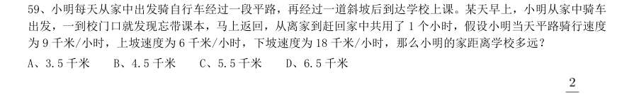

- **A.** 3.5 千米
- **B.** 4.5 千米
- **C.** 5.5 千米
- **D.** 6.5 千米

**答案：B**　**考点：行程问题｜环形与往返**　**难度：★★★☆☆**
**【数量关系·其他数量关系｜HB-2020-ty-X060】**

60. 甲、乙、丙三人去超市买了100 元的商品,如果甲付钱,那么甲剩下的钱是乙、丙两人钱数之和的 ;如 果乙付钱,则乙剩下的钱是甲、丙两人钱数之和的 ;如果丙付钱,丙用他的会员卡可享受9 折优惠,结果丙 剩下的钱是甲、乙两人钱数之和的 ;那么,甲、乙、丙三人开始时一共带了多少钱?

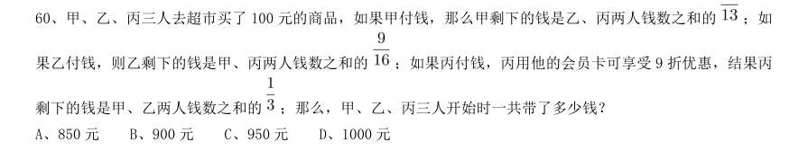

- **A.** 850 元
- **B.** 900 元
- **C.** 950 元
- **D.** 1000 元

**答案：A**　**考点：其他数量关系｜方程与不定方程**　**难度：★★★☆☆**
**【数量关系·概率问题｜HB-2020-ty-X061】**

61. 南部某战区一个10 人小分队里有6 人是特种兵,某次突击任务需派出5 人参战,若抽到3 名或3 名以上特 种兵可成功完成突击任务,那么成功完成突击任务的概率有多大?

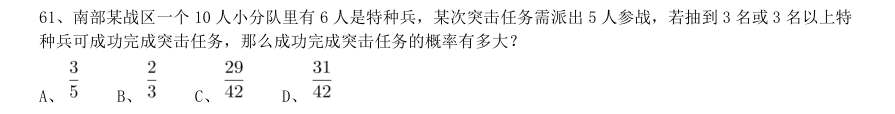

- **A.** 
- **B.** 
- **C.** 
- **D.** 

**答案：D**　**考点：概率问题｜摸球与抽取**　**难度：★★★★★**
**【数量关系·最值问题｜HB-2020-ty-X062】**

62. 某城市一条道路上有4 个十字路口,每个十字路口至少有一名交通协管员,现将8 个协管员名额分配到这4 个路口,则每个路口协管员名额的分配方案有:

- **A.** 35 种
- **B.** 70 种
- **C.** 96 种
- **D.** 114 种

**答案：A**　**考点：最值问题｜最值优化**　**难度：★★★★☆**
**【数量关系·最值问题｜HB-2020-ty-X063】**

63. 某篮球队共有九人,分三组举行三人制篮球赛,他们的球衣号码分别是从1 号到9 号,分组后发现三组的球 衣号码之和不同,且最大和是最小和的两倍。则各组号码之和不可能是下列哪个数?

- **A.** 10
- **B.** 11
- **C.** 12
- **D.** 13

**答案：D**　**考点：最值问题｜最值优化**　**难度：★★★★☆**
**【数量关系·最值问题｜HB-2020-ty-X064】**

64. 某电商平台每隔5 千米有一座仓库,共有

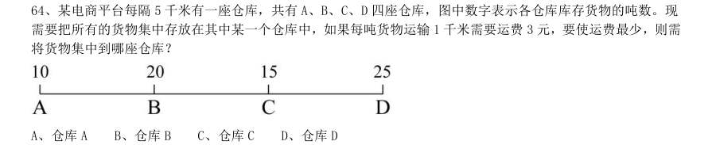

- **A.** 仓库A
- **B.** 仓库B
- **C.** 仓库C
- **D.** 仓库D

**答案：C**　**考点：最值问题｜最值优化**　**难度：★★★★☆**
**【数量关系·其他数量关系｜HB-2020-ty-X065】**

65. 小王在荡秋千,当秋千摆角为30°时,它摆到最高位置与最低位置的高度差为0.45 米。小王为寻求更大的 刺激感,将秋千摆角增加15°,则秋千能摆到的最高位置约上升了多少米?( , )

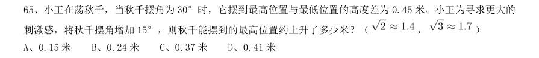

- **A.** 0.15 米
- **B.** 0.24 米
- **C.** 0.37 米
- **D.** 0.41 米

**答案：D**　**考点：其他数量关系｜方程与不定方程**　**难度：★★☆☆☆**
**【数量关系·几何问题｜HB-2020-ty-X066】**

66. 在屋内墙角处堆放稻谷(如图,谷堆为一个圆锥的四分之一),谷堆底部的弧长为6 米,高为2 米,经过一 夜发现谷堆在重力作用下底部的弧长变为8 米,若谷堆的谷量不变那么此时谷堆的高为:

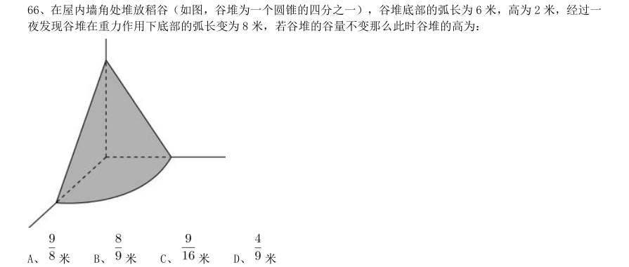

- **A.** 米
- **B.** 米
- **C.** 米
- **D.** 

**答案：A**　**考点：几何问题｜立体几何**　**难度：★★★★★**
**【数量关系·概率问题｜HB-2020-ty-X067】**

67. 某公司职员预约某快递员上午9 点30 分到10 点在公司大楼前取件,假设两人均在这段时间内到达,且在这 段时间到达的概率相等。约定先到者等后到者10 分钟,过时交易取消。快递员取件成功的概率为:

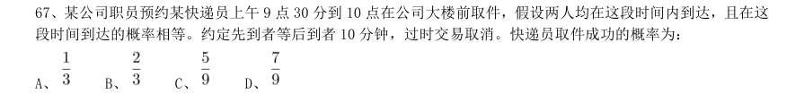

- **A.** 
- **B.** 
- **C.** 
- **D.** 

**答案：C**　**考点：概率问题｜摸球与抽取**　**难度：★★★★★**
**【数量关系·几何问题｜HB-2020-ty-X068】**

68. 村民陶某承包一块长方形种植地,他将地分割成如图所示的4 个小长方形,在

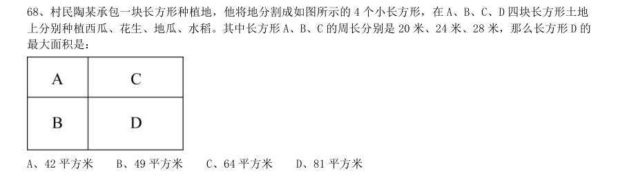

- **A.** 42 平方米
- **B.** 49 平方米
- **C.** 64 平方米
- **D.** 81 平方米

**答案：C**　**考点：几何问题｜平面几何**　**难度：★★★★☆**
**【数量关系·其他数量关系｜HB-2020-ty-X069】**

69. 甲乙丙丁四人通过手机的位置共享,发现乙在甲正南方向2 公里处,丙在乙北偏西60°方向2 公里处,丁 在甲北偏西75°方向。若丁与甲、丙的距离相等,则该距离为:

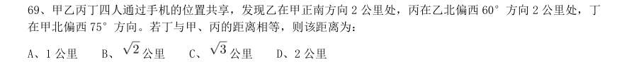

- **A.** 1 公里
- **B.** 公里
- **C.** 公里
- **D.** 2 公里

**答案：B**　**考点：其他数量关系｜和差倍比**　**难度：★☆☆☆☆**
**【数量关系·几何问题｜HB-2020-ty-X070】**

70. 野外生存需要用一个简易的圆锥型过滤器(如下图所示)装满溪水进行过滤。过滤器的底面直径为20 厘米, 高为6 厘米。问全部过滤完毕后,在不考虑损耗的情况下,可使底面半径为5 厘米,高为15 厘米圆柱型容器的 水面高度达到:

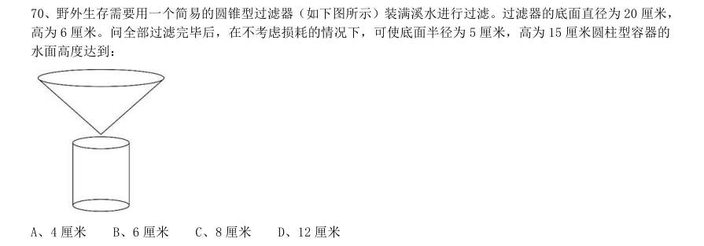

- **A.** 4 厘米
- **B.** 6 厘米
- **C.** 8 厘米
- **D.** 12 厘米

**答案：C**　**考点：几何问题｜立体几何**　**难度：★★★★★**
**【判断推理·图形推理｜HB-2020-ty-X071】**

71. 从所给的四个选项中,选择最合适 的一个填入问号处,使之呈现一定的规律性:

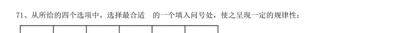

> （本题为图形题，选项为图片，见原卷）

**答案：C**　**考点：图形推理｜数量规律**　**难度：★★★☆☆**
**【判断推理·图形推理｜HB-2020-ty-X072】**

72. 从所给的四个选项中,选择最合适 的一个填入问号处,使之呈现一定的规律性:

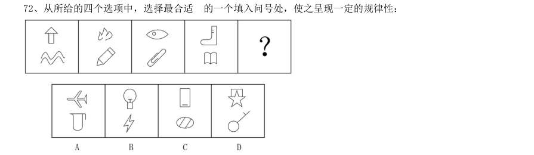

> （本题为图形题，选项为图片，见原卷）

**答案：D**　**考点：图形推理｜数量规律**　**难度：★★★☆☆**
**【判断推理·图形推理｜HB-2020-ty-X073】**

73. 把下面六个图形分为两类,使每一类图形都有各自的共同特征或规律,分类正确的一项是:

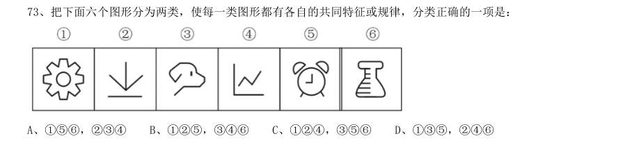

- **A.** 156,234
- **B.** 125,346
- **C.** 124,356
- **D.** 135,246

**答案：A**　**考点：图形推理｜数量规律**　**难度：★★★☆☆**
**【判断推理·图形推理｜HB-2020-ty-X074】**

74. 从所给的四个选项中,选择最合适的一个填入问号处,使之呈现一定的规律性:

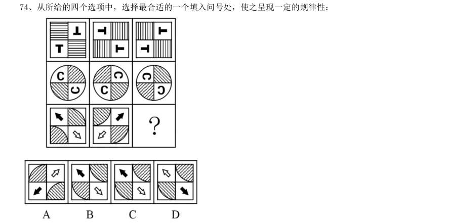

> （本题为图形题，选项为图片，见原卷）

**答案：C**　**考点：图形推理｜位置规律**　**难度：★★★☆☆**
**【判断推理·图形推理｜HB-2020-ty-X075】**

75. 正方体被切除部分后的造型如下图所示,其被切去部分的造型是:

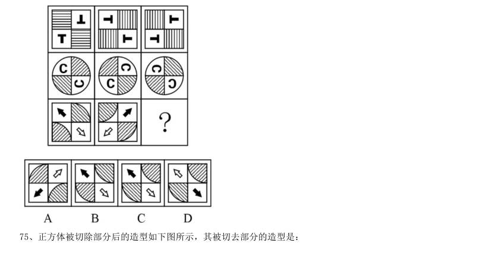

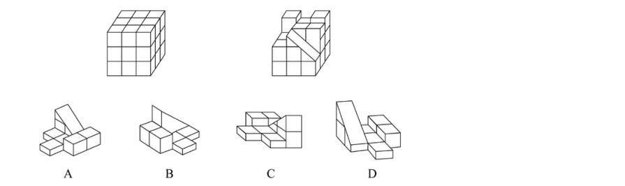

> （本题为图形题，选项为图片，见原卷）

**答案：C**　**考点：图形推理｜立体拼合**　**难度：★★★☆☆**
**【判断推理·定义判断｜HB-2020-ty-X076】**

76. 亲环境行为是指个体通过减少或消除自身活动对环境的负面影响以达到改善生态系统结构的行为。它的本质 是通过有效减轻环境问题实现环境改善,核心任务是构造环境稳态友好型的社会。 根据上述定义,下列选项属于亲环境行为的是:

- **A.** 植树造林
- **B.** 低碳出行
- **C.** 细水长流
- **D.** 围海造田

**答案：B**　**考点：定义判断｜单定义**　**难度：★★☆☆☆**
**【判断推理·定义判断｜HB-2020-ty-X077】**

77. 社会收缩是指人类聚落中人口持续流失,由此引发相应地区经济社会环境和文化在空间上的衰退这一过程。 根据收缩行为是否是聚落行为主体主动采取的规划策略或管理措施,可以分为主动社会收缩和被动社会收缩。 根据上述定义,下列选项属于主动社会收缩的是:

- **A.** 某市因疏解核心区功能导致城区人口下降
- **B.** 2019 年我国春运人口迁移规模近30 亿人次
- **C.** 某产煤大县因资源枯竭导致就业吸纳能力下降
- **D.** 某制造业基地因产业升级导致房屋空置率居高不下

**答案：A**　**考点：定义判断｜多定义**　**难度：★★☆☆☆**
**【判断推理·定义判断｜HB-2020-ty-X078】**

78. 侵蚀作用指风力、流水、冰川、波浪等外力在运动状态下改变地面岩石及其风化物的过程。侵蚀作用可分为 机械剥蚀作用和化学剥蚀作用。 根据上述定义,下列选项属于侵蚀作用的是:

- **A.** 裸露的人造雕像在长期的风吹日晒雨淋下,会出现机械剥蚀,甚至会出现崩塌碎裂
- **B.** 植物根部在岩缝中向岩石施加物理压力,并提供一个水及化学物的渗透渠道,造成岩石分解开裂
- **C.** 可溶性石灰岩在流水中部分溶解形成天然溶液而随水流失,造成岩体缩小甚至消失,形成岩溶地貌
- **D.** 在气温变化突出的地区,岩石中的水分冻融交替,冰冻时体积膨胀,像楔子插入岩体内,导致岩石崩碎

**答案：C**　**考点：定义判断｜单定义**　**难度：★★☆☆☆**
**【判断推理·定义判断｜HB-2020-ty-X079】**

79. 印象管理是指人试图控制他人对自己形成的印象的过程。一个人留给他人的印象表明了他人对其的知觉、评 价,甚至会使他人形成对其的特定应对方式。因而,为了给他人留下好的印象,得到他人好的评价与对待,人会 用一种给他人造成特定印象的方式来自我表现。印象管理的运用,尤其要避免某些表演崩溃,包括无意动作、不 合时宜的闯入、闹剧等。 根据上述定义,下列选项体现印象管理运用的是:

- **A.** 沙子龙在夜静人稀时,关好门,舞出一套断魂枪,微微一笑说:“不传不传”
- **B.** 许衡看到人们摘食路边的梨解渴,不为所动,说:“梨虽无主,而吾心有主”
- **C.** 一向沉静温柔的小美在毕业之际,承受不住与同学离别的感伤,突然嚎啕大哭
- **D.** 岳飞的母亲为了激励岳飞奋勇抗金,用针在其背上刺了四个字:“精忠报国”

**答案：B**　**考点：定义判断｜单定义**　**难度：★★★★☆**
**【判断推理·定义判断｜HB-2020-ty-X080】**

80. 疼痛共情的偏好性,是指个体对他人疼痛的感知、判断和情绪反应,总是由于个体与他人之间的亲疏远近关 系或情感认同程度不同而不同。 根据上述定义,下列没有体观疼痛共情的偏好性的是:

- **A.** 小明看到《西游记》里的白骨精被孙悟空打死,高兴得跳了起来
- **B.** 小张看到外来游客不幸溺水而死,从此再也不敢去那条河里游泳
- **C.** 小李在看歌剧《白毛女》时跳上戏台拉住喜儿,不让黄世仁抢走
- **D.** 小红听奶奶回忆自己在旧社会的苦日子时,禁不住潸然泪下

**答案：B**　**考点：定义判断｜单定义**　**难度：★★☆☆☆**
**【判断推理·定义判断｜HB-2020-ty-X081】**

81. 算法歧视是以算法为手段实施的歧视,主要指在大数据背景下、依靠机器计算的自动决策系统在对数据主体 做出决策分析时,由于数据和算法本身不具有中立性或者隐含错误、被人为操控等原因,对数据主体进行差别对 待,造成歧视性后果。 根据上述定义,下列属于算法歧视的是:

- **A.** 某新生班主任根据学生的入学成绩高低来安排他们的学号
- **B.** 某水果商家总是对长期参与团购的客户给予更低价格折扣
- **C.** 某信用评估平台通过用户的网络使用行为来判定其信用值
- **D.** 某招聘网站给男性推送高薪职位的广告次数是女性的6 倍

**答案：D**　**考点：定义判断｜单定义**　**难度：★★★☆☆**
**【判断推理·定义判断｜HB-2020-ty-X082】**

82. 积极强化是指用某种有吸引力的结果对某一行为进行奖励和肯定,以期在类似条件下重复这一行为。消极强 化是指在行为出现时把不愉快的刺激撤销或减少,这样也可以增加行为频率。 根据上述定义,下列选项属于积极强化的是:

- **A.** 君子一日三省其身
- **B.** 杀鸡骇猴以儆效尤
- **C.** 重赏之下必有勇夫
- **D.** 从轻发落戴罪立功

**答案：C**　**考点：定义判断｜多定义**　**难度：★★☆☆☆**
**【判断推理·定义判断｜HB-2020-ty-X083】**

83. 社会计算的内涵包括两个层面:一是社会的计算化,二是计算的社会化。社会的计算化是指通过人们在互联 网上留下的海量而且相互关联的数据足迹,对人们的社会活动进行追踪、检索、汇编、计量和运算。计算的社会 化则是指互联网创造了一种环境、一个平台,使人们能够广泛地参与计算过程,从而在数据的挖掘、分析和应用 等方面获得更高效率。 根据上述定义,下列现象符合计算的杜会化的是:

- **A.** 某购物平台根据用户购物经历,定期向用户推荐商品
- **B.** 某手机导航软件能为用户自动生成一个月来的行踪图
- **C.** 全班同学在暑假田野调查结束后合作制成精美的相册
- **D.** 小陈在众筹平台匿名捐款后,受助者上门送来感谢信

**答案：D**　**考点：定义判断｜多定义**　**难度：★★★☆☆**
**【判断推理·定义判断｜HB-2020-ty-X084】**

84. 外部性是指经济当事人的生产和消费行为对其它经济当事人的生产和消费行为施加的有益或者有害影响的效 应。正外部性是指某个经济行为个体的活动使他人或社会受益,而受益者无需花费代价。负外部性是指某个经济 行为个体的活动使他人或社会受损,而造成负外部性的人却没有为此承担成本。 根据上述定义,下列选项属于正外部性的是:

- **A.** 经过农田的蒸汽机车,喷出火花飞到农民种植的麦穗上
- **B.** 飞速行驶的火车尖锐的汽笛声吓跑在农田吃稻谷的小鸟
- **C.** 某工厂在村庄建起了扶贫车间,为村民就近就业提供便利
- **D.** 某工厂排出了大量废水和有害气体,给周围居民带来健康危害

**答案：C**　**考点：定义判断｜多定义**　**难度：★★★★☆**
**【判断推理·定义判断｜HB-2020-ty-X085】**

85. 错觉是完全不符合刺激本身特征的失真的或扭曲事实的知觉经验,生活中,凭知觉经验所作的解释显然是失 真的,甚至是错误的。幻觉是在没有相应的外界客观事物直接作用下发生的不真实感知。幻觉具有与真实知觉类 似的特点,但它是虚幻的。正常人在某些特殊的状态下,如强烈的情绪体验并伴有生动的想象、回忆,或期待的 心情、紧张的情绪,或处于催眠状态,都可能会出现幻觉。在入眠或醒觉状态的过程中,也会发生幻觉。 根据上述定义,下列属于幻觉的是:

- **A.** 杯弓有蛇影,草木疑皆兵
- **B.** 相看两不厌,唯有敬亭山
- **C.** 寝兴目存形,遗音犹在耳
- **D.** 蝉噪林逾静,鸟鸣山更幽

**答案：C**　**考点：定义判断｜多定义**　**难度：★★★☆☆**
**【判断推理·类比推理｜HB-2020-ty-X086】**

86. 牵牛花∶喇叭花

- **A.** 乞巧节∶七夕节
- **B.** 七巧板∶橡皮泥
- **C.** 人行道∶车行道
- **D.** 防腐剂∶添加剂

**答案：A**　**考点：类比推理｜逻辑关系**　**难度：★☆☆☆☆**
**【判断推理·类比推理｜HB-2020-ty-X087】**

87. 售后∶品控

- **A.** 数据∶科学
- **B.** 融资∶风投
- **C.** 龙骨∶地板
- **D.** 听证∶监管

**答案：D**　**考点：类比推理｜逻辑关系**　**难度：★☆☆☆☆**
**【判断推理·类比推理｜HB-2020-ty-X088】**

88. 鲜花∶塑料花

- **A.** 纸质书∶电子书
- **B.** 相片∶画像
- **C.** 原本∶复印本
- **D.** 钤章∶印泥

**答案：C**　**考点：类比推理｜逻辑关系**　**难度：★☆☆☆☆**
**【判断推理·类比推理｜HB-2020-ty-X089】**

89. 羊∶羊奶∶腥膻

- **A.** 蚕∶蚕丝∶雪白
- **B.** 蜘蛛∶蛛丝∶粘缚
- **C.** 蜂∶蜂蜜∶甘甜
- **D.** 雨燕∶燕窝∶营养

**答案：C**　**考点：类比推理｜对应关系**　**难度：★☆☆☆☆**
**【判断推理·类比推理｜HB-2020-ty-X090】**

90. 花∶牡丹∶玫瑰

- **A.** 茶∶红茶∶绿茶
- **B.** 草∶艾草∶蓼草
- **C.** 球∶足球∶绒球
- **D.** 车∶轿车∶客车

**答案：B**　**考点：类比推理｜逻辑关系**　**难度：★☆☆☆☆**
**【判断推理·类比推理｜HB-2020-ty-X091】**

91. 空运∶海运∶运输

- **A.** 平装∶精装∶装帧
- **B.** 货轮∶客轮∶邮轮
- **C.** 晚会∶聚会∶集会
- **D.** 试飞∶试航∶航天

**答案：A**　**考点：类比推理｜逻辑关系**　**难度：★☆☆☆☆**
**【判断推理·类比推理｜HB-2020-ty-X092】**

92. 初伏∶中伏∶末伏

- **A.** 火星∶木星∶土星
- **B.** 大雨∶小雨∶谷雨
- **C.** 上旬∶中旬∶下旬
- **D.** 大暑∶小暑∶处暑

**答案：C**　**考点：类比推理｜逻辑关系**　**难度：★☆☆☆☆**
**【判断推理·类比推理｜HB-2020-ty-X093】**

93. 十年寒窗∶悬梁刺股∶囊萤映雪

- **A.** 七月流火∶以荻画地∶临池学书
- **B.** 三月肉味∶蓝田种玉∶程门立雪
- **C.** 一寸光阴∶凿壁偷光∶闻鸡起舞
- **D.** 一日三秋∶卧薪尝胆∶铁杆磨针

**答案：C**　**考点：类比推理｜语义关系**　**难度：★☆☆☆☆**
**【判断推理·类比推理｜HB-2020-ty-X094】**

94. 了如指掌 对于 ( ) 相当于 ( ) 对于 坚固

- **A.** 知道;铁板一块
- **B.** 明白;坚不可摧
- **C.** 理解;铜墙铁壁
- **D.** 了解;固若金汤

**答案：D**　**考点：类比推理｜语义关系**　**难度：★☆☆☆☆**
**【判断推理·类比推理｜HB-2020-ty-X095】**

95. ( ) 对于 裁判 相当于 案件 对于 ( )

- **A.** 球员;法庭
- **B.** 黑哨;上诉
- **C.** 比赛;法官
- **D.** 比分;律师

**答案：C**　**考点：类比推理｜对应关系**　**难度：★☆☆☆☆**
**【判断推理·逻辑判断｜HB-2020-ty-X096】**

96. 越是身处浮华的地方,我们越是希望能遇到一块心灵栖息地。虽然我们生活在一个商业化社会,但书店仍然 是灵魂的慰藉之地。大到城市,小到商场,若能有一家文化味浓郁的书店,一定能让人们感受到不一样的氛围。 书店入驻商场,这不仅能给商场带来客流,也能提升商场的品位。以书店融合阅读、休闲和其他文化产品的类似 “文化商场”模式,更是可以在商场内部构建一个特别的文化链。 如果以上论断为真,则下列说法正确的是

- **A.** 城市让人们感受到不一样的氛围,是因为拥有文化味浓郁的书店
- **B.** 想要在商场内部构建一个特别的文化链,就不应忽视书店这一环
- **C.** 因为书店提升了商场的品味,所以书店给商场带来了客流
- **D.** 即便不是身处浮华的地方,我们也能遇到一块心灵栖息地

**答案：B**　**考点：逻辑判断｜归纳推导**　**难度：★★★★★**
**【判断推理·逻辑判断｜HB-2020-ty-X097】**

97. 在市场竞争十分激烈的时候,一个企业要是不激流勇进,创造出富有竞争力的产品,也不适时撤退、主动割 爱,放弃没有前景的市场,那么这个企业最后一定会陷入危机之中。 如果以上论断为真,下列说法正确的是:

- **A.** 某企业未能创造出富有竞争力的产品,最后一定会惨遭淘汰
- **B.** 某企业紧要关头急流勇退,转向其它市场,就可以避免危机
- **C.** 某企业放弃已显颓势的产业,转向新产品的开发,它可能不会被淘汰
- **D.** 某企业研发出了富有竞争力的产品,它最后一定不会陷入危机之中

**答案：C**　**考点：逻辑判断｜归纳推导**　**难度：★★★★★**
**【判断推理·逻辑判断｜HB-2020-ty-X098】**

98. 心理学家考察了450 位中年男性和女性,他们中有白领阶层,也有蓝领阶层;有技能判断型人群,也有决策 制定型人群。结果发现,那些身居重要职位的高管人士普遍比一般员工更胖。研究者认为,做出许多决定所承受 的压力通过饮食方式得到排解,这最终在一定程度上改变了高管人士之前的饮食习惯,如果你的职位幸运地得到 晋升,你将发现不仅是薪水变多,自己的腰围也在变粗,伴随着体重上升。 以下哪项如果为真,最能质疑上述结论?

- **A.** 比较而言,技能判断型人群腰围较小,决策制定型人群腰围较大
- **B.** 比较而言,身居要职的高管人士更难抽出时间投入锻炼以缩小腰围
- **C.** 每晋升一个工作等级,技能判断型人群的腰围平均会减少0.5 厘米
- **D.** 每晋升一个工作等级,决策制定型人群的腰围平均会增大0.28 厘米

**答案：B**　**考点：逻辑判断｜削弱**　**难度：★★★★★**
**【判断推理·逻辑判断｜HB-2020-ty-X099】**

99. 食品添加剂是现代食品工业的重要组成部分,按规定使用食品添加剂对人体无害,而且可以改善食品的品质, 起到防腐、保鲜的作用。正是因为有了食品添加剂的发展,才有了大量的方便食品,给人们的生活带来极大的便 利。如果不加入食品添加剂,大部分食品要么难看、难吃或难以保鲜,要么就是价格昂贵。 如果以下各项为真,最能支持上述结论的是:

- **A.** 食品添加剂和人类文明史一样悠久,例如点豆腐用的卤水
- **B.** 如果不使用添加剂,食品会因微生物作用而引起食物中毒
- **C.** 宣称无食品添加剂往往是商家迎合消费者心理造出的噱头
- **D.** 三聚氰胺也是一种添加剂,在水泥里能够作为高效减水剂

**答案：B**　**考点：逻辑判断｜加强**　**难度：★★★★★**
**【判断推理·逻辑判断｜HB-2020-ty-X100】**

100. 二氧化碳的排放量剧增导致全球气候变暖,使珠穆朗玛峰所在的喜马拉雅地区冰川正面临急剧缩小的危险。 研究显示,珠峰海拔在5000 米到6000 米的冰川集中区域出现冰川快速融化的现象,这些地方将只在冬季而不是 在温暖的季节时看到结冰。专家推论说,根据未来的气候变化趋势,喜马拉雅地区的冰川减少的速度还有可能加 快,如果本世纪内气温如预测的一样继续升高,该地区的冰川最终将消失殆尽。 如果以下各项为真,最能削弱上述论证的是:

- **A.** 喜马拉雅山冰川面积每年缩小约0.1%到0.6%
- **B.** 喜马拉雅山其他地方的冰川对气温变化不敏感
- **C.** 过去50 年珠峰周边冰川覆盖面积减少了33.3%
- **D.** 珠峰海拔7000 米以上的冰川没有快速融化迹象

**答案：D**　**考点：逻辑判断｜削弱**　**难度：★★★★★**
**【判断推理·逻辑判断｜HB-2020-ty-X101】**

101. 近年来,“类脑计算”从理念走向实践,正走出一条制造类人智能的新途径。所谓“类脑计算”,是指仿 真、模拟和借鉴大脑神经系统结构和信息处理过程的装置,模型和方法,其目标是制造类脑计算机。然而有人提 出质疑:大脑奥秘尚未揭示,我们还不了解智能背后的基本原理,怎么能制造出具有“大脑智能”的类脑计算机 呢? 以下哪项如果为真,最能反驳上述质疑?

- **A.** 类脑计算机的器件速度是生物神经元和突触的百万倍,一旦产生智能,后果难以预料
- **B.** 关于“类脑计算”的伦理制度和风险评估等必须与“类脑计算”的技术发明同步展开
- **C.** 揭示大脑奥秘和发明类脑计算机是相互作用的复杂过程,不是“前者决定后者”的简单关系
- **D.** 国内已经启动集合各高校、科研机构和企业优势研究力量的10 多项“类脑计算”研究项目

**答案：C**　**考点：逻辑判断｜削弱**　**难度：★★★★★**
**【判断推理·逻辑判断｜HB-2020-ty-X102】**

102. 地球表面的大部分都被海洋覆盖,生命也诞生于海洋之中。然而,据估计,地球有80%的物种生活在陆地 上,而海洋中仅为15%, 剩下的5%生活在淡水中。研究者认为,陆地栖息地的物理布局相对海洋可能更加支离 破碎,是导致陆地物种更加多样化的主要原因之一。 以下哪项如果为真,最能加强上述研究者的观点?

- **A.** 地球表面可分成热带、南温带、北温带、南寒带、北寒带五个温度带,各温度带物种差异性大,种类丰富
- **B.** 深海相对于有阳光照射的浅海岸地区而言,基本上像个冰箱,而且门已经关上很久,物种远不如浅海丰富
- **C.** 根据某群岛记录显示,随着时间推移,自然选择甚至可以把两个岛屿上相同物种的不同族群变成截然不同的物种
- **D.** 森林覆盖许多陆地,而树叶和枝干形成新的生态环境,海洋中的珊瑚也起同样作用,但覆盖海底的面积没那

**答案：C**　**考点：逻辑判断｜加强**　**难度：★★★★★**
**【判断推理·逻辑判断｜HB-2020-ty-X103】**

103. 肌萎缩侧索硬化症(ALS),俗称“渐冻症”。某科研团队研究发现,ALS 的疾病发展与肠道微生物AM 菌 的数量密切相关。研究人员观察和比较了37 名ALS 患者及29 名健康亲属的肠道菌群和血液、脑脊液样本。他们 发现肠道细菌菌株有差异,其中有一种菌株与烟酰胺的产生有关。此外,在这些ALS 患者的血液和脑脊液中,烟 酰胺水平有所下降。 若要上述研究发现成立,需要补充的前提是:

- **A.** 人类肠道中的微生物非常复杂
- **B.** 烟酰胺是肠道微生物AM 菌的代谢物
- **C.** 小鼠补充烟酸胺后,ALS 症状得到了减轻
- **D.** 人体肠道细菌的变化与ALS 的疾病发展速度有关

**答案：B**　**考点：逻辑判断｜加强**　**难度：★★★★★**
**【判断推理·逻辑判断｜HB-2020-ty-X104】**

104. 一项心理学研究认为,出身经济层次最低家庭的人中年后出现代谢综合征的比例最高,无论他们获得多大 成就都是如此。该研究同时发现代谢综合征虽与童年生活状况有关,但该群体中那些拥有慈母的人不容易出现该 综合征。究其原因,慈母具有同情心,会告诉孩子如何应对压力并鼓励他们健康饮食,保持良好生活方式。因此, 我们在现实中可以设计一套方案,指导母亲教育孩子如何应对压力、健康生活和掌控命运。 由此可以推出:

- **A.** 设计针对母亲的指导方案,有助于降低特定群体出现代谢综合征的比例
- **B.** 因为缺少母爱,出身经济层次最低家庭的人出现代谢综合征的比例最高
- **C.** 因为父亲不教导孩子保持良好生活方式,所以父亲对孩子的健康没影响
- **D.** 出身经济层次最低家庭的人,童年如受到慈母呵护,中年后身体很健康

**答案：A**　**考点：逻辑判断｜归纳推导**　**难度：★★★★★**
**【判断推理·逻辑判断｜HB-2020-ty-X105】**

105. 地球距离火星最近约为5500 万公里,最远则超过4 亿公里,只有地球与火星夹角为70°时发射探测器才 能如期抵达火星,因此,我国预计在2020 年发射火星探测器,次年登陆火星,一位航天专家对此评论道:“如 果不能抓住2020 年这个机会,那么,下一次合适的发射时间至少要推迟到2022 年之后。” 上述专家的评论若要成立,需要补充的前提是:

- **A.** 火星探测器发射后,需要经过不少于7 个月的飞行,才能抵达火星轨道
- **B.** 我国需于2020 年发射火星探测器,才能尽快缩小与西方航天大国的差距
- **C.** 地球与火星的相对近点约每15 年出现一次,二者距离近的年份是登陆火星的最佳时机
- **D.** 发射火星探测器须等到地球和火星形成一定夹角,而这个机会每隔26 个月才出现一次

**答案：D**　**考点：逻辑判断｜加强**　**难度：★★★★★**
**【资料分析·综合分析｜HB-2020-ty-X106】**

106. 截至2017 年底,中国人工智能市场规模约为:

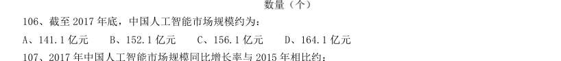

- **A.** 141.1 亿元
- **B.** 152.1 亿元
- **C.** 156.1 亿元
- **D.** 164.1 亿元

**答案：B**　**考点：综合分析｜选正确项**　**难度：★★★★☆**
**【资料分析·增长率计算与比较｜HB-2020-ty-X107】**

107. 2017 年中国人工智能市场规模同比增长率与2015 年相比约:

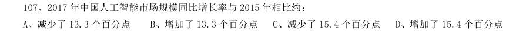

- **A.** 减少了13.3 个百分点
- **B.** 增加了13.3 个百分点
- **C.** 减少了15.4 个百分点
- **D.** 增加了15.4 个百分点

**答案：暂缺**　**考点：增长率计算与比较｜增长率计算**　**难度：★★☆☆☆**
**【资料分析·增长率计算与比较｜HB-2020-ty-X108】**

108. 若按照2018 年同比增长率,到2019 年底中国人工智能市场规模约为:

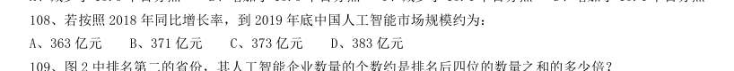

- **A.** 363 亿元
- **B.** 371 亿元
- **C.** 373 亿元
- **D.** 383 亿元

**答案：暂缺**　**考点：增长率计算与比较｜增长率计算**　**难度：★★☆☆☆**
**【资料分析·倍数计算｜HB-2020-ty-X109】**

109. 图2 中排名第二的省份,其人工智能企业数量的个数约是排名后四位的数量之和的多少倍?

- **A.** 11.3
- **B.** 12.3
- **C.** 12.8
- **D.** 13.3

**答案：暂缺**　**考点：倍数计算｜是几倍**　**难度：★★☆☆☆**
**【资料分析·综合分析｜HB-2020-ty-X110】**

110. 下列说法正确的是:

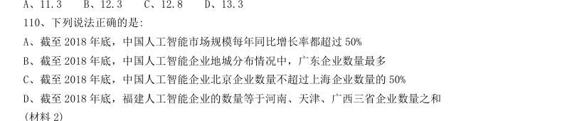

- **A.** 截至2018 年底,中国人工智能市场规模每年同比增长率都超过50%
- **B.** 截至2018 年底,中国人工智能企业地城分布情况中,广东企业数量最多
- **C.** 截至2018 年底,中国人工智能企业北京企业数量不超过上海企业数量的50%
- **D.** 截至2018 年底,福建人工智能企业的数量等于河南、天津、广西三省企业数量之和

**答案：暂缺**　**考点：综合分析｜选正确项**　**难度：★★★★★**
**【资料分析·综合分析｜HB-2020-ty-X111】**
> 材料：2019 年5 月,全国12358 价格监管平台受理价格举报、投诉、咨询共计37576 件,同比下降40.70%,环比 下降9.31%。

111. 其中,价格举报4192 件,环比下降19.06%;价格投诉2059 件,环比下降15.92%;价格咨询31325 件,环比下降7.34%。平台受理量排名前十的省份依次是北京(5786 件)、江苏(3528 件)、上海(2499 件)、 重庆(2486 件)、河南(2469 件)、陕西(2440 件)、浙江(2321 件)、天津(1571 件)、福建(1483 件)、 广西(1309 件)。平台受理量行业分布如下表所示: 2019 年4 月,平台受理的价格咨询比价格举报约多:

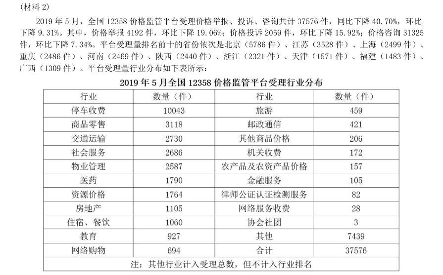

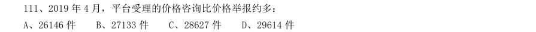

- **A.** 26146 件
- **B.** 27133 件
- **C.** 28627 件
- **D.** 29614 件

**答案：暂缺**　**考点：综合分析｜排序与图示判断**　**难度：★★★★★**
**【资料分析·倍数计算｜HB-2020-ty-X112】**

112. 2019 年5 月,平台受理量排名第二的省份约是排名第九的省份的多少倍?

> 材料图见 images/HB-2020-ty-X111-m.jpg

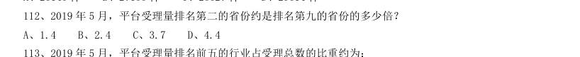

- **A.** 1.4
- **B.** 2.4
- **C.** 3.7
- **D.** 4.4

**答案：暂缺**　**考点：倍数计算｜是几倍**　**难度：★★☆☆☆**
**【资料分析·比重计算与比较｜HB-2020-ty-X113】**

113. 2019 年5 月,平台受理量排名前五的行业占受理总数的比重约为:

> 材料图见 images/HB-2020-ty-X111-m.jpg

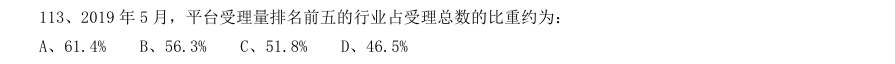

- **A.** 61.4%
- **B.** 56.3%
- **C.** 51.8%
- **D.** 46.5%

**答案：暂缺**　**考点：比重计算与比较｜现期比重**　**难度：★★☆☆☆**
**【资料分析·增长率计算与比较｜HB-2020-ty-X114】**

114. 2019 年5 月,邮政通信行业的受理量比房地产业约少:

> 材料图见 images/HB-2020-ty-X111-m.jpg

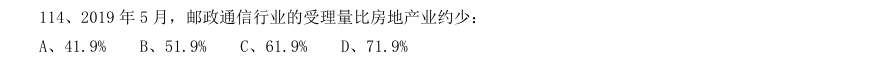

- **A.** 41.9%
- **B.** 51.9%
- **C.** 61.9%
- **D.** 71.9%

**答案：暂缺**　**考点：增长率计算与比较｜增长率计算（综合）**　**难度：★★☆☆☆**
**【资料分析·综合分析｜HB-2020-ty-X115】**

115. 能够从上述资料推出的是:

> 材料图见 images/HB-2020-ty-X111-m.jpg

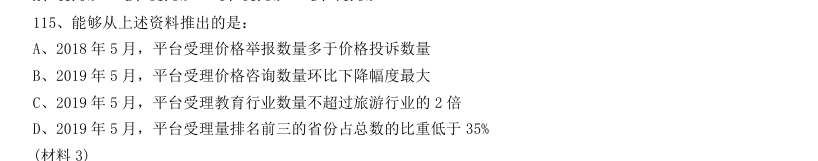

- **A.** 2018 年5 月,平台受理价格举报数量多于价格投诉数量
- **B.** 2019 年5 月,平台受理价格咨询数量环比下降幅度最大
- **C.** 2019 年5 月,平台受理教育行业数量不超过旅游行业的2 倍
- **D.** 2019 年5 月,平台受理量排名前三的省份占总数的比重低于35%

**答案：暂缺**　**考点：综合分析｜综合分析（综合）**　**难度：★★★★★**
**【资料分析·比重计算与比较｜HB-2020-ty-X116】**

116. 2016 年,A 市直接经济价值年值占现代农业生态服务价值年值的比重为:

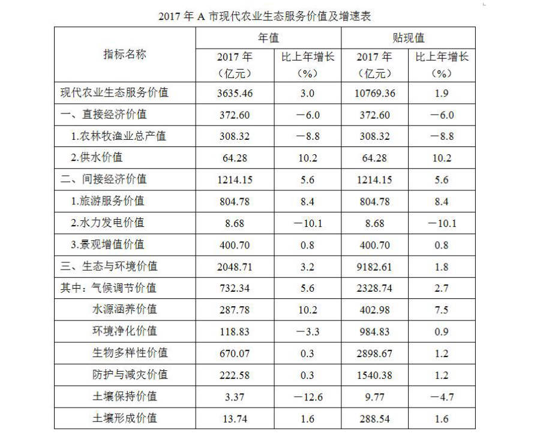

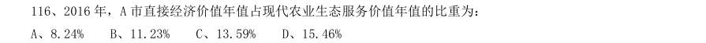

- **A.** 8.24%
- **B.** 11.23%
- **C.** 13.59%
- **D.** 15.46%

**答案：暂缺**　**考点：比重计算与比较｜现期比重**　**难度：★★☆☆☆**
**【资料分析·比重计算与比较｜HB-2020-ty-X117】**

117. 能够正确描述2017 年A 市间接经济价值年值中三个指标占比的统计图是:

> 材料图见 images/HB-2020-ty-X116-m.jpg

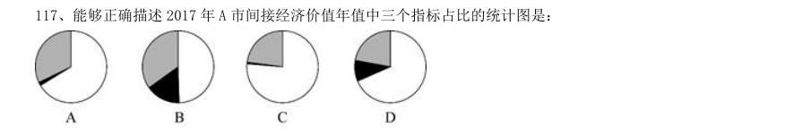

> （本题为图形题，选项为图片，见原卷）

**答案：暂缺**　**考点：比重计算与比较｜现期比重**　**难度：★★☆☆☆**
**【资料分析·综合分析｜HB-2020-ty-X118】**

118. 2016 年,A 市旅游服务价值年值比农林牧渔业总产值年值多:

> 材料图见 images/HB-2020-ty-X116-m.jpg

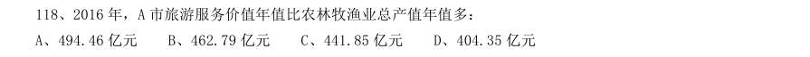

- **A.** 494.46 亿元
- **B.** 462.79 亿元
- **C.** 441.85 亿元
- **D.** 404.35 亿元

**答案：暂缺**　**考点：综合分析｜综合分析（综合）**　**难度：★★★★☆**
**【资料分析·年均增长率｜HB-2020-ty-X119】**

119. 2017 年A 市生态与环境价值中,年值、贴现值较上年均有所上升的指标有:

> 材料图见 images/HB-2020-ty-X116-m.jpg

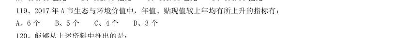

- **A.** 6 个
- **B.** 5 个
- **C.** 4 个
- **D.** 3 个

**答案：暂缺**　**考点：年均增长率｜年均增长率计算**　**难度：★★☆☆☆**
**【资料分析·综合分析｜HB-2020-ty-X120】**

120. 能够从上述资料中推出的是:

> 材料图见 images/HB-2020-ty-X116-m.jpg

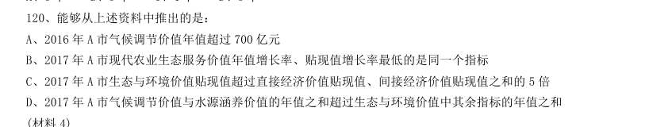

- **A.** 2016 年A 市气候调节价值年值超过700 亿元
- **B.** 2017 年A 市现代农业生态服务价值年值增长率、贴现值增长率最低的是同一个指标
- **C.** 2017 年A 市生态与环境价值贴现值超过直接经济价值贴现值、间接经济价值贴现值之和的5 倍
- **D.** 2017 年A 市气候调节价值与水源涵养价值的年值之和超过生态与环境价值中其余指标的年值之和

**答案：暂缺**　**考点：综合分析｜综合分析（综合）**　**难度：★★★★★**
**【资料分析·综合分析｜HB-2020-ty-X121】**
> 材料：2019 年6 月,全国发行地方政府债券8996 亿元,同比增长68.37%,环比增长195.63%。其中,发行一般债 券3178 亿元,同比减少28.33%,环比增长117.08%,发行专项债券5818 亿元,同比增长540.04%,环比增长 268.46%;按用途划分,发行新增债券7170 亿元,同比增长127.11%,环比增长332.71%,发行置换债券和再融 资债券1826 亿元,同比减少16.47%,环比增长31.75%。 2019 年6 月,地方政府债券平均发行期限11.1 年,其中新增债券10.4 年,置换债券和再融资债券13.4 年; 地方政府债券平均发行利率3.55%,其中新增债券3.52%,置换债券和再融资债券3.65%。 2019 年1 至6 月,全国发行地方政府债券28372 亿元,同比增长101.09%。其中,发行一般债券12858 亿 元,同比增长23.21%,

121. 2019 年1 至6 月,地方政府债券平均发行期限9.3 年,其中一般债券11.2 年,专项债券7.8 年;地方政府 债券平均发行利率3.47%,其中一般债券3.53%,专项债券3.43%。 2019 年全国地方政府债务限额为240774.3 亿元。其中,一般债务限额133089.22 亿元,专项债务限额 107685.08 亿元。截至2019 年6 月末,全国地方政府债务余额205477 亿元,其中,一般债务118397 亿元,专 项债务87080 亿元。 2019 年6 月,全国发行的地方政府债券比2018 年6 月多约:

> 材料图见 images/HB-2020-ty-X116-m.jpg

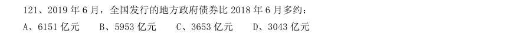

- **A.** 6151 亿元
- **B.** 5953 亿元
- **C.** 3653 亿元
- **D.** 3043 亿元

**答案：暂缺**　**考点：综合分析｜综合分析（综合）**　**难度：★★★★★**
**【资料分析·综合分析｜HB-2020-ty-X122】**

122. 2018 年1 至5 月,全国发行地方政府债券约:

> 材料图见 images/HB-2020-ty-X116-m.jpg

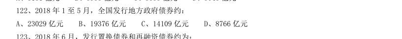

- **A.** 23029 亿元
- **B.** 19376 亿元
- **C.** 14109 亿元
- **D.** 8766 亿元

**答案：暂缺**　**考点：综合分析｜综合分析（综合）**　**难度：★★★★☆**
**【资料分析·综合分析｜HB-2020-ty-X123】**

123. 2018 年6 月,发行置换债券和再融资债券约为:

> 材料图见 images/HB-2020-ty-X116-m.jpg

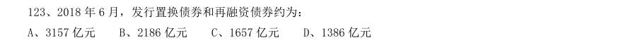

- **A.** 3157 亿元
- **B.** 2186 亿元
- **C.** 1657 亿元
- **D.** 1386 亿元

**答案：暂缺**　**考点：综合分析｜综合分析（综合）**　**难度：★★★★☆**
**【资料分析·综合分析｜HB-2020-ty-X124】**

124. 2019 年1 至6 月,全国发行地方政府债券同比增量绝对值排序正确的是:

> 材料图见 images/HB-2020-ty-X116-m.jpg

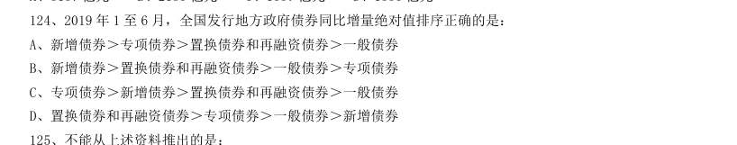

- **A.** 新增债券>专项债券>置换债券和再融资债券>一般债券
- **B.** 新增债券>置换债券和再融资债券>一般债券>专项债券
- **C.** 专项债券>新增债券>置换债券和再融资债券>一般债券
- **D.** 置换债券和再融资债券>专项债券>一般债券>新增债券

**答案：暂缺**　**考点：综合分析｜排序与图示判断**　**难度：★★★★★**
**【资料分析·综合分析｜HB-2020-ty-X125】**

125. 不能从上述资料推出的是:

> 材料图见 images/HB-2020-ty-X116-m.jpg

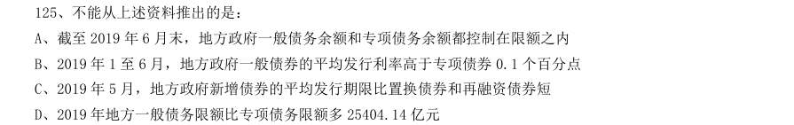

- **A.** 截至2019 年6 月末,地方政府一般债务余额和专项债务余额都控制在限额之内
- **B.** 2019 年1 至6 月,地方政府一般债券的平均发行利率高于专项债券0.1 个百分点
- **C.** 2019 年5 月,地方政府新增债券的平均发行期限比置换债券和再融资债券短
- **D.** 2019 年地方一般债务限额比专项债务限额多25404.14 亿元

**答案：暂缺**　**考点：综合分析｜综合分析（综合）**　**难度：★★★★★**