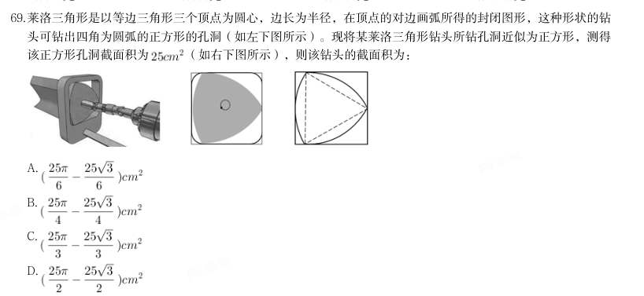
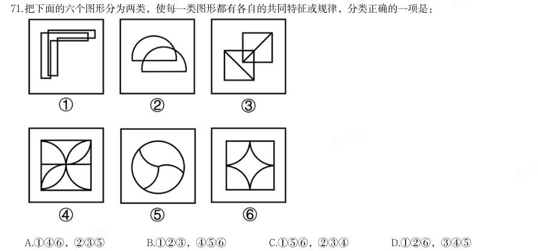
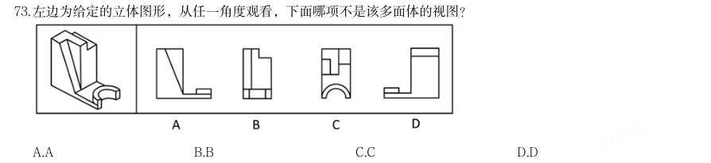
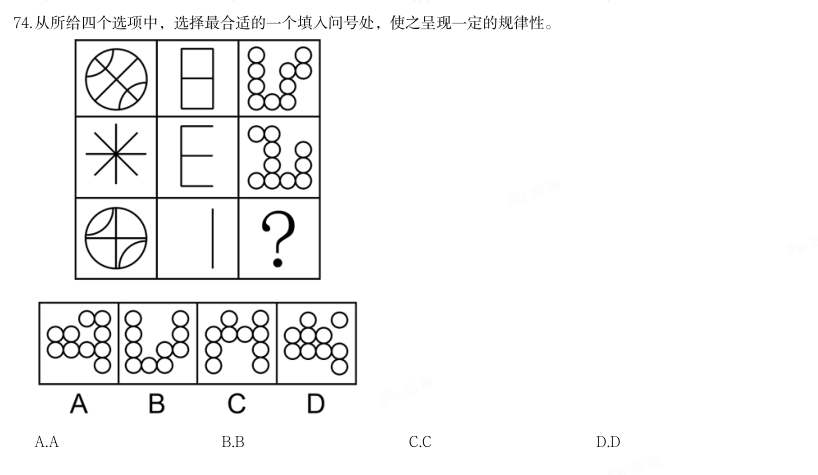
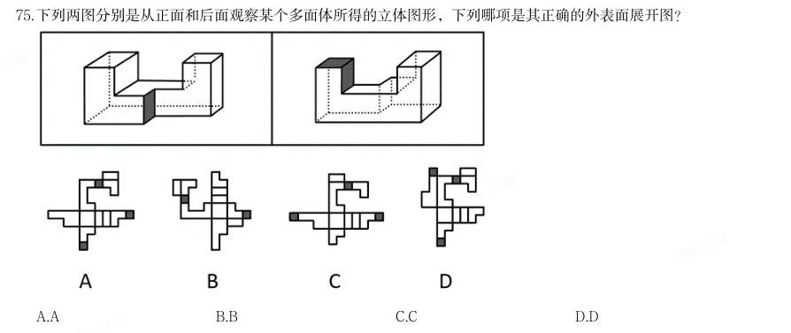
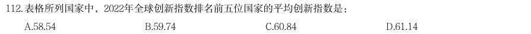
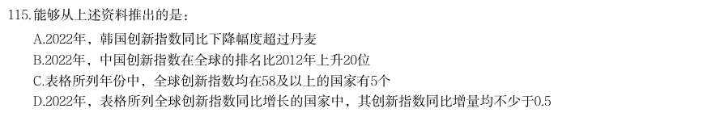
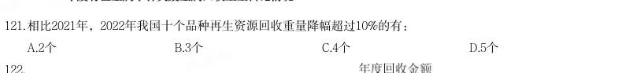
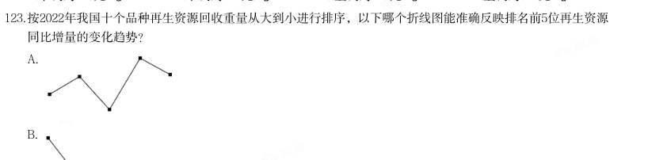
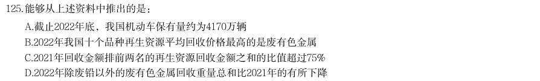

# 2024 年湖北行测（统一卷）

- 题量：125（含答案 125）
- 模块分布：资料分析20 / 数量关系15 / 言语理解35 / 判断推理35 / 常识判断20
- 试卷编号：`湖北-2024-统一卷`

## 题目与答案

**【常识判断·时事政治｜HB-2024-ty-X001】**

1. 习近平新时代中国特色社会主义思想是当代中国马克思主义、21世纪马克思主义。下列对此理解正确的有几 项: 1党的十九大把习近平新时代中国特色社会主义思想确立为党必须长期坚持的指导思想并庄严地写入党章 2习近平新时代中国特色社会主义思想是马克思主义中国化最新成果,是当今时代最现实、最鲜活的马克思主 义 3今天我们所处的时代同马克思所处的时代相比发生了巨大而深刻的变化,已经脱离了马克思主义所指明的历 史时代 4习近平新时代中国特色社会主义思想,始终把马克思主义作为中国共产党人的“真经”,始终坚持马克思主 义基本原理

- **A.** 1项
- **B.** 2项
- **C.** 3项
- **D.** 4项

**答案：C**　**考点：时事政治｜时政热点**
**【常识判断·地理常识｜HB-2024-ty-X002】**

2. 2023年,《习近平著作选读》第一卷、第二卷出版发行,这是党和国家政治生活中的一件大事。下列著作内容 和篇名对应正确的是:

- **A.** 生态环境是关系党的使命宗旨的重大政治问题,也是关系民生的重大社会问题——《加强生态文明建设必须坚持的原则》
- **B.** 做好新形势下宣传思想工作,必须自觉承担起举旗帜、聚民心、育新人、兴文化、展形象的使命任务——《开展党史学习教育要突出重点》
- **C.** 我们说的共同富裕是全体人民共同富裕,是人民群众物质生活和精神生活都富裕,不是少数人的富裕,也不是整齐划一的平均主义——《在全国脱贫攻坚总结表彰大会上的讲话》
- **D.** “两个维护”要体现在坚决贯彻党中央决策部署的行动上,体现在履职尽责、做好本职工作的实效上,体现

**答案：A**　**考点：地理常识｜世界地理**
**【常识判断·法律常识｜HB-2024-ty-X003】**

3. 在党员、干部的日常言行上——《不断提高政治判断力、政治领悟力、政治执行力》 习近平总书记强调,要坚定维护宪法权威和尊严,推动宪法完善和发展,更好发挥宪法在治国理政中的重要作 用。下列有关表述正确的有几项: 1要加强宪法理论研究和宣传教育,坚持知识普及、理论阐释、观念引导全面发力 2加快完善以宪法为核心的中国特色社会主义法律体系,不断提高宪法实施和监督水平 3坚持宪法确定的中国共产党领导地位不动摇,坚持宪法确定的人民民主专政的国体和人民代表大会制度的政 体不动摇 4宪法是治国安邦的总章程,是我们党治国理政的根本法律依据,是国家政治和社会生活的最高法律规范

- **A.** 1项
- **B.** 2项
- **C.** 3项
- **D.** 4项

**答案：D**　**考点：法律常识｜宪法**
**【常识判断·科技常识｜HB-2024-ty-X004】**

4. 党的十八大以来,习近平总书记始终高度重视“三农”工作,把解决好“三农”问题作为全党工作的重中之 重。下列关于《中共中央国务院关于做好2023年全面推进乡村振兴重点工作的意见》中的举措,表述正确的 是: 1把永久基本农田全部建成高标准农田 2树立大食物观,加快构建多元化食物供给体系 3发展现代设施农业,鼓励地方对设施农业建设给予信贷贴息 4深化东西部劳务协作,实施防止返贫就业攻坚行动,确保脱贫劳动力就业规模稳定在3000万人以上 5严格耕地占补平衡管理,实行部门联合开展补充耕地验收评定和“市县审核、省级复核、社会监督”机制

- **A.** 12345
- **B.** 1234
- **C.** 235
- **D.** 2345

**答案：D**　**考点：科技常识｜科技常识（综合）**
**【常识判断·时事政治｜HB-2024-ty-X005】**

5. 党的二十大报告提出,在社会基层坚持和发展新时代“枫桥经验”,完善正确处理新形势下人民内部矛盾机 制,及时把矛盾纠纷化解在基层、化解在萌芽状态。下列关于新时代“枫桥经验”的表述不正确的是:

- **A.** 党建引领是新时代“枫桥经验”的政治灵魂
- **B.** 人民主体是新时代“枫桥经验”的核心价值
- **C.** 新时代“枫桥经验”是以制度现代化为优先价值导向的基层治理现代化经验
- **D.** 新时代“枫桥经验”主要内容是变群众上访为领导下访,深入基层,联系群众,真下真访民情,实心实意办

**答案：D**　**考点：时事政治｜政策文件**
**【常识判断·法律常识｜HB-2024-ty-X006】**

6. 事 党的十八大以来,以习近平同志为核心的党中央始终把未成年人工作摆在突出位置。2024年1月1日起施行的 《未成年人网络保护条例》是我国第一部针对未成年人网络保护的专门性综合立法,是贯彻落实习近平法治思 想的生动体现。下列关于该条例内容表述正确的有几项? 1国家教育部门负责统筹协调未成年人网络保护工作 2网络产品和服务提供者不得为未成年人提供游戏账号租售服务 3网络产品和服务提供者不得通过自动化决策方式向未成年人进行商业营销 4网络直播服务提供者应当建立网络直播发布者真实身份信息动态核验机制 5网络服务提供者可根据实际引导未成年人参与应援集资、投票打榜、刷量控评等网络活动

- **A.** 2项
- **B.** 3项
- **C.** 4项
- **D.** 5项

**答案：B**　**考点：法律常识｜法律常识（综合）**
**【常识判断·经济常识｜HB-2024-ty-X007】**

7. 在2023年12月召开的中央经济工作会议上,习近平总书记全面总结2023年经济工作,深刻分析当前经济形势, 系统部署2024年经济工作。下列关于做好2024年经济工作的要求,表述正确的有: 1强化宏观政策逆周期和跨周期调节 2坚持稳中求进、以进促稳、先立后破 3积极的财政政策要适度加力、提质增效 4稳健的货币政策要灵活适度、精准有效

- **A.** 12
- **B.** 123
- **C.** 234
- **D.** 1234

**答案：D**　**考点：经济常识｜宏观经济**
**【常识判断·法律常识｜HB-2024-ty-X008】**

8. 《中华人民共和国法律援助法》对于规范和促进法律援助工作、保障公民和有关当事人合法权益具有重大意 义。下列情况属于可经指派获得法律援助的是: 115岁的学生小明涉嫌贩卖毒品,没有委托辩护人 225岁的精神病人赵某涉嫌抢劫,其患病多年经济困难,没有委托辩护人 335岁的村民张某因向村中水井投毒,可能被判处死刑,没有委托辩护人 445岁的聋哑人李某创设公司后涉嫌逃税罪,其个人资产过亿,没有委托辩护人

- **A.** 123
- **B.** 234
- **C.** 134
- **D.** 1234

**答案：D**　**考点：法律常识｜法律常识（综合）**
**【常识判断·地理常识｜HB-2024-ty-X009】**

9. 根据中共中央、国务院2023年3月印发的《党和国家机构改革方案》,下列关于本次改革方案的表述错误的 是:

- **A.** 证券业之外的金融业监管由国家金融监督管理总局统一负责
- **B.** 统筹数字资源整合共享和开发利用,是国家数据局的职责之一
- **C.** 在农业农村部加挂国家乡村振兴局牌子,不再保留单设的国家乡村振兴局
- **D.** 将工业和信息化部的国家高新技术产业开发区等科技园区建设职责划入科学技术部

**答案：D**　**考点：地理常识｜世界地理**
**【常识判断·历史人文｜HB-2024-ty-X010】**

10. 戏曲是中华优秀传统文化的重要组成部分,下列有关说法错误的是:

- **A.** 京剧、豫剧、评剧、黄梅戏、越剧是中国戏剧五大剧种
- **B.** 《群英会》是依据《水浒传》改编的传统京剧
- **C.** 黄梅戏代表剧目中有《天仙配》和《女驸马》
- **D.** 豫剧与梆子腔关系紧密

**答案：B**　**考点：历史人文｜文学与文化**
**【常识判断·政治常识｜HB-2024-ty-X011】**

11. 小明被困在一个无人、无食物来源但有淡水的荒岛上。假如他在等待救援期间可以从相同重量的葡萄、馒头、 酸奶、花生仁这四种食物中选择一种,那么为了能在岛上生存的时间最长,他应该选择的食物是( )。

- **A.** 葡萄
- **B.** 馒头
- **C.** 酸奶
- **D.** 花生仁

**答案：D**　**考点：政治常识｜政治常识（综合）**
**【常识判断·政治常识｜HB-2024-ty-X012】**

12. 下列病毒与其主要感染的人体系统对应正确的是:

- **A.** 狂犬病毒——免疫系统
- **B.** 流感病毒——神经系统
- **C.** 乙肝病毒——消化系统
- **D.** 艾滋病毒——生殖系统

**答案：C**　**考点：政治常识｜政治常识（综合）**
**【常识判断·历史人文｜HB-2024-ty-X013】**

13. 瑟是我国古代一种弦乐器,弦发出的音与弦的粗细和张力有关。我国古代这方面的经验积累相当早,文献记载 也很多,以下选项没有体现这一原理的是:

- **A.** 《礼记·乐记》:清庙之瑟,朱弦而疏越,壹倡而三叹,有遗音者也
- **B.** 《韩非子·外储说左下》:夫瑟以小弦为大声,以大弦为小声
- **C.** 《月令章句》:瑟前其柱则清,却其柱则浊
- **D.** 《春诸纪闻》:缓其商弦,与宫同音

**答案：A**　**考点：历史人文｜中国古代史**
**【常识判断·政治常识｜HB-2024-ty-X014】**

14. 唐代是丝绸之路的鼎盛时期,当时丝绸之路上的商队可能携带的商品是:

- **A.** 线装本的《史记》
- **B.** 精心制作的宣德炉
- **C.** 《司马温公神道碑》拓片
- **D.** 鎏金工艺制作的莲瓣银茶托

**答案：D**　**考点：政治常识｜政治常识（综合）**
**【常识判断·历史人文｜HB-2024-ty-X015】**

15. 《礼记·曲礼》有言:“男子二十冠而字。”古人名与字的含义通常有一定关联,或相同相近,或相关相辅, 或相反相成,下列历史人物名与字的对应关系与其他三项不同的是:

- **A.** 曹丕,字子桓
- **B.** 周瑜,字公瑾
- **C.** 杜甫,字子美
- **D.** 朱熹,字元晦

**答案：D**　**考点：历史人文｜中国古代史**
**【常识判断·政治常识｜HB-2024-ty-X016】**

16. 讲述宋史时,“燕云十六州”是绕不开的话题,下列有关叙述不正确的是:

- **A.** 周世宗柴荣北伐时收复了部分州
- **B.** 澶渊之盟正式将燕云十六州割让给辽国
- **C.** 高梁河之战使北宋失去了完全收复燕云十六州的时机
- **D.** 燕云十六州是我国北方以幽州和云州为中心的十六个州

**答案：B**　**考点：政治常识｜政治常识（综合）**
**【常识判断·经济常识｜HB-2024-ty-X017】**

17. 下列关于贷款市场报价利率(LPR)说法错误的是:

- **A.** 目前LPR只有1年期和5年期以上两个期限品种
- **B.** 当LPR下降后,商业性个人住房贷款的最新一期月供也会下降
- **C.** LPR是由中国人民银行授权全国银行间同业拆借中心计算并公布的基础性的贷款参考利率
- **D.** 新发放的商业性个人住房贷款利率是以最近一个月相应期限的贷款市场报价利率为定价基准加点形成

**答案：B**　**考点：经济常识｜宏观经济**
**【常识判断·政治常识｜HB-2024-ty-X018】**

18. 下列关于国债逆回购的说法正确的是:

- **A.** 投资者可以通过银行网点购买国债逆回购
- **B.** 国债逆回购是以国家为主体进行债券回购
- **C.** 国债逆回购本质上是一种短期资金借贷方式
- **D.** 国债逆回购利率上行20个基点表示利率增加2%

**答案：C**　**考点：政治常识｜政治常识（综合）**
**【常识判断·经济常识｜HB-2024-ty-X019】**

19. 宝石是用于装饰的、有经济价值的矿物及生物矿物和岩石的总称,呈现晶体、集合体等形态,是地球送给人类 的珍贵礼物。下列不属于宝石形成机制的是( )。

- **A.** 由炽热岩浆喷发所生成的熔岩蒸汽冷凝产生
- **B.** 岩浆冷却凝固时浓缩的成分结晶后形成
- **C.** 在地核内部高温高压变质瘤结成型
- **D.** 从岩浆产生的热液中结晶生长

**答案：C**　**考点：经济常识｜经济常识（综合）**
**【常识判断·科技常识｜HB-2024-ty-X020】**

20. 酶是具有高度特异性和高度催化效能的生物催化剂,在人类的生产生活中具有重要的应用。以下有关酶的添加 应用对应错误的是( )。

- **A.** 白酒——淀粉酶
- **B.** 果汁——纤维素酶
- **C.** 脱脂奶——乳糖酶
- **D.** 加酶洗衣粉——蛋白酶

**答案：C**　**考点：科技常识｜基础科学**
**【言语理解·逻辑填空｜HB-2024-ty-X021】**
> 材料：的答案。 数字社会中,用户已经离不开各种必须的应用软件,一些应用软件虽然是在用户知情的前提下收集用户个人信 息,但很多时候用户都是被逼无奈地同意。比如,下载App后,要么同意其收集自己的个人信息,要么放弃注

21. 册使用。这种貌似 的“二选一”,实际上是通过霸王条款限制了用户的选择自由。

- **A.** 均等
- **B.** 自由
- **C.** 恰当
- **D.** 公平

**答案：B**　**考点：逻辑填空｜逻辑填空（综合）**
**【言语理解·逻辑填空｜HB-2024-ty-X022】**

22. 面对北宋王朝百余年的积贫积弱,怀“回天转地”之气概、视“天下大治”为己任的王安石,从“继道而 行”“以道求治”的哲学立场和政治观念出发,借论周公之政畅抒其立法施治的观点,其 显然不仅仅是治 必有法,而更在于强调治须“良法”。 填入划横线部分最恰当的一项是:

- **A.** 缘由
- **B.** 动机
- **C.** 设想
- **D.** 意图

**答案：D**　**考点：逻辑填空｜一空**
**【言语理解·逻辑填空｜HB-2024-ty-X023】**

23. 音乐诗画《听此青绿——乐咏千里江山》以十三幅 图景展现传世名画《千里江山图》中的景观和风情,借 鉴《高山流水》《渔舟唱晚》《梅花三弄》等古曲的艺术表达,融合编钟、箜篌、筑等民族乐器和西洋铜管 乐,加入绘画、书法、意境化舞蹈等表现方式,为千山万壑、江河交错的盛景注入 而深邃、浑厚而轻盈的 悠远神韵。 依次填入划横线部分最恰当的一项是:

- **A.** 壮丽 磅礴
- **B.** 华丽 壮阔
- **C.** 宏伟 清雅
- **D.** 绮丽 恢宏

**答案：A**　**考点：逻辑填空｜一空**
**【言语理解·逻辑填空｜HB-2024-ty-X024】**

24. 金秋时节,五彩斑斓的丰收画卷在广袤大地徐徐展开。14亿人的饭碗,依赖有限耕地上的产出,良种的重要性 不言而喻。“种地不选种,累死落个空”“好种多打粮”“千算万算,不如良种合算”······一句 句 而直白的农谚,道出一粒小小的种子如何承载粮食安全这“国之大者”。当良种与土地相遇,丰收的希 望便开始____。 依次填入画横线部分最恰当的一项是:

- **A.** 质朴 发酵
- **B.** 朴实 滋生
- **C.** 俭朴 点燃
- **D.** 朴素 孕育

**答案：D**　**考点：逻辑填空｜一空**
**【言语理解·逻辑填空｜HB-2024-ty-X025】**

25. 湿地被誉为“地球之肾”,和森林、海洋一起,构成了地球的三大生态系统,它在净化水质、 水源、调节 气候、 生物多样性等方面,具有不可替代的生态价值。 依次填入划横线部分最恰当的一项是:

- **A.** 滋养 维持
- **B.** 涵养 维护
- **C.** 保护 衡量
- **D.** 充沛 助力

**答案：B**　**考点：逻辑填空｜一空**
**【言语理解·逻辑填空｜HB-2024-ty-X026】**

26. 党的十八大以来,经过艰苦卓绝的努力,我们打赢了人类历史上最大规模脱贫攻坚战;经济总量从54万亿元提 升到114万亿元,占世界经济的比重从11.3%提升到18.5%;港珠澳大桥通车 ,北斗卫星导航系统全面开 通,第三艘航空母舰下水······一个个改天换地的创举,一件件惊天动地的大事,谱写了时代变迁 的 乐章,拓展了历史前行的宽阔航道。 依次填入划横线部分最恰当的一项是:

- **A.** 运行 宽宏
- **B.** 运营 恢宏
- **C.** 运转 宏伟
- **D.** 运载 宏大

**答案：B**　**考点：逻辑填空｜一空**
**【言语理解·逻辑填空｜HB-2024-ty-X027】**

27. 中华民族的历史是各民族共同创造的。其间汉族的发展也是因为有其他民族 、 而不断进步。汉族人口 多,原本是由许多少数民族混血形成的,故汉族的贡献也包含了许多少数民族的贡献。 依次填入划横线部分最恰当的一项是:

- **A.** 参加 融合
- **B.** 参与 融入
- **C.** 汇合 创造
- **D.** 凝聚 交融

**答案：B**　**考点：逻辑填空｜一空**
**【言语理解·逻辑填空｜HB-2024-ty-X028】**

28. 在当今世界,科学家利用基因编辑技术,为“复活”灭绝物种 了生态修复的新途径,但挽救濒危物种,保 护生物多样性才是核心要义,人类需要采取组合措施来遏制和 生物多样性丧失的严峻形势。 依次填入划横线部分最恰当的一项是:

- **A.** 发明 拯救
- **B.** 开拓 扭转
- **C.** 发现 抢救
- **D.** 开辟 缓解

**答案：B**　**考点：逻辑填空｜一空**
**【言语理解·逻辑填空｜HB-2024-ty-X029】**
> 材料：我国已经形成了相对完善的中药质量标准控制体系, 了中药材源头种植到终端产品流通的各个环节。医院 积极利用现代制药新技术 了传统医院中药制剂的给药剂型和给药方法,走科学化的特色制剂发展方式,满 足群众多元化用药需求。

29. 依次填入划横线部分最恰当的一项是:

- **A.** 包揽 改革
- **B.** 蕴涵 改换
- **C.** 涵盖 改变
- **D.** 囊括 改成

**答案：C**　**考点：逻辑填空｜一空**
**【言语理解·逻辑填空｜HB-2024-ty-X030】**

30. 据介绍,光学产品的装配和调试,直接影响成像效果。高精密复杂光学系统对性能有严苛的要求,不仅要实现 狭小空间内超精密光学镜片的精密装调,还需 光学系统的稳定性。高精密复杂光学系统的装配和调试,往 往靠经验丰富的匠人 精密仪器完成,存在装调难度大、周期长、制造加工一致性差等问题。 依次填入划横线部分最恰当的一项是:

- **A.** 维持 制作
- **B.** 确保 配合
- **C.** 保持 组合
- **D.** 确认 搭配

**答案：B**　**考点：逻辑填空｜一空**
**【言语理解·逻辑填空｜HB-2024-ty-X031】**

31. 20世纪下半叶兴起的信息通信技术等高新科技,有两个明显特征:一是与每个人的日常生活 ,无人能须 臾脱离高新科技的影响;二是高新科技发展速度 ,科技风险随之增加且难以预测。科技创新活动一旦脱 靶,将造成不可逆的负面影响甚至巨大灾难。为此,需努力控制科技伦理问题的出现,避免被动治理局面。 依次填入画横线部分最恰当的一项是:

- **A.** 休戚与共 惊人
- **B.** 如影随形 迅速
- **C.** 息息相关 迅猛
- **D.** 一脉相连 飞快

**答案：C**　**考点：逻辑填空｜一空**
**【言语理解·逻辑填空｜HB-2024-ty-X032】**

32. 短视频已成为互联网的底层应用。某研究报告显示,目前我国短视频用户有10.12亿,青年是绝对主力军。作为 互联网原住民一代,青年会被短视频“集体 ”并不奇怪:“短” 了信息时代消费内容快餐化的需求, 而“视觉化”带来的生动直观、即时满足等特点, 了对年青一代沉浸式体验的“注意力抓取”。 依次填入画横线部分最恰当的一项是:

- **A.** 攻陷 迎合 实现
- **B.** 攻陷 满足 弥补
- **C.** 沦陷 逢迎 达成
- **D.** 沦陷 契合 兑现

**答案：A**　**考点：逻辑填空｜一空**
**【言语理解·逻辑填空｜HB-2024-ty-X033】**

33. 暗物质,一种在物质起源和宇宙 过程中具有重要地位的物质,约占整个宇宙物质质量的85%。但它看不 见、摸不着,几乎不和任何物体发生作用。为了捕捉到这 又“腼腆”的暗物质,21世纪以来,国际上 开展了20多个探测实验。人们相信,谁先揭开它的面纱,谁就将促成人类对物质世界和宇宙认识的又一次重 大飞跃。 依次填入画横线部分最恰当的一项是:

- **A.** 蜕变 严肃 持续
- **B.** 演化 神秘 相继
- **C.** 运动 神奇 广泛
- **D.** 膨胀 冷酷 及时

**答案：B**　**考点：逻辑填空｜一空**
**【言语理解·逻辑填空｜HB-2024-ty-X034】**

34. “巴赫金对话”理论的概念经过西方社会学的发展,被 成一种克服现代性危机、重构认同与共同体的有效 手段。具体到政治传播的 里,强调政府与公众的“垂直对话”,其本质是政府紧密围绕民生民意与社会需 求,通过及时的信息公开 不确定性,弥合不同意见并最终确认共同价值的手段。 依次填入划横线部分最恰当的一项是:

- **A.** 推演 领域 消灭
- **B.** 演绎 语境 消弭
- **C.** 论证 情境 消损
- **D.** 归纳 环境 消解

**答案：B**　**考点：逻辑填空｜一空**
**【言语理解·逻辑填空｜HB-2024-ty-X035】**

35. 中国汉字经历岁月洗礼, ,如今已发展出成熟而多样的字体系统。随着科学技术的 ,激光照排技术 替代活字印刷,让汉字的传播方式发生了革命性变化,而数字媒体的 使汉字字体的设计迎来了质的飞跃。 当我们以全新的视角重新审视汉字时,会发现其创新的设计方法如万花筒般千姿百态、绚丽多彩。 依次填入划横线部分最恰当的一项是:

- **A.** 久久为功 提升 创新
- **B.** 历久弥新 增长 融合
- **C.** 薪火相传 更迭 介入
- **D.** 厚积薄发 普及 应用

**答案：C**　**考点：逻辑填空｜一空**
**【言语理解·逻辑填空｜HB-2024-ty-X036】**

36. 历史上的关羽之所以经历由人到神的 跃升,从根本上讲,是因为他的道德品行和人格气质满足了不同时代 价值信仰重构的精神需求,即在关公身上蕴含着中华优秀文化 的核心价值。那么这种核心价值是什么? 主张刚、毅、直、俭者有之,认为孝、悌、忠、信者有之,可谓众说多歧, 。 依次填入画横线部分最恰当的一项是:

- **A.** 提高 一脉相承 鞭辟入里
- **B.** 擢拔 一以贯之 莫衷一是
- **C.** 提携 一如既往 各执一词
- **D.** 擢用 自始至终 众口难调

**答案：B**　**考点：逻辑填空｜一空**
**【言语理解·中心理解｜HB-2024-ty-X037】**

37. 到2030年,我国数字人整体市场规模将达2700亿元。数字人应用的多元拓展,得益于我国数字技术的不断进步 和产业布局的持续完善。我国数字人产业上下游均已具备一定规模的企业集群,有较深厚的技术积累。看上 游,成像设备产品已发展成熟,智能传感器等关键技术正被集中攻坚;看下游,应用领域加速从文娱行业向制 造业、现代服务业延伸。同时,数字人产品制作企业高速发展、相关服务平台正加快打造,数字人制作水平明 显提升,数字人产业将加快走向成熟。 对这段文字理解不正确的是:

- **A.** 数字人应用场景将更为广泛
- **B.** 目前数字人产业仍处在成长期
- **C.** 我国数字人市场发展前景良好
- **D.** 智能传感器等关键技术已有重大突破

**答案：D**　**考点：中心理解｜中心理解（综合）**
**【言语理解·中心理解｜HB-2024-ty-X038】**

38. 伴随着城市化快速发展的步伐,今天的少年儿童与乡土田园渐行渐远。如何开展既符合时代特色又“接地 气”的耕读教育?这道“考题”,考验的是学校与教师勇于创新的意识、因地制宜的本领。很多学校意识 到:“耕”离不开土地和自然,“读”重在学习广博有趣的各类知识、涵养自强不息的人格品德、树立报效国 家的崇高志气。于是,越来越多的学生被老师们带到原野田间,越来越多的课堂开设在了大自然里。学生们饶 有兴致地学习农耕知识、活泼健朗地舒展心胸情怀,耕读教育的真正意义由此得以实现。 对这段文字概括最恰当的一项是:

- **A.** 耕读为本计之久远
- **B.** 古为今用耕读传家
- **C.** 劳动教育能够激发内生动力
- **D.** 在“土味”课堂实现耕读教育的价值

**答案：D**　**考点：中心理解｜中心句与主旨**
**【言语理解·中心理解｜HB-2024-ty-X039】**

39. 2012年至2021年,国家知识产权局累计授权发明专利395.3万件,年均增长13.8%,累计注册商标3556.3万件, 年均增长25.5%。累计评出中国专利金奖310项,获奖项目新增销售额超过2.5万亿元,我国知识产权使用费进出 口总额累计2.19万亿元,年均增长13.7%,其中出口年均增长31.2%。超过进口增速近20个百分点。知识产权有 力支撑了创新型经济、品牌经济、区域特色经济和开放型经济发展。 这段文字旨在说明:

- **A.** 知识产权运用的效益快速增长
- **B.** 知识产权助力优化营商环境
- **C.** 知识产权创新专利的数量上升
- **D.** 知识产权国际合作持续深化

**答案：A**　**考点：中心理解｜中心句与主旨**
**【言语理解·中心理解｜HB-2024-ty-X040】**

40. 冰冻圈主要分布在地球两极和中低纬度的高山地区,在气候系统和气候变化中扮演着重要角色。极地温度对于 全球的影响力也许比我们想象中要大得多。可以说,极地温度就像一个遥控器,控制着地球上其他地方的“恒 定”温度。卫星数据显示,北极的浮冰正在加速消融、减少。冰越来越少,意味着地球能够反射到太空的阳光 变少了,也意味着更多深海海水被暴露出来去吸收阳光而变暖,地球会变得更暖,冰会融化得更快,而且很难 恢复,如此往复,会放大全球的温度变化情况。 与这段文字的意思相符的一项是:

- **A.** 极地和高山地区地表上存在多年冰体
- **B.** 极地温度决定着地球上其他地方的温度
- **C.** 北极冰冻圈的加速融化会导致全球变暖
- **D.** 极地冰冻圈的融化速度慢于中低纬度高山冰冻圈

**答案：C**　**考点：中心理解｜中心句与主旨**
**【言语理解·中心理解｜HB-2024-ty-X041】**

41. 如今无论什么季节,任何水果都能随时买回家尝鲜,很多人对此并不赞同,理由是反季水果的种植过程中总会 有不利于健康的因素,因此他们在选购水果的时候,会侧重购买当季、当地产的水果。但是,果蔬中是否存在 不利于健康的因素,与自然栽种还是大棚栽种没有必然联系。随着现代化农业技术的推广应用,大棚栽种水果 技术越来越成熟,所有的保鲜剂、食品添加剂、植物生长调节剂,只要是国家相关标准允许使用的,且在规定 的用量下,对人体健康是没有危害的。 这段文字旨在说明:

- **A.** 人们倾向于购买当季当地产的水果
- **B.** 反季水果在种植过程中会产生不利于健康的因素
- **C.** 水果是否存在不利于健康的因素与栽种方式的选择无关
- **D.** 应加强现代农业技术的推广应用,减少添加剂对健康的危害

**答案：C**　**考点：中心理解｜转折与因果**
**【言语理解·标题填入｜HB-2024-ty-X042】**

42. 神经科学领域已有研究揭示脑衰老的分子、细胞、器官、系统多层级多种生物学特征,它们相互依赖、彼此互 为联系,共同构成脑衰老特征及其发生机制的复杂性。此外,该领域新技术和新方法的应用也使研究内容得到 极大丰富与发展。在对抗衰老过程中维持脑健康及其功能,是一项挑战,运动可以通过改善脑衰老的生物学特 征及生理功能,促进脑的可塑性。因此,临床实践中运动干预可作为补充策略,改善衰老人群及相关慢性疾病 患者的脑健康。 最适合做这段文字标题的是:

- **A.** 运动促进脑生长:加强认知与记忆
- **B.** 运动干预脑衰老:新进展与再认识
- **C.** 运动改变脑结构:挑战性与安全性
- **D.** 运动影响脑健康:运动疗法有前景

**答案：B**　**考点：标题填入｜标题填入**
**【言语理解·中心理解｜HB-2024-ty-X043】**

43. 新农人,不同于传统农民,也异于新型职业农民,他们多是从城市回流农村的新群体。如果说过去大部分年轻 人以跳出农门为奋斗目标之一的话,近年来,跳回农门正在成为新时尚。新农人带来了新技术、新商业模式和 运营理念,创造了新的就业机会和空间,丰富并拓展了农村经济业态。但在现实中,新农人融入农村社会网 络,激活产业网络并没有那么容易。不少人虽然在物理意义上返乡回乡了,但在社会关系上仍是“异乡人”。 正如不少调研所显示的,新农人不了解农村,不知道如何与农民打交道,难以有效嵌入当地产业网络开展分工 合作。 这段文字主要说明了:

- **A.** 新农人,回得去并不等于融得进
- **B.** 新农人需补短板,否则创业难成
- **C.** 新农人具备新理念,掌握新技术
- **D.** 时代呼唤更多新农人回农村创业

**答案：A**　**考点：中心理解｜中心句与主旨**
**【言语理解·逻辑填空｜HB-2024-ty-X044】**

44. 元素周期表是化学科学的基石,在化学发展史上具有里程碑意义。作为元素周期表中的“住户”,元素的发现 几乎与人类文明相伴。像铁、铜、金、银等容易以单质形态存在的元素发现得最早,之后从铁器时代到青铜时 代,从炼金术到电解技术,从核辐射到核裂变, ,新“住户”不断占据各自的位置。直至今日,仍 然有新的元素被发现(合成),而且关于元素在生命起源、物种进化中的作用以及元素如何精准调控材料性能 及生命过程等仍然是科学家们非常关注的科学问题。 填入划横线处最恰当的一句是:

- **A.** 元素周期表逐步被填充并扩展
- **B.** 元素周期表被有序地组织起来
- **C.** 元素周期表得到较完美的呈现
- **D.** 元素在周期表不同行列排列着

**答案：A**　**考点：逻辑填空｜一空**
**【言语理解·下文推断｜HB-2024-ty-X045】**

45. 目前,学术界对数字经济在促进乡村产业振兴中的实际作用方面已有一定研究,但对数字经济影响乡村产业振 兴的内在机制等尚缺乏系统的理论阐释,由此可能夸大或弱化数字经济在乡村产业振兴中的作用,甚至有可能 导致政策制定的偏差。因此,我们拟在厘清数字经济对乡村产业振兴的关键作用基础上,从效率提升、产业变 革、结构优化三个角度剖析数字经济促进乡村产业振兴的内在机制,并立足现实提出相应的实现路径。 这段文字接下来最可能介绍:

- **A.** 数字经济促进乡村产业振兴的方法
- **B.** 数字经济对乡村产业振兴的关键作用
- **C.** 数字经济如何使乡村产业振兴的效率得以提升
- **D.** 借助数字经济促进乡村产业振兴的过程中有哪些现实制约

**答案：B**　**考点：下文推断｜下文推断**
**【言语理解·中心理解｜HB-2024-ty-X046】**

46. 碳纤维是由有机纤维经过一系列热处理转化而成,含碳量高于90%的无机高性能纤维,是一种力学性能优异的 新材料,其比重不到钢的五分之一。碳纤维树脂复合材料抗拉强度是钢的7至9倍,还具有出色的耐热性、优秀 的抗腐蚀性与抗辐射性。以碳为主要原料,以碳纤维复合材料、石墨烯等为核心的新一代复合材料是21世纪最 具应用前景的新材料,可应用于飞机结构材料、人工韧带等身体代用材料以及火箭外壳、工业机器人等领域, 但碳纤维复合材料发展也面临着高质量树脂基材缺乏等发展瓶颈问题。 根据这段文字,下列说法正确的是:

- **A.** 碳纤维是一种含碳量高的有机纤维
- **B.** 碳正成为21世纪的主导型先进材料
- **C.** 碳纤维树脂复合材料的抗拉强度优于钢
- **D.** 碳纤维树脂复合材料是一种最耐热且最坚硬的材料

**答案：C**　**考点：中心理解｜主题词**
**【言语理解·逻辑填空｜HB-2024-ty-X047】**

47. 长期以来,我们将沙质土壤景观统称为“沙漠”,常与荒凉、沙尘暴等相联系,甚至认为是地球的皮肤癌。但 事实上,“山水林田湖草沙”是生命共同体。沙地依靠渗入地下深处的土壤水分,长出了稀疏的乔木、各类灌 木及草本,形成了疏林草原、灌丛草原景观, 。其生物多样性——如毛乌素沙地是鄂尔多斯高原植 物与动物集中分布区,几乎涵盖了鄂尔多斯全部物种。但毕竟受降水限制,大部分沙地土壤水分尚未达到较密 的森林生长的基本水分要求,但局部水分条件较好的地区亦有分布。沙漠同样如此,特别是沙漠湖泊湿地,是 沙漠区宝贵的生物资源宝库。 填入划横线部分最恰当的一句是:

- **A.** 也具有重要的生态价值
- **B.** 形成重要的防风固沙屏障带
- **C.** 构成了自然生态系统必不可少的要素
- **D.** 其生物多样性往往高于同地带植被区

**答案：D**　**考点：逻辑填空｜一空**
**【言语理解·中心理解｜HB-2024-ty-X048】**

48. “医疗美容”是指运用手术、药物、医疗器械以及其他具有创伤性或者侵入性的医学技术方法对人的容貌和人 体各部位形态进行的修复与再塑。这个行业在迅速发展的同时,也出现了许多乱象。一些地方医疗美容机构制 售假劣“水光针”“整形用注射填充物”等美容针剂、违规使用“热玛吉”“光治疗”等医疗美容设备,导致 医美事故频发,甚至出现非法从业、虚假宣传、借“医美贷”实施诈骗等违法犯罪行为,给消费者身心带来巨 大伤害。 这段话主要介绍的是:

- **A.** 医美行业发展迅速
- **B.** 医美行业事故频发
- **C.** 医美行业虚假宣传
- **D.** 医美行业乱象丛生

**答案：D**　**考点：中心理解｜中心句与主旨**
**【言语理解·语句填入｜HB-2024-ty-X049】**

49. 经济活动的可持续性和相关金融资产的价值依赖于生物多样性和环境提供的生态系统服务。与气候变化类似, 生物多样性丧失也是本世纪面临的最大危机之一。导致环境恶化和气候变化的罪魁祸首是大量不考虑环境影 响、破坏生物多样性、只顾赚钱的投资活动。因此, 。 填入划横线部分最恰当的一句是:

- **A.** 在保护生物多样性方面金融业有着不可推卸的责任
- **B.** 人类将面临气候变化和生物多样性丧失的巨大危机
- **C.** 应逐步建立对金融机构管理的监管框架和稳定机制
- **D.** 导致环境恶化的根本原因是大量经济活动的可持续性

**答案：A**　**考点：语句填入｜语句填入**
**【言语理解·中心理解｜HB-2024-ty-X050】**

50. 实践是人的思维方式得以形成的最切近的现实基础,人的思维方式是实践的要素、结构、过程、程序、规律的 观念反映,是实践方式的内化与积淀。没有实践活动,也就没有思维方式或思维结构。而思维方式或思维结构 一经形成,又成为人们进行认知活动、评价活动和实践活动的思维的框架、定势、模式、取向。实践方式作为 由实践的各种要素、活动构成的实践逻辑,经过实践的无数次的重复,逐步扬弃了具体实践活动的个别性、特 殊性与偶然性而具备了一般性、普遍性与必然性,人类实践也逐渐趋向稳定、成熟并形成了相对稳定的模式。 与这段文字的意思相符的一项是:

- **A.** 实践即是一种思维方式
- **B.** 思维即是一种实践方式
- **C.** 实践方式形成思维方式
- **D.** 思维方式形成实践方式

**答案：C**　**考点：中心理解｜中心理解（综合）**
**【言语理解·中心理解｜HB-2024-ty-X051】**

51. 从古到今,人类不断梦想着能够找到长生不老的“灵丹妙药”,但目前也未有合法批准的能够真正用于抵抗衰 老的药物或疗法。以干细胞抗衰老疗法为例,由于具有自我更新和多向分化能力,干细胞在组织再生等领域具 有良好的应用潜力,也被宣传为延缓衰老的有力武器。然而科研人员提醒,虽然干细胞疗法在动物实验中表现 出一定的治疗效果,但对于人类而言,还需要等待临床试验结果。衰老是机体在整体水平上的系统性变化,不 是单一组织的变化,干细胞目前还无法同时针对所有组织细胞发挥治疗或起到延缓衰老的作用。 这段文字意在强调:

- **A.** 采用干细胞疗法抵抗衰老大有可为
- **B.** 干细胞治疗用于延缓衰老还有许多问题
- **C.** 从古到今人类为延缓衰老进行了各种尝试
- **D.** 当前干细胞的抗衰老研究仍处于实验探索阶段

**答案：D**　**考点：中心理解｜对策优先**
**【言语理解·下文推断｜HB-2024-ty-X052】**

52. 文化遗产保护体系,是针对与保护对象有关的内部、外部考察范围,所确定的定性、定量、定形态的科学研究 体系,也是一个发展着的动态体系。伴随着人类社会价值观念的演变,有关文化遗产资源的观念也不断发生变 化,对文化多样性和生物多样性的尊重必然更加突出,文化遗产的外延种类和评价体系也必然不断丰富。 接下来最有可能介绍:

- **A.** 要重视文化遗产的保护方向
- **B.** 要建立新的文化遗产资源观
- **C.** 要将更多文化遗产资源纳入保护范畴
- **D.** 在着力保护文化遗产物质载体的同时,还要重视发掘和保存非物质文化遗产

**答案：B**　**考点：下文推断｜下文推断**
**【言语理解·语句排序｜HB-2024-ty-X053】**

53. 将下列6个句子重新排列,语序正确的是: 1数字战“疫”成效显著,各级政府和有关企业借助数字技术进行疫情防控 2新冠肺炎疫情暴发以来,数字技术、数字经济在支持抗击疫情、经济复苏、复工复产、稳定就业等方面发挥 了重要作用 3电子商务从业人员规模超过6000万,新业态、新模式创造了大量新职业、新岗位,成为就业“蓄水池” 4远程办公、云签约、云面试等服务助力“停工不停产”,增强供应链韧性 5新业态、新模式助力稳定和扩大就业线上招聘使高校毕业生就业工作稳步推进,“共享员工”灵活用工等方 式创造新就业岗位 6数字化转型,促进经济全面恢复,“无接触配送”“智能取餐柜”等服务有力保障了居民生活需求

- **A.** 126534
- **B.** 216453
- **C.** 543126
- **D.** 435216

**答案：B**　**考点：语句排序｜语句排序**
**【言语理解·语句排序｜HB-2024-ty-X054】**

54. 1设施农业大有可为,要发展日光温室、植物工厂和集约化畜禽养殖,推进陆基和深远海养殖渔场建设,拓宽 农业生产空间领域 2要构建多元化食物供给体系,在保护好生态环境的前提下,从耕地资源向整个国土资源拓展,从传统农作物 和畜禽资源向更丰富的生物资源拓展 3“吃饭”不仅仅是消费粮食,肉蛋奶、果菜鱼、菌菇笋等样样都是美食 4向森林、草原、江河湖海要食物,向植物动物微生物要热量、要蛋白,多途径开发食物来源 5耕地之外,我国还有40多亿亩林地、近40亿亩草地和大量的江河湖海等资源 6解决吃饭问题,不能光盯着有限的耕地,要把思路打开,树立大食物观 将以上6个句子重新排列,语序正确的是:

- **A.** 165324
- **B.** 612435
- **C.** 635241
- **D.** 162435

**答案：C**　**考点：语句排序｜语句排序**
**【言语理解·语句排序｜HB-2024-ty-X055】**

55. 1已经投入应用的主要是针对健康人群开发的、精准性稍差一些的非植入式设备 2到目前为止,科学家们已经发明了多种获取脑电波的设备 3近些年来,科学家们则在开发用于特殊病人的植入式设备上花费了大量精力 4但基于安全性、伦理性等方面的考虑,一直没有在人类的临床上取得突破 5这类设备被称为脑机芯片或干脆简称为脑机接口,它能获得更加精准的脑电信息,也能将外界电信号更加精 准地输入大脑 6然而随着人工智能相关技术和工程技术、材料技术的飞速发展,不少科学家又开始了这类尝试 将以上6个句子重新排列,语序正确的是:

- **A.** 321654
- **B.** 364125
- **C.** 213546
- **D.** 241356

**答案：C**　**考点：语句排序｜语句排序**
**【数量关系·其他数量关系｜HB-2024-ty-X056】**

56. 某单位为解决职工暑期“带娃难”的问题,开设了暑托班。开班时男孩与女孩的比例为3:4,后来有2个男 孩、1个女孩退出暑托班,此时男孩与女孩的比例为2:3。那么开班时女孩有多少人?

- **A.** 10
- **B.** 12
- **C.** 14
- **D.** 16

**答案：D**　**考点：其他数量关系｜方程与不定方程**
**【数量关系·其他数量关系｜HB-2024-ty-X057】**

57. 某农产品基地对外供应一批农副产品。假设这批农副产品每天都有定量的自然损耗,如果提货方每天运走1.5吨 产品,则50天运完;如果提货方每天运走2吨产品,则40天运完。那么这批农副产品有多少吨?

- **A.** 75
- **B.** 80
- **C.** 100
- **D.** 110

**答案：C**　**考点：其他数量关系｜其他数量关系（综合）**
**【数量关系·其他数量关系｜HB-2024-ty-X058】**

58. 大学生创业主要集中在高科技、智力服务、连锁加盟和自媒体运营四个领域。某学院今年选择创业的大学毕业 生不到50人,其中选择智力服务领域、连锁加盟领域和自媒体运营领域的分别占 , 和 。那么该学院今年 选择高科技领域创业的大学毕业生有多少人?

- **A.** 1
- **B.** 3
- **C.** 5
- **D.** 7

**答案：A**　**考点：其他数量关系｜和差倍比**
**【数量关系·排列组合｜HB-2024-ty-X059】**

59. 运输公司准备将475箱相同的救灾物资运往灾区。现在有足够多的大、小两种货车可供选择,大货车每辆最多 可装载48箱物资,小货车每辆最多可装载32箱物资。每辆大货车配两名驾驶员,每辆小货车配一名驾驶员,目 前公司有17名驾驶员可供派遣。若装载物资时,应先装满大货车,再依次装满小货车,且最后一辆小货车的装 载率至少要达到三分之二,则可选择的派车方案有多少种?

- **A.** 2
- **B.** 3
- **C.** 4
- **D.** 5

**答案：A**　**考点：排列组合｜基础排列组合**
**【数量关系·排列组合｜HB-2024-ty-X060】**

60. 某公园绿化管理部门采购了100片围栏,每片长1米且不可弯折。现拆分拟围成5块周长相等且互不相邻的矩形 花卉区域。若不考虑拼接间隙,那么这5块区域的最大与最小面积最多可相差多少平方米?

- **A.** 10
- **B.** 12
- **C.** 16
- **D.** 25

**答案：C**　**考点：排列组合｜捆绑法**
**【数量关系·概率问题｜HB-2024-ty-X061】**

61. 某社区服务中心拟引入优质资源为本社区45名老人提供居家养老服务。已知老人的年龄构成如下(设老人的年 龄为x): 有17人, 有12人, 有11人,90岁及以上有5人。现从该社区中随机 抽取两名老人了解居家养老服务情况,那么这两名老人恰好都在80岁以上(含80岁)的概率是:

- **A.** 
- **B.** 
- **C.** 
- **D.** 

**答案：A**　**考点：概率问题｜摸球与抽取**
**【数量关系·其他数量关系｜HB-2024-ty-X062】**

62. 某旅游公司定制甲、乙两种纪念品,第一次共定制50个。试销后根据反馈,第二次定制两种纪念品共70个,其 中乙纪念品个数是第一次的 。已知甲纪念品单价为15元,第一次定制花费1150元,那么第二次定制花费多少 元?

- **A.** 1150
- **B.** 1725
- **C.** 2300
- **D.** 2875

**答案：A**　**考点：其他数量关系｜其他数量关系（综合）**
**【数量关系·概率问题｜HB-2024-ty-X063】**

63. 中秋节前夕,小赵买了6个外观相同的月饼,其中有3个是蛋黄馅的。回到家后,小赵从中任取3个月饼,里面 恰好有1个是蛋黄馅的概率是:

- **A.** 
- **B.** 
- **C.** 
- **D.** 

**答案：A**　**考点：概率问题｜摸球与抽取**
**【数量关系·容斥问题｜HB-2024-ty-X064】**

64. 某公司开展迎新春三分球投篮比赛。3个部门分别派出2、4、4个选手共计10人参加。规则要求同一个部门的选 手顺序相连、全部投完再安排另一个部门的人员,则这10人不同的投篮顺序种数的范围是:

- **A.** 小于1000
- **B.** 1000~5000
- **C.** 5001~10000
- **D.** 10000以上

**答案：C**　**考点：容斥问题｜容斥问题（综合）**
**【数量关系·排列组合｜HB-2024-ty-X065】**

65. 中国空间站主体由天和核心舱、问天实验舱、梦天实验舱构成。某次实验需要5名宇航员同时在三个舱中开 展,每个人只能去一个舱,每个舱至少安排1名宇航员,其中甲宇航员只能去问天实验舱和梦天实验舱中的一 个,则不同的安排方法有多少种?

- **A.** 72
- **B.** 88
- **C.** 100
- **D.** 144

**答案：C**　**考点：排列组合｜基础排列组合**
**【数量关系·溶液问题｜HB-2024-ty-X066】**

66. 气象学中,24小时内降落在某面积上的雨水深度叫做日降雨量(不考虑渗漏、蒸发、流失等损耗,单位: mm),将日降雨量记为w,其等级划分如下:小雨( ),中雨( ),大雨( ),暴雨( )。某地某日用一个圆锥形容器接了24小时的雨水(如下图所示),则该 地日降雨量等级是:

- **A.** 暴雨
- **B.** 大雨
- **C.** 中雨
- **D.** 小雨

**答案：C**　**考点：溶液问题｜稀释与浓缩**
**【数量关系·行程问题｜HB-2024-ty-X067】**

67. 某地人工湖景区开辟了沿湖福道和环湖乐道两条圆形观景道供市民休闲健身(如下图所示)。小李和他的妈妈 分别沿乐道和福道从

- **A.** 2
- **B.** 3
- **C.** 4
- **D.** 6

**答案：B**　**考点：行程问题｜行程问题（综合）**
**【数量关系·几何问题｜HB-2024-ty-X068】**

68. 某单面圆形交通禁停标志牌如图所示,标志牌直径为60cm,牌中各处红色区域宽度均为5cm,某工厂承接30个 该种标志牌的喷绘业务,已知每个标志牌的蓝色区域喷绘价格是112.5元,红蓝区域喷绘单价相同(价格仅按面 积计算),那么30个标志牌喷绘共需:

- **A.** 3375元
- **B.** 6000元
- **C.** 6750元
- **D.** 8437.5元

**答案：C**　**考点：几何问题｜平面几何**
**【数量关系·几何问题｜HB-2024-ty-X069】**

69. 莱洛三角形是以等边三角形三个顶点为圆心,边长为半径,在顶点的对边画弧所得的封闭图形,这种形状的钻 头可钻出四角为圆弧的正方形的孔洞(如左下图所示)。现将某莱洛三角形钻头所钻孔洞近似为正方形,测得 该正方形孔洞截面积为 (如右下图所示),则该钻头的截面积为:

> （本题为图形题，选项为图片，见原卷）

**答案：D**　**考点：几何问题｜平面几何**
**【数量关系·行程问题｜HB-2024-ty-X070】**

70. A、D两地设有通信基站(如下图所示),发射信号范围分别是以A、D为圆心,AE和DB为半径的圆形区域,小 林从B地出发,沿与DB垂直的BA方向匀速行进,步行速度为4千米/小时,那么步行约多少分钟后小林的手机能 够重新接收到信号?( )

- **A.** 8
- **B.** 10
- **C.** 12
- **D.** 14

**答案：C**　**考点：行程问题｜基础行程**
**【判断推理·图形推理｜HB-2024-ty-X071】**

71. 个最恰当的答案。 把下面的六个图形分为两类,使每一类图形都有各自的共同特征或规律,分类正确的一项是:

- **A.** 146,235
- **B.** 123,456
- **C.** 156,234
- **D.** 126,345

**答案：D**　**考点：图形推理｜分组分类**
**【判断推理·图形推理｜HB-2024-ty-X072】**

72. 把下面的六个图形分为两类,使每一类图形都有各自的共同特征或规律,分类正确的一项是:

- **A.** 146,235
- **B.** 123,456
- **C.** 156,234
- **D.** 135,246

**答案：C**　**考点：图形推理｜分组分类**
**【判断推理·图形推理｜HB-2024-ty-X073】**

73. 左边为给定的立体图形,从任一角度观看,下面哪项不是该多面体的视图?

> （本题为图形题，选项为图片，见原卷）

**答案：C**　**考点：图形推理｜数量规律**
**【判断推理·图形推理｜HB-2024-ty-X074】**

74. 从所给四个选项中,选择最合适的一个填入问号处,使之呈现一定的规律性。

> （本题为图形题，选项为图片，见原卷）

**答案：D**　**考点：图形推理｜图形推理（综合）**
**【判断推理·图形推理｜HB-2024-ty-X075】**

75. 下列两图分别是从正面和后面观察某个多面体所得的立体图形,下列哪项是其正确的外表面展开图?

> （本题为图形题，选项为图片，见原卷）

**答案：A**　**考点：图形推理｜立体图形**
**【判断推理·定义判断｜HB-2024-ty-X076】**

76. 蒸发冷却是一种通过水的蒸发来冷却空气的过程,即水会吸收空气的热量而蒸发从而冷却空气。空气越干燥, 其容纳水分的能力越强,当用水喷淋空气时,则空气温度的降低幅度越大。如果采用温度更低的自来水或井 水,其空气的降温效果更佳。 根据上述定义,下列未体现蒸发冷却的是:

- **A.** 用喷水壶装满冰凉刺骨的井水,然后喷淋房屋周边
- **B.** 在逆风处设置风井,使空气沿风井流入楼内喷泉处
- **C.** 沿海国家在风口建造风车,利用空气流动驱动扇页
- **D.** 将冷水输送到屋顶,冷水从房檐四周流下形成水帘

**答案：C**　**考点：定义判断｜单定义**
**【判断推理·逻辑判断｜HB-2024-ty-X077】**

77. 在统计学中,生态谬误是指用一种高层次的分析单位做调查,却用另一种低层次的分析单位做结论,即运用数 据时错误地将整组的汇总结果应用到组内的单位中。 根据以上定义,下列属于生态谬误的是:

- **A.** 一项调研发现甲地居民的收入普遍比乙地居民的收入更高,由此认为甲地教师的收入高于乙地教师的收入
- **B.** 服务业占比大的区域比服务业占比小的区域更容易吸引高层次人才,由此认为服务业占比大的区域高层次人才更多
- **C.** 某杂志开设了读者意见反馈邮箱,几天后收到28个不喜欢时装栏目的反馈邮件。某编辑认为有读者不喜欢,就一定有读者喜欢
- **D.** 某公司规定,上一年工资数额在公司前6%的要降低工资,小王上一年的工资低于公司的平均水平,可以推出

**答案：A**　**考点：逻辑判断｜归纳推导**
**【判断推理·定义判断｜HB-2024-ty-X078】**

78. 小王今年的工资可能降低 湖陆风是指湖陆之间相互转换的热力环流现象。入夜以后,陆地降温速度比湖水快,近地面空气变冷变重,而 湖水降温慢,温度比陆地高,空气暖而轻,形成上升气流,陆上气流流向湖心形成陆风。太阳升起后,陆地吸 热和升温速度比湖水快,直至陆上空气升温形成上升气流,湖面空气流向陆地形成湖风。 根据上述定义,下列诗句最能体现湖陆风现象的是:

- **A.** 轮台九月风夜吼,一川碎石大如斗,随风满地石乱走
- **B.** 潮没具区薮,潦深云梦田。朝随北风去,暮逐南风旋
- **C.** 鸱枭养子庭树上,曲墙空屋多旋风
- **D.** 鹊飞山月曙,蝉噪野风秋

**答案：B**　**考点：定义判断｜单定义**
**【判断推理·定义判断｜HB-2024-ty-X079】**

79. 磁滞现象指的是磁场把未带磁性的铁磁性物质(如铁、钴、镍及其合金等)磁化,使之带有磁性,但外加磁场 去除后,铁磁性物质的磁性也不会马上消除,仍保有磁性的现象。 根据上述定义,下列属于磁滞现象的是:

- **A.** 当水中溶解了某些铁磁性物质,水在强磁场下流过时,周围金属物体中会产生磁感应现象,金属中有电流流过
- **B.** 由导线将电池、小灯泡、电流表、开关连接成闭合电路,闭合开关时,灯泡亮暗、电流表指针的指向等都会有变化
- **C.** 电饭锅中的温控元件都有设置好的温度值,电饭锅运行达到一定温度后,感温磁钢会消磁,依靠弹簧的反作用力断开电源
- **D.** 把烧红的铁片放置在子午线的方向,使铁分子顺着地球磁场方向排列,达到磁化目的,之后挪动铁片,铁分

**答案：D**　**考点：定义判断｜单定义**
**【判断推理·定义判断｜HB-2024-ty-X080】**

80. 子仍然按照磁场方向排列 政策合成谬误,是指从各部门来看,每项政策都是对的,组合起来实施时却是错的。政策分解谬误,是指不该 分解的系统性任务被分解了,有的分解到各部门、各地方,有的分解到各个时间段。 根据上述定义,下列属于政策分解谬误的是:

- **A.** 为了让居民买得起房,某省各部门实施了一系列举措调控房价,几年后该省的房地产商数量明显减少
- **B.** 为了推动乡村振兴,某乡镇决定帮扶辖区内村民养殖黑山羊,一年后黑山羊数量剧增,导致附近山林遭到破坏
- **C.** 为了加快新能源产业的发展,某省出台政策鼓励居民购买电动汽车,半年后发现,该省范围内充电桩数量严重不足
- **D.** 某地政府欲出台一部环境卫生管理条例,其中各部分内容被分配到相关部门草拟,但最终统筹草案后发现各

**答案：D**　**考点：定义判断｜单定义**
**【判断推理·定义判断｜HB-2024-ty-X081】**

81. 部分之间难以衔接 相变指的是物质微观粒子在不同聚集状态间的转变。在等温等压条件下,从一相转变为另一相时吸收或放出的 热量是相变潜热。第一类相变是指伴有相变潜热和体积突变的相变。第二类相变则不伴有相变潜热和体积突 变,但有热容跃变。 根据上述定义,下列属于第一类相变的是:

- **A.** 热致变色印刷工艺采用遇热可产生色变的物质,如金属碘化物、络合物等,制成油墨在印品上形成色变层
- **B.** 在1个大气压的情况下,1公斤的冰转变成同温度的水,要吸收79.6千卡的热量,与此同时体积亦收缩
- **C.** 含羞草叶茎部的叶褥含有很多水分,当叶片振动时,叶褥中的水分流向其它地方,叶片逐渐干瘪蜷缩到一起
- **D.** 核磁共振成像是通过使人体本身的磁场和仪器自身的磁性物质相互作用形成检测显影,进而查看到病变的位

**答案：B**　**考点：定义判断｜单定义**
**【判断推理·定义判断｜HB-2024-ty-X082】**

82. 置 “嗜睡”是一种睡眠失调现象,患者会持续感到极端疲倦,昏昏欲睡,往往会在毫无预警的情况下睡着,甚至 是在活动中途突然入睡。“醉睡”则指酒醒后并没有完全清醒的状态,“醉睡”往往伴随混乱、迷惑、甚至暴 力反应和失忆。 根据上述定义,下列选项未体现“嗜睡”或“醉睡”的是:

- **A.** 昨夜雨疏风骤,浓睡不消残酒
- **B.** 终日昏昏醉梦间,忽闻春尽强登山
- **C.** 老眠早觉常残夜,病力先衰不待年
- **D.** 临川税驾忽数月,嗜睡爱闲常闭门

**答案：C**　**考点：定义判断｜单定义**
**【判断推理·定义判断｜HB-2024-ty-X083】**

83. 肿瘤侵犯,指的是肿块发展后引起相邻部位的反应和变化。肿瘤浸润,是指肿瘤细胞发展扩大透过原发部位的 浆膜层转移到相邻组织和器官。肿瘤转移,指肿瘤由原发器官通过血液、淋巴等方式到达另一个远处器官。 根据上述定义,下列属于肿瘤侵犯的是:

- **A.** 宋阿姨近期体检发现患有乳腺癌,医生告知癌细胞已到达胸壁组织
- **B.** 经检查,老赵的肺部有五个毛玻璃结节,医生提醒他要定期复查
- **C.** 老王的胰腺肿瘤经过三个月的无效治疗已经蔓延到肝脏
- **D.** 老张肺部的肿块碰触心脏薄膜,引起心包积液

**答案：D**　**考点：定义判断｜单定义**
**【判断推理·定义判断｜HB-2024-ty-X084】**

84. 生物学重复是指对不同生物个体或者不同生物群体的样品采用相同的处理方式进行实验。技术重复则是指对同 一样品进行的多次相同实验。 根据上述定义,下列属于生物学重复的是:

- **A.** 采集小王的血样一次并采用三种不同方式分别进行一次检测
- **B.** 采用三种不同方式对分三次采集的小王血样各进行一次检测
- **C.** 采集小王、小李、小张三人的血样并用同样方式分别进行一次检测
- **D.** 采集小王、小李、小张三人的血样混合后用三种方式进行三次检测

**答案：C**　**考点：定义判断｜单定义**
**【判断推理·定义判断｜HB-2024-ty-X085】**

85. 供应商绿色压力是指企业供应商的环保意识和环保行为对企业绿色创新的影响。它会促使企业显著改进产品生 产流程,以减少对自然资源的使用,并在产品生命周期内减少有害物质的释放。研究表明,供应商的绿色环保 意识越强,绿色环保行为越主动,就越有可能通过供应链来影响链上企业的绿色创新行为。 根据上述定义,下列属于供应商绿色压力的是:

- **A.** 随着绿色意识的增强,消费者更愿意选择资源节约和环境友好的产品
- **B.** 随着国家生态建设的推进,企业会更加谨慎地选择自己的下游客户
- **C.** 供应商可以为链上企业提供“绿色创新”方面的资源和知识
- **D.** 供应商的绿色环保行为倒逼企业进行绿色创新行为

**答案：D**　**考点：定义判断｜单定义**
**【判断推理·类比推理｜HB-2024-ty-X086】**

86. 兵符:信物

- **A.** 七律:绝句
- **B.** 汉字:偏旁
- **C.** 干戈:战争
- **D.** 寒露:节气

**答案：D**　**考点：类比推理｜类比推理（综合）**
**【判断推理·类比推理｜HB-2024-ty-X087】**

87. 伸延:延伸

- **A.** 登攀:攀登
- **B.** 喜欢:欢喜
- **C.** 生产:产生
- **D.** 等次:次等

**答案：A**　**考点：类比推理｜类比推理（综合）**
**【判断推理·类比推理｜HB-2024-ty-X088】**

88. 牡丹花:牵牛花

- **A.** 金枪鱼:八爪鱼
- **B.** 东北菜:黄花菜
- **C.** 布谷鸟:啄木鸟
- **D.** 变色龙:霸王龙

**答案：C**　**考点：类比推理｜类比推理（综合）**
**【判断推理·类比推理｜HB-2024-ty-X089】**

89. 虫害:植物受损

- **A.** 雾霾:慢性肺炎
- **B.** 除名:查无此人
- **C.** 赤潮:海水污染
- **D.** 失眠:辗转反侧

**答案：A**　**考点：类比推理｜类比推理（综合）**
**【判断推理·类比推理｜HB-2024-ty-X090】**

90. 网箱养殖:深海养殖

- **A.** 网络设备:无线网卡
- **B.** 成人教育:职业教育
- **C.** 载人飞船:返回舱
- **D.** 娱乐项目:剧本杀

**答案：B**　**考点：类比推理｜类比推理（综合）**
**【判断推理·类比推理｜HB-2024-ty-X091】**

91. 锁骨:肋骨:坐骨

- **A.** 头脑:头皮:头发
- **B.** 腹腔:口腔:鼻腔
- **C.** 盲肠:大肠:直肠
- **D.** 颈椎:胸椎:腰椎

**答案：D**　**考点：类比推理｜类比推理（综合）**
**【判断推理·类比推理｜HB-2024-ty-X092】**

92. 热传递:热传导:热辐射

- **A.** 隔离:冷却:灭火
- **B.** 混合物:化合物:纯净物
- **C.** 播种:撒播:条播
- **D.** 说明文:举例子:作比较

**答案：C**　**考点：类比推理｜类比推理（综合）**
**【判断推理·类比推理｜HB-2024-ty-X093】**

93. 服装:唐装:西装

- **A.** 刷牙:牙刷:牙膏
- **B.** 豪车:赛车:轿车
- **C.** 旗帜:国旗:红旗
- **D.** 武术:太极拳:咏春拳

**答案：D**　**考点：类比推理｜类比推理（综合）**
**【判断推理·类比推理｜HB-2024-ty-X094】**

94. 数字经济 对于 ( ),相当于 ( ) 对于 人工智能

- **A.** 信息工具 家用电器
- **B.** 信息技术 无人驾驶
- **C.** 数字资源 现代农业
- **D.** 数字货币 远程医疗

**答案：B**　**考点：类比推理｜类比推理（综合）**
**【判断推理·类比推理｜HB-2024-ty-X095】**

95. 缘木求鱼 对于 ( ) 相当于 ( ) 对于 抱薪救火

- **A.** 事与愿违 抽薪止沸
- **B.** 南辕北辙 通宵达旦
- **C.** 刻舟求剑 纵风止燎
- **D.** 扬汤止沸 凿壁偷光

**答案：C**　**考点：类比推理｜类比推理（综合）**
**【判断推理·逻辑判断｜HB-2024-ty-X096】**
> 材料：对世界上最常见的火山类型而言,含水量较高的岩浆往往储存在地壳更深处。水在很大程度上引发并助长了火 山爆发,岩浆的含水量越多,岩浆上升得越快,喷发就越猛烈。此时,岩浆的浮力不再是岩浆喷发的关键,岩

96. 浆中越多的水分含量才意味着越多的气泡和潜在更猛烈的喷发。 以下哪项如果为真,最能加强上述研究发现?

- **A.** 岩浆之所以能通过地壳裂缝上升,是因为岩浆比周围岩石的浮力更大
- **B.** 若除水外还有额外的浮力,也会在火山被触发时将更多的岩浆带到地面
- **C.** 水和岩浆的混合物在上升过程中有时会发生脱气现象,使混合物变得更加粘稠,导致上升缓慢甚至停滞
- **D.** 水和岩浆的混合物储存在火山中,当岩浆上升到地表附近后,压力下降就会形成气泡,气泡迅速膨胀导致岩

**答案：D**　**考点：逻辑判断｜加强**
**【判断推理·逻辑判断｜HB-2024-ty-X097】**

97. 浆喷射而出 某智库调查表明,某省2022年的长租房成交量呈不断上涨的趋势,排在全国前列,成交总量超过3000套,较去 年增长超过40%,有效解决了新市民、青年人等群体的住房难题。因此有专家认为,加快发展长租房市场是我 国解决住房难题的一剂良药。 以下哪项如果为真,最能削弱上述结论?

- **A.** 长租房市场发展时间短,目前缺乏有效监管
- **B.** 2022年,我国的长租房市场规模已达1.73万亿元
- **C.** 长租房无法享受与购房者同等的公共服务,在一二线城市难以推广
- **D.** 有数据表明,我国租赁人口约有2.2亿,占流动人口总数的90%左右

**答案：C**　**考点：逻辑判断｜削弱**
**【判断推理·逻辑判断｜HB-2024-ty-X098】**

98. 白居易在《荔枝图序》中言道:“若离本枝,一日而色变,二日而香变,三日而味变,四五日外,色香味尽去 矣。”研究表明,荔枝难以保鲜是因为果实的呼吸强度很高,导致果实品质急剧下降。 以下哪项如果为真,最能支持上述研究结论?

- **A.** 荔枝的可食用部位不是像桃子那样的果皮,而是“假果皮”,它与外皮之间没有直接的维管束相连,外皮失水时不能直接从果肉处获得补充
- **B.** 荔枝离枝后会继续分解糖分:氧气充足时,糖分会分解为二氧化碳;氧气不足时,糖分会转化为一些影响风味的醇、醛类物质
- **C.** 荔枝自身会不断产生乙烯,加速果实成熟甚至腐烂,自然更容易变质
- **D.** 荔枝花能产生花蜜,并且它们的蜜腺很发达,是很好的蜜源植物

**答案：B**　**考点：逻辑判断｜加强**
**【判断推理·逻辑判断｜HB-2024-ty-X099】**

99. 河西走廊西部的荒原地处内陆,气候干燥,大部分地方都是戈壁沙漠,绿洲面积仅占总面积的很小一部分。千 百年来,这里留下了一座又一座的古城址,它们有的彼此连缀,仿佛庞大的星座,有的则间断闪耀,形成多层 结构。专家认为,水源变化是形成多个古城址的原因。 以下哪项如果为真,最能支持上述专家的观点?

- **A.** 河西走廊西部的部分地区素有“世界风库”之称,每年三分之一的时间刮着七级以上大风
- **B.** 一旦水量减少,耕地很快会沙化,古城烟火无以为继,人们就会寻找新的绿洲再建一座城
- **C.** 在1000多年的时间中,河西走廊骆驼城的地下水位下降了几十米
- **D.** 在河西走廊,古城都是依水而建

**答案：B**　**考点：逻辑判断｜加强**
**【判断推理·逻辑判断｜HB-2024-ty-X100】**

100. 长期只给中老年人提供一些对大脑神经系统有益的营养素,如DHA、抗氧化剂等,对预防脑力衰老似乎没有明 显的效果,但改变整体的膳食模式则有利于延缓中老年人的认知退化。研究者发现地中海膳食和得舒膳食模式 能保护老年人的认知能力。绿叶蔬菜、鱼类和全谷物是这两种膳食模式强调要充分摄入的三类核心食物。此 外,还要严格限制油炸、高盐、甜食饮料等,因为它们不利于预防肥胖和三高,而这些则都是加剧认知退化的 重要因素。 以下哪项如果为真,最能支持上述研究发现?

- **A.** 蔬果总量高的老年人认知能力保持得较好
- **B.** 地中海膳食、得舒膳食等饮食模式有利于延缓认知退化
- **C.** 预防脑力衰老仅靠摄入营养素或改变整体的膳食模式是不够的
- **D.** 全谷物有利于控制血糖,绿叶蔬菜有利于改善血脂,鱼类所含的脂肪酸更易消化

**答案：D**　**考点：逻辑判断｜加强**
**【判断推理·逻辑判断｜HB-2024-ty-X101】**

101. 土楼是客家文化的象征,主要集中在福建。其实,在广东潮汕地区也存在大量土楼,仅潮州饶平县就有781 座。潮汕的土楼始建于元代,盛于明清,迄今已有700余年的营造史。专家认为,土楼生于乱世,是应潮客先 民们聚族而居,集体防卫的需要而产生的。 要得到上述结论,需要补充的前提是:

- **A.** 在古老的土楼守护下,家族得以躲过漫长岁月中的种种侵袭和战乱
- **B.** 潮汕历史上有过漫长的山海动荡,从明至清屡遭山贼、海盗的侵扰
- **C.** 千百年来,大量的客家人和闽南人从陆路和水路迁入潮汕,带去了土楼文化
- **D.** 潮汕地区古有“无村不寨”的说法,曾有大量军事性、封闭型的围寨,类型多样

**答案：B**　**考点：逻辑判断｜前提假设**
**【判断推理·逻辑判断｜HB-2024-ty-X102】**

102. 心理学家曾做过一个实验,将被试者分为两组,给他们看同一张交通事故的照片,并询问有关车速的问题。对 第一组问“你认为是以多快的速度相撞的”,而对第二组则问“你认为是以多快的速度猛烈撞击到一起的”。 后者是让人想到撞击非常猛烈的表达方式。一周后,再询问被试者“汽车的挡风玻璃是否撞碎了”(实际上并 没有撞碎)。结果显示,回答“是”的人,第二组的比例比第一组多两倍以上。心理学家由此得出结论:人类 的记忆并不是固定的,而是根据之后获取的信息而变化。 以下哪项如果为真,最能削弱心理学家的结论?

- **A.** 第二组被试者的人数比第一组的多
- **B.** 第二组被试者的记忆力本来就偏弱
- **C.** 时隔一周再询问的合理性有待斟酌
- **D.** 两组被试者在认知水平上没有差距

**答案：B**　**考点：逻辑判断｜削弱**
**【判断推理·逻辑判断｜HB-2024-ty-X103】**

103. 目前,研究人员已可以利用基因组编辑技术,破坏致病基因或插入外源基因,来预防或治疗疾病。艾滋病 (AIDS)是具有免疫功能的淋巴细胞感染了艾滋病病毒(HIV)造成的,在感染淋巴细胞时,HIV通过识别淋 巴细胞表面一种名为CCR5的蛋白质,以此为记号并进行侵入。研究人员可以从患者身上采集淋巴细胞,对其进 行基因组编辑,再把编辑后的淋巴细胞送回患者体内,达到治疗效果。 要得到上述结论,需要补充的前提是:

- **A.** CCR5基因是AIDS的相关基因
- **B.** 患者的淋巴细胞可以由直系亲属的淋巴细胞代替
- **C.** HIV面对丧失功能的CCR5,会找到淋巴细胞上的另一种CXCR4细胞来侵入
- **D.** 基因组编辑技术可以使CCR5基因丧失功能,这样HIV就无法感染淋巴细胞了

**答案：D**　**考点：逻辑判断｜前提假设**
**【判断推理·逻辑判断｜HB-2024-ty-X104】**

104. 学校计划开展暑期夏令营活动,就陈老师和林老师是否担任夏令营带队老师,几个家长纷纷猜测: 吴妈妈:如果陈老师没去带队,林老师肯定也没去; 李妈妈:陈老师是这个夏令营活动的策划者,她一定会去带队; 郑妈妈:你们等着看吧,陈老师和林老师至少有一个人会去; 张妈妈:我认为林老师会去带队,陈老师要回家探亲不会去。 结果发现其中两个妈妈猜对了,两个妈妈猜错了。请问猜对了的妈妈是:

- **A.** 李妈妈和郑妈妈
- **B.** 吴妈妈和张妈妈
- **C.** 吴妈妈和李妈妈
- **D.** 郑妈妈和张妈妈

**答案：D**　**考点：逻辑判断｜逻辑判断（综合）**
**【判断推理·逻辑判断｜HB-2024-ty-X105】**

105. 某单位由于工作需要,本周六必须安排赵、钱、孙、李、周、吴、郑7名工作人员值班,每个人都要值半天 班,上午安排4人一起值班,下午安排3人一起值班。值班人员的分配满足下列条件: (1)赵和孙不在一起值班; (2)周和孙不在一起值班; (3)如果郑在下午值班,那么赵和李也在下午值班; (4)或者钱在上午值班,或者郑在下午值班。 根据以上信息,必须在上午值班的工作人员是:

- **A.** 钱和郑
- **B.** 赵和郑
- **C.** 赵和周
- **D.** 吴和孙

**答案：A**　**考点：逻辑判断｜翻译推理**
**【资料分析·基期量计算｜HB-2024-ty-X106】**

106. 分析、比较、计算和判断处理。 (一) 2019~2022年全国体育场地面积增长最快的年份是:

- **A.** 2019年
- **B.** 2020年
- **C.** 2021年
- **D.** 2022年

**答案：A**　**考点：基期量计算｜基期量计算（综合）**
**【资料分析·平均数计算｜HB-2024-ty-X107】**

107. 2022年全国每万人拥有的体育场地数量约为:

- **A.** 26.2个
- **B.** 29.9个
- **C.** 34.7个
- **D.** 39.4个

**答案：B**　**考点：平均数计算｜现期平均数**
**【资料分析·比重计算与比较｜HB-2024-ty-X108】**

108. 2022年,按体育场地类型的数量,从大到小排位第二的约占全国体育场地数量的:

- **A.** 5.4%
- **B.** 23.2%
- **C.** 29.6%
- **D.** 62.1%

**答案：C**　**考点：比重计算与比较｜现期比重**
**【资料分析·基期量计算｜HB-2024-ty-X109】**

109. 2022年,按运动项目划分场地数量之和最接近全国体育场地数量25%的是:

- **A.** 游泳场地+全民健身路径
- **B.** 健身步道+全民健身路径
- **C.** 篮球场地+滑雪场地
- **D.** 排球场地+乒乓球场地

**答案：D**　**考点：基期量计算｜基期量计算（综合）**
**【资料分析·综合分析｜HB-2024-ty-X110】**

110. 能够从上述资料推出的是:

- **A.** 2022年全国每个体育场地平均面积大于900平方米
- **B.** 2022年足球、篮球、排球场地数量之和少于体育健身场地数量
- **C.** 2022年全国体育场地数量同比增速比2021年提高了2个百分点
- **D.** 2022年全国主要分项体育场地数量占全国体育场地数量的95%以上

**答案：D**　**考点：综合分析｜综合分析（综合）**
**【资料分析·基期量计算｜HB-2024-ty-X111】**

111. (二) 表格所列国家中,相较于2012年,2022年全球创新指数增长最快的国家是:

- **A.** 美国
- **B.** 中国
- **C.** 英国
- **D.** 印度

**答案：B**　**考点：基期量计算｜基期量计算（综合）**
**【资料分析·平均数计算｜HB-2024-ty-X112】**

112. 表格所列国家中,2022年全球创新指数排名前五位国家的平均创新指数是:

- **A.** 58.54
- **B.** 59.74
- **C.** 60.84
- **D.** 61.14

**答案：D**　**考点：平均数计算｜现期平均数**
**【资料分析·综合分析｜HB-2024-ty-X113】**

113. 2021年,下列国家全球创新指数大小比较,错误的是:

- **A.** 瑞士>瑞典>美国
- **B.** 英国>韩国>荷兰
- **C.** 芬兰>新加坡>丹麦
- **D.** 俄罗斯>巴西>印度

**答案：D**　**考点：综合分析｜选错误项**
**【资料分析·增长率计算与比较｜HB-2024-ty-X114】**

114. 2022年,中国、巴西、俄罗斯、印度、南非五国创新指数之和同比:

- **A.** 增长约3.2%
- **B.** 增长约4.8%
- **C.** 下降约3.2%
- **D.** 下降约4.8%

**答案：C**　**考点：增长率计算与比较｜增长率计算（综合）**
**【资料分析·综合分析｜HB-2024-ty-X115】**

115. 能够从上述资料推出的是:

- **A.** 2022年,韩国创新指数同比下降幅度超过丹麦
- **B.** 2022年,中国创新指数在全球的排名比2012年上升20位
- **C.** 表格所列年份中,全球创新指数均在58及以上的国家有5个
- **D.** 2022年,表格所列全球创新指数同比增长的国家中,其创新指数同比增量均不少于0.5

**答案：A**　**考点：综合分析｜综合分析（综合）**
**【资料分析·增长率计算与比较｜HB-2024-ty-X116】**
> 材料：(三) 2022年,全国共有260家银行机构和29家理财公司累计新发理财产品2.94万只,同比下降38.23%,降幅比上 年同期扩大7.22个百分点;累计募集资金89.62万亿元,同比减少32.57万亿元。 截至2022年底,全国共有278家银行机构和29家理财公司有存续的理财产品,共存续产品3.47万只,同比下 降4.41%;存续规模27.65万亿元,同比下降4.66%。分机构类型来看,理财公司存续产品13947只,存续规模 22.24万亿元,同比增长29.36%。银行机构中,城商行存续产品9064只,存续规模2.45万亿元,同比下降 32.34%;农村金融机构存续产品7808只,存续规模1.09万亿元,同比下降2.63%;股份制银行存续产品1208只, 存续规模0.88万亿元,同比下降82.99%;大型银行存续产品668只,存续规模0.92万亿元,同比下49.26%;其他 机构存续产品

116. 2022年全国银行机构和理财公司累计新发理财产品只数与2020年相比约:

- **A.** 下降45%
- **B.** 下降57%
- **C.** 下降66%
- **D.** 下降69%

**答案：B**　**考点：增长率计算与比较｜增长率计算（综合）**
**【资料分析·基期量计算｜HB-2024-ty-X117】**

117. 2021年银行机构存续的理财产品存续规模约为多少万亿元?

- **A.** 5.4
- **B.** 6.7
- **C.** 10.5
- **D.** 11.8

**答案：D**　**考点：基期量计算｜基期量计算（综合）**
**【资料分析·平均数计算｜HB-2024-ty-X118】**

118. 2022年不同机构每只存续理财产品平均存续金额从大到小排前三名的是:

- **A.** 大型银行、理财公司、城商行
- **B.** 理财公司、大型银行、城商行
- **C.** 大型银行、理财公司、股份制银行
- **D.** 理财公司、大型银行、股份制银行

**答案：D**　**考点：平均数计算｜现期平均数**
**【资料分析·倍数计算｜HB-2024-ty-X119】**

119. 以存续规模计算市场份额,2022年理财公司存续理财产品的市场份额是2021年理财公司的多少倍?

- **A.** 0.45
- **B.** 0.78
- **C.** 1.36
- **D.** 1.56

**答案：C**　**考点：倍数计算｜是几倍**
**【资料分析·综合分析｜HB-2024-ty-X120】**

120. 能够从上述资料中推出的是:

- **A.** 2021年持有理财产品的个人投资者数量占比为98.88%
- **B.** 2022年新发理财产品中平均每只产品募集资金低于2021年
- **C.** 2022年城商行存续产品存续金额在银行机构存续产品中比例为8.85%
- **D.** 2022年持有理财产品的个人投资者中风险偏好为二级的数量约为3393万个

**答案：D**　**考点：综合分析｜综合分析（综合）**
**【资料分析·增长率计算与比较｜HB-2024-ty-X121】**

121. 2022年我国报废机动车回收数量399.1万辆,同比增长32.9%,回收数量占我国机动车保有量的 。 相比2021年,2022年我国十个品种再生资源回收重量降幅超过10%的有:

- **A.** 2个
- **B.** 3个
- **C.** 4个
- **D.** 5个

**答案：B**　**考点：增长率计算与比较｜降幅与增速**
**【资料分析·平均数计算｜HB-2024-ty-X122】**

122. 相比2021年,2022年我国废纸平均回收价格(平均回收价格 ):

- **A.** 下调约170元/吨
- **B.** 下调约347元/吨
- **C.** 上调约170元/吨
- **D.** 上调约347元/吨

**答案：A**　**考点：平均数计算｜现期平均数**
**【资料分析·增长量计算｜HB-2024-ty-X123】**

123. 按2022年我国十个品种再生资源回收重量从大到小进行排序,以下哪个折线图能准确反映排名前5位再生资源 同比增量的变化趋势?

- **A.** 
- **B.** 
- **C.** 
- **D.** 

**答案：D**　**考点：增长量计算｜增长量比较**
**【资料分析·基期量计算｜HB-2024-ty-X124】**

124. 2022年我国废有色金属中废铅回收重量约为:

- **A.** 261万吨
- **B.** 275万吨
- **C.** 285万吨
- **D.** 291万吨

**答案：C**　**考点：基期量计算｜基期量计算（综合）**
**【资料分析·综合分析｜HB-2024-ty-X125】**

125. 能够从上述资料中推出的是:

- **A.** 截止2022年底,我国机动车保有量约为4170万辆
- **B.** 2022年我国十个品种再生资源平均回收价格最高的是废有色金属
- **C.** 2021年回收金额排前两名的再生资源回收金额之和的比值超过75%
- **D.** 2022年除废铅以外的废有色金属回收重量总和比2021年的有所下降

**答案：C**　**考点：综合分析｜综合分析（综合）**