# 2025 湖北省考·行测

- 题量：125（含答案 93）
- 考试类型：湖北省考
- 模块分布：资料分析21 / 数量关系10 / 言语理解33 / 判断推理39 / 常识判断22
- 试卷编号：`湖北-2025-统一卷`

## 题目与答案

**【2025 湖北省考·第 1 题】常识判断·政治常识｜HB-2025-ty-X001**

1. 习近平总书记指出,现代化产业体系是现代化国家的物质技术基础,关于现代化产业体系建设,下列表述正确 的有几项? 1坚持把发展经济的着力点放在国有企业上 2推动制造业高端化、智能化、绿色化发展 3推动战略性新兴产业融合集群发展 4推动现代服务业同先进制造业、现代农业深度融合 5优化基础设施布局、结构、功能和系统集成,构建现代化基础设施体系

- **A.** 5项
- **B.** 4项
- **C.** 3项
- **D.** 2项

**答案：B**　**考点：政治常识｜新时代理论**　**难度：★★★★★**
**【2025 湖北省考·第 2 题】常识判断·政治常识｜HB-2025-ty-X002**

2. 习近平总书记指出,我们要坚定不移走中国特色社会主义政治发展道路,坚持和完善我国根本政治制度、基本 政治制度、重要政治制度,不断健全人民当家作主制度体系。以下哪项是我国根本政治制度:

- **A.** 党领导的多党合作和政治协商制度
- **B.** 人民代表大会制度
- **C.** 民族区域自治制度
- **D.** 基层群众自治制度

**答案：B**　**考点：政治常识｜新时代理论**　**难度：★★★★☆**
**【2025 湖北省考·第 3 题】常识判断·政治常识｜HB-2025-ty-X003**

3. 习近平总书记强调,要坚持城乡融合发展,畅通城乡要素流动。关于城乡融合发展,下列说法正确的有几项? 1城乡融合发展是中国式现代化的必然要求 2推进以乡镇为重要载体的新型城镇化建设,发展各具特色的乡镇经济 3发展新型农村集体经济,构建产权明晰、分配合理的运行机制 4完善覆盖农村人口的常态化防止返贫致贫机制 5允许农户合法拥有的住房通过出租、入股、合作等方式盘活利用

- **A.** 1项
- **B.** 2项
- **C.** 3项
- **D.** 4项

**答案：D**　**考点：政治常识｜新时代理论**　**难度：★★★★★**
**【2025 湖北省考·第 4 题】常识判断·政治常识｜HB-2025-ty-X004**

4. 习近平总书记指出,人心是最大的政治,统一战线是凝聚人心、汇聚力量的强大法宝,关于统一战线,下列表 述正确的是: 1统战工作的本质要求是大团结大联合,解决的就是人心和力量问题 2统一战线是党领导的统一战线,其最鲜明的特征是坚持以人民为中心 3发展壮大爱国爱港爱澳力量,增强港澳同胞的爱国精神,形成更广泛的国内外支持“一国两制”的统一战线 4关键是要坚持求同存异,发扬“团结一批评一团结”的优良传统,在尊重多样性中寻求一致性

- **A.** 123
- **B.** 124
- **C.** 134
- **D.** 234

**答案：C**　**考点：政治常识｜新时代理论**　**难度：★★★★★**
**【2025 湖北省考·第 5 题】常识判断·政治常识｜HB-2025-ty-X005**

5. 习近平总书记指出,纵观人类历史,教育兴则国家兴,教育强则国家强,世界强国无一不是教育强国,教育始 终是强国兴起的关键因素。关于建设教育强国,下列表述正确的有几项? 1要坚持不懈用新时代中国特色社会主义思想铸魂育人,着力加强社会主义核心价值观教育 2必须以坚持党对教育事业的全面领导为根本保证 3坚持把高速高效发展作为各级各类教育的生命线 4建设教育强国,龙头是义务教育

- **A.** 1项
- **B.** 2项
- **C.** 3项
- **D.** 4项

**答案：B**　**考点：政治常识｜新时代理论**　**难度：★★★★★**
**【2025 湖北省考·第 6 题】常识判断·政治常识｜HB-2025-ty-X006**

6. 党的二十届三中全会提出,高水平社会主义市场经济体制是中国式现代化的重要保障,关于构建高水平社会主 义市场经济体制,下列举措不恰当的是:

- **A.** 完善市场准入制度,优化新业态新领域市场准入环境
- **B.** 推动市场基础制度规则统一、市场监管公平统一、市场设施高标准联通
- **C.** 加强财政政策和货币政策协调配合,着力扩大内需,增强消费对优化供给结构的基础性作用
- **D.** 建立国有企业履行战略使命评价制度,完善国有企业分类考核评价体系,开展国有经济增加值核算

**答案：C**　**考点：政治常识｜新时代理论**　**难度：★★★★★**
**【2025 湖北省考·第 7 题】常识判断·政治常识｜HB-2025-ty-X007**

7. 坚定理想信念,坚守共产党人精神追求,始终是共产党人安身立命的根本。关于推动理想信念教育常态化制度 化,下列表述不恰当的是:

- **A.** 形成网上思想道德教育统一化、标准化实施机制
- **B.** 建立健全道德领域突出问题协同治理机制,完善“扫黄打非”长效机制
- **C.** 健全诚信建设长效机制,教育引导全社会自觉遵守法律,遵循公序良俗
- **D.** 优化英模人物宣传学习机制,创新爱国主义教育和各类群众性主题活动组织机制

**答案：A**　**考点：政治常识｜政治常识（待细分）**　**难度：★★★★★**
**【2025 湖北省考·第 8 题】常识判断·政治常识｜HB-2025-ty-X008**

8. 统一开放的交通运输市场是有效衔接供需、促进国民经济循环畅通的重要基础,关于加快建设统一开放的交通 运输市场,下列举措不恰当的是:

- **A.** 建立交通运输装备能源清洁替代机制,保障规划实施全类运输工具应用新能源、清洁能源
- **B.** 对交通运输领域招标投标、政府采购等相关规章制度按照有关规定进行公平竞争审查
- **C.** 依托全国一体化大数据中心协同创新体系布局,构建综合交通大数据中心体系
- **D.** 防止利用数据、算法、技术等手段排除限制竞争、侵害从业人员合法权益

**答案：A**　**考点：政治常识｜政治常识（待细分）**　**难度：★★★★★**
**【2025 湖北省考·第 9 题】常识判断·政治常识｜HB-2025-ty-X009**

9. 习近平总书记指出,如期实现建军一百年奋斗目标,加快把人民军队建成世界一流军队,是全面建设社会主义 现代化国家的战略要求。关于实现建军一百年奋斗目标,下列举措恰当的是: 1加强军史学习教育,繁荣发展强军文化,强化战斗精神培育 2加强军人军属荣誉激励和权益保障,做好退役军人服务保障工作 3积极开展军事斗争,塑造安全态势,遏控危机冲突,阻止局部战争 4研究掌握信息化智能化战争特点规律,创新军事战略指导,发展人民战争战略战术

- **A.** 123
- **B.** 124
- **C.** 134
- **D.** 234

**答案：B**　**考点：政治常识｜新时代理论**　**难度：★★★★★**
**【2025 湖北省考·第 10 题】常识判断·政治常识｜HB-2025-ty-X010**

10. 习近平总书记强调,现代化产业体系是现代化国家的物质技术基础,必须把发展经济的着力点放在实体经济 上,为实现第二个百年奋斗目标提供坚强物质支撑。下列与之相关说法正确的有几项? 1推进实施绿色发展战略,充分发挥绿色化赋能实体经济发展效应 2促进数字技术和实体经济深度融合,催生新产业新业态新模式替代传统产业 3重视现代服务业的发展,推动现代服务业与先进制造业、现代农业深度融合 4推动重点产业在国内外有序转移、促进国内外产业深度融合与实体经济发展相结合

- **A.** 1
- **B.** 2
- **C.** 3
- **D.** 4

**答案：C**　**考点：政治常识｜新时代理论**　**难度：★★★★★**
**【2025 湖北省考·第 11 题】常识判断·政治常识｜HB-2025-ty-X011**

11. 题目正在全力以赴征集,将会第一时间上传。(正确答案默认设置为A项。)

- **A.** 缺失
- **B.** 缺失
- **C.** 缺失
- **D.** 缺失

**答案：D**　**考点：政治常识｜政治常识（待细分）**　**难度：★★★★☆**
**【2025 湖北省考·第 12 题】常识判断·政治常识｜HB-2025-ty-X012**

12. 题目正在全力以赴征集,将会第一时间上传。(正确答案默认设置为A项。)

- **A.** 缺失
- **B.** 缺失
- **C.** 缺失
- **D.** 缺失

**答案：B**　**考点：政治常识｜政治常识（待细分）**　**难度：★★★★☆**
**【2025 湖北省考·第 13 题】常识判断·政治常识｜HB-2025-ty-X013**

13. 习近平总书记强调,要加强新时代廉洁文化建设,教育引导广大党员、干部增强不想腐的自觉,清清白白做 人、干干净净做事。下列属于加强新时代廉洁文化建设的举措有几项? 1开办红色廉洁文化专题展览,在红色教育中传承党的廉洁基因 2对新入职党员、干部及时开展廉洁教育,扣好年轻干部廉洁从政第一粒扣子 3注重从优秀传统家训家规中汲取营养,开展红色家风传承活动 4挖掘历史文献、文化经典、文物古迹中的廉洁思想,整理古圣先贤、清官廉吏的嘉言懿行

- **A.** 1项
- **B.** 2项
- **C.** 3项
- **D.** 4项

**答案：D**　**考点：政治常识｜新时代理论**　**难度：★★★★★**
**【2025 湖北省考·第 14 题】常识判断·政治常识｜HB-2025-ty-X014**

14. 党的二十大强调,国家安全是民族复兴的根基,社会稳定是国家强盛的前提,必须坚定不移贯彻总体国家安全 观,把维护国家安全贯穿党和国家工作各方面全过程,确保国家安全和社会稳定。下列表述不正确的是:

- **A.** 坚持党中央对国家安全工作的集中统一领导,完善高效权威的国家安全领导体制
- **B.** 坚持安全第一、应急为主,建立大安全大应急框架,完善公共安全体系
- **C.** 加强海外安全保障能力建设,维护我国公民、法人在海外合法权益
- **D.** 强化食品药品安全监管,健全生物安全监管预警防控体系

**答案：B**　**考点：政治常识｜新时代理论**　**难度：★★★★★**
**【2025 湖北省考·第 15 题】常识判断·时事政治｜HB-2025-ty-X015**

15. D.强化食品药品安全监管,健全生物安全监管预警防控体系 党的二十届三中全会提出,要健全社会治理体系。关于健全社会治理体系,下列表述不准确的是:

- **A.** 健全城乡社区治理体系,及时把矛盾纠纷化解在基层、化解在萌芽状态
- **B.** 提高市域社会治理能力,强化市民热线等公共服务平台功能
- **C.** 坚持和发展“枫桥经验”是健全社会治理体系的基础和前提
- **D.** 健全发挥家庭家教家风建设在基层治理中作用的机制

**答案：C**　**考点：时事政治｜重要会议**　**难度：★★★★★**
**【2025 湖北省考·第 16 题】常识判断·法律常识｜HB-2025-ty-X016**

16. 下列关于法规的表述正确的是:

- **A.** 国家监察委员会根据宪法、法律和行政法规,制定监察法规
- **B.** 《中华人民共和国军事设施保护法》和《国际军事合作工作条例》都属于军事法规
- **C.** 地方性法规是指各地方政府按照宪法、法律、行政法规的规定制定的规范性法律文件
- **D.** 党内法规是体现党的统一意志,规范党的领导和党的建设活动、依靠党的纪律保证实施的专门规章制度

**答案：D**　**考点：法律常识｜法律常识（待细分）**　**难度：★★★★★**
**【2025 湖北省考·第 17 题】常识判断·生活常识｜HB-2025-ty-X017**

17. 藻蓝蛋白是一种可从螺旋藻中提取分离得到的色素蛋白,可制成营养保健品,以下关于藻蓝蛋白说法错误的 是:

- **A.** 藻蓝蛋白在强酸环境下不稳定
- **B.** 藻蓝蛋白是一种可食用的天然色素
- **C.** 藻蓝蛋白至少由C、H、O、N四种元素组成
- **D.** 藻蓝蛋白呈现蓝色是由于其吸收了蓝光的缘故

**答案：D**　**考点：生活常识｜科技常识**　**难度：★★★★☆**
**【2025 湖北省考·第 18 题】常识判断·科技常识｜HB-2025-ty-X018**

18. 人们日常体检中的很多仪器,其原理都和射线有关,目前最常用的是伽马射线和伦琴射线,下列关于这两种射 线的说法错误的是( )。

- **A.** 这两种射线都属于电磁波
- **B.** 伽马射线的辐射性较强,不能用于食品杀菌
- **C.** 伦琴射线可用于CT(电子计算机断层扫描)检查中
- **D.** 这两种射线的辐射伤害可以用不同厚度的铅板来阻挡

**答案：B**　**考点：科技常识｜科技常识（待细分）**　**难度：★★★★☆**
**【2025 湖北省考·第 19 题】常识判断·生活常识｜HB-2025-ty-X019**

19. 以下关于我国航母的说法错误的是:

- **A.** 目前我国列装的航母满载排水量均超过5万吨
- **B.** “福建舰”是我国自主建造的弹射型国产航母,采用平直通长飞行板
- **C.** 我国首艘国产航母“辽宁舰”于2012年入列,目前已形成体系作战能力
- **D.** 2019年12月,中国第二艘航母被正式命名为“山东舰”,其突破了船体结构,动力核心设备这两项重大技术

**答案：C**　**考点：生活常识｜科技常识**　**难度：★★★★★**
**【2025 湖北省考·第 20 题】常识判断·生活常识｜HB-2025-ty-X020**

20. 瓶颈 下列案例中,当事人的主张能够获得法院支持的是:

- **A.** 王某以妻子未经自己同意擅自流产为由,主张妻子侵犯自己的生育权,要求进行损害赔偿
- **B.** 张某与妻子离婚时,以女方一天也没有回家住过为由,主张返还按照习俗给付的18万元彩礼
- **C.** 李某认为自己在婚后通过转让发明专利获得的收入为个人财产,主张不能用于偿还夫妻共同债务
- **D.** 某父母为已婚女儿出资购房,并约定房屋为女儿所有,其女婿孙某离婚时主张该房屋属于家庭共同财产

**答案：B**　**考点：生活常识｜法律常识**　**难度：★★★★★**
**【2025 湖北省考·第 21 题】常识判断·科技常识｜HB-2025-ty-X021**

21. 下列选项与无线充电器主要工作原理相同的是:

- **A.** 微波炉
- **B.** 电磁炉
- **C.** 电热毯
- **D.** 电熨斗

**答案：B**　**考点：科技常识｜科技常识（待细分）**　**难度：★★★★☆**
**【2025 湖北省考·第 22 题】常识判断·历史人文｜HB-2025-ty-X022**

22. 下列有关中国古代建筑的说法错误的是:

- **A.** 楼是“重屋”,指的是两层及以上的建筑物
- **B.** 阁是一种半开放的建筑,常建于水边供人们赏景恰当的答案。
- **C.** 舫是仿照船型而造的一种建筑,又被称为“不系舟”
- **D.** 亭一般为开敞性结构,没有围墙,顶部可分为六角、八角等形状

**答案：B**　**考点：历史人文｜中国古代史**　**难度：★★★★★**
**【2025 湖北省考·第 23 题】言语理解·逻辑填空｜HB-2025-ty-X023**

23. D.亭一般为开敞性结构,没有围墙,顶部可分为六角、八角等形状 下列诗文涉及的人物或事件对应的时期错误的是:

- **A.** 合从离衡,佩印者六——战国
- **B.** 饮马瀚海,封狼居胥——东汉
- **C.** 被遇神宗,致位宰相——北宋
- **D.** 血战歼倭,勋垂闽浙——明朝

**答案：B**　**考点：逻辑填空｜语境分析**　**难度：★★☆☆☆**
**【2025 湖北省考·第 24 题】言语理解·逻辑填空｜HB-2025-ty-X024**

24. “超级满月”是月球位于近地点时刚好出现满月,使月亮看起来又大又亮的现象。其发生需要满足的条件是:

- **A.** 农历初一前后,地球运动到太阳与月球之间
- **B.** 农历初一前后,月球运动到太阳与地球之间
- **C.** 农历十五前后,地球运动到太阳与月球之间
- **D.** 农历十五前后,月球运动到太阳与地球之间

**答案：C**　**考点：逻辑填空｜逻辑填空（待细分）**　**难度：★★☆☆☆**
**【2025 湖北省考·第 25 题】言语理解·中心理解｜HB-2025-ty-X025**

25. 下列关于我国重要历史文物的叙述错误的是:

- **A.** 青铜器“利簋”又名“武王征商簋”,其铭文记载了武王伐纣这一历史事件
- **B.** 三星堆遗址出土了青铜大立人像、青铜神树、金面罩等珍贵文物
- **C.** 新疆出土的汉代织锦护臂,织有“五星出东方利中国”八字
- **D.** 位于陕西西安的半坡遗址出土了嵌绿松石象牙杯

**答案：D**　**考点：中心理解｜中心理解（综合）**　**难度：★★★★☆**
**【2025 湖北省考·第 26 题】言语理解·逻辑填空｜HB-2025-ty-X026**

26. 司马迁说:“余读孔氏书,想见其为人。适鲁、观仲尼庙堂······祗回留之,不能去。”“余读《离 骚》······悲其志,适长沙,观屈原所自沉渊······想见其为人。”《史记》的“太史公曰”据 信有120余篇,大多 ,彰显客观公正的史学观。唯有对孔子和屈原则是带着浓烈的个人情感,以基本相 同的笔调,发出了触动人们心灵的赞叹。 填入画横线部分最恰当的一项是:

- **A.** 隐晦曲折
- **B.** 直言不讳
- **C.** 秉笔直评
- **D.** 光明正大

**答案：C**　**考点：逻辑填空｜逻辑填空（待细分）**　**难度：★★★★★**
**【2025 湖北省考·第 27 题】言语理解·逻辑填空｜HB-2025-ty-X027**

27. 全球粒子物理研究主要强国纷纷提出了各自未来的“希格斯工厂”方案。最近几年,在一些国家和地区制定的 粒子物理发展规划中,希格斯粒子的研究 地均居于核心地位。中国物理学会高能物理分会的决议中,也 明确写明,我国提出的环形正负电子对撞机是我国未来高能加速器物理发展的首选项目。 填入画横线部分最恰当的一项是:

- **A.** 一成不变
- **B.** 千篇一律
- **C.** 出乎意料
- **D.** 无一例外

**答案：D**　**考点：逻辑填空｜逻辑填空（待细分）**　**难度：★★★★☆**
**【2025 湖北省考·第 28 题】言语理解·逻辑填空｜HB-2025-ty-X028**

28. 从航天任务连战连捷到重大航空工程深入推进,从空间科学探索到航天科技成果服务经济社会发展,十年来, 一次次振奋人心的火箭腾飞,一项项令人惊叹的航空成就, 出航天人接续奋斗的轨迹。 填入画横线部分最恰当的一项是:

- **A.** 见证
- **B.** 描摹
- **C.** 创造
- **D.** 勾勒

**答案：D**　**考点：逻辑填空｜逻辑填空（待细分）**　**难度：★★★☆☆**
**【2025 湖北省考·第 29 题】言语理解·逻辑填空｜HB-2025-ty-X029**

29. 说起中国的民居建筑,人们想到的多是南徽北晋,其实关中的建筑风格 ,中国最早的房屋建筑便出现在 关中临潼姜寨仰韶文化村落遗址。从关中各地聚集而成的关中民俗博物院,将古时关中民宅的建筑风格 呈 现,让我们在艺术的熏陶中感受到关中建筑的伟大。 依次填入画横线部分最恰当的一项是:

- **A.** 青出于蓝 透彻
- **B.** 后来居上 畅快
- **C.** 技高一筹 全面
- **D.** 更胜一筹 淋漓

**答案：D**　**考点：逻辑填空｜逻辑填空（待细分）**　**难度：★★★★☆**
**【2025 湖北省考·第 30 题】言语理解·逻辑填空｜HB-2025-ty-X030**

30. 大数据、人工智能、虚拟现实等新兴技术不断改写信息传播 ,“融媒”“智媒”快速迭代升级。在万物皆 媒、虚实同构的传播语境下,融会贯通不同传播主体、不同传播方式,实现资源跨国配置、价值跨界创造,尤 其是要 各国青年群体的媒介使用习惯和内容选择偏好,研究他们在视听文本、审美旨趣方面的特点,才能 有效地增强中华文明的国际影响力。 依次填入画横线部分最恰当的一项是:

- **A.** 模式 认清
- **B.** 版图 熟悉
- **C.** 格局 洞悉
- **D.** 形式 明确

**答案：C**　**考点：逻辑填空｜语境分析**　**难度：★★★★★**
**【2025 湖北省考·第 31 题】言语理解·逻辑填空｜HB-2025-ty-X031**

31. 古人说寿县“恃水以为固”, 。五代十国时期,后周大军将寿县重重包围,守将刘仁瞻誓死守城。后遇 大雨,淮河淝水暴涨后周兵营水深数尺,死伤严重,不战而退。春秋战国时,寿县是可与洛阳、邯郸、临 淄 的重要都会。自晋到唐、宋,寿县也以繁华著称于世,舟楫如梭,商贾如云。 依次填入画横线部分最恰当的一项是:

- **A.** 所言不虚 比肩
- **B.** 言之有理 媲美
- **C.** 当之无愧 鼎峙
- **D.** 名不虚传 扛鼎

**答案：A**　**考点：逻辑填空｜逻辑填空（待细分）**　**难度：★★★★☆**
**【2025 湖北省考·第 32 题】言语理解·逻辑填空｜HB-2025-ty-X032**

32. 江南文化的价值不仅局限于文化典籍和文物古迹之中,更 在人们的日常生活之中。具有几千年江河湖海水 韵的江南文化,以其精神文明、文化特征和风俗习惯, 和影响着一代又一代民众创造有烟火气、有温度的 诗性生活。 依次填入画横线部分最恰当的一项是:

- **A.** 包含 汇聚
- **B.** 蕴含 融汇
- **C.** 酝酿 叠合
- **D.** 孕育 萦绕

**答案：B**　**考点：逻辑填空｜逻辑填空（待细分）**　**难度：★★★☆☆**
**【2025 湖北省考·第 33 题】言语理解·逻辑填空｜HB-2025-ty-X033**

33. 历史上的一切医学手段都包含着 的改善身体的愿望。鉴于生命科学对于人类生物学结构和功能的理解仍 然非常 ,在脑科学领域尤其如此,故不能指望生物技术在短期内对人类本性做出实质性的改变,但“更好 的人类”这个未来的发展趋势已经出现。 依次填入画横线部分最恰当的一项是:

- **A.** 显而易见 通俗
- **B.** 尽善尽美 粗浅
- **C.** 朴实无华 晦涩
- **D.** 不言而喻 有限

**答案：D**　**考点：逻辑填空｜逻辑填空（待细分）**　**难度：★★★☆☆**
**【2025 湖北省考·第 34 题】言语理解·逻辑填空｜HB-2025-ty-X034**

34. 综合,意味着包容和吸纳。武术、杂技、魔术等表演“绝活儿”,凡是有益于戏曲创作的,皆可为戏曲所用。 当下流行的“跨界融合”,无论是戏曲汲取其他当代艺术元素的创新,还是戏曲给予其他艺术样式灵感与素 材,实质上都与中国戏曲综合性艺术特征相 。综合意味着 ,而不是自设边界。 依次填入画横线部分最恰当的一项是:

- **A.** 契合 吐故纳新
- **B.** 投合 兼收并蓄
- **C.** 迎合 推陈出新
- **D.** 符合 融会贯通

**答案：A**　**考点：逻辑填空｜逻辑填空（待细分）**　**难度：★★★★☆**
**【2025 湖北省考·第 35 题】言语理解·逻辑填空｜HB-2025-ty-X035**

35. 新文化运动作为一场思想文化领域的革命,实际构建了 传统儒学意识形态的现代意识形态。新文化运动时 期形成的社会观、伦理观、中西文化观对 中国现代的社会形态提供了观念性的基础。 依次填入画横线部分最恰当的一项是:

- **A.** 赓续 改进
- **B.** 替代 形塑
- **C.** 取用 重构
- **D.** 转换 完善

**答案：B**　**考点：逻辑填空｜逻辑填空（待细分）**　**难度：★★★☆☆**
**【2025 湖北省考·第 36 题】言语理解·逻辑填空｜HB-2025-ty-X036**

36. 福建屏南,群峰耸峙、雨量 ,孕育了茂密的竹海,也造就了屏南传统弓箭制作技艺。一代弓箭工匠,致力 于 竹木弓箭制作工艺、 传统射箭运动,让传统体育运动重新焕发光彩。 依次填入画横线部分最恰当的一项是:

- **A.** 充足 再现 恢复
- **B.** 充沛 复原 复兴
- **C.** 丰沛 修复 弘扬
- **D.** 充实 还原 振兴

**答案：B**　**考点：逻辑填空｜逻辑填空（待细分）**　**难度：★★★☆☆**
**【2025 湖北省考·第 37 题】言语理解·逻辑填空｜HB-2025-ty-X037**

37. 网络直播本质而言是一种“眼球经济”,极具效仿意味和引导效应。如果本该弘扬正能量、 真善美的镜 头,却频频出现打擦边球、违背社会公序良俗的行为,那么长此以往不仅会 直播行业的健康发展,也会 风清气正的环境。 依次填入画横线部分最恰当的一项是:

- **A.** 散布 妨碍 损害
- **B.** 撒播 阻挠 腐化
- **C.** 传递 干扰 摧毁
- **D.** 传播 阻碍 侵蚀

**答案：D**　**考点：逻辑填空｜逻辑填空（待细分）**　**难度：★★★☆☆**
**【2025 湖北省考·第 38 题】言语理解·逻辑填空｜HB-2025-ty-X038**

38. 在实现第二个百年奋斗目标的新征程上,我们既拥有了强大的思想伟力、显著的制度优势、积累了 的物质 基础、建立了 的产业体系和超大规模的国内市场,又面临着诸多风险挑战,甚至可能遇到难以想象的惊涛 骇浪般的 考验。 依次填入画横线部分最恰当的一项是:

- **A.** 雄厚 完备 严峻
- **B.** 丰厚 完善 巨大
- **C.** 厚实 完美 严酷
- **D.** 浑厚 完整 重大

**答案：A**　**考点：逻辑填空｜逻辑填空（待细分）**　**难度：★★★☆☆**
**【2025 湖北省考·第 39 题】言语理解·逻辑填空｜HB-2025-ty-X039**
> 材料：青春的样子,本就是有理想、敢担当、能 、肯奋斗的样子。树立积极的就业观念,到祖国和人民最需要的 地方发挥光和热,在乡村振兴、卫国戍边等各领域各方面工作中争当排头兵和生力军,不仅能够留下无悔的青

39. 春记忆,而且将在基层 中获得受用终身的精神财富,为走好职业生涯提供 的滋养。 依次填入画横线部分最恰当的一项是:

- **A.** 作为 磨难 日久弥新
- **B.** 刻苦 磨练 经久不衰
- **C.** 吃苦 磨砺 源源不断
- **D.** 奉献 磨炼 滔滔不竭

**答案：C**　**考点：逻辑填空｜逻辑填空（待细分）**　**难度：★★☆☆☆**
**【2025 湖北省考·第 40 题】言语理解·逻辑填空｜HB-2025-ty-X040**

40. 冠心病、心肌梗塞、脑梗塞、下肢坏死······糖尿病带来的并发症令人痛苦不堪,更麻烦的是,它还会 认知障碍,例如轻度认知损伤和阿尔兹海默病。有研究显示,近十几年来,在死亡的糖尿病患者中,患有 认知障碍的 越来越大。因此,亟须找到引发糖尿病患者认知障碍的 。 依次填入画横线部分最恰当的一项是:

- **A.** 激发 比值 元凶巨恶
- **B.** 导致 比例 幕后黑手
- **C.** 诱发 比重 罪魁祸首
- **D.** 招致 比率 始作俑者

**答案：C**　**考点：逻辑填空｜逻辑填空（待细分）**　**难度：★★★★☆**
**【2025 湖北省考·第 41 题】言语理解·中心理解｜HB-2025-ty-X041**

41. 起伏越多越大的地形,越不利于上方气流的稳定,因此,在山地丘陵和城镇的上空,哪怕雷暴云产生了滚轴 云,也很容易因地形的扰乱而被迅速破坏。而在广袤、平坦的海洋上空,滚轴云却可以经久不散。同样广袤的 内蒙古大草原,看起来也理应利于滚轴云的频繁生成。但是,与大海低空湿润的空气相比,草原低空的空气未 必湿润,而暖湿气流是雷暴云生长的基础。如果低空湿度不够,雷暴云即使形成,也难以在低空中形成大量的 云体。 这段文字主要介绍了:

- **A.** 滚轴云是雷暴云生长的前提
- **B.** 暖湿气流是滚轴云形成的基础
- **C.** 地形和湿度是雷暴云形成的关键
- **D.** 内陆中滚轴云比海洋更少的原因

**答案：D**　**考点：中心理解｜转折与因果**　**难度：★★★★★**
**【2025 湖北省考·第 42 题】言语理解·中心理解｜HB-2025-ty-X042**

42. 与工业经济、数字经济相比,生物经济最大的特点是打破了数字经济“赢者通吃”的商业模式,具有资源依赖 性强、技术多样性高、市场垄断程度低等特点,为生物资源丰富、生物技术相对落后的国家提供了一次难得 的、可能实现跨越式发展的机遇。我国生物资源丰富、市场潜力大,生物技术已有良好基础,做强做大生物经 济,不仅能有效缓解甚至最终解决粮食安全、能源安全、环境安全、生物安全等问题,而且能够大幅度提高人 民健康水平,推进新一轮经济增长。 这段文字旨在说明:

- **A.** 我国生物经济的发展现状与前景研判
- **B.** 全球生物经济演进的规律和发展布局
- **C.** 中国面临生物经济的巨大机遇和挑战
- **D.** 生物经济对构建新发展格局意义重大

**答案：A**　**考点：中心理解｜中心句与主旨**　**难度：★★★★★**
**【2025 湖北省考·第 43 题】言语理解·中心理解｜HB-2025-ty-X043**

43. 人工智能所带来的智能化和自动化社会发展趋势提升了社会生产效率,并对传统公共管理者的决策和服务角色 带来挑战,人工智能作为新型的权利所有者逐渐代替传统公共管理者,作为基于计算逻辑,算法规则和数据的 公共管理者参与到社会治理过程之中,从而使未来人工智能场景下的公共管理者角色由“事务性供给”转 向“公共性维护”,这一趋势在将传统的公共管理者从社会事务管理中解放出来的同时,也淡化了传统公共管 理者在社会中的管理者角色,使社会治理逐渐呈现由自由平等的生产者联合治理的特点。 这段话所要表达的中心思想是:

- **A.** 人工智能消除公共权力
- **B.** 人工智能加速生产者联合
- **C.** 人工智能提高技术治理能力
- **D.** 人工智能推动社会自主管理的实现

**答案：D**　**考点：中心理解｜中心句与主旨**　**难度：★★★★★**
**【2025 湖北省考·第 44 题】言语理解·中心理解｜HB-2025-ty-X044**

44. 历史早期季节体系的发展演变与农事周期之间具有紧密联系。殷商及其从前的“二时”观念是围绕种植粟、黍 等农作物的农事活动而产生的一种社会时间,殷商以来对冬小麦的推广种植并使其嵌入到固有的农业结构中, 推动了先秦时期人们“四时”观念的萌生与演进,所以,“四时”观念的产生,是在对既有的“二时”观念进 一步细化的基础上得以实现的,而冬小麦的推广种植及其在农业生产中重要地位的逐渐凸显,成为人们细 化“二时”观念为“四时”观念的契机。 这段文字主要讲述的是:

- **A.** 社会时间超过自然时间之外而独立存在
- **B.** 先秦“四时”观念与“二时”观念的联系
- **C.** 冬小麦的推广种植在农业生产中的重要地位
- **D.** 冬小麦的推广种植与先秦“四时”观念的产生

**答案：D**　**考点：中心理解｜转折与因果**　**难度：★★★★★**
**【2025 湖北省考·第 45 题】言语理解·中心理解｜HB-2025-ty-X045**

45. 在中老年患者中,动脉硬化是个常见病,当血管出现硬化病变后,很多人认为只要将硬化的血管变“软”就可 以改善病情。事实上,动脉硬化是以脂质代谢障碍为基础的一类病变,以胆固醇及低密度脂蛋白为主的脂质首 先在血管内膜下沉积,然后逐渐在局部形成血栓,进一步通过纤维化及钙化形成动脉硬化斑块,最终导致动脉 壁增厚变硬、血管腔狭窄。动脉硬化是一个不可逆的过程,出现硬化后的血管是无法恢复到正常状态的,因此 动脉硬化的进程只能延缓,不能逆转。 这段文字旨在说明:

- **A.** 硬化的血管难再“软”
- **B.** 老年人难逃动脉硬化
- **C.** 动脉硬化是个常见病
- **D.** 动脉硬化是基础病变

**答案：A**　**考点：中心理解｜转折与因果**　**难度：★★★★★**
**【2025 湖北省考·第 46 题】言语理解·中心理解｜HB-2025-ty-X046**

46. 在距今约1.26亿年至7200万年之间,树脂产量和沉积量特别大,地层里的琥珀十分丰富,该时段称为白垩纪树 脂时期,比白垩纪树脂时期更早期的琥珀非常稀少,且很少包含生物;白垩纪结束后琥珀数量明显下降,近乎 消失,直到6100万年前新生代地层中才开始出现新的琥珀。白垩纪树脂时期全球气候温暖湿润,大气中二氧化 碳和甲烷等温室气体含量较高,频繁的火山活动促进气候变暖、改变大气成分,有利于松柏类植物生长,生物 活跃、病虫害增加使树木分泌更多树脂,野火频发,促进树脂产生与埋藏,海平面上升使许多内陆低地被淹 没,土层中石化树脂被冲刷、搬运、沉积形成琥珀矿藏。 这段文字主要介绍了白垩纪树脂时期琥珀化石的:

- **A.** 形态特征
- **B.** 科学价值
- **C.** 形成原因
- **D.** 类别划分

**答案：C**　**考点：中心理解｜中心句与主旨**　**难度：★★★★★**
**【2025 湖北省考·第 47 题】言语理解·下文推断｜HB-2025-ty-X047**

47. 我们都知道很多植物的种子是靠动物来传播的,很多木本植物,喜欢利用鸟类来帮助它们传播种子。但对草本 植物来说,有更适合它们的“工具人”——蚂蚁,而这些利用蚂蚁传播种子的植物有一个专有名词——蚁播植 物。蚂蚁小,蚁播植物的种子也非常不起眼。原来,草本植物在种子上带了块营养丰富的“肉”,这 个“肉”富含蚂蚁所需的油脂或者其他营养成分,而被叫做“油质体”。不管油质体种类是有多么丰富多彩, 外形是有多么天差地别,但都逃不了两项原则:既要充当着诱惑蚂蚁的食物,还要作为蚂蚁叼着这些种子的抓 手。 接下来最有可能讲的是:

- **A.** 蚂蚁如何处理蚁播植物
- **B.** “油质体”如何充当着诱惑蚂蚁的食物
- **C.** 鸟类如何帮助木本植物传播它们的种子
- **D.** 草本植物的“油质体”被其他植物“偷食”

**答案：B**　**考点：下文推断｜下文推断**　**难度：★★★★★**
**【2025 湖北省考·第 48 题】言语理解·下文推断｜HB-2025-ty-X048**

48. 从交通出行到餐饮消费,从垃圾分类到噪声治理,群众的日常生活与城市治理息息相关。提升城市治理精细化 水平,也是适应城市发展新阶段、新要求,打造宜居、韧性、智慧城市的必然要求。过去5年,我国常住人口 城镇化率稳步提升,由大规模增量建设转为存量提质改造和增量结构调整并重。在这样的大背景下,燃气管 网、桥梁等如何实现实时监测,红绿灯如何配时,公园绿地如何布局等,都考验着城市治理精细化水平。 这段文字接下来最可能介绍的是:

- **A.** 城市治理智能化带来的新问题
- **B.** 如何进行城市软硬件增量建设
- **C.** 城市精细化治理与百姓的关联性
- **D.** 如何提升城市治理的精细化水平

**答案：D**　**考点：下文推断｜下文推断**　**难度：★★★★★**
**【2025 湖北省考·第 49 题】言语理解·标题填入｜HB-2025-ty-X049**

49. 上门代厨、上门收纳整理、上门推拿、上门养老······近年来,各类上门服务新业态涌现,为市场经济 输入新鲜血液。但“上门经济”并非只有红利没有烦恼。调查发现,目前“上门经济”面临监管存在盲区、消 费者维权难、取证溯源难等问题,亟待加强规范引导。规范是保障行业健康有序发展、维护各方合法权益的基 础。只有把规矩立起来,加强规范引导,才能促进“上门经济”良性发展。 最适合做这段文字标题的是:

- **A.** “上门经济”规范有序方能行稳致远
- **B.** “上门经济”并非只有红利没有烦恼
- **C.** “上门经济”为市场经济输入新血液
- **D.** “上门经济”既要敞开门也要守好门

**答案：A**　**考点：标题填入｜标题填入**　**难度：★★★★★**
**【2025 湖北省考·第 50 题】言语理解·中心理解｜HB-2025-ty-X050**
> 材料：我国主要粮食品种供给充足,但在资源和环境双重约束下,构建多元食物供给体系还面临较大压力。现代设施 农业包含设施种植、设施畜牧、设施渔业和工厂化育秧设施、粮食烘干设施、仓储冷链物流设施等公共服务设 施,可以利用现代信息技术、生物技术、工程装备技术与现代经营管理方式,突破资源、环境和市场的限制, 拓宽农业发展时空,缓解粮食生产面临的问题,尽可能规避市场风险。

50. 与这段文字意思相符的一项是:

- **A.** 我国设施农业应用广泛,粮食品种供给充足
- **B.** 现代经营管理方式构建了多元食物供给体系
- **C.** 解决育秧难问题,须建设工厂化育秧设施
- **D.** 现代设施农业可以突破资源、环境的制约

**答案：D**　**考点：中心理解｜中心理解（综合）**　**难度：★★☆☆☆**
**【2025 湖北省考·第 51 题】言语理解·逻辑填空｜HB-2025-ty-X051**

51. 从事实际活动的现实的人,是马克思主义的出发点。实现人的自由全面发展是马克思主义的最高价值追求。要 坚持以人民为中心,坚持人民主体地位,将人民作为改革与发展的实践主体和核心动力,将实现、维护和发展 最广大人民根本利益、 、促进人的自由全面发展作为改革与发展的根本目的和最高价值,激发人民 的历史主动性和创造性,促进社会公正,增进民生福祉,不断实现人民对美好生活的向往,使人民群众有更多 的获得感、幸福感、安全感。 填入画横线部分最恰当的一项是:

- **A.** 大力发展教育培训
- **B.** 尊重人民各项权利
- **C.** 完善各项法律法规
- **D.** 推动人民参与治理

**答案：B**　**考点：逻辑填空｜逻辑填空（待细分）**　**难度：★★★★★**
**【2025 湖北省考·第 52 题】言语理解·中心理解｜HB-2025-ty-X052**

52. 典籍版本资源有多种形式。除书籍外,印刷古籍的雕版,文字记录的简帛、金石器物、石刻、碑刻、拓本、绘 画、纸币、档案及近代以来各种类型的媒介等,均可纳入典籍版本资源的范畴。从广义上来说,凡是能够印证 中华文明、以物证史、以物叙史、可以直观感受或触摸的实物,都可视为典籍版本资源。典籍版本资源是中华 文明的“活化石”,是中国历史不绝如缕、一脉相承的“见证人”,也是中国文化影响世界的“实证者”。它 为全面深入了解中华文明提供了一把钥匙,具有不可比拟的独特优势,在推动建设中华民族现代文明方面发挥 着重要作用。 这段文字重在讨论典籍版本:

- **A.** 资源范畴与文化价值
- **B.** 文献属性与社会作用
- **C.** 形式类型与历史意蕴
- **D.** 实物来源与优势地位

**答案：A**　**考点：中心理解｜中心理解（综合）**　**难度：★★★★★**
**【2025 湖北省考·第 53 题】言语理解·逻辑填空｜HB-2025-ty-X053**

53. 中国科学院大气物理研究所开发的起沙模型很好地模拟出了2001年至2017年东亚沙尘暴频次的年际变化和减弱 趋势,模拟的起沙通量与观测的沙尘天数具有很好的相关关系,相关系数达0.75。从变化的原因来看,沙尘源 区上地表风速减弱、植被覆盖增加、土壤变湿均起到了重要作用,贡献率分别为46%、30%、24%。可见风速 减弱起主导作用,而植被覆盖增加和土壤变湿也有关键作用。 由此可以推知:

- **A.** 沙尘暴的起因有三方面
- **B.** 起沙模型还有提升空间
- **C.** 风速减弱属于人为因素
- **D.** 增加植被覆盖率能够减弱沙尘暴

**答案：D**　**考点：逻辑填空｜逻辑填空（待细分）**　**难度：★★★★★**
**【2025 湖北省考·第 54 题】言语理解·中心理解｜HB-2025-ty-X054**

54. 隐私计算作为一项可以实现数据在流转过程中“可用不可见”的技术,其价值被快速发掘并放大,成为数据安 全、数据保护市场的关注焦点。隐私计算为解决数据存证、数据流通安全及隐私保护等问题提供了基础支撑, 为海量复杂数据要素的全面流通提供了坚实的技术保障。这使隐私计算等技术成为驱动金融科技纵深发展的重 要引擎。然而,隐私计算也面临着算力挑战。未来应重点探索隐私计算安全、性能、效果的平衡与统一,构建 高安全、高效率、高可能的数据流通生态,实现隐私计算扩大应用落地范围,更好地推动数字经济发展。 这段文字未谈论隐私计算的:

- **A.** 应用前景
- **B.** 技术保障
- **C.** 发展难题
- **D.** 发展方向

**答案：B**　**考点：中心理解｜对策优先**　**难度：★★★★★**
**【2025 湖北省考·第 55 题】言语理解·语句排序｜HB-2025-ty-X055**

55. 1这种电池可以被用于驱动各种低功率、一次性可丢弃的电子器件 2加上一点水,纸带上的盐会溶解,释放出带电离子,这些离子在纸带上弥散激活电池组 3纸张和锌的生物可降解性,使这种电池能够最大程度减少可丢弃、低功率电子器件带来的环境影响 4纸带上分布着氯化钠,纸带较短端浸了蜡,含有石墨薄片的油墨印制在纸带一面,有锌粉的油墨印制在纸带 的另一面 5一种新电池,主要由一个1平方厘米的电池单元组成,还包含3种印在长方形纸带上的油墨 6这种油墨将电池组正负极和两根电线连接起来,电线位于有蜡的那端 将以上6个句子重新排列,语序正确的是:

- **A.** 516423
- **B.** 534612
- **C.** 546213
- **D.** 564321

**答案：C**　**考点：语句排序｜语序排列**　**难度：★★★★★**
**【2025 湖北省考·第 56 题】数量关系·排列组合｜HB-2025-ty-X056**

56. 案。 某研究机构对不同蔬果的代谢质量进行评分,分数越高代表代谢质量越高。现有13种蔬果,其中2种蔬果为5 分,4种蔬果为4分,3种蔬果为3分,4种蔬果为2分,那么从中选取3种蔬果得分总和不低于13分的组合共有多 少种?

- **A.** 21
- **B.** 19
- **C.** 16
- **D.** 13

**答案：B**　**考点：排列组合｜基础排列组合**　**难度：★★★★★**
**【2025 湖北省考·第 57 题】数量关系·利润问题｜HB-2025-ty-X057**

57. 小明在网络二手交易平台按照每张150元的价格转手了两张珍藏版CD,其中一张盈利25%,另一张亏损25%,则 小明转手这两张CD总的盈亏情况是:

- **A.** 不盈不亏
- **B.** 盈利20元
- **C.** 亏损20元
- **D.** 亏损25元

**答案：C**　**考点：利润问题｜基础利润**　**难度：★★☆☆☆**
**【2025 湖北省考·第 58 题】数量关系·概率问题｜HB-2025-ty-X058**

58. 某企业到A大学招聘,小张、小李和小王3位毕业生前去应聘。若小张、小李2人中至少有1人签约的概率是 , 小王签约的概率是 ,那么3人中至少有1人签约该企业的概率是多少?

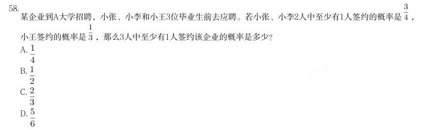

- **A.** 
- **B.** 
- **C.** 
- **D.** 

**答案：C**　**考点：概率问题｜摸球与抽取**　**难度：★★★★★**
**【2025 湖北省考·第 59 题】数量关系·排列组合｜HB-2025-ty-X059**

59. 某地军工驿站就业直通车送6名工人到

- **A.** 180
- **B.** 320
- **C.** 345
- **D.** 360

**答案：C**　**考点：排列组合｜排列组合（综合）**　**难度：★★★★★**
**【2025 湖北省考·第 60 题】数量关系·行程问题｜HB-2025-ty-X060**

60. 某小区组织“情满金秋”柑橘采摘活动,参加人员按年龄分成老、中、青三组,老年组、中年组的人数之比为 5:2,中年组、青年组的人数之比为3:4。老年组、中年组、青年组平均每人采摘速度之比为1:2:3。已知 青年组共采摘80斤柑橘,那么三组人员一共采摘柑橘:

- **A.** 170斤
- **B.** 212斤
- **C.** 255斤
- **D.** 298斤

**答案：A**　**考点：行程问题｜基础行程**　**难度：★★★☆☆**
**【2025 湖北省考·第 61 题】数量关系·概率问题｜HB-2025-ty-X061**

61. 21分制的羽毛球比赛,每赢一球得1分,下一球由上一球得分方发球,20:20平局以后,先多得2分的一方获 胜,若甲发球时甲得分的概率为0.6、乙发球时乙得分的概率为0.7,各球的结果相互独立,乙将比分追成20: 20平后,甲最终以23:21的比分获胜的概率在以下哪个范围?

- **A.** 0.05-0.1
- **B.** 0.1-0.15
- **C.** 0.15-0.2
- **D.** 0.2-0.25

**答案：C**　**考点：概率问题｜比赛与赛制**　**难度：★★★★★**
**【2025 湖北省考·第 62 题】数量关系·最值问题｜HB-2025-ty-X062**

62. 某展览馆最多可以容纳1040人。该展览馆有

- **A.** 7
- **B.** 6
- **C.** 5
- **D.** 4

**答案：C**　**考点：最值问题｜最值优化**　**难度：★★★★☆**
**【2025 湖北省考·第 63 题】数量关系·几何问题｜HB-2025-ty-X063**

63. 某三层高的露天平台每层可视作圆柱体(如下图所示)。已知每层高5米,下层直径100米,中层直径80米,上 层直径68米,现要对平台的外表面进行清洁维护,共需要维护多少平方米?

- **A.** 
- **B.** 
- **C.** 
- **D.** 

**答案：A**　**考点：几何问题｜立体几何**　**难度：★★★★★**
**【2025 湖北省考·第 64 题】数量关系·几何问题｜HB-2025-ty-X064**

64. 为丰富儿童的暑假生活,某公园在半径为 米的半圆形水池旁修建了一个弯月形儿童戏水池(如下图所 示)。该弯月形戏水池可看作是由半径为20米的半圆 和半径为 米的半圆O的圆弧围成的阴影部分,圆 心距 为20米且 垂直于直径AB,那么该戏水池的面积为多少平方米?

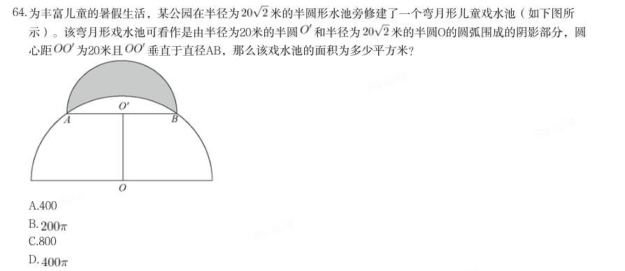

- **A.** 400
- **B.** 
- **C.** 800
- **D.** 

**答案：B**　**考点：几何问题｜平面几何**　**难度：★★★★★**
**【2025 湖北省考·第 65 题】数量关系·几何问题｜HB-2025-ty-X065**

65. 妈妈将一个圆锥形冰淇淋(如下图所示,顶面是半径为3厘米的平面)将距离顶面三分之一高的位置平行切 开,下面那块给小安,上面那块给小凡,那么小安吃的冰淇淋份量是小凡的多少倍?

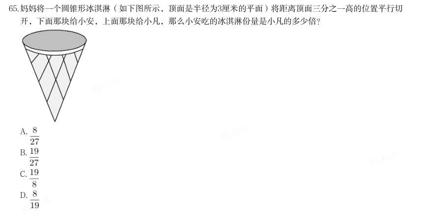

- **A.** 
- **B.** 
- **C.** 
- **D.** 

**答案：B**　**考点：几何问题｜立体几何**　**难度：★★★★★**
**【2025 湖北省考·第 66 题】判断推理·逻辑判断｜HB-2025-ty-X066**

66. 出一个最恰当的答案。 高速公路某路段转向处靠近居民楼,为减少噪声需设置隔音板(如下图所示),安装隔音板范围为公路转向处 的一段圆曲线(即从点A至点B圆弧),测控人员在过点A、B的两条切线的交点C处,测得从A到B转角 为 ,若此圆曲线的半径OA=1km,则这段隔音板的安装长度为:

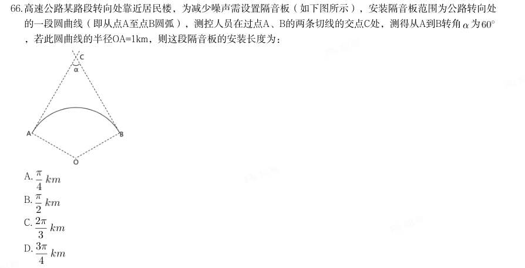

- **A.** 
- **B.** 
- **C.** 
- **D.** 

**答案：D**　**考点：逻辑判断｜逻辑判断（待细分）**　**难度：★★★★★**
**【2025 湖北省考·第 67 题】判断推理·逻辑判断｜HB-2025-ty-X067**

67. 某工厂生产A、B两种商品,需要用到猪肉和土豆两种原材料。已知生成100份A食品需要猪肉50公斤,土豆50公 斤,利润为500元。生产100份B食品需要猪肉20公斤,土豆75公斤,利润400元。目前猪肉和土豆只能进货500 公斤和600公斤,则生产A、B两种食品最大利润为:

- **A.** 5272元
- **B.** 5313元
- **C.** 5363元
- **D.** 5432元

**答案：D**　**考点：逻辑判断｜逻辑判断（待细分）**　**难度：★★★★★**
**【2025 湖北省考·第 68 题】判断推理·逻辑判断｜HB-2025-ty-X068**

68. 某汽车生产基地计划生产燃油车和电动汽车2种不同的汽车,为了响应国家节能减排政策,总公司规定每生产 一辆燃油车减去2个环保积分,生产一辆电动汽车增加3个环保积分,已知生产一辆燃油车、电动车的利润分别 为2万元、1万元,该基地每月最多能生产3000辆汽车。那么环保积分总和不为负数的情况下,该基地一个月的 最大利润是多少万元?

- **A.** 5200
- **B.** 5000
- **C.** 4800
- **D.** 4000

**答案：C**　**考点：逻辑判断｜逻辑判断（待细分）**　**难度：★★★★★**
**【2025 湖北省考·第 69 题】判断推理·逻辑判断｜HB-2025-ty-X069**

69. 某农科所将一块上底长为20米的直角梯形状实验田划分为4个完全相同的区域(如下图所示),种上4个不同品 种的玉米,产量分别为110、115、125和130千克。那么,该实验田玉米的平均产量为多少千克/平方米?

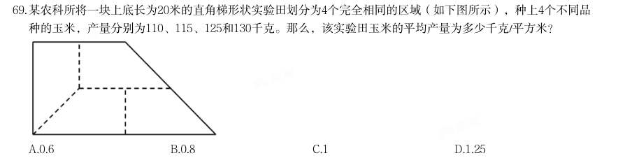

- **A.** 0.6
- **B.** 0.8
- **C.** 1
- **D.** 1.25

**答案：D**　**考点：逻辑判断｜逻辑判断（待细分）**　**难度：★★★★☆**
**【2025 湖北省考·第 70 题】判断推理·逻辑判断｜HB-2025-ty-X070**

70. 某风景区内有5个收费景点,门票分别为10元、10元、20元、20元、20元。老李花了40元购买门票,依次游览 了不同景点。那么可能的游览方式有多少种?

- **A.** 6
- **B.** 18
- **C.** 24
- **D.** 60

**答案：C**　**考点：逻辑判断｜逻辑判断（待细分）**　**难度：★★★☆☆**
**【2025 湖北省考·第 71 题】判断推理·图形推理｜HB-2025-ty-X071**

71. 把下面的六个图形分为两类,使每一类图形都有各自的共同特征或规律,分类正确的一项是:

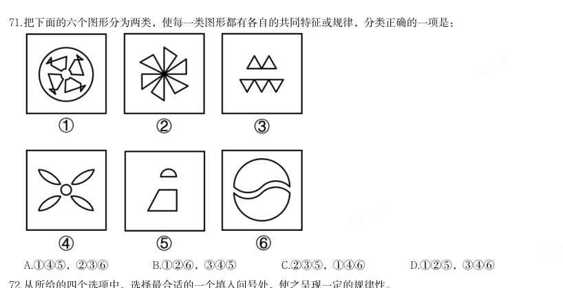

- **A.** 145,236
- **B.** 126,345
- **C.** 235,146
- **D.** 125,346

**答案：A**　**考点：图形推理｜分组分类**　**难度：★★★☆☆**
**【2025 湖北省考·第 72 题】判断推理·图形推理｜HB-2025-ty-X072**

72. 从所给的四个选项中,选择最合适的一个填入问号处,使之呈现一定的规律性。

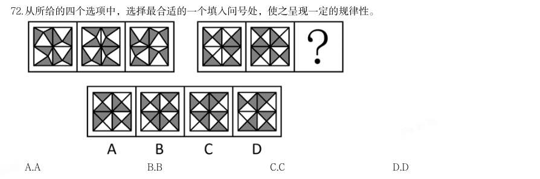

> （本题为图形题，选项为图片，见原卷）

**答案：C**　**考点：图形推理｜图形推理（待细分）**　**难度：★★★★★**
**【2025 湖北省考·第 73 题】判断推理·图形推理｜HB-2025-ty-X073**

73. 把下面的六个图形分为两类,使每一类图形都有各自的共同特征或规律,分类正确的一项是:

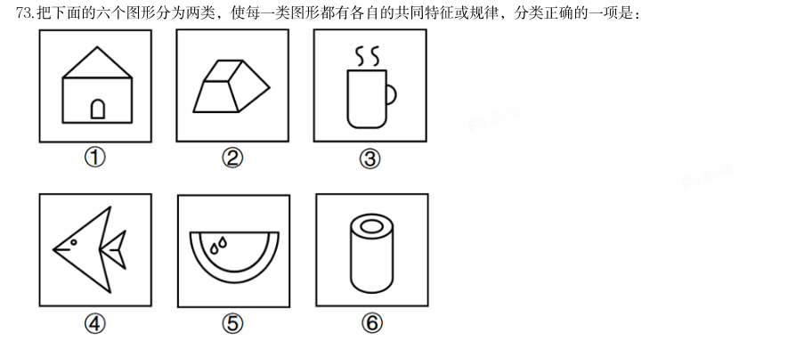

- **A.** 134,256
- **B.** 126,345
- **C.** 135,246
- **D.** 146,235

**答案：B**　**考点：图形推理｜分组分类**　**难度：★★★☆☆**
**【2025 湖北省考·第 74 题】判断推理·图形推理｜HB-2025-ty-X074**

74. 从所给的四个选项中,选择最合适的一个填入问号处,使之呈现一定的规律性。

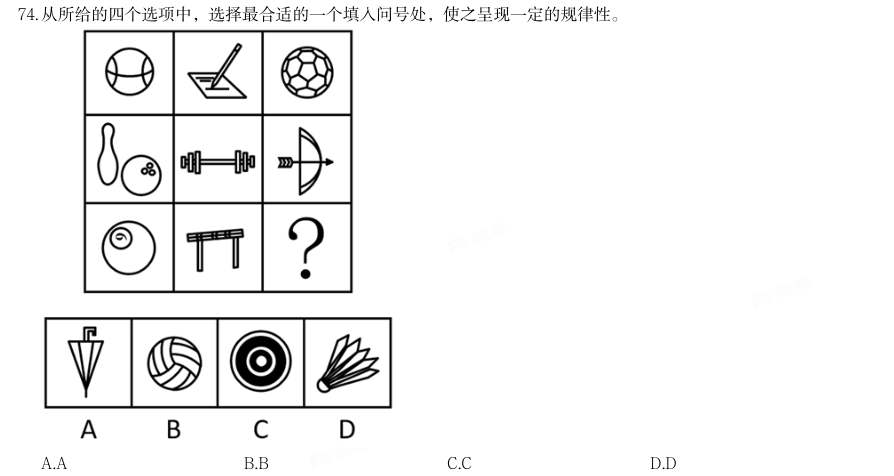

> （本题为图形题，选项为图片，见原卷）

**答案：D**　**考点：图形推理｜图形推理（待细分）**　**难度：★★★★★**
**【2025 湖北省考·第 75 题】判断推理·图形推理｜HB-2025-ty-X075**

75. 下图左侧给定的是3×3的正方体被分解后的多面体,切去的部分可以由给定的1、2和3三个多面体组合而 成。以下哪项能填入问号处?

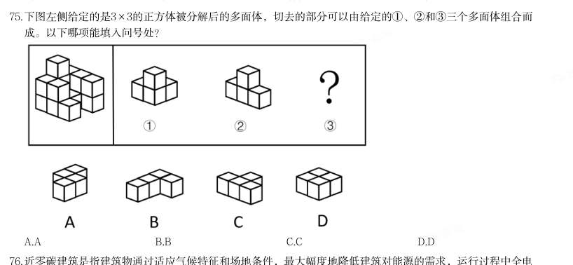

> （本题为图形题，选项为图片，见原卷）

**答案：D**　**考点：图形推理｜立体拼合**　**难度：★★★★★**
**【2025 湖北省考·第 76 题】判断推理·定义判断｜HB-2025-ty-X076**

76. 近零碳建筑是指建筑物通过适应气候特征和场地条件,最大幅度地降低建筑对能源的需求,运行过程中全电 化,不使用燃气,建筑排放的碳量处于较低水平,近零碳建筑不仅利用各种方法减少自身产生的碳排放,还收 集并利用雨水、太阳能等可再生能源,最终达到零废水、零能耗、零废弃物的理想状态。 下列做法不符合近零碳建筑理念的是:

- **A.** 加大物联网、大数据、人工智能等技术在建筑上的应用
- **B.** 淘汰预制模块化建筑技术,采用传热系数高的幕墙建材
- **C.** 实现建筑内空调精细化运行,始终保持温湿度的独立控制
- **D.** 利用集成地源热泵、空气源热泵、光伏发电等可再生能源

**答案：B**　**考点：定义判断｜定义判断（综合）**　**难度：★★★★☆**
**【2025 湖北省考·第 77 题】判断推理·定义判断｜HB-2025-ty-X077**

77. 马氏体相变是一种晶体结构变化,由于外界物理作用,比如温度、外力或者磁场的变化,一些材料的晶体结构 会失去稳定性,原子发生短距离的移动,导致结构畸变。这种非原子扩散型的结构变化被称为马氏体相变,马 氏体相变的一个重要特性是形状记忆效应,即基于两种结构相互转变和变体滑移,材料外形发生明显变化并能 恢复原态。 根据上述定义,下列未体现马氏体相变的是:

- **A.** 将形状扭曲的别针放到热水里,别针立刻就能恢复原状
- **B.** 起扩张血管作用的心脏支架用在外周血管时,因为挤压而变形
- **C.** 通过电流加热控制合金网状结构变化,制造了能模仿蠕虫前进的机器人
- **D.** 采用镍钛弓丝的牙齿矫形器受口腔温度影响,可产生形状恢复力,为牙齿矫形提供所需

**答案：B**　**考点：定义判断｜单定义**　**难度：★★★★★**
**【2025 湖北省考·第 78 题】判断推理·逻辑判断｜HB-2025-ty-X078**

78. 假定有一个理想化的纯黑体,它能将所有吸收的能量以“光”的形式释放,则称之为绝对黑体,它从绝对零度 (单位为“K”即开尔文、 )开始被加热升温会由黑变为发红光、黄光、白光、蓝光、加热到N (K)时,绝对黑体发光所含的光谱成分,就称N(K)色温:某发光物与N(K)温度下绝对黑体发光所含的光 谱成分相同,就称其色温为N(K)。 以下关于色温的叙述正确的是:

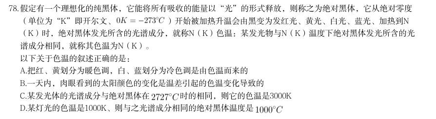

- **A.** 把红、黄划分为暖色调,白、蓝划分为冷色调是由色温而来的
- **B.** 一天内,肉眼看到的太阳颜色的变化是温差引起的色温变化导致的
- **C.** 某发光体的光谱成分与绝对黑体在时的相同,则它的色温是3000K
- **D.** 某灯光的色温是1000K、则与之光谱成分相同的绝对黑体温度是

**答案：A**　**考点：逻辑判断｜逻辑判断（待细分）**　**难度：★★★★★**
**【2025 湖北省考·第 79 题】判断推理·逻辑判断｜HB-2025-ty-X079**

79. 在某个定义域上有加减乘除等多种二元运算(用★代表其中一种)如果在定义域内存在一个数w,对于定义域 范围内的每个数m(包括w),都有w★m=m,则称w为该种二元运算上的左幺元。 以下关于左幺元的叙述正确的是:

- **A.** 在整数范围内的乘法运算中,1是左幺元
- **B.** 在整数范围内的加法运算中,1是左幺元
- **C.** 在整数范围内的减法运算中,0是左幺元
- **D.** 在整数范围内的除法运算中,0是左幺元

**答案：A**　**考点：逻辑判断｜翻译推理**　**难度：★★★★☆**
**【2025 湖北省考·第 80 题】判断推理·定义判断｜HB-2025-ty-X080**

80. 物质循环是指在生态系统中,各种元素物质沿着特定途径从周围环境中被生物体吸收利用,再从生物体回到周 围环境的循环变化过程,即各种元素物质在生物体和非生物环境之间的往复循环运转过程。 下列诗句中所描写的内容最能体现物质循环的是:

- **A.** 时有落花至,远随流水香
- **B.** 莫作绕山云,循环无定期
- **C.** 黄河之水天上来,奔流到海不复回
- **D.** 落红不是无情物,化作春泥更护花

**答案：D**　**考点：定义判断｜定义判断（综合）**　**难度：★★☆☆☆**
**【2025 湖北省考·第 81 题】判断推理·定义判断｜HB-2025-ty-X081**

81. 印客也称in客,指的是把自己在网络平台上所写的、画的、摘录的任何文字和图片整理成册,自己制作或请人 制作成具有保存价值并体现个性的印刷品的人。 根据以上定义,下列属于印客的是:

- **A.** 小楠是某大学的特聘教师,撰写不少高水平学术文章,去年她将这些文章分类整理成册,目前正与出版社商量印刷排版事宜
- **B.** 小雪是某印刷服务社的美工,具备较高专业素养,业务内容是美化处理客户发来的图片和文字,成品在网络上得到海量好评
- **C.** 小影是某网站的专栏作家,在网络上发表多篇高阅读量和点赞量的文章,不少读者将她的文章打印出来,作为范本交流学习
- **D.** 小芳是某企业员工,经常在微博上用图片加文字的形式表达心灵感悟,她定期收集这些记录,请专业人士排

**答案：D**　**考点：定义判断｜单定义**　**难度：★★★☆☆**
**【2025 湖北省考·第 82 题】判断推理·定义判断｜HB-2025-ty-X082**

82. 版设计印刷成册 拓扑绝缘体是一种内部绝缘、界面允许电荷移动的材料,在拓扑绝缘体的内部,电子能带结构和常规的绝缘体 相似,但在其表面或边界上存在特殊的量子态,这些量子态位于块体能带结构的带隙之中,从而能够导电。 根据上述定义,以下哪项是拓扑绝缘体?

- **A.** 量子点接触是一种纳米尺度的电子器件,其整体的导电性质可以通过调整器件的尺寸和形状来调控
- **B.** 氮化镓中由半导体异质结中的特殊电子结构形成的二维电子气,虽然其并不是一种材料,但在一定条件下能够导电
- **C.** 纯石墨烯本身不导电,但是经过一些工艺加工后,会表现出在一定条件下可以允许表面电荷移动形成导电能力的一种量子效应
- **D.** 镧钡铜氧体系的超导陶瓷,是一类在临界温度时电阻为零的陶瓷材料,它还表现出完全抗磁性的行为,在传

**答案：C**　**考点：定义判断｜单定义**　**难度：★★★☆☆**
**【2025 湖北省考·第 83 题】判断推理·定义判断｜HB-2025-ty-X083**

83. 输过程中几乎没有能量消耗 计算亲属关系亲疏远近的单位是亲等,国际最为通用的是罗马法亲等计算法和寺院法亲等计算法,二者关于旁 系血亲的计算法有所不同:罗马法亲等计算法是从己身往上数至双方共同的直系血亲即同源人,每经一代为一 亲等,再往下数至要计算的人,也是每经一代为一亲等,所有数字相加就是双方之间的亲等数;寺院法亲等计 算法是从己身和所要计算的人分别往上数至血缘同源人,两边的亲等数相等时,就采用一边的亲等数,如果亲 等数不等,则采用多的一方的亲等数。 根据上述定义,下列符合罗马法亲等计算法的是:

- **A.** 自己与外甥的女儿之间的亲等是三亲等
- **B.** 表妹与堂妹之间的亲等,都是四亲等
- **C.** 姑侄之间的亲等是二亲等
- **D.** 自己与伯父之间是三亲等

**答案：D**　**考点：定义判断｜单定义**　**难度：★★★★☆**
**【2025 湖北省考·第 84 题】判断推理·定义判断｜HB-2025-ty-X084**

84. 免疫电镜技术是将抗原抗体反应的特异性和电子显微镜的高分辨率相结合,在亚细胞和超微结构水平上对抗原 进行定位分析的一种高精确度的技术。 根据上述定义,下列不属于免疫电镜技术的是:

- **A.** 酶的催化作用对其底物的反应可形成不同的电子密度,运用电子显微镜来观察,可确定酶的存在,从而对抗原进行定位
- **B.** 胶体金与铁蛋白一样具有高电子密度,将沙门氏菌的抗血清与胶体金颗粒结合,可以明确病原物抗原在电镜水平的定位
- **C.** 铁蛋白通过交联剂与抗体等物质的共价结合,其分辨率高、散射能力强,借助电镜可以准确描述抗原抗体复合物的定位
- **D.** 微流体检测芯片中的免疫电极体系有镀金基层、导电聚合物层和抗体层,三者自下而上依次贴合,提高检测

**答案：D**　**考点：定义判断｜单定义**　**难度：★★★☆☆**
**【2025 湖北省考·第 85 题】判断推理·定义判断｜HB-2025-ty-X085**

85. 定位的水平 意思主义和表示主义是解释确定语言含义的两种方法。当语言发生歧义时。意思主义认为应当按照言语者内心 所欲表达的真实意思来确定语言含义,而无需在意别人如何理解;反之,表示主义主张语言一旦表达出来便与 言语者没有关系了,应当按照社会公众的通常理解来确定语言的含义。 根据上述定义,下列说法最能体现意思主义的是:

- **A.** 误载不害真意
- **B.** 人同此心,心同此理
- **C.** 一千个读者有一千个哈姆雷特
- **D.** 横看成岭侧成峰,远近高低各不同

**答案：A**　**考点：定义判断｜单定义**　**难度：★★★☆☆**
**【2025 湖北省考·第 86 题】判断推理·类比推理｜HB-2025-ty-X086**

86. 言之无文:行之不远

- **A.** 一叶障目:不见泰山
- **B.** 宁为玉碎:不为瓦全
- **C.** 藏诸名山:传之其人
- **D.** 取之不尽:用之不竭

**答案：A**　**考点：类比推理｜类比推理（综合）**　**难度：★★☆☆☆**
**【2025 湖北省考·第 87 题】判断推理·类比推理｜HB-2025-ty-X087**

87. 柠檬水:酸梅汤

- **A.** 橘子汁:香蕉水
- **B.** 梅子酒:葡萄干
- **C.** 苹果派:草莓挞
- **D.** 西瓜霜:荔枝蜜

**答案：C**　**考点：类比推理｜类比推理（综合）**　**难度：★★☆☆☆**
**【2025 湖北省考·第 88 题】判断推理·类比推理｜HB-2025-ty-X088**

88. 低碳排放:保护环境

- **A.** 候鸟迁徙:气候变化
- **B.** 昆虫叮咬:过敏反应
- **C.** 收集数据:调查研究
- **D.** 滴水成冰:热胀冷缩

**答案：C**　**考点：类比推理｜类比推理（综合）**　**难度：★★☆☆☆**
**【2025 湖北省考·第 89 题】判断推理·类比推理｜HB-2025-ty-X089**

89. 石料:木材:印章

- **A.** 毛笔:墨水:书法
- **B.** 湘绣:蜀绣:刺绣
- **C.** 宣纸:年画:国画
- **D.** 搪瓷:塑料:脸盆

**答案：D**　**考点：类比推理｜类比推理（综合）**　**难度：★★☆☆☆**
**【2025 湖北省考·第 90 题】判断推理·类比推理｜HB-2025-ty-X090**

90. 衰弱:噪声:听力

- **A.** 锻炼:饮食:健康
- **B.** 杠杆:重力:质量
- **C.** 降低:摩擦:速度
- **D.** 气候变暖:冰层融化:环境

**答案：C**　**考点：类比推理｜类比推理（综合）**　**难度：★★☆☆☆**
**【2025 湖北省考·第 91 题】判断推理·类比推理｜HB-2025-ty-X091**

91. 车辆:货车:运输

- **A.** 温室气体:甲烷:二氧化碳
- **B.** 未来产业:量子信息:研究监管
- **C.** 自我意识:人格:心理调节
- **D.** 绿色能源:太阳能:发电

**答案：D**　**考点：类比推理｜类比推理（综合）**　**难度：★★☆☆☆**
**【2025 湖北省考·第 92 题】判断推理·类比推理｜HB-2025-ty-X092**

92. 名垂青史:光耀千秋:光前裕后

- **A.** 畏首畏尾:犹犹豫豫:瞻前顾后
- **B.** 投鼠忌器:缩手缩脚:慎终追远
- **C.** 光宗耀祖:光耀门楣:落叶归根
- **D.** 空前绝后:开天辟地:继往开来

**答案：A**　**考点：类比推理｜类比推理（综合）**　**难度：★★☆☆☆**
**【2025 湖北省考·第 93 题】判断推理·类比推理｜HB-2025-ty-X093**

93. ( ) 对于 众志成城 相当于 拒谏饰非 对于 ( )

- **A.** 孤掌难鸣 广开言路
- **B.** 寸积铢累 从谏如流
- **C.** 众擎易举 集思广益
- **D.** 独木难支 闭目塞听

**答案：A**　**考点：类比推理｜类比推理（综合）**　**难度：★★☆☆☆**
**【2025 湖北省考·第 94 题】判断推理·类比推理｜HB-2025-ty-X094**

94. ( ) 对于 松树 相当于 CPU 对于 ( )

- **A.** 松果 显卡
- **B.** 植物 电器
- **C.** 松子 电脑
- **D.** 松茸 芯片

**答案：该题答案缺失，见原卷**　**考点：类比推理｜类比推理（综合）**　**难度：★★☆☆☆**
**【2025 湖北省考·第 95 题】判断推理·类比推理｜HB-2025-ty-X095**

95. ( ) 对于 运动器材 相当于 玫瑰 对于 ( )

- **A.** 单杠 爱情
- **B.** 哑铃 花卉
- **C.** 健身 精油
- **D.** 铸铁 月季

**答案：该题答案缺失，见原卷**　**考点：类比推理｜类比推理（综合）**　**难度：★★☆☆☆**
**【2025 湖北省考·第 96 题】判断推理·逻辑判断｜HB-2025-ty-X096**

96. 有研究人员针对素食对心血管疾病高危人群的影响进行数据分析发现,素食与低密度脂蛋白胆固醇、葡萄糖水 平和体重的显著改善有关,因此,研究人员提出素食可有效降低胆固醇、血糖和体重。 以下哪项如果为真,不能削弱上述结论:

- **A.** 快餐店素食套餐含有精制碳水化合物、糖、玉米糖浆等,热量更高
- **B.** 部分素食含有大量反式脂肪酸,反式脂肪酸的摄入会引起胆固醇升高
- **C.** 广义上的素食不仅包括蔬菜等纯素食,还包括鸡蛋、奶和乳制品
- **D.** 素食中的蔬菜多是油炸的,这使素食者变胖的风险更大

**答案：该题答案缺失，见原卷**　**考点：逻辑判断｜削弱论证**　**难度：★★★★★**
**【2025 湖北省考·第 97 题】判断推理·逻辑判断｜HB-2025-ty-X097**

97. 某研究团队发布了一项关于睡眠习惯、时间与癌症风险的研究。研究分析了近1.5万人,发现睡眠时间短导致癌 症风险升高,和睡眠时间为6-8小时的参与者相比,夜间睡眠时间少于6小时的人,患癌风险升高41%,和午睡 时间多于60分钟的参与者相比,从不午睡的参与者患癌风险升高60%。 以下哪项如果为真,最能加强上述观点:

- **A.** 睡眠时间短会损害免疫功能、降低人体对肿瘤细胞的识别和消灭能力
- **B.** 人类环境、卫生资源和睡眠习惯的变化,导致癌症发病原因发生了变化
- **C.** 夜间睡眠时间短或不午睡的参与者,大多年龄较大且缺少锻炼,健康状况不佳
- **D.** 和总睡眠时间为7-8小时的参与者相比,总睡眠时间少于7小时的男性,患痛风险升高69%

**答案：该题答案缺失，见原卷**　**考点：逻辑判断｜加强论证**　**难度：★★★★★**
**【2025 湖北省考·第 98 题】判断推理·逻辑判断｜HB-2025-ty-X098**

98. 有研究发现,儿童受试者考夫曼简明智力测验得分下降与其居住地点黑碳浓度的提高有关。此外,在老年男性 群体中,黑碳浓度水平升高1倍,其简易智力状态检查量表(MMSE)得分小于25的OR值为1.3,相当于衰老1.9 年。由此,专家认为,黑碳暴露会导致神经系统损伤。 以下哪项如果为真,最能削弱上述论证:

- **A.** 相关研究所关注的儿童和老人群体本身血脑屏障较脆弱,易受黑碳暴露影响
- **B.** 颗粒物可以通过嗅球,沿嗅觉神经元传输到大脑,对神经系统产生不良影响
- **C.** 最新研究表明,黑碳因其特有的物化属性可能具有比细颗粒物更大的健康影响
- **D.** 黑碳暴露与男孩在考夫曼简明智力测验中的反应时间延长和错误率增加有关,而在女孩中未观察到显著相关

**答案：该题答案缺失，见原卷**　**考点：逻辑判断｜削弱论证**　**难度：★★★★★**
**【2025 湖北省考·第 99 题】判断推理·逻辑判断｜HB-2025-ty-X099**
> 材料：性 某研究指出,阻力训练可以帮助预防或延缓阿尔茨海默病(AD),研究者给小鼠的尾部绑上拉力带,将其放置 在一个倾斜的木板上并训练向上爬,训练四周后,小鼠的血液样本分析表明,参与阻力训练小鼠的大脑中很少 出现 -淀粉样蛋白累积,皮质酮(相当于人类分泌的皮质醇)也处于正常水平,除此之外,阻力训练增加了小

99. 鼠大脑中小胶质细胞的数量,这种细胞在AD早期对大脑有重要保护作用,比如清除 -淀粉样蛋白的多肽和细 胞钾片,减轻大脑局部炎症。 以上论述如果为真,必须基于的前提是:

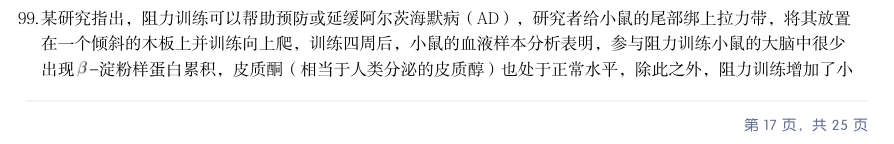

- **A.** 皮质醇水平在AD早期阶段会呈现升高的趋势
- **B.** 大脑中累积的-淀粉样蛋白是导致罹患AD的元凶
- **C.** 阻力训练会使小胶质细胞从促炎状态转变成抗炎症状态
- **D.** 皮质醇会在压力过大时生成并使得个体容易焦虑和躁动

**答案：该题答案缺失，见原卷**　**考点：逻辑判断｜前提假设**　**难度：★★★☆☆**
**【2025 湖北省考·第 100 题】判断推理·逻辑判断｜HB-2025-ty-X100**

100. 与人类的眼球是一整个球形不同,鸟类眼球是由一大一小的两个半球构成,小的半球是角膜,大的半球是视网 膜,在角膜周围有一圈小骨片形成的一个环状的支撑性的脊,这个骨片环即巩膜环,保护眼球的同时也限制了 眼球的转动,人类在走路时,通过眼球的转动抵消走路时的振动来保持视觉的稳定,而鸟类无法大幅度地转动 眼球。因此,很多鸟类走路时,让头部先移至前方保持稳定,身体再前进。保持不动的头部像是向后缩了一 样,于是就成了脖子一伸一缩的样子。 由此可以推出:

- **A.** 鸟类的眼球构造有助于形成更锐利的远视力
- **B.** 鸟类走路时脖子的伸缩有助于维持身体的平衡
- **C.** 鸟类通过颈部运动让眼睛成像保持更持久的稳定
- **D.** 鸟类通过运动头部来获得视差以增强空间的深度感知

**答案：该题答案缺失，见原卷**　**考点：逻辑判断｜结论推出**　**难度：★★★★★**
**【2025 湖北省考·第 101 题】判断推理·逻辑判断｜HB-2025-ty-X101**

101. 某地湖水水位的季节性变化显著,洪水期和枯水期的湖水面积和蓄水量相差悬殊,每到秋冬季节进入枯水期, 湖水水位急剧下降,湖面沙洲裸露,仅剩几条蜿蜒的水道,对当地居民的生产生活造成不良影响。当地政府计 划在湖泊口建设一道巨型水闸,可以在秋冬季节蓄住湖水,以满足灌溉、航运、生活等需求。生态专家认为, 水闸不会对生态环境造成负面影响,甚至能够优化当地物种的生存环境。 以下哪项如果为真,最能削弱上述论证:

- **A.** 该湖泊是某些候鸟的栖息地,每年都会吸引它们来此越冬
- **B.** 蓄水会导致湖泊的冬季水位上涨,某些种类的候鸟喜爱浮水游动
- **C.** 水闸上会预留数个60米宽的洄游通道,供江豚等水生动物洄游觅食
- **D.** 湖泊周围主要的鸟类种群以水生植物块茎和底栖生物为食,需要栖息在较浅的水陆交错环境

**答案：该题答案缺失，见原卷**　**考点：逻辑判断｜削弱论证**　**难度：★★★★★**
**【2025 湖北省考·第 102 题】判断推理·逻辑判断｜HB-2025-ty-X102**

102. 大蚕蛾具有其他昆虫无法比拟的巨大翅膀,长度可达28cm,是自然界中最为绚丽灿烂的昆虫之一。在自然界 中,为了吸引异性,许多动物都拥有鲜艳美丽的外形,因此,科学家认为,大蚕蛾的“锦衣华服”是用于吸引 异性,从而增加交配繁殖的几率。 以下哪项如果为真,最能削弱上述结论:

- **A.** 绝大部分种类的大蚕蛾生存繁衍于群山密林之中,昼伏夜出,无法看清同类的翅膀
- **B.** 大蚕蛾翅膀的绚丽来自于鳞片的密集排布,能折射和衍射光线,从而让天敌分心或疑惑
- **C.** 大蚕蛾头顶的触角是重要的感觉器官,主要起到嗅觉和触觉作用,可以通过触角进行信息交流
- **D.** 大蚕蛾雌雄两性的色泽不同,雄性大体呈橘黄色,翅膀以杏黄色为主,雌性为青白色,翅膀以淡绿色为主

**答案：该题答案缺失，见原卷**　**考点：逻辑判断｜削弱论证**　**难度：★★★★★**
**【2025 湖北省考·第 103 题】判断推理·逻辑判断｜HB-2025-ty-X103**

103. 人类的饮食需在更具营养的同时减少对气候的影响。因此,未来饮食策略应思考降低温室气体的排放,多考虑 基于海产的“蓝色”饮食。海产品是良好的蛋白、脂酸、维生素和矿物质来源,其中有一半营养密度高于牛 肉、猪肉和鸡肉。专家通过资料分析了全球野外捕捞和养殖的海产品营养密度及其对气候的影响发现,野外捕 捞鲑鱼、鲱鱼及养殖贻贝、牡蛎等海产品温室气体排放量较低,对气候的影响也小。因此,可持续的海产品消 费能够在为人类提供更多营养的同时减轻环境压力。 由此可以推出:

- **A.** 为进一步降低碳排放,渔业应采用节能高效的捕捞技术
- **B.** 未来,人们在饮食策略中将大量采用海产品替代其他肉类进行分析、比较、计算和判断处理。

**答案：该题答案缺失，见原卷**　**考点：逻辑判断｜前提假设**　**难度：★★★★★**
**【2025 湖北省考·第 104 题】资料分析·综合分析｜HB-2025-ty-X104**
> 材料：2023年,我国数字经济规模持续扩大。数字经济核心产业增加值超过12万亿元,约占GDP的10%。电子信 息制造业增加值同比增长3.4%;电信业务收入1.68万亿元;互联网业务收入1.75万亿元;软件业务收入12.33万 亿元。以云计算、大数据、物联网等为代表的新兴业务中,云计算、大数据业务收入同比增长37.5%,物联网 业务收入同比增长20.3%。高技术制造业、高技术服务业投资分别同比增长9.9%、11.4%。高技术制造业中,计 算机、通信和其他电子设备制造业投资同比增长9.3%。

104. C.每一物种的生产或捕获方法的差异,会给气候变化带来很大不同 D.鼓励以海产的“蓝色”饮食替代其他动物蛋白,或可帮助应对气候变化 某市举办智能数控技能大赛、小周、小吴、小郑、小王、小钱进入了决赛。比赛后,有记者询问他们的感受, 他们回答如下: 小周:小郑整场发挥得都很好,我觉得冠军非他莫属; 小吴:我觉得冠军一定会在我、小周、小钱三人之中产生; 小郑:我自我感觉不好,这次与冠军无缘了; 小钱:我连季军都拿不到; 小王:我不会是亚军。 已知本次比赛产生了冠军、亚军、季军各一人,且在五人中只有一个人的回答与比赛结果相符。那么,获得亚 军的是:

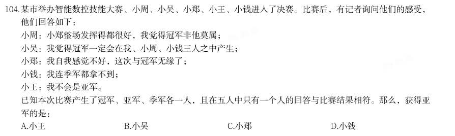

- **A.** 小王
- **B.** 小吴
- **C.** 小郑
- **D.** 小钱

**答案：该题答案缺失，见原卷**　**考点：综合分析｜综合分析（综合）**　**难度：★★★★★**
**【2025 湖北省考·第 105 题】判断推理·逻辑判断｜HB-2025-ty-X105**

105. 某公园计划从桃树、李树、杨树、柳树、松树中选择几种树种植,树种的选择满足下列条件: (1)如果选桃树,那么不选松树; (2)要么选桃树,要么选李树; (3)至少选3种树种植; (4)桃树和杨树至多选1种; (5)李树和柳树至多选1种。 由此可以推出:

- **A.** 种李树和桃树,不种松树
- **B.** 种桃树和柳树,不种杨树
- **C.** 种李树和杨树,不种松树
- **D.** 种杨树和松树,不种桃树

**答案：该题答案缺失，见原卷**　**考点：逻辑判断｜翻译推理**　**难度：★★★★★**
**【2025 湖北省考·第 106 题】资料分析·综合分析｜HB-2025-ty-X106**
> 材料：2023年,我国数字经济规模持续扩大。数字经济核心产业增加值超过12万亿元,约占GDP的10%。电子信息制造业增加值同比增长3.4%;电信业务收入1.68万亿元;互联网业务收入1.75万亿元;软件业务收入12.33万亿元。以云计算、大数据、物联网等为代表的新兴业务中,云计算、大数据业务收入同比增长37.5%,物联网业务收入同比增长20.3%。高技术制造业、高技术服务业投资分别同比增长9.9%、11.4%。高技术制造业中,计算机、通信和其他电子设备制造业投资同比增长9.3%。

106. 2022年我国软件业务收入在以下哪个范围:

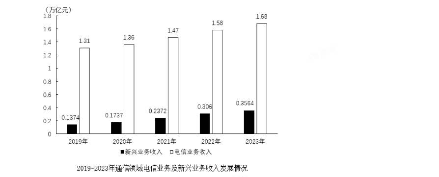

- **A.** 10.7-10.9万亿元
- **B.** 10.9-11.1万亿元
- **C.** 11.1-11.3万亿元
- **D.** 11.3-11.5万亿元

**答案：该题答案缺失，见原卷**　**考点：综合分析｜综合分析（综合）**　**难度：★★★★☆**
**【2025 湖北省考·第 107 题】资料分析·增长率计算与比较｜HB-2025-ty-X107**
> 材料：2023年,我国数字经济规模持续扩大。数字经济核心产业增加值超过12万亿元,约占GDP的10%。电子信息制造业增加值同比增长3.4%;电信业务收入1.68万亿元;互联网业务收入1.75万亿元;软件业务收入12.33万亿元。以云计算、大数据、物联网等为代表的新兴业务中,云计算、大数据业务收入同比增长37.5%,物联网业务收入同比增长20.3%。高技术制造业、高技术服务业投资分别同比增长9.9%、11.4%。高技术制造业中,计算机、通信和其他电子设备制造业投资同比增长9.3%。

107. 2019-2023年,互联网业务收入同比增速高于电子信息制造业增加值同比增速的年份有:

> 材料图见 images/HB-2025-ty-X106-m.jpg

- **A.** 1个
- **B.** 2个
- **C.** 3个
- **D.** 4个

**答案：该题答案缺失，见原卷**　**考点：增长率计算与比较｜增长率比较**　**难度：★★★☆☆**
**【2025 湖北省考·第 108 题】资料分析·增长率计算与比较｜HB-2025-ty-X108**
> 材料：2023年,我国数字经济规模持续扩大。数字经济核心产业增加值超过12万亿元,约占GDP的10%。电子信息制造业增加值同比增长3.4%;电信业务收入1.68万亿元;互联网业务收入1.75万亿元;软件业务收入12.33万亿元。以云计算、大数据、物联网等为代表的新兴业务中,云计算、大数据业务收入同比增长37.5%,物联网业务收入同比增长20.3%。高技术制造业、高技术服务业投资分别同比增长9.9%、11.4%。高技术制造业中,计算机、通信和其他电子设备制造业投资同比增长9.3%。

108. 2023年,新兴业务收入与电信业务收入的比值,较2019年上升了约:

> 材料图见 images/HB-2025-ty-X106-m.jpg

- **A.** 11个百分点
- **B.** 10.7个百分点
- **C.** 10.3个百分点
- **D.** 9.8个百分点

**答案：该题答案缺失，见原卷**　**考点：增长率计算与比较｜增长率计算（综合）**　**难度：★★★☆☆**
**【2025 湖北省考·第 109 题】资料分析·增长率计算与比较｜HB-2025-ty-X109**
> 材料：2023年,我国数字经济规模持续扩大。数字经济核心产业增加值超过12万亿元,约占GDP的10%。电子信息制造业增加值同比增长3.4%;电信业务收入1.68万亿元;互联网业务收入1.75万亿元;软件业务收入12.33万亿元。以云计算、大数据、物联网等为代表的新兴业务中,云计算、大数据业务收入同比增长37.5%,物联网业务收入同比增长20.3%。高技术制造业、高技术服务业投资分别同比增长9.9%、11.4%。高技术制造业中,计算机、通信和其他电子设备制造业投资同比增长9.3%。

109. 按照2023年的同比增速,2025年互联网业务收入预计在以下哪个范围:

> 材料图见 images/HB-2025-ty-X106-m.jpg

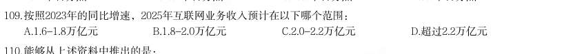

- **A.** 1.6-1.8万亿元
- **B.** 1.8-2.0万亿元
- **C.** 2.0-2.2万亿元
- **D.** 超过2.2万亿元

**答案：该题答案缺失，见原卷**　**考点：增长率计算与比较｜增长率计算**　**难度：★★★☆☆**
**【2025 湖北省考·第 110 题】资料分析·综合分析｜HB-2025-ty-X110**
> 材料：2023年,我国数字经济规模持续扩大。数字经济核心产业增加值超过12万亿元,约占GDP的10%。电子信息制造业增加值同比增长3.4%;电信业务收入1.68万亿元;互联网业务收入1.75万亿元;软件业务收入12.33万亿元。以云计算、大数据、物联网等为代表的新兴业务中,云计算、大数据业务收入同比增长37.5%,物联网业务收入同比增长20.3%。高技术制造业、高技术服务业投资分别同比增长9.9%、11.4%。高技术制造业中,计算机、通信和其他电子设备制造业投资同比增长9.3%。

110. 能够从上述资料中推出的是:

> 材料图见 images/HB-2025-ty-X106-m.jpg

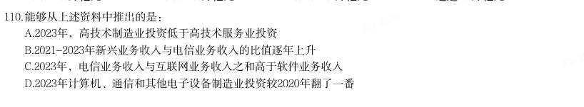

- **A.** 2023年,高技术制造业投资低于高技术服务业投资
- **B.** 2021-2023年新兴业务收入与电信业务收入的比值逐年上升
- **C.** 2023年,电信业务收入与互联网业务收入之和高于软件业务收入
- **D.** 2023年计算机、通信和其他电子设备制造业投资较2020年翻了一番

**答案：该题答案缺失，见原卷**　**考点：综合分析｜综合分析（综合）**　**难度：★★★★★**
**【2025 湖北省考·第 111 题】资料分析·平均数计算｜HB-2025-ty-X111**

111. 2015-2022年期间,我国A股市场新上市公司平均每家首次募资金额最大的年份是:

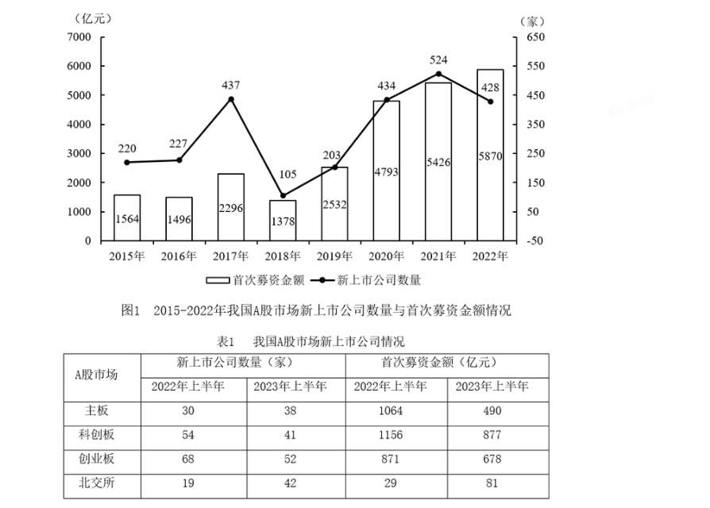

- **A.** 2018年
- **B.** 2019年
- **C.** 2021年
- **D.** 2022年

**答案：该题答案缺失，见原卷**　**考点：平均数计算｜现期平均数**　**难度：★★★☆☆**
**【2025 湖北省考·第 112 题】资料分析·增长率计算与比较｜HB-2025-ty-X112**

112. 2016-2022年期间,我国A股市场新上市公司的首次募资金额同比增长超过15%的年份有:

> 材料图见 images/HB-2025-ty-X111-m.jpg

- **A.** 3个
- **B.** 4个
- **C.** 5个
- **D.** 6个

**答案：该题答案缺失，见原卷**　**考点：增长率计算与比较｜增长率计算（综合）**　**难度：★★★☆☆**
**【2025 湖北省考·第 113 题】资料分析·平均数计算｜HB-2025-ty-X113**

113. 2023年上半年,北交所新上市公司平均募资金额同比增量在以下哪个范围?

> 材料图见 images/HB-2025-ty-X111-m.jpg

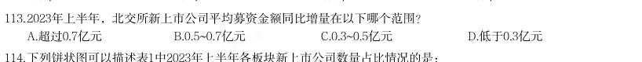

- **A.** 超过0.7亿元
- **B.** 0.5~0.7亿元
- **C.** 0.3~0.5亿元
- **D.** 低于0.3亿元

**答案：该题答案缺失，见原卷**　**考点：平均数计算｜现期平均数**　**难度：★★★☆☆**
**【2025 湖北省考·第 114 题】资料分析·综合分析｜HB-2025-ty-X114**
> 材料：下列饼状图可以描述表1中2023年上半年各板块新上市公司数量占比情况的是: 2023年,我国制浆造纸及纸制品全行业完成纸浆、纸及纸板和纸制品产量合计29139万吨,同比增长 2.63%。其中纸及纸板产量12965万吨,与2022年的12425万吨相比同比增长4.35%,增速比2022年扩大了1.71个 百分点。 2023年,全国纸及纸板消费量13165万吨,同比增长6.14%,增速比2022年扩大了8.08个百分点;人均年消 费量93.37千克,同比增长6.30%。 2023年,全国2567家造纸及纸板生产企业部分经济指标如下:营业收入8019亿元;成品存货440亿元,同 比下降7.65%;利润总额269亿元,同比增长3.01%;资产11316亿元,同比增长2.11%;资产负债率58.05%;负 债总额6569亿元,同比增长2.82%。

114. 2023年,我国东部地区11个省(区、市)纸及纸板产量为8843万吨,占全国纸及纸板产量比例为68.2%, 同比增长5.44%;中部地区8个省占比为19.2%,同比增长2.51%;西部地区12个省(区、市)占比为12.6%,同 比增长1.43%。我国有18个省(区、市)纸及纸板产量超过100万吨,产量合计12597万吨,占全国纸及纸板总 产量的97.16%。

> 材料图见 images/HB-2025-ty-X111-m.jpg

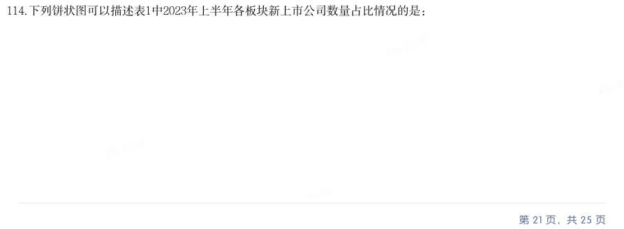

- **A.** 
- **B.** 
- **C.** 
- **D.** 

**答案：该题答案缺失，见原卷**　**考点：综合分析｜比重**　**难度：★★★★★**
**【2025 湖北省考·第 115 题】资料分析·综合分析｜HB-2025-ty-X115**
> 材料：下列饼状图可以描述表1中2023年上半年各板块新上市公司数量占比情况的是: 2023年,我国制浆造纸及纸制品全行业完成纸浆、纸及纸板和纸制品产量合计29139万吨,同比增长 2.63%。其中纸及纸板产量12965万吨,与2022年的12425万吨相比同比增长4.35%,增速比2022年扩大了1.71个 百分点。 2023年,全国纸及纸板消费量13165万吨,同比增长6.14%,增速比2022年扩大了8.08个百分点;人均年消 费量93.37千克,同比增长6.30%。 2023年,全国2567家造纸及纸板生产企业部分经济指标如下:营业收入8019亿元;成品存货440亿元,同 比下降7.65%;利润总额269亿元,同比增长3.01%;资产11316亿元,同比增长2.11%;资产负债率58.05%;负 债总额6569亿元,同比增长2.82%。

115. 能够从上述资料中推出的是:

> 材料图见 images/HB-2025-ty-X111-m.jpg

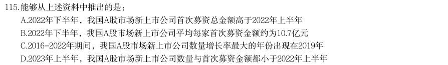

- **A.** 2022年下半年,我国A股市场新上市公司首次募资总金额高于2022年上半年
- **B.** 2022年下半年,我国A股市场新上市公司平均每家首次募资金额约为10.7亿元
- **C.** 2016-2022年期间,我国A股市场新上市公司数量增长率最大的年份出现在2019年
- **D.** 2023年上半年,我国A股市场新上市公司数量与首次募资金额都小于2022年上半年

**答案：该题答案缺失，见原卷**　**考点：综合分析｜平均数**　**难度：★★★★★**
**【2025 湖北省考·第 116 题】资料分析·综合分析｜HB-2025-ty-X116**
> 材料：2023年全国著作权(包括作品著作权、计算机软件著作权、著作权质权)登记总量达8923901件,同比增 长40.46%,增速比上年同期增加39个百分点。根据各省、自治区、直辖市版权局和中国版权保护中心作品登记 信息统计,2023年全国共完成作品著作权登记6428277件,同比增长42.30%,登记量前五位的分别是:北京市 1101072件,同比增加53802件;山东省873826件,同比增加619459件;福建省710648件,同比增加424814件; 中国版权保护中心493070件,同比增加1476件;上海市412660件,同比增加30660件,从作品类型来看,登记 量最多的是美术作品3296437件,第二是摄影作品2501968件,第三是文字作品329128件,前三类作品类型登记 量占作品著作权登记总量的95.32%,该比例比上年同期增加4.86个百分点。

116. 2023年全国共完成著作权质权登记411件,同比增长17.43%,涉及主借务会额995817.4万元,同比增长 82.82%;涉及担保金额985783.88万元,同比增长80.85%。其中计算机软件著作权质权登记361件,涉及主债务 金额917149.06万元;涉及担保金额907399.56万元;作品(除计算机软件之外)著作权质权登记50件,同比下 降26.47%,涉及主债务金额78668.34万元,同比下降55.13%;涉及担保金额78384.32万元,同比下降55.46%。 2021年全国纸及纸板产量约为:

> 材料图见 images/HB-2025-ty-X111-m.jpg

- **A.** 11715万吨
- **B.** 12105万吨
- **C.** 12762万吨
- **D.** 13227万吨

**答案：该题答案缺失，见原卷**　**考点：综合分析｜综合分析（综合）**　**难度：★★★★★**
**【2025 湖北省考·第 117 题】资料分析·增长率计算与比较｜HB-2025-ty-X117**
> 材料：2023年全国著作权(包括作品著作权、计算机软件著作权、著作权质权)登记总量达8923901件,同比增 长40.46%,增速比上年同期增加39个百分点。根据各省、自治区、直辖市版权局和中国版权保护中心作品登记 信息统计,2023年全国共完成作品著作权登记6428277件,同比增长42.30%,登记量前五位的分别是:北京市 1101072件,同比增加53802件;山东省873826件,同比增加619459件;福建省710648件,同比增加424814件; 中国版权保护中心493070件,同比增加1476件;上海市412660件,同比增加30660件,从作品类型来看,登记 量最多的是美术作品3296437件,第二是摄影作品2501968件,第三是文字作品329128件,前三类作品类型登记 量占作品著作权登记总量的95.32%,该比例比上年同期增加4.86个百分点。

117. 2022年全国纸及纸板消费量同比增速与产量同比增速相比约:

> 材料图见 images/HB-2025-ty-X111-m.jpg

- **A.** 低4.58个百分点
- **B.** 低0.5个百分点
- **C.** 高5.37个百分点
- **D.** 高1.79个百分点

**答案：该题答案缺失，见原卷**　**考点：增长率计算与比较｜增长率计算**　**难度：★★★☆☆**
**【2025 湖北省考·第 118 题】资料分析·综合分析｜HB-2025-ty-X118**
> 材料：2023年全国著作权(包括作品著作权、计算机软件著作权、著作权质权)登记总量达8923901件,同比增 长40.46%,增速比上年同期增加39个百分点。根据各省、自治区、直辖市版权局和中国版权保护中心作品登记 信息统计,2023年全国共完成作品著作权登记6428277件,同比增长42.30%,登记量前五位的分别是:北京市 1101072件,同比增加53802件;山东省873826件,同比增加619459件;福建省710648件,同比增加424814件; 中国版权保护中心493070件,同比增加1476件;上海市412660件,同比增加30660件,从作品类型来看,登记 量最多的是美术作品3296437件,第二是摄影作品2501968件,第三是文字作品329128件,前三类作品类型登记 量占作品著作权登记总量的95.32%,该比例比上年同期增加4.86个百分点。

118. 2023年,造纸及纸板生产企业部分经济指标同比增速按从高到低排列,正确的是( )。

> 材料图见 images/HB-2025-ty-X111-m.jpg

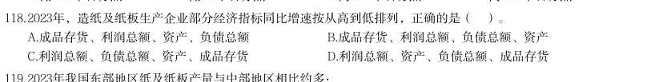

- **A.** 成品存货、利润总额、资产、负债总额
- **B.** 成品存货、利润总额、负债总额、资产
- **C.** 利润总额、负债总额、资产、成品存货
- **D.** 利润总额、资产、负债总额、成品存货

**答案：该题答案缺失，见原卷**　**考点：综合分析｜增长率**　**难度：★★★★☆**
**【2025 湖北省考·第 119 题】资料分析·倍数计算｜HB-2025-ty-X119**
> 材料：2023年全国著作权(包括作品著作权、计算机软件著作权、著作权质权)登记总量达8923901件,同比增 长40.46%,增速比上年同期增加39个百分点。根据各省、自治区、直辖市版权局和中国版权保护中心作品登记 信息统计,2023年全国共完成作品著作权登记6428277件,同比增长42.30%,登记量前五位的分别是:北京市 1101072件,同比增加53802件;山东省873826件,同比增加619459件;福建省710648件,同比增加424814件; 中国版权保护中心493070件,同比增加1476件;上海市412660件,同比增加30660件,从作品类型来看,登记 量最多的是美术作品3296437件,第二是摄影作品2501968件,第三是文字作品329128件,前三类作品类型登记 量占作品著作权登记总量的95.32%,该比例比上年同期增加4.86个百分点。

119. 2023年我国东部地区纸及纸板产量与中部地区相比约多:

> 材料图见 images/HB-2025-ty-X111-m.jpg

- **A.** 4倍以上
- **B.** 3-4倍
- **C.** 2-3倍
- **D.** 1-2倍

**答案：该题答案缺失，见原卷**　**考点：倍数计算｜倍数计算（综合）**　**难度：★★★☆☆**
**【2025 湖北省考·第 120 题】资料分析·综合分析｜HB-2025-ty-X120**
> 材料：2023年全国著作权(包括作品著作权、计算机软件著作权、著作权质权)登记总量达8923901件,同比增 长40.46%,增速比上年同期增加39个百分点。根据各省、自治区、直辖市版权局和中国版权保护中心作品登记 信息统计,2023年全国共完成作品著作权登记6428277件,同比增长42.30%,登记量前五位的分别是:北京市 1101072件,同比增加53802件;山东省873826件,同比增加619459件;福建省710648件,同比增加424814件; 中国版权保护中心493070件,同比增加1476件;上海市412660件,同比增加30660件,从作品类型来看,登记 量最多的是美术作品3296437件,第二是摄影作品2501968件,第三是文字作品329128件,前三类作品类型登记 量占作品著作权登记总量的95.32%,该比例比上年同期增加4.86个百分点。

120. 能够从上述资料中推出的是:

> 材料图见 images/HB-2025-ty-X111-m.jpg

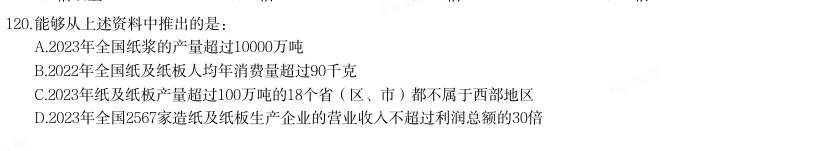

- **A.** 2023年全国纸浆的产量超过10000万吨
- **B.** 2022年全国纸及纸板人均年消费量超过90千克
- **C.** 2023年纸及纸板产量超过100万吨的18个省(区、市)都不属于西部地区
- **D.** 2023年全国2567家造纸及纸板生产企业的营业收入不超过利润总额的30倍

**答案：该题答案缺失，见原卷**　**考点：综合分析｜平均数**　**难度：★★★★★**
**【2025 湖北省考·第 121 题】资料分析·综合分析｜HB-2025-ty-X121**
> 材料：2023年全国著作权(包括作品著作权、计算机软件著作权、著作权质权)登记总量达8923901件,同比增长40.46%,增速比上年同期增加39个百分点。根据各省、自治区、直辖市版权局和中国版权保护中心作品登记信息统计,2023年全国共完成作品著作权登记6428277件,同比增长42.30%,登记量前五位的分别是:北京市1101072件,同比增加53802件;山东省873826件,同比增加619459件;福建省710648件,同比增加424814件;
中国版权保护中心493070件,同比增加1476件;上海市412660件,同比增加30660件,从作品类型来看,登记量最多的是美术作品3296437件,第二是摄影作品2501968件,第三是文字作品329128件,前三类作品类型登记量占作品著作权登记总量的95.32%,该比例比上年同期增加4.86个百分点。
2023年全国共完成著作权质权登记41

121. 2021年全国著作权登记总量约为:

> 材料图见 images/HB-2025-ty-X111-m.jpg

- **A.** 626万件
- **B.** 656万件
- **C.** 685万件
- **D.** 728万件

**答案：该题答案缺失，见原卷**　**考点：综合分析｜综合分析（综合）**　**难度：★★★★☆**
**【2025 湖北省考·第 122 题】资料分析·比重计算与比较｜HB-2025-ty-X122**
> 材料：2023年全国著作权(包括作品著作权、计算机软件著作权、著作权质权)登记总量达8923901件,同比增长40.46%,增速比上年同期增加39个百分点。根据各省、自治区、直辖市版权局和中国版权保护中心作品登记信息统计,2023年全国共完成作品著作权登记6428277件,同比增长42.30%,登记量前五位的分别是:北京市1101072件,同比增加53802件;山东省873826件,同比增加619459件;福建省710648件,同比增加424814件;
中国版权保护中心493070件,同比增加1476件;上海市412660件,同比增加30660件,从作品类型来看,登记量最多的是美术作品3296437件,第二是摄影作品2501968件,第三是文字作品329128件,前三类作品类型登记量占作品著作权登记总量的95.32%,该比例比上年同期增加4.86个百分点。
2023年全国共完成著作权质权登记41

122. 2022年北京市作品著作权登记量约占同年全国作品著作权登记总量的:

> 材料图见 images/HB-2025-ty-X111-m.jpg

- **A.** 10%
- **B.** 13%
- **C.** 18%
- **D.** 23%

**答案：该题答案缺失，见原卷**　**考点：比重计算与比较｜现期比重**　**难度：★★★☆☆**
**【2025 湖北省考·第 123 题】资料分析·综合分析｜HB-2025-ty-X123**
> 材料：2023年全国著作权(包括作品著作权、计算机软件著作权、著作权质权)登记总量达8923901件,同比增长40.46%,增速比上年同期增加39个百分点。根据各省、自治区、直辖市版权局和中国版权保护中心作品登记信息统计,2023年全国共完成作品著作权登记6428277件,同比增长42.30%,登记量前五位的分别是:北京市1101072件,同比增加53802件;山东省873826件,同比增加619459件;福建省710648件,同比增加424814件;
中国版权保护中心493070件,同比增加1476件;上海市412660件,同比增加30660件,从作品类型来看,登记量最多的是美术作品3296437件,第二是摄影作品2501968件,第三是文字作品329128件,前三类作品类型登记量占作品著作权登记总量的95.32%,该比例比上年同期增加4.86个百分点。
2023年全国共完成著作权质权登记41

123. 2022年美术作品、摄影作品、文字作品的著作权登记量共约:

> 材料图见 images/HB-2025-ty-X111-m.jpg

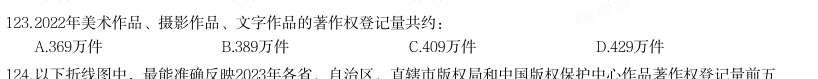

- **A.** 369万件
- **B.** 389万件
- **C.** 409万件
- **D.** 429万件

**答案：该题答案缺失，见原卷**　**考点：综合分析｜综合分析（综合）**　**难度：★★★★☆**
**【2025 湖北省考·第 124 题】资料分析·增长率计算与比较｜HB-2025-ty-X124**
> 材料：2023年全国著作权(包括作品著作权、计算机软件著作权、著作权质权)登记总量达8923901件,同比增长40.46%,增速比上年同期增加39个百分点。根据各省、自治区、直辖市版权局和中国版权保护中心作品登记信息统计,2023年全国共完成作品著作权登记6428277件,同比增长42.30%,登记量前五位的分别是:北京市1101072件,同比增加53802件;山东省873826件,同比增加619459件;福建省710648件,同比增加424814件;
中国版权保护中心493070件,同比增加1476件;上海市412660件,同比增加30660件,从作品类型来看,登记量最多的是美术作品3296437件,第二是摄影作品2501968件,第三是文字作品329128件,前三类作品类型登记量占作品著作权登记总量的95.32%,该比例比上年同期增加4.86个百分点。
2023年全国共完成著作权质权登记41

124. 以下折线图中,最能准确反映2023年各省、自治区、直辖市版权局和中国版权保护中心作品著作权登记量前五 位的同比增长率情况的是(按登记量从大到小排列):

> 材料图见 images/HB-2025-ty-X111-m.jpg

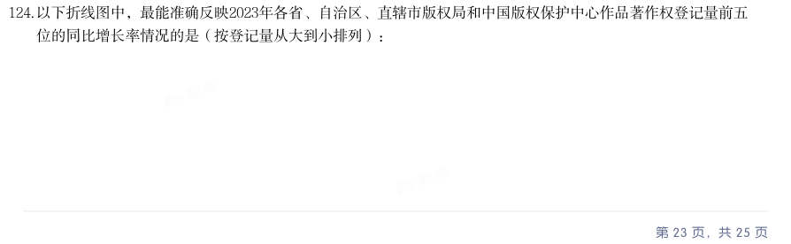

- **A.** 
- **B.** 
- **C.** 
- **D.** 

**答案：该题答案缺失，见原卷**　**考点：增长率计算与比较｜增长率计算**　**难度：★★★☆☆**
**【2025 湖北省考·第 125 题】资料分析·综合分析｜HB-2025-ty-X125**
> 材料：2023年全国著作权(包括作品著作权、计算机软件著作权、著作权质权)登记总量达8923901件,同比增长40.46%,增速比上年同期增加39个百分点。根据各省、自治区、直辖市版权局和中国版权保护中心作品登记信息统计,2023年全国共完成作品著作权登记6428277件,同比增长42.30%,登记量前五位的分别是:北京市1101072件,同比增加53802件;山东省873826件,同比增加619459件;福建省710648件,同比增加424814件;
中国版权保护中心493070件,同比增加1476件;上海市412660件,同比增加30660件,从作品类型来看,登记量最多的是美术作品3296437件,第二是摄影作品2501968件,第三是文字作品329128件,前三类作品类型登记量占作品著作权登记总量的95.32%,该比例比上年同期增加4.86个百分点。
2023年全国共完成著作权质权登记41

125. 不能从上述资料中推出的是:

> 材料图见 images/HB-2025-ty-X111-m.jpg

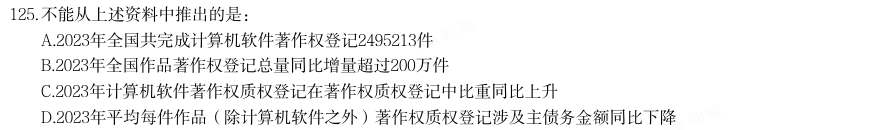

- **A.** 2023年全国共完成计算机软件著作权登记2495213件
- **B.** 2023年全国作品著作权登记总量同比增量超过200万件
- **C.** 2023年计算机软件著作权质权登记在著作权质权登记中比重同比上升
- **D.** 2023年平均每件作品(除计算机软件之外)著作权质权登记涉及主债务金额同比下降

**答案：该题答案缺失，见原卷**　**考点：综合分析｜年均增长率**　**难度：★★★★★**