# 2026 年湖北行测（统一卷）

- 题量：125（含答案 117）
- 模块分布：资料分析20 / 数量关系15 / 言语理解30 / 判断推理35 / 常识判断25
- 试卷编号：`湖北-2026-统一卷`

## 题目与答案

**【常识判断·政治常识｜HB-2026-ty-X001】**

1. · 本试卷由粉笔用户上岸张同学66生成 (网友回忆版) · 本试卷由粉笔用户上岸张同学66生成 党的十八大以来,以习近平同志为核心的党中央坚定不移推进全面从严治党,取得一系列理论创新、实践创 新、制度创新成果,构建起全面从严治党体系,开辟了百年大党自我革命新境界。下列关于全面从严治党的表 述不准确的是( )。

- **A.** 制度建设要与管党治党需要相适应、与党的各项建设相配套,全方位织密制度的笼子
- **B.** 严密党的组织体系,关键是坚持党中央权威和集中统一领导,根本在做到“两个维护”
- **C.** 新时代党的建设是以党的组织建设为统领、党的各项建设同向发力综合发力的系统工程
- **D.** 着力抓好政治监督、领导班子特别是“一把手”监督、“三重一大”事项监督以及权力集中、资金密集、资

**答案：C**　**考点：政治常识**
**【常识判断·政治常识｜HB-2026-ty-X002】**

2. 源富集等重点领域的监督 习近平总书记指出,讲好中国故事,传播好中国声音,展示真实、立体、全面的中国,是加强我国国际传播能 力建设的重要任务。关于加强我国国际传播能力建设,下列表述正确的是: 1要提升国际传播体系稳定性,防范国际传播格局重构 2要全面提升国际传播效能,建强适应新时代国际传播需要的专门人才队伍 3要倡导和平的国际舆论环境,不参与国际舆论斗争,塑造谦逊谦和的大国形象 4推动走出去、请进来管理便利化,扩大国际人文交流合作

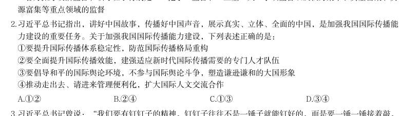

> （本题为图形题，选项为图片，见原卷）

**答案：暂缺**　**考点：政治常识**
**【常识判断·政治常识｜HB-2026-ty-X003】**

3. 习近平总书记曾说:“我们要有钉钉子的精神,钉钉子往往不是一锤子就能钉好的,而是要一锤一锤接着敲, 直到把钉子钉实钉牢,钉牢一颗再钉下一颗,不断钉下去,必然大有成效。如果东一榔头西一棒子,结果很可 能是一颗钉子都钉不上、钉不牢。”这句话最能体现的哲学原理是: 1量变与质变辩证统一 2肯定与否定辩证统一 3主要矛盾与次要矛盾辩证统一 4尊重客观规律与发挥主观能动性辩证统一

- **A.** 12
- **B.** 23
- **C.** 34
- **D.** 14

**答案：暂缺**　**考点：政治常识**
**【常识判断·政治常识｜HB-2026-ty-X004】**

4. 下列选项中,习近平用语与其蕴含的思想、观点对应恰当的是: 1我将无我,不负人民——全心全意为人民服务 2功成不必在我、功成必定有我——方向决定前途,道路决定命运 3江山就是人民,人民就是江山——民为邦本 4时代是出卷人,我们是答卷人,人民是阅卷人——时代造就英雄,伟大来自平凡

- **A.** 12
- **B.** 13
- **C.** 24
- **D.** 34

**答案：暂缺**　**考点：政治常识**
**【常识判断·政治常识｜HB-2026-ty-X005】**

5. 习近平总书记指出,中国愿同世界各国一道,把握信息革命发展的历史主动,携手构建网络空间命运共同体, 让互联网更好造福人民、造福世界。关于构建网络空间命运共同体,下列表述正确的是: 1尊重网络主权,维护网络安全,共同构建和平、安全、开放、合作的网络空间 2全球网络主要由跨国公司提供,网络空间未来应由跨国公司携手经营 3倡导发展优先,构建更加普惠繁荣的网络空间 4保障数据安全,建立单边、保密的国际互联网治理体系 5深化网络安全务实合作,有力打击网络违法犯罪行为

- **A.** 135
- **B.** 145
- **C.** 1235
- **D.** 12345

**答案：暂缺**　**考点：政治常识**
**【常识判断·政治常识｜HB-2026-ty-X006】**
> 材料：习近平总书记指出,要推动公共文化服务标准化、均等化,坚持政府主导、社会参与、重心下移、共建共享, 完善公共文化服务体系,提高基本公共文化服务的覆盖面和适用性。关于完善公共文化服务体系,下列举措正 确的有几项?

6. · 本试卷由粉笔用户上岸张同学66生成 1做好文化馆、乡镇(街道)综合文化站、村(社区)综合性文化服务中心等的规划建设 2推动优质文化资源向沿海发达地区集中,促进公共文化服务差异化发展 3实施全国智慧图书馆体系建设、公共文化云建设等项目 4实施广播电视惠民工程,完善农村文化基础设施网络 5推动各民族文化的传承保护和创新交融,提升民族地区公共文化服务水平

- **A.** 2项
- **B.** 3项
- **C.** 4项
- **D.** 5项

**答案：暂缺**　**考点：政治常识**
**【常识判断·政治常识｜HB-2026-ty-X007】**

7. 习近平总书记强调,要推动森林“水库、钱库、粮库、碳库”更好联动,实现生态效益、经济效益、社会效益 相统一。下列表述与这一要求相契合的有几项? 1手中有粮,心中不慌 2绿水青山就是金山银山 3增绿就是增优势,护林就是护财富 4环境就是民生,青山就是美丽,蓝天也是幸福

- **A.** 1项
- **B.** 2项
- **C.** 3项
- **D.** 4项

**答案：暂缺**　**考点：政治常识**
**【常识判断·政治常识｜HB-2026-ty-X008】**

8. 党的二十大报告指出,坚持把发展经济的着力点放在实体经济上,推进新型工业化,加快建设制造强国、质量 强国、航天强国、交通强国、网络强国、数字中国。关于发展实体经济,下列说法正确的是: 1金融是实体经济的血脉,为实体经济服务是金融的天职 2要增强资本市场服务实体经济功能,积极有序发展股权融资 3要实现实体经济、科技创新、现代金融、人力资源协同发展 4要促进实体经济和数字经济深度融合,有序推动实体经济脱实向虚 5要推动资源要素向实体经济集聚、政策措施向实体经济倾斜、工作力量向实体经济加强

- **A.** 1235
- **B.** 234
- **C.** 1245
- **D.** 345

**答案：暂缺**　**考点：政治常识**
**【常识判断·政治常识｜HB-2026-ty-X009】**

9. 党的二十届四中全会指出,“十五五”时期是基本实现社会主义现代化夯实基础、全面发力的关键时期,在基 本实现社会主义现代化进程中具有承前启后的重要地位。关于“十五五”规划,下列说法正确的是:

- **A.** 加强原始创新和关键核心技术攻关,推动科技创新和产业创新深度融合
- **B.** 把发展经济的着力点向传统实体产业转移,巩固壮大传统实体产业根基
- **C.** 积极稳妥推进和实现碳达峰,发展集中式能源,逐步缩减全国碳排放权交易市场
- **D.** 发挥积极财政政策作用,适当加强地方事权、提高地方财政支出比重,增加地方自主财力

**答案：暂缺**　**考点：政治常识**
**【常识判断·政治常识｜HB-2026-ty-X010】**

10. 推进中国式现代化是一个系统工程,需要统筹兼顾、系统谋划、整体推进,正确处理好一系列重大关系。下列 与之相关的表述正确的有( )。 1活力与秩序:中国式现代化应当而且能够实现活而不乱、活跃有序的动态平衡 2守正与创新:守正才能不迷失方向、不犯颠覆性错误,创新才能把握时代、引领时代 3战略与策略:要增强策略的前瞻性,准确把握事物发展的必然趋势,以科学的战略预见未来、引领未来 4效率与公平:中国式现代化既要创造比资本主义更高的效率,又要更有效地维护社会公平,更好实现效率与 公平相兼顾、相促进、相统一

- **A.** 1项
- **B.** 2项
- **C.** 3项
- **D.** 4项

**答案：B**　**考点：政治常识**
**【常识判断·政治常识｜HB-2026-ty-X011】**
> 材料：城乡融合发展是中国式现代化的必然要求。关于城乡融合发展,下列说法正确的有几项? 1要把乡村振兴战略这篇大文章做好,必须走城乡融合发展之路 2在现代化进程中,如何处理好工农关系、城乡关系,在一定程度上决定着现代化的成败 3要顺应城乡融合发展大趋势,破除妨碍城乡要素平等交换、双向流动的制度壁垒 4振兴乡村,不能就乡村论乡村,还是要强化以工补农、以城带乡,加快形成工农互促、城乡互补、协调发 展、共同繁荣的新型工农城乡关系

11. · 本试卷由粉笔用户上岸张同学66生成

- **A.** 1项
- **B.** 2项
- **C.** 3项
- **D.** 4项

**答案：D**　**考点：政治常识**
**【常识判断·政治常识｜HB-2026-ty-X012】**

12. 建设质量强国是推动高质量发展,促进我国经济由大向强转变的重要举措,是满足人民美好生活需要的重要途 径。关于建设质量强国,下列表述正确的有( )。 1建立健全强制性与自愿性相结合的质量披露制度 2支持开展质量公益诉讼和集体诉讼,有效执行商品质量惩罚性赔偿制度 3深化检验检测认证机构资质审批制度改革,全面实施告知承诺和优化审批服务 4加强工程质量监督队伍建设,全面推行政府购买服务方式委托社会力量辅助工程质量监督检查 5鼓励支持中小微企业实施技术改造、质量改进、品牌建设,提升中小微企业质量技术创新能力

- **A.** 4项
- **B.** 3项
- **C.** 2项
- **D.** 1项

**答案：A**　**考点：政治常识**
**【常识判断·政治常识｜HB-2026-ty-X013】**

13. 加强数字政府建设是创新政府治理理念和方式、形成数字治理新格局、推进国家治理体系和治理能力现代化的 重要举措。下列关于数字政府建设的基本原则,表述正确的有几项? 1坚持党的全面领导,充分发挥党总揽全局、协调各方的领导核心作用 2坚持以市场为中心,始终把满足人民群众物质生活的迫切需求作为目标 3坚持整体协同,强化系统观念,加强系统集成,全面提升数字政府集约化建设水平 4坚持数据赋能,建立健全数据治理制度和标准体系,加强数据汇聚融合、共享开放和开发利用

- **A.** 1项
- **B.** 2项
- **C.** 3项
- **D.** 4项

**答案：C**　**考点：政治常识**
**【常识判断·政治常识｜HB-2026-ty-X014】**

14. 建设教育强国,基点在基础教育。基础教育搞得越扎实,教育强国步伐就越稳、后劲就越足。关于加强基础教 育,下列举措正确的有几项? 1提升寄宿制学校办学条件和管理水平,办好必要的乡村小规模学校 2统筹推进市域内高中阶段学校多样化发展,加快扩大普通高中教育资源供给 3强化家庭教育主阵地作用,健全学校家庭社会协同育人机制 4建立基础教育各学段学龄人口变化监测预警制度,优化中小学和幼儿园布局 5深入开展县域义务教育优质均衡督导评估,有序推进市域义务教育优质均衡发展

- **A.** 4项
- **B.** 3项
- **C.** 2项
- **D.** 1项

**答案：A**　**考点：政治常识**
**【常识判断·政治常识｜HB-2026-ty-X015】**

15. 优化政务服务、提升行政效能是优化营商环境、建设全国统一大市场的必然要求,对加快构建新发展格局、推 动高质量发展具有重要意义。关于优化政务服务、提升行政效能,下列举措恰当的是: 1推进关联事项集成办,为企业和群众提供“一件事一次办”“一类事一站办”服务 2推进线下办事“只进一门”,要求所有的银行网点、邮政网点、园区等都要设置便民服务点 3推进企业和群众诉求“一线应答”,根据需要设置重点领域专席,不断提升12345热线接办效率 4推进线上办事“一网通办”,推动各类政务服务事项和应用“应接尽接、应上尽上”,政府服务事项全面纳 入同级政务服务平台管理和办理

- **A.** 12
- **B.** 13
- **C.** 24
- **D.** 34

**答案：B**　**考点：政治常识**
**【常识判断·政治常识｜HB-2026-ty-X016】**

16. 中国共产党党报党刊的发展历程,与中国共产党的奋斗历程密不可分。下列说法错误的是:

- **A.** 《布尔塞维克》是解放战争时期中国共产党创办的中央机关刊物
- **B.** 《人民日报》由《晋察冀日报》和晋冀鲁豫《人民日报》合并而来
- **C.** 《红色中华》创刊于江西瑞金,初期为中华苏维埃共和国临时中央政府机关报
- **D.** 《求是》杂志是党中央指导全党全国工作的重要思想理论阵地,前身是中共中央主办的《红旗》杂志

**答案：A**　**考点：政治常识**
**【常识判断·政治常识｜HB-2026-ty-X017】**
> 材料：关于社会保险,下列说法正确的是:

17. · 本试卷由粉笔用户上岸张同学66生成

- **A.** 灵活就业人员可以参加职工基本医疗保险
- **B.** 失业者领取失业保险金的期限与累计缴费年限无关
- **C.** 同一统筹地区内用人单位工伤保险执行统一缴费费率
- **D.** 生育保险待遇中的生育津贴按职工本人上年度的月平均工资计发

**答案：A**　**考点：政治常识**
**【常识判断·地理常识｜HB-2026-ty-X018】**

18. 根据《中华人民共和国广告法》,下列属于违法行为的有几项? 1在广告中使用国旗、国歌 2在广告中使用国家机关工作人员的名义或者形象 3电视台以介绍健康、养生知识等形式变相发布医疗、药品、医疗器械、保健食品广告 4对升学、通过考试、获得学位学历或者合格证书,或者对教育、培训的效果作出保证性承诺 5教育、培训广告中利用科研单位、学术机构、专业人士的名义或者形象作推荐、证明

- **A.** 2项
- **B.** 3项
- **C.** 4项
- **D.** 5项

**答案：D**　**考点：地理常识**
**【常识判断·经济常识｜HB-2026-ty-X019】**

19. 下列语句与其所蕴含的经济学原理对应正确的是:

- **A.** 物以多为贱——沉没成本
- **B.** 酒香不怕巷子深——买方市场
- **C.** 众人拾柴火焰高——规模经济
- **D.** 物至而反,冬夏是也。致至而危,累棋是也——边际效用递增

**答案：C**　**考点：经济常识**
**【常识判断·历史人文｜HB-2026-ty-X020】**

20. “二十四史”是中国历代史学家精心编撰的纪传体史书,是中华民族珍贵的文化遗产。下列说法正确的是:

- **A.** 《后汉书》记载了侯景之乱
- **B.** 《南史》是南朝范晔编撰的史书
- **C.** 《汉书》中《艺文志》是记述经济制度的专篇
- **D.** 《史记》卷次中《五帝本纪》排序在《殷本纪》之前

**答案：D**　**考点：历史人文**
**【常识判断·政治常识｜HB-2026-ty-X021】**

21. 关于我国考古发现,下列说法错误的是:

- **A.** 良渚文化主要分布于太湖地区,其文化遗址最大特色是所出土的玉器
- **B.** 仰韶文化主要分布在黄河支流汇集的中原地区,其中较著名的是元谋人遗址
- **C.** 大汶口文化主要分布在泰山周围地区,氏族墓地中晚期出现了男女合葬现象
- **D.** 龙山文化是新石器时代晚期的文化,其陶器已开始使用轮制技术,器型规整

**答案：B**　**考点：政治常识**
**【常识判断·科技常识｜HB-2026-ty-X022】**

22. 下列选项体现的物理原理与其他选项不同的是( )。

- **A.** 三角形的泡泡棒吹出的泡泡总是趋于球状
- **B.** 植物根部的毛细管从土壤中吸收水分
- **C.** 眼镜镜片的表面镀膜可以防蓝光
- **D.** 雨后荷叶上的水珠呈球形

**答案：C**　**考点：科技常识**
**【常识判断·法律常识｜HB-2026-ty-X023】**

23. 极光是一种绚丽多彩的大气发光现象,一般只在南北两极的高纬度地区出现,它的形成与太阳活动、地球磁场 和高层大气的相互作用有关。由此判断观测极光需要的条件是( )。

- **A.** 太阳活动强烈,月圆的夜晚
- **B.** 太阳活动强烈,晴朗的夜晚
- **C.** 太阳活动微弱,多云的夜晚
- **D.** 太阳活动微弱,下雨的夜晚

**答案：B**　**考点：法律常识**
**【常识判断·生活常识｜HB-2026-ty-X024】**

24. 《黄帝内经》中“是故圣人不治已病治未病”的思想是中医养生的重要理念,倡导通过饮食、运动、情志调节 等方式增强体质,未病先防。下列古诗词中描述的行为不符合“治未病”理念的是( )。

- **A.** 天寒常早睡,不待日光敛
- **B.** 修性以保神,安心以全身
- **C.** 抽刀断水水更流,举杯消愁愁更愁
- **D.** 食惟半饱无兼味,酒至三分莫过频

**答案：C**　**考点：生活常识**
**【常识判断·政治常识｜HB-2026-ty-X025】**
> 材料：肥胖会严重影响人体健康,饮食控制是治疗肥胖症的一种有效手段。在摄入量相同且不考虑烹饪方式的情况 下,下列四份食谱中热量值最低的是( )。

25. · 本试卷由粉笔用户上岸张同学66生成

- **A.** 鸭肉、馒头、马铃薯、葡萄
- **B.** 鲈鱼、大米饭、黄瓜、橙子
- **C.** 鸡蛋、花卷、胡萝卜、榴莲
- **D.** 五花肉、烧饼、鲜香菇、西瓜

**答案：B**　**考点：政治常识**
**【言语理解·逻辑填空｜HB-2026-ty-X026】**

26. 的答案。 当前人类已全面进入知识经济时代,高质量发展越来越依靠知识和创新。教育强国、科技强国、人才强国具有 共生性, 。科技强国要求高科技自立自强,成为世界主要科学中心;人才强国要求提高自主培养质量, 成为世界重要人才中心。科技和人才离不开高质量教育体系,因此“三大强国”的统筹部署有利于支撑“两个 中心”建设。 填入画横线部分最恰当的一项是:

- **A.** 异曲同工
- **B.** 同气连枝
- **C.** 同日而语
- **D.** 同声相应

**答案：B**　**考点：逻辑填空**
**【言语理解·逻辑填空｜HB-2026-ty-X027】**

27. 中国有着悠久灿烂的文明,同时开创了人类历史上最为 的现代化进程,中国故事精彩非凡、激动人心, 也需要精彩讲述、更好传播。 填入画横线部分最恰当的一项是:

- **A.** 五彩斑斓
- **B.** 流光溢彩
- **C.** 波澜壮阔
- **D.** 汹涌澎湃

**答案：C**　**考点：逻辑填空**
**【言语理解·逻辑填空｜HB-2026-ty-X028】**

28. 《永乐大典》成书于明永乐六年,是中国古代最大的类书,《不列颠百科全书》称其为“世界有史以来最大的 百科全书”,共计22937卷11095册,约3.7亿字,收先秦至明初的各类典籍七八千种,被称为典籍 、佚书宝 库。

- **A.** 本源
- **B.** 渊薮
- **C.** 桂冠
- **D.** 文荟

**答案：B**　**考点：逻辑填空**
**【言语理解·逻辑填空｜HB-2026-ty-X029】**

29. 未来,数字科技将会持续深度赋能文化产业,数字文化产业新模式、新业态更加丰富,文化产业的产业链、生 态链、价值链更为 。我们应着重培养市场主体,探索建构文化全产业链, 文化供给与文化需求的错 位,引导文化企业坚持社会效益与经济效益的高度统一,不断提升文化产品和服务的供给质量。 依次填入画横线部分最恰当的一项是:

- **A.** 完备 消解
- **B.** 完善 拉开
- **C.** 完好 弥补
- **D.** 完美 避开

**答案：A**　**考点：逻辑填空**
**【言语理解·逻辑填空｜HB-2026-ty-X030】**

30. 勤劳智慧的黔东南人民始终 着与大自然“万物共生”的传统,响应季节变化,熟悉土地秉性,顺应、融入 大自然生态系统,形成了生态养殖、种植绿色循环发展的完整生物链。作为典型的人工生态系统,江稻鱼鸭复 合系统具有保护生物多样性、控制病虫害、调节气候、 水源等多种生态功能。 依次填入画横线部分最恰当的一项是:

- **A.** 坚守 涵养
- **B.** 遵守 滋润
- **C.** 恪守 蓄积
- **D.** 信守 保持

**答案：A**　**考点：逻辑填空**
**【言语理解·逻辑填空｜HB-2026-ty-X031】**

31. 一种能监测心脏术后并发症的新设备可以完成比传统的起搏器更复杂的监测。起搏器只能提供心脏的整体图 像,但新设备可以提供更 的图像,具体显示出心脏哪些区域功能不正常。其上分布的微电极阵列可从心房 的多个位置绘制电信号活动,并按需传递电刺激,以便在 的时候解除房颤,恢复正常心律。 依次填入画横线部分最恰当的一项是:

- **A.** 清晰 需要
- **B.** 细致 关键
- **C.** 直观 适当
- **D.** 完整 凶险

**答案：B**　**考点：逻辑填空**
**【言语理解·逻辑填空｜HB-2026-ty-X032】**

32. 高山草甸四周海拔较高的陡峭山地往往是不同生态系统的交界处,生存环境和食物资源更为多样,这使得赤狐 可以大展拳脚, 在不同景观的边缘,将捕食效率最大化,同时也将风险降至最低,可谓 。即使在内 蒙古达赉湖、宁夏贺兰山等地,赤狐的洞穴也经常出现。 依次填入画横线部分最恰当的一项是:

- **A.** 逡巡 从容不迫
- **B.** 盘桓 张弛有度
- **C.** 游走 进退自如
- **D.** 驻留 攻守兼备

**答案：C**　**考点：逻辑填空**
**【言语理解·逻辑填空｜HB-2026-ty-X033】**
> 材料：这些“山环水绕”的地方虽然山不高,水的形态也无太大差别,但这里是自然优美的 。这里有花岗岩、石 灰岩、红色砂岩三大造景岩石,每一种都造就了独具 的美,如花岗岩的雄浑,石灰岩的秀美,红色砂岩造

33. · 本试卷由粉笔用户上岸张同学66生成 就的赤壁丹霞······然而,这块“山环水绕”之地,永远在 中展现出无穷的多样性,如花岗岩造 就的黄山式的景观在江西三清山上再现,红色砂岩造就的广东仁化碧水丹崖式的风景在福建泰宁重演。 依次填入画横线部分最恰当的一项是:

- **A.** 代表 生态 丰富性
- **B.** 特例 风情 共同性
- **C.** 范例 特色 同一性
- **D.** 典范 个性 统一性

**答案：D**　**考点：逻辑填空**
**【言语理解·逻辑填空｜HB-2026-ty-X034】**

34. 在一般印象里,香水是比较晚近的舶来品,但这里的“香水”指的是发展成熟的香精香水。20世纪初,香港的 广生行和上海中西大药房 引进了淡香精香水“佛罗里达水”,借用欧阳修词中“花露重,草烟低,人家帘 幕垂”的句子,命名为“花露水”。这种淡绿色香水主要使用玫瑰与麝香香精,在此后数十年里 中国,是 中国最流行的香调。所以,有人将花露水称为中国最早的香水,也不能说没有依据。 依次填入画横线部分最恰当的一项是:

- **A.** 先后 遍及
- **B.** 率先 风靡
- **C.** 抢先 享誉
- **D.** 分别 席卷

**答案：B**　**考点：逻辑填空**
**【言语理解·逻辑填空｜HB-2026-ty-X035】**

35. 马的移动能力强且速度快,有了马的 ,人类的畜牧规模必然会有所 ,聚落的大小、位置以及聚落之间 的距离也会随之出现一定程度的变化。 依次填入画横线部分最恰当的一项是:

- **A.** 参与 改变
- **B.** 帮助 精简
- **C.** 协助 扩大
- **D.** 介入 增加

**答案：C**　**考点：逻辑填空**
**【言语理解·逻辑填空｜HB-2026-ty-X036】**

36. 约有20%的人出生时至少携带一个名为APOE4的基因变异拷贝。该变异使人年老时更易患心脏病,但这种变异 却没有被淘汰。研究发现,APOE4基因可能具有抵消其他负面影响的 好处,如携带APOE4的女性会生育更 多的孩子。这种生育优势可能使该致病基因在人类进化过程中得以 。 依次填入画横线部分最恰当的一项是:

- **A.** 潜在 延续
- **B.** 特殊 发展
- **C.** 显性 保存
- **D.** 隐性 入选

**答案：A**　**考点：逻辑填空**
**【言语理解·逻辑填空｜HB-2026-ty-X037】**

37. 近年来,随着“中华文明探源研究”“考古中国”等重大项目的深入实施,中国考古学界积极推动多学科交叉 融合,不断利用新手段、新工具提升田野考古发掘水平与研究阐释能力, 了历史轴线, 了历史信度, 丰富了历史内涵, 了历史场景。 依次填入画横线部分最恰当的一项是:

- **A.** 廓张 平添 加强
- **B.** 延伸 增强 活化
- **C.** 接续 提高 恢复
- **D.** 拓长 充实 还原

**答案：B**　**考点：逻辑填空**
**【言语理解·逻辑填空｜HB-2026-ty-X038】**

38. 人工智能技术飞速发展,逐渐向人类智能水平逼近。科学家们在研究过程中愈发清晰地意识到,许多棘手的问 题并非单凭一家公司之力就能成功解决。除了至今 的“电车难题”外,还有日益重要的价值观 问题 ——当AI拥有了自主设定目标的能力时,又该如何确保这些由AI自行确定的目标符合人类利益、与人类价值观 相 ? 依次填入画横线部分最恰当的一项是:

- **A.** 争论不休 构建 吻合
- **B.** 流口常谈 践行 出入
- **C.** 悬而未决 对齐 契合
- **D.** 束手无策 匹配 切合

**答案：C**　**考点：逻辑填空**
**【言语理解·中心理解｜HB-2026-ty-X039】**

39. 智能社会的演进模糊了社会心态与社会行为的边界,呈现出线上线下虚实共生、心态风险与行动风险交织缠绕 的特征,这对社会心态的治理策略与治理工具提出了新的挑战。社交软件的分享机制与算法推荐规律,都以对 人类心理特征的精准利用为前提。此类技术往往把复杂的人类互动过程简化为点赞、转发等二元化的态度立场 或简单行为,虽然便利了个体表达观点,却可能导致网络行为高度两极化,让许多事实错误但情绪饱满的虚假 信息快速传播,成为网络空间治理的一大顽疾。 这段文字意在强调:

- **A.** 智能社会对社会心态治理提出了新的挑战
- **B.** 智能化加速了从社会心态到社会行为的转化
- **C.** 社交软件的算法可能导致网络行为高度两极化
- **D.** 智能社会当务之急是要加强网络空间治理

**答案：A**　**考点：中心理解**
**【言语理解·中心理解｜HB-2026-ty-X040】**
> 材料：晚安牛奶的最大卖点在于“高褪黑素含量”。有品牌标明“褪黑素含量:12500pg/盒”,1pg等于万亿分之一 克。而褪黑素的有效剂量在0.1~0.3毫克,这意味着需要喝约8000盒这种牛奶才能达到治疗剂量,因此晚安牛奶

40. · 本试卷由粉笔用户上岸张同学66生成 助眠更依赖于其安慰剂效应。如果某人有轻微的失眠困扰,还达不到临床上失眠的诊断标准,又能够排除器质 性或精神疾病因素导致的失眠,个体比较相信晚安牛奶,或者喝后有效,在这种有益无害的前提下,不妨食 用。 这段文字意在强调:

- **A.** 晚安牛奶的助眠效果主要源自心理作用
- **B.** 晚安牛奶能助眠是商家的虚假宣传
- **C.** 多喝晚安牛奶才能起到助眠作用
- **D.** 晚安牛奶有较好的助眠效果

**答案：A**　**考点：中心理解**
**【言语理解·中心理解｜HB-2026-ty-X041】**

41. 目前,以京津冀、长三角、粤港澳大湾区、成渝、中部地区城市群为核心的快递枢纽集群建设已基本成形,全 球性国际寄递中心、境外地面网络和海外仓加快建设,农村寄递服务网络实现下乡进村,宅递、箱递、站递等 多元化末端服务体系初步形成。我国快递业拥有专业物流园区400多个,营业网点41.3万处,快递运输汽车27万 多辆,全货机近200架。重点城市群内快件1日达、国内重点城市间次日达已成为常态。 这段文字意在说明:

- **A.** 我国快递业通过完善基础设施推动了城乡寄送服务均衡发展
- **B.** 我国快递业将聚焦全球寄递网络建设以提升国际运输时效
- **C.** 我国快递业依托“枢纽+网络”建设实现了物流及寄递能力全面发展
- **D.** 我国快递业在农村寄递网络建设及寄递时效提升上成效显著

**答案：C**　**考点：中心理解**
**【言语理解·中心理解｜HB-2026-ty-X042】**

42. 普惠金融体系面临的重要挑战之一是服务对象存在标准化数据少、个体风险高、抵押品少、个性化需求多等特 征,因此发展普惠金融需要不同类型的金融机构和企业共同分担风险和损失,比如融资担保等风险共担机制即 为解决上述问题的一种手段,不过费用设计、合作模式等都有待于进一步创新。 这段文字意在说明:

- **A.** 普惠金融体系费用设计和合作模式亟待创新
- **B.** 普惠金融体系建设要逐步拓宽金融服务领域
- **C.** 普惠金融体系建设有必要完善风险共担机制
- **D.** 普惠金融体系面临来自服务对象的多重挑战

**答案：C**　**考点：中心理解**
**【言语理解·中心理解｜HB-2026-ty-X043】**

43. 斑翅果蝇的雌虫会在多种软皮水果中产卵,其幼虫在果实内取食,导致水果腐烂。近日,科研人员利用“基因 剪刀”技术将影响斑翅果蝇性别发育的基因修改成让雌虫无法正常产卵但对雄虫无影响的版本后,斑翅果蝇的 绝大多数后代都会继承这个基因变化,实现基因驱动。科学家认为,人为实现基因驱动,让特定基因在生物群 体中传播开来,可以控制有害生物的数量或增强濒危物种的抗病能力。此前已有研究团队用相关方法消灭传播 疟疾的蚊子,此次用于斑翅果蝇这种农业害虫尚属首次。 这段文字主要介绍了:

- **A.** “基因剪刀”技术是一项高效的抗虫害技术
- **B.** “基因剪刀”技术增强了濒危物种的抗病能力
- **C.** 通过基因驱动可以控制有害生物的数量
- **D.** 研究人员用“基因剪刀”技术对抗斑翅果蝇

**答案：D**　**考点：中心理解**
**【言语理解·中心理解｜HB-2026-ty-X044】**

44. 在我国,对农业生产造成重大危害的多数昆虫都具有迁飞性。草地贪夜蛾、黏虫等具有“春夏北迁,秋冬南 迁”的习性。由于昆虫个体小、重量轻,飞行能力有限,远距离迁飞主要借助气流运载。季风、台风、西太平 洋副热带高压的位置与强度变化等因素都会对害虫的迁飞扩散产生重要影响。每年春夏,害虫大军从中南半岛 等地随西南季风迁飞入我国,之后又随西南季风或东南季风暖湿气流继续北上。到了秋冬,草地贪夜蛾、黏虫 等为逃避低温环境,只好迁回温暖的南方。这是昆虫逃避不良环境条件的一种生存对策。 这段文字重在说明害虫大军迁飞的:

- **A.** 地域密码
- **B.** 季节规律
- **C.** 环境影响
- **D.** 生存策略

**答案：B**　**考点：中心理解**
**【言语理解·中心理解｜HB-2026-ty-X045】**
> 材料：在深度学习的过程中,实际确定误差并非易事。为解决这一问题,当前深度学习领域应用“损失函数”实现误 差最小化,即在人工智能的学习过程中,找到能够最小化损失函数值的参数。但损失函数的形式会随具体情况 而有所不同,难以全面掌握其特性,因此需要引入微分。微分主要用于分析某个变量的变化如何影响函数的 值。通过对损失函数进行微分,可以明了参数变化时损失函数值的变化,进而调整参数值,让损失函数的值尽 可能小。在针对性地进行编程后,人工智能能够自动完成上述任务。

45. · 本试卷由粉笔用户上岸张同学66生成 对这段文字概括最恰当的是:

- **A.** 通过对损失函数进行微分,深度学习能实现误差最小化
- **B.** 引入微分后,损失函数能帮助人工智能实现自主深度学习
- **C.** 损失函数在深度学习中主要用于确定误差
- **D.** 损失函数对深度学习的参数优化具有重要意义

**答案：A**　**考点：中心理解**
**【言语理解·中心理解｜HB-2026-ty-X046】**

46. 人形机器人的传感器像是人类的眼睛、耳朵和皮肤,扮演着感知器官的角色。视觉传感器通过摄像头捕捉环境 图像;声音传感器接收并解析语音指令;力觉传感器仿效人体的力觉感受,精确感知与外界的接触力;触觉传 感器模仿人类触觉,精准感知物体的形状和硬度。控制系统是人形机器人的大脑,借助计算单元和智能算法处 理数据并作出决策。多种智能算法的应用让机器人越来越接近人类,比如利用深度神经网络,处理视觉、语音 识别等任务。 根据这段文字,对“人形机器人的设计原理”概括最准确的是:

- **A.** 借助多功能传感器实现智能化处理
- **B.** 仿生学与机械工程的有机融合
- **C.** 赋予精准触觉,提升感知能力
- **D.** 传感技术与控制理论的集成突破

**答案：D**　**考点：中心理解**
**【言语理解·下文推断｜HB-2026-ty-X047】**

47. 美,向来不是强造出来的,落在城市绿化上更是如此。一座美丽城市的内核,在于人们对大自然的珍爱与敬 畏,人与自然的和谐共生。近年来,我国的城市绿化得到快速发展,遍布公园广场的观赏草坪、街道两旁齐整 的行道树、绿草如茵的足球场都为园林城市建设增色不少,极大地提升了观赏性与舒适度。但一些城市绿化中 也出现了相互跟风、贪美求贵、追求“四季有花”等现象,不仅成为城市建设的不能承受之重,也与生态文明 建设的初衷背道而驰。 接下来作者最有可能讲述的是:

- **A.** 如何实事求是地进行城市绿化
- **B.** 城市绿化要综合考虑多种可能
- **C.** 城市绿化绝不能贪美求贵
- **D.** 让城市绿化更好地造福人民

**答案：A**　**考点：下文推断**
**【言语理解·下文推断｜HB-2026-ty-X048】**

48. “低空风怪”也叫下击暴流,是一股从雷暴云中快速下沉的强烈气流。如同瀑布一泻千里直击山石,“风 怪”在触及地面后向四周爆发出强大的冲击力。当“风怪”呼啸而下时,速度最高可达每秒100米,比高铁还 快。不仅如此,它还会在低空形成猛然四散的强风,击中地面时爆发出的水平风力最大可达17级,足以掀翻火 车、轮船。“风怪”造成的大风会在几百米内风向突变,对飞机起降危害很大。 接下来作者最有可能讲述的是:

- **A.** “低空风怪”的定义及其特征
- **B.** “低空风怪”威力强、危害大
- **C.** 能否对“低空风怪”作出预警
- **D.** “低空风怪”与龙卷风的差异

**答案：C**　**考点：下文推断**
**【言语理解·标题填入｜HB-2026-ty-X049】**

49. 当人们将光照程度作为城市发达程度的衡量标准时,大都市的星光也正在“黯淡消失”。曾几何时,夜晚璀璨 的星空带给人无限的遐思,但是随着城市化进程的加快,越来越多生活在城市里的人发现,星星似乎“消失不 见”了。天文学家表示,近年来光污染状况迅速恶化,超过三分之一的人类看不到夜空中明亮的银河。发光二 极管和其他形式的照明正以惊人的速度照亮夜空。由于光污染的加剧,20年后人类可能无法看到夜晚的星空。 最适合做这段文字标题的是:

- **A.** 星光黯淡:寻找消失的星星
- **B.** 光污染:亮了城市,暗了星空
- **C.** 星星点灯:照不亮城市的夜空
- **D.** 光污染:让星星们“无处可藏”

**答案：B**　**考点：标题填入**
**【言语理解·逻辑填空｜HB-2026-ty-X050】**
> 材料：20世纪中叶,分子生物学诞生,开启了在分子水平上研究生命及其活动的现代生命科学时代。这个时期的研究 者采用“碎片化”的模式来研究生命及其生理或病理活动。但是,研究者逐渐认识到,生命活动并非是由一个 个基因或蛋白质“零件”独立完成的,而是建立在生命体内众多基因、蛋白质和其他化学小分子形成的复杂相 互作用之上;对于高等生物而言,除了分子层面复杂的相互作用网络外,还有着细胞、组织和器官等不同介观 层面各种组分之间的相互作用。 根据这段文字,可以推出:

50. · 本试卷由粉笔用户上岸张同学66生成

- **A.** 生命活动是一种复杂系统的整体行为
- **B.** 低等生物的生命活动由基因独立完成
- **C.** 分子层面的研究是理解高等生物的关键
- **D.** 现代科学主要采用“碎片化”模式研究生命活动

**答案：A**　**考点：逻辑填空**
**【言语理解·细节判断｜HB-2026-ty-X051】**

51. 绿色供应链是一种在整个供应链中综合考虑环境影响和资源效率的现代管理模式。它以绿色制造理论和供应链 管理技术为基础,涉及供应商、生产商、销售商、消费者和回收商,目的是使产品从物料获取、加工、包装、 仓储、运输、使用到报废处理的整个过程,对环境影响最小,资源利用率最高。资源材料是绿色供应链的基 础,其可持续性供给是实现绿色供应链的根本条件。 根据这段文字,可以推出的是:

- **A.** 传统供应链对环境影响的关注度较低
- **B.** 应用绿色供应链,生产商和供应商最为关键
- **C.** 绿色供应链的核心目标是增强可持续发展
- **D.** 若资源材料供给不可持续,绿色供应链则难以实现

**答案：D**　**考点：细节判断**
**【言语理解·中心理解｜HB-2026-ty-X052】**

52. 一年中的大部分时间,成年棕熊都是离群索居的动物。但当大量鲑鱼洄游到湖中繁殖时,常常会有几十头棕熊 同时聚集在湖边。过高的种群密度和相对有限的理想捕鱼位置,决定了它们必须竞争进食序列。在这个巨大 的“餐桌”周围,进食的座次是由实力来决定的,成年公熊之间常常为了争夺捕鱼位置在湖畔发生激烈打斗, 胜者赢得一切。在这个时期,湖畔通常是被雄性棕熊所占据的,当雌性带着幼年棕熊靠近时,狂暴的公熊会驱 赶它们,幼熊易遭到撕咬而死亡。 由这段文字无法推出:

- **A.** 成年棕熊在争夺食物时竞争非常激烈
- **B.** 成年棕熊的进食序列主要由实力决定
- **C.** 鲑鱼繁殖期的湖畔对幼熊会更加危险
- **D.** 雌熊带幼熊靠近湖畔是为了捕食鲑鱼

**答案：D**　**考点：中心理解**
**【言语理解·逻辑填空｜HB-2026-ty-X053】**

53. 通过将城市物联网系统与互联网系统进行充分融合,借助大数据、云计算等数字信息处理技术,管理者可以将 城市运行过程中所产生的海量数据资源进行充分整合,提取有效信息后进行优化决策,形成科学可行的城市治 理方案。利用互联网改造城市传统基础设施,接入城市物联网系统并使其智能化,由此可以增进城市各子系统 间使用者、管理者之间的高效协作, 。 填入画横线处最恰当的是:

- **A.** 进而提高城市系统的整体运行效率
- **B.** 从而更好发挥物联网的价值创造功能
- **C.** 有效提升互联网和物联网的可靠性和安全性
- **D.** 从多个维度改善城市环境和人们的生活质量

**答案：A**　**考点：逻辑填空**
**【言语理解·逻辑填空｜HB-2026-ty-X054】**

54. 如今,网络和数字媒介已成为未成年人生活的基本环境。短视频以沉浸式体验让他们轻松获得各种热点、热梗 和表情包,“老铁”“666”等迅速进入他们的话语体系,甚至成为特定圈层的身份标识。在各大社交媒体 上,家长们担心“孩子不好好说话”,老师们交流“如何引导学生正确用语”。诙谐幽默的网络语言在丰富人 类表达的同时, 。在“人机共生”时代,如何培育未成年人的语言文化素养值得重视。 填入画横线处最恰当的是:

- **A.** 也成为人们理解文化和世界的重要方式
- **B.** 也对原有规范的语言文化体系造成冲击
- **C.** 更需要思考机器智能环境下的文化素养提升问题
- **D.** 越来越多的人感受到“文字失语”的困扰

**答案：B**　**考点：逻辑填空**
**【言语理解·逻辑填空｜HB-2026-ty-X055】**
> 材料：1一段时间里,长视频葆有一种艺术优越感,认为台网联动就是把影视作品切成片段挪到网上 2这种长短阵营划分实际上是专业作品和民间段子的区分 3但在当今短视频崛起的网络视频生态中,长视频不可再孤芳自赏,而应打开视野,与更多短视频及受众进行 联结交流 4剧场化不是让长视频成为网络视听阵营的“孤勇者”,而是在精品化战略基础上思考如何利用短视频为作品 铺垫引流 5的确,长视频是一种综合艺术,包括文学、戏剧、音乐、歌舞等多种艺术元素 6网络视频原无长短之分,只因短视频的崛起,专业生产的影视作品才以长视频的概念区别于用户生产模式的 短视频 将以上6个句子重新排列,语序正确的是:

55. · 本试卷由粉笔用户上岸张同学66生成

- **A.** 641235
- **B.** 462153
- **C.** 512364
- **D.** 153246

**答案：B**　**考点：逻辑填空**
**【数量关系·年龄问题｜HB-2026-ty-X056】**

56. 运动心率即人体在运动时保持的心率状态,保持最佳的运动心率对于运动安全及运动效果来说都十分重要。一 般来说,正常人最佳运动心率的范围是:最大运动心率=(220-年龄)×0.8次/分;最小运动心率=(220-年 龄)×0.6次/分。那么正常人40岁时,最佳运动心率的范围为:

- **A.** 108~132次/分
- **B.** 132~144次/分
- **C.** 108~144次/分
- **D.** 144~176次/分

**答案：C**　**考点：年龄问题**
**【数量关系·最值问题｜HB-2026-ty-X057】**

57. 为了节约资源,保护环境,某企业需要购买A、B两种型号的污水处理设备共8台。A型设备月污水处理能力为 240吨,价格为每台12万元,B型设备月污水处理能力为160吨,价格为每台10万元,企业最多支出90万元购买 设备,且要求月污水处理能力不低于1600吨。那么A型污水处理设备最多可购买:

- **A.** 3台
- **B.** 4台
- **C.** 5台
- **D.** 6台

**答案：C**　**考点：最值问题**
**【数量关系·排列组合｜HB-2026-ty-X058】**

58. 城区某中学安排2位数学老师、4位英语老师到A、B两所乡村中学任教,要求两所乡村中学各安排3位老师,其 中A中学至少需要安排1位数学老师。那么有多少种不同的安排方式?

- **A.** 9
- **B.** 12
- **C.** 16
- **D.** 20

**答案：C**　**考点：排列组合**
**【数量关系·概率问题｜HB-2026-ty-X059】**

59. 杜甫在《绝句》中写道:“两个黄鹂鸣翠柳,一行白鹭上青天。”从这十四个字中任取两个字,则声母相同的 概率是多少?

- **A.** 
- **B.** 
- **C.** 
- **D.** 

**答案：B**　**考点：概率问题**
**【数量关系·概率问题｜HB-2026-ty-X060】**

60. 体操世锦赛男团预赛一共有单杠、双杠、自由体操、鞍马、吊环、跳马六个项目,每个国家的比赛项目顺序由 抽签决定。那么某个国家第一个比赛项目不是单杠,且自由体操不在双杠之后的概率是多少?

- **A.** 
- **B.** 
- **C.** 
- **D.** 

**答案：A**　**考点：概率问题**
**【数量关系·最值问题｜HB-2026-ty-X061】**

61. 某冷链物流公司每天至少要运送160吨海鲜从甲港口到乙市场,公司有8辆A型冷链运输车和4辆B型冷链运输 车,且只有10名驾驶员。A型车每天每辆可运输24吨,运费350元;B型车每天每辆可运输20吨,运费450元。那 么公司每天的运费最少为:

- **A.** 2450元
- **B.** 2550元
- **C.** 2650元
- **D.** 2900元

**答案：A**　**考点：最值问题**
**【数量关系·最值问题｜HB-2026-ty-X062】**
> 材料：某小区内有一块直角扇形的草坪如下图所示,两条互相垂直的小路AC与BC分别长4米和3米。物业公司准备在 四边形OACB围成的区域种植丁香花。如果小路面积忽略不计,则丁香花种植面积为多少平方米?

62. · 本试卷由粉笔用户上岸张同学66生成

- **A.** 11
- **B.** 12
- **C.** 13
- **D.** 14

**答案：A**　**考点：最值问题**
**【数量关系·几何问题｜HB-2026-ty-X063】**

63. 为庆祝春节,某村计划在村口的两根圆柱体石柱上缠绕灯带。每根石柱需绕上3圈灯带,起始点为A,终点为 B,如下图所示。若每根石柱高为5米,横截面圆的周长为4米,那么两根石柱所需的灯带总长度最短为多少 米?

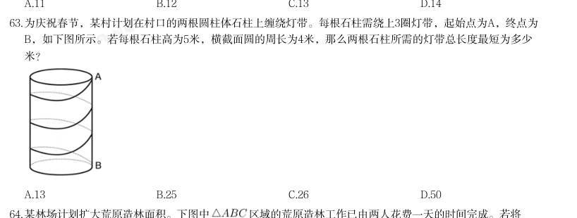

> （本题为图形题，选项为图片，见原卷）

**答案：C**　**考点：几何问题**
**【数量关系·工程问题｜HB-2026-ty-X064】**

64. 某林场计划扩大荒原造林面积。下图中 区域的荒原造林工作已由两人花费一天的时间完成。若将 的AB边延长一倍到点D,BC边延长两倍到点E,CA边延长三倍到点F。假设每人的工作效率一致,则至 少需要增加几人才能在接下来的5天内完成 剩余区域的荒原造林工作?

- **A.** 3
- **B.** 5
- **C.** 6
- **D.** 12

**答案：B**　**考点：工程问题**
**【数量关系·几何问题｜HB-2026-ty-X065】**

65. 某风力发电机的三片风叶之间两两所成的角度为 ,当其中一片风叶OB与塔杆叠合时,一位身高1.8米的技 术人员站在另一片风叶OA端头的正下方,测得塔杆顶部仰角为 (如左下图所示);若该技术人员站在离塔 杆60米处,则测得塔杆顶部仰角为 (如右下图所示)。那么风叶转动时叶片顶端最高离地面:

- **A.** 81.8米
- **B.** 89.8米
- **C.** 95.8米
- **D.** 101.8米

**答案：D**　**考点：几何问题**
**【数量关系·最值问题｜HB-2026-ty-X066】**
> 材料：某县拟对某段运河开展河道治理。甲公司治理1米需要用时1.5天,投入5万元;乙公司治理1米需要用时2天,投 入4万元。甲、乙两公司不能同时作业,若要求在365天内完成不少于200米的治理工作,则至少需要治理费

66. · 本试卷由粉笔用户上岸张同学66生成 用:

- **A.** 832万元
- **B.** 845万元
- **C.** 860万元
- **D.** 870万元

**答案：D**　**考点：最值问题**
**【数量关系·最值问题｜HB-2026-ty-X067】**

67. 小刚新做了一个鞋柜,鞋柜的纵截面如左下图所示。鞋柜水平深度28.8厘米,隔板与水平面夹角为 ,这个格 子刚好放得下一个15厘米高的鞋盒,则这双鞋的鞋码最大是:(参考数据: , , )

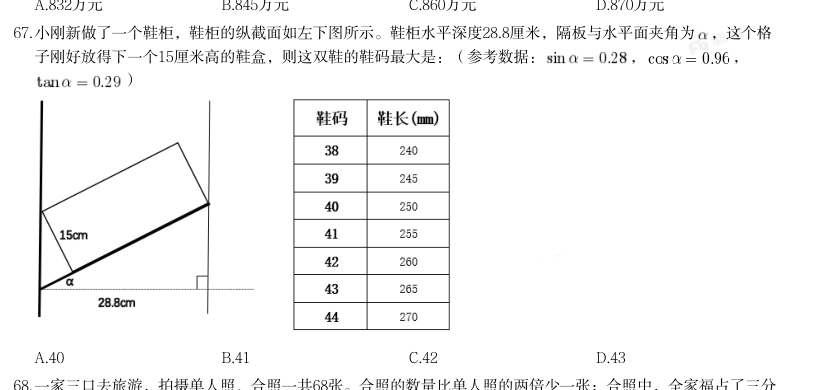

> （本题为图形题，选项为图片，见原卷）

**答案：B**　**考点：最值问题**
**【数量关系·最值问题｜HB-2026-ty-X068】**

68. 一家三口去旅游,拍摄单人照、合照一共68张。合照的数量比单人照的两倍少一张;合照中,全家福占了三分 之二,且孩子出现的次数为爸爸妈妈出现次数之和的一半;孩子的单人照比爸爸、妈妈单人照数量之和多1 张。那么孩子出现的照片一共有:

- **A.** 52张
- **B.** 48张
- **C.** 45张
- **D.** 37张

**答案：A**　**考点：最值问题**
**【数量关系·几何问题｜HB-2026-ty-X069】**

69. 某款蛋堡锅的锅盘为直径24厘米的圆,其中排布着7个全等的深度均为2厘米的圆柱状凹槽,锅盘的金属用料与 表面积成正比(厚度忽略不计,锅盘可近似看作如右下图所示的图形)。厂家现推出凹槽加深30%的升级款, 则升级后的锅盘用料约增加多少倍?

- **A.** 0.13
- **B.** 0.21
- **C.** 0.3
- **D.** 0.69

**答案：A**　**考点：几何问题**
**【数量关系·最值问题｜HB-2026-ty-X070】**

70. 随着新型清洁能源、现代生态农牧的发展,昔日戈壁荒滩不仅成为光伏“蓝海”,还变成了养殖数万只“光伏 羊”的繁茂草原。牧民甲、乙家中都有若干只“光伏羊”,乙若给甲20只羊,甲的羊数将是乙的K倍;甲若给 乙K只羊,乙的羊数将是甲的一半;若K为正整数,那么K的值可能有多少个?

- **A.** 5
- **B.** 6
- **C.** 7
- **D.** 8

**答案：D**　**考点：最值问题**
**【判断推理·类比推理｜HB-2026-ty-X071】**
> 材料：个最恰当的答案。 从所给的四个选项中,选择最合适的一个填入问号处,使之呈现一定的规律性。

71. · 本试卷由粉笔用户上岸张同学66生成

- **A.** A
- **B.** B
- **C.** C
- **D.** D

**答案：B**　**考点：类比推理**
**【判断推理·图形推理｜HB-2026-ty-X072】**

72. 把下面的六个图形分为两类,使每一类图形都有各自的共同特征或规律,分类正确的一项是:

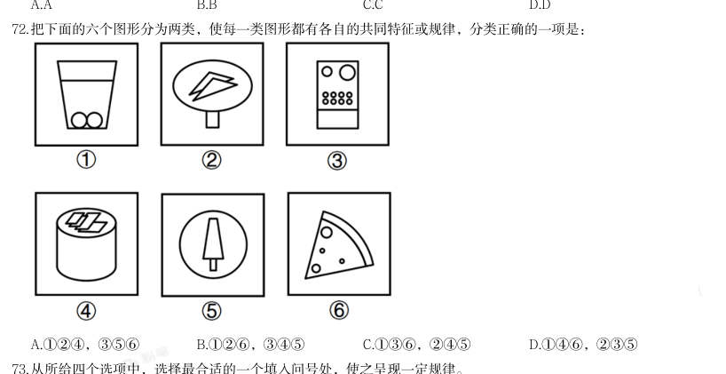

- **A.** 124,356
- **B.** 126,345
- **C.** 136,245
- **D.** 146,235

**答案：C**　**考点：图形推理**
**【判断推理·类比推理｜HB-2026-ty-X073】**
> 材料：从所给四个选项中,选择最合适的一个填入问号处,使之呈现一定规律。

73. · 本试卷由粉笔用户上岸张同学66生成

- **A.** A
- **B.** B
- **C.** C
- **D.** D

**答案：A**　**考点：类比推理**
**【判断推理·图形推理｜HB-2026-ty-X074】**

74. 左图是一个带把手的立方体纸盒,右边哪项可能是其外表面展开图?

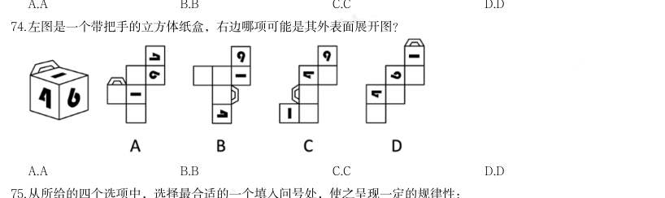

- **A.** A
- **B.** B
- **C.** C
- **D.** D

**答案：B**　**考点：图形推理**
**【判断推理·图形推理｜HB-2026-ty-X075】**

75. 从所给的四个选项中,选择最合适的一个填入问号处,使之呈现一定的规律性:

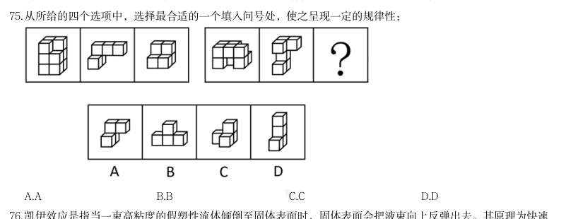

> （本题为图形题，选项为图片，见原卷）

**答案：B**　**考点：图形推理**
**【判断推理·定义判断｜HB-2026-ty-X076】**
> 材料：凯伊效应是指当一束高粘度的假塑性流体倾倒至固体表面时,固体表面会把液束向上反弹出去。其原理为快速 下落的液束冲击下方堆积的黏性流体,流体表面因为受到冲击粘度变小,受到撞击后形成一个酒窝状的凹坑,

76. · 本试卷由粉笔用户上岸张同学66生成 同时粘度降低的表面充当了润滑剂的作用,最终使得下落的液束被反弹出去。 根据上述定义,下列属于凯伊效应的是:

- **A.** 用肥皂水冲洗勺子,肥皂水碰到勺子后会沿着勺子曲面流下去
- **B.** 在喷水池喷出的水柱上放乒乓球,水柱会托举乒乓球向上跳跃
- **C.** 水流冲过土壤中的孔隙或裂缝时,形成了类似管道的水流通道
- **D.** 将洗发水从高处快速倒向桌面,堆积的洗发水会突然跳起一束

**答案：D**　**考点：定义判断**
**【判断推理·定义判断｜HB-2026-ty-X077】**

77. 回归效应,是指极端样本在后续观测中更接近总体均值的趋势,表现为个体极端特征随时间推移逐渐减弱。 根据上述定义,下列体现了回归效应的是:

- **A.** 龙生龙,凤生凤,老鼠的儿子会打洞
- **B.** 尺寸小的豌豆子代会变大,尺寸大的豌豆子代会变小
- **C.** 一对父母身高近两米,他们的孩子成年后身高也近两米
- **D.** 某篮球运动员平均每场得分为20分,但在某场比赛中得了40分

**答案：B**　**考点：定义判断**
**【判断推理·定义判断｜HB-2026-ty-X078】**

78. 可编程物质是指一种可以根据用户输入或自主感应而以编程方式来改变自身物理性质的物质。 根据上述定义,下列不涉及可编程物质的是:

- **A.** 某智能水泥通过内嵌的传感器,自主控制水泥应力的释放以保持建筑物结构稳定
- **B.** 某智能布料由高分子复合纤维织成,输入不同电压会改变其电场,从而根据预设编码显现不同图案
- **C.** 通过添加纳米颗粒和化学反应物,某新型水泥可以实现自动修复裂缝和损坏,从而延长建筑的寿命
- **D.** 某智能玻璃使用Socket网络编程技术,可根据外部光照强度和内部信号来改变透明度,调节室内光线以节省

**答案：C**　**考点：定义判断**
**【判断推理·定义判断｜HB-2026-ty-X079】**

79. 能源 敏化电极法指的是在指示电极上覆盖一层物质,使电极能提高或改变其选择性,进而检测物质的方法,包括气 敏电极法、酶电极法等。其中,气敏电极法在指示电极上覆盖的是特殊的透气膜或空隙间隔,使待测气体可以 通过。酶电极法在电极敏感膜上覆盖的是含酶凝胶或悬浮液,待测物可以向酶膜扩散。 根据上述定义,下列属于气敏电极法的是:

- **A.** 在pH电极上覆盖乙烯材料,气体穿过覆盖物进入中介溶液,引起化学平衡移动,进而计算出浓度
- **B.** 某种能将乙醇转化为电流的微生物经培养后可形成微生物膜,当电极放置在膜上时可检测出乙醇的浓度
- **C.** 给pH电极装上葡萄糖氧化酶膜,当电极插入待测溶液时,酶催化产生化学反应,进而测定葡萄糖含量
- **D.** 在植株鲜样中加偏磷酸溶液,打碎成浆后,取样品滤液加活性炭及硼酸钠溶液,进而测定抗坏血酸含量

**答案：A**　**考点：定义判断**
**【判断推理·定义判断｜HB-2026-ty-X080】**

80. 疤痕效应是指人在遭受创伤后,伤口经过一段时间的恢复会愈合,但留下的疤痕会时刻提醒人们过去的伤痛, 并对人的心理造成持续的影响。在社会学中,疤痕效应泛指重大事件会使人们的行为模式趋于保守,更加厌恶 风险,进而导致人们对于事物的看法和决策产生偏差。 根据上述定义,下列未体现疤痕效应的是:

- **A.** 一朝被蛇咬,十年怕井绳
- **B.** 经历台风袭击后,老刘会经常囤积一些非必要生活用品,以备不时之需
- **C.** 五年前老陈投资失败后,将所有积蓄存入银行,不再选择其他理财方式
- **D.** 杨教授儿时经历过饥荒,深刻理解粮食的重要性,矢志培育优质高产的小麦种子

**答案：D**　**考点：定义判断**
**【判断推理·定义判断｜HB-2026-ty-X081】**

81. 复冰现象是指当冰的表面受压,压力令其熔点降低,使得冰化成水,一旦压力消失,熔点提高至原来的水平, 水又变为冰的现象。 根据上述定义,下列不属于复冰现象的是:

- **A.** 将两块水平放置的冰砖面对面压实,松手后两块冰砖粘在了一起
- **B.** 在一块很大的冰上放一条金属线,金属线两端分别连着两个重物,金属线缓慢穿越冰块而且不会将其切开· 本试卷由粉笔用户上岸张同学66生成
- **C.** 在滑冰场上滑冰时,冰刀留下道道痕迹,但很快刀痕会全部消失,留下完好如初的冰面
- **D.** 水结冰时,所释放的热量在其内部形成压力、产生气泡,这使得结成的冰看上去不透明

**答案：D**　**考点：定义判断**
**【判断推理·定义判断｜HB-2026-ty-X082】**

82. 印随效应是一种特殊的学习方式,与一般的条件反射或习惯形成不同,它只在动物幼雏智力发展的一个特定阶 段内发生,这个阶段被称为敏感期或关键期。如果错过了这个短暂时期,动物就很难或者无法学习到相应的行 为。印随效应的发生有两个必要条件:一是刺激物必须是活动的,二是刺激物必须与动物幼雏有一定的亲缘关 系或相似性。印随效应不仅存在于动物幼雏中,也存在于人类婴儿中。 根据上述定义,下列体现了印随效应的是:

- **A.** 小婷读小学时被寄养在二姨家,她对二姨有深深的依恋和信任感
- **B.** 退役的搜救犬在被陈大爷收养后,每天都忠诚地跟在陈大爷身边
- **C.** 小花从小睡觉都要抱一个布娃娃,如果离了布娃娃她就哭闹不止
- **D.** 刚孵出的雏鹅先看到一只小狗,随后小狗去哪里它就会跟到哪里

**答案：D**　**考点：定义判断**
**【判断推理·定义判断｜HB-2026-ty-X083】**

83. 新污染物筛查主要有两类:非靶向筛查是不针对特定的目标污染物,基于全扫描分析获取对样品成分的表达; 疑似筛查是根据先验的化学结构信息和质谱采集的特征发现样品中可能存在的化学物质。 根据上述定义,下列最能体现疑似筛查的是:

- **A.** 小肖利用全二维气相色谱—质谱法分析废水样品,发现污水处理过程中产生了苯并三唑类化合物
- **B.** 课题组筛查化工园区土壤中的污染物,对识别到的化合物的检测频率和相对含量进行打分,最终选出了36种优先污染物
- **C.** 研究小组筛查了潜在内分泌干扰物列表中的化学物,发现一半以上的个人护理产品中含有与发育损害或内分泌干扰有关的成分
- **D.** 吴教授采用效应导向分析方法筛查出石油和香烟浸出液中导致芳基烃受体(AhR)反应的组分,并鉴定出这

**答案：C**　**考点：定义判断**
**【判断推理·定义判断｜HB-2026-ty-X084】**

84. 些组分中导致AhR反应的化合物 玻尔兹曼宇宙是玻尔兹曼为了解释宇宙初始阶段的熵之谜提出的假说。基于“整个系统的熵增加,则系统某些 部分的熵可以减少”的事实,它设想在宇宙初始物质的随机运动过程中偶然产生一个熵较低的区域,从这个区 域诞生了我们所熟知的宇宙。玻尔兹曼大脑假说认为,如果一个新结构可由随机的熵减少所触发产生,那么一 个拥有“宇宙记忆”的大脑因为比较简单,所以它的出现概率远比宇宙这种复杂结构的出现概率大得多。 根据上述定义,最有可能得出的结论是:

- **A.** 玻尔兹曼大脑假说是由玻尔兹曼提出的
- **B.** 玻尔兹曼宇宙假说认为宇宙可能是唯一的
- **C.** 玻尔兹曼大脑假说质疑玻尔兹曼宇宙假说的理论基础
- **D.** 玻尔兹曼大脑假说反对存在玻尔兹曼宇宙,主张我们可能只是一些大脑

**答案：C**　**考点：定义判断**
**【判断推理·定义判断｜HB-2026-ty-X085】**

85. 偏序集是一个集合与其上元素之间的一种关系组成的整体,该关系需满足三个条件: 1自反性:集合中每个元素与自身有此关系 2反对称性:若元素A与B,B与A互有此关系,则A与B必为同一元素 3传递性:若A与B,B与C有此关系,则A与C有此关系 根据上述定义,下列属于偏序集的是:

- **A.** 设集合为一天中所有的时间点,定义集合上的关系为某时间点不晚于另一时间点
- **B.** 设集合为书架上所有的书,定义集合上的关系为某本书与另一本书摆在同一层
- **C.** 设集合为某班级的所有同学,定义集合上的关系为朋友关系
- **D.** 设集合为所有整数,定义集合上的关系为不等于

**答案：A**　**考点：定义判断**
**【判断推理·类比推理｜HB-2026-ty-X086】**

86. 蛋白质:有机物

- **A.** 故宫:北京
- **B.** 5G基站:通讯设施
- **C.** 显示屏:折叠屏
- **D.** 固态硬盘:台式机硬盘

**答案：B**　**考点：类比推理**
**【判断推理·类比推理｜HB-2026-ty-X087】**

87. · 本试卷由粉笔用户上岸张同学66生成 寓意:寓言

- **A.** 序言:正文
- **B.** 情节:童话
- **C.** 报告文学:新闻
- **D.** 著作:诗集

**答案：B**　**考点：类比推理**
**【判断推理·类比推理｜HB-2026-ty-X088】**

88. 星期:星期一

- **A.** 年:正月
- **B.** 细胞:培养基
- **C.** 牙齿:牙龈
- **D.** 节能灯:电源

**答案：A**　**考点：类比推理**
**【判断推理·类比推理｜HB-2026-ty-X089】**

89. 随波逐流:盲从

- **A.** 杯水车薪:坚持
- **B.** 心不在焉:专注
- **C.** 临渊羡鱼:空想
- **D.** 据理力争:反驳

**答案：C**　**考点：类比推理**
**【判断推理·类比推理｜HB-2026-ty-X090】**

90. 鸡犬不宁:安居乐业

- **A.** 羊质虎皮:色厉内荏
- **B.** 莺歌燕舞:鸟语花香
- **C.** 海底捞针:探囊取物
- **D.** 蝇营狗苟:寡廉鲜耻

**答案：C**　**考点：类比推理**
**【判断推理·类比推理｜HB-2026-ty-X091】**

91. 清明:传统节日:春节

- **A.** 神话:民间文学:舞蹈
- **B.** 手机:家用电器:冰箱
- **C.** 电话:通讯工具:快递
- **D.** 足球:体育用品:哑铃

**答案：D**　**考点：类比推理**
**【判断推理·类比推理｜HB-2026-ty-X092】**

92. 树枝:秸秆:柴火

- **A.** 车前:沉香:中药
- **B.** 尘土:烟雾:污染
- **C.** 蚕蛾:蚊子:成虫
- **D.** 火车:汽车:车厢

**答案：A**　**考点：类比推理**
**【判断推理·类比推理｜HB-2026-ty-X093】**

93. 杏仁:腰果:坚果

- **A.** 餐具:饭碗:饭勺
- **B.** 门框:门楣:门扇
- **C.** 礼单:礼帖:礼仪
- **D.** 火枪:火炮:火器

**答案：D**　**考点：类比推理**
**【判断推理·类比推理｜HB-2026-ty-X094】**

94. 光刻机 对于 ( ) 相当于 ( ) 对于 核燃料

- **A.** 芯片 离心机
- **B.** 计算器 核电站
- **C.** 光盘 压铸机
- **D.** 紫外线光源 核裂变

**答案：A**　**考点：类比推理**
**【判断推理·类比推理｜HB-2026-ty-X095】**

95. ( )对于 庐山 相当于 车水马龙 对于( )

- **A.** 游人如织 街市
- **B.** 惊鸿一瞥 人群
- **C.** 天然画卷 剧场
- **D.** 鬼斧神工 陋巷

**答案：A**　**考点：类比推理**
**【判断推理·逻辑判断｜HB-2026-ty-X096】**

96. 近年来,东海海域经常出现鲸搁浅现象,海洋学家推测是因为东海海岸线很长,而且这里拥有丰富的浮游生物 和鱼类资源,容易引鲸洄游至此,进而导致鲸搁浅的现象发生。 以下描写鲸搁浅的选项中,最能支持上述结论的是( )。

- **A.** 闰鱼,无定形,闰年秋潮,飓风推出海,其大吞舟也
- **B.** 房鱼,出海,极大,如房。或随潮汐沙陷上,土人割脂熬油
- **C.** 大凡东海有巨鱼流入内地者,必无目,无目,故随潮而进也
- **D.** 见大鲸驱群鲛,逐肥鱼于渤澥之尾······贪而不能止,北蹙于碣石,槁焉

**答案：D**　**考点：逻辑判断**
**【判断推理·逻辑判断｜HB-2026-ty-X097】**

97. 端粒是染色体末端的一段重复的核苷酸序列。当端粒长度变得非常短时,就更容易导致细胞的衰老和凋亡。有 研究发现,每天每增加一杯速溶咖啡摄入量,端粒长度对应的等效年龄减少0.38年,因而速溶咖啡摄入量与端 粒长度呈负相关。不过,研究结果也显示,研磨咖啡摄入量与端粒长度的相关性没有统计学意义,不能证实研 磨咖啡也会减少端粒长度对应的等效年龄。该研究认为,饮用速溶咖啡会导致衰老,饮用研磨咖啡则不会,因 而后者更健康。 以下哪项如果为真,不能支持上述结论?

- **A.** 速溶咖啡中往往会添加白砂糖、乳粉等,这些成分容易导致衰老
- **B.** 实验中使用的部分速溶咖啡样本,其实是现场研磨咖啡豆制作的
- **C.** 与相同量的研磨咖啡相比较,速溶咖啡中导致衰老的铅含量更高
- **D.** 制作研磨咖啡时,会使用滤纸吸附咖啡白醇等对人体有害的物质

**答案：B**　**考点：逻辑判断**
**【判断推理·逻辑判断｜HB-2026-ty-X098】**
> 材料：鱼通过鳃的呼吸作用,从水中吸收钙离子,进入耳石囊内与碳酸根离子结合形成碳酸钙、随后沉积形成耳石, 它具有维持鱼身平衡及辅助听觉的作用。鱼耳石的日周轮、年轮和产卵轮等时间记号,记录了鱼类生长过程中 的环境信息。通过分析鱼耳石形态和化学组成等方式,我们可以了解鱼类生活史特征及其栖息环境的变化。

98. · 本试卷由粉笔用户上岸张同学66生成 以下哪项如果为真,最能加强上述论证?

- **A.** 许多鱼类的寿命可长达数十年之久
- **B.** 环境污染可能导致鱼停止生长甚至死亡
- **C.** 不同鱼类的耳石大小不同,难以据此判断鱼类的生长环境情况
- **D.** 相对于鳞片、鳍条,鱼耳石的形态结构和化学组成更稳定,保存时间更长

**答案：D**　**考点：逻辑判断**
**【判断推理·逻辑判断｜HB-2026-ty-X099】**

99. 紫杉醇是治疗癌症的明星药物。紫杉醇通过作用于细胞内的微管蛋白,保持微管的稳定性来抑制细胞的有丝分 裂,控制癌细胞发展,从而达到治疗目的。香榧中含有紫杉醇,因此,有观点认为,多食用香榧可以治疗癌 症。 以下哪项如果为真,最能削弱上述结论?

- **A.** 紫杉醇对正常细胞产生的影响目前还未可知
- **B.** 香榧中紫杉醇含量微乎其微,几乎可以忽略不计
- **C.** 香榧含有丰富的蛋白质,可以增强癌症患者的免疫力
- **D.** 对于分裂速度比正常细胞快的癌细胞,紫杉醇表现出更明显的抑制作用

**答案：B**　**考点：逻辑判断**
**【判断推理·逻辑判断｜HB-2026-ty-X100】**

100. 一项关于离子通道Piezo2的介导性慢性疼痛超敏反应功能的研究表明,Piezo2是一个机械敏感通道,会在压力的 刺激下激活伤害性感受器,当Piezo2发生功能丧失型突变时,患者对轻微的触摸或振动不再敏感;当它发生功 能获得型突变时,患者通常被诊断为其它疾病。 以下哪项如果为真,最能削弱上述结论?

- **A.** 有的慢性疼痛综合征患者的伤害性感受器在无机械刺激时仍然活跃
- **B.** 有的Piezo2功能丧失型突变患者在强烈挤压皮肤时激活了伤害性感受器
- **C.** 有的患者发生Piezo2功能获得型突变,被诊断出患有复杂发育障碍疾病
- **D.** 有的患者发生Piezo2功能丧失型突变,伤害性感受器对机械刺激更敏感

**答案：D**　**考点：逻辑判断**
**【判断推理·逻辑判断｜HB-2026-ty-X101】**

101. 近日,考古学家发现了一块展示约1.25亿年前肉食性哺乳动物爬兽袭击较大植食性恐龙鹦鹉嘴龙的化石。化石 中,鹦鹉嘴龙呈卧姿态,后肢折叠在身体两侧;爬兽的身体向右盘绕,俯坐在鹦鹉嘴龙背侧,抓扒着猎物的下 巴并撕咬肋骨,其小腿则被鹦鹉嘴龙的后腿夹住。研究者认为,这一发现首次挑战了“恐龙在白垩纪期间几乎 没有受到同时代哺乳动物威胁”的观点。 以下哪项如果为真,最不能支持上述研究者的结论?

- **A.** 已能够确认爬兽与鹦鹉嘴龙纠缠在一起并同时葬身于火山喷发
- **B.** 在发现该标本前就有其他观点认为爬兽会捕食鹦鹉嘴龙等恐龙
- **C.** 通过恐龙骨架上的牙印证明了爬兽当时正啃食鹦鹉嘴龙的尸体
- **D.** 在一块爬兽标本的胃中曾发现有鹦鹉嘴龙幼年个体的骨骼残留

**答案：B**　**考点：逻辑判断**
**【判断推理·逻辑判断｜HB-2026-ty-X102】**

102. 研究人员发现,与摄入盐水的对照组小鼠相比,摄入葡萄球菌肠毒素SEA的小鼠会出现明显干呕现象。人类癌 症患者使用化疗药物也会有类似的恶心和呕吐反应。研究显示,小鼠肠道内的SEA毒素激活了肠内壁的肠嗜铬 细胞,释放出血清素,血清素又与肠道的感觉神经元受体结合,将信号传递到脑干中的特定神经元从而引发干 呕,当特定神经元被灭活后,小鼠干呕显著减少。研究还发现,特定神经元被灭活后,其他动物的干呕也会显 著减少。 由此可以推出:

- **A.** 如果不摄入葡萄球菌肠毒素,那么小鼠就不会出现干呕现象
- **B.** 开发出灭活特定神经元的药物或能帮助化疗病人减少呕吐
- **C.** SEA毒素与肠道的感觉神经元受体结合会引发动物的干呕
- **D.** 切断小鼠脑干中特定神经元的信号传递或能引发干呕

**答案：B**　**考点：逻辑判断**
**【判断推理·逻辑判断｜HB-2026-ty-X103】**

103. · 本试卷由粉笔用户上岸张同学66生成 青藏高原被誉为“亚洲水塔”,是全球气候变化敏感区和指示区。这里分布着地球海拔最高数量最多的高原湖 泊群,面积约占全国的百分之五十,对区域水循环、生态环境和气候调节具有重要意义。如果青藏高原降水增 加或者冰川加速消融,那么青藏高原的湖泊将会持续扩张,并且导致潜在的流域合并或重组,威胁到该地区的 基础设施和生态安全。由此可以推出:

- **A.** 如果青藏高原的湖泊没有持续扩张,那么青藏高原的降水没有增加且冰川并没有加速消融
- **B.** 如果青藏高原降水增加或者冰川加速消融,将会导致其潜在的流域合并
- **C.** 如果青藏高原降水没有增加,那么其潜在的流域没有合并和重组
- **D.** 如果青藏高原的流域合并或重组,那么青藏高原降水增加

**答案：A**　**考点：逻辑判断**
**【判断推理·逻辑判断｜HB-2026-ty-X104】**

104. 甲、乙、丙、丁、戊、己、庚7人分别去P、Q、R、S四个不同的值班点,根据工作安排,每个值班点至少有1 人,至多有3人;每个人只能去1个值班点;要求Q值班点有3人值班。同时,还需满足下列条件: (1)去R值班点的人数与去P值班点的人数一样 (2)如果甲、乙、丙中至多2人去Q值班点,那么只有丁去S值班点 (3)只有乙和庚去S值班点,丁或戊才不去S值班点 根据上述信息,下列哪项必然为真?

- **A.** 乙去Q值班点,戊去S值班点
- **B.** 甲去Q值班点,丁去P值班点
- **C.** 己去P值班点,庚去R值班点
- **D.** 丙去P值班点,戊去S值班点

**答案：A**　**考点：逻辑判断**
**【判断推理·逻辑判断｜HB-2026-ty-X105】**

105. 小王把仙女座、猎户座、大熊座、人马座、狮子座五个星座在星空图上的位置用

- **A.** 大熊座在位置C上
- **B.** 狮子座在位置C上
- **C.** 仙女座在位置C上
- **D.** 猎户座在位置C上

**答案：A**　**考点：逻辑判断**
**【资料分析·增长量计算｜HB-2026-ty-X106】**

106. 分析、比较、计算和判断处理。 (一) · 本试卷由粉笔用户上岸张同学66生成 2025年6月,地方政府债券投资者总持有额的环比增量约为:

- **A.** 5514亿元
- **B.** 6124亿元
- **C.** 6514亿元
- **D.** 7124亿元

**答案：C**　**考点：增长量计算**
**【资料分析·比重计算与比较｜HB-2026-ty-X107】**

107. 2025年1-4月,再融资债券发行额占地方政府债券累计发行额的比重在下列哪个范围内?

- **A.** 35%~45%
- **B.** 45%~55%
- **C.** 55%~65%
- **D.** 65%~75%

**答案：C**　**考点：比重计算与比较**
**【资料分析·综合分析｜HB-2026-ty-X108】**

108. 关于2025年6月各类地方政府债券发行额的环比增速,下列排序正确的是:

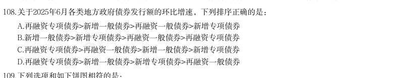

- **A.** 再融资专项债券>新增一般债券>再融资一般债券>新增专项债券
- **B.** 新增一般债券>新增专项债券>再融资一般债券>再融资专项债券
- **C.** 再融资专项债券>再融资一般债券>新增一般债券>新增专项债券
- **D.** 再融资专项债券>新增一般债券>新增专项债券>再融资一般债券

**答案：A**　**考点：综合分析**
**【资料分析·综合分析｜HB-2026-ty-X109】**

109. 下列选项和如下饼图相符的是:

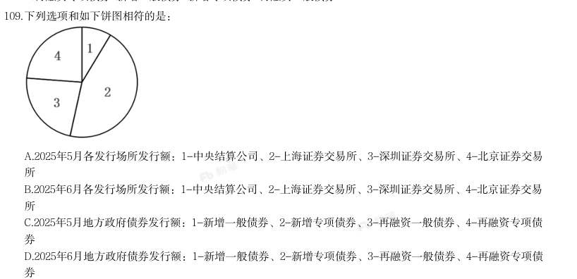

- **A.** 2025年5月各发行场所发行额:1-中央结算公司、2-上海证券交易所、3-深圳证券交易所、4-北京证券交易所
- **B.** 2025年6月各发行场所发行额:1-中央结算公司、2-上海证券交易所、3-深圳证券交易所、4-北京证券交易所
- **C.** 2025年5月地方政府债券发行额:1-新增一般债券、2-新增专项债券、3-再融资一般债券、4-再融资专项债券
- **D.** 2025年6月地方政府债券发行额:1-新增一般债券、2-新增专项债券、3-再融资一般债券、4-再融资专项债

**答案：D**　**考点：综合分析**
**【资料分析·综合分析｜HB-2026-ty-X110】**

110. 券 能够从上述资料中推出的是:

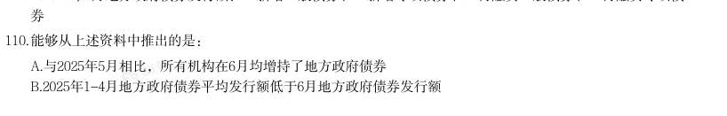

- **A.** 与2025年5月相比,所有机构在6月均增持了地方政府债券
- **B.** 2025年1-4月地方政府债券平均发行额低于6月地方政府债券发行额· 本试卷由粉笔用户上岸张同学66生成
- **C.** 2025年5月与6月上海证券交易所发行额占1-6月总发行额的比重差异超过7个百分点
- **D.** 对比2025年5月与6月的机构投资者持有情况,不存在持有金额上升、占比却下降的机构

**答案：B**　**考点：综合分析**
**【资料分析·年均增长率｜HB-2026-ty-X111】**
> 材料：(二) 近年来,我国低空经济发展表现出巨大潜力,2023年底全国低空经济规模超5000亿元,2030年底有望达到 2万亿元。截至2024年底,全国在册通用机场达475个,较2023年增加26个。截至2023年底,全国通用航空企业 达689家,在册通用航空器数量3303架,通用航空完成飞行时长137.1万小时,同比增长12.4%。其中,载客类完 成2.8万小时,同比增长55.1%,载人类完成14.5万小时,同比增长34.7%,其他类完成69.6万小时,同比增长 8.3%;非经营性作业时长完成50.2万小时,同比增长11.2%。 截至2024年底,全国无人机生产企业近700家,截至2023年底,全国获得通用航空经营许可证且使用民用 无人机的通用航空企业19825家,同比净增4695家;全行业无人机拥有者注册用户92.9万个,其中,个人用户 84.9万个,企业、事业、机关法人单位用户8万个;全行

111. 在2023年底的基础上,要确保2030年底全国低空经济规模达到2万亿元,那么从2024年开始,全国低空经济规 模平均每年增量约为:

- **A.** 1468亿元
- **B.** 1643亿元
- **C.** 1875亿元
- **D.** 2143亿元

**答案：D**　**考点：年均增长率**
**【资料分析·增长量计算｜HB-2026-ty-X112】**

112. 2024年,全国在册通用机场数量比2023年约增加了:

- **A.** 2%
- **B.** 4%
- **C.** 6%
- **D.** 8%

**答案：C**　**考点：增长量计算**
**【资料分析·基期量计算｜HB-2026-ty-X113】**

113. 2023年我国通用航空完成飞行时长比2022年约多:

- **A.** 13万小时
- **B.** 15万小时
- **C.** 17万小时
- **D.** 19万小时

**答案：B**　**考点：基期量计算**
**【资料分析·综合分析｜HB-2026-ty-X114】**

114. 关于2022年底通用航空飞行时长,下列排序正确的是:

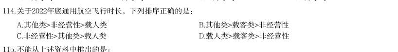

- **A.** 其他类>非经营性>载人类
- **B.** 其他类>载客类>非经营性
- **C.** 非经营性>其他类>载人类
- **D.** 载人类>载客类>非经营性

**答案：A**　**考点：综合分析**
**【资料分析·基期量计算｜HB-2026-ty-X115】**

115. 不能从上述资料中推出的是:

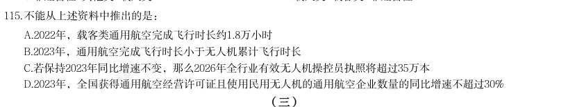

- **A.** 2022年,载客类通用航空完成飞行时长约1.8万小时
- **B.** 2023年,通用航空完成飞行时长小于无人机累计飞行时长
- **C.** 若保持2023年同比增速不变,那么2026年全行业有效无人机操控员执照将超过35万本
- **D.** 2023年,全国获得通用航空经营许可证且使用民用无人机的通用航空企业数量的同比增速不超过30%

**答案：D**　**考点：基期量计算**
**【资料分析·基期量计算｜HB-2026-ty-X116】**
> 材料：(三) 2025年上半年,Q市12348公共法律服务热线有效接听解答咨询量(以下简称法律热线咨询量)为102428人 次。按咨询事项分类统计,前十事项的咨询量合计占法律热线咨询量的85.85%,同比提升0.65个百分点。

116. · 本试卷由粉笔用户上岸张同学66生成 2025年第二季度Q市法律热线咨询量约为:

- **A.** 4.83万人次
- **B.** 4.96万人次
- **C.** 5.12万人次
- **D.** 5.23万人次

**答案：B**　**考点：基期量计算**
**【资料分析·增长率计算与比较｜HB-2026-ty-X117】**

117. 2025年第一季度Q市法律热线咨询量环比增长速度约为:

- **A.** 24.23%
- **B.** 19.50%
- **C.** -19.68%
- **D.** -16.44%

**答案：D**　**考点：增长率计算与比较**
**【资料分析·增长量计算｜HB-2026-ty-X118】**

118. 以下折线图中,最能准确反映2022-2025年间Q市法律热线咨询量第二季度环比增量变化趋势的是:

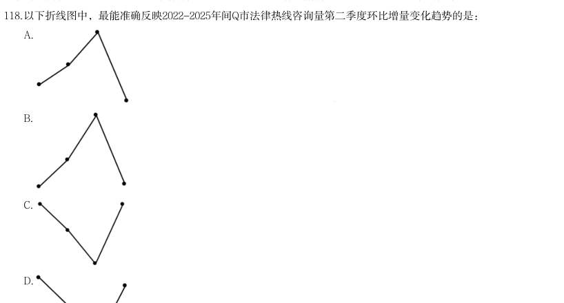

- **A.** 
- **B.** 
- **C.** 
- **D.** 

**答案：A**　**考点：增长量计算**
**【资料分析·基期量计算｜HB-2026-ty-X119】**

119. 2024年上半年Q市法律热线咨询量中前十事项的咨询量约为:

- **A.** 9.19万人次
- **B.** 8.27万人次
- **C.** 7.89万人次
- **D.** 6.38万人次

**答案：C**　**考点：基期量计算**
**【资料分析·综合分析｜HB-2026-ty-X120】**

120. 能够从上述资料中推出的是:

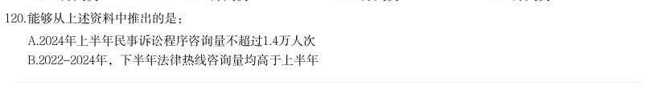

- **A.** 2024年上半年民事诉讼程序咨询量不超过1.4万人次
- **B.** 2022-2024年,下半年法律热线咨询量均高于上半年· 本试卷由粉笔用户上岸张同学66生成
- **C.** 2023-2024年,法律热线咨询量出现同比增长的季度有7个
- **D.** 2025年上半年,前十事项咨询量中劳动合同的占比超过11%

**答案：D**　**考点：综合分析**
**【资料分析·比重计算与比较｜HB-2026-ty-X121】**
> 材料：(四) 截至2024年末,我国60岁及以上人口突破3亿,达到31031万人。养老服务相关企业约16万家,比2023年底 增长24.36%。全国共有各类养老机构和设施40.6万个,养老床位合计799.3万张。

121. 2024年末,我国60岁及以上人口中,65岁及以上的人口占比约为:

- **A.** 51%
- **B.** 61%
- **C.** 71%
- **D.** 81%

**答案：C**　**考点：比重计算与比较**
**【资料分析·平均数计算｜HB-2026-ty-X122】**

122. 2024年末,我国注册登记的养老机构平均拥有护理型床位约:

- **A.** 68张
- **B.** 83张
- **C.** 103张
- **D.** 127张

**答案：B**　**考点：平均数计算**
**【资料分析·基期量计算｜HB-2026-ty-X123】**

123. 根据老年人口抚养比的计算公式,2022年我国0-14岁的人口数约为:

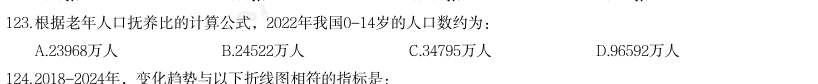

- **A.** 23968万人
- **B.** 24522万人
- **C.** 34795万人
- **D.** 96592万人

**答案：A**　**考点：基期量计算**
**【资料分析·基期量计算｜HB-2026-ty-X124】**

124. 2018-2024年,变化趋势与以下折线图相符的指标是:

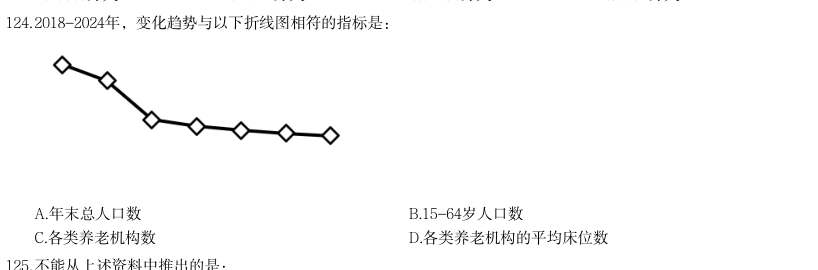

- **A.** 年末总人口数
- **B.** 15-64岁人口数
- **C.** 各类养老机构数
- **D.** 各类养老机构的平均床位数

**答案：D**　**考点：基期量计算**
**【资料分析·基期量计算｜HB-2026-ty-X125】**

125. 不能从上述资料中推出的是: · 本试卷由粉笔用户上岸张同学66生成

- **A.** 2024年底,医养结合机构的平均床位数高于注册登记养老机构的平均床位数
- **B.** 2021~2024年,我国各类养老机构的数量持续增长,但床位数并未同步增长
- **C.** 2024年,平均用于支持每项公立医疗卫生机构医养结合项目的中央预算内投资资金超过4000万元
- **D.** 2018~2024年,我国15~64岁人口数始终保持下降的趋势

**答案：D**　**考点：基期量计算**