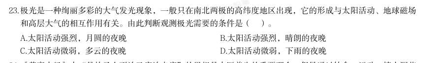

# 常识判断 · 地理常识

> 考点编码：`CS-DL`　｜　体系对齐：花生十三 `changshi-panduan.md#2.5`

## 一、命题规律

- **本题型真题总量**：113 题（2001–2026）
- **地区分布**：国考 64 / 广东 25 / 湖北 24
- **近六年题量**：2026年5题, 2025年3题, 2024年6题, 2023年6题, 2022年4题, 2021年1题
- **覆盖试卷**：61 套
- **子考点分布**：世界地理 46　中国地理 45　地理常识（待细分） 32
- **同题变体**：另有 10 道为同题重复（同年多卷/跨年再考），已折叠，需展开见 scripts/search.py --all-variants

## 二、近年真题（最多 12 题，按年份倒序）

### 2026 湖北·统一卷　第 23 题　（地理常识（待细分））

极光是一种绚丽多彩的大气发光现象,一般只在南北两极的高纬度地区出现,它的形成与太阳活动、地球磁场 和高层大气的相互作用有关。由此判断观测极光需要的条件是( )。

- **A.** 太阳活动强烈,月圆的夜晚
- **B.** 太阳活动强烈,晴朗的夜晚
- **C.** 太阳活动微弱,多云的夜晚
- **D.** 太阳活动微弱,下雨的夜晚

**答案：B**

**解析/参考要点**：B
本题考查科技常识。
A 项错误,B 项正确,极光的产生依赖于太阳活动释放的高能带电粒子与地球磁
场的相互作用。当太阳活动强烈时,更多高能带电粒子进入地球两极,激发高层
大气中的原子发光,形成极光。而极光亮度较低,需在无云层遮挡且无其他光污
染的晴朗夜晚才能清晰观测。但月圆的夜晚通常月光强烈,明亮的月光会严重削
弱极光的可见度,甚至使其完全不可见。故“太阳活动强烈,晴朗的夜晚”可以
观测到极光。
C、D 两项错误,太阳活动微弱时,太阳风强度降低,进入地球两极的高能带电
粒子减少,极光出现的频率和强度显著降低,甚至无法形成可见极光。下雨意味
着云层厚密,而在多云的夜晚,云层会完全遮挡极光,不具备极光的观测条件。
故正确答案为B。

### 2026 国考·副省级　第 26 题　（世界地理）

下列与海洋经济有关的说法错误的是:

- **A.** 海水中氢离子和氢氧根离子浓度高,利用海水制氢效率高
- **B.** 现代深远海养殖平台一般设置在有较大浪流的开放性水域
- **C.** 潮汐发电的水轮机结构要适应海水落差小、流量大的特点
- **D.** 液化天然气运输船的液舱通常采用超低温环境储存天然气

**答案：A**

**解析/参考要点**：A
本题考查科技常识。
A 项错误,常温下纯水中氢离子和氢氧根离子浓度为
mol/L,海水中的氢离子和氢氧根离子浓度实际并
不高(
时
,
浓
度约为
m
ol/L,
浓
度约为
m
ol/L),直接电解海水制氢效率
并不高,且存在腐蚀、析氯等问题,通常需要淡化或特殊电解技术。
B 项正确,深远海养殖是一项综合性系统工程,现代深远海养殖平台一般都是设置在水深超过15m 且有较大浪
流的开放性水域,在离岸较远(3 海里外)的岛礁水域或养殖水体超过1 万
的
海水养殖网箱平台。
C 项正确,潮汐发电是一种利用海水周期性涨落能量进行水力发电的技术,通过在海湾或感潮河口筑坝形成水
库,利用潮位差驱动水轮机发电。其原理与常规水电类似,但需适应低水头(落差小)、大流量的海水特性,
具有清洁可再生、发电稳定等特点,可结合围垦、养殖等综合利用。
D 项正确,液化天然气运输船(LNG 船)是专用于海上天然气运输的船型。运输天然气对船的要求非常苛刻,
不仅要做到极高标准的密封性,保存天然气的液货舱还要能承受液化天然气零下163 摄氏度的低温考验。液货
舱最核心的就是一种叫殷瓦钢的材料,它在零下163 摄氏度天然气变成液态的时候,能保质保量地将其储存起
来。
本题为选非题,故正确答案为A。

### 2026 国考·副省级　第 30 题　（中国地理）

下列关于河流入海口的描述与河流对应错误的是:

- **A.** 浑浊的河水奔流而至,汇入清澈的渤海,形成一条清晰的分界线——黄河
- **B.** “三龙吐珠,八门入海”,生动地描绘出了它的奇特形态——淮河
- **C.** 在入海口的潮间带上,会看到一片耀眼的红色,又被称为“红海滩”——辽河
- **D.** 在其与东海海潮的相互激荡下,造就了我国第三大岛崇明岛——长江

**答案：B**

**解析/参考要点**：B
本题考查地理国情。
A 项正确,黄河以含沙量大而闻名,黄河的河水呈黄色,比较浑浊,当其汇入相对清澈的渤海时,由于河水与
海水的密度、盐度不同,会在一段时间内相互浸润而不混合,从而形成一条非常清晰黄蓝相间的分界线,这是
黄河入海口的典型景观。
B 项错误,“三龙吐珠,八门入海”描绘的是珠江入海口的形态,而非淮河。珠江下游水系发达,入海口区域
水网密布,主要经由虎门、蕉门、洪奇门、横门、磨刀门、鸡啼门、虎跳门和崖门八个口门流入南海,形成了
“八门入海”的奇特格局;“三龙”指珠江的西江、东江、北江三大干流。而淮河历史上因黄河夺淮入海,河
道较为单一,主要经由苏北灌溉总渠等人工河道入海,并无“八门入海”的特征。
C 项正确,辽河入海口的潮间带上覆盖着大面积的碱蓬草,碱蓬草每年四月长出地面,在夏季为绿色,到了秋
季则变为鲜艳的赤红色,从而形成了一望无际的“红海滩”。“红海滩”是辽宁盘锦地区的著名自然景观。
D 项正确,长江水量巨大,携带着大量的泥沙在其入海口处沉积,同时,东海的海潮又对这些泥沙起到顶托和
冲刷作用,在河流与海洋动力的长期相互作用下,泥沙不断淤积,最终形成了中国最大的冲积岛——崇明岛。
本题为选非题,故正确答案为B。

### 2026 国考·地市级　第 27 题　（世界地理）
> 材料：C.高纯石英可用于芯片制造中的光刻环节…

下列与海洋经济有关的说法错误的是：

- **A.** 海水中氢离子和氢氧根离子浓度高，利用海水制氢效率高
- **B.** 现代深远海养殖平台一般设置在有较大浪流的开放性水域
- **C.** 潮汐发电的水轮机结构要适应海水落差小、流量大的特点
- **D.** 液化天然气运输船的液舱通常采用超低温环境储存天然气

**答案：A**

**解析/参考要点**：A
本题考查科技常识。
A 项错误,常温下纯水中氢离子和氢氧根离子浓度为
mol/L,海水中的氢离子和氢氧根离子浓度实际
并不高(
时
,
浓
度约为
m
ol/L,
浓
度约为
m
ol/L),直接电解海水制
氢效率并不高,且存在腐蚀、析氯等问题,通常需要淡化或特殊电解技术。
B 项正确,深远海养殖是一项综合性系统工程,现代深远海养殖平台一般都是设置在水深超过15m 且有较
大浪流的开放性水域,在离岸较远(3 海里外)的岛礁水域或养殖水体超过1 万
的海水养殖网箱平台。
C 项正确,潮汐发电是一种利用海水周期性涨落能量进行水力发电的技术,通过在海湾或感潮河口筑坝形
成水库,利用潮位差驱动水轮机发电。其原理与常规水电类似,但需适应低水头(落差小)、大流量的海
水特性,具有清洁可再生、发电稳定等特点,可结合围垦、养殖等综合利用。
D 项正确,液化天然气运输船(LNG 船)是专用于海上天然气运输的船型。运输天然气对船的要求非常苛
刻,不仅要做到极高标准的密封性,保存天然气的液货舱还要能承受液化天然气零下163 摄氏度的低温考
验。液货舱最核心的就是一种叫殷瓦钢的材料,它在零下163 摄氏度天然气变成液态的时候,能保质保量
地将其储存起来。
本题为选非题,故正确答案为A。

### 2026 国考·地市级　第 29 题　（中国地理）

下列关于河流入海口的描述与河流对应错误的是:

- **A.** 浑浊的河水奔流而至,汇入清澈的渤海,形成一条清晰的分界线——黄河
- **B.** “三龙吐珠,八门入海”,生动地描绘出了它的奇特形态——淮河
- **C.** 在入海口的潮间带上,会看到一片耀眼的红色,又被称为“红海滩”——辽河
- **D.** 在其与东海海潮的相互激荡下,造就了我国第三大岛崇明岛——长江

**答案：B**

**解析/参考要点**：B
本题考查地理国情。
A 项正确,黄河以含沙量大而闻名,黄河的河水呈黄色,比较浑浊,当其汇入相对清澈的渤海时,由于河
水与海水的密度、盐度不同,会在一段时间内相互浸润而不混合,从而形成一条非常清晰黄蓝相间的分界
线,这是黄河入海口的典型景观。
B 项错误,“三龙吐珠,八门入海”描绘的是珠江入海口的形态,而非淮河。珠江下游水系发达,入海口
区域水网密布,主要经由虎门、蕉门、洪奇门、横门、磨刀门、鸡啼门、虎跳门和崖门八个口门流入南海,
形成了“八门入海”的奇特格局;“三龙”指珠江的西江、东江、北江三大干流。而淮河历史上因黄河夺
淮入海,河道较为单一,主要经由苏北灌溉总渠等人工河道入海,并无“八门入海”的特征。
C 项正确,辽河入海口的潮间带上覆盖着大面积的碱蓬草,碱蓬草每年四月长出地面,在夏季为绿色,到
了秋季则变为鲜艳的赤红色,从而形成了一望无际的“红海滩”。“红海滩”是辽宁盘锦地区的著名自然
景观。
D 项正确,长江水量巨大,携带着大量的泥沙在其入海口处沉积,同时,东海的海潮又对这些泥沙起到顶
托和冲刷作用,在河流与海洋动力的长期相互作用下,泥沙不断淤积,最终形成了中国最大的冲积岛——
崇明岛。
本题为选非题,故正确答案为B。

### 2025 国考·副省级　第 30 题　（中国地理）

某博物馆想办一期关于中国自然与人文的地理展览,开设以下几个专题,哪个专题所拟名称不恰当?

- **A.** 长江:稻作文明与鱼米之乡
- **B.** 都江堰:千年水道神韵再现
- **C.** 胡焕庸线:中国的“东与西”
- **D.** 五岳:高山神圣性的代表

**答案：B**

**解析/参考要点**：本题考查地理国情。
A 项正确,稻作文明与鱼米之乡形容的是长江流域,尤其是长江中下游地区。长江流域依靠其优越的自
然条件,孕育了东亚稻作文明,为中华民族的繁衍提供了稳定的物质条件。长江流域的河姆渡遗址、城
头山遗址等考古发现表明,早在1 万年前,这里就已经开始了水稻的种植,成为世界稻作文明的发源地
之一。
B 项错误,继2022 年经补水实现百年来首次全线水流贯通后,截至2024 年断流百年的京杭大运河已连
续三年全线水流贯通,再现了壮美运河千年神韵。都江堰是当今世界年代久远、唯一留存、以无坝引水
为特征的宏大水利工程,建堰两千多年来经久不衰,而且发挥着愈来愈大的效益。
C 项正确,“胡焕庸线”是1935 年胡焕庸在“中国人口之分布”一文中提出的一条人口地理分界线,即
今天的“黑河—腾冲线”。中国人口分布以“胡焕庸线(黑河—腾冲线)”为界,呈现出极不均衡的特
征,东南多、西北少。同时,“胡焕庸线(黑河—腾冲线)”也是中国东西分界线。
2025 国考《行测》(副省级)解析
12 / 46
D 项正确,五岳是中华传统文化中五大名山的总称,包括东岳泰山、西岳华山、南岳衡山、北岳恒山、
中岳嵩山。五岳是具有方位代表性的神圣高山,它们是文明核心地域范围的象征,是华夏文明地理构建
中极具特色的成果。
本题为选非题,故正确答案为B。

### 2025 国考·地市级　第 30 题　（中国地理）

关于盆地地形,下列说法错误的是:

- **A.** 相比平原,盆地更容易富集油气资源
- **B.** 塔里木盆地是大型封闭性山间盆地
- **C.** 盆地地形在山地、高原、海洋里都有分布
- **D.** 华北渤海湾多分布着岩溶盆地

**答案：D**

**解析/参考要点**：本题考查地理国情。
A 项正确,盆地通常是由地壳运动形成的低洼地带,其四周高、中央低的地形特点使得盆地内部容易形
成封闭的构造环境,相比平原,更有利于油气资源的聚集。此外,盆地内部的沉积物在地质演化过程中
逐渐被深埋地下,在高温高压条件下也会转化为油气资源。
B 项正确,塔里木盆地是大型封闭性山间盆地,该处地块基底为古老结晶岩,基底上有约千米厚的富含
古生代化石的沉积覆盖层,上有较薄的中生代和新生代沉积层。塔里木盆地是我国陆地上最大的含油气
盆地,也是全球唯一以超深层资源为主的含油气盆地。
C 项正确,盆地是指地球表面相对长时期沉降的区域,因整个地形外观与盆子相似而得名,是基底表面
相对于海平面长期洼陷或坳陷并接受沉积物沉积充填的地区。陆上的盆地多分布在多山的地表上,在丘
陵、山地、高原等都有相应的不同构造的盆地。海洋中也有盆地地形,位于大洋中脊与大陆边缘之间,
如渤海湾盆地。
D 项错误,岩溶盆地是大型溶蚀洼地,常生成在地壳运动长期相对稳定的地区,代表岩溶发育的后期阶
段,多在热带气候条件下形成。一般面积较大,长达数十至百余公里。底部平坦,有地表河流通过,堆
积有冲积、坡积及溶蚀残余的各类沉积物。华北渤海湾的盆地属于断陷盆地。断陷盆地指断块构造中的
沉降地块,又称地堑盆地,它的外形受断层线控制,多呈狭长条状。
本题为选非题,故正确答案为D。

### 2025 国考·行政执法　第 32 题　（地理常识（待细分））

如果要写一部《地球史诗》,下列描述与地质年代对应不当的是:

- **A.** 虽然这时的大陆荒凉一片,但大海的子民空前繁盛,藻类欣欣向荣,三叶虫风头最劲,生命是这个时代永恒的主题——寒武纪
- **B.** 新生的纪元始于大灭绝之后,哺乳动物继恐龙成为新主,被子植物极度繁盛,裸子植物只有松柏长青——志留纪
- **C.** 鱼类是这个时代的代言人,裸蕨在大地上站稳了脚根,成片的森林改写了历史,登陆的两栖类颠覆了乾坤——泥盆纪
- **D.** 森林以裸子植物为名养育了恐龙,鸟类首次翱翔于天空,恐龙最终征服了世界——侏罗纪

**答案：B**

**解析/参考要点**：本题考查地理国情。
A 项正确,寒武纪是古生代的第一个纪,约开始于5.4 亿年前,结束于4.85 亿年前。在这个时期里,陆
地下沉,北半球大部被海水淹没。寒武纪常被称为“三叶虫的时代”,这是因为寒武纪岩石中保存有比
其他类群丰富的矿化的三叶虫硬壳。植物中红藻、绿藻等开始繁盛。
B 项错误,志留纪是古生代的第三个纪,约开始于4.43 亿年前,结束于4.19 亿年前。在这个时期里,
地壳相当稳定,但末期有强烈的造山运动。生物群中腕足类和珊瑚繁荣,三叶虫和笔石仍繁盛,无颌类
发育,到晚期出现原始鱼类,末期出现原始陆生植物裸蕨。新生代是显生宙的第三个代,分为古近纪、
新近纪和第四纪。在这个时期地壳有强烈的造山运动,中生代的爬行动物绝迹,哺乳动物繁盛,生物达
到高度发展阶段,和现代接近,后期有人类出现。
C 项正确,泥盆纪是古生代的第四个纪,约开始于4.19 亿年前,结束于3.59 亿年前。这个时期的初期
各处海水退去,积聚后层沉积物。后期海水又淹没陆地并形成含大量有机物质的沉积物。在泥盆纪里蕨
类植物繁盛,昆虫和两栖类兴起。脊椎动物进入飞跃发展时期,鱼形动物数量和种类增多,现代鱼类—
—硬骨鱼开始发展。泥盆纪常被称为“鱼类时代”。
D 项正确,侏罗纪是中生代的第二个纪,约开始于2.01 亿年前,结束于1.45 亿年前。在这个时期里,
有造山运动和剧烈的火山活动。这一时期恐龙成为陆地的统治者,爬行动物非常发达,翼龙类和鸟类出
现,哺乳动物开始发展。植物中苏铁、银杏最繁盛。
本题为选非题,故正确答案为B。

### 2024 湖北·统一卷　第 19 题　（地理常识（待细分））

宝石是用于装饰的、有经济价值的矿物及生物矿物和岩石的总称,呈现晶体、集合体等形态,是地球送给人类 的珍贵礼物。下列不属于宝石形成机制的是( )。

- **A.** 由炽热岩浆喷发所生成的熔岩蒸汽冷凝产生
- **B.** 岩浆冷却凝固时浓缩的成分结晶后形成
- **C.** 在地核内部高温高压变质瘤结成型
- **D.** 从岩浆产生的热液中结晶生长

**答案：C**

**解析/参考要点**：本题考查地理国情。
A、B 两项正确,按岩石性质,宝石可分三类:火成岩(岩浆岩)、变质岩与沉积岩。岩浆岩又称火成
岩,是由炽热岩浆喷出地表或侵入地壳冷却凝固所形成的岩石。岩浆在冷却过程中,由于温度和压
力的变化,会形成不同类型的火成岩,包括侵入岩和喷出岩。火成岩中的宝石,如钻石和蓝宝石,
通常是在岩浆上升到地表的过程中,由于冷却速度的不同而形成的。变质岩是由火成岩或沉积岩在
高温高压下经历化学和物理变化而形成。沉积岩,又称为水成岩,是由地表或接近地表的水溶液结
晶而成的,这些水溶液可能含有特定的矿物质,如二氧化碳和二氧化硅。沉积岩通常成层堆叠,如
石灰岩和页岩,它们可以形成各种宝石,如蛋白石和绿松石。
C 项错误,宝石分布在地壳和地幔中,不是在地核内部高温高压变质瘤结成型。
D 项正确,当水热与地球内部岩浆相互作用时,形成热液。从岩浆产生的热液中可以形成结晶,当岩
浆冷却时,如果有合适的温度、压力、空间和足够时间就可以形成宝石,包括紫水晶、黄晶以及祖
母绿等。
本题为选非题,故正确答案为C。

### 2024 广东·统一卷　第 4 题　（中国地理）

(判断题)广东省是全国光、热和水资源相对匮乏的地区。

- **A.** 正确
- **B.** 错误

**答案：A**

**解析/参考要点**：本题考查政治常识。
求是杂志中题为《画好强国建设、民族复兴的最大同心圆》的文章指出:“民族团结是我国各族人
民的生命线,中华民族共同体意识是民族团结之本······事实充分说明,对中华民族形成起
决定作用的是对中华民族共同体的认同,而不是种族、血缘、地域、宗教等因素。”
故表述正确。

### 2024 国考·副省级　第 15 题　（中国地理）

习近平总书记在给山东省地矿局第六地质大队全体地质工作者的回信中强调:“矿产资源是经济社会发展的重 要物质基础,矿产资源勘查开发事关国计民生和国家安全。”下列与我国矿产资源有关的说法错误的是:

- **A.** 锡矿是我国的优势矿产资源之一
- **B.** 我国已在南海实现天然气水合物试采
- **C.** 新疆罗布泊是我国钾盐的主要产地之一
- **D.** 我国目前最大的金矿在云南省内

**答案：D**

**解析/参考要点**：本题考查地理国情。
A 项正确,我国已发现矿产171 种,按探明储量计算,中国有45 种优势矿产,而锡矿是我国的优势矿产
资源之一。中国锡资源丰富,长期以来一直是锡的生产大国,储量和产量均居于世界前列。目前已探明
矿产地293 处,总保有储量锡407 万吨,我国锡矿分布于15 个省(区),以广西、云南两省(区)储量
最多,分别占全国的32.9%和31.4%。
B 项正确,2017 年,我国海域天然气水合物在南海北部神狐海域第一轮试采成功,实现连续稳定产气60
天,累计产气量30.9 万立方米。这次试采是我国首次,也是世界首次成功实现资源量占全球90%以上、
开发难度最大的泥质粉砂型天然气水合物安全可控开采。
C 项正确,中国钾盐的主要产地有青海柴达木现代盐湖、新疆罗布泊现代盐湖和云南勐野井固体钾盐矿。
新疆罗布泊地区北部钾盐储量2.5 亿吨以上,是中国为数不多的钾盐矿中次大的一个超大型钾盐矿。2000
年,我国成立新疆罗布泊钾盐公司,先后完成中试,建成年产4 万吨硫酸钾示范厂。
D 项错误,西岭金矿是迄今为止国内发现的最大单体金矿床,属世界级巨型单体金矿床。西岭金矿位于
山东省莱州市三山岛金矿深部,并非云南省。山东黄金矿产资源丰富,地质储量居全国之首,是全国黄
金产量第一大省。
本题为选非题,故正确答案为D。

### 2024 国考·副省级　第 16 题　（中国地理）

中国地广物博、幅员辽阔,下列关于我国地理国情的说法正确的是:

- **A.** 黄河最大的支流渭河和第二大支流泾河,二者汇流出现“泾渭分明”的自然景观
- **B.** 中国第一大瀑布黄果树大瀑布,位于贵州省贵阳市
- **C.** 丹江口水库是亚洲第一大人工淡水湖,与著名的西湖位于同一省份
- **D.** 黄山不仅有“五绝”,还以历史遗存、书画、文学、传说、名人“五胜”著称于世

**答案：D**

**解析/参考要点**：本题考查地理国情。
A 项错误,黄河的第一大支流是渭河,第二大支流是汾河。泾河是黄河第一大支流渭河的第一大支流。
泾河和渭河在西安市交汇时,会呈现出一清一浊互不相融的奇特自然景观——泾渭分明。
B 项错误,中国第一大瀑布是黄果树瀑布,位于中国贵州省安顺市镇宁布依族苗族自治县,属珠江水系
西江干流南盘江支流北盘江支流打帮河的支流可布河下游白水河段水系。
2024 国考《行测》(副省级)解析
7 / 46
C 项错误,丹江口水库,是亚洲第一大人工淡水湖,中国南水北调中线工程的水源地,国家一级水源保
护区。丹江口水库库区主要位于河南省南阳市淅川县,总面积846 平方千米,被称为汉江的天然水位调
节器,有“亚洲天池”之美誉。西湖位于浙江省杭州市。
D 项正确,黄山,古称黟山,位于安徽省黄山市境内,地处安徽省南部、黄山市北部。黄山以奇松、怪
石、云海、温泉、冬雪“五绝”及历史遗存、书画、文学、传说、名人“五胜”著称于世,有“天下第
一奇山”“天开图画”“松海云川”之称。
故正确答案为D。

## 三、其余真题（按年代分片）

| 年代 | 题量 | 分片文件 |
|---|---:|---|
| 2000s | 28 | [CS-DL-2000s.md](split/CS-DL-2000s.md) |
| 2010s | 53 | [CS-DL-2010s.md](split/CS-DL-2010s.md) |
| 2020s | 20 | [CS-DL-2020s.md](split/CS-DL-2020s.md) |

> 也可用 `python scripts/search.py --kaodian CS-DL` 直接检索全部 113 题。