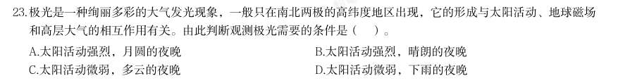

# 常识判断 · 法律常识

> 考点编码：`CS-FL`　｜　体系对齐：花生十三 `changshi-panduan.md#2.3`

## 一、命题规律

- **本题型真题总量**：223 题（2002–2026）
- **地区分布**：国考 123 / 广东 51 / 湖北 49
- **近六年题量**：2026年4题, 2025年6题, 2024年14题, 2023年7题, 2022年5题, 2021年6题
- **覆盖试卷**：72 套
- **子考点分布**：法律常识（综合） 72　宪法 55　行政法 51　民法典 40　刑法 20
- **同题变体**：另有 15 道为同题重复（同年多卷/跨年再考），已折叠，需展开见 scripts/search.py --all-variants

## 二、近年真题（最多 12 题，按年份倒序）

### 2026 湖北·统一卷　第 23 题　（法律常识（综合））

极光是一种绚丽多彩的大气发光现象,一般只在南北两极的高纬度地区出现,它的形成与太阳活动、地球磁场 和高层大气的相互作用有关。由此判断观测极光需要的条件是( )。

- **A.** 太阳活动强烈,月圆的夜晚
- **B.** 太阳活动强烈,晴朗的夜晚
- **C.** 太阳活动微弱,多云的夜晚
- **D.** 太阳活动微弱,下雨的夜晚

**答案：B**

**解析/参考要点**：B
本题考查科技常识。
A 项错误,B 项正确,极光的产生依赖于太阳活动释放的高能带电粒子与地球磁
场的相互作用。当太阳活动强烈时,更多高能带电粒子进入地球两极,激发高层
大气中的原子发光,形成极光。而极光亮度较低,需在无云层遮挡且无其他光污
染的晴朗夜晚才能清晰观测。但月圆的夜晚通常月光强烈,明亮的月光会严重削
弱极光的可见度,甚至使其完全不可见。故“太阳活动强烈,晴朗的夜晚”可以
观测到极光。
C、D 两项错误,太阳活动微弱时,太阳风强度降低,进入地球两极的高能带电
粒子减少,极光出现的频率和强度显著降低,甚至无法形成可见极光。下雨意味
着云层厚密,而在多云的夜晚,云层会完全遮挡极光,不具备极光的观测条件。
故正确答案为B。

### 2026 国考·副省级　第 22 题　（行政法）

根据《政务数据共享条例》,下列说法错误的是:

- **A.** 政务数据需求部门提交的申请材料不全的,政务数据提供部门不得直接予以拒绝
- **B.** 政府部门通过共享获得政务数据后不得擅自将获得的政务数据提供给第三方
- **C.** 可以提供给所有政府部门共享使用的政务数据属于无条件共享类政务数据
- **D.** 政府部门应当新建政务数据共享交换系统开展跨层级政务数据共享相关工作

**答案：D**

**解析/参考要点**：D
本题考查法律常识。
A 项正确,根据《政务数据共享条例》第二十一条第二款规定:“政务数据需求部门提交的申请材料不全的,
政务数据提供部门应当一次性告知其需要补充的材料,不得直接予以拒绝。政务数据提供部门不同意共享的,
应当说明理由。”
B 项正确,根据《政务数据共享条例》第二十五条第一款规定:“政府部门通过共享获得政务数据的,不得擅
自扩大使用范围以及用于或者变相用于其他目的,不得擅自将获得的政务数据提供给第三方。确需扩大使用范
围、用于其他目的或者提供给第三方的,应当经政务数据提供部门同意。”
C 项正确,根据《政务数据共享条例》第十四条第一项规定:“政务数据按照共享属性分为无条件共享、有条
件共享和不予共享三类:(一)可以提供给所有政府部门共享使用的政务数据属于无条件共享类;”
D 项错误,根据《政务数据共享条例》第三十一条规定:“政府部门已建设的政务数据平台应当纳入全国一体
化政务大数据体系。除法律、行政法规另有规定外,原则上不得通过新建政务数据共享交换系统开展跨层级、
跨地域、跨系统、跨部门、跨业务的政务数据共享工作。”故“应当”说法错误,应为“原则上不得通过”。
本题为选非题,故正确答案为D。

### 2026 国考·地市级　第 21 题　（刑法）
> 材料：B.实践的过程就是对于结果的检验和评价 D.实践是一种无目的的适应环境的本能活动 点…

下列情形不符合《中华人民共和国监察法》及其实施条例规定的是:

- **A.** 再派出的监察专员王某在开展监察工作过程中,受派出他的监察机构领导
- **B.** 公务员张某在怀孕期间因涉嫌严重职务违法被监察机关调查,经监察机关依法审批,对其采取责令候查措施
- **C.** 办理监察事项的监察人员黄某系监察对象刘某的丈夫,黄某应自行回避
- **D.** 监察人员李某涉嫌职务犯罪,监察机关决定对其采取15 日禁闭措施

**答案：D**

**解析/参考要点**：D
本题考查法律常识。
A 项正确,根据《中华人民共和国监察法》第十条规定:“国家监察委员会领导地方各级监察委员会的工
作,上级监察委员会领导下级监察委员会的工作。”第十二条第四款:“监察机构、监察专员对派驻或者
派出它的监察委员会或者监察机构、监察专员负责。”因此,再派出的监察专员王某在开展监察工作过程
中,受派出他的监察机构领导。
B 项正确,根据《中华人民共和国监察法》第二十三条第一款第二项规定:“被调查人涉嫌严重职务违法
或者职务犯罪,并有下列情形之一的,经监察机关依法审批,可以对其采取责令候查措施:(二)符合留
置条件,但患有严重疾病、生活不能自理的,系怀孕或者正在哺乳自己婴儿的妇女,或者生活不能自理的
人的唯一扶养人。”因此,被调查人张某处于怀孕期间,符合采取责令候查措施的情形。
C 项正确,根据《中华人民共和国监察法》第六十七条第一项规定:“办理监察事项的监察人员有下列情
形之一的,应当自行回避,监察对象、检举人及其他有关人员也有权要求其回避:(一)是监察对象或者
检举人的近亲属的。”因此,监察人员黄某系监察对象刘某的丈夫,符合自行回避的情形。
D 项错误,根据《中华人民共和国监察法》第六十四条第一款规定:“监察人员涉嫌严重职务违法或者职
务犯罪,为防止造成更为严重的后果或者恶劣影响,监察机关经依法审批,可以对其采取禁闭措施。禁闭
的期限不得超过七日。”因此,监察人员李某被采取15 日禁闭措施,不符合“禁闭的期限不得超过七日”
的规定。
本题为选非题,故正确答案为D。

### 2026 国考·地市级　第 23 题　（行政法）

根据《政务数据共享条例》,下列说法错误的是:

- **A.** 政务数据需求部门提交的申请材料不全的,政务数据提供部门不得直接予以拒绝
- **B.** 政府部门通过共享获得政务数据后不得擅自将获得的政务数据提供给第三方
- **C.** 可以提供给所有政府部门共享使用的政务数据属于无条件共享类政务数据
- **D.** 政府部门应当新建政务数据共享交换系统开展跨层级政务数据共享相关工作

**答案：D**

**解析/参考要点**：D
本题考查法律常识。
A 项正确,根据《政务数据共享条例》第二十一条第二款规定:“政务数据需求部门提交的申请材料不全
的,政务数据提供部门应当一次性告知其需要补充的材料,不得直接予以拒绝。政务数据提供部门不同意
共享的,应当说明理由。”
B 项正确,根据《政务数据共享条例》第二十五条第一款规定:“政府部门通过共享获得政务数据的,不
得擅自扩大使用范围以及用于或者变相用于其他目的,不得擅自将获得的政务数据提供给第三方。确需扩
大使用范围、用于其他目的或者提供给第三方的,应当经政务数据提供部门同意。”
C 项正确,根据《政务数据共享条例》第十四条第一项规定:“政务数据按照共享属性分为无条件共享、
有条件共享和不予共享三类:(一)可以提供给所有政府部门共享使用的政务数据属于无条件共享类;”
D 项错误,根据《政务数据共享条例》第三十一条规定:“政府部门已建设的政务数据平台应当纳入全国
一体化政务大数据体系。除法律、行政法规另有规定外,原则上不得通过新建政务数据共享交换系统开展
跨层级、跨地域、跨系统、跨部门、跨业务的政务数据共享工作。”故“应当”说法错误,应为“原则上
不得通过”。
本题为选非题,故正确答案为D。

### 2025 国考·副省级　第 22 题　（宪法）

下列与我国的立法权相关的说法正确的是:

- **A.** 强制隔离戒毒、冻结存款的行政强制措施只能由法律予以设定
- **B.** 全国人民代表大会可授权国务院根据实际需要制定法律
- **C.** 法律解释权属于全国人大常委会、最高人民法院及最高人民检察院
- **D.** 行政法规由国务院及其组成部门、直属机构、办事机构予以制定发布

**答案：A**

**解析/参考要点**：本题考查法律常识。
A 项正确,根据《中华人民共和国行政强制法》第九条规定:“行政强制措施的种类:(一)限制公民人
身自由;(二)查封场所、设施或者财物;(三)扣押财物;(四)冻结存款、汇款;(五)其他行政
强制措施。”根据第十条规定:“行政强制措施由法律设定。尚未制定法律,且属于国务院行政管理职
权事项的,行政法规可以设定除本法第九条第一项、第四项和应当由法律规定的行政强制措施以外的其
他行政强制措施。尚未制定法律、行政法规,且属于地方性事务的,地方性法规可以设定本法第九条第
二项、第三项的行政强制措施。法律、法规以外的其他规范性文件不得设定行政强制措施。”因此,限
制公民人身自由(强制隔离戒毒)与冻结存款、汇款的行政强制措施只能由法律予以设定。
B 项错误,根据《中华人民共和国立法法》第十条第三款规定:“全国人民代表大会可以授权全国人民
代表大会常务委员会制定相关法律。”第十二条规定:“本法第十一条规定的事项尚未制定法律的,全
国人民代表大会及其常务委员会有权作出决定,授权国务院可以根据实际需要,对其中的部分事项先制
定行政法规,但是有关犯罪和刑罚、对公民政治权利的剥夺和限制人身自由的强制措施和处罚、司法制
度等事项除外。”因此,全国人民代表大会可授权全国人民代表大会常务委员会制定相关法律,可授权
国务院根据实际需要先制定行政法规,而非法律。
C 项错误,根据《中华人民共和国立法法》第四十八条第一款规定:“法律解释权属于全国人民代表大
会常务委员会。”第一百一十九条第一款规定“最高人民法院、最高人民检察院作出的属于审判、检察
工作中具体应用法律的解释,应当主要针对具体的法律

### 2025 国考·副省级　第 24 题　（行政法）

根据《中华人民共和国食品安全法》,下列情形符合法律规定的是:

- **A.** 某食品生产企业自行检验产品后,不再委托专业机构进行检验
- **B.** 某乳制品生产企业以分装方式生产婴幼儿配方乳粉
- **C.** 某食品安全监督管理部门向食品生产经营者收取检验费
- **D.** 某个体工商户仅销售预包装食品,未报食品安全监督管理部门备案

**答案：A**

**解析/参考要点**：本题考查法律常识。
A 项正确,根据《中华人民共和国食品安全法》第八十九条第一款规定:“食品生产企业可以自行对所
生产的食品进行检验,也可以委托符合本法规定的食品检验机构进行检验。”因此,某食品生产企业自
行检验产品后,可以不再委托专业机构进行检验。
B 项错误,根据《中华人民共和国食品安全法》第八十一条第五款规定:“不得以分装方式生产婴幼儿
配方乳粉,同一企业不得用同一配方生产不同品牌的婴幼儿配方乳粉。”因此,某乳制品生产企业不得
以分装方式生产婴幼儿配方乳粉。
C 项错误,根据《中华人民共和国食品安全法》第八十七条规定:“县级以上人民政府食品安全监督管
理部门应当对食品进行定期或者不定期的抽样检验,并依据有关规定公布检验结果,不得免检。进行抽
样检验,应当购买抽取的样品,委托符合本法规定的食品检验机构进行检验,并支付相关费用;不得向
食品生产经营者收取检验费和其他费用。”因此,某食品安全监督管理部门不得向食品生产经营者收取
检验费。
D 项错误,根据《中华人民共和国食品安全法》第三十五条第一款规定:“国家对食品生产经营实行许
可制度。从事食品生产、食品销售、餐饮服务,应当依法取得许可。但是,销售食用农产品和仅销售预
包装食品的,不需要取得许可。仅销售预包装食品的,应当报所在地县级以上地方人民政府食品安全监
督管理部门备案。”因此,某个体工商户仅销售预包装食品,应报所在地县级以上地方人民政府食品安
全监督管理部门备案。
2025 国考《行测》(副省级)解析
10 / 46
故正确答案为A。

### 2025 国考·地市级　第 24 题　（行政法）

根据《中华人民共和国公司法》的规定,下列事项必须通过国家企业信用信息公示系统公示的是:

- **A.** 某公司与其他公司的合并决议
- **B.** 其公司股东实缴出资额和出资方式
- **C.** 某公司股东会作出的减少注册资本的决议
- **D.** 某公司的破产清算公告

**答案：B**

**解析/参考要点**：本题考查法律常识。
A、C、D 三项错误,B 项正确,根据《中华人民共和国公司法》第四十条第一款规定:“公司应当按照规
定通过国家企业信用信息公示系统公示下列事项:(一)有限责任公司股东认缴和实缴的出资额、出资方
式和出资日期,股份有限公司发起人认购的股份数;(二)有限责任公司股东、股份有限公司发起人的股
权、股份变更信息;(三)行政许可取得、变更、注销等信息;(四)法律、行政法规规定的其他信息。”
故正确答案为B。

### 2025 国考·地市级　第 25 题　（法律常识（综合））

《中华人民共和国消费者权益保护法实施条例》自2024年7月1日起施行。下列说法或做法符合相关法律法规的 是:

- **A.** 甲公司在消费者订购云服务前将自动续费条款放置于显著位置,消费者同意订购并勾选自动续费,甲公司可在该服务到期时自动扣费
- **B.** 乙加油站为消费者提供免费洗车服务时造成车身划痕,该加油站无需承担赔偿责任
- **C.** 丙在某直播平台上直播卖服装,称自己的服装为尾货和瑕疵品,要求大家谨慎购买,该商品不适用七天无理由退货
- **D.** 丁健身馆与消费者签订书面合同,约定提供为期半年的健身私教课程服务并收取3000元预付款

**答案：D**

**解析/参考要点**：本题考查法律常识。
A 项错误,根据《中华人民共和国消费者权益保护法实施条例》第十条第二款规定:“经营者采取自动
展期、自动续费等方式提供服务的,应当在消费者接受服务前和自动展期、自动续费等日期前,以显著
方式提请消费者注意。”因此,甲公司的自动扣费业务,不仅应当在消费者接受服务前以显著方式提请
消费者注意,还应当在自动续费日期前,以显著方式提请消费者注意。
B 项错误,根据《中华人民共和国消费者权益保护法实施条例》第七条第二款规定:“经营者向消费者
提供商品或者服务(包括以奖励、赠送、试用等形式向消费者免费提供商品或者服务),应当保证商品或
者服务符合保障人身、财产安全的要求······”因此,乙加油站虽然为消费者提供的是免费洗车
服务,但仍应当保证商品或者服务符合保障人身、财产安全的要求。
C 项错误,根据《中华人民共和国消费者权益保护法实施条例》第十九条第一、二款规定:“经营者通
过网络、电视、电话、邮购等方式销售商品的,应当遵守消费者权益保护法第二十五条规定,不得擅自
扩大不适用无理由退货的商品范围。经营者应当以显著方式对不适用无理由退货的商品进行标注,提示
消费者在购买时进行确认,不得将不适用无理由退货作为消费者默认同意的选项。未经消费者确认,经
营者不得拒绝无理由退货。”根据《中华人民共和国消费者权益保护法》第二十五条第一、二款规定:
“经营者采用网络、电视、电话、邮购等方式销售商品,消费者有权自收到商品之日起七日内退货,且
无需说明理由,但下列商品除外:(一)消费者定作的;(二)鲜活易腐的;(三)在线下载或者消费者拆
封的音像制品、计算机软件等数字化商品;(四)交

### 2025 国考·行政执法　第 21 题　（宪法）

下列与我国的立法权相关的说法正确的是:

- **A.** 强制隔离戒毒、冻结存款的行政强制措施只能由法律予以设定
- **B.** 全国人民代表大会可授权国务院根据实际需要制定法律
- **C.** 法律解释权属于全国人大常委会、最高人民法院及最高人民检察院
- **D.** 行政法规由国务院及其组成部门、直属机构、办事机构予以制定发布

**答案：A**

**解析/参考要点**：本题考查法律常识。
A 项正确,根据《中华人民共和国行政强制法》第九条规定:“行政强制措施的种类:(一)限制公民人
身自由;(二)查封场所、设施或者财物;(三)扣押财物;(四)冻结存款、汇款;(五)其他行政强制
措施。”根据第十条规定:“行政强制措施由法律设定。尚未制定法律,且属于国务院行政管理职权事
项的,行政法规可以设定除本法第九条第一项、第四项和应当由法律规定的行政强制措施以外的其他行
政强制措施。尚未制定法律、行政法规,且属于地方性事务的,地方性法规可以设定本法第九条第二项、
第三项的行政强制措施。法律、法规以外的其他规范性文件不得设定行政强制措施。”因此,限制公民
人身自由(强制隔离戒毒)与冻结存款、汇款的行政强制措施只能由法律予以设定。
B 项错误,根据《中华人民共和国立法法》第十条第三款规定:“全国人民代表大会可以授权全国人民
代表大会常务委员会制定相关法律。”第十二条规定:“本法第十一条规定的事项尚未制定法律的,全
国人民代表大会及其常务委员会有权作出决定,授权国务院可以根据实际需要,对其中的部分事项先制
定行政法规,但是有关犯罪和刑罚、对公民政治权利的剥夺和限制人身自由的强制措施和处罚、司法制
度等事项除外。”因此,全国人民代表大会可授权全国人民代表大会常务委员会制定相关法律,可授权
国务院根据实际需要先制定行政法规,而非法律。
C 项错误,根据《中华人民共和国立法法》第四十八条第一款规定:“法律解释权属于全国人民代表大
会常务委员会。”第一百一十九条第一款规定“最高人民法院、最高人民检察院作出的属于审判、检察
工作中具体应用法律的解释,应当主要针对具体的法律

### 2025 国考·行政执法　第 24 题　（民法典）

虚假诉讼、作伪证是我国重点打击的破坏司法秩序的行为。下列说法错误的是:

- **A.** 甲伪造合同向法院起诉,意图获得非法利益,甲可能被罚款、拘留或被追究刑事责任
- **B.** 甲指使乙在一民事案件中作伪证,甲的行为构成妨害作证罪
- **C.** 甲欠乙2万元,因欠条遗失,乙补写欠条并模仿甲的签名后向法院起诉,乙的行为构成虚假诉讼罪
- **D.** 甲为鉴定人,在某刑事案件中故意作虚假鉴定,意图陷害他人,甲的行为构成伪证罪

**答案：C**

**解析/参考要点**：本题考查法律常识。
A 项正确,根据《中华人民共和国民事诉讼法》第一百一十四条第一款第一项规定:“诉讼参与人或者
其他人有下列行为之一的,人民法院可以根据情节轻重予以罚款、拘留;构成犯罪的,依法追究刑事责
任:(一)伪造、毁灭重要证据,妨碍人民法院审理案件的;”选项中,甲伪造合同向法院起诉,属于伪
造、毁灭重要证据,妨碍人民法院审理案件的行为,甲可能被罚款、拘留或被追究刑事责任。
B 项正确,根据《中华人民共和国刑法》第三百零七条第一款规定:“以暴力、威胁、贿买等方法阻止
证人作证或者指使他人作伪证的,处三年以下有期徒刑或者拘役;情节严重的,处三年以上七年以下有
期徒刑。”选项中,甲指使乙在案件中作伪证,属于妨害作证的情形。因此,甲的行为构成妨害作证罪。
C 项错误,根据《中华人民共和国刑法》第三百零七条之一第一款规定:“以捏造的事实提起民事诉讼,
妨害司法秩序或者严重侵害他人合法权益的,处三年以下有期徒刑、拘役或者管制,并处或者单处罚金;
情节严重的,处三年以上七年以下有期徒刑,并处罚金。”选项中,甲确实欠乙2 万元,虽然后期乙补
写欠条并模仿甲的签名,但是乙并不存在捏造事实的情形。因此,乙的行为并不构成虚假诉讼罪。
D 项正确,根据《中华人民共和国刑法》第三百零五条规定:“在刑事诉讼中,证人、鉴定人、记录人、
翻译人对与案件有重要关系的情节,故意作虚假证明、鉴定、记录、翻译,意图陷害他人或者隐匿罪证
的,处三年以下有期徒刑或者拘役;情节严重的,处三年以上七年以下有期徒刑。”选项中,甲为鉴定
2025 国考《行测》(行政执法卷)解析
10 / 46
人,在案件中故意作虚假鉴定

### 2024 湖北·统一卷　第 3 题　（宪法）

在党员、干部的日常言行上——《不断提高政治判断力、政治领悟力、政治执行力》 习近平总书记强调,要坚定维护宪法权威和尊严,推动宪法完善和发展,更好发挥宪法在治国理政中的重要作 用。下列有关表述正确的有几项: 1要加强宪法理论研究和宣传教育,坚持知识普及、理论阐释、观念引导全面发力 2加快完善以宪法为核心的中国特色社会主义法律体系,不断提高宪法实施和监督水平 3坚持宪法确定的中国共产党领导地位不动摇,坚持宪法确定的人民民主专政的国体和人民代表大会制度的政 体不动摇 4宪法是治国安邦的总章程,是我们党治国理政的根本法律依据,是国家政治和社会生活的最高法律规范

- **A.** 1项
- **B.** 2项
- **C.** 3项
- **D.** 4项

**答案：D**

### 2024 湖北·统一卷　第 6 题　（法律常识（综合））

事 党的十八大以来,以习近平同志为核心的党中央始终把未成年人工作摆在突出位置。2024年1月1日起施行的 《未成年人网络保护条例》是我国第一部针对未成年人网络保护的专门性综合立法,是贯彻落实习近平法治思 想的生动体现。下列关于该条例内容表述正确的有几项? 1国家教育部门负责统筹协调未成年人网络保护工作 2网络产品和服务提供者不得为未成年人提供游戏账号租售服务 3网络产品和服务提供者不得通过自动化决策方式向未成年人进行商业营销 4网络直播服务提供者应当建立网络直播发布者真实身份信息动态核验机制 5网络服务提供者可根据实际引导未成年人参与应援集资、投票打榜、刷量控评等网络活动

- **A.** 2项
- **B.** 3项
- **C.** 4项
- **D.** 5项

**答案：B**

## 三、其余真题（按年代分片）

| 年代 | 题量 | 分片文件 |
|---|---:|---|
| 2000s | 67 | [CS-FL-2000s.md](split/CS-FL-2000s.md) |
| 2010s | 91 | [CS-FL-2010s.md](split/CS-FL-2010s.md) |
| 2020s | 53 | [CS-FL-2020s.md](split/CS-FL-2020s.md) |

> 也可用 `python scripts/search.py --kaodian CS-FL` 直接检索全部 223 题。