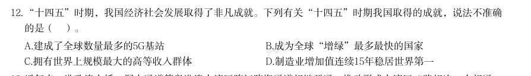

# 常识判断 · 经济常识

> 考点编码：`CS-JJ`　｜　体系对齐：花生十三 `changshi-panduan.md#2.2`

## 一、命题规律

- **本题型真题总量**：138 题（2000–2026）
- **地区分布**：国考 61 / 广东 47 / 湖北 30
- **近六年题量**：2026年5题, 2025年3题, 2024年5题, 2023年10题, 2022年6题, 2021年2题
- **覆盖试卷**：65 套
- **子考点分布**：微观与市场 52　宏观经济 47　经济常识（综合） 40　经济指标 14
- **同题变体**：另有 15 道为同题重复（同年多卷/跨年再考），已折叠，需展开见 scripts/search.py --all-variants

## 二、近年真题（最多 12 题，按年份倒序）

### 2026 广东·统一卷　第 12 题　（经济常识（综合））

“十四五”时期,我国经济社会发展取得了非凡成就。下列有关“十四五”时期我国取得的成就,说法不准确 的是( )。

- **A.** 建成了全球数量最多的5G基站
- **B.** 成为全球“增绿”最多最快的国家
- **C.** 拥有世界上规模最大的高等收入群体
- **D.** 制造业增加值连续15年稳居世界第一

**答案：C**

**解析/参考要点**：答案C
本题考查科技常识。2025 年7 月9 日,国务院新闻办公室举行“高质量完成'十
四五'规划”系列主题新闻发布安。
A、D 两项正确,C 项错误,国家发展改革委主任郑栅洁在发布会上表示,中国还
是全球第一制造业大国、第一货物贸易大
国、第一外汇储备大国、第一能源生产大国、第一人力资源大国,拥有世界上规
模最大的中等收入群体、社会保障体系,建成了全球数量最多的5G 基站...我国
连续15 年稳坐全球制造业“头把交椅”,200 多种主要工业品产量世界第一,中
国不能造的越来越少、能造的越来越好。故选项“拥有世界上规模最大的高等收
入群体“说法错误,应是“拥有世界上规模最大的中等收入群体”。
B 项正确,国家发展改革委主任郑栅洁在发布会上表示,绿水青山就是金山银山
理念深入人心,绿色已经成为当代中国的鲜明底色,这五年的成效集中体现在增
绿、治污、用能、循环四个方面。“增绿”全球最多,森林覆盖率提高到25%以
上,新增森林面积相当于1 个陕西省的面积,贡献了全球新增绿化面积的四分之
一。本题为选非题,故正确答案为C。

### 2026 国考·副省级　第 23 题　（宏观经济）

下列经济目标与政策工具匹配错误的是:

- **A.** 扩大基础设施投资规模——提高专项债发行额度
- **B.** 降低市场主体经营成本——延续小微企业增值税减免
- **C.** 拓宽房企的融资渠道——增加保障性住房再贷款额度
- **D.** 缓解基层“三保”支出压力——加大中央对地方转移支付

**答案：C**

**解析/参考要点**：C
本题考查经济常识。
A 项正确,专项债券是落实积极财政政策的重要抓手,能直接有效拉动投资。基础设施建设是专项债资金的主
要投向领域,提高专项债发行额度有利于扩大基础设施投资规模,发挥强基础、补短板、惠民生、扩投资等积
极作用。
B 项正确,延续小微企业增值税减免能够显著减轻小微企业税收负担,从而减轻小微企业的经营压力,有利于
稳定其经营状况。该政策直接降低小微企业税负,增强其经营信心,符合“降低市场主体经营成本”的经济目
标。
C 项错误,在开发商存在保交房的资金压力时,地方政府旗下的国企、城投可以向央行申请“保障性住房再贷
款”,然后以合理价格收购开发商已经建设好的存量商品房。故保障性住房再贷款资金用途明确限定为收购存
量商品房,而非直接拓宽房企融资渠道。
D 项正确,为支持基层财政平稳运行,加强基层“三保”保障,中央财政不断推动财力下沉。加大中央对地方
转移支付,有利于增强地方财力并确保基层“三保”的稳固,以强化地方财力的支撑,助力地方更好地履行“三
保”职责。
本题为选非题,故正确答案为C。

### 2026 国考·地市级　第 22 题　（经济常识（综合））

关于《中华人民共和国民营经济促进法》,下列说法错误的是:

- **A.** 是我国第一部专门关于民营经济发展的基础性法律
- **B.** 规定司法行政部门建立涉企行政执法诉求沟通机制
- **C.** 规定地方各级人民政府与民营经济组织订立的合同不得变更
- **D.** 规定向民营经济组织开放国家重大科研基础设施

**答案：C**

**解析/参考要点**：C
本题考查法律常识。
A 项正确,中华人民共和国司法部发布的《民营经济必将走向更加广阔的舞台——写在民营经济促进法施
行之际》指出:“第一部专门关于民营经济发展的基础性法律;第一次将‘两个毫不动摇’写入法律;第
一次明确民营经济的法律地位;第一次明确规定‘促进民营经济持续、健康、高质量发展,是国家长期坚
持的重大方针政策’......民营经济促进法的制定和实施,在我国民营经济发展史上具有里程碑意义。”
B 项正确,根据《中华人民共和国民营经济促进法》第五十三条第二款规定:“司法行政部门建立涉企行
政执法诉求沟通机制,组织开展行政执法检查,加强对行政执法活动的监督,及时纠正不当行政执法行为。”
C 项错误,根据《中华人民共和国民营经济促进法》第七十条规定:“地方各级人民政府及其有关部门应
当履行依法向民营经济组织作出的政策承诺和与民营经济组织订立的合同,不得以行政区划调整、政府换
届、机构或者职能调整以及相关人员更替等为由违约、毁约。因国家利益、社会公共利益需要改变政策承
诺、合同约定的,应当依照法定权限和程序进行,并对民营经济组织因此受到的损失予以补偿。”因此,
并非规定“合同不得变更”,而是强调政府不得随意违约毁约,同时明确了基于公共利益的合法变更情形
及补偿。
D 项正确,根据《中华人民共和国民营经济促进法》第二十八条规定:“支持民营经济组织参与国家科技
攻关项目,支持有能力的民营经济组织牵头承担国家重大技术攻关任务,向民营经济组织开放国家重大科
研基础设施,支持公共研究开发平台、共性技术平台开放共享,为民营经济组织技术创新平等提供服务,
鼓励各类企业和高等学校、科研院所

### 2026 国考·行政执法　第 22 题　（经济常识（综合））

关于《中华人民共和国民营经济促进法》,下列说法错误的是:

- **A.** 是我国第一部专门关于民营经济发展的基础性法律
- **B.** 规定司法行政部门建立涉企行政执法诉求沟通机制
- **C.** 规定地方各级人民政府与民营经济组织订立的合同不得变更
- **D.** 规定向民营经济组织开放国家重大科研基础设施

**答案：C**

**解析/参考要点**：C
本题考查法律常识。
A 项正确,中华人民共和国司法部发布的《民营经济必将走向更加广阔的舞台——写在民营经济促进法施
行之际》指出:“第一部专门关于民营经济发展的基础性法律;第一次将‘两个毫不动摇’写入法律;第
一次明确民营经济的法律地位;第一次明确规定‘促进民营经济持续、健康、高质量发展,是国家长期坚
持的重大方针政策’······民营经济促进法的制定和实施,在我国民营经济发展史上具有里程碑意
义。”
B 项正确,根据《中华人民共和国民营经济促进法》第五十三条第二款规定:“司法行政部门建立涉企行
政执法诉求沟通机制,组织开展行政执法检查,加强对行政执法活动的监督,及时纠正不当行政执法行为。”
C 项错误,根据《中华人民共和国民营经济促进法》第七十条规定:“地方各级人民政府及其有关部门应
当履行依法向民营经济组织作出的政策承诺和与民营经济组织订立的合同,不得以行政区划调整、政府换
届、机构或者职能调整以及相关人员更替等为由违约、毁约。因国家利益、社会公共利益需要改变政策承
诺、合同约定的,应当依照法定权限和程序进行,并对民营经济组织因此受到的损失予以补偿。”因此,
并非规定“合同不得变更”,而是强调政府不得随意违约毁约,同时明确了基于公共利益的合法变更情形
及补偿。
D 项正确,根据《中华人民共和国民营经济促进法》第二十八条规定:“支持民营经济组织参与国家科技
攻关项目,支持有能力的民营经济组织牵头承担国家重大技术攻关任务,向民营经济组织开放国家重大科
研基础设施,支持公共研究开发平台、共性技术平台开放共享,为民营经济组织技术创新平等提供服务,
鼓励各类企业和高等学校、科研院

### 2026 国考·行政执法　第 25 题　（宏观经济）

下列说法与我国税收制度不相符的是:

- **A.** 对我国境内某全球知名半导体公司征收增值税
- **B.** 对未做废弃物无害化处理的养殖场征收资源税
- **C.** 对某进口高档化妆品公司征收消费税
- **D.** 对在我国境内外资企业工作多年的外籍居民征收个人所得税

**答案：B**

**解析/参考要点**：B
本题考查法律常识。
A 项正确,根据《中华人民共和国增值税法》第三条第一款规定:“在中华人民共和国境内(以下简称境
内)销售货物、服务、无形资产、不动产(以下称应税交易),以及进口货物的单位和个人(包括个体工
商户),为增值税的纳税人,应当依照本法规定缴纳增值税。”选项中,我国境内的半导体公司销售半导
体产品,属于增值税征税范围,应征收增值税,因此,符合我国税收制度。
B 项错误,根据《中华人民共和国资源税法》第一条规定:“在中华人民共和国领域和中华人民共和国管
辖的其他海域开发应税资源的单位和个人,为资源税的纳税人,应当依照本法规定缴纳资源税。应税资源
的具体范围,由本法所附《资源税税目税率表》(以下称《税目税率表》)确定。”《资源税税目税率表》
载明的应税资源的具体范围包括能源矿产、金属矿产、非金属矿产、水气矿产、盐。选项中,未做废弃物
无害化处理的养殖场不属于开发应税资源的单位,不应对其征收资源税,因此,不符合我国税收制度。
C 项正确,根据《中华人民共和国消费税暂行条例》第一条规定:“在中华人民共和国境内生产、委托加
工和进口本条例规定的消费品的单位和个人,以及国务院确定的销售本条例规定的消费品的其他单位和个
人,为消费税的纳税人,应当依照本条例缴纳消费税。”第二条第一款规定:“消费税的税目、税率,依
照本条例所附的《消费税税目税率表》执行。”《消费税税目税率表》载明税目“三、化妆品”的税率为
“30%”。选项中,某进口高档化妆品公司进口本条例规定的消费品化妆品,属于消费税的纳税人,应对
其征收消费税,因此,符合我国税收制度。
D 项正确,根据《中华人民共和国个人所

### 2025 国考·副省级　第 21 题　（宏观经济）

2024政府工作报告提出,着力扩大国内需求,推动经济实现良性循环。下列措施有利于扩大内需的是: 1完善粮食生产收储加工体系 2加大出口信贷和出口信保支持 3合理扩大地方政府专项债券投向领域 4实施数字消费、绿色消费、健康消费促进政策

- **A.** 12
- **B.** 23
- **C.** 14
- **D.** 34

**答案：D**

**解析/参考要点**：本题考查经济常识。
1错误,2024 政府工作报告在“三、2024 年政府工作任务”部分“(六)更好统筹发展和安全,有效防
范化解重点领域风险”中指出:“加强重点领域安全能力建设。完善粮食生产收储加工体系,全方位夯
实粮食安全根基。”
2错误,2024 政府工作报告在“三、2024 年政府工作任务”部分“(五)扩大高水平对外开放,促进互
利共赢”中指出:“推动外贸质升量稳。加强进出口信贷和出口信保支持,优化跨境结算、汇率风险管
理等服务,支持企业开拓多元化市场。”
3正确,2024 政府工作报告在“三、2024 年政府工作任务”部分“(三)着力扩大国内需求,推动经济
实现良性循环”中指出:“积极扩大有效投资······合理扩大地方政府专项债券投向领域和用作
资本金范围,额度分配向项目准备充分、投资效率较高的地区倾斜。”
4正确,2024 政府工作报告在“三、2024 年政府工作任务”部分“(三)着力扩大国内需求,推动经济
实现良性循环”中指出:“培育壮大新型消费,实施数字消费、绿色消费、健康消费促进政策,积极培
育智能家居、文娱旅游、体育赛事、国货‘潮品’等新的消费增长点。”
综上所述,34符合题意。
故正确答案为D。

### 2025 国考·地市级　第 28 题　（经济指标）

下列人物所说的话与经济有关,其中说法正确的是:

- **A.** 社区居民:我的定期储蓄存款被统计在货币供应量M1中
- **B.** 外资企业CEO:我公司的产值持续增长,为中国GDP提升做出了贡献
- **C.** 留美学生:人民币汇率降低,我的学费也降低了
- **D.** 纳税商户:相比于增值税,营业税的好处是避免重复征税

**答案：B**

**解析/参考要点**：本题考查经济常识。
A 项错误,中国货币供应量的层次划分为:M0=流通中现金;M1=M0+单位活期存款;M2=M1+单位定期存款
+个人存款+其他存款。社区居民的定期储蓄存款属于个人存款,通常被计入M2。
B 项正确,GDP(国内生产总值)是指一个国家和地区所有常住单位在一定时期内生产活动的全部最终成
果。外资企业在中国的生产活动产生的价值会计入中国的GDP。
C 项错误,人民币汇率降低,意味着人民币贬值,美元相对升值。对于在美国留学的学生来说,这通常
会导致他们需要支付更多的人民币来兑换美元以支付学费,而不是降低。
D 项错误,营业税是一种流转税,是在商品销售或劳务提供过程中,针对流转额(如销售额、营业额等)
2025 国考《行测》(地市级)解析
11 / 44
征收的税款。而增值税是对商品和服务在流转过程中产生的增值额进行征税。增值税的一个重要特点就
是可以避免重复征税,因为它只对每个环节的增值部分征税。
故正确答案为B。

### 2025 国考·行政执法　第 28 题　（经济指标）

下列人物所说的话与经济有关,其中说法正确的是:

- **A.** 社区居民:我的定期储蓄存款被统计在货币供应量M1中
- **B.** 外资企业CEO:我公司的产值持续增长,为中国GDP提升做出了贡献
- **C.** 留美学生:人民币汇率降低,我的学费也降低了
- **D.** 纳税商户:相比于增值税,营业税的好处是避免重复征税

**答案：B**

**解析/参考要点**：本题考查经济常识。
A 项错误,中国货币供应量的层次划分为:M0=流通中现金;M1=M0+单位活期存款;M2=M1+单位定期存款
+个人存款+其他存款。社区居民的定期储蓄存款属于个人存款,通常被计入M2。
B 项正确,GDP(国内生产总值)是指一个国家和地区所有常住单位在一定时期内生产活动的全部最终成
果。外资企业在中国的生产活动产生的价值会计入中国的GDP。
C 项错误,人民币汇率降低,意味着人民币贬值,美元相对升值。对于在美国留学的学生来说,这通常
会导致他们需要支付更多的人民币来兑换美元以支付学费,而不是降低。
D 项错误,营业税是一种流转税,是在商品销售或劳务提供过程中,针对流转额(如销售额、营业额等)
征收的税款。而增值税是对商品和服务在流转过程中产生的增值额进行征税。增值税的一个重要特点就
是可以避免重复征税,因为它只对每个环节的增值部分征税。
故正确答案为B。

### 2024 湖北·统一卷　第 7 题　（宏观经济）

在2023年12月召开的中央经济工作会议上,习近平总书记全面总结2023年经济工作,深刻分析当前经济形势, 系统部署2024年经济工作。下列关于做好2024年经济工作的要求,表述正确的有: 1强化宏观政策逆周期和跨周期调节 2坚持稳中求进、以进促稳、先立后破 3积极的财政政策要适度加力、提质增效 4稳健的货币政策要灵活适度、精准有效

- **A.** 12
- **B.** 123
- **C.** 234
- **D.** 1234

**答案：D**

### 2024 湖北·统一卷　第 17 题　（宏观经济）

下列关于贷款市场报价利率(LPR)说法错误的是:

- **A.** 目前LPR只有1年期和5年期以上两个期限品种
- **B.** 当LPR下降后,商业性个人住房贷款的最新一期月供也会下降
- **C.** LPR是由中国人民银行授权全国银行间同业拆借中心计算并公布的基础性的贷款参考利率
- **D.** 新发放的商业性个人住房贷款利率是以最近一个月相应期限的贷款市场报价利率为定价基准加点形成

**答案：B**

### 2024 湖北·统一卷　第 18 题　（宏观经济）

下列关于国债逆回购的说法正确的是:

- **A.** 投资者可以通过银行网点购买国债逆回购
- **B.** 国债逆回购是以国家为主体进行债券回购
- **C.** 国债逆回购本质上是一种短期资金借贷方式
- **D.** 国债逆回购利率上行20个基点表示利率增加2%

**答案：C**

### 2024 国考·副省级　第 7 题　（宏观经济）

习近平指出健全美丽中国建设保障体系,统筹各领域资源,汇聚各方面力量,打好法治、市场、科技、政 策“组合拳”,关于健全美丽中国建设保障体系,下列正确的是( )。 1要全面实行排污许可制,完善自然资源资产管理制度体系,健全国土空间用途管制制度 2要完善绿色低碳发展经济政策,强化财政支持、税收政策支持、金融支持、价格政策支持 3要加快构建环保信用监管体系,规范环境治理市场,促进环保产业和环境服务业健康发展 4要更好发挥政府在碳排放权、用能权、用水权等资源环境要素配置中的决定性

- **A.** 234
- **B.** 124
- **C.** 134
- **D.** 123

**答案：D**

**解析/参考要点**：本题考查政治常识。
123正确,4错误,2023 年7 月17 日至18 日,全国生态环境保护大会在北京召开。习近平指出,要
健全美丽中国建设保障体系。统筹各领域资源,汇聚各方面力量,打好法治、市场、科技、政策“组合
拳”。要强化法治保障,统筹推进生态环境、资源能源等领域相关法律制修订,实施最严格的地上地下、
陆海统筹、区域联动的生态环境治理制度,全面实行排污许可制,完善自然资源资产管理制度体系,健
全国土空间用途管制制度。要完善绿色低碳发展经济政策,强化财政支持、税收政策支持、金融支持、
价格政策支持。要推动有效市场和有为政府更好结合,将碳排放权、用能权、用水权、排污权等资源环
境要素一体纳入要素市场化配置改革总盘子,支持出让、转让、抵押、入股等市场交易行为,加快构建
环保信用监管体系,规范环境治理市场,促进环保产业和环境服务业健康发展。
故正确答案为D。

## 三、其余真题（按年代分片）

| 年代 | 题量 | 分片文件 |
|---|---:|---|
| 2000s | 28 | [CS-JJ-2000s.md](split/CS-JJ-2000s.md) |
| 2010s | 66 | [CS-JJ-2010s.md](split/CS-JJ-2010s.md) |
| 2020s | 32 | [CS-JJ-2020s.md](split/CS-JJ-2020s.md) |

> 也可用 `python scripts/search.py --kaodian CS-JJ` 直接检索全部 138 题。