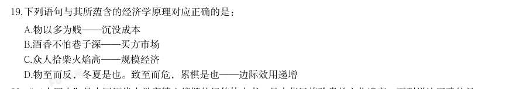
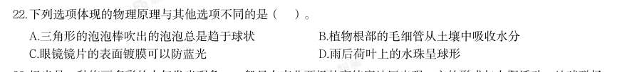
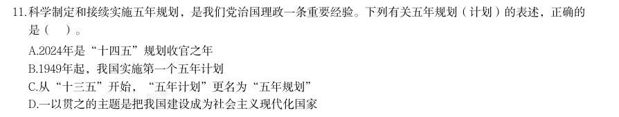

# 常识判断 · 科技常识

> 考点编码：`CS-KJ`　｜　体系对齐：花生十三 `changshi-panduan.md#2.6`

## 一、命题规律

- **本题型真题总量**：205 题（2000–2026）
- **地区分布**：国考 88 / 广东 62 / 湖北 55
- **近六年题量**：2026年10题, 2025年9题, 2024年7题, 2023年16题, 2022年9题, 2021年6题
- **覆盖试卷**：83 套
- **子考点分布**：基础科学 137　科技常识（待细分） 56　科技成就 30
- **同题变体**：另有 18 道为同题重复（同年多卷/跨年再考），已折叠，需展开见 scripts/search.py --all-variants

## 二、近年真题（最多 12 题，按年份倒序）

### 【2026 湖北省考·第 19 题】HB-2026-ty-X019　科技常识｜科技常识（待细分）

下列语句与其所蕴含的经济学原理对应正确的是:

- **A.** 物以多为贱——沉没成本
- **B.** 酒香不怕巷子深——买方市场
- **C.** 众人拾柴火焰高——规模经济
- **D.** 物至而反,冬夏是也。致至而危,累棋是也——边际效用递增

**答案：C**

**解析/参考要点**：C
本题考查经济常识。
A 项错误,“物以多为贱”反映的是供给影响价格的供需原理,供大于求,价格
下跌;供小于求,价格上升。所以“物以多为贱”反映的是商品供给过剩导致价
格下跌。沉没成本指已发生且不可回收的支出,如已经流逝的时间、金钱或精力
等,与物品贵贱无关。
B 项错误,买方市场指商品供大于求导致买方占据交易优势的市场形态。反之,
卖方市场指商品供不应求促使卖方掌握主动权的市场形态。“酒香不怕巷子深”
描述优质产品无需广告即可吸引消费者,体现的是卖方占据主导地位,所以应该
是卖方市场。
C 项正确,规模经济指随着生产规模扩大,单位产品的平均成本下降,效率提升。
“众人拾柴火焰高”形象比喻集体协作能放大产出效益,与企业通过扩大生产、
分工协作降低单位成本的经济逻辑相符合。
D 项错误,“物至而反,冬夏是也。致至而危,累棋是也”大意为事物发展到极
致必转向反面,对应经济学中的边际效用递减,即随着消费者对某种物品消费量
的增加,每增加消费一单位该物品带来的满足感递减,甚至转为负效用。而边际
效用递增是指随着消费者对某种物品的消费量增加,每增加消费一单位该物品所
带来的满足感逐步上升。
故正确答案为C。

### 【2026 湖北省考·第 22 题】HB-2026-ty-X022　科技常识｜基础科学

下列选项体现的物理原理与其他选项不同的是( )。

- **A.** 三角形的泡泡棒吹出的泡泡总是趋于球状
- **B.** 植物根部的毛细管从土壤中吸收水分
- **C.** 眼镜镜片的表面镀膜可以防蓝光
- **D.** 雨后荷叶上的水珠呈球形

**答案：C**

**解析/参考要点**：C
本题考查科技常识。
A、D 两项正确,三角形的泡泡棒吹出的泡泡最终呈球形,雨后荷叶上的水珠呈
球形,都是因为液体表面张力的作用,表面张力会使液体表面尽可能收缩到最小
表面积(相同体积下球形表面积最小),因此体现的是表面张力原理。
B 项正确,毛细作用是液体表面对固体表面的吸引力。当毛细管插入浸润液体中,
管内液面上升,高于管外液面;毛细管插入不浸润液体中,管内液体下降,低于
管外液面。植物根部毛细管从土壤中吸水,利用的是毛细现象,而毛细现象本质
上是液体表面张力与附着层分子相互作用力共同作用的结果,核心原理是表面张
力。
C 项错误,眼镜镜片的表面镀膜防蓝光,利用的是光的干涉原理。镜片表面镀多
层纳米级光学薄膜,蓝光入射时,在膜层上表面与下表面分别反射,两束反射光
相位相反、发生相消干涉,大幅降低蓝光透过率。与表面张力无关。
本题为选非题,故正确答案为C。

### 【2026 广东省考·第 11 题】GD-2026-ty-X011　科技常识｜基础科学

科学制定和接续实施五年规划,是我们党治国理政一条重要经验。下列有关五年规划(计划)的表述,正确的 是( )。

- **A.** 2024年是“十四五”规划收官之年
- **B.** 1949年起,我国实施第一个五年计划
- **C.** 从“十三五”开始,“五年计划”更名为“五年规划”
- **D.** 一以贯之的主题是把我国建设成为社会主义现代化国家

**答案：D**

**解析/参考要点**：答案D
本题考查人文常识。
A 项错误,“十四五”规划是我国在2021 年至2025 年期间的国民经济和社会发
展战略故2025 年是“十四五”规划的收官之年
B、C 两项错误,五年规划,全称为中华人民共和国国民经济和社会发展五年规
划纲要,是中国国民经济计划的重要部分,属长期计划。中国从1953 年开始制
定实施第一个“五年计划”。从“十一五”起,“五年计划”改为“五年规划”。
故B 项中“1949 年”表述有误,应为“1953 年”:C 项中“十三五”表述有误,
应为“十一五”。
D 项正确,2020 年10 月29 日,习近平总书记在党的十九届五中全会第二次全体
会议上的讲话中指出:“从第一个五年计划到第十四个五年规划,一以贯之的主
题是把我国建设成为社会主义现代化国家。故正确答案为D。

### 【2026 国考（副省级）·第 33 题】GK-2026-fs-X033　科技常识｜基础科学

关于化学平衡在人类活动中的应用,下列说法错误的是:

- **A.** 处理硬水时,可通过加入适量石灰乳作为软化剂调节水的硬度
- **B.** 血液中CO2 浓度增加时,血液中水电离出的氢氧根离子会增多
- **C.** 适当降低水温增大CO2 的溶解度可维持冷却水管道中的盐类平衡
- **D.** 向含有铜离子的废水中加入适量的碱可达到净化水质的环保目的

**答案：B**

**解析/参考要点**：B

### 【2026 国考（副省级）·第 34 题】GK-2026-fs-X034　科技常识｜基础科学

关于医学治疗手段及其原理,下列说法正确的是:

- **A.** 体外冲击波碎石术利用次声波可以将肾结石击碎成小块,使其随尿液排出体外
- **B.** 免疫疗法治疗癌症,能够通过激活自身免疫系统,利用T 细胞直接吞噬癌细胞
- **C.** 血液透析依据半透膜原理,将血液中的有害物质以及多余的水分清除出体外
- **D.** 激光治疗近视,利用激光对视网膜进行切割,改变视网膜的曲率,从而矫正视力

**答案：C**

**解析/参考要点**：C
本题考查科技常识。
A 项错误,体外冲击波碎石术利用的是超声波(频率高于20kHz)而非次声波。超声波频率高、波长短,在传
播过程中具有方向性好、能量大、穿透能力强等特性,超声波通过高频机械振动产生的空化效应和机械应力击
碎结石。次声波因频率低(<20Hz)、能量分散,无法精准聚焦于结石部位,临床上无法用于击碎结石。
B 项错误,免疫疗法(如PD-1/PD-L1 抑制剂)通过解除肿瘤微环境对T 细胞的抑制,增强其识别和杀伤癌细
胞的能力,但T 细胞主要通过释放穿孔素、颗粒酶等直接杀死癌细胞,而非“吞噬”(吞噬是巨噬细胞的功能)。
C 项正确,血液透析利用半透膜的选择透过性,使血液中的小分子代谢废物(如尿素、肌酐)和多余水分通过
膜孔进入透析液,从而被清除出体外。而血细胞、蛋白质等大分子被保留。
D 项错误,激光近视手术是通过切削角膜基质层改变角膜曲率从而矫正视力,而非视网膜。视网膜位于眼球后
部,激光无法直接作用。
故正确答案为C。

### 【2026 国考（副省级）·第 35 题】GK-2026-fs-X035　科技常识｜基础科学

关于汽车自动驾驶技术,下列说法错误的是:

- **A.** 激光雷达通过发射激光束来探测目标的位置、速度
- **B.** 相对于毫米波雷达,超声波雷达更适合远距离探测
- **C.** 强化学习有助于实现车辆的自主学习和智能决策
- **D.** 陀螺仪和加速度计可用来测算车辆的姿态和运动信息

**答案：B**

**解析/参考要点**：B
本题考查科技常识。
A 项正确,激光雷达本质是发射激光束探测目标的雷达系统,其向目标发射激光束后,通过接收反射的回波信
号与发射信号对比,能测算出目标的位置、速度、距离等多种参数,这也是其在自动驾驶中用于精准环境感知
的核心原理。
B 项错误,毫米波雷达是工作在毫米波波段(波长为1~10mm)探测的雷达,通过分析反射回来的电磁波来探
测物体的距离、速度和角度。电磁波在空气中衰减很慢,能够实现百米以上的有效探测。超声波雷达是一种利
用超声波(频率高于20kHz 的声波)进行探测的传感器,主要用于短距离环境感知,常见于汽车泊车辅助、
工业检测等领域。
C 项正确,强化学习是一种机器学习方法,它允许智能体能够在与环境的交互中通过试错来学习最优策略。它
能应用在自动驾驶的路径规划、紧急情况制动避让等决策环节,助力车辆实现自主学习和智能决策,提升应对
复杂交通场景的能力。
D 项正确,陀螺仪可测量车辆的角速度,以此判断车辆转向角度、姿态变化等;加速度计能测量车辆三轴方向
的加速度,可推算车速变化等运动信息。二者常整合为惯性测量单元,为自动驾驶的车道保持、自适应巡航等
功能提供车辆姿态和运动信息支撑。
本题为选非题,故正确答案为B。

### 【2026 国考（地市级）·第 33 题】GK-2026-ds-X033　科技常识｜基础科学

关于化学平衡在人类活动中的应用,下列说法错误的是:

- **A.** 处理硬水时,可通过加入适量石灰乳作为软化剂调节水的硬度
- **B.** 血液中CO2 浓度增加时,血液中水电离出的氢氧根离子会增多
- **C.** 适当降低水温增大COZ 的溶解度可维持冷却水管道中的盐类平衡
- **D.** 向含有铜离子的废水中加入适量的碱可达到净化水质的环保目的

**答案：B**

**解析/参考要点**：B
本题考查科技常识。
A 项正确,硬水是指含有较多可溶性钙、镁化合物的水。石灰乳(主要成分为
)
可与水中的
碳酸氢钙、碳酸氢镁反应生成碳酸钙、氢氧化镁沉淀,从而降低可溶性钙、镁离子浓度,达到降低水硬度
的目的,是常用的硬水软化方法之一。
B 项错误,血液中
与水反应生成碳酸(
),碳酸电离出
,
使血液中
浓
度升高。
根据水的电离平衡(
),
浓度增大会抑制水的电离,导致水电离出的
减少,而非增多。
C 项正确,
在
水中的溶解度随温度降低而增大,适当降低水温可增加
溶解量,抑制冷却水管
道中碳酸钙等盐类的析出(避免结垢),从而维持盐类平衡,保护管道。
D 项正确,向含铜离子(
)的废水中加碱(如NaOH),可使
与
反应生成氢氧化铜
(
)
沉淀,通过过滤等方式去除铜离子,达到净化水质、减少重金属污染的环保目的。
本题为选非题,故正确答案为B。

### 【2026 国考（地市级）·第 34 题】GK-2026-ds-X034　科技常识｜基础科学

关于医学治疗手段及其原理,下列说法正确的是:

- **A.** 体外冲击波碎石术利用次声波可以将肾结石击碎成小块,使其随尿液排出体外
- **B.** 免疫疗法治疗癌症,能够通过激活自身免疫系统,利用T 细胞直接吞噬癌细胞
- **C.** 血液透析依据半透膜原理,将血液中的有害物质以及多余的水分清除出体外
- **D.** 激光治疗近视,利用激光对视网膜进行切割,改变视网膜的曲率,从而矫正视力

**答案：C**

**解析/参考要点**：C
本题考查科技常识。
A 项错误,体外冲击波碎石术利用的是超声波(频率高于20kHz)而非次声波。超声波频率高、波长短,
在传播过程中具有方向性好、能量大、穿透能力强等特性,超声波通过高频机械振动产生的空化效应和机
械应力击碎结石。次声波因频率低(<20Hz)、能量分散,无法精准聚焦于结石部位,临床上无法用于击
碎结石。
B 项错误,免疫疗法(如PD-1/PD-L1 抑制剂)通过解除肿瘤微环境对T 细胞的抑制,增强其识别和杀伤
癌细胞的能力,但T 细胞主要通过释放穿孔素、颗粒酶等直接杀死癌细胞,而非“吞噬”(吞噬是巨噬细
胞的功能)。
C 项正确,血液透析利用半透膜的选择透过性,使血液中的小分子代谢废物(如尿素、肌酐)和多余水分
通过膜孔进入透析液,从而被清除出体外。而血细胞、蛋白质等大分子被保留。
D 项错误,激光近视手术是通过切削角膜基质层改变角膜曲率从而矫正视力,而非视网膜。视网膜位于眼
球后部,激光无法直接作用。
故正确答案为C。

### 【2026 国考（行政执法）·第 30 题】GK-2026-zf-X030　科技常识｜基础科学

为促进长江水生生物多样性和水域生态修复,我国实施长江十年禁渔,下列相关说法错误的 是:

- **A.** 长江流域“一江一口两湖七河”禁渔,“两湖”指鄱阳湖和太湖
- **B.** 禁止在长江流域开放水域养殖外来物种或者其他非本地物种
- **C.** 青、草、鲢、鳙四大家鱼会在长江和其附属湖泊之间洄游
- **D.** 在禁渔期内使用炸鱼、电鱼等方式捕捞,涉嫌刑事犯罪

**答案：A**

**解析/参考要点**：A
本题考查科技常识。
A 项错误,长江流域“一江一口两湖七河”,即长江干流,长江口禁捕管理区,鄱阳湖、洞庭湖、大渡河、
岷江、沱江、赤水河、嘉陵江、乌江、汉江等重要支流实行暂定为期10 年的常年禁捕。其中“两湖”指
鄱阳湖和洞庭湖,而非太湖。
B 项正确,根据《长江保护法》第四十二条第三款规定:“禁止在长江流域开放水域养殖、投放外来物种
或者其他非本地物种种质资源。”这一规定的核心目的是防范外来物种入侵,避免其与本地水生生物争夺
资源、破坏食物链,进而保护长江水生生物多样性。
C 项正确,青、草、鲢、鳙四大家鱼具有典型的洄游习性,繁殖期需进入长江干流或大型支流的特定江段
(水流湍急、水温适宜)产卵,受精卵随水流漂流发育,幼鱼再进入鄱阳湖、洞庭湖等附属湖泊觅食育肥,
成熟后再返回长江干流繁殖。长江十年禁渔的核心目标之一,就是保护这一“江-湖洄游通道”的完整性,
让鱼类完成自然繁殖周期。
D 项正确,根据《刑法》第三百四十条规定:“违反保护水产资源法规,在禁渔区、禁渔期或者使用禁用
的工具、方法捕捞水产品,情节严重的,处三年以下有期徒刑、拘役、管制或者罚金。”炸鱼、电鱼属于
典型的“禁用捕捞方法”,不仅会直接杀伤鱼类(包括幼鱼、鱼卵),还会破坏水域生态环境(如电击导
致水生植物死亡、水体缺氧),其社会危害性远超普通非法捕捞,达到“情节严重”标准即涉嫌刑事犯罪,
表述符合法律规定与司法实践。
本题为选非题,故正确答案为A。

### 【2026 国考（行政执法）·第 31 题】GK-2026-zf-X031　科技常识｜基础科学

关于汽车自动驾驶技术,下列说法错误的是:

- **A.** 激光雷达通过发射激光束来探测目标的位置、速度
- **B.** 相对于毫米波雷达,超声波雷达更适合远距离探测
- **C.** 强化学习有助于实现车辆的自主学习和智能决策
- **D.** 陀螺仪和加速度计可用来测算车辆的姿态和运动信息

**答案：B**

**解析/参考要点**：B
本题考查科技常识。
A 项正确,激光雷达本质是发射激光束探测目标的雷达系统,其向目标发射激光束后,通过接收反射的回
波信号与发射信号对比,能测算出目标的位置、速度、距离等多种参数,这也是其在自动驾驶中用于精准
环境感知的核心原理。
B 项错误,毫米波雷达是工作在毫米波波段(波长为1~10mm)探测的雷达,通过分析反射回来的电磁波
来探测物体的距离、速度和角度。电磁波在空气中衰减很慢,能够实现百米以上的有效探测。超声波雷达
是一种利用超声波(频率高于20kHz 的声波)进行探测的传感器,主要用于短距离环境感知,常见于汽车
泊车辅助、工业检测等领域。
C 项正确,强化学习是一种机器学习方法,它允许智能体能够在与环境的交互中通过试错来学习最优策略。
它能应用在自动驾驶的路径规划、紧急情况制动避让等决策环节,助力车辆实现自主学习和智能决策,提
升应对复杂交通场景的能力。
D 项正确,陀螺仪可测量车辆的角速度,以此判断车辆转向角度、姿态变化等;加速度计能测量车辆三轴
方向的加速度,可推算车速变化等运动信息。二者常整合为惯性测量单元,为自动驾驶的车道保持、自适
应巡航等功能提供车辆姿态和运动信息支撑。
本题为选非题,故正确答案为B。

### 【2025 湖北省考·第 18 题】HB-2025-ty-X018　科技常识｜科技常识（待细分）

人们日常体检中的很多仪器,其原理都和射线有关,目前最常用的是伽马射线和伦琴射线,下列关于这两种射 线的说法错误的是( )。

- **A.** 这两种射线都属于电磁波
- **B.** 伽马射线的辐射性较强,不能用于食品杀菌
- **C.** 伦琴射线可用于CT(电子计算机断层扫描)检查中
- **D.** 这两种射线的辐射伤害可以用不同厚度的铅板来阻挡

**答案：B**

### 【2025 湖北省考·第 21 题】HB-2025-ty-X021　科技常识｜科技常识（待细分）

下列选项与无线充电器主要工作原理相同的是:

- **A.** 微波炉
- **B.** 电磁炉
- **C.** 电热毯
- **D.** 电熨斗

**答案：B**

## 三、其余真题（按年代分片）

| 年代 | 题量 | 分片文件 |
|---|---:|---|
| 2000s | 32 | [CS-KJ-2000s.md](split/CS-KJ-2000s.md) |
| 2010s | 91 | [CS-KJ-2010s.md](split/CS-KJ-2010s.md) |
| 2020s | 70 | [CS-KJ-2020s.md](split/CS-KJ-2020s.md) |

> 也可用 `python scripts/search.py --kaodian CS-KJ` 直接检索全部 205 题。