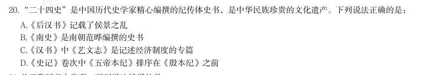
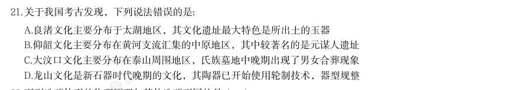
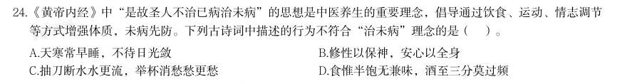

# 常识判断 · 历史人文

> 考点编码：`CS-LS`　｜　体系对齐：花生十三 `changshi-panduan.md#2.4`

## 一、命题规律

- **本题型真题总量**：211 题（2000–2026）
- **地区分布**：国考 91 / 广东 56 / 湖北 64
- **近六年题量**：2026年8题, 2025年4题, 2024年8题, 2023年12题, 2022年12题, 2021年7题
- **覆盖试卷**：77 套
- **子考点分布**：中国古代史 130　文学与文化 71　历史人文（待细分） 27　世界史 5
- **同题变体**：另有 22 道为同题重复（同年多卷/跨年再考），已折叠，需展开见 scripts/search.py --all-variants

## 二、近年真题（最多 12 题，按年份倒序）

### 2026 湖北·统一卷　第 20 题　（中国古代史）

“二十四史”是中国历代史学家精心编撰的纪传体史书,是中华民族珍贵的文化遗产。下列说法正确的是:

- **A.** 《后汉书》记载了侯景之乱
- **B.** 《南史》是南朝范晔编撰的史书
- **C.** 《汉书》中《艺文志》是记述经济制度的专篇
- **D.** 《史记》卷次中《五帝本纪》排序在《殷本纪》之前

**答案：D**

**解析/参考要点**：D
本题考查人文常识。
A 项错误,《后汉书》是南朝宋范晔编撰的史书,创作于南朝宋元嘉年间,是一
部记载东汉历史的纪传体断代史。《后汉书》主要记述了上起东汉的汉光武帝建
武元年(25 年),下至汉献帝建安二十五年(220 年),共195 年的史事。而侯
景之乱发生在南北朝时期的梁朝,属于南朝历史事件,时间远晚于东汉,不可能
出现在《后汉书》中。
B 项错误,《南史》是中国历代官修正史“二十四史”之一,记述上起宋武帝刘
裕永初元年(420 年),下迄陈后主陈叔宝祯明三年(589 年),包含南朝宋、
齐、梁、陈四个朝代共一百七十年的历史。《南史》与《北史》为姊妹篇,由李
大师及其子李延寿两代人编撰完成,而非范晔。
C 项错误,《汉书》由东汉班固编撰,班昭、马续补作,是中国首部纪传体断代
史,成书于汉和帝年间,与《史记》《后汉书》《三国志》并称“前四史”。《汉
书》中的《艺文志》在西汉刘歆《七略》基础上改编而成,是中国古代第一部系
统性的图书目录、学术源流专篇,主要记录当时存世典籍、分类与学术流派。而
记述经济制度、财政、农业、工商业等内容的专篇是《食货志》。
D 项正确,《史记》是西汉史学家司马迁撰写的纪传体史书,是中国历史上第一
部纪传体通史,记载了上至上古传说中的黄帝时代,下至汉武帝太初四年间共三
千多年的历史。全书由十二本纪、十表、八书、三十世家、七十列传构成,其中
“本纪”是全书提纲,以王朝的更替为体,按年月时间记述帝王的言行政绩,照
历史时间顺序:《五帝本纪》居首,其后依次为《夏本纪》《殷本纪》《周本纪》
等。五帝时代早于殷商,因此《五帝本纪》在卷次排序上位于《殷本纪》之

### 2026 湖北·统一卷　第 21 题　（中国古代史）

关于我国考古发现,下列说法错误的是:

- **A.** 良渚文化主要分布于太湖地区,其文化遗址最大特色是所出土的玉器
- **B.** 仰韶文化主要分布在黄河支流汇集的中原地区,其中较著名的是元谋人遗址
- **C.** 大汶口文化主要分布在泰山周围地区,氏族墓地中晚期出现了男女合葬现象
- **D.** 龙山文化是新石器时代晚期的文化,其陶器已开始使用轮制技术,器型规整

**答案：B**

**解析/参考要点**：B
A 项正确,良渚文化是我国长江下游太湖流域新石器时代晚期的重要文化,距今
约5300—4300 年。该文化以大型古城址、祭坛、水利系统和大量制作精美的玉
琮、玉璧、玉钺等礼器为突出特征,玉器工艺发达,象征着较高的社会等级与早
期国家形态。
B 项错误,仰韶文化是黄河中游地区新石器时代的代表性文化,以彩陶为典型标
志,著名遗址有陕西西安半坡遗址、河南陕县庙底沟遗址等。元谋人遗址位于云
南元谋县,属于旧石器时代早期古人类遗址,与仰韶文化在时代、地域、文化属
性上均不相符。
C 项正确,大汶口文化主要分布在以泰山为中心的黄河下游地区,距今约6500
—4500 年。其墓葬材料丰富,早期以单人葬为主,中晚期出现男女合葬、夫妻
合葬,同时墓葬规模与随葬品差异明显,反映出私有制出现、贫富分化与社会阶
层逐步形成。
D 项正确,龙山文化是新石器时代晚期文化,主要分布于黄河中下游地区,距今
约4500—4000 年。该文化普遍掌握快轮制陶技术,陶器以黑陶为代表,胎质细
腻、器壁轻薄、造型规整,标志着我国史前制陶工艺达到较高水平。
本题为选非题,故正确答案为B。

### 2026 湖北·统一卷　第 24 题　（文学与文化）

《黄帝内经》中“是故圣人不治已病治未病”的思想是中医养生的重要理念,倡导通过饮食、运动、情志调节 等方式增强体质,未病先防。下列古诗词中描述的行为不符合“治未病”理念的是( )。

- **A.** 天寒常早睡,不待日光敛
- **B.** 修性以保神,安心以全身
- **C.** 抽刀断水水更流,举杯消愁愁更愁
- **D.** 食惟半饱无兼味,酒至三分莫过频

**答案：C**

**解析/参考要点**：C
本题考查文化常识。
“治未病”意为未病先防、养生、顺自然。
A 项正确,诗句出自宋代释文珦的五言古诗《早睡》。意思为天气冷了就早早睡
觉,不等太阳完全落山就休息。选项内容顺应天时、规律作息,符合“治未病”
的养生理念。
B 项正确,诗句出自三国魏嵇康的经典养生名篇《养生论》。意思为修养性情、
调摄心性,以此保养精神、守护心神;安定内心、平和情志,以此保全身体、养
护生命。选项内容符合“治未病”的养生理念。
C 项错误,诗句出自唐代李白的《宣州谢朓楼饯别校书叔云》。意思为拔刀断水
水却更加汹涌奔流,举杯消愁愁情上却更加浓烈。过量饮酒伤神伤身,不符合“治
未病”理念。
D 项正确,诗句出自明代龚廷贤的养生名篇《摄养诗》。意思为吃饭只吃半饱(七
八分饱),不追求多种油腻、浓烈的味道,饮食清淡简单。喝酒只喝到三分微醺
即可,不要频繁饮酒。饮食有节、不过量饮酒,符合“治未病”的养生理念。
本题为选非题,故正确答案为C。

### 2026 国考·副省级　第 25 题　（文学与文化）

《贺新郎·读史》是毛泽东创作的咏史词,高度凝练了人类社会发展历程。下列相关说法不 恰当的是:

- **A.** 成汤创立商朝是“五帝三皇神圣事”之一
- **B.** 在“只几个石头磨过”时人类学会了用火
- **C.** 利簋是“铜铁炉中翻火焰”时代留下的器物
- **D.** “更陈王奋起挥黄钺”揭开了秦末农民起义的序幕

**答案：A**

**解析/参考要点**：A
本题考查人文常识。
毛泽东的《贺新郎·读史》写于1964 年春,是一首咏史体裁的词,全词通过宏观视角梳理人类历史进程,并
明确提出了对历史问题精到的思索和理解,歌颂了历史的真正创造者——劳动人民,表达了作者对人民力量的
崇敬与共情以及对社会发展规律的深刻洞察与革命情怀。
A 项错误,“五帝三皇神圣事”的意思是传说中国上古三皇五帝,都是最高尚最有才能的神圣人物。其中“五
帝三皇”指的是中国远古传说时代夏朝建立之前的部落首领。成汤是商朝的建立者,大约公元前16 世纪灭夏
建商。因此,商朝的历史晚于“五帝三皇”时代,成汤创立商朝不属于“五帝三皇神圣事”。
B 项正确,“只几个石头磨过”的意思是人类进步到最早的石器时代,这是人类历史的“小儿时节”。考古研
究表明,人类早在石器时代就已学会使用火,最早的人类用火证据可追溯至100 万年前,中国境内的西侯度遗
址(山西)被认为是“人类文明的第一把圣火”所在地,距今约180 万年。故石器时代与人类掌握用火技术在
时间上高度吻合。
C 项正确,“铜铁炉中翻火焰”的意思是在青铜器时代和铁器时代,青铜器和铁器都要用炉火来冶炼和翻铸。
利簋是西周早期青铜器,1976 年出土于陕西临潼,现藏于中国国家博物馆。故利簋作为西周时期的青铜器,
正是“铜铁炉中翻火焰”时代的典型器物。
D 项正确,“更陈王奋起挥黄钺”中“陈王”指陈胜,是秦末农民起义领袖,曾自立为“张楚王”;“挥黄钺”
指挥动饰以黄金的大斧。陈胜吴广起义又称“大泽乡起义”,是秦末农民战争的一部分,这次起义沉重打击了
秦朝,揭开了秦末农民起义的序幕,是中国历史上第一次大规模的农民起义。
本题为

### 2026 国考·副省级　第 27 题　（中国古代史）

某学生假期参观历史古迹并写下记录。下列古迹与记录文字对应错误的是:

- **A.** 马王堆遗址——何家村窖藏的金碗银壶在射灯下流淌着暗光,鎏金舞马衔杯纹银壶上的骏马俯首献酒
- **B.** 北京故宫——气势恢宏的三层汉白玉须弥座犹如层叠的云,将金碧辉煌的太和殿高高托起,威严之外添了几分神秘与飘逸
- **C.** 西夏陵——漫步于贺兰山前的戈壁滩,星罗棋布的古冢在眼前铺展,高低错落的残垣在风中静立,仿佛正缓缓撩开岁月的面纱
- **D.** 敦煌莫高窟——朴实无华的山岗间,洞窟犹如蜂房一般,层层叠叠,保留了千年佛教艺术的灿

**答案：A**

**解析/参考要点**：A
本题考查人文常识。
A 项错误,记录文字中描述的“何家村窖藏的金碗银壶”“鎏金舞马衔杯纹银壶”是唐代文物,出土于陕西西
安何家村。而“马王堆遗址”是位于湖南长沙的西汉墓葬遗址,以辛追夫人、素纱襌衣、帛画等文物闻名。两
者在时代、地域和文物属性上均不相关,因此将对何家村文物的描述对应马王堆遗址错误。
B 项正确,太和殿,又称“金銮殿”,位于北京故宫博物院内,是紫禁城(故宫)中最大的殿宇。太和殿坐落
于气势恢宏的三层汉白玉须弥座之上,这一设计既彰显了皇权的至高无上,其层叠的造型和洁白的石材也赋予
了建筑庄严与飘逸并存的美感。描述符合北京故宫太和殿的建筑特征。
C 项正确,西夏陵位于宁夏银川西侧的贺兰山前戈壁滩,2025 年7 月11 日,被联合国教科文组织列入《世界
遗产名录》。陵区现存众多夯土陵台与残垣,呈星罗棋布之势,在苍茫的天地间尽显历史的沧桑与神秘。描述
与西夏陵的实际风貌和地理环境相符。
D 项正确,敦煌莫高窟开凿在鸣沙山的崖壁上,洞窟密集如蜂房,层层叠叠,内部保存了跨越千年的精美佛教
壁画与雕塑,是举世闻名的佛教艺术宝库。描述准确抓住了莫高窟的外观特点和核心文化价值。
本题为选非题,故正确答案为A。

### 2026 国考·地市级　第 28 题　（文学与文化）
> 材料：施方案》,下列有关说法正确的是: A.西北区要重点加强水平梯田改造建设 B.25 度以上坡耕地、沿海内陆滩涂是开展建设的重点区域 C.高标准农田建设标准中的“两通”是指通水通路 D.黄淮海区应该把改善田块细碎化问题作为一个工作重点 26. 2025 年自然资源部发布《新发现矿种公告》,高纯石英矿正式成为我国第174 号矿种。下列 与之相关的说法错误的是: 性 : A.海水中氢离子和氢氧根离子浓度高,利用海水制氢效率高 B.现代深远海养殖平台一般设置在有较大浪流的开放性水域 C.潮汐发电的水轮机结构要适应海水落差小、流量大的特点 D.液化天然气运输船的液舱通常采用超低温环境储存天然气…

关于诗句中涉及的气象现象,下列说法错误的是:

- **A.** “白雪却嫌春色晚,故穿庭树作飞花”与春季较强冷空气活动有关
- **B.** “雷车动地电火明,急雨遂作盆盎倾”多与积雨云中的电位差有关
- **C.** “檐花穿雾凇,窗纸战风棱”的景观形成过程中包含凝华现象
- **D.** “鸡声茅店月,人迹板桥霜”的“霜”包含在降水统计范围内

**答案：D**

**解析/参考要点**：D
本题考查地理国情。
A 项正确,“白雪却嫌春色晚,故穿庭树作飞花”出自唐代韩愈的《春雪》,意思是白雪也嫌春色来得太
晚了,所以有意化作花儿在庭院树间穿飞。春季冷暖空气活动频繁,当较强冷空气南下与暖湿气流相遇,
使气温降至
以下时,会引发冻雨或降雪等天气现象。
B 项正确,“雷车动地电火明,急雨遂作盆盎倾”出自南宋陆游的《七月十九日大风雨雷电》,意思是雷
声打下来惊天动地电火闪烁,急雨就像有人在空中用盆和盎向下倾倒。雷电一般产生于对流发展旺盛的积
雨云中。总体而言,积雨云的上部以正电荷为主,下部以负电荷为主,云的上、下部之间形成一个电位差。
当电位差达到一定程度后,就会产生放电,即闪电现象。放电过程中,闪电通道内的电弧高温,可使周围
空气极速膨胀,热消失后又冷却,使空气极速收缩,引起剧烈的有声振动,即雷声。
C 项正确,“檐花穿雾凇,窗纸战风棱”出自明代杨慎的《寒夕》,大意是屋檐下结着雾凇,窗户纸在风
中颤动。雾凇,俗称树挂,是指过冷却雾滴直接冻结在物体迎风面上,或空气中的饱和水汽直接凝华而形
成的乳白色不透明的冰晶物。
D 项错误,“鸡声茅店月,人迹板桥霜”出自唐代温庭筠的《商山早行》,意思是鸡声嘹亮,茅草店沐浴
着晓月的余辉,足迹依稀,木板桥覆盖着早春的寒霜。霜指气温降至
以下时地表水汽凝结形成的白
色晶体。国家气象局地面观测规范明确规定,降水量仅指垂直降水(如雨、雪、冰雹),水平降水(如雾、
霜、露)不计入降水量。
本题为选非题,故正确答案为D。

### 2026 国考·地市级　第 35 题　（中国古代史）

下列技术与其在考古领域的应用,对应错误的是:

- **A.** 光谱分析——揭示青铜器金属元素的含量和组成
- **B.** 中子成像技术——推断殷商青铜器铸造工艺
- **C.** 碳14 测年技术——精确判定青铜器的铸造年代
- **D.** 3D 数字建模结合X 射线断层扫描——分析青铜器内部结构

**答案：C**

**解析/参考要点**：C
本题考查科技常识。
A 项正确,光谱分析是指根据物质的光谱来鉴别物质及确定它的化学组成和相对含量。光谱分析的核心在
于不同元素的原子在激发后会发射或吸收特定波长的光谱,通过检测光谱的波长和强度,可精准识别物质
中的元素种类及含量占比。在考古领域,青铜器的性能与其铜、锡、铅的合金比例直接相关,通过光谱分
析,无需破坏文物即可快速测定其元素的含量和组成,还原古代冶金技术水平。
B 项正确,中子成像技术是一种利用中子束穿透物体进行三维成像的技术,具有无损检测和穿透重金属等
材料的独特优势。殷商青铜器多采用“范铸法”铸造,其内部往往残留范缝、浇道、芯撑等铸造痕迹,或
存在芯土残留、铸造缺陷。中子成像技术能无创还原这些内部细节,帮助考古学家反向推导模具设计、浇
铸流程等工艺特征。
C 项错误,碳14 测年技术即通过测定样品中碳14 同位素的衰变量计算有机物的死亡年代。该方法基于碳
14 在大气中生成后参与碳循环的原理,生物体死亡后碳14 含量按半衰期5730 年递减,被广泛应用于木炭、
骨骼、贝壳及古生物化石等含碳物质的年代测定。该技术的适用前提是检测对象必须为有机物,而青铜器
是金属合金,本身不含碳14,无法直接通过该技术测年。
D 项正确,X 射线断层扫描(CT 扫描)是一种成像技术,通过多角度发射X 射线,可无创穿透青铜器,
清晰呈现内部的破损、裂隙、隐藏铭文或残留芯土等结构;3D 数字建模则能将CT 扫描数据转化为直观的
三维模型,方便考古学家进行多角度观察、测量和模拟复原。
本题为选非题,故正确答案为C。

### 2026 国考·行政执法　第 32 题　（中国古代史）

关于中国古代建筑的构件,下列说法正确的是:

- **A.** 飞檐在木构建筑中能有效减少梁柱交接处的剪力
- **B.** 台基多使用石材,其主要目的是防火
- **C.** 藻井可解决建筑室内通风和采光问题
- **D.** 榫卯结构通过允许微小位移来提升整体抗震性能

**答案：D**

**解析/参考要点**：D
本题考查人文常识。
A 项错误,斗拱是中国传统木构建筑中特有的承重构件,能有效减少梁柱交接处的剪力。斗拱通过层层叠
压的斗、拱、翘等部件,可以将梁架传递下来的竖向荷载分散。同时,斗拱的榫卯连接具有一定的弹性和
转动空间,在荷载作用下可产生微小变形,吸收部分剪力能量,避免节点因剪力集中而开裂或损坏。飞檐
是中国传统木构建筑中屋顶檐部向上翘起的特殊构造,主要具备排水、遮阳等功能。
B 项错误,台基是高出地面的建筑物底座,一大功能是防潮隔湿:高于室外地坪的基身,其主要部分是用
多层夯土或夯土层与碎砖瓦石块层交互重叠、夯筑而成,这种做法可以有效地阻止地下水分的上升。防火
功能主要通过其他建筑构件,如防火墙等实现。
C 项错误,藻井是天花向上凹进为穹窿状的部分,在历史演进中逐渐从实用性建筑构件转变为装饰性建筑
构件,核心为装饰功能。且藻井的使用有着严格的等级规制,是传统礼制文化在建筑中的体现。窗户是建
筑中最基本的通风和采光构件。
D 项正确,榫卯是在两个木构件上所采用的一种凹凸结合的连接方式。榫卯结构允许节点处的微小位移和
变形,能有效耗散地震能量、缓冲地震冲击,从而大幅提升木构建筑的整体抗震性能。
故正确答案为D。

### 2025 湖北·统一卷　第 22 题　（中国古代史）

下列有关中国古代建筑的说法错误的是:

- **A.** 楼是“重屋”,指的是两层及以上的建筑物
- **B.** 阁是一种半开放的建筑,常建于水边供人们赏景恰当的答案。
- **C.** 舫是仿照船型而造的一种建筑,又被称为“不系舟”
- **D.** 亭一般为开敞性结构,没有围墙,顶部可分为六角、八角等形状

**答案：B**

**解析/参考要点**：本题考查人文常识。
A 项正确,《说文解字》释“楼”为“重屋”,即多层建筑,如黄鹤楼、岳阳楼均为典型楼阁式建筑。
B 项错误,阁以“高耸、封闭性”为主,结构上常有平座(悬挑平台),内部多层,用于藏书、供奉佛
像等;阁通常四面开窗但墙体完整,与“亭”“榭”的开放性不同。临水建筑多为“榭”或“轩”,而阁多建于
高地或庭院中。
C 项正确,舫是园林中仿船形的一种建筑,因其形似船而不能航行,又被称为“不系舟”,这一别称源
自《庄子·列御寇》,比喻超脱自在,与舫的静态观赏功能契合。
D 项正确,亭的核心特征是“有顶无墙”,其顶部造型多样,涵盖圆形、扇形等,六角、八角为常见形
制。
本题为选非题,故正确答案为B。

### 2025 国考·副省级　第 25 题　（中国古代史）

国家主席习近平在二〇二四年新年贺词中指出:“良渚、二里头的文明曙光,殷墟甲骨的文字传承,三星堆的 文化瑰宝,国家版本馆的文脉赓续······泱泱中华,历史何其悠久。文明何其博大,这是我们的自信之 基、力量之源。”下列与之相关的说法不准确的是:

- **A.** “良渚”遗址中出土了大量的玉器
- **B.** “殷墟甲骨”中包含了大量的卜辞
- **C.** “蚕丛及鱼凫”与“二里头”遗址有关
- **D.** 青铜神树是“三星堆的文化瑰宝”之一

**答案：C**

**解析/参考要点**：本题考查人文常识。
A 项正确,良渚古城遗址,位于浙江省杭州市余杭区瓶窑镇凤都路,1986 年,考古学者在浙江余杭反山
遗址发掘了良渚文化大墓11 座,出土了1200 多件套玉器,包括完整的玉琮、玉璧等。
B 项正确,殷墟位于河南省安阳市,是商代晚期的都城遗址。殷墟甲骨文中的绝大多数材料是卜辞,即
占卜记录,但占卜的范围很广,包含鬼神、祭祀、战争、农业、田猎、天象、疾病、历法等丰富内容,
涉及当时社会的王室、贵族、平民和奴隶等各个阶层。
C 项错误,“蚕丛及鱼凫”应与三星堆遗址有关。三星堆遗址出土了大量的鸟头勺柄,其鸟头形象颇似
鱼凫(鱼鹰),可能与古蜀传说中以鱼凫为族名、族徽的鱼凫王朝有关。一号坑出土的金杖上鱼和鸟的
图案也被认为是鱼凫王朝的徽号、标志。“二里头”遗址,位于洛阳盆地东部的偃师区境内,是迄今为
止可确认的中国最早的王国都城遗址。
D 项正确,三星堆遗址位于四川省广汉市三星堆镇鸭子河南岸。在三星堆遗址共发掘出6 棵青铜神树,
是“三星堆的文化瑰宝”。其中最完整的是I号大型铜神树,由底座、树和龙三部分组成,采用分段铸
造法铸造,使用了套铸、铆铸、嵌铸等工艺,通高3.96 米,是中国现存最大的单件青铜文物。
本题为选非题,故正确答案为C。

### 2025 国考·副省级　第 28 题　（中国古代史）

纪录片《何以中国》讲述了多元一体中华民族的形成和中华文明创生的故事。下列哪句解说词不可能出现在 《秦汉》一集中?

- **A.** 他登峰山,攀泰山,上琅琊,经之罘,过东观,临碣石,至会稽,巡行之处皆刊石勒铭
- **B.** 武丁左手扶住卜骨,右手持炭棒,灼烧着钻槽,通红的棒头神秘地闪烁,不久后,裂缝在钻槽边绽开,发出脆响
- **C.** 从长安出发时,车马粼粼百余人,回程路上,只有两人,一十三年间,有利益相诱,有武力相胁,温柔乡、囹圄境,却从未丢失身为汉使的旌节,从未磨灭此行的初心
- **D.** 龙首原上,长乐、未央两宫东西并峙,于高处制掣全城。桂宫、北宫、明光宫横列两宫之北

**答案：B**

**解析/参考要点**：本题考查人文常识。
A 项正确,秦始皇在统一六国后,为了巩固统治,多次进行巡游。这段话描述的是秦始皇巡游的路线和
所到之处刻石勒铭的情况,可能出现在《秦汉》一集中。
B 项错误,这段话描述的是武丁进行占卜的情景,武丁是商朝晚期的君主,这与秦汉时期的历史背景不
符,不可能出现在《秦汉》一集中。
C 项正确,这段话描述的是汉代使节张骞出使西域的艰辛历程,是秦汉时期的重要历史事件,可能出现
在《秦汉》一集中。
D 项正确,这段话描述的是汉代长安城的宫殿布局,是秦汉时期的重要建筑和文化象征,可能出现在《秦
汉》一集中。
本题为选非题,故正确答案为B。

### 2025 国考·地市级　第 34 题　（文学与文化）

下列《三国演义》中的回目,按照先后顺序排列正确的是: 1宴长江曹操赋诗,锁战船北军用武 2战官渡本初败绩,劫乌巢孟德烧粮 3刘先主遗诏托孤儿,诸葛亮安居平五路 4王司徒巧使连环计,董太师大闹凤仪亭

- **A.** 1342
- **B.** 3241
- **C.** 2143
- **D.** 4213

**答案：D**

**解析/参考要点**：本题考查人文常识。
1“宴长江曹操赋诗,锁战船北军用武”出自《三国演义》第48 回,主要内容是曹操在长江宴请自己手
下时作了一首《短歌行》,赤壁之战面对北方军队不擅长水战,曹操在庞统的建议下,将战船用铁锁连接,
准备开战。
2“战官渡本初败绩,劫乌巢孟德烧粮”出自《三国演义》第30 回,主要内容是曹操与袁绍的官渡大战
中,袁绍大败。曹操在劫了乌巢后将其烧毁,断了袁绍的粮草。
3“刘先主遗诏托孤儿,诸葛亮安居平五路”出自《三国演义》第85 回,主要内容是刘备在白帝城永安
宫病重,召诸葛亮等人托付后事。刘备病逝,诸葛亮立年幼的刘禅为帝,曹丕乘机派五路大军攻击西蜀,
2025 国考《行测》(地市级)解析
13 / 44
诸葛亮运筹帷幄智平五路。
4“王司徒巧使连环计,董太师大闹凤仪亭”出自《三国演义》第8 回,主要内容是司徒王允使用了连
环计,将貂蝉许配给吕布,最后又将她献给了董卓。董卓在听闻吕布约会貂蝉后,大闹了凤仪亭。
按照先后顺序排列为4213。
故正确答案为D。

## 三、其余真题（按年代分片）

| 年代 | 题量 | 分片文件 |
|---|---:|---|
| 2000s | 36 | [CS-LS-2000s.md](split/CS-LS-2000s.md) |
| 2010s | 103 | [CS-LS-2010s.md](split/CS-LS-2010s.md) |
| 2020s | 60 | [CS-LS-2020s.md](split/CS-LS-2020s.md) |

> 也可用 `python scripts/search.py --kaodian CS-LS` 直接检索全部 211 题。