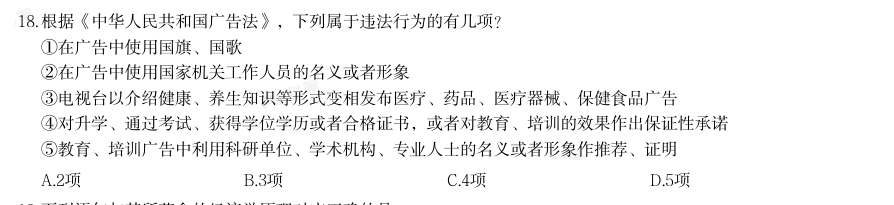
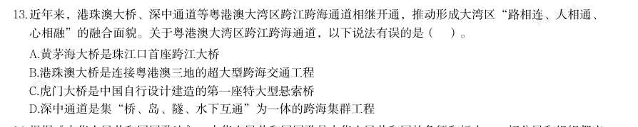
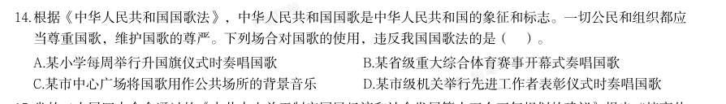

# 常识判断 · 生活常识

> 考点编码：`CS-SH`　｜　体系对齐：花生十三 `changshi-panduan.md#2.8`

## 一、命题规律

- **本题型真题总量**：814 题（2000–2026）
- **地区分布**：国考 386 / 广东 238 / 湖北 190
- **近六年题量**：2026年18题, 2025年18题, 2024年21题, 2023年87题, 2022年19题, 2021年16题
- **覆盖试卷**：88 套
- **子考点分布**：其他常识（综合） 636　生活常识 213
- **同题变体**：另有 35 道为同题重复（同年多卷/跨年再考），已折叠，需展开见 scripts/search.py --all-variants

## 二、近年真题（最多 12 题，按年份倒序）

### 2026 湖北·统一卷　第 17 题　（其他常识（综合））
> 材料：关于社会保险,下列说法正确的是:…

· 本试卷由粉笔用户上岸张同学66生成

- **A.** 灵活就业人员可以参加职工基本医疗保险
- **B.** 失业者领取失业保险金的期限与累计缴费年限无关
- **C.** 同一统筹地区内用人单位工伤保险执行统一缴费费率
- **D.** 生育保险待遇中的生育津贴按职工本人上年度的月平均工资计发

**答案：A**

**解析/参考要点**：A
本题考查经济常识。
A 项正确,根据《中华人民共和国社会保险法》第二十三条第二款规定:“无雇
工的个体工商户、未在用人单位参加职工基本医疗保险的非全日制从业人员以及
其他灵活就业人员可以参加职工基本医疗保险,由个人按照国家规定缴纳基本医
疗保险费。”
B 项错误,根据《中华人民共和国社会保险法》第四十六条规定:“失业人员失
业前用人单位和本人累计缴费满一年不足五年的,领取失业保险金的期限最长为
十二个月;累计缴费满五年不足十年的,领取失业保险金的期限最长为十八个月;
累计缴费十年以上的,领取失业保险金的期限最长为二十四个月。重新就业后,
再次失业的,缴费时间重新计算,领取失业保险金的期限与前次失业应当领取而
尚未领取的失业保险金的期限合并计算,最长不超过二十四个月。”因此,失业
者领取失业保险金的期限与累计缴费年限有关。
C 项错误,根据《工伤保险条例》第八条规定:“工伤保险费根据以支定收、收
支平衡的原则,确定费率。国家根据不同行业的工伤风险程度确定行业的差别费
率,并根据工伤保险费使用、工伤发生率等情况在每个行业内确定若干费率档次。
行业差别费率及行业内费率档次由国务院社会保险行政部门制定,报国务院批准
后公布施行。统筹地区经办机构根据用人单位工伤保险费使用、工伤发生率等情
况,适用所属行业内相应的费率档次确定单位缴费费率。”因此,同一统筹地区
内的工伤保险会根据不同行业确定差别费率,而不是执行统一缴费费率。
D 项错误,根据《中华人民共和国社会保险法》第五十六条规定:“职工有下列
情形之一的,可以按照国家规定享受生育津贴:(一)女职工生育享受产假;(二)
享受计划生育

### 2026 湖北·统一卷　第 18 题　（生活常识）

根据《中华人民共和国广告法》,下列属于违法行为的有几项? 1在广告中使用国旗、国歌 2在广告中使用国家机关工作人员的名义或者形象 3电视台以介绍健康、养生知识等形式变相发布医疗、药品、医疗器械、保健食品广告 4对升学、通过考试、获得学位学历或者合格证书,或者对教育、培训的效果作出保证性承诺 5教育、培训广告中利用科研单位、学术机构、专业人士的名义或者形象作推荐、证明

- **A.** 2项
- **B.** 3项
- **C.** 4项
- **D.** 5项

**答案：D**

**解析/参考要点**：D
本题考查法律常识。
1错误,根据《中华人民共和国广告法》第九条第一项规定:“广告不得有下列
情形:(一)使用或者变相使用中华人民共和国的国旗、国歌、国徽,军旗、军
歌、军徽;”因此,无论商业目的如何,在广告中使用国旗、国歌均属于违法行
为。
2错误,根据《中华人民共和国广告法》第九条第二项规定:“广告不得有下列
情形:(二)使用或者变相使用国家机关、国家机关工作人员的名义或者形象;”
因此,国家机关及其工作人员的形象代表公权力,将其在广告中使用属于违法行
为。
3错误,根据《中华人民共和国广告法》第十九条规定:“广播电台、电视台、
报刊音像出版单位、互联网信息服务提供者不得以介绍健康、养生知识等形式变
相发布医疗、药品、医疗器械、保健食品广告。”选项中,电视台以健康、养生
知识为幌子,实则发布医疗、药品等禁止类广告,属于典型的变相发布,因此,
属于违法行为。
4错误,根据《中华人民共和国广告法》第二十四条第一项规定:“教育、培训
广告不得含有下列内容:(一)对升学、通过考试、获得学位学历或者合格证书,
或者对教育、培训的效果作出明示或者暗示的保证性承诺。”因此,教育、培训
广告中对升学、通过考试、获得学位学历或者合格证书,或者对教育、培训的效
果作出保证性承诺,属于违法行为。
5错误,根据《中华人民共和国广告法》第二十四条第三项规定:“教育、培训
广告不得含有下列内容:(三)利用科研单位、学术机构、教育机构、行业协会、
专业人士、受益者的名义或者形象作推荐、证明。”因此,教育、培训广告中利
用科研单位、学术机构、专业人士的名义或者形象作推荐、证明属于违法行为。
综上,123

### 2026 湖北·统一卷　第 25 题　（生活常识）
> 材料：肥胖会严重影响人体健康,饮食控制是治疗肥胖症的一种有效手段。在摄入量相同且不考虑烹饪方式的情况 下,下列四份食谱中热量值最低的是( )。…

· 本试卷由粉笔用户上岸张同学66生成

- **A.** 鸭肉、馒头、马铃薯、葡萄
- **B.** 鲈鱼、大米饭、黄瓜、橙子
- **C.** 鸡蛋、花卷、胡萝卜、榴莲
- **D.** 五花肉、烧饼、鲜香菇、西瓜

**答案：B**

**解析/参考要点**：B
本题考查科技常识。
相同摄入量且不考虑烹饪方式的情况下,食材中脂肪、糖类或碳水化合物含量越
高,整体热量值越高;低脂优质蛋白、高膳食纤维蔬菜及低糖水果占比越高,整
体热量值越低。
A 项错误,鸭肉脂肪含量中等,馒头与马铃薯均为淀粉含量较高的主食,葡萄含
糖量偏高。整体食材脂肪与碳水化合物占比偏高,因此该食谱整体热量处于中等
水平。
B 项正确,鲈鱼为低脂高蛋白的白肉,热量密度显著偏低,大米饭为常规精制主
食,黄瓜属于极低热量的高纤维蔬菜,橙子为低糖水果。全餐以低脂、低糖、高
纤维食材为主,脂肪与精制碳水占比最低,故该食谱热量值最低。
C 项错误,花卷为精制淀粉类主食,胡萝卜相比黄瓜而言,碳水化合物含量较高,
榴莲为高脂高糖水果,热量密度极高,大幅提升了整份食谱的热量水平。
D 项错误,五花肉为高脂肪肉类,热量密度极高,烧饼属于高油高淀粉主食,二
者共同构成极高热量来源,即便鲜香菇与西瓜热量较低,也无法降低整体热量,
故该食谱为四组中热量最高的组合。
故正确答案为B。

### 2026 广东·统一卷　第 13 题　（生活常识）

近年来,港珠澳大桥、深中通道等粤港澳大湾区跨江跨海通道相继开通,推动形成大湾区“路相连、人相通、 心相融”的融合面貌。关于粤港澳大湾区跨江跨海通道,以下说法有误的是( )。

- **A.** 黄茅海大桥是珠江口首座跨江大桥
- **B.** 港珠澳大桥是连接粤港澳三地的超大型跨海交通工程
- **C.** 虎门大桥是中国自行设计建造的第一座特大型悬索桥
- **D.** 深中通道是集“桥、岛、隧、水下互通”为一体的跨海集群工程

**答案：暂缺（原始文件为扫描版）**

**解析/参考要点**：答案A
本题考查地理国情。
A 项错误,C 项正确,珠江口首座跨江大桥是虎门大桥,而非黄茅海大桥。黄茅
海大桥是连接珠海与江门的跨海通道,于2024 年通车,是大湾区西部重要交通
枢纽。虎门大桥是中国自主设计建造的首座特大型大跨度钢箱梁悬索桥,全长

### 2026 广东·统一卷　第 14 题　（其他常识（综合））

根据《中华人民共和国国歌法》,中华人民共和国国歌是中华人民共和国的象征和标志。一切公民和组织都应 当尊重国歌,维护国歌的尊严。下列场合对国歌的使用,违反我国国歌法的是( )。

- **A.** 某小学每周举行升国旗仪式时奏唱国歌
- **B.** 某省级重大综合体育赛事开幕式奏唱国歌
- **C.** 某市中心广场将国歌用作公共场所的背景音乐
- **D.** 某市级机关举行先进工作者表彰仪式时奏唱国歌

**答案：暂缺（原始文件为扫描版）**

### 2026 国考·副省级　第 24 题　（其他常识（综合））

我国始终高度重视荒漠化的治理工作,把防沙治沙作为荒漠化防治工作的主要任务。下列与 我国荒漠化防治有关的说法错误的是:

- **A.** 我国是全球首个实现土地退化零增长的国家
- **B.** 塔克拉玛干沙漠实现生态屏障全面“锁边合龙”
- **C.** 草方格固沙技术最早用于治理宁夏中卫的沙坡头地区
- **D.** 甘肃民勤治沙工程有效阻止了毛乌素沙漠的推进

**答案：D**

**解析/参考要点**：D
本题考查地理国情。
A 项正确,2024 年11 月25 日,国家林业和草原局召开防治荒漠化主题新闻发布会指出,据统计,我国53%
的可治理沙化土地得到有效治理,沙化土地面积净减少6500 万亩,呈现出“整体好转、改善加速”的良好态
势,在全球率先实现了土地退化“零增长”、荒漠化和沙化土地“双缩减”。
B 项正确,2024 年11 月28 日,一条全长3046 公里的绿色屏障被填补了最后缺口,沿着沙漠边缘蜿蜒成链,
塔克拉玛干绿色阻沙防护带工程实现全面锁边“合龙”。由此,这道柔软而韧性十足的绿篱,能够强力制止流
沙肆虐,将绿洲与黄沙、生命与死亡分隔。
C 项正确,草方格沙障技术被誉为“中国魔方”,最早于20 世纪50 年代应用于宁夏中卫的沙坡头地区,目的
是保障穿越腾格里沙漠的包兰铁路免受流沙侵蚀。该技术通过将麦草等材料扎成方格,有效增大地表粗糙度、
降低风速、固定流沙,并能涵养水分,为植物生长创造条件,是实现工程固沙与生物固沙相结合的关键技术,
是我国荒漠化防治的智慧结晶。
D 项错误,毛乌素沙地主要分布在内蒙古自治区南部、陕西省榆林市北部以及宁夏回族自治区东部。阻止毛乌
素沙地推进的治理工程主要位于陕西榆林等地。毛乌素沙地与甘肃民勤相距甚远,分属不同的地理区域和治理
体系。故毛乌素沙漠的治理与甘肃无关。
本题为选非题,故正确答案为D。

### 2026 国考·副省级　第 28 题　（生活常识）

某物流公司要优化长三角到乌鲁木齐的易腐货物运输路线,下列方案最可行的是:

- **A.** 夏季采用陇海——兰新铁路运输利用沿线低温天气自然保鲜
- **B.** 冬季选择长江——京杭大运河——黄河水运组合避开陆路交通拥堵
- **C.** 春秋季采用铁路冷藏集装箱运输平衡运输成本与时效性
- **D.** 全年优先使用连霍高速公路运输以追求最低的运输成本

**答案：C**

**解析/参考要点**：C
本题考查地理国情。
A 项错误,兰新铁路东起甘肃省兰州,跨红柳河进入新疆维吾尔自治区,在达坂城穿过天山至乌鲁木齐。兰新
铁路东连陇海铁路,在兰州与包兰线交汇。陇海铁路是中国东西方向的主要铁路干线之一,起自江苏省北部的
连云港,横贯江苏、安徽、河南、陕西、甘肃5 省,至甘肃省省会兰州。此方案时间成本高,陇海线经过河南、
陕西,兰新线穿越河西走廊、新疆戈壁,夏季高温,且长途运输车厢内极易积聚热量,不适合自然保鲜。故此
方案不可行。
B 项错误,黄河干流冬季平均气温低于
,
一般每年12 月至次年3 月为天然结冰期,船舶无法航行,且冬
季黄河流域降水稀少、地表径流减少,进入枯水期后,下游河道水位显著下降,水位不足导致船舶搁浅风险极
高。此方案耗时较长,且由于河流冰封期、水位降低等因素会导致无法通航。故此方案不可行。
C 项正确,冷藏集装箱是指一种有良好隔热,且能维持一定低温要求,适用于各类易腐食品的运送、贮存的特
殊集装箱。故不管春秋季沿线温度变化,都能保持货物所需的低温环境,避免变质。此方案的时间成本小于水
运、经济成本小于公路运输,且可以保证货物不变质。故此方案可行。
D 项错误,连云港—霍尔果斯高速公路,简称“连霍高速”,是中国境内连接江苏省连云港市和新疆维吾尔自
治区伊犁哈萨克自治州的高速公路,全长4244 公里,横贯我国中部。在长途、大批量货物运输中,公路运输
的单位成本通常远高于铁路和水运。其次,公路运输受路况、天气影响大,时效不稳定,且货车冷藏需要持续
供电,长途运输中若出现故障,货物容易变质,风险比铁路高。此方案的时间成本、经济成本都较高,且有货
物腐坏变质等风险

### 2026 国考·副省级　第 29 题　（生活常识）

下列与自然界中的颜色有关的说法错误的是:

- **A.** “橙色月亮”通常发生在大气层中水汽或颗粒物质较多时
- **B.** 火烈鸟羽毛呈朱红色与摄入食物中的虾青素累积有关
- **C.** 蓝闪蝶翅膀呈蓝色是由于其表面鳞片具有特殊的微结构
- **D.** 蓝莓呈现靛蓝色是因为表面蜡质层中含高浓度花青素

**答案：D**

**解析/参考要点**：D
本题考查科技常识。
A 项正确,“橙色月亮”的形成核心与大气层散射作用相关。当大气层中水汽、尘埃、颗粒物质等杂质较多时
(如日出日落、雾霾天、火山喷发后),月光穿过大气层的路径变长,波长较短的蓝、紫光被大量散射,而波
长较长的橙、红光穿透能力更强,最终到达人眼,使月亮呈现橙色。
B 项正确,火烈鸟的羽毛颜色并非天生固定,而是后天通过食物累积形成。其主要食物(如虾、蟹、藻类)中
富含类胡萝卜素(核心为虾青素),这类物质无法被火烈鸟自身合成,需通过消化吸收后沉积在羽毛组织中,
随着累积量增加,羽毛逐渐从白色变为鲜艳的朱红色。这一机制是生物学中“食物色素累积影响生物体色”的
典型案例。
C 项正确,蓝闪蝶翅膀的蓝色源于“结构色”(物理色),系因其翅膀表面覆盖着微小的鳞片,这些鳞片具有
特殊的纳米级微结构(如多层薄膜、光栅结构),能够通过反射、折射、干涉等物理作用,选择性地增强蓝光
的反射的同时削弱其他色光的传播,最终呈现出明亮的蓝色。
D 项错误,蓝莓呈现靛蓝色并不是因为表面蜡质层中含有高浓度花青素。实际上,蓝莓的靛蓝色主要来源于表
皮蜡质层的微型结构,这些结构通过散射光线产生结构色,而花青素主要存在于果肉或表皮细胞中,贡献的是
紫色或红色色调,不会直接导致蓝莓呈现靛蓝色。
本题为选非题,故正确答案为D。

### 2026 国考·副省级　第 31 题　（其他常识（综合））

某款创意时钟要用不同的符号替代表盘上的数字,下列设计不合适的是:

- **A.** 用45 度角的正弦“sin450” 替代“ 1 ”
- **B.** . 用3 的阶乘“ 3 ! ” 替代“ 6 ”
- **C.** 用重力加速度“g”替代“10”
- **D.** 用二进制数“ (1100)2”替代“12”

**答案：A**

**解析/参考要点**：A

### 2026 国考·副省级　第 32 题　（其他常识（综合））

关于核裂变与核衰变,下列说法错误的是:

- **A.** 核衰变的过程中电荷数是守恒的
- **B.** 放射性元素衰变是自然界自发进行的
- **C.** 核裂变是一种异常剧烈的化学变化
- **D.** 核裂变释放出的中子可以引起链式反应

**答案：C**

**解析/参考要点**：C
本题考查科技常识。
A 项正确,核衰变属于核反应,遵循电荷数守恒规律。无论何种衰变类型(如
衰
变、
衰
变),衰变前后
原子核的总电荷数始终保持不变,这是原子核物理的基本守恒定律之一。
B 项正确,放射性元素的衰变是自然界自发进行的过程。由于原子核内部结构不稳定,会主动释放粒子或能量
向更稳定的状态转变,无需外界提供触发条件(如温度、压强变化等)。
C 项错误,化学变化的核心是分子破裂、原子重新组合,原子核本身不发生改变;而核裂变是重原子核在中子
轰击下分裂为轻原子核的过程,原子核的结构和组成发生了根本性变化,属于物理变化,并非化学变化。
D 项正确,在核裂变过程中,重原子核分裂时会释放出2-3 个中子,这些中子具有足够能量,可继续撞击周围
的重原子核,使裂变持续发生,形成链式反应。
本题为选非题,故正确答案为C。

### 2026 国考·地市级　第 30 题　（生活常识）

下列与自然界中的颜色有关的说法错误的是:

- **A.** “橙色月亮”通常发生在大气层中水汽或颗粒物质较多时
- **B.** 火烈鸟羽毛呈朱红色与摄入食物中的虾青素累积有关
- **C.** 蓝闪蝶翅膀呈蓝色是由于其表面鳞片具有特殊的微结构
- **D.** 蓝莓呈现靛蓝色是因为表面蜡质层中含高浓度花青素

**答案：D**

**解析/参考要点**：D
本题考查科技常识。
A 项正确,“橙色月亮”的形成核心与大气层散射作用相关。当大气层中水汽、尘埃、颗粒物质等杂质较
多时(如日出日落、雾霾天、火山喷发后),月光穿过大气层的路径变长,波长较短的蓝、紫光被大量散
射,而波长较长的橙、红光穿透能力更强,最终到达人眼,使月亮呈现橙色。
B 项正确,火烈鸟的羽毛颜色并非天生固定,而是后天通过食物累积形成。其主要食物(如虾、蟹、藻类)
中富含类胡萝卜素(核心为虾青素),这类物质无法被火烈鸟自身合成,需通过消化吸收后沉积在羽毛组
织中,随着累积量增加,羽毛逐渐从白色变为鲜艳的朱红色。这一机制是生物学中“食物色素累积影响生
物体色”的典型案例。
C 项正确,蓝闪蝶翅膀的蓝色源于“结构色”(物理色),系因其翅膀表面覆盖着微小的鳞片,这些鳞片
具有特殊的纳米级微结构(如多层薄膜、光栅结构),能够通过反射、折射、干涉等物理作用,选择性地
增强蓝光的反射的同时削弱其他色光的传播,最终呈现出明亮的蓝色。
D 项错误,蓝莓呈现靛蓝色并不是因为表面蜡质层中含有高浓度花青素。实际上,蓝莓的靛蓝色主要来源
于表皮蜡质层的微型结构,这些结构通过散射光线产生结构色,而花青素主要存在于果肉或表皮细胞中,
贡献的是紫色或红色色调,不会直接导致蓝莓呈现靛蓝色。
本题为选非题,故正确答案为D。

### 2026 国考·地市级　第 32 题　（其他常识（综合））

某款创意时钟要用不同的符号替代表盘上的数字,下列设计不合适的是: 是这个时候,越要扛稳责任

- **A.** 用45 度角的正弦“sin45"” 替代“ 1 ”
- **B.** . 用3 的阶乘“ 3 ! ” 替代“ 6 ”
- **C.** 用重力加速度“g”替代“10”
- **D.** 用二进制数“ (1100)2”替代“12”

**答案：A**

**解析/参考要点**：A
本题考查科技常识。
A 项错误,
,与数字1 的数值差异过大,不适合直接替代。若需用三角函数替代,可
选择
(
值为1)。
B 项正确,3 的阶乘“
”等于3×2×1=6,与数字6 完全匹配,可替代。
C 项正确,重力加速度
,四舍五入后与10 接近,可替代。
D 项正确,二进制数“
”转换为十进制为1×8+1×4+0×2+0×1=12,数值对应准确,可替代。
本题为选非题,故正确答案为A。

## 三、其余真题（按年代分片）

| 年代 | 题量 | 分片文件 |
|---|---:|---|
| 2000s | 201 | [CS-SH-2000s.md](split/CS-SH-2000s.md) |
| 2010s | 355 | [CS-SH-2010s.md](split/CS-SH-2010s.md) |
| 2020s | 246 | [CS-SH-2020s.md](split/CS-SH-2020s.md) |

> 也可用 `python scripts/search.py --kaodian CS-SH` 直接检索全部 814 题。