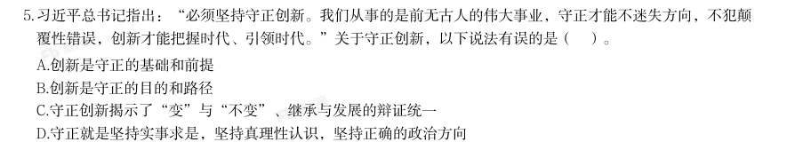

# 常识判断 · 政治常识

> 考点编码：`CS-ZZ`　｜　体系对齐：花生十三 `changshi-panduan.md#2.1`

## 一、命题规律

- **本题型真题总量**：1066 题（2000–2026）
- **地区分布**：国考 511 / 广东 290 / 湖北 265
- **近六年题量**：2026年69题, 2025年71题, 2024年30题, 2023年103题, 2022年27题, 2021年19题
- **覆盖试卷**：89 套
- **子考点分布**：政治常识（综合） 903　毛中特与党史 115　马克思主义基本原理 102　新时代理论 85
- **同题变体**：另有 139 道为同题重复（同年多卷/跨年再考），已折叠，需展开见 scripts/search.py --all-variants

## 二、真题与答案（按年份倒序，最多 30 题）

### 2026 湖北·统一卷　第 1 题　（毛中特与党史）

· 本试卷由粉笔用户上岸张同学66生成 (网友回忆版) · 本试卷由粉笔用户上岸张同学66生成 党的十八大以来,以习近平同志为核心的党中央坚定不移推进全面从严治党,取得一系列理论创新、实践创 新、制度创新成果,构建起全面从严治党体系,开辟了百年大党自我革命新境界。下列关于全面从严治党的表 述不准确的是( )。

- **A.** 制度建设要与管党治党需要相适应、与党的各项建设相配套,全方位织密制度的笼子
- **B.** 严密党的组织体系,关键是坚持党中央权威和集中统一领导,根本在做到“两个维护”
- **C.** 新时代党的建设是以党的组织建设为统领、党的各项建设同向发力综合发力的系统工程
- **D.** 着力抓好政治监督、领导班子特别是“一把手”监督、“三重一大”事项监督以及权力集中、资金密集、资

**答案：C**

**解析/参考要点**：C
本题考查新思想。
2025 年2 月16 日,《求是》杂志发表习近平总书记重要文章《健全全面从严治
党体系》,以下简称文章。
A 项正确,文章指出:“第四,健全科学完备、有效管用的制度体系。全面从严
治党政治性、原则性强,必须有一套科学完备的制度来规范。制度建设要与管党
治党需要相适应、与党的各项建设相配套,全方位织密制度的笼子。”
B 项正确,文章指出:“第一,健全上下贯通、执行有力的组织体系······只
有党的组织体系严密起来,党的各级组织政治功能和组织功能充分发挥出来,全
面从严治党才能持续向纵深推进。严密党的组织体系,关键是坚持党中央权威和
集中统一领导,根本在做到‘两个维护’。”
C 项错误,文章指出:“······新时代党的建设是以党的政治建设为统领、
党的各项建设同向发力综合发力的系统工程,必须以党中央关于党的建设的重要
思想、关于党的自我革命的重要思想为根本遵循,坚持和加强党的全面领导和党
中央集中统一领导······”故“以党的组织建设为统领”表述有误,应为
“以党的政治建设为统领”。
D 项正确,文章指出:“第三,健全精准发力、标本兼治的监管体系······要
突出监督重点,着力抓好政治监督、领导班子特别是‘一把手’监督、‘三重一
大’事项监督以及权力集中、资金密集、资源富集等重点领域的监督,切实让特
权现象和腐败问题无所遁形。”
本题为选非题,故正确答案为C。

### 2026 湖北·统一卷　第 2 题　（新时代理论）

源富集等重点领域的监督 习近平总书记指出,讲好中国故事,传播好中国声音,展示真实、立体、全面的中国,是加强我国国际传播能 力建设的重要任务。关于加强我国国际传播能力建设,下列表述正确的是: 1要提升国际传播体系稳定性,防范国际传播格局重构 2要全面提升国际传播效能,建强适应新时代国际传播需要的专门人才队伍 3要倡导和平的国际舆论环境,不参与国际舆论斗争,塑造谦逊谦和的大国形象 4推动走出去、请进来管理便利化,扩大国际人文交流合作

> （本题为图形题，选项为图片，见原卷）

**答案：暂缺（原始文件为扫描版）**

### 2026 湖北·统一卷　第 3 题　（马克思主义基本原理）

习近平总书记曾说:“我们要有钉钉子的精神,钉钉子往往不是一锤子就能钉好的,而是要一锤一锤接着敲, 直到把钉子钉实钉牢,钉牢一颗再钉下一颗,不断钉下去,必然大有成效。如果东一榔头西一棒子,结果很可 能是一颗钉子都钉不上、钉不牢。”这句话最能体现的哲学原理是: 1量变与质变辩证统一 2肯定与否定辩证统一 3主要矛盾与次要矛盾辩证统一 4尊重客观规律与发挥主观能动性辩证统一

- **A.** 12
- **B.** 23
- **C.** 34
- **D.** 14

**答案：暂缺（原始文件为扫描版）**

### 2026 湖北·统一卷　第 4 题　（新时代理论）

下列选项中,习近平用语与其蕴含的思想、观点对应恰当的是: 1我将无我,不负人民——全心全意为人民服务 2功成不必在我、功成必定有我——方向决定前途,道路决定命运 3江山就是人民,人民就是江山——民为邦本 4时代是出卷人,我们是答卷人,人民是阅卷人——时代造就英雄,伟大来自平凡

- **A.** 12
- **B.** 13
- **C.** 24
- **D.** 34

**答案：暂缺（原始文件为扫描版）**

### 2026 湖北·统一卷　第 5 题　（毛中特与党史）

习近平总书记指出,中国愿同世界各国一道,把握信息革命发展的历史主动,携手构建网络空间命运共同体, 让互联网更好造福人民、造福世界。关于构建网络空间命运共同体,下列表述正确的是: 1尊重网络主权,维护网络安全,共同构建和平、安全、开放、合作的网络空间 2全球网络主要由跨国公司提供,网络空间未来应由跨国公司携手经营 3倡导发展优先,构建更加普惠繁荣的网络空间 4保障数据安全,建立单边、保密的国际互联网治理体系 5深化网络安全务实合作,有力打击网络违法犯罪行为

- **A.** 135
- **B.** 145
- **C.** 1235
- **D.** 12345

**答案：暂缺（原始文件为扫描版）**

### 2026 湖北·统一卷　第 6 题　（政治常识（综合））
> 材料：习近平总书记指出,要推动公共文化服务标准化、均等化,坚持政府主导、社会参与、重心下移、共建共享, 完善公共文化服务体系,提高基本公共文化服务的覆盖面和适用性。关于完善公共文化服务体系,下列举措正 确的有几项?…

· 本试卷由粉笔用户上岸张同学66生成 1做好文化馆、乡镇(街道)综合文化站、村(社区)综合性文化服务中心等的规划建设 2推动优质文化资源向沿海发达地区集中,促进公共文化服务差异化发展 3实施全国智慧图书馆体系建设、公共文化云建设等项目 4实施广播电视惠民工程,完善农村文化基础设施网络 5推动各民族文化的传承保护和创新交融,提升民族地区公共文化服务水平

- **A.** 2项
- **B.** 3项
- **C.** 4项
- **D.** 5项

**答案：暂缺（原始文件为扫描版）**

### 2026 湖北·统一卷　第 7 题　（新时代理论）

习近平总书记强调,要推动森林“水库、钱库、粮库、碳库”更好联动,实现生态效益、经济效益、社会效益 相统一。下列表述与这一要求相契合的有几项? 1手中有粮,心中不慌 2绿水青山就是金山银山 3增绿就是增优势,护林就是护财富 4环境就是民生,青山就是美丽,蓝天也是幸福

- **A.** 1项
- **B.** 2项
- **C.** 3项
- **D.** 4项

**答案：暂缺（原始文件为扫描版）**

### 2026 湖北·统一卷　第 8 题　（马克思主义基本原理）

党的二十大报告指出,坚持把发展经济的着力点放在实体经济上,推进新型工业化,加快建设制造强国、质量 强国、航天强国、交通强国、网络强国、数字中国。关于发展实体经济,下列说法正确的是: 1金融是实体经济的血脉,为实体经济服务是金融的天职 2要增强资本市场服务实体经济功能,积极有序发展股权融资 3要实现实体经济、科技创新、现代金融、人力资源协同发展 4要促进实体经济和数字经济深度融合,有序推动实体经济脱实向虚 5要推动资源要素向实体经济集聚、政策措施向实体经济倾斜、工作力量向实体经济加强

- **A.** 1235
- **B.** 234
- **C.** 1245
- **D.** 345

**答案：暂缺（原始文件为扫描版）**

### 2026 湖北·统一卷　第 9 题　（政治常识（综合））

党的二十届四中全会指出,“十五五”时期是基本实现社会主义现代化夯实基础、全面发力的关键时期,在基 本实现社会主义现代化进程中具有承前启后的重要地位。关于“十五五”规划,下列说法正确的是:

- **A.** 加强原始创新和关键核心技术攻关,推动科技创新和产业创新深度融合
- **B.** 把发展经济的着力点向传统实体产业转移,巩固壮大传统实体产业根基
- **C.** 积极稳妥推进和实现碳达峰,发展集中式能源,逐步缩减全国碳排放权交易市场
- **D.** 发挥积极财政政策作用,适当加强地方事权、提高地方财政支出比重,增加地方自主财力

**答案：暂缺（原始文件为扫描版）**

### 2026 湖北·统一卷　第 10 题　（马克思主义基本原理）

推进中国式现代化是一个系统工程,需要统筹兼顾、系统谋划、整体推进,正确处理好一系列重大关系。下列 与之相关的表述正确的有( )。 1活力与秩序:中国式现代化应当而且能够实现活而不乱、活跃有序的动态平衡 2守正与创新:守正才能不迷失方向、不犯颠覆性错误,创新才能把握时代、引领时代 3战略与策略:要增强策略的前瞻性,准确把握事物发展的必然趋势,以科学的战略预见未来、引领未来 4效率与公平:中国式现代化既要创造比资本主义更高的效率,又要更有效地维护社会公平,更好实现效率与 公平相兼顾、相促进、相统一

- **A.** 1项
- **B.** 2项
- **C.** 3项
- **D.** 4项

**答案：B**

**解析/参考要点**：B
本题考查新思想。
1错误,4正确,《中共中央关于进一步全面深化改革、推进中国式现代化的决
定》在“十、深化文化体制机制改革”部分中指出:“(41)构建更有效力的国
际传播体系。推进国际传播格局重构,深化主流媒体国际传播机制改革创新,加
快构建多渠道、立体式对外传播格局。加快构建中国话语和中国叙事体系,全面
提升国际传播效能。建设全球文明倡议践行机制。推动走出去、请进来管理便利
化,扩大国际人文交流合作。”故“防范国际传播格局重构”表述错误,应为“推
进国际传播格局重构”。
2正确,3错误,2021 年5 月31 日,习近平总书记在中共中央政治局第三十次
集体学习时指出:“我们党历来高度重视对外传播工作......积极推动中华文化走
出去,有效开展国际舆论引导和舆论斗争,初步构建起多主体、立体式的大外宣
格局······要全面提升国际传播效能,建强适应新时代国际传播需要的专
门人才队伍······”故“不参与国际舆论斗争”表述错误,应为“有效开
展国际舆论引导和舆论斗争”。
综上,24表述正确。
故正确答案为B。
3.D
本题考查马克思主义。
1正确,钉钉子要一锤一锤接着敲,直到钉实钉牢,体现了量的积累(每一锤)
达到一定程度必然引起质的飞跃(钉牢一颗钉子);不断钉下去,必然大有成效,
体现了量变与质变的辩证统一关系。
2错误,“肯定与否定辩证统一”指事物内部包含肯定和否定的因素,要通过辩
证否定实现发展。题干强调的是持续用力、循序渐进,并未涉及对事物自身的肯
定与否定。
3错误,“主要矛盾与次要矛盾辩证统一”指在复杂事物发展过程中要抓关键、
抓重点,统筹兼顾。题干强调的是工

### 2026 湖北·统一卷　第 11 题　（毛中特与党史）
> 材料：城乡融合发展是中国式现代化的必然要求。关于城乡融合发展,下列说法正确的有几项? 1要把乡村振兴战略这篇大文章做好,必须走城乡融合发展之路 2在现代化进程中,如何处理好工农关系、城乡关系,在一定程度上决定着现代化的成败 3要顺应城乡融合发展大趋势,破除妨碍城乡要素平等交换、双向流动的制度壁垒 4振兴乡村,不能就乡村论乡村,还是要强化以工补农、以城带乡,加快形成工农互促、城乡互补、协调发 展、共同繁荣的新型工农城乡关系…

· 本试卷由粉笔用户上岸张同学66生成

- **A.** 1项
- **B.** 2项
- **C.** 3项
- **D.** 4项

**答案：D**

**解析/参考要点**：D
本题考查新思想。
1正确,2018 年9 月21 日,习近平总书记在十九届中央政治局第八次集体学习
时讲话指出:“要把乡村振兴战略这篇大文章做好,必须走城乡融合发展之路。
我们一开始就没有提城市化,而是提城镇化,目的就是促进城乡融合。要向改革
要动力,加快建立健全城乡融合发展体制机制和政策体系。”
2正确,2018 年9 月21 日,习近平总书记在十九届中央政治局第八次集体学习
时讲话指出:“我一直强调,没有农业农村现代化,就没有整个国家现代化。在
现代化进程中,如何处理好工农关系、城乡关系,在一定程度上决定着现代化的
成败。”
3正确,2022 年12 月23 日,习近平总书记在中央农村工作会议上讲话指出:
“要顺应城乡融合发展大趋势,破除妨碍城乡要素平等交换、双向流动的制度壁
垒,促进发展要素、各类服务更多下乡,率先在县域内破除城乡二元结构。”
4正确,2020 年12 月28 日,习近平总书记在中央农村工作会议上讲话指出:
“第六,推动城乡融合发展见实效。振兴乡村,不能就乡村论乡村,还是要强化
以工补农、以城带乡,加快形成工农互促、城乡互补、协调发展、共同繁荣的新
型工农城乡关系。”
综上,1234说法正确,共4 项。
故正确答案为D。

### 2026 湖北·统一卷　第 12 题　（毛中特与党史）

建设质量强国是推动高质量发展,促进我国经济由大向强转变的重要举措,是满足人民美好生活需要的重要途 径。关于建设质量强国,下列表述正确的有( )。 1建立健全强制性与自愿性相结合的质量披露制度 2支持开展质量公益诉讼和集体诉讼,有效执行商品质量惩罚性赔偿制度 3深化检验检测认证机构资质审批制度改革,全面实施告知承诺和优化审批服务 4加强工程质量监督队伍建设,全面推行政府购买服务方式委托社会力量辅助工程质量监督检查 5鼓励支持中小微企业实施技术改造、质量改进、品牌建设,提升中小微企业质量技术创新能力

- **A.** 4项
- **B.** 3项
- **C.** 2项
- **D.** 1项

**答案：A**

**解析/参考要点**：A
本题考查新思想。
2023 年2 月,中共中央、国务院印发《质量强国建设纲要》(以下简称《纲要》)。
1正确,《纲要》在“十、推进质量治理现代化”部分指出:“(二十六)健全
质量政策制度······建立质量分级标准规则,实施产品和服务质量分级,
引导优质优价,促进精准监管。建立健全强制性与自愿性相结合的质量披露制度,
鼓励企业实施质量承诺和标准自我声明公开。”
2正确,《纲要》在“十、推进质量治理现代化”部分指出:“(二十五)加强
质量法治建设······支持开展质量公益诉讼和集体诉讼,有效执行商品质
量惩罚性赔偿制度。健全产品和服务质量担保与争议处理机制,推行第三方质量
争议仲裁。加强质量法治宣传教育,普及质量法律知识。”
3正确,《纲要》在“九、构建高水平质量基础设施”部分指出:“(二十二)
优化质量基础设施管理······深化检验检测机构市场化改革,加强公益性
机构功能性定位、专业化建设,推进经营性机构集约化运营、产业化发展。深化
检验检测认证机构资质审批制度改革,全面实施告知承诺和优化审批服务,优化
规范检验检测机构资质认定程序。”
4错误,《纲要》在“六、提升建设工程品质”部分指出:“(十三)强化工程
质量保障······强化工程建设全链条质量监管,完善日常检查和抽查抽测
相结合的质量监督检查制度,加强工程质量监督队伍建设,探索推行政府购买服
务方式委托社会力量辅助工程质量监督检查。”故“全面推行”表述有误,应为
“探索推行”。
5正确,《纲要》在“八、增强企业质量和品牌发展能力”部分指出:“(十九)
加快质量技术创新应用······支持企业牵头组建质量技术创新联

### 2026 湖北·统一卷　第 13 题　（毛中特与党史）

加强数字政府建设是创新政府治理理念和方式、形成数字治理新格局、推进国家治理体系和治理能力现代化的 重要举措。下列关于数字政府建设的基本原则,表述正确的有几项? 1坚持党的全面领导,充分发挥党总揽全局、协调各方的领导核心作用 2坚持以市场为中心,始终把满足人民群众物质生活的迫切需求作为目标 3坚持整体协同,强化系统观念,加强系统集成,全面提升数字政府集约化建设水平 4坚持数据赋能,建立健全数据治理制度和标准体系,加强数据汇聚融合、共享开放和开发利用

- **A.** 1项
- **B.** 2项
- **C.** 3项
- **D.** 4项

**答案：C**

**解析/参考要点**：C
本题考查新思想。
2022 年6 月23 日,国务院发布了《关于加强数字政府建设的指导意见》,以下
简称《意见》。
1正确,《意见》“一、发展现状和总体要求”中“2.基本原则”部分指出:“坚
持党的全面领导。充分发挥党总揽全局、协调各方的领导核心作用,全面贯彻党
中央、国务院重大决策部署,将坚持和加强党的全面领导贯穿数字政府建设各领
域各环节,贯穿政府数字化改革和制度创新全过程,确保数字政府建设正确方
向。”
2错误,《意见》“一、发展现状和总体要求”中“2.基本原则”部分指出:“坚
持以人民为中心。始终把满足人民对美好生活的向往作为数字政府建设的出发点
和落脚点······”故“以市场为中心,始终把满足人民群众物质生活的迫
切需求作为目标”说法错误,应为“以人民为中心,始终把满足人民对美好生活
的向往作为数字政府建设的出发点和落脚点”
3正确,《意见》“一、发展现状和总体要求”中“2.基本原则”部分指出:“坚
持整体协同。强化系统观念,加强系统集成,全面提升数字政府集约化建设水平,
统筹推进技术融合、业务融合、数据融合,提升跨层级、跨地域、跨系统、跨部
门、跨业务的协同管理和服务水平······”
4正确,《意见》“一、发展现状和总体要求”中“2.基本原则”部分指出:“坚
持数据赋能。建立健全数据治理制度和标准体系,加强数据汇聚融合、共享开放
和开发利用,促进数据依法有序流动,充分发挥数据的基础资源作用和创新引擎
作用,提高政府决策科学化水平和管理服务效率,催生经济社会发展新动能。”
故134正确,共3 项。
故正确答案为C。

### 2026 湖北·统一卷　第 14 题　（政治常识（综合））

建设教育强国,基点在基础教育。基础教育搞得越扎实,教育强国步伐就越稳、后劲就越足。关于加强基础教 育,下列举措正确的有几项? 1提升寄宿制学校办学条件和管理水平,办好必要的乡村小规模学校 2统筹推进市域内高中阶段学校多样化发展,加快扩大普通高中教育资源供给 3强化家庭教育主阵地作用,健全学校家庭社会协同育人机制 4建立基础教育各学段学龄人口变化监测预警制度,优化中小学和幼儿园布局 5深入开展县域义务教育优质均衡督导评估,有序推进市域义务教育优质均衡发展

- **A.** 4项
- **B.** 3项
- **C.** 2项
- **D.** 1项

**答案：A**

**解析/参考要点**：A
本题考查新思想。
2025 年1 月,中共中央国务院印发《教育强国建设规划纲要(2024—2035 年)》
(以下简称《纲要》)。
15正确,《纲要》在“三、办强办优基础教育,夯实全面提升国民素质战略基
点”部分指出:“(八)推动义务教育优质均衡发展和城乡一体化······提
升寄宿制学校办学条件和管理水平,办好必要的乡村小规模学校······深
入开展县域义务教育优质均衡督导评估,有序推进市域义务教育优质均衡发展。”
2正确,《纲要》在“三、办强办优基础教育,夯实全面提升国民素质战略基点”
部分指出:“(九)促进学前教育普及普惠和高中阶段学校多样化发展······统
筹推进市域内高中阶段学校多样化发展,加快扩大普通高中教育资源供给。”
3错误,《纲要》在“三、办强办优基础教育,夯实全面提升国民素质战略基点”
部分指出:“(十)统筹推进‘双减’和教育教学质量提升······强化学
校教育主阵地作用,全面提升课堂教学水平,加强对学习困难学生的辅导······”
故“强化家庭教育主阵地作用”说法错误,应为“强化学校教育主阵地作用”。
4正确,《纲要》在“三、办强办优基础教育,夯实全面提升国民素质战略基点”
部分指出:
“(七)健全与人口变化相适应的基础教育资源统筹调配机制······建
立基础教育各学段学龄人口变化监测预警制度,优化中小学和幼儿园布局。”
故1245说法正确,共4 项。
故正确答案为A。

### 2026 湖北·统一卷　第 15 题　（政治常识（综合））

优化政务服务、提升行政效能是优化营商环境、建设全国统一大市场的必然要求,对加快构建新发展格局、推 动高质量发展具有重要意义。关于优化政务服务、提升行政效能,下列举措恰当的是: 1推进关联事项集成办,为企业和群众提供“一件事一次办”“一类事一站办”服务 2推进线下办事“只进一门”,要求所有的银行网点、邮政网点、园区等都要设置便民服务点 3推进企业和群众诉求“一线应答”,根据需要设置重点领域专席,不断提升12345热线接办效率 4推进线上办事“一网通办”,推动各类政务服务事项和应用“应接尽接、应上尽上”,政府服务事项全面纳 入同级政务服务平台管理和办理

- **A.** 12
- **B.** 13
- **C.** 24
- **D.** 34

**答案：B**

**解析/参考要点**：B
本题考查新思想。
2024 年01 月16 日,《国务院关于进一步优化政务服务提升行政效能推动“高
效办成一件事”的指导意见》(以下简称《意见》)发布。
1正确,《意见》在“三、全面深化政务服务模式创新”部分指出:“(四)推
进关联事项集成办。从企业和群众视角出发,将需要多个部门办理或跨层级办理,
关联性强、办理量大、办理时间相对集中的多个事项集成办理,为企业和群众提
供‘一件事一次办’、‘一类事一站办’服务。明确每个‘一件事’的牵头部门
和配合部门及各自职责,强化跨部门政策、业务、系统协同和数据共享······”
2错误,《意见》在“二、全面加强政务服务渠道建设”部分指出:“(一)推
进线下办事‘只进一门’······有关部门单设的政务服务窗口应整合并入
本级政务服务中心,确不具备整合条件的要纳入一体化管理,按统一要求提供规
范服务。结合经济社会发展状况、人口分布情况,统筹推进乡镇(街道)便民服
务中心和村(社区)便民服务站建设。鼓励在有条件、有需求的银行网点、邮政
网点、园区等设置便民服务点,探索利用集成式自助终端提供‘24 小时不打烊’
服务。国务院部门可根据实际需要设立政务服务大厅,集中提供办事服务。”故
“要求所有的银行网点、邮政网点、园区等都要设置便民服务点”表述错误,应
为“鼓励在有条件、有需求的银行网点、邮政网点、园区等设置便民服务点”。
3正确,《意见》在“二、全面加强政务服务渠道建设”部分指出:“(三)推
进企业和群众诉求‘一线应答’。依托12345 政务服务便民热线加强政务服务热
线归并,根据需要设置重点领域专席,不断提升12345 热线接办效率,高效

### 2026 湖北·统一卷　第 16 题　（毛中特与党史）

中国共产党党报党刊的发展历程,与中国共产党的奋斗历程密不可分。下列说法错误的是:

- **A.** 《布尔塞维克》是解放战争时期中国共产党创办的中央机关刊物
- **B.** 《人民日报》由《晋察冀日报》和晋冀鲁豫《人民日报》合并而来
- **C.** 《红色中华》创刊于江西瑞金,初期为中华苏维埃共和国临时中央政府机关报
- **D.** 《求是》杂志是党中央指导全党全国工作的重要思想理论阵地,前身是中共中央主办的《红旗》杂志

**答案：A**

**解析/参考要点**：A
本题考查人文常识。
A 项错误,《布尔塞维克》于1927 年10 月至1932 年7 月出版,其名称源自俄
语“共产党”的音译,属于中共中央在第二次国内革命战争时期的地下理论机关
刊物。而解放战争时期是1946 年至1949 年。
B 项正确,1948 年5 月,晋察冀与晋冀鲁豫边区合并为华北解放区,同年6 月
15 日,《晋察冀日报》和晋冀鲁豫《人民日报》合并为《人民日报》,是中国
共产党中央委员会机关报。
C 项正确,1931 年12 月11 日,《红色中华》创刊于江西瑞金,初期为中华苏维
埃共和国临时中央政府机关报,《红色中华》的任务是发挥中央政府对苏维埃运
动的积极领导作用。
D 项正确,《求是》杂志是中国共产党中央委员会主办的机关刊物,是党中央指
导全党全国工作的重要思想理论阵地。《求是》杂志创刊于1988 年7 月1 日,
其前身是1958 年中共中央创办的《红旗》杂志。
本题为选非题,故正确答案为A。

### 2026 湖北·统一卷　第 17 题　（政治常识（综合））
> 材料：关于社会保险,下列说法正确的是:…

· 本试卷由粉笔用户上岸张同学66生成

- **A.** 灵活就业人员可以参加职工基本医疗保险
- **B.** 失业者领取失业保险金的期限与累计缴费年限无关
- **C.** 同一统筹地区内用人单位工伤保险执行统一缴费费率
- **D.** 生育保险待遇中的生育津贴按职工本人上年度的月平均工资计发

**答案：A**

**解析/参考要点**：A
本题考查经济常识。
A 项正确,根据《中华人民共和国社会保险法》第二十三条第二款规定:“无雇
工的个体工商户、未在用人单位参加职工基本医疗保险的非全日制从业人员以及
其他灵活就业人员可以参加职工基本医疗保险,由个人按照国家规定缴纳基本医
疗保险费。”
B 项错误,根据《中华人民共和国社会保险法》第四十六条规定:“失业人员失
业前用人单位和本人累计缴费满一年不足五年的,领取失业保险金的期限最长为
十二个月;累计缴费满五年不足十年的,领取失业保险金的期限最长为十八个月;
累计缴费十年以上的,领取失业保险金的期限最长为二十四个月。重新就业后,
再次失业的,缴费时间重新计算,领取失业保险金的期限与前次失业应当领取而
尚未领取的失业保险金的期限合并计算,最长不超过二十四个月。”因此,失业
者领取失业保险金的期限与累计缴费年限有关。
C 项错误,根据《工伤保险条例》第八条规定:“工伤保险费根据以支定收、收
支平衡的原则,确定费率。国家根据不同行业的工伤风险程度确定行业的差别费
率,并根据工伤保险费使用、工伤发生率等情况在每个行业内确定若干费率档次。
行业差别费率及行业内费率档次由国务院社会保险行政部门制定,报国务院批准
后公布施行。统筹地区经办机构根据用人单位工伤保险费使用、工伤发生率等情
况,适用所属行业内相应的费率档次确定单位缴费费率。”因此,同一统筹地区
内的工伤保险会根据不同行业确定差别费率,而不是执行统一缴费费率。
D 项错误,根据《中华人民共和国社会保险法》第五十六条规定:“职工有下列
情形之一的,可以按照国家规定享受生育津贴:(一)女职工生育享受产假;(二)
享受计划生育

### 2026 湖北·统一卷　第 21 题　（政治常识（综合））

关于我国考古发现,下列说法错误的是:

- **A.** 良渚文化主要分布于太湖地区,其文化遗址最大特色是所出土的玉器
- **B.** 仰韶文化主要分布在黄河支流汇集的中原地区,其中较著名的是元谋人遗址
- **C.** 大汶口文化主要分布在泰山周围地区,氏族墓地中晚期出现了男女合葬现象
- **D.** 龙山文化是新石器时代晚期的文化,其陶器已开始使用轮制技术,器型规整

**答案：B**

**解析/参考要点**：B
A 项正确,良渚文化是我国长江下游太湖流域新石器时代晚期的重要文化,距今
约5300—4300 年。该文化以大型古城址、祭坛、水利系统和大量制作精美的玉
琮、玉璧、玉钺等礼器为突出特征,玉器工艺发达,象征着较高的社会等级与早
期国家形态。
B 项错误,仰韶文化是黄河中游地区新石器时代的代表性文化,以彩陶为典型标
志,著名遗址有陕西西安半坡遗址、河南陕县庙底沟遗址等。元谋人遗址位于云
南元谋县,属于旧石器时代早期古人类遗址,与仰韶文化在时代、地域、文化属
性上均不相符。
C 项正确,大汶口文化主要分布在以泰山为中心的黄河下游地区,距今约6500
—4500 年。其墓葬材料丰富,早期以单人葬为主,中晚期出现男女合葬、夫妻
合葬,同时墓葬规模与随葬品差异明显,反映出私有制出现、贫富分化与社会阶
层逐步形成。
D 项正确,龙山文化是新石器时代晚期文化,主要分布于黄河中下游地区,距今
约4500—4000 年。该文化普遍掌握快轮制陶技术,陶器以黑陶为代表,胎质细
腻、器壁轻薄、造型规整,标志着我国史前制陶工艺达到较高水平。
本题为选非题,故正确答案为B。

### 2026 湖北·统一卷　第 25 题　（政治常识（综合））
> 材料：肥胖会严重影响人体健康,饮食控制是治疗肥胖症的一种有效手段。在摄入量相同且不考虑烹饪方式的情况 下,下列四份食谱中热量值最低的是( )。…

· 本试卷由粉笔用户上岸张同学66生成

- **A.** 鸭肉、馒头、马铃薯、葡萄
- **B.** 鲈鱼、大米饭、黄瓜、橙子
- **C.** 鸡蛋、花卷、胡萝卜、榴莲
- **D.** 五花肉、烧饼、鲜香菇、西瓜

**答案：B**

**解析/参考要点**：B
本题考查科技常识。
相同摄入量且不考虑烹饪方式的情况下,食材中脂肪、糖类或碳水化合物含量越
高,整体热量值越高;低脂优质蛋白、高膳食纤维蔬菜及低糖水果占比越高,整
体热量值越低。
A 项错误,鸭肉脂肪含量中等,馒头与马铃薯均为淀粉含量较高的主食,葡萄含
糖量偏高。整体食材脂肪与碳水化合物占比偏高,因此该食谱整体热量处于中等
水平。
B 项正确,鲈鱼为低脂高蛋白的白肉,热量密度显著偏低,大米饭为常规精制主
食,黄瓜属于极低热量的高纤维蔬菜,橙子为低糖水果。全餐以低脂、低糖、高
纤维食材为主,脂肪与精制碳水占比最低,故该食谱热量值最低。
C 项错误,花卷为精制淀粉类主食,胡萝卜相比黄瓜而言,碳水化合物含量较高,
榴莲为高脂高糖水果,热量密度极高,大幅提升了整份食谱的热量水平。
D 项错误,五花肉为高脂肪肉类,热量密度极高,烧饼属于高油高淀粉主食,二
者共同构成极高热量来源,即便鲜香菇与西瓜热量较低,也无法降低整体热量,
故该食谱为四组中热量最高的组合。
故正确答案为B。

### 2026 广东·统一卷　第 1 题　（毛中特与党史）
> 材料：· 本试卷由粉笔用户上岸张同学66生成 (网友回忆版) · 本试卷由粉笔用户上岸张同学66生成 (判断题)广东增创新优势、实现新突破,必须大力弘扬改革开放精神、特区精神,以全面深化改革开放推动 高质量发展。( )…

(判断题)农业农村现代化关系中国式现代化全局和成色。( )

- **A.** 正确
- **B.** 错误

**答案：暂缺（原始文件为扫描版）**

**解析/参考要点**：答案√
本题考查时政热点。
2025 年11 月7 日至8 日,习近平总书记在广东考察时强调,广东增创新优势、
实现新突破,必须大力弘扬改革开放精神、特区精神,以全面深化改革开放推动
高质量发展。要坚持有效市场和有为政府相结合促进各种所有制经济优势互补、
共同发展。着眼发展新质生产力,强化科技创新和产业创新深度融合,建设具有
国际竞争力的现代化产业体系。故表述正确。

### 2026 广东·统一卷　第 2 题　（新时代理论）

(判断题)现代化产业体系是中国式现代化的物质技术基础。( )

- **A.** 正确
- **B.** 错误

**答案：暂缺（原始文件为扫描版）**

**解析/参考要点**：答案√
本题考查理论与政策。
2025 年10 月23 日,中国共产党第二十届中央委员会第四次全体会议通过的《中
共中央关于制定国民经济和社会发展第十五个五年规划的建议》中“八、加快农
业农村现代化,扎实推进乡村全面振兴”部分指出:农业农村现代化关系中国式
现代化全局和成色。坚持把解决好'三农'问题作为全党工作重中之重,促进城乡
融合发展,持续巩固拓展脱贫攻坚成果,推动农村基本具备现代生活条件,加快
建设农业强国。”故表述正确。

### 2026 广东·统一卷　第 3 题　（政治常识（综合））

(判断题)生产关系是人类社会发展的根本动力,也是一切社会变迁和政治变革的终极原因。( )

- **A.** 正确
- **B.** 错误

**答案：暂缺（原始文件为扫描版）**

**解析/参考要点**：答案√
本题考查理论与政策。
2025 年10 月23 日,中国共产党第二十届中央委员会第四次全体会议通过的《中
共中央关于制定国民经济和社会发展第十五个五年规划的建议》中“三、建设现
代化产业体系,巩固壮大实体经济根基”部分指出:“现代化产业体系是中国式
现代化的物质技术基础。坚持把发展经济的着力点放在实体经济上,坚持智能化、
绿色化、融合化方向,加快建设制造强国、质量强国、航天强国、交通强国、网
络强国,保持制造业合理比重,构建以先进制造业为骨干的现代化产业体系。故
表述正确。

### 2026 广东·统一卷　第 4 题　（马克思主义基本原理）

习近平总书记指出:“必须坚持守正创新。我们从事的是前无古人的伟大事业,守正才能不迷失方向,不犯颠 覆性错误,创新才能把握时代、引领时代。”关于守正创新,以下说法有误的是( )。

> （本题为图形题，选项为图片，见原卷）

**答案：暂缺（原始文件为扫描版）**

**解析/参考要点**：答案×
生产力决定生产关系,生产关系对生产力具有反作用。生产力是人类在生产实践
中形成的改造和影响自然以使其适合社会需要的物质力量,表现的是人与自然的
关系。历史唯物主义认为,生产力是人类社会发展的根本动力,也是一切社会变
迁和政治变革的终极原因。故“生产关系”表述错误,应为“生产力”。故表述
错误。

### 2026 广东·统一卷　第 5 题　（新时代理论）

（本题题干为图形/公式，文字层无题干，图见原卷）

- **A.** 创新是守正的基础和前提
- **B.** 创新是守正的目的和路径
- **C.** 守正创新揭示了“变”与“不变”、继承与发展的辩证统一
- **D.** 守正就是坚持实事求是,坚持真理性认识,坚持正确的政治方向

**答案：A**

**解析/参考要点**：答案A
本题考查理论与政策。
2023 年4 月,中国社会科学网发表文章《深刻把握守正创新的核心意涵》(以下
简称文章)
A 项错误,B 项正确,文章指出:“守正是创新的前提和基础,创新是守正的目的
和路径。守正并不是墨守成规、循规蹈矩,而是守住本和源、根和魂;创新也不
是凭空幻想、恣意妄为,而是在把握事物发展规律的基础上充分发挥人的主观能
动性。”故A 项“创新是守正的基础和前提“表述错误,应为“守正是创新的基
础和前提”
C 项正确,文章指出:“习近平总书记在学习贯彻党的二十大精神研讨班开班式
上深刻阐述了推进中国式现代化要处理好若干个重大关系,其中一个就是守正与
创新的关系。守正与创新相辅相成,深刻彰显了'变’与'不变’、继承与发展、
原则性与灵活性的辩证统一。
D 项正确,文章指出:“所谓守正,就是坚持实事求是,坚持真理性认识,坚持
正确政治方向。守正是创新的基本前提,也是创新的可靠保障。”
本题为选非题,故正确答案为A。

### 2026 广东·统一卷　第 6 题　（新时代理论）

推进碳达峰碳中和是党中央作出的重大战略决策,是我们对国际社会的庄严承诺,也是推动经济结构转型升 级、形成绿色低碳产业竞争优势,实现高质量发展的内在要求。以下有关推进碳达峰碳中和的表述,最准确的 是( )。

- **A.** 实现碳达峰碳中和,时间紧任务重,各地应加快步调,通过“碳冲锋”“运动式减碳”尽快实现目标
- **B.** 对于碳排放较高的传统行业,应优先关停、清退,确有较高经济价值的,逐步引导实现绿色低碳转型
- **C.** 积极落实《联合国气候变化框架公约》,与世界各国协商确定达到“双碳”目标的路径和方式、节奏和力度
- **D.** 要优化调整产业结构,大力发展绿色低碳产业,使发展建立在高效利用资源、严格保护生态环境、有效控制

**答案：D**

**解析/参考要点**：答案D
本题考查理论与政策。
D 项正确,A、B 两项错误,2023 年7 月17 日至18 日,全国生态环境保护大会
在北京召开。习近平总书记在讲话中指出:“实现碳达峰碳中和,等不得也急不
得,不可能毕其功于一役,必须坚持稳中求进、逐步实现,决不能搞“碳冲锋’、
'运动式减碳’。要立足国情,坚持先立后破,加快规划建设新型能源体系,确保
能源安全。要优化调整产业结构,大力发展绿色低碳产业,使发展建立在高效利
用资源、严格保护生态环境、有效控制温室气体排放的基础上。对于传统行业,
不能简单当成'低端产业’一退了之、一关了之,而是要推动工艺、技术、装备
升级,实现绿色低碳转型。要以更加积极的姿态参与全球气候治理,形成更加主
动有利的新局面。”故A 项“通过'碳冲锋“运动式减碳'尽快实现目标”和B 项
“对于碳排放较高的传统行业,应优先关停、清退”均为错误表述。
C 项错误,2023 年7 月17 日,习近平总书记在全国生态环境保护大会上的讲话
中指出:“推进碳达峰碳中和是党中央经过深思熟虑作出的重大战略决策,是我
们对国际社会的庄严承诺,也是推动经济结构转型升级、形成绿色低碳产业竞争
优势,实现高质量发展的内在要求。我们承诺的双碳'目标是确定不移的,但达
到这一目标的路径和方式、节奏和力度则应该而且必须由我们自己作主,决不受
他人左右。”故选项“与世界各国协商确定达到'双碳'目标的路径和方式、节奏
和力度”说法错误,应是“必须由我们自己作主,决不受他人左右”
故正确答案为D。

### 2026 广东·统一卷　第 7 题　（马克思主义基本原理）

温室气体排放的基础上 习近平总书记指出:“宪法作为上层建筑,一定要适应经济基础的变化而变化。任何国家都不可能制定一部永 远适用的宪法。”下列古语与这一观点最为契合的是( )。

- **A.** 理国要道,在于公平正直
- **B.** 法与时转则治,治与世宜则有功
- **C.** 盖天下之事,不难于立法,而难于法之必行
- **D.** 举直错诸枉,则民服;举枉错诸直,则民不服

**答案：B**

**解析/参考要点**：答案B
本题考查马克思主义。
题干强调宪法作为上层建筑,会随着经济基础的变化而变化,强调了马克思主义
哲学中经济基础决定上层建筑的观点。
A 项错误,“理国要道,在于公平正直”出自唐代吴兢的《贞观政要·卷五·论
公平》,意为治理国家的关键,在于坚守公平正义秉持公正无私的原则,主要涉
及执政理念,属于上层建筑内部的思想观念层面,与题干观点不符。
B 项正确,“法与时转则治,治与世宜则有功”出自战国时期韩非子的《韩非子·心
度》,意为法度需随时代发展而调整,治理方式要与社会实际相适配,才能实现
有效治理并取得成效。与题干观点相符
C 项错误,“盖天下之事,不难于立法,而难于法之必行”出自明代张居正的《请
稽查章奏随事考成以修实政疏》,意为治理国家的事务,制定法律并不困难,难
的是将法律切实贯彻执行,强调实践的重要性。与题干观点不符。
D 项错误,“举直错诸枉,则民服:举枉错诸直,则民不服”出自《论语·为政》,
意为提拔任用正直贤能的人,罢免贬斥奸邪不端的人,百姓就会信服;反之,任
用奸邪的人、排挤正直的人,百姓就不会信服强调“任人唯贤”是凝聚民心、稳
定社会的关键。与题干观点不符。故正确答案为B。

### 2026 广东·统一卷　第 8 题　（新时代理论）

水是生存之本、文明之源,水安全是涉及国家长治久安的大事。为了解决好水安全问题,下列说法有误的是( )。

- **A.** 要按照“节水优先、空间均衡、系统治理、两手发力”的方针治水
- **B.** 要统筹做好水灾害防治、水资源节约、水生态保护修复、水环境治理
- **C.** 要树立节约用水就是保护生态、保护水源就是保护家园的意识,坚决抑制不合理用水需求
- **D.** 要根据人口、城市和产业发展规划,因地制宜发掘更多水资源,避免水资源成为发展的约束条件

**答案：D**

**解析/参考要点**：答案D
本题考查理论与政策。
A、B 两项正确,2015 年2 月10 日,习近平总书记主持召开中央财经领导小组第
九次会议时讲话指出,保障粮食安全,要加快转变农业发展方式...保障水安全,
关键要转变治水思路,按照“节水优先、空间均衡、系统治理、两手发力”的方
针治水,统筹做好水灾害防治、水资源节约、水生态保护修复、水环境治理。
C 项正确,D 项错误,2014 年3 月14 日,习近平总书记在中央财经领导小组第
五次会议上讲话指出,要大力宣传节水和洁水观念。树立节约用水就是保护生态、
保护水源就是保护家园的意识,营造亲水、惜水、节水的良好氛围,消除水龙头
上的浪费,倡导节约每一滴水,使爱护水、节约水成为全社会的良好风尚和自觉
行动。
2019 年9 月18 日,习近平总书记在黄河流域生态保护和高质量发展座谈会上讲
话指出,要坚持以水定城、以水定地、以水定人、以水定产,把水资源作为最大
的刚性约束,合理规划人口、城市和产业发展坚决抑制不合理用水需求,大力发
展节水产业和技术,大力推进农业节水,实施全社会节水行动,推动用水方式由
粗放向节约集约转变。故D 项中“避免水资源成为发展的约束条件”表述错误,
应为“把水资源作为最大的刚性约束”C
本题为选非题,故正确答案为D。

### 2026 广东·统一卷　第 9 题　（马克思主义基本原理）

(多选题)中国共产党在领导人民进行革命、建设、改革的长期实践中,逐步形成和确定了一条正确的思想路 线······这条思想路线是中国共产党对马克思主义理论发展作出的重大贡献,其核心是实事求是。关 于“实事求是”,以下表述正确的有( )。

- **A.** 想问题、做决策、办事情,应当从本本出发
- **B.** 实事求是是中国共产党人的基本思想方法、工作方法和领导方法
- **C.** 坚持实事求是,最基础的工作在于“求是”,关键在于搞清楚“事实”
- **D.** 实事求是是党领导人民推动中国革命、建设、改革事业不断取得胜利的重要法宝

**答案：B**

**解析/参考要点**：答案BD
本题考查理论与政策。
2012 年5 月16 日,时任中央政治局常委中央党校校长的习近平在中央党校发表
了题为《坚持实事求是的思想路线》的重要讲话。
A 项错误,讲话指出:“坚持实事求是,就必须坚持一切从实际出发。为什么想
问题、作决策、办事情必须从实际出发,而不能从本本出发呢?因为实际事物是
具体的,而本本是对实际事物研究、抽象的结果,不能成为研究问题和作决策的
出发
点,出发点只能是客观实际。”故选项“从本本出发”说法错误,应是“从实际
出发”。
B、D 两项正确,讲话指出:“实事求是作为党的思想路线,它始终是马克思主义
中国化理论成果的精髓和灵魂,即是毛泽东思想的精髓和灵魂,是包括邓小平理
论、'三个代表'重要思想以及科学发展观在内的中国特色社会主义理论体系的精
髓和灵魂,它始终是中国共产党人认识世界和改造世界的根本要求,是我们党的
基本思想方法、工作方法和领导方法,是党带领人民推动中国革命、建设、改革
事业不断取得胜利的重要法宝。
C 项错误,讲话指出:“坚持实事求是,最基础的工作在于搞清楚'实事’,就是
了解实际、掌握实情。坚持实事求是,关键在于'求是’,就是探求和掌握事物发
展的规律。”故选项“最基础的工作在于'求是’,关键在于搞清楚'事实”说法错
误,应是“最基础的工作在于搞清楚'实事’,关键在于'求是”。故正确答案为
BD。

### 2026 广东·统一卷　第 10 题　（马克思主义基本原理）
> 材料：(多选题)物质范畴是一切唯物主义哲学的理论基石。马克思主义的物质范畴是一个高度抽象的哲学概念,是 对世界上客观存在的各种事物共同本质的概括。关于马克思主义的物质范畴,下列选项正确的有( )。…

· 本试卷由粉笔用户上岸张同学66生成

- **A.** 物质的根本属性是运动
- **B.** 世界的本原是多种物质的集合
- **C.** 物质是标志客观实在的哲学范畴
- **D.** 物质资料的生产方式构成了人类社会存在的基础

**答案：暂缺（原始文件为扫描版）**

**解析/参考要点**：答案ACD
本题考查马克思主义。
A 项正确,马克思主义哲学明确指出,运动是物质的根本属性和存在方式。物质
和运动是不可分割的统一体,不存在脱离运动的物质,也不存在脱离物质的运动。
任何物质都处于永恒的运动变化之中,静止只是运动的特殊状态。
B 项错误,马克思主义坚持唯物主义一元论,认为世界的本原只有一个,即客观
实在的物质,而非“多种物质的集合”。该项的表述属于多元论的错误观点,违
背了马克思主义物质观的核心立场。
C 项正确,列宁对马克思主义物质范畴给出了经典定义:物质是标志客观实在的
哲学范畴,这种客观实在是人通过感觉感知的,它不依赖于我们的感觉而存在,
为我们的感觉所复写、摄影、反映。这一定义精准概括了物质的本质属性。
D 项正确,物质资料的生产方式由生产力和生产关系构成,它是人类社会存在和
发展的基础。人类的第一个历史活动就是生产满足自身生存需要的物质资料,生
产方式决定着社会的性质、结构和面貌,也决定着社会形态的更替。故正确答案
为ACD。

### 2026 广东·统一卷　第 13 题　（政治常识（综合））

近年来,港珠澳大桥、深中通道等粤港澳大湾区跨江跨海通道相继开通,推动形成大湾区“路相连、人相通、 心相融”的融合面貌。关于粤港澳大湾区跨江跨海通道,以下说法有误的是( )。

- **A.** 黄茅海大桥是珠江口首座跨江大桥
- **B.** 港珠澳大桥是连接粤港澳三地的超大型跨海交通工程
- **C.** 虎门大桥是中国自行设计建造的第一座特大型悬索桥
- **D.** 深中通道是集“桥、岛、隧、水下互通”为一体的跨海集群工程

**答案：暂缺（原始文件为扫描版）**

**解析/参考要点**：答案A
本题考查地理国情。
A 项错误,C 项正确,珠江口首座跨江大桥是虎门大桥,而非黄茅海大桥。黄茅
海大桥是连接珠海与江门的跨海通道,于2024 年通车,是大湾区西部重要交通
枢纽。虎门大桥是中国自主设计建造的首座特大型大跨度钢箱梁悬索桥,全长
