# 常识判断 · 政治常识

> 考点编码：`CS-ZZ`　｜　体系对齐：花生十三 `changshi-panduan.md#2.1`

## 一、命题规律

- **本题型真题总量**：189 题（2002–2026）
- **地区分布**：国考 82 / 广东 57 / 湖北 50
- **近六年题量**：2026年46题, 2025年46题, 2024年17题, 2023年7题, 2022年13题, 2021年6题
- **覆盖试卷**：45 套
- **子考点分布**：新时代理论 208　政治常识（综合） 46　马克思主义基本原理 24　毛中特与党史 14
- **同题变体**：另有 103 道为同题重复（同年多卷/跨年再考），已折叠，需展开见 scripts/search.py --all-variants

## 二、近年真题（最多 12 题，按年份倒序）

### 2026 湖北·统一卷　第 1 题　（新时代理论）

党的十八大以来,以习近平同志为核心的党中央坚定不移推进全面从严治党,取得一系列理论创新、实践创 新、制度创新成果,构建起全面从严治党体系,开辟了百年大党自我革命新境界。下列关于全面从严治党的表 述不准确的是( )。

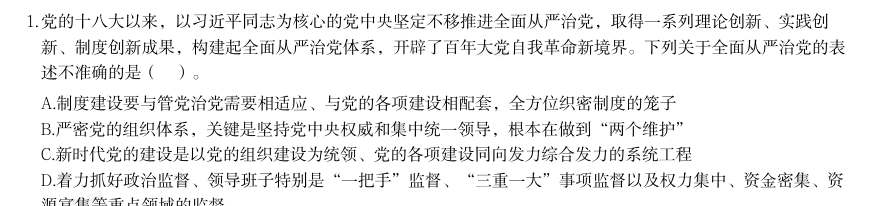

- **A.** 制度建设要与管党治党需要相适应、与党的各项建设相配套,全方位织密制度的笼子
- **B.** 严密党的组织体系,关键是坚持党中央权威和集中统一领导,根本在做到“两个维护”
- **C.** 新时代党的建设是以党的组织建设为统领、党的各项建设同向发力综合发力的系统工程
- **D.** 着力抓好政治监督、领导班子特别是“一把手”监督、“三重一大”事项监督以及权力集中、资金密集、资

**答案：C**

**解析/参考要点**：C
本题考查新思想。
2025 年2 月16 日,《求是》杂志发表习近平总书记重要文章《健全全面从严治
党体系》,以下简称文章。
A 项正确,文章指出:“第四,健全科学完备、有效管用的制度体系。全面从严
治党政治性、原则性强,必须有一套科学完备的制度来规范。制度建设要与管党
治党需要相适应、与党的各项建设相配套,全方位织密制度的笼子。”
B 项正确,文章指出:“第一,健全上下贯通、执行有力的组织体系······只
有党的组织体系严密起来,党的各级组织政治功能和组织功能充分发挥出来,全
面从严治党才能持续向纵深推进。严密党的组织体系,关键是坚持党中央权威和
集中统一领导,根本在做到‘两个维护’。”
C 项错误,文章指出:“······新时代党的建设是以党的政治建设为统领、
党的各项建设同向发力综合发力的系统工程,必须以党中央关于党的建设的重要
思想、关于党的自我革命的重要思想为根本遵循,坚持和加强党的全面领导和党
中央集中统一领导······”故“以党的组织建设为统领”表述有误,应为
“以党的政治建设为统领”。
D 项正确,文章指出:“第三,健全精准发力、标本兼治的监管体系······要
突出监督重点,着力抓好政治监督、领导班子特别是‘一把手’监督、‘三重一
大’事项监督以及权力集中、资金密集、资源富集等重点领域的监督,切实让特
权现象和腐败问题无所遁形。”
本题为选非题,故正确答案为C。

### 2026 湖北·统一卷　第 2 题　（新时代理论）

源富集等重点领域的监督 习近平总书记指出,讲好中国故事,传播好中国声音,展示真实、立体、全面的中国,是加强我国国际传播能 力建设的重要任务。关于加强我国国际传播能力建设,下列表述正确的是: 1要提升国际传播体系稳定性,防范国际传播格局重构 2要全面提升国际传播效能,建强适应新时代国际传播需要的专门人才队伍 3要倡导和平的国际舆论环境,不参与国际舆论斗争,塑造谦逊谦和的大国形象 4推动走出去、请进来管理便利化,扩大国际人文交流合作

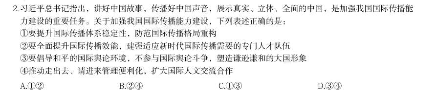

> （本题为图形题，选项为图片，见原卷）

**答案：暂缺（原始文件为扫描版）**

### 2026 湖北·统一卷　第 3 题　（新时代理论）

习近平总书记曾说:“我们要有钉钉子的精神,钉钉子往往不是一锤子就能钉好的,而是要一锤一锤接着敲, 直到把钉子钉实钉牢,钉牢一颗再钉下一颗,不断钉下去,必然大有成效。如果东一榔头西一棒子,结果很可 能是一颗钉子都钉不上、钉不牢。”这句话最能体现的哲学原理是: 1量变与质变辩证统一 2肯定与否定辩证统一 3主要矛盾与次要矛盾辩证统一 4尊重客观规律与发挥主观能动性辩证统一

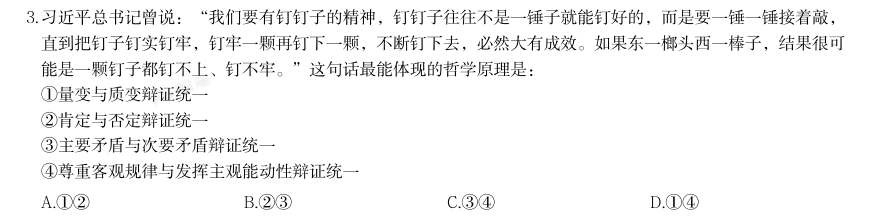

- **A.** 12
- **B.** 23
- **C.** 34
- **D.** 14

**答案：暂缺（原始文件为扫描版）**

### 2026 湖北·统一卷　第 4 题　（新时代理论）

下列选项中,习近平用语与其蕴含的思想、观点对应恰当的是: 1我将无我,不负人民——全心全意为人民服务 2功成不必在我、功成必定有我——方向决定前途,道路决定命运 3江山就是人民,人民就是江山——民为邦本 4时代是出卷人,我们是答卷人,人民是阅卷人——时代造就英雄,伟大来自平凡

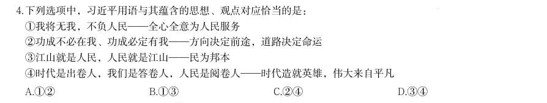

- **A.** 12
- **B.** 13
- **C.** 24
- **D.** 34

**答案：暂缺（原始文件为扫描版）**

### 2026 湖北·统一卷　第 5 题　（新时代理论）

习近平总书记指出,中国愿同世界各国一道,把握信息革命发展的历史主动,携手构建网络空间命运共同体, 让互联网更好造福人民、造福世界。关于构建网络空间命运共同体,下列表述正确的是: 1尊重网络主权,维护网络安全,共同构建和平、安全、开放、合作的网络空间 2全球网络主要由跨国公司提供,网络空间未来应由跨国公司携手经营 3倡导发展优先,构建更加普惠繁荣的网络空间 4保障数据安全,建立单边、保密的国际互联网治理体系 5深化网络安全务实合作,有力打击网络违法犯罪行为

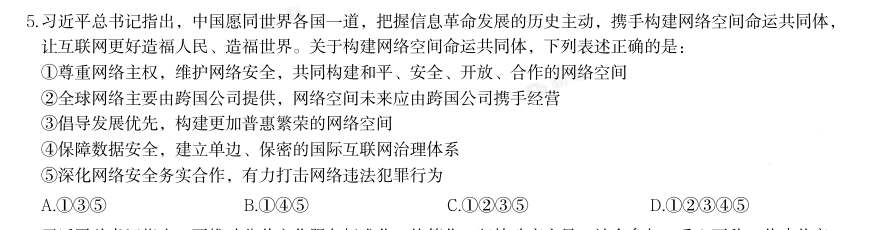

- **A.** 135
- **B.** 145
- **C.** 1235
- **D.** 12345

**答案：暂缺（原始文件为扫描版）**

### 2026 湖北·统一卷　第 6 题　（政治常识（综合））
> 材料：习近平总书记指出,要推动公共文化服务标准化、均等化,坚持政府主导、社会参与、重心下移、共建共享, 完善公共文化服务体系,提高基本公共文化服务的覆盖面和适用性。关于完善公共文化服务体系,下列举措正 确的有几项?…

1做好文化馆、乡镇(街道)综合文化站、村(社区)综合性文化服务中心等的规划建设 2推动优质文化资源向沿海发达地区集中,促进公共文化服务差异化发展 3实施全国智慧图书馆体系建设、公共文化云建设等项目 4实施广播电视惠民工程,完善农村文化基础设施网络 5推动各民族文化的传承保护和创新交融,提升民族地区公共文化服务水平

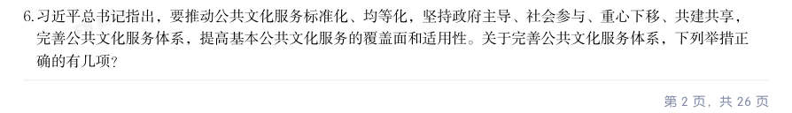

- **A.** 2项
- **B.** 3项
- **C.** 4项
- **D.** 5项

**答案：暂缺（原始文件为扫描版）**

### 2026 湖北·统一卷　第 7 题　（新时代理论）

习近平总书记强调,要推动森林“水库、钱库、粮库、碳库”更好联动,实现生态效益、经济效益、社会效益 相统一。下列表述与这一要求相契合的有几项? 1手中有粮,心中不慌 2绿水青山就是金山银山 3增绿就是增优势,护林就是护财富 4环境就是民生,青山就是美丽,蓝天也是幸福

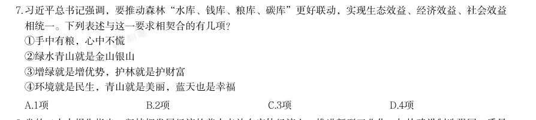

- **A.** 1项
- **B.** 2项
- **C.** 3项
- **D.** 4项

**答案：暂缺（原始文件为扫描版）**

### 2026 湖北·统一卷　第 8 题　（新时代理论）

党的二十大报告指出,坚持把发展经济的着力点放在实体经济上,推进新型工业化,加快建设制造强国、质量 强国、航天强国、交通强国、网络强国、数字中国。关于发展实体经济,下列说法正确的是: 1金融是实体经济的血脉,为实体经济服务是金融的天职 2要增强资本市场服务实体经济功能,积极有序发展股权融资 3要实现实体经济、科技创新、现代金融、人力资源协同发展 4要促进实体经济和数字经济深度融合,有序推动实体经济脱实向虚 5要推动资源要素向实体经济集聚、政策措施向实体经济倾斜、工作力量向实体经济加强

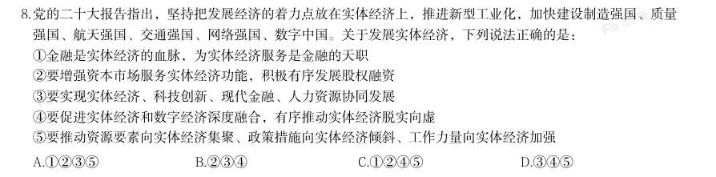

- **A.** 1235
- **B.** 234
- **C.** 1245
- **D.** 345

**答案：暂缺（原始文件为扫描版）**

### 2026 湖北·统一卷　第 9 题　（政治常识（综合））

党的二十届四中全会指出,“十五五”时期是基本实现社会主义现代化夯实基础、全面发力的关键时期,在基 本实现社会主义现代化进程中具有承前启后的重要地位。关于“十五五”规划,下列说法正确的是:

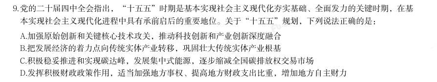

- **A.** 加强原始创新和关键核心技术攻关,推动科技创新和产业创新深度融合
- **B.** 把发展经济的着力点向传统实体产业转移,巩固壮大传统实体产业根基
- **C.** 积极稳妥推进和实现碳达峰,发展集中式能源,逐步缩减全国碳排放权交易市场
- **D.** 发挥积极财政政策作用,适当加强地方事权、提高地方财政支出比重,增加地方自主财力

**答案：暂缺（原始文件为扫描版）**

### 2026 湖北·统一卷　第 10 题　（新时代理论）

推进中国式现代化是一个系统工程,需要统筹兼顾、系统谋划、整体推进,正确处理好一系列重大关系。下列 与之相关的表述正确的有( )。 1活力与秩序:中国式现代化应当而且能够实现活而不乱、活跃有序的动态平衡 2守正与创新:守正才能不迷失方向、不犯颠覆性错误,创新才能把握时代、引领时代 3战略与策略:要增强策略的前瞻性,准确把握事物发展的必然趋势,以科学的战略预见未来、引领未来 4效率与公平:中国式现代化既要创造比资本主义更高的效率,又要更有效地维护社会公平,更好实现效率与 公平相兼顾、相促进、相统一

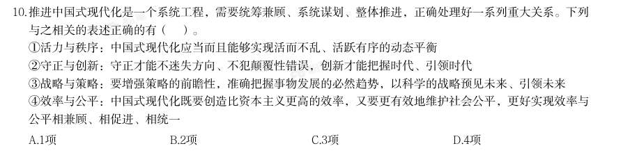

- **A.** 1项
- **B.** 2项
- **C.** 3项
- **D.** 4项

**答案：B**

**解析/参考要点**：B
本题考查新思想。
1错误,4正确,《中共中央关于进一步全面深化改革、推进中国式现代化的决
定》在“十、深化文化体制机制改革”部分中指出:“(41)构建更有效力的国
际传播体系。推进国际传播格局重构,深化主流媒体国际传播机制改革创新,加
快构建多渠道、立体式对外传播格局。加快构建中国话语和中国叙事体系,全面
提升国际传播效能。建设全球文明倡议践行机制。推动走出去、请进来管理便利
化,扩大国际人文交流合作。”故“防范国际传播格局重构”表述错误,应为“推
进国际传播格局重构”。
2正确,3错误,2021 年5 月31 日,习近平总书记在中共中央政治局第三十次
集体学习时指出:“我们党历来高度重视对外传播工作......积极推动中华文化走
出去,有效开展国际舆论引导和舆论斗争,初步构建起多主体、立体式的大外宣
格局······要全面提升国际传播效能,建强适应新时代国际传播需要的专
门人才队伍······”故“不参与国际舆论斗争”表述错误,应为“有效开
展国际舆论引导和舆论斗争”。
综上,24表述正确。
故正确答案为B。
3.D
本题考查马克思主义。
1正确,钉钉子要一锤一锤接着敲,直到钉实钉牢,体现了量的积累(每一锤)
达到一定程度必然引起质的飞跃(钉牢一颗钉子);不断钉下去,必然大有成效,
体现了量变与质变的辩证统一关系。
2错误,“肯定与否定辩证统一”指事物内部包含肯定和否定的因素,要通过辩
证否定实现发展。题干强调的是持续用力、循序渐进,并未涉及对事物自身的肯
定与否定。
3错误,“主要矛盾与次要矛盾辩证统一”指在复杂事物发展过程中要抓关键、
抓重点,统筹兼顾。题干强调的是工

### 2026 湖北·统一卷　第 11 题　（新时代理论）

城乡融合发展是中国式现代化的必然要求。关于城乡融合发展,下列说法正确的有几项? 1要把乡村振兴战略这篇大文章做好,必须走城乡融合发展之路 2在现代化进程中,如何处理好工农关系、城乡关系,在一定程度上决定着现代化的成败 3要顺应城乡融合发展大趋势,破除妨碍城乡要素平等交换、双向流动的制度壁垒 4振兴乡村,不能就乡村论乡村,还是要强化以工补农、以城带乡,加快形成工农互促、城乡互补、协调发 展、共同繁荣的新型工农城乡关系

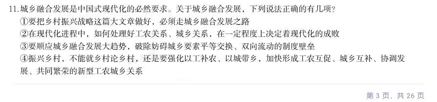

- **A.** 1项
- **B.** 2项
- **C.** 3项
- **D.** 4项

**答案：D**

**解析/参考要点**：D
本题考查新思想。
1正确,2018 年9 月21 日,习近平总书记在十九届中央政治局第八次集体学习
时讲话指出:“要把乡村振兴战略这篇大文章做好,必须走城乡融合发展之路。
我们一开始就没有提城市化,而是提城镇化,目的就是促进城乡融合。要向改革
要动力,加快建立健全城乡融合发展体制机制和政策体系。”
2正确,2018 年9 月21 日,习近平总书记在十九届中央政治局第八次集体学习
时讲话指出:“我一直强调,没有农业农村现代化,就没有整个国家现代化。在
现代化进程中,如何处理好工农关系、城乡关系,在一定程度上决定着现代化的
成败。”
3正确,2022 年12 月23 日,习近平总书记在中央农村工作会议上讲话指出:
“要顺应城乡融合发展大趋势,破除妨碍城乡要素平等交换、双向流动的制度壁
垒,促进发展要素、各类服务更多下乡,率先在县域内破除城乡二元结构。”
4正确,2020 年12 月28 日,习近平总书记在中央农村工作会议上讲话指出:
“第六,推动城乡融合发展见实效。振兴乡村,不能就乡村论乡村,还是要强化
以工补农、以城带乡,加快形成工农互促、城乡互补、协调发展、共同繁荣的新
型工农城乡关系。”
综上,1234说法正确,共4 项。
故正确答案为D。

### 2026 湖北·统一卷　第 12 题　（毛中特与党史）

建设质量强国是推动高质量发展,促进我国经济由大向强转变的重要举措,是满足人民美好生活需要的重要途 径。关于建设质量强国,下列表述正确的有( )。 1建立健全强制性与自愿性相结合的质量披露制度 2支持开展质量公益诉讼和集体诉讼,有效执行商品质量惩罚性赔偿制度 3深化检验检测认证机构资质审批制度改革,全面实施告知承诺和优化审批服务 4加强工程质量监督队伍建设,全面推行政府购买服务方式委托社会力量辅助工程质量监督检查 5鼓励支持中小微企业实施技术改造、质量改进、品牌建设,提升中小微企业质量技术创新能力

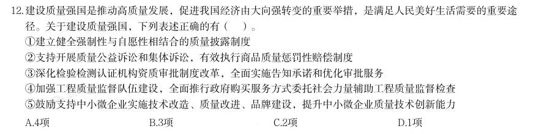

- **A.** 4项
- **B.** 3项
- **C.** 2项
- **D.** 1项

**答案：A**

**解析/参考要点**：A
本题考查新思想。
2023 年2 月,中共中央、国务院印发《质量强国建设纲要》(以下简称《纲要》)。
1正确,《纲要》在“十、推进质量治理现代化”部分指出:“(二十六)健全
质量政策制度······建立质量分级标准规则,实施产品和服务质量分级,
引导优质优价,促进精准监管。建立健全强制性与自愿性相结合的质量披露制度,
鼓励企业实施质量承诺和标准自我声明公开。”
2正确,《纲要》在“十、推进质量治理现代化”部分指出:“(二十五)加强
质量法治建设······支持开展质量公益诉讼和集体诉讼,有效执行商品质
量惩罚性赔偿制度。健全产品和服务质量担保与争议处理机制,推行第三方质量
争议仲裁。加强质量法治宣传教育,普及质量法律知识。”
3正确,《纲要》在“九、构建高水平质量基础设施”部分指出:“(二十二)
优化质量基础设施管理······深化检验检测机构市场化改革,加强公益性
机构功能性定位、专业化建设,推进经营性机构集约化运营、产业化发展。深化
检验检测认证机构资质审批制度改革,全面实施告知承诺和优化审批服务,优化
规范检验检测机构资质认定程序。”
4错误,《纲要》在“六、提升建设工程品质”部分指出:“(十三)强化工程
质量保障······强化工程建设全链条质量监管,完善日常检查和抽查抽测
相结合的质量监督检查制度,加强工程质量监督队伍建设,探索推行政府购买服
务方式委托社会力量辅助工程质量监督检查。”故“全面推行”表述有误,应为
“探索推行”。
5正确,《纲要》在“八、增强企业质量和品牌发展能力”部分指出:“(十九)
加快质量技术创新应用······支持企业牵头组建质量技术创新联

## 三、其余真题（按年代分片）

| 年代 | 题量 | 分片文件 |
|---|---:|---|
| 2000s | 9 | [CS-ZZ-2000s.md](split/CS-ZZ-2000s.md) |
| 2010s | 29 | [CS-ZZ-2010s.md](split/CS-ZZ-2010s.md) |
| 2020s | 139 | [CS-ZZ-2020s.md](split/CS-ZZ-2020s.md) |

> 也可用 `python scripts/search.py --kaodian CS-ZZ` 直接检索全部 189 题。