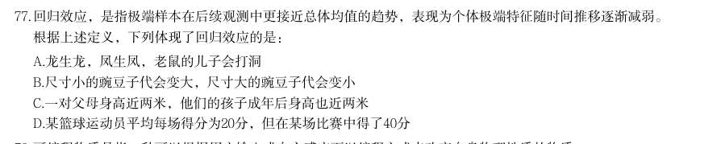
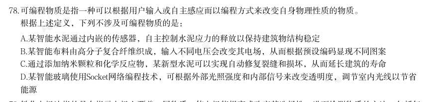
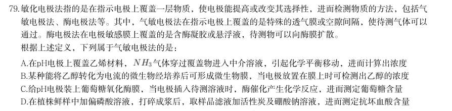
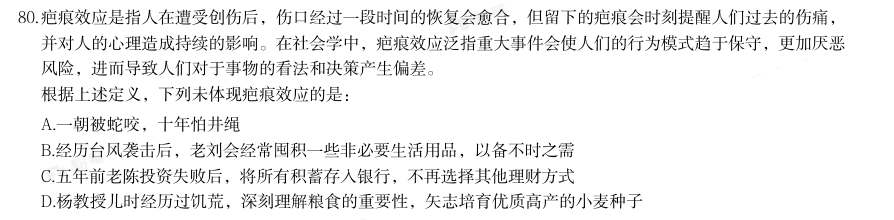
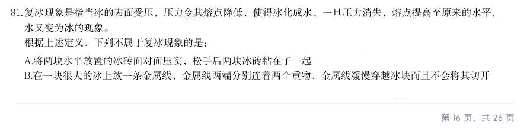
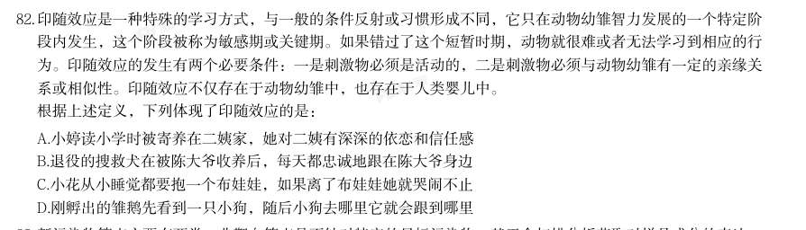
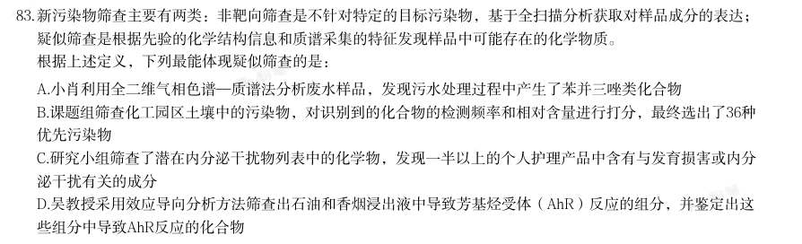
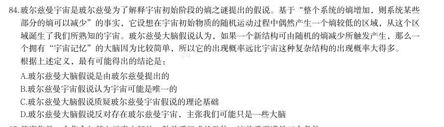
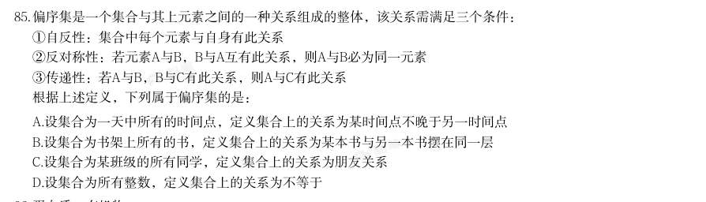

# 判断推理 · 定义判断

> 考点编码：`PD-DY`　｜　体系对齐：花生十三 `panduan-tuili.md#二`

## 一、命题规律

- **本题型真题总量**：441 题（2002–2026）
- **地区分布**：国考 284 / 广东 3 / 湖北 154
- **近六年题量**：2026年27题, 2025年29题, 2024年31题, 2023年20题, 2022年26题, 2021年11题
- **覆盖试卷**：59 套
- **子考点分布**：单定义 504　多定义 19　定义判断（综合） 15
- **同题变体**：另有 97 道为同题重复（同年多卷/跨年再考），已折叠，需展开见 scripts/search.py --all-variants

## 二、近年真题（最多 12 题，按年份倒序）

### 2026 湖北·统一卷　第 76 题　（单定义）
> 材料：凯伊效应是指当一束高粘度的假塑性流体倾倒至固体表面时,固体表面会把液束向上反弹出去。其原理为快速 下落的液束冲击下方堆积的黏性流体,流体表面因为受到冲击粘度变小,受到撞击后形成一个酒窝状的凹坑,…

· 本试卷由粉笔用户上岸张同学66生成 同时粘度降低的表面充当了润滑剂的作用,最终使得下落的液束被反弹出去。 根据上述定义,下列属于凯伊效应的是:

- **A.** 用肥皂水冲洗勺子,肥皂水碰到勺子后会沿着勺子曲面流下去
- **B.** 在喷水池喷出的水柱上放乒乓球,水柱会托举乒乓球向上跳跃
- **C.** 水流冲过土壤中的孔隙或裂缝时,形成了类似管道的水流通道
- **D.** 将洗发水从高处快速倒向桌面,堆积的洗发水会突然跳起一束

**答案：D**

**解析/参考要点**：D
第一步:找出定义关键词。
“高粘度的假塑性流体倾倒至固体表面”、“液束向上反弹出去”。
第二步:逐一分析选项。
A 项:肥皂水碰到勺子后沿着勺子曲面流下去,液束没有反弹,不符合“液束向
上反弹出去”,不符合定义,排除;
B 项:水柱托举乒乓球向上跳跃,不涉及液束反弹,不符合“液束向上反弹出去”,
不符合定义,排除;
C 项:水流冲过孔隙或裂缝形成类似管道的水流通道,不涉及液束反弹,不符合
“液束向上反弹出去”,不符合定义,排除;
D 项:将洗发水从高处快速倒向桌面,洗发水是高粘度假塑性流体,符合“高粘
度的假塑性流体倾倒至固体表面”,堆积的洗发水突然跳起一束,符合“液束向
上反弹出去”,符合定义,当选。
故正确答案为D。

### 2026 湖北·统一卷　第 77 题　（单定义）

回归效应,是指极端样本在后续观测中更接近总体均值的趋势,表现为个体极端特征随时间推移逐渐减弱。 根据上述定义,下列体现了回归效应的是:

- **A.** 龙生龙,凤生凤,老鼠的儿子会打洞
- **B.** 尺寸小的豌豆子代会变大,尺寸大的豌豆子代会变小
- **C.** 一对父母身高近两米,他们的孩子成年后身高也近两米
- **D.** 某篮球运动员平均每场得分为20分,但在某场比赛中得了40分

**答案：B**

**解析/参考要点**：B
第一步:找出定义关键词。
“更接近总体均值”、“个体极端特征”、“随时间推移逐渐减弱”。
第二步:逐一分析选项。
A 项:龙生龙、凤生凤强调的是遗传稳定性,个体极端特征没有减弱,反而保持,
不符合定义,排除;
B 项:尺寸小(极端偏小)的豌豆子代变大,尺寸大(极端偏大)的豌豆子代变
小,个体极端特征随时间推移逐渐减弱,都向中间的总体尺寸均值靠拢,符合定
义,当选;
C 项:父母身高近两米,孩子身高也近两米,个体极端特征没有减弱,反而保持,
不符合定义,排除;
D 项:只说了一场得40 分(极端高分),但没有后续数据说明得分向20 分的均
值回归,不符合定义,排除。
故正确答案为B。

### 2026 湖北·统一卷　第 78 题　（单定义）

可编程物质是指一种可以根据用户输入或自主感应而以编程方式来改变自身物理性质的物质。 根据上述定义,下列不涉及可编程物质的是:

- **A.** 某智能水泥通过内嵌的传感器,自主控制水泥应力的释放以保持建筑物结构稳定
- **B.** 某智能布料由高分子复合纤维织成,输入不同电压会改变其电场,从而根据预设编码显现不同图案
- **C.** 通过添加纳米颗粒和化学反应物,某新型水泥可以实现自动修复裂缝和损坏,从而延长建筑的寿命
- **D.** 某智能玻璃使用Socket网络编程技术,可根据外部光照强度和内部信号来改变透明度,调节室内光线以节省

**答案：C**

**解析/参考要点**：C
第一步:找出定义关键词。
“根据用户输入或自主感应”、“以编程方式”、“改变自身物理性质”。
第二步:逐一分析选项。
A 项:智能水泥通过内嵌的传感器自主控制应力的释放来保持建筑物结构稳定,
属于“自主感应”、“以编程方式”、“改变自身物理性质”,符合定义,排除;
B 项:智能布料通过输入不同电压改变电场,根据预设编码显现不同图案,属于
“用户输入”、“以编程方式”、“改变自身物理性质”,符合定义,排除;
C 项:新型水泥通过添加纳米颗粒和化学反应物实现自动修复,属于材料本身的
化学特性,不符合“根据用户输入或自主感应”、“以编程方式”,不符合定义,
当选;
D 项:智能玻璃通过网络编程技术,根据外部光照强度和内部信号来改变透明度,
属于“自主感应”、“以编程方式”、“改变自身物理性质”,符合定义,排除。
本题为选非题,故正确答案为C。

### 2026 湖北·统一卷　第 79 题　（单定义）

能源 敏化电极法指的是在指示电极上覆盖一层物质,使电极能提高或改变其选择性,进而检测物质的方法,包括气 敏电极法、酶电极法等。其中,气敏电极法在指示电极上覆盖的是特殊的透气膜或空隙间隔,使待测气体可以 通过。酶电极法在电极敏感膜上覆盖的是含酶凝胶或悬浮液,待测物可以向酶膜扩散。 根据上述定义,下列属于气敏电极法的是:

- **A.** 在pH电极上覆盖乙烯材料,气体穿过覆盖物进入中介溶液,引起化学平衡移动,进而计算出浓度
- **B.** 某种能将乙醇转化为电流的微生物经培养后可形成微生物膜,当电极放置在膜上时可检测出乙醇的浓度
- **C.** 给pH电极装上葡萄糖氧化酶膜,当电极插入待测溶液时,酶催化产生化学反应,进而测定葡萄糖含量
- **D.** 在植株鲜样中加偏磷酸溶液,打碎成浆后,取样品滤液加活性炭及硼酸钠溶液,进而测定抗坏血酸含量

**答案：A**

**解析/参考要点**：A
第一步:找出定义关键词。
敏化电极法:“指示电极上覆盖一层物质”、“电极能提高或改变其选择性”、
“检测物质”;
气敏电极法:“指示电极上覆盖的是特殊的透气膜或空隙间隔”、“待测气体可
以通过”;
酶电极法:“电极敏感膜上覆盖的是含酶凝胶或悬浮液”、“待测物可以向酶膜
扩散”。
第二步:逐一分析选项。
A 项:在pH 电极上覆盖乙烯材料,符合“指示电极上覆盖的是特殊的透气膜或
空隙间隔”,
气体穿过覆盖物进入中介溶液,从而计算出浓度,符合“待
测气体可以通过”,符合“气敏电极法”定义,当选;
B 项:电极放置在微生物膜上检测出乙醇的浓度,乙醇不属于气体,不符合“待
测气体可以通过”,不符合“气敏电极法”定义,排除;
C 项:给pH 电极装上葡萄糖氧化酶膜,符合“电极敏感膜上覆盖的是含酶凝胶
或悬浮液”,电极插入待测溶液时,酶催化产生化学反应,进而测定葡萄糖含量,
符合“待测物可以向酶膜扩散”,符合“酶电极法”定义,不符合“气敏电极法”
定义,排除;
D 项:在植株鲜样中加偏磷酸溶液,取样品滤液加活性炭及硼酸钠溶液来测定抗
坏血酸含量,不涉及电极,不符合“指示电极上覆盖一层物质”,不符合“敏化
电极法”,不符合定义,排除。
故正确答案为A。

### 2026 湖北·统一卷　第 80 题　（单定义）

疤痕效应是指人在遭受创伤后,伤口经过一段时间的恢复会愈合,但留下的疤痕会时刻提醒人们过去的伤痛, 并对人的心理造成持续的影响。在社会学中,疤痕效应泛指重大事件会使人们的行为模式趋于保守,更加厌恶 风险,进而导致人们对于事物的看法和决策产生偏差。 根据上述定义,下列未体现疤痕效应的是:

- **A.** 一朝被蛇咬,十年怕井绳
- **B.** 经历台风袭击后,老刘会经常囤积一些非必要生活用品,以备不时之需
- **C.** 五年前老陈投资失败后,将所有积蓄存入银行,不再选择其他理财方式
- **D.** 杨教授儿时经历过饥荒,深刻理解粮食的重要性,矢志培育优质高产的小麦种子

**答案：D**

**解析/参考要点**：D
第一步:找出定义关键词。
“重大事件”、“趋于保守”、“更加厌恶风险”、“人们对于事物的看法和决
策产生偏差”。
第二步:逐一分析选项。
A 项:意思是被蛇咬伤的创伤事件后,长达十年里看到外形相似的绳子都会心生
恐惧,被蛇咬属于重大创伤事件,怕井绳是行为上的风险回避,符合“重大事件”、
“趋于保守”、“更加厌恶风险”、“人们对于事物的看法和决策产生偏差”,
符合定义,排除;
B 项:经历台风袭击后,符合“重大事件”,老刘经常囤积非必要生活用品,说
明行为模式转为保守,决策因过往创伤出现偏差,符合“趋于保守”、“更加厌
恶风险”、“人们对于事物的看法和决策产生偏差”,符合定义,排除;
C 项:五年前投资失败后,符合“重大事件”,老陈将所有积蓄存银行,不再选
择其他理财方式,说明他厌恶风险,决策因过往创伤发生根本性的保守转变,符
合“趋于保守”、“更加厌恶风险”、“人们对于事物的看法和决策产生偏差”,
符合定义,排除;
D 项:杨教授儿时经历过饥荒,矢志培育优质高产的小麦种子,说明他主动投身
科研,并未厌恶风险,而是将经历转化为解决问题的动力,不符合“趋于保守”、
“更加厌恶风险”、“人们对于事物的看法和决策产生偏差”,不符合定义,当
选。
本题为选非题,故正确答案为D。

### 2026 湖北·统一卷　第 81 题　（单定义）

复冰现象是指当冰的表面受压,压力令其熔点降低,使得冰化成水,一旦压力消失,熔点提高至原来的水平, 水又变为冰的现象。 根据上述定义,下列不属于复冰现象的是:

- **A.** 将两块水平放置的冰砖面对面压实,松手后两块冰砖粘在了一起
- **B.** 在一块很大的冰上放一条金属线,金属线两端分别连着两个重物,金属线缓慢穿越冰块而且不会将其切开· 本试卷由粉笔用户上岸张同学66生成
- **C.** 在滑冰场上滑冰时,冰刀留下道道痕迹,但很快刀痕会全部消失,留下完好如初的冰面
- **D.** 水结冰时,所释放的热量在其内部形成压力、产生气泡,这使得结成的冰看上去不透明

**答案：D**

**解析/参考要点**：D
第一步:找出定义关键词。
“冰受压化成水”、“压力消失水又变为冰”。
第二步:逐一分析选项。
A 项:两块冰砖压实,说明冰在受压时先化成了水,松开粘一块说明刚刚化的水
又结冰了,符合“冰受压化成水”、“压力消失水又变为冰”,符合定义,排除;
B 项:金属线能够穿过冰,说明冰受压化成了水,金属线穿过之后压力解除,但
冰不会被切开,说明水又结冰,符合“冰受压化成水”、“压力消失水又变为冰”,
符合定义,排除;
C 项:刀痕消失,说明冰刀离开冰面后,压力消失,水膜重新结冰,冰面恢复平
整,符合“冰受压化成水”、“压力消失水又变为冰”,符合定义,排除;
D 项:水结冰时内部产生压力和气泡,仅仅是水结冰的单向凝固过程,并没有体
现冰化水现象,不符合“冰受压化成水”、“压力消失水又变为冰”,不符合定
义,当选。
本题为选非题,故正确答案为D。

### 2026 湖北·统一卷　第 82 题　（单定义）

印随效应是一种特殊的学习方式,与一般的条件反射或习惯形成不同,它只在动物幼雏智力发展的一个特定阶 段内发生,这个阶段被称为敏感期或关键期。如果错过了这个短暂时期,动物就很难或者无法学习到相应的行 为。印随效应的发生有两个必要条件:一是刺激物必须是活动的,二是刺激物必须与动物幼雏有一定的亲缘关 系或相似性。印随效应不仅存在于动物幼雏中,也存在于人类婴儿中。 根据上述定义,下列体现了印随效应的是:

- **A.** 小婷读小学时被寄养在二姨家,她对二姨有深深的依恋和信任感
- **B.** 退役的搜救犬在被陈大爷收养后,每天都忠诚地跟在陈大爷身边
- **C.** 小花从小睡觉都要抱一个布娃娃,如果离了布娃娃她就哭闹不止
- **D.** 刚孵出的雏鹅先看到一只小狗,随后小狗去哪里它就会跟到哪里

**答案：D**

**解析/参考要点**：D
第一步:找出定义关键词。
“是一种特殊的学习方式”、
“只在动物幼雏智力发展的敏感期或关键期内发生”、
“一是刺激物必须是活动的”、“二是刺激物必须与动物幼雏有一定的亲缘关系
或相似性”、“也存在于人类婴儿中”。
第二步:逐一分析选项。
A 项:寄养在二姨家的小婷已经读小学,不属于婴儿阶段,不符合“也存在于人
类婴儿中”,不符合定义,排除;
B 项:退役的搜救犬已是成年犬,不属于动物幼雏,不符合“只在动物幼雏智力
发展的敏感期或关键期内发生”,不符合定义,排除;
C 项:小花离了布娃娃就哭闹不止,布娃娃不是活物,不符合“一是刺激物必须
是活动的”,不符合定义,排除;
D 项:刚孵出的雏鹅,符合“只在动物幼雏智力发展的敏感期或关键期内发生”,
雏鹅先看到一只鸭子后跟随鸭子,符合“是一种特殊的学习方式”、“一是刺激
物必须是活动的”、“二是刺激物必须与动物幼雏有一定的亲缘关系或相似性”,
符合定义,当选。
故正确答案为D。

### 2026 湖北·统一卷　第 83 题　（单定义）

新污染物筛查主要有两类:非靶向筛查是不针对特定的目标污染物,基于全扫描分析获取对样品成分的表达; 疑似筛查是根据先验的化学结构信息和质谱采集的特征发现样品中可能存在的化学物质。 根据上述定义,下列最能体现疑似筛查的是:

- **A.** 小肖利用全二维气相色谱—质谱法分析废水样品,发现污水处理过程中产生了苯并三唑类化合物
- **B.** 课题组筛查化工园区土壤中的污染物,对识别到的化合物的检测频率和相对含量进行打分,最终选出了36种优先污染物
- **C.** 研究小组筛查了潜在内分泌干扰物列表中的化学物,发现一半以上的个人护理产品中含有与发育损害或内分泌干扰有关的成分
- **D.** 吴教授采用效应导向分析方法筛查出石油和香烟浸出液中导致芳基烃受体(AhR)反应的组分,并鉴定出这

**答案：C**

**解析/参考要点**：C
第一步:找出定义关键词。
非靶向筛查:“不针对特定的目标污染物”、“基于全扫描分析获取对样品成分
的表达”;
疑似筛查:“根据先验的化学结构信息和质谱采集的特征”、“发现样品中可能
存在的化学物质”。
第二步:逐一分析选项。
A 项:小肖利用全二维气相色谱—质谱法分析废水样品发现了苯并三唑类化合物,
符合“不针对特定的目标污染物”、“基于全扫描分析获取对样品成分的表达”,
符合非靶向筛查定义,不符合疑似筛查定义,排除;
B 项:对识别到的化合物的检测频率和相对含量进行打分,最终“选出”了36
种优先污染物,“选出”意味着不是新发现的,是对已有识别结果的后续处理,
不符合“发现样品中可能存在的化学物质”,不符合疑似筛查定义,排除;
C 项:筛查潜在内分泌干扰物列表中的化学物,符合“根据先验的化学结构信息
和质谱采集的特征”,发现一半以上的个人护理产品中含有与发育损害或内分泌
干扰有关的成分,符合“发现样品中可能存在的化学物质”,符合疑似筛查定义,
当选;
D 项:吴教授采用“效应导向”分析方法筛查出石油和香烟浸出液中导致芳基烃
受体(AhR)反应的组分,是从效应倒推成分,不符合“根据先验的化学结构信
息和质谱采集的特征”,不符合疑似筛查定义,排除。
故正确答案为C。

### 2026 湖北·统一卷　第 84 题　（单定义）

些组分中导致AhR反应的化合物 玻尔兹曼宇宙是玻尔兹曼为了解释宇宙初始阶段的熵之谜提出的假说。基于“整个系统的熵增加,则系统某些 部分的熵可以减少”的事实,它设想在宇宙初始物质的随机运动过程中偶然产生一个熵较低的区域,从这个区 域诞生了我们所熟知的宇宙。玻尔兹曼大脑假说认为,如果一个新结构可由随机的熵减少所触发产生,那么一 个拥有“宇宙记忆”的大脑因为比较简单,所以它的出现概率远比宇宙这种复杂结构的出现概率大得多。 根据上述定义,最有可能得出的结论是:

- **A.** 玻尔兹曼大脑假说是由玻尔兹曼提出的
- **B.** 玻尔兹曼宇宙假说认为宇宙可能是唯一的
- **C.** 玻尔兹曼大脑假说质疑玻尔兹曼宇宙假说的理论基础
- **D.** 玻尔兹曼大脑假说反对存在玻尔兹曼宇宙,主张我们可能只是一些大脑

**答案：C**

**解析/参考要点**：C
第一步:找出定义关键词。
玻尔兹曼宇宙假说:宇宙是随机运动中偶然出现的低熵区域。
玻尔兹曼大脑假说:在同样的随机熵减机制下,简单的“大脑”比整个宇宙更容
易出现。
第二步:逐一分析选项。
A 项:题干中仅提及了“玻尔兹曼宇宙假说”是由玻尔兹曼提出的,但未提及“玻
尔兹曼大脑假说”是由谁提出的,故无法推出,排除;
B 项:题干中“玻尔兹曼宇宙假说”仅仅是在假设宇宙是如何诞生的,但未提及
宇宙是否是唯一的,无法推出,排除;
C 项:“玻尔兹曼宇宙假说”认为“宇宙”是随机运动偶然产生的,按照这个说
法,题干最后一句说随机运动偶然产生的更应该是“简单的大脑”,而非“宇宙”,
所以“玻尔兹曼大脑假说”是对“玻尔兹曼宇宙假说”的质疑,可以推出,当选;
D 项:题干中“玻尔兹曼大脑假说”并未提及我们是否可能是那些拥有“宇宙记
忆”的大脑,无法推出,排除。
故正确答案为C。

### 2026 湖北·统一卷　第 85 题　（单定义）

偏序集是一个集合与其上元素之间的一种关系组成的整体,该关系需满足三个条件: 1自反性:集合中每个元素与自身有此关系 2反对称性:若元素A与B,B与A互有此关系,则A与B必为同一元素 3传递性:若A与B,B与C有此关系,则A与C有此关系 根据上述定义,下列属于偏序集的是:

- **A.** 设集合为一天中所有的时间点,定义集合上的关系为某时间点不晚于另一时间点
- **B.** 设集合为书架上所有的书,定义集合上的关系为某本书与另一本书摆在同一层
- **C.** 设集合为某班级的所有同学,定义集合上的关系为朋友关系
- **D.** 设集合为所有整数,定义集合上的关系为不等于

**答案：A**

**解析/参考要点**：A
第一步:找出定义关键词。
“集合中每个元素与自身有此关系”、“若元素A 与B,B 与A 互有此关系,则
A 与B 必为同一元素”、“若A 与B,B 与C 有此关系,则A 与C 有此关系”。
第二步:逐一分析选项。
A 项:设A、B、C 为一天中的三个时间点,即有“A 不晚于A,B 不晚于B,C 不
晚于C”,符合“集合中每个元素与自身有此关系”,若“A 不晚于B 且B 不晚
于A,可以得到A=B”,符合“若元素A 与B,B 与A 互有此关系,则A 与B 必为
同一元素”,若“A 不晚于B,B 不晚于C,则A 不晚于C”,符合“若A 与B,B
与C 有此关系,则A 与C 有此关系”,符合定义,当选;
B 项:设A、B 为书架上的两本书,通过“A 与B 在同一层,B 与A 在同一层,无
法得到A 和B 一定是同一本书”,不符合“若元素A 与B,B 与A 互有此关系,
则A 与B 必为同一元素”,不符合定义,排除;
C 项:设A、B、C 为班级中的三位同学,若“A 和B 是朋友,B 和C 是朋友,无
法得到A 和C 一定是朋友”,不符合“若A 与B,B 与C 有此关系,则A 与C 有
此关系”,不符合定义,排除;
D 项:任意整数都等于自身,即任意整数和自身都没有“不等于”关系,不符合
“集合中每个元素与自身有此关系”,不符合定义,排除。
故正确答案为A。

### 2026 国考·副省级　第 91 题　（单定义）

均变论认为,支配各种地质过程的法则在地质历史上没有发生过变化,现在起作用的各种自 然营力在漫长的地质过程中具有普遍的均一性,即地质具有相同方式和相同的强度;地球上生物 的种与演变是一个渐变的过程,种之间有过渡关系,生物进化过程是极其漫长的。灾变论认为, 在整个地质发展的过程中,地球经常发生各种突如其来的、短暂的全球性灾难性变化,这些变化 强烈地改变了地球的面貌;地球上生物的变化是反复多次灾变的结果。 根据上述定义,下列说法最能体现灾变论观点的是:

- **A.** “我们找不到开始的痕迹,也看不到结束的迹象”
- **B.** “地质记录是一部被鲜血和火焰写成的史诗”
- **C.** “现在是通往过去的一把钥匙”
- **D.** “自然界里没有飞跃”

**答案：B**

**解析/参考要点**：B
第一步:找出定义关键词。
均变论:“支配各种地质过程的法则在地质历史上没有发生过变化”、“现在起作用的各种自然营力在漫长的
地质过程中具有普遍的均一性”、“地球上生物的种与演变是一个渐变的过程,种之间有过渡关系,生物进化
过程是极其漫长的”。
灾变论:“地球经常发生各种突如其来的、短暂的全球性灾难性变化,这些变化强烈地改变了地球的面貌”、
“地球上生物的变化是反复多次灾变的结果”。
第二步:逐一分析选项。
A 项:“我们找不到开始的痕迹,也看不到结束的迹象”,体现了“支配各种地质过程的法则在地质历史上没
有发生过变化”、“地球上生物的种与演变是一个渐变的过程,种之间有过渡关系,生物进化过程是极其漫长
的”,符合“均变论”定义,不符合“灾变论”定义,排除;
B 项:“地质记录是一部被鲜血和火焰写成的史诗”,“鲜血和火焰”隐喻的是灾难,体现了“地球经常发生
各种突如其来的、短暂的全球性灾难性变化,这些变化强烈地改变了地球的面貌”、“地球上生物的变化是反
复多次灾变的结果”,符合“灾变论”定义,当选;
C 项:“现在是通往过去的一把钥匙”,体现了“支配各种地质过程的法则在地质历史上没有发生过变化”、
“现在起作用的各种自然营力在漫长的地质过程中具有普遍的均一性”、“地球上生物的种与演变是一个渐变
的过程,种之间有过渡关系,生物进化过程是极其漫长的”,符合“均变论”定义,不符合“灾变论”定义,
排除;
D 项:“自然界里没有飞跃”,体现了“地球上生物的种与演变是一个渐变的过程,种之间有过渡关系,生物
进化过程是极其漫长的”,符合“均变论”定义,不符合“灾变论”定义,排除。
故正确答

### 2026 国考·副省级　第 92 题　（单定义）

波特五力模型是一种竞争分析工具,用于评估一个行业的竞争力和吸引力。该模型通过对同 行业竞争对手的威胁,潜在进入者的威胁、替代品的威胁、上游供应商的议价能力和下游购买者 的议价能力这五个方面的分析,帮助企业了解其所处行业的竞争环境,以制定相应的竞争策略。 根据上述定义,关于康复机器人行业,对下列问题的分析不能归入波特五力模型的是:

- **A.** 康复机器人行业准入门槛高吗?需要强大的技术能力和创新能力吗?
- **B.** 医院和康复中心患者规模如何?对于康复机器人的需求有多大?
- **C.** 与传统物理治疗等康复治疗方法相比,康复机器人有竞争力吗?
- **D.** 康复机器人企业内部各部门之间的协同合作程度高吗?

**答案：D**

**解析/参考要点**：D
第一步:找出定义关键词。
“同行业竞争对手的威胁”、“潜在进入者的威胁”、“替代品的威胁”、“上游供应商的议价能力”、“下
游购买者的议价能力”、“帮助企业了解其所处行业的竞争环境,以制定相应的竞争策略”。
第二步:逐一分析选项。
A 项:康复机器人行业准入门槛高吗?需要强大的技术能力和创新能力吗?问题中的“准入门槛”、“技术能
力和创新能力”直接关系到潜在企业能否进入康复机器人行业,符合波特五力模型中的“潜在进入者的威胁”,
符合定义,排除;
B 项:医院和康复中心患者规模如何?对于康复机器人的需求有多大?问题中的“医院”和“康复中心”是康
复机器人的“下游购买者”,“患者规模”与“需求程度”会直接影响购买者采购时的“议价能力”,符合波
特五力模型中的“下游购买者的议价能力”,符合定义,排除;
C 项:与传统物理治疗等康复治疗方法相比,康复机器人有竞争力吗?问题中的“传统物理治疗”是康复机器
人的“替代方案”,是在分析“替代品”的竞争力对行业的威胁,符合波特五力模型中的“替代品的威胁”,
符合定义,排除;
D 项:康复机器人企业内部各部门之间的协同合作程度高吗?问题中的“企业内部各部门之间的协同合作程度”
属于企业“内部管理”的范畴,不符合波特五力模型中的任何一个,不符合定义,当选。
本题为选非题,故正确答案为D。

## 三、其余真题（按年代分片）

| 年代 | 题量 | 分片文件 |
|---|---:|---|
| 2000s | 93 | [PD-DY-2000s.md](split/PD-DY-2000s.md) |
| 2010s | 185 | [PD-DY-2010s.md](split/PD-DY-2010s.md) |
| 2020s | 151 | [PD-DY-2020s.md](split/PD-DY-2020s.md) |

> 也可用 `python scripts/search.py --kaodian PD-DY` 直接检索全部 441 题。