# 判断推理 · 科学推理

> 考点编码：`PD-KX`　｜　体系对齐：花生十三 `体系外补充（广东特色，归入判断推理）`

## 一、命题规律

- **本题型真题总量**：16 题（2004–2022）
- **地区分布**：国考 4 / 广东 11 / 湖北 1
- **近六年题量**：2022年1题, 2021年3题, 2020年1题, 2019年2题, 2017年1题, 2016年3题
- **覆盖试卷**：13 套
- **子考点分布**：物理 13　生物 2　化学 2　科学推理（综合） 1
- **同题变体**：另有 2 道为同题重复（同年多卷/跨年再考），已折叠，需展开见 scripts/search.py --all-variants

## 二、近年真题（最多 12 题，按年份倒序）

### 【2022 广东省考（乡镇）·第 74 题】GD-2022-xz-X074　科学推理｜物理

如图是某家庭电路图的一部分,家庭内各电器均正确接入电路。则以下说法准确的是:

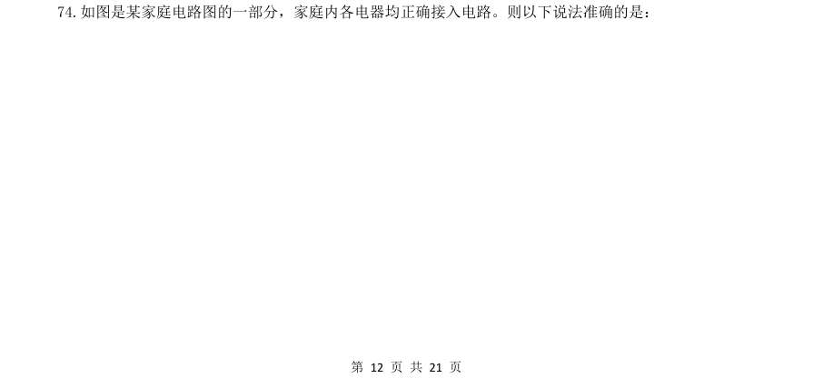

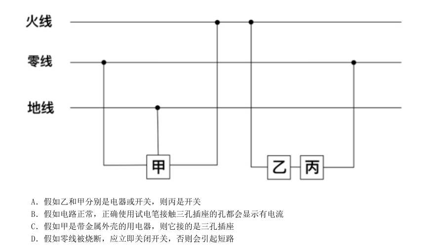

- **A.** 假如乙和甲分别是电器或开关,则丙是开关
- **B.** 假如电路正常,正确使用试电笔接触三孔插座的孔都会显示有电流
- **C.** 假如甲是带金属外壳的用电器,则它接的是三孔插座
- **D.** 假如零线被烧断,应立即关闭开关,否则会引起短路

**答案：C**

**解析/参考要点**：解析
A 项:根据家庭电路的特点,开关应接在用电器和火线之间,当开关断开时即可切断用电器与火线
的连接,防止触电事故的发生,故乙是开关,丙是用电器,错误;
B 项:在正常的电路中,使用试电笔接触火线时,试电笔中的氖管会发光,表示火线有电,使用试
电笔接触零线或地线,氖管均不发光,根据三孔插座“左零右火上接地”的接线方式可知,只有使用
试电笔接触三孔插座的右孔时氖管才会发光,显示此处有电流,接触左孔和上孔均无此现象,错误;
C 项: 图中甲的连接方式为左零右火上接地,并且带金属外壳的用电器也必须接地,以防漏电对人造
成伤害,故甲接的是三孔插座,正确;
D 项:零线被烧断,整个电路处于断路状态,不会引起短路,错误。
故正确答案为C。

### 【2021 广东省考（乡镇）·第 66 题】GD-2021-xz-X066　科学推理｜化学

下列词语所描述的场景中,涉及化学变化的是( )

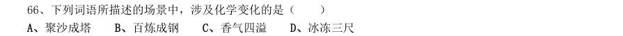

- **A.** 聚沙成塔
- **B.** 百炼成钢
- **C.** 香气四溢
- **D.** 冰冻三尺

**答案：该题答案缺失，见原卷**

### 【2021 广东省考（乡镇）·第 76 题】GD-2021-xz-X076　科学推理｜物理

下列现象与科学原理搭配正确的是( )。 ①白醋能除去水垢——水垢在白醋中溶解度较高 ②用稀硫酸除铜锈——铜锈与稀硫酸发生氧化还原反应 ③含氟牙膏能预防龋齿——氟化物作用于牙齿表面增强耐酸蚀能力

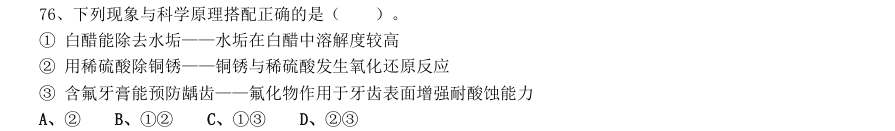

- **A.** ②
- **B.** ①②
- **C.** ①③
- **D.** ②③

**答案：该题答案缺失，见原卷**

### 【2021 广东省考（乡镇）·第 83 题】GD-2021-xz-X083　科学推理｜化学

常见的泡沫灭火器内有两个容器,外壳内装碳酸氢钠与泡沫灭火剂的混合溶液。另有一玻璃瓶内胆,装有硫 酸铝水溶液。如图所示,正常情况(图I)下。两种溶液互不接触。当需要使用泡沫灭火器时把灭火器倒立(图 II),两种溶液发生化学反应 ,打开灭火器 开关时,泡沫从灭火器中喷出,覆盖在燃烧物品上。则下列说法正确的是( )。

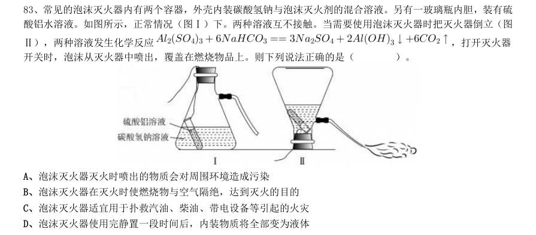

- **A.** 泡沫灭火器灭火时喷出的物质会对周围环境造成污染
- **B.** 泡沫灭火器在灭火时使燃烧物与空气隔绝,达到灭火的目的
- **C.** 泡沫灭火器适宜用于扑救汽油、柴油、带电设备等引起的火灾
- **D.** 泡沫灭火器使用完静置一段时间后,内装物质将全部变为液体

**答案：该题答案缺失，见原卷**

### 【2020 广东省考（乡镇）·第 79 题】GD-2020-xz-X079　科学推理｜物理

如图所示是某仓库报警器的电路示意图,热传感器R1 安装在仓库内部,监控机A 和报警电铃安装在监控室 内。热传感器R1 的阻值会随着温度的升高而减小,当仓库发生火情时,下列说正确的是( )

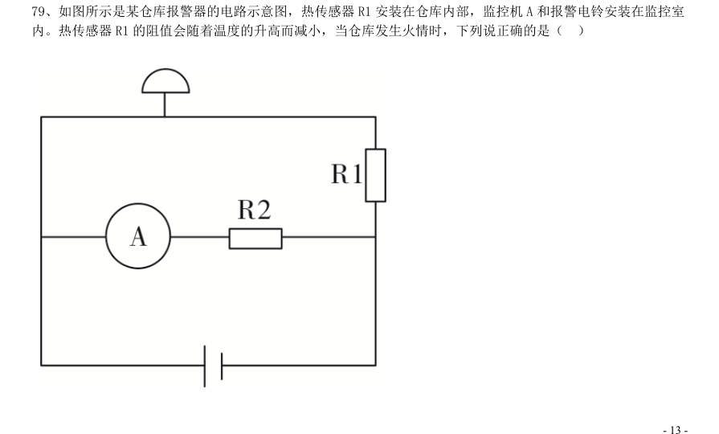

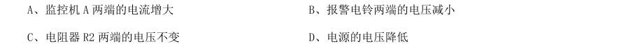

- **A.** 监控机A 两端的电流增大
- **B.** 报警电铃两端的电压减小
- **C.** 电阻器R2 两端的电压不变
- **D.** 电源的电压降低

**答案：该题答案缺失，见原卷**

### 【2019 广东省考（乡镇）·第 48 题】GD-2019-xz-X048　科学推理｜物理

下图是具有起钉功能的锤子,要使锤子起钉时更省力,最科学的做法是( )。

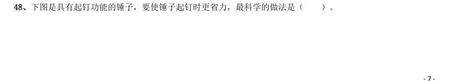

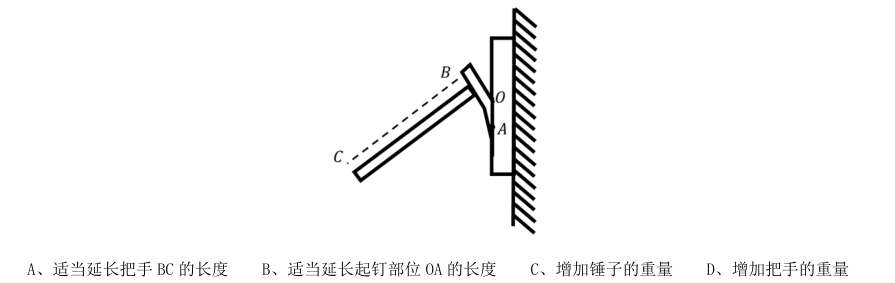

- **A.** 适当延长把手BC 的长度
- **B.** 适当延长起钉部位OA 的长度
- **C.** 增加锤子的重量
- **D.** 增加把手的重量

**答案：该题答案缺失，见原卷**

### 【2019 广东省考（乡镇）·第 56 题】GD-2019-xz-X056　科学推理｜生物

细胞膜能够防止细胞外物质自由进入细胞,保证细胞内环境的相对稳定。这是因为( )。

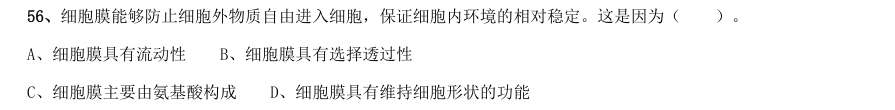

- **A.** 细胞膜具有流动性
- **B.** 细胞膜具有选择透过性
- **C.** 细胞膜主要由氨基酸构成
- **D.** 细胞膜具有维持细胞形状的功能

**答案：该题答案缺失，见原卷**

### 【2017 广东省考·第 66 题】GD-2017-ty-X066　科学推理｜物理

为节约用电,有生产商为楼道照明开发出“光控开关”和“声控开关”。“光控开关”在天黑时自动闭 合,天亮时自动断开;“声控开关”在有人走动发出声音时自动闭合,无人走动时自动断开。若将这两种开 关配合使用,就可以使楼道照明变得更加节能。为达到这个目的,楼道照明的电路安装简图是:

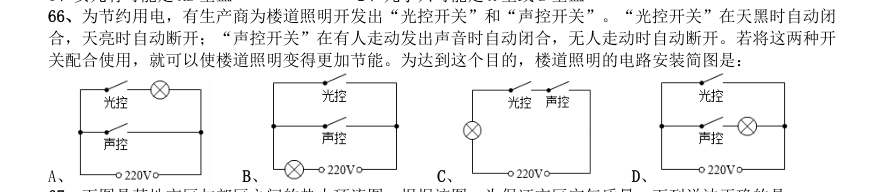

> （本题为图形题，选项为图片，见原卷）

**答案：该题答案缺失，见原卷**

### 【2016 广东省考（乡镇）·第 64 题】GD-2016-xz-X064　科学推理｜物理

用一个开关控制办公室里的两盏灯,最合理的电路图是( )。

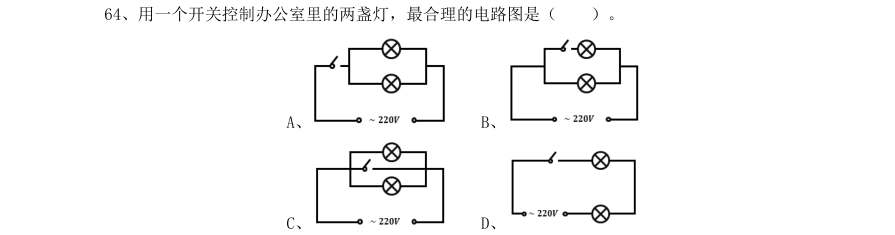

> （本题为图形题，选项为图片，见原卷）

**答案：该题答案缺失，见原卷**

### 【2016 国考（副省级）·第 105 题】GK-2016-fs-X105　科学推理｜物理

重力 对于 ( ) 相当于 ( ) 对于 昼夜交替

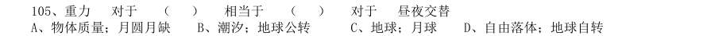

- **A.** 物体质量;月圆月缺
- **B.** 潮汐;地球公转
- **C.** 地球;月球
- **D.** 自由落体;地球自转

**答案：D**

**解析/参考要点**：逐一代入验证选项
A 选项:“重力”是引起物体有质量的必然原因,但“月圆月缺”与“昼夜交替”没有关系,“月圆月缺”
是由地球月亮太阳的位置决定的,而“昼夜交替”是因为地球自转引起的,所以A 错误;
B 选项:潮汐是由于月球引力导致的,地球公转不是引起昼夜交替的原因,B 错误;
C 选项:重力是地球产生的属性,但月球与昼夜交替无关,C 错误;
D 选项:重力是引起物体自由落体的必然原因,地球自转也是引起昼夜交替的必然原因,D 为正确答案。
故正确答案为D。

### 【2016 国考（地市级）·第 99 题】GK-2016-ds-X099　科学推理｜物理

重力 对于 ( ) 相当于 ( ) 对于 昼夜交替

- **A.** 物体质量;月圆月缺
- **B.** 潮汐;地球公转
- **C.** 地球;月球
- **D.** 自由落体;地球自转

**答案：D**

**解析/参考要点**：逐一代入验证选项
A 选项:“重力”是引起物体有质量的必然原因,但“月圆月缺”与“昼夜交替”没有关系,“月圆月缺”是由
地球月亮太阳的位置决定的,而“昼夜交替”是因为地球自转引起的,所以A 错误;
B 选项:潮汐是由于月球引力导致的,地球公转不是引起昼夜交替的原因,B 错误;
C 选项:重力是地球产生的属性,但月球与昼夜交替无关,C 错误;
D 选项:重力是引起物体自由落体的必然原因,地球自转也是引起昼夜交替的必然原因,D 为正确答案。
故正确答案为D。

### 【2015 广东省考（县级）·第 69 题】GD-2015-xj-X069　科学推理｜物理

在下图所示的电路中,电源电压保持不变,闭合开关 、 后,电路正常工作。开关 闭合,开关 由闭合到断开时,下列说法正确的是:

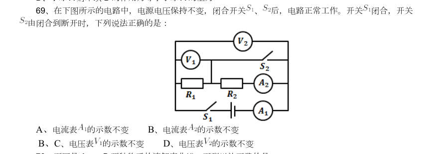

- **A.** 电流表的示数不变
- **B.** 电流表的示数不变的示数不变
- **D.** 电压表的示数不变

**答案：该题答案缺失，见原卷**

## 三、其余真题（按年代分片）

| 年代 | 题量 | 分片文件 |
|---|---:|---|
| 2000s | 3 | [PD-KX-2000s.md](split/PD-KX-2000s.md) |
| 2010s | 1 | [PD-KX-2010s.md](split/PD-KX-2010s.md) |

> 也可用 `python scripts/search.py --kaodian PD-KX` 直接检索全部 16 题。