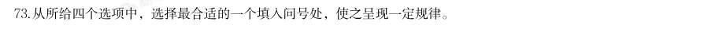
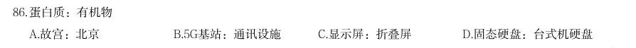
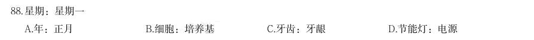
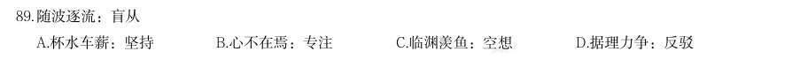
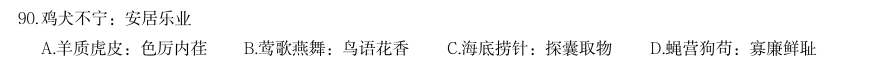
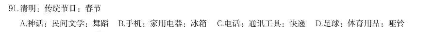
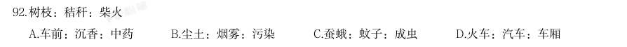
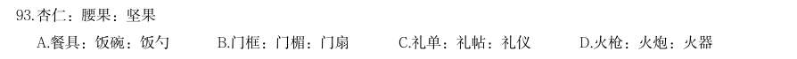
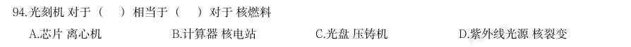
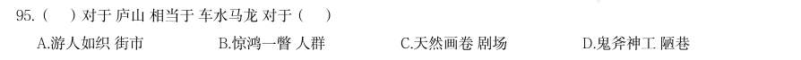

# 判断推理 · 类比推理

> 考点编码：`PD-LB`　｜　体系对齐：花生十三 `panduan-tuili.md#三`

## 一、命题规律

- **本题型真题总量**：702 题（2006–2026）
- **地区分布**：国考 319 / 广东 231 / 湖北 152
- **近六年题量**：2026年26题, 2025年26题, 2024年40题, 2023年18题, 2022年42题, 2021年25题
- **覆盖试卷**：77 套
- **子考点分布**：类比推理（综合） 290　逻辑关系 191　对应关系 127　语义关系 91　程度与词性 3　语法关系 2
- **同题变体**：另有 2 道为同题重复（同年多卷/跨年再考），已折叠，需展开见 scripts/search.py --all-variants

## 二、近年真题（最多 12 题，按年份倒序）

### 2026 湖北·统一卷　第 71 题　（逻辑关系）
> 材料：个最恰当的答案。 从所给的四个选项中,选择最合适的一个填入问号处,使之呈现一定的规律性。…

· 本试卷由粉笔用户上岸张同学66生成

- **A.** A
- **B.** B
- **C.** C
- **D.** D

**答案：B**

**解析/参考要点**：B
元素组成不同,且无明显属性规律,考虑数量规律。观察发现,题干图形出现明
显封闭区域,优先考虑数面。题干图形的面数量依次为10、9、8、?、6、5,
故“?”处图形的面数量应为7,只有B 项符合。
故正确答案为B。

### 2026 湖北·统一卷　第 73 题　（逻辑关系）
> 材料：从所给四个选项中,选择最合适的一个填入问号处,使之呈现一定规律。…

· 本试卷由粉笔用户上岸张同学66生成

- **A.** A
- **B.** B
- **C.** C
- **D.** D

**答案：A**

**解析/参考要点**：A
元素组成不同,且无明显属性规律,考虑数量规律。观察发现,题干图形线条交
叉明显,优先考虑交点数。第一行图形的交点数依次为1、2、3,第二行图形的
交点数依次为4、5、6,第三行图形的交点数依次为7、8、?,故?处应为9
个交点的图形,只有A 项符合。
故正确答案为A。

### 2026 湖北·统一卷　第 86 题　（逻辑关系）

蛋白质:有机物

- **A.** 故宫:北京
- **B.** 5G基站:通讯设施
- **C.** 显示屏:折叠屏
- **D.** 固态硬盘:台式机硬盘

**答案：B**

**解析/参考要点**：B
第一步:判断题干词语间逻辑关系。
蛋白质是有机物,二者为种属关系。
第二步:判断选项词语间逻辑关系。
A 项:故宫在北京,二者为地点对应关系,与题干逻辑关系不一致,排除;
B 项:5G 基站是通讯设施,二者为种属关系,与题干逻辑关系一致,当选;
C 项:折叠屏是显示屏,二者为种属关系,但顺序与题干相反,与题干逻辑关系
不一致,排除;
D 项:有的固态硬盘是台式机硬盘,有的固态硬盘不是台式机硬盘,有的台式机
硬盘是固态硬盘,有的台式机硬盘不是固态硬盘,二者为交叉关系,与题干逻辑
关系不一致,排除。
故正确答案为B。

### 2026 湖北·统一卷　第 87 题　（逻辑关系）

· 本试卷由粉笔用户上岸张同学66生成 寓意:寓言

- **A.** 序言:正文
- **B.** 情节:童话
- **C.** 报告文学:新闻
- **D.** 著作:诗集

**答案：B**

**解析/参考要点**：B
第一步:判断题干词语间逻辑关系。
寓言是用假托的故事或自然物的拟人手法来说明某个道理或教训的文学作品,寓
意是寓言所包含的核心内涵,二者是组成关系。
第二步:判断选项词语间逻辑关系。
A 项:序言和正文是同一篇作品里的两个组成部分,二者是并列关系,与题干逻
辑关系不一致,排除;
B 项:童话是通过丰富的想象、幻想和夸张来编写的适合于儿童欣赏的故事,情
节是童话的核心组成部分,二者是组成关系,与题干逻辑关系一致,当选;
C 项:报告文学是一种散文体裁,以现实生活中具有典型意义的真人真事为题材,
经过适当的艺术加工而成,兼有新闻报道特点,报告文学和新闻不是组成关系,
与题干逻辑关系不一致,排除;
D 项:所有诗集都是著作,二者是种属关系,与题干逻辑关系不一致,排除。
故正确答案为B。

### 2026 湖北·统一卷　第 88 题　（逻辑关系）

星期:星期一

- **A.** 年:正月
- **B.** 细胞:培养基
- **C.** 牙齿:牙龈
- **D.** 节能灯:电源

**答案：A**

**解析/参考要点**：A
第一步:判断题干词语间逻辑关系。
星期包含星期一,星期一是星期中的其中一天,二者为组成关系。
第二步:判断选项词语间逻辑关系。
A 项:年包含正月,正月是农历一年中的第一个月,二者为组成关系,与题干逻
辑关系一致,当选;
B 项:细胞在培养基中培养,二者为对应关系,与题干逻辑关系不一致,排除;
C 项:牙齿和牙龈是口腔内不同的结构,二者为并列关系,与题干逻辑关系不一
致,排除;
D 项:节能灯工作需要电源供电,二者为条件对应关系,与题干逻辑关系不一致,
排除。
故正确答案为A。

### 2026 湖北·统一卷　第 89 题　（语义关系）

随波逐流:盲从

- **A.** 杯水车薪:坚持
- **B.** 心不在焉:专注
- **C.** 临渊羡鱼:空想
- **D.** 据理力争:反驳

**答案：C**

**解析/参考要点**：C
第一步:判断题干词语间逻辑关系。
“随波逐流”意思是随着波浪起伏,跟着流水漂荡,比喻没有坚定的立场和主见,
随大流;“盲从”意思是盲目地附和、随从别人,二者为近义关系。
第二步:判断选项词语间逻辑关系。
A 项:“杯水车薪”意思是用一杯水去救一车着了火的柴草,比喻力量太小或东
西太少,无济于事,与“坚持”不是近义关系,与题干逻辑关系不一致,排除;
B 项:“心不在焉”意思是心思不在这里,思想不集中;“专注”指专心注意,
二者是反义关系,与题干逻辑关系不一致,排除;
C 项:“临渊羡鱼”意思是面对着深渊,希望得到鱼,比喻仅有空想而无实际行
动,与“空想”是近义关系,与题干逻辑关系一致,当选;
D 项:“据理力争”意思是依据道理,竭力维护自己方面的权益、观点等;“反
驳”指说出自己的理由来否定别人不同的意见,二者不是近义关系,与题干逻辑
关系不一致,排除。
故正确答案为C。

### 2026 湖北·统一卷　第 90 题　（语义关系）

鸡犬不宁:安居乐业

- **A.** 羊质虎皮:色厉内荏
- **B.** 莺歌燕舞:鸟语花香
- **C.** 海底捞针:探囊取物
- **D.** 蝇营狗苟:寡廉鲜耻

**答案：C**

**解析/参考要点**：C
第一步:判断题干词语间逻辑关系。
“鸡犬不宁”意思是连鸡狗都不得安宁,形容搅扰得很厉害,“安居乐业”意思
是安定地生活,愉快地工作,二者为反义关系。
第二步:判断选项词语间逻辑关系。
A 项:“羊质虎皮”意思是羊虽然披上虎皮,但怯弱的本性不变,比喻外强内弱,
虚有其表,“色厉内荏”意思是外表强横,内心怯懦,形容外表凶恶强横,实际
上内心虚弱怯懦,二者为近义关系,与题干逻辑关系不一致,排除;
B 项:“莺歌燕舞”意思是黄莺歌唱,燕子飞舞,形容大好春光或大好形势,“鸟
语花香”意思是鸟儿叫,花儿飘香,多形容春天魅人的景象,二者为近义关系,
与题干逻辑关系不一致,排除;
C 项:“海底捞针”比喻极难找到,“探囊取物”意思是伸手到袋子里取东西,
比喻能够轻而易举地办成某件事情,二者为反义关系,与题干逻辑关系一致,当
选;
D 项:“蝇营狗苟”意思是像苍蝇那样飞来飞去,像狗那样苟且偷生,形容人不
顾廉耻,到处钻营,“寡廉鲜耻”意思是不廉洁,不知羞耻,二者为近义关系,
与题干逻辑关系不一致,排除。
故正确答案为C。

### 2026 湖北·统一卷　第 91 题　（逻辑关系）

清明:传统节日:春节

- **A.** 神话:民间文学:舞蹈
- **B.** 手机:家用电器:冰箱
- **C.** 电话:通讯工具:快递
- **D.** 足球:体育用品:哑铃

**答案：D**

**解析/参考要点**：D
第一步:判断题干词语间逻辑关系。
清明和春节都是传统节日,二者为并列关系中的反对关系,且均与第二个词构成
包容关系中的种属关系。
第二步:判断选项词语间逻辑关系。
A 项:舞蹈不是民间文学,后两词不构成种属关系,与题干逻辑关系不一致,排
除;
B 项:手机不是家用电器,前两词不构成种属关系,与题干逻辑关系不一致,排
除;
C 项:快递不是通讯工具,后两词不构成种属关系,与题干逻辑关系不一致,排
除;
D 项:足球和哑铃都是体育用品,二者为反对关系,且均与第二个词构成种属关
系,与题干逻辑关系一致,当选。
故正确答案为D。

### 2026 湖北·统一卷　第 92 题　（逻辑关系）

树枝:秸秆:柴火

- **A.** 车前:沉香:中药
- **B.** 尘土:烟雾:污染
- **C.** 蚕蛾:蚊子:成虫
- **D.** 火车:汽车:车厢

**答案：A**

**解析/参考要点**：A
第一步:判断题干词语间逻辑关系。
树枝和秸秆都是柴火,前两词为并列关系,均与第三词构成种属关系,且树枝、
秸秆均为植物类。
第二步:判断选项词语间逻辑关系。
A 项:车前和沉香都是中药,前两词为并列关系,均与第三词构成种属关系,且
车前、沉香均为植物类,与题干逻辑关系一致,当选;
B 项:尘土和烟雾都是污染物,会导致污染,前两词为并列关系,均与第三词构
成因果对应关系,与题干逻辑关系不一致,排除;
C 项:蚕和蚊子是完全变态昆虫,完全变态昆虫的发育需要经历卵、幼虫、蛹、
成虫四个时期,蚕蛾和蚊子均是成虫,前两词为并列关系,均与第三词构成种属
关系,但蚕和蚊子均为动物类,与题干逻辑关系不一致,排除;
D 项:火车和汽车都是交通工具,二者为并列关系,车厢为火车和汽车的组成部
分,前两词均与第三词构成组成关系,与题干逻辑关系不一致,排除。
故正确答案为A。

### 2026 湖北·统一卷　第 93 题　（逻辑关系）

杏仁:腰果:坚果

- **A.** 餐具:饭碗:饭勺
- **B.** 门框:门楣:门扇
- **C.** 礼单:礼帖:礼仪
- **D.** 火枪:火炮:火器

**答案：D**

**解析/参考要点**：D
第一步:判断题干词语间逻辑关系。
杏仁和腰果都是坚果,二者为并列关系中的反对关系,均与第三个词语构成包容
关系中的种属关系。
第二步:判断选项词语间逻辑关系。
A 项:饭碗和饭勺都是餐具,二者为反对关系,均与第一个词语构成种属关系,
词语顺序不同,与题干逻辑关系不一致,排除;
B 项:门楣是门框上部的横梁结构,二者为包容关系中的组成关系,与题干逻辑
关系不一致,排除;
C 项:礼单和礼帖都是传统礼仪文书,二者为反对关系,但礼单和礼帖均是礼仪
的体现,与第三个词语构成对应关系,与题干逻辑关系不一致,排除;
D 项:火枪和火炮都是火器,二者为反对关系,均与第三个词语构成种属关系,
与题干逻辑关系一致,当选。
故正确答案为D。

### 2026 湖北·统一卷　第 94 题　（逻辑关系）

光刻机 对于 ( ) 相当于 ( ) 对于 核燃料

- **A.** 芯片 离心机
- **B.** 计算器 核电站
- **C.** 光盘 压铸机
- **D.** 紫外线光源 核裂变

**答案：A**

**解析/参考要点**：A
逐一代入选项。
A 项:光刻机是生产芯片的设备,二者为生产设备与产品的对应关系;离心机是
生产核燃料的设备,二者为生产设备与产品的对应关系,前后逻辑关系一致,当
选;
B 项:光刻机是生产计算器中的芯片的设备,二者对应关系;核燃料是核电站的
能量来源,二者为能量来源的对应关系,前后逻辑关系不一致,排除;
C 项:光刻机是生产芯片的设备,光盘是一种利用激光扫描记录和读取信息的光
学存储介质,二者没有明显逻辑关系;压铸机是用于压力铸造的机器,核燃料是
可在核反应堆中通过核裂变或核聚变释放核能的材料,二者没有明显逻辑关系,
前后逻辑关系不一致,排除;
D 项:紫外线光源是光刻机的组成部分,二者为组成关系;核裂变是核燃料释放
能量的方式,二者为对应关系,前后逻辑关系不一致,排除。
故正确答案为A。

### 2026 湖北·统一卷　第 95 题　（对应关系）

( )对于 庐山 相当于 车水马龙 对于( )

- **A.** 游人如织 街市
- **B.** 惊鸿一瞥 人群
- **C.** 天然画卷 剧场
- **D.** 鬼斧神工 陋巷

**答案：A**

**解析/参考要点**：A
逐一代入选项。
A 项:游人如织形容游人多得像织布的线一样,密密麻麻,可以用来形容庐山的
景象,二者为特点与描述对象的对应关系;车水马龙指车如流水,马如游龙一般,
形容热闹繁华的景象,可以用来形容街市,二者为特点与描述对象的对应关系,
前后逻辑关系一致,当选;
B 项:惊鸿一瞥指人只是匆匆看了一眼,却给人留下极深的印象,与庐山无明显
逻辑关系;车水马龙指车如流水,马如游龙一般,形容热闹繁华的景象,不能用
来形容人群,前后逻辑关系不一致,排除;
C 项:天然画卷指自然形成的、未经人工加工修饰的美丽景观,可以用来形容庐
山的景象;车水马龙指车如流水,马如游龙一般,形容热闹繁华的景象,不能用
来形容剧场,前后逻辑关系不一致,排除;
D 项:鬼斧神工原意是像鬼神制作出来的,形容艺术技巧高超,不像是人力所能
达到的,可以用来形容庐山的景象;车水马龙指车如流水,马如游龙一般,形容
热闹繁华的景象,不能用来形容陋巷,前后逻辑关系不一致,排除。
故正确答案为A。

## 三、其余真题（按年代分片）

| 年代 | 题量 | 分片文件 |
|---|---:|---|
| 2000s | 95 | [PD-LB-2000s.md](split/PD-LB-2000s.md) |
| 2010s | 388 | [PD-LB-2010s.md](split/PD-LB-2010s.md) |
| 2020s | 207 | [PD-LB-2020s.md](split/PD-LB-2020s.md) |

> 也可用 `python scripts/search.py --kaodian PD-LB` 直接检索全部 702 题。